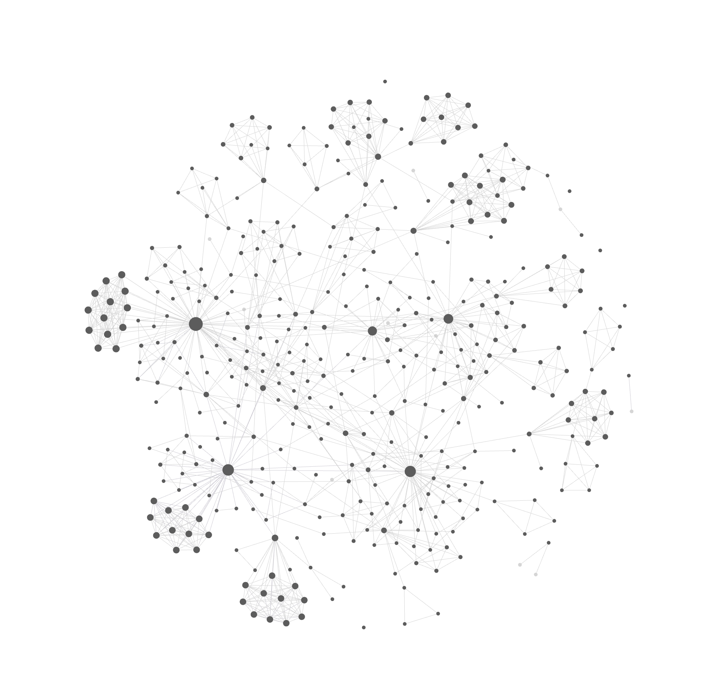

# Engram

> ⚠️ **Breaking change.** The pre-vault TOML memory-record storage layer
> (`~/.local/share/engram/memory/`) was removed. Engram now writes only
> to an agent-memory Obsidian vault. Migration from the
> old layout is not automated. An LLM should be able to migrate easily.

## Overview

Engram gives Claude Code and Pi agents persistent memory via a zettelkasten-style vault. All six skills — `recall`, `learn`, `please`, `route`, `curate`, and `write-memory` — ship as `SKILL.md` installed by `engram update`. Each skill may additionally carry a companion `skill-claude-<name>` vault runbook note (key `claude:<name>`) offered by `engram update`/`engram register-skills` and curated like any other pending offer. Registration also offers runbook notes for every other skill, command and Pi prompt template the harnesses load by default: user, synced, plugin, Pi-configured, and project-local sources, namespaced by source (e.g. `skill-superpowers-brainstorming`, `skill-project-github-com-toejough-engram-cmd-opsx-apply`). `please` orchestrates end-to-end work by sequencing recall, learn, and other skills around a user's `<ask>` (matched by the literal triggers `/please`, `take this end-to-end`, `please`), `route` encodes the delegate-everything doctrine `please` draws on to staff its subagents, `curate` judges `engram serve`'s pending-offer notes against the host vault (matched by the literal triggers `curate`, `/curate`, `pending offers`, `pending offer`), and `write-memory` executes the vault-write commands `recall`/`learn` invoke natively at their write sites (parents judge, the worker writes). The `please` and `route` skills are pure meta-orchestration.

`engram update` installs the skills into Claude Code and Pi, and the vault is harness-agnostic — so `recall` and `learn` work the same on each. Automatic sweeping of raw session transcripts into the chunk index reads Claude Code JSONL and Pi session files.

After a few months of use, the vault's wikilink graph looks like this in Obsidian — each dot is a note, each line a `[[wikilink]]`; dense clusters are groups of related notes, and the connective tissue reflects thematic proximity:



*Screenshot pre-dates the 2026-07-10 vocab→tags migration (#678): the ~25 vocab term-note hubs visible here no longer exist — vocab membership now rides `tags: [vocab/<term>]`, not wikilinks, so a fresh graph view no longer shows these hubs.*

## Installing

Requires Go 1.25+, `git` and `git-lfs` on `PATH`: `engram update` builds the binary from the engram checkout it runs in, or from a fresh clone when there is none, and refuses a clone whose embedded model is a git-lfs pointer.

1. Install the binary:

   ```bash
   go install github.com/toejough/engram/cmd/engram@latest
   ```

   Make sure `$GOBIN` (or `$GOPATH/bin`, default `~/go/bin`) is on your `PATH`. This proxy-built binary is only a bootstrap: its embedded model is a git-lfs pointer (#645), and step 2 replaces it with a build from a clone.

2. Deploy the skills to every detected harness (Claude Code, Pi):

   ```bash
   engram update                 # install / refresh
   engram update --with-guidance # also sync guidance docs (recall.md, delegate.md, learn.md, shim.md) to engram-owned roots; --with-guidance is a one-time opt-in: once any guidance file is imported, plain `engram update` keeps all of them current
   engram update --dry-run       # show what would change, without writing
   engram update --allow-downgrade # override the local-mode refusal to install an older revision than what's installed
   ```

   `engram update` syncs engram artifacts to engram-owned roots per harness (`~/.claude/engram/`, `~/.pi/agent/engram/`) and materializes them as symlinks in each harness's discovery paths (`~/.claude/skills/`, `~/.pi/agent/skills/`, etc.). Removals from the source propagate on every update. First update performs a dark migration of pre-existing copies to symlinks. Run it again any time to upgrade — it also reinstalls the binary via `go install`, then re-execs the fresh binary so the sync itself runs with the new logic ([792a11e The rest of the update runs in the new binary](docs/specs/product/install-and-update.md#792a11e-the-rest-of-the-update-runs-in-the-new-binary)). `--with-guidance` additionally syncs guidance docs to the root's `guidance/` subtree (canonical paths) and materializes symlinks; compat symlinks at flat paths (`~/.claude/engram/*.md`) keep existing `@import` lines in CLAUDE.md and AGENTS.md resolving (Claude Code + Pi; opt-in). It's a **one-time opt-in per file** — once your CLAUDE.md (or AGENTS.md) imports a guidance file, plain `engram update` keeps it current. Until then, plain `engram update` prints a one-line hint. See [install-and-update](docs/specs/product/install-and-update.md) for the deployment-as-sync behavior.

   On Claude Code, `engram update` also turns on automatic memory, the `engram-memory` mod: from the next session on, each prompt arrives with the vault notes that bear on it, with nothing else to run. `engram update --dry-run` lists it without installing it, and Pi is not given it.

## Skills

| Skill | What it does |
|-------|--------------|
| `recall` | Surfaces relevant notes and raw chunks via a single `engram query` call: a clustered **relevance** channel (recency-biased per-phrase cosine over notes+chunks → bounded matched set → one unified chunk+note clustering that builds `candidate_l2s` from within-cluster top-5 only) plus an **explore** channel (notes sampled from vocab-term centroids by proximity to the query, budgeted to the matched-note count, delivered as top-level items tagged `provenance: explore`) plus an un-clustered **recency** channel (the newest chunks, tagged `recent`). For each cluster (and the explore items) it judges coverage inline (covered/near/absent) and crystallizes via `engram amend` (update an existing note) or a handoff to the `write-memory` skill (create one) in its default `deep` mode (a `glance` pass is read-only), activates only the notes it actually used, then reports whether the surfaced memory changed the agent's plan. |
| `learn` | Captures the session's explicit lessons — corrections, explicit save-requests, self-discovered reversals, and confirmed approaches (positive reinforcement, user-praised or self-validated) — as permanent vault notes via `write-memory` handoffs. Along the way it mechanically sweeps every conversation and doc into the searchable chunk index (`engram ingest --auto`) and checks vocab liveness (`engram vocab stats`, auto-refitting when due), so raw event memory stays current even when no explicit lesson exists. |

See `agent-instructions/skills/{recall,learn,please,route,curate,write-memory}/SKILL.md` for the full skill definitions.

All six ship with a `SKILL.md` (see [skill-runbook-registration](docs/specs/product/skill-runbook-registration.md) for the mechanism). `please` drives an ask end-to-end through a fixed seven-step workflow (capture, orient, plan, execute (TDD), document, complete, capture), tracked on the task list, with four adversarial review gates dispatching fresh per-angle reviewer subagents over the plan, each refactor, touched docs, and outward prose, plus a step-7 lessons audit; it is one skill and runbook note (its former three sub-runbooks merged into the single note/skill body), triggered by `/please <ask>` and the literal phrases `take this end-to-end` and `please`. `route` guides subagent selection (agent type, model, effort): easy work goes to a cheap model, complex work is decomposed before dispatch, and every dispatched subagent recalls first; `please` consults it when staffing gate reviewers. `curate` judges pending-offer notes (a child's served `learn`, a note pulled down from the parent) against the host vault using the same covered/near/absent reasoning `recall` documents, authors the runbook fields of pending skill notes instead of judging them, and composes and executes `engram amend` directly (an offer's content already exists as a note file, so it does not hand off to `write-memory`); it runs host-local only and is triggered by the literal words `curate`, `/curate`, `pending offers`, and `pending offer`. `write-memory` is invoked natively as a skill by `recall`/`learn` at their write sites, not reached via basename/wikilink.

## Vault location

Engram reads and writes a zettelkasten vault. Resolution order:

1. `--vault <path>` flag
2. `ENGRAM_VAULT_PATH` environment variable
3. `$XDG_DATA_HOME/engram/vault` (fallback: `~/.local/share/engram/vault`)

Every vault-resolving command (not only `engram learn`) creates a missing vault on
first use: the directory is bootstrapped with a minimal `.obsidian/` config so
Obsidian recognizes it, a `.gitignore`, a starter `README.md`, a `.engram/` state
directory and a vault ID, and one stderr line (`engram: created new vault at <path>`)
announces it so a mistyped `--vault` path is visible. An existing vault is left
untouched by read-only use. See
[792a2f Existing vaults are left alone](docs/specs/product/vault-identity.md#792a2f-existing-vaults-are-left-alone).

Vault layout (flat since the 2026-06-12 flat-vault migration — notes live at the
vault root; the `Permanent/` and `MOCs/` subdirectories are retired and ignored
by the scanner):

```
<vault>/
  <luhmann-id>.<YYYY-MM-DD>.<slug>.md   atomic notes at the root
  <luhmann-id>.<YYYY-MM-DD>.<slug>.vec.json   sibling embedding sidecar
```

## Binary commands

```
engram learn feedback --slug ... --source ... --situation ... --behavior ... --impact ... --action ... [--tag <family>[/<value>] ...] [--project <slug>] [--issue <id>]
engram learn fact     --slug ... --source ... --situation ... --subject ... --predicate ... --object ... [--tag <family>[/<value>] ...] [--project <slug>] [--issue <id>]
engram learn qa       --slug ... --source ... [--question <text>] [--answer <text>|--answer-file <path>] [--contributors <basename>...] [--certainty high|medium|low]   Write a QA pair (Q+A notes) to the vault. --slug and --source required; --answer and --answer-file are mutually exclusive; --contributors repeatable, validated against the vault; --certainty defaults to medium.
engram learn runbook  --slug ... --source ... --situation ... --done-when ... [--body <numbered steps>] [--red-flag <text> ...] [--trigger <text> ...] [--tag <family>[/<value>] ...] [--project <slug>] [--issue <id>]   Write a runbook note. `--trigger` (repeatable, each ≥ 3 chars) declares literal cues — a slash form or multi-word phrase, never a lone common word — that surface the runbook first when they appear in `engram query --text`; `engram amend --trigger` replaces the list.
engram embed apply [--all|--missing|--stale|--force|--dry-run]   (Re-)embed notes per selection (default: missing)
engram embed status                    Report counts per state (total / with-embeddings / without / stale / incompatible / broken)
engram query --phrase <p> [--phrase <p>...] [--text <user message>] [--limit N] [--project <slug>] [--chunks-dir <dir>] [--content-budget N] [--recent-fill N] [--lazy-chunks]   Semantic search over vault notes + chunk index; YAML output. `--limit` (default 20) caps the returned `items[]` count — a real, enforced cap, not report-only metadata — except runbook trigger hits, which do not count against it. (A runbook can only be a trigger hit if it has a compatible embedding sidecar.) `--text` takes the user's message verbatim (never embedded; at least one of `--phrase`/`--text` is required): a runbook whose `triggers:` list has an entry appearing in it (case-insensitive whole-word match, whitespace collapsed: `curate` hits "curate!" and "/curate" but not "accurate") is a trigger hit and leads `items[]` with provenance `trigger`, regardless of similarity. With `ENGRAM_PARENT` set, merges local + parent results into one payload — see [Parent sync](#parent-sync-engram_parent). Recency-weights chunks AND notes. Builds a bounded matched set (per-phrase top-30, union/dedup, relevance floor 0.25, cap ~300), clusters it in one pass (AutoK k-means), emits `candidate_l2s: [{path, cosine, content}]` per cluster — within-cluster top-5 notes only — plus superseded-note ride-alongs at the next rank. Separately samples an **explore** half from vocab-term centroids by proximity to the query (softmax allocation, budgeted to the matched-note count, δ=0.05 match-evidence bonus for terms with an exploit-half member, core-first within-term selection, dedupe+backfill), delivered as top-level `items[]` entries (`provenance: explore`, `source_term`; budget reported in `explore_allocated`, a term → delivered-count map, always present — `{}` on missing/unreadable centroid data). Appends the newest chunks un-clustered (tagged `recent`; default 25, controlled by `--recent-fill`). `--content-budget` caps how many chunk items render with full content (default 15; later chunks get a snippet). `--lazy-chunks` renders matched chunk items path/score only — the agent fetches evidence on demand via `engram show-chunk`. Activation is agent-driven — the binary emits no `activated` flag. --project restricts items to notes whose frontmatter `project:` matches.
engram query-chunks --phrase <p> [--phrase <p>...] [--limit N] [--chunks-dir <dir>]   Semantic search over the chunk index only (YAML output). Scores chunks by max cosine across phrases; clusters results with AutoK k-means. No vault notes, no recency channel — chunk-space search only.
engram resituate --note <ref> --situation <text>   Rewrite a note's situation field in sync: frontmatter, body opener, and sidecar situation_vector (D4/INV-S2). Both flags required; no --dry-run.
engram check   Run vault-invariant checks (G0 and G3 links, M5 situation, S1 sidecars); a PASS/WARN/FAIL line each, exit non-zero only on FAIL
engram ingest [--auto]   Merge-append session transcripts + markdown into the per-source chunk index — re-chunks/re-embeds only changed content; within one source this is append-only (a re-chunk never drops a prior record). Across sources, byte-identical content is deduplicated by content hash: only one canonical copy per hash group is indexed, and a duplicate's index file is removed only once its retained twin's index file is verified to cover every one of its own records — never on hash-match alone. `--auto` sweeps all known sources, skips session-log directories whose slugified project path starts with a non-persistent-workspace prefix (slugified forms of `/private/tmp`, `/tmp`, and macOS `$TMPDIR`), and additionally drops any resolved sweep root whose own path sits under `/tmp`, `/private/tmp`, `/var/folders`, or `/private/var/folders` — preventing eval/test runs from bloating the main index. An ancestor `.claude` dir's sweep also now excludes its `jobs/` subdirectory (agent-harness scratch, including whole snapshot copies of the vault) — matching the exclude the `.pi` ancestor sweep already had; `.claude/jobs` was previously swept and indexed. Configurable via `.engram/sweep.json` (`non_persistent_prefixes` / `non_persistent_path_prefixes` keys); bypassed by explicit `--sweep`/`--transcript`/`--markdown`/`--pi-sessions` or an isolated index via `ENGRAM_CHUNKS_DIR`. Used by /learn and /recall.
engram prune [--empty [--dry-run]] [--duplicates [--dry-run]]   Detach chunk index entries whose source file no longer exists (GC). Operator-run; reads the manifest and drops the stale per-source manifest entry, keeping the embedded chunks on disk (still searchable). `--empty` instead removes existing 0-byte `.jsonl` chunk-index files left by zero-record sources (ranking-neutral — empties hold zero records); `--duplicates` retroactively collapses every exact-content-hash group down to one canonical member, removing the rest's index files + manifest entries — safe by construction (a duplicate is removed only once its retained twin's index file is verified to cover its records; otherwise refused, not removed) and convergent (a second run removes nothing); `--dry-run` previews the count without deleting or removing. Not part of the recall/learn flows.
engram count [--group-by <attr> [--filter <attr=value>...]] [--backlinks-of <basename>]   Read-only vault aggregation, off the query/similarity path. `--group-by` counts distinct note membership per frontmatter attribute value (list attrs count one per distinct element; a value listed twice in one note still counts once), optionally restricted by repeatable AND-ed `--filter attr=value` predicates (scalar equality or list-contains); output is `value<TAB>count` lines sorted count-desc then value-asc, an `(attr absent): N` bucket when any in-set note lacks the attribute, then `total: N` (empty result prints nothing). `--backlinks-of <basename>` prints a vault-graph node's wikilink in-degree plus its sorted linkers. The two modes are mutually exclusive and each independently Obsidian-verifiable (group-by against a property/tag filter, backlinks-of against the backlinks panel) — they are NOT equal to each other: backlinks-of counts every linker (e.g. an index/MOC page) while group-by counts only frontmatter members, so the two diverge by the count of non-member linkers.
engram show <ref> [--parent]   Print a note (frontmatter + body) and its outbound wikilink targets, read-only. One required positional; no --ref flag. (candidate_l2s carry content inline, so /recall no longer shows candidates.) `--parent` resolves the ref against `ENGRAM_PARENT` instead of the local vault — errors if unset. On a local miss, with `--parent` not passed, `engram show` falls back to `ENGRAM_PARENT` automatically if configured, prefixing output with `# from_parent: true`; a local hit never contacts the parent, and with no `ENGRAM_PARENT` configured the same not-found error surfaces as before.
engram show-chunk <source#anchor> [--chunks-dir <dir>]   Print a chunk's text by its source#anchor id (read-only). Used by /recall with `--lazy-chunks` to fetch a specific chunk's evidence on demand. Local only — chunks never cross vaults, so there is no `--parent` flag and no parent fallback.
engram amend --target <ref> [--activate] [--clear-pending] [--supersedes "<basename>|<type>|<claim>"] [--chunk-source <source#anchor>...] [--situation/--subject/--predicate/--object | --behavior/--impact/--action | --done-when/--body ...] [--red-flag <text>...] [--trigger <text>...] [--discard [--into <existing>]] [--expect-hash <exchange hash>]   Amend a note in place: merge chunk-source provenance (idempotent), overwrite only supplied content fields, re-embed only on a content change; `--activate` bumps `LastUsed`; `--clear-pending` clears the pending-offer marker a served write or a pull-down set, accepting it as a normal live note; `--supersedes` writes typed supersession frontmatter + inverse + body line. `--discard` deletes the target note and its sidecar; with `--into <existing>` it folds the target's basename, aliases and parent links into `<existing>` first (curation's covered/near fold), instead of a bare delete. `--expect-hash` is required for `--clear-pending`, `--discard` and `--discard --into` on a note carrying `offer.origin`: the command fails without changing anything unless the note's current exchange hash equals the expected one (any hash that is not equal to the current one — including one from another hash version, which compares as unknown — fails), so a curator's judgment can never be silently overtaken by an in-place offer update. The /recall update path: covered link-enriches, near re-synthesizes content.
engram activate --note <ref> [--note <ref>...] [--parent]   Mark note(s) as recently used — bumps `LastUsed` in the sidecar so usefulness keeps useful notes fresh (called by /recall on only the notes the agent actually used). `--note` paths are vault-relative (resolved against the vault root / `ENGRAM_VAULT_PATH`); absolute paths are used as-is. On a local miss, a basename or `<basename>.md` ref is a parent candidate when `ENGRAM_PARENT` is set: it is fetched and written as a new local pending offer instead of failing (a bare Luhmann id never goes to the parent — ids are minted per vault). `--parent` forces parent resolution even when a local file of that name exists, and errors if `ENGRAM_PARENT` is unset; a path ref with `--parent` is refused as "not sent to the parent" rather than looked up locally. Either way, activating a parent note also bumps its use on the parent, best-effort (a failure there is not fatal). With `ENGRAM_PARENT` set, a local hit on a note linked to a parent note (a previously pulled or offered copy) also re-checks that parent note: when its exchange hash has changed since the link was recorded, and that version was not declined, the new version is pulled down as another local pending offer; an unchanged note, a declined version or an unreachable parent writes nothing and never fails the local activate. The re-check does not bump the parent note's use. A served `POST /activate` resolves refs only against the vault's note names and refuses an absolute path, a path separator or `..` with a 400.
engram vocab bootstrap --seed <yaml> [--floor <f>]     Seed vocab definition fact notes (bare `vocab` tag plus their own `vocab/<term>` self-tag per term — one family note stays bare-only) from the validated term set (--seed, required); embed them; tag all existing notes with `vocab/<term>` entries in the shared `tags:` list (no separate index file — the index is emergent via `engram count`). --floor sets the minimum cosine similarity for vocab assignment (default 0.35). Idempotent.
engram vocab tag-definitions [--vault <dir>]  Idempotent backfill: adds the missing `vocab/<term>` self-tag to every existing per-term definition note (skips the family note). Tags are not content-hash inputs so no re-embed occurs. `--vault` overrides the vault root.
engram vocab propose --term <t> --description <d>  LLM-gated: create a new vocab definition note if no existing term covers it and projected attachment ≤ 20% of vault (~$0.05/proposal). Both flags required.
engram vocab stats                     Per-term member counts, vault untagged-rate, hub terms (> 25% of vault), orphan terms (< 2 members), version staleness.
engram vocab refit [--dry-run] [--names <file>]  Derivational: derives the vocabulary from the vault's note embeddings; matches clusters to existing terms, retires unmatched derived terms (proposed terms are never auto-retired), and emits naming requests for new clusters — answer via --names <file>. --dry-run previews the matched/new/retired diff. Rewrites member `tags:` entries in the `vocab/<term>` namespace; major version bump on the family definition note (no index to regenerate — the index is emergent). Triggered growth-only (≥40 new notes AND ≥14 days).
engram auto deliver [--vault <dir>] [--sessions <dir>]   Reads one JSON request (`{"text": <prompt>, "session": <session id>, "origin": <the kind Claude Code stamped on the prompt>}`) on standard input and prints the block of the vault notes that bear on the text and that the session's record does not already hold; prints nothing when none do, and nothing for a prompt whose `origin` is not one the user sends (`composer`, `bridge`, `slack-ping`, `sdk`) — a request without `origin` prints nothing. Creates no vault. `--sessions` defaults to `ENGRAM_TRANSCRIPT_DIR`, else `$CLAUDE_CONFIG_DIR/projects`, else `~/.claude/projects`. The `engram-memory` mod runs it for each Claude Code prompt.
engram auto judge [--vault <dir>] [--sessions <dir>] [--capture-sdk]   Reads one JSON object (`{"session": <session id>, "text": <the prompt the turn began with>, "answer": <the turn's final text>, "origin": <as above>}`) on standard input and prints the request for the model that judges the turn (`model`, `effort`, `system`, `prompt`, `maxTokens`, `timeoutMs`): the instructions as `system`, and as `prompt` the conversation window and the vault notes nearest to it, with credentials redacted. Prints nothing when the origin is not one the user sends or the session's record holds no prompt; fails, naming the cause, when there is no vault or no record of the session. `--capture-sdk` (or `ENGRAM_AUTO_CAPTURE_SDK=1`) also judges the turns of headless prompts (origin `sdk`, `claude -p`), which are left alone by default so that a script run under your own home writes no note. Creates no vault. The `engram-memory` mod runs it after each Claude Code turn.
engram auto write [--vault <dir>] [--vault-name <name>] [--records <dir>]   Reads one JSON object (`{"session": <session id>, "turn": <turn id>, "reply": <the model's reply to the request that auto judge printed>}`, or `"failure"` in place of `"reply"` for a step that failed) on standard input and writes each lesson of the reply as a fact or feedback note through the learn path, with the source `written automatically (session <id>)`; a lesson that a note of the vault already states, or that lacks a field, is left out. What became of each lesson (`written`, `skipped`, `nothing` or `failed`, with the reason) is recorded as one JSON file under `--records` (default `$XDG_DATA_HOME/engram/auto/<session id>/`). Creates no vault: with none, the lesson is not written and the failure is recorded. The `engram-memory` mod runs it after each judgement.
engram update [--with-guidance]        Refresh binary, re-exec the fresh binary for the sync phase (792a11e in docs/specs/product/install-and-update.md); sync agents-instructions/{skills,guidance} to engram-owned roots and materialize as symlinks; removals propagate; dark migration on first sync ([--dry-run] previews, never installs/re-execs); --with-guidance includes guidance (canonical paths in guidance/, compat symlinks at flat paths) (Claude Code + Pi; opt-in; see 792a11 in docs/specs/product/install-and-update.md). Local-mode installs refuse a provable downgrade (installed binary's revision not an ancestor of the module root's HEAD); override with --allow-downgrade
```

## `engram serve` & the two-doors model

One vault is one node, and one node has exactly one brain — but it has two doors. The **local door** is the CLI running directly against the vault: every command, including the host-only ones (`ingest`, `vocab refit`, `prune`, `check`, `update`, `resituate`), lives here and commits immediately. It is never served over HTTP. The **network door** is `engram serve` — the same node's HTTP surface for remote callers, exposing only a fixed subset (`query`, `show`, `activate`, `learn`). `/amend`, `/query-chunks` and `/show-chunk` are not served — chunks never cross vaults, and offers use `/learn` for both new notes and amend-offers. Both doors run the exact same `Run*` code paths and share the exact same vault flocks ([vault-write-lock](docs/specs/technical/vault-write-lock.md)), so a local write and a served write racing the same vault never lose an update — there is no separate server-side implementation to keep in sync.

The two doors differ in write semantics, not in code path: a local `learn`/`amend` commits as a normal, immediately-live note. A served `learn` (a child's offer) lands as a **pending offer** — a normal note carrying a pending marker, excluded from query results until a curation pass (the `curate` runbook) judges it covered/near/absent against the existing vault and folds it in or discards it; so does a note a child pulls down from its parent (`engram activate`, see [Parent sync](#parent-sync-engram_parent) below). This is deliberate: an offer is a caller outside the host's own act of record asking to contribute, not the vault owner's own write.

`ENGRAM_SERVER` is no longer supported: setting it is a hard error for every command; set `ENGRAM_PARENT` to the same URL. A served `learn` stamps the note's `user:` field from whatever identity the calling instance declares in the request body (client-detected, the same way `repo:` already works) — no external authentication service is required or consulted; the server rejects only an empty declared identity, nothing else. Trust for a served write rests on network reachability of the server itself, not on edge-authenticated SSO.

### Parent sync: `ENGRAM_PARENT`

Every environment always has its own local vault — the first command that resolves a vault path creates one, with a one-line stderr notice. `ENGRAM_PARENT=http://host:port` names this node's single parent vault (the vault-graph is a tree — personal → team → org — never a mesh, so a node has at most one parent) and turns on symmetric, local-first exchange: this node keeps every note it writes locally, and offers/pulls notes with the parent, never chunks. Each vault has a stable random **vault ID**, stored in the tracked `.engram-vault-id` file; links to a parent's notes are keyed by that ID, not by URL, so a hostname or IP change breaks nothing. `engram vault-id` prints the ID and a location check; `--regenerate`/`--claim` resolve a copy or a moved vault.

**Upward: offers.** `engram learn` writes locally, then offers the note to the parent. A content-changing `engram amend` or `engram resituate` is offered too, as an amend targeting the linked parent counterpart when one exists, otherwise as a new note. Bookkeeping (`--activate`, `--clear-pending` of most notes, `--discard`, identity backfill, `learn qa`) stays local and is never offered — except that accepting a served offer (`--clear-pending` on a note carrying `offer.origin`) is itself offered onward to this vault's own parent, so an accepted note keeps propagating up the tree. Offers that the parent can't take queue in a local **outbox** (`<vault>/.engram/outbox.json`) and drain after the next successful parent contact; the parent is backed off (skipped) for a while after a failure. Nothing is lost offline, and retries never duplicate an offer.

**Downward: pull-down.** `engram query` runs locally and fetches the parent's `/query`, then merges the two result sets into one payload — runbook trigger hits first (local, then parent), then the direct items from both sides by descending score, then the explore picks by descending score, with `--limit` capping the direct and explore items and a note floor keeping enough notes among them — deduping so only the local copy of a note that exists on both sides shows. Parent **chunks never travel** — the parent's chunk items (including its recency channel) are dropped before the merge, chunk content budgets are local-only, and `show-chunk` reads only the local chunk index; only notes cross vaults. Each item carries its source's `model_id` as a visible, non-gating signal (the merge never refuses on a model mismatch) and a `from_parent` boolean so an agent knows where an item came from. `engram activate` on a ref that misses locally pulls the parent's note down as a new **local pending offer** — curation judges it like any other offer before it counts as live knowledge — and best-effort bumps the note's use on the parent too. Because the merged query shows the local copy in place of a linked parent note, activating that local copy is where a later parent-side change comes back down: activate re-checks the linked parent note and pulls a changed version down as another pending offer. If the parent is unreachable, `engram query` degrades to local-only results (which still include every accepted — i.e. live, non-pending — copy of a previously pulled or offered note) with a warning rather than failing, and repeated failures back off further parent contact for a while.

**Fleet impact.** Every environment that already sets `ENGRAM_PARENT` starts offering all of its learns and content amends on upgrade, so the host's curation queue (`pending_offers`) grows by the fleet's write rate; curating it is expected upkeep, not a bug.

**BREAKING:** `--limit` is now a real, enforced cap on `engram query`'s returned `items[]` count, in every mode — local and `ENGRAM_PARENT`-merged alike — except that runbook trigger hits do not count against it. It was previously report-only metadata; actual item count was governed by clustering/candidate-nomination sizing with no hard ceiling. Existing callers will see at most 20 items by default where they previously saw more.

## Semantic search & the embed-on-write pipeline

Engram bundles `all-MiniLM-L6-v2` (384-d) inside the binary via `go:embed`; inference is pure Go through [Hugot](https://github.com/knights-analytics/hugot) + [GoMLX](https://github.com/gomlx/gomlx)'s `simplego` backend — no CGO, no daemon, no API key. Every note (`<id>.<date>.<slug>.md`) gets a sibling `.vec.json` sidecar written on `engram learn`.

For the sidecar shape and the dual-vector / recency-decay / `content_hash` mechanics, see `docs/GLOSSARY.md` (the *sidecar* entry) and [embedding-sidecar](docs/specs/technical/embedding-sidecar.md) and [text-embedder](docs/specs/technical/text-embedder.md). For the `engram query` matched-set + clustering pipeline, see the `engram query` line under [Binary commands](#binary-commands) above (and [query-engine](docs/specs/technical/query-engine.md)) — the algorithm is not restated here.

`engram embed` CLI reference:

- `engram embed status` — a total and per-state counts: `with-embeddings` / `without` / `stale` / `incompatible` / `broken`.
- `engram embed apply [--missing|--stale|--force|--all|--dry-run]` — (re-)embed notes per selection: `--missing` (default) notes without sidecars; `--stale` notes whose content changed; `--force` notes whose sidecar is from another model or an older schema; `--all` every note; mode flags combine, a broken sidecar is always re-embedded, and `--dry-run` reports without writing.

Inputs longer than 1500 chars are truncated to MiniLM-L6's 512-token limit — a non-issue for engram's 200–500-word notes.

## Project structure

```
cmd/engram/          CLI entry point: wiring-only single-statement main() composing cli.Primitives from checker-thin per-capability-group functions of raw capability references (all adapter composition lives in internal/cli via cli.NewDeps; enforced by targ check-thin-api)
internal/            Business logic (DI boundaries)
  chunk/             Splits transcripts/markdown into embedding-sized chunks for the chunk index (pure string logic, no I/O)
  auto/              Automatic memory: the block of the notes that bear on a prompt (pure; collaborators injected)
  cli/               CLI command wiring (targ targets)
  cluster/           k-means clustering with silhouette-based auto-K, for recall clustering
  context/           Transcript processing
  debuglog/          Structured debug logging
  embed/             Embedder interface + Hugot/GoMLX backend, sidecar I/O, state classification
  luhmann/           Luhmann-ID allocation under file lock
  transcript/        Session transcript reading (Claude Code + Pi JSONL), read by engram ingest
  update/            Self-refresh subcommand
  vaultgraph/        Vault traversal (wikilink graph, note scanning)
agent-instructions/
  skills/            Source for all six skills — recall, learn, please, route, curate, write-memory
  mods/              Source for the Claude Code mods engram update deploys beside the skills — engram-memory (automatic memory)
  guidance/          Source for the deployable ambient guidance docs — recall-firing (recall.md), delegation-firing (delegate.md), learn-firing (learn.md), and runbook-follow-frame (shim.md)
```

## Development

- `go install ./cmd/engram` — install the binary (targ has no `build` target; it covers check/test/lint only)
- `targ test` — run unit + integration tests
- `targ check-full` — lint + coverage (use this to see ALL errors at once)
- `targ acceptance [--run REGEXP]` — run the tests that drive a real Claude Code session in an isolated home (they need a login token and cost money, so `targ check-full` does not run them)
- Never run `go test` / `go build` / `go vet` directly — use `targ`

## Design principles

Design principles are summarized in [`AGENTS.md`](AGENTS.md), and their rationale lives with the requirements they justify in the [behavior record](docs/specs/); this README covers orientation and the CLI reference only.

## Documentation

See [`docs/AGENTS.md`](docs/AGENTS.md) for the documentation conventions and the index of guides, [`docs/GLOSSARY.md`](docs/GLOSSARY.md) for terms, [`docs/ROADMAP.md`](docs/ROADMAP.md) for planned and parked work, and `dev/eval/LEDGER.md` for proven results.
