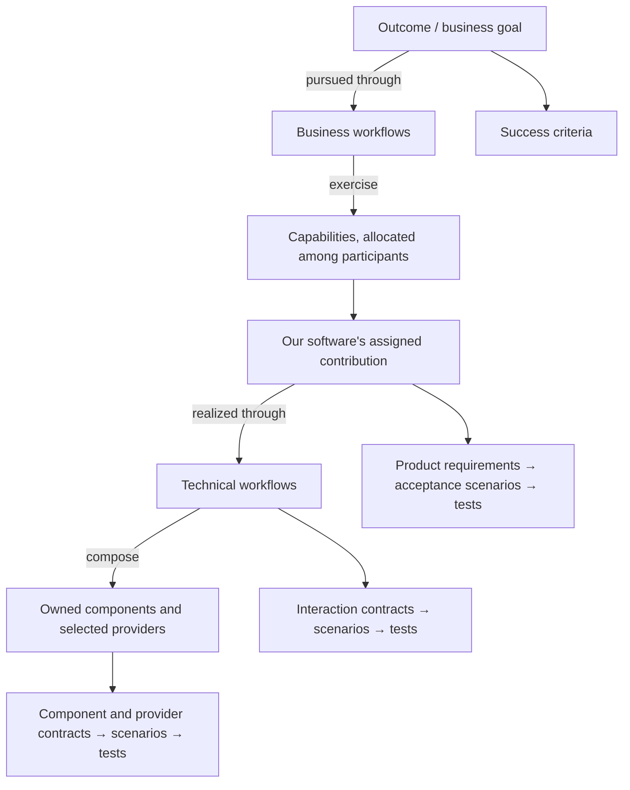

# Model and Conventions

This guide owns shared meanings, document identity, links, and project profiles.
The [Workflow Guide](./WORKFLOW-GUIDE.md) owns how work proceeds; the
[Specification Guide](./SPECIFICATION-GUIDE.md) owns specification content and coverage.
Paths beginning with `docs/` refer to the adopting project.

## Model and Vocabulary

Desired outcomes, business workflows, and capabilities describe the problem; technical workflows and
components realize the software's assigned contribution. These views are many-to-many, without
matching steps or depths. Capabilities and business workflows develop together, as do components
and technical workflows. This map shows what justifies and verifies what, **not development order**:



The definitions below are authoritative for these guides. Use these terms consistently, keeping
repeated definitions aligned; ordinary explanatory language need not introduce alternative model
names. Use **business**, not **domain**, to label the problem view. An adopting project's
`docs/GLOSSARY.md` defines its business and technical terms separately from this shared vocabulary.

### Outcome

A desired business result enabled by capabilities; **business goal** means the same thing. One
capability may support several outcomes; one outcome may require several capabilities. Its
specification defines the goal, scope, and success criteria. These business goals differ from the
work entries in [Workflow: Goals and Guards](./WORKFLOW-GUIDE.md#goals-and-guards).
See [Specification: Outcome Specification](./SPECIFICATION-GUIDE.md#outcome-specification).

### Capability

A coherent, repeatable ability to perform meaningful business work, independent of performer or
method. **Business capability** means the same thing. It may involve people, software, or third
parties and differs from a desired outcome or particular activity.
See [Specification: Capability Specification](./SPECIFICATION-GUIDE.md#capability-specification).

### Participant

A person, this software, or a third party involved in achieving an outcome. Participants perform
activities and exercise capabilities; several may contribute to the same capability.
See [Specification: Business Workflow Specification](./SPECIFICATION-GUIDE.md#business-workflow-specification).

### Activity

Meaningful work performed by a participant in a business workflow. It may contribute part of a
capability without needing its own capability label: assessing options is an activity exercising
the professional judgment capability.
See [Specification: Business Workflow Specification](./SPECIFICATION-GUIDE.md#business-workflow-specification).

### Responsibility

Work or an obligation assigned to a participant or component, not itself a new capability. Product
specifications allocate responsibilities within capabilities; technical specifications assign
components the work realizing the software's contribution.
See [Specification: Capability Specification](./SPECIFICATION-GUIDE.md#capability-specification),
[Component Qualification](./SPECIFICATION-GUIDE.md#component-qualification).

### Software Contribution

The part of a capability assigned to this software, expressed through responsibilities and observable
promises. It may depend on work retained by people or third parties; realizing it need not automate
the whole capability.
See [Specification: Capability Specification](./SPECIFICATION-GUIDE.md#capability-specification).

### Business Workflow

Participants' activities, decisions, and handoffs pursuing an outcome. Each workflow exercises
one or more capabilities through those activities. Required composition differs from an illustrative
sequence and from the software's internal implementation.
See [Specification: Business Workflow Specification](./SPECIFICATION-GUIDE.md#business-workflow-specification).

### Handoff

A transfer of information, a decision, or work between business workflow participants, including
decision authority, completion conditions, and relevant failure and recovery behavior.
See [Specification: Business Workflow Specification](./SPECIFICATION-GUIDE.md#business-workflow-specification).

### Component

A bounded, composable software part owning a coherent technical responsibility for the software's
assigned contribution to one or more capabilities, hiding its implementation behind explicit
contracts. It may contribute directly or support other components; separate deployment is unnecessary.
See [Specification: Component Qualification](./SPECIFICATION-GUIDE.md#component-qualification).

### Technical Workflow

Interactions and data transformations among components and selected providers realizing the
software's assigned contribution to capabilities. Providers may be owned components, standard-library
facilities, or third-party software. Its steps need not match business activities one-to-one.
Qualify **workflow** as business or technical when the distinction matters.
See [Specification: Technical Workflow Specification](./SPECIFICATION-GUIDE.md#technical-workflow-specification).

### Contract

Observable obligations and the assumptions under which they hold, including relevant constraints,
rather than prescribed internals. At a component boundary, **provided behavior** is what the component
guarantees callers under stated assumptions; **required behavior** is what it assumes a collaborator
provides through a port. A scenario makes a contract concrete without replacing its full obligations.
See [Specification: Component Contracts](./SPECIFICATION-GUIDE.md#component-contracts).

### Port

A purposeful behavioral contract at a component boundary, expressing consumer needs independently
of provider internals. It applies to internal and third-party dependencies; matching data shapes
alone does not establish compatibility. **Port** is not a term for documentation migration.
See [Specification: Component Contracts](./SPECIFICATION-GUIDE.md#component-contracts).

### Adapter

Reconciles a selected provider with a consumer's required contract when they do not match directly.
It is needed only for a reconcilable mismatch and cannot promise guarantees it and the provider
cannot jointly deliver.
See [Specification: Component Contracts](./SPECIFICATION-GUIDE.md#component-contracts).

### Realization

The selected implementation fulfilling the software's assigned capability contribution or a
component's required contract. Capability realization connects product promises to components and
technical workflows; contract realization connects consumer needs to a provider and any necessary
adapter.
See [Specification: Product Traceability](./SPECIFICATION-GUIDE.md#product-traceability),
[Component Contracts](./SPECIFICATION-GUIDE.md#component-contracts).

### Requirement

A specification statement of required, recommended, prohibited, or permitted behavior using an
explicit normative keyword. Product requirements state software promises; technical requirements
state the behavior realizing them.
See [Specification: Product Requirements](./SPECIFICATION-GUIDE.md#product-requirements),
[Technical Specifications](./SPECIFICATION-GUIDE.md#technical-specifications).

### Gherkin Scenario

An addressable behavioral example: **Given** conditions, **When** an action occurs, **Then**
observable results follow. Product scenarios specify acceptance of the software's contribution;
technical scenarios specify component or interaction behavior.
See [Specification: Acceptance Scenarios](./SPECIFICATION-GUIDE.md#acceptance-scenarios),
[Technical Specifications](./SPECIFICATION-GUIDE.md#technical-specifications).

### User Acceptance Testing (UAT)

Verification of the software's promised contribution through product scenarios an end user can check.
It covers software obligations, including handoff responses, without claiming to verify a person's
judgment or another participant's competence.
See [Specification: Acceptance Scenarios](./SPECIFICATION-GUIDE.md#acceptance-scenarios).

### Traceability

Explicit links connecting desired outcomes, contributing workflows and capabilities, the software's
assigned contribution, its technical realization, and software verification evidence. Component
responsibilities and technical workflows link to product capabilities, requirements, and acceptance
scenarios directly or through supporting contracts. These relationships are many-to-many, not
matching hierarchies.
See [Specification: Product Traceability](./SPECIFICATION-GUIDE.md#product-traceability).

### Refactoring

Following [Martin Fowler](https://martinfowler.com/bliki/DefinitionOfRefactoring.html), changing
software's internal structure to improve understanding and reduce modification cost while preserving
observable behavior.
See [Workflow: Consolidate the Change](./WORKFLOW-GUIDE.md#consolidate-the-change).

### Functional Proof of Concept (POC)

The first implementation of an agreed change that passes its acceptance suite, reached through
incremental builds and reflection. Its internal design remains provisional until whole-change
consolidation and verification; acceptance passing does not complete technical verification, review,
or promotion.
See [Workflow: Reach the Functional POC](./WORKFLOW-GUIDE.md#reach-the-functional-poc).

### Canonical Specification

The maintained, authoritative record of agreed outcomes and success criteria, current normative
behavior, and concise explanatory context. Product files organize outcomes, capability promises, and
business workflows; technical files organize component and technical workflow contracts. Completed
change execution history remains in version control.
See [Specification: Canonical Content](./SPECIFICATION-GUIDE.md#canonical-content).

### Change Specification

A product or technical specification scoped to an active change: additions, modifications, and
removals relative to canonical specifications, with explanatory change context.
See [Specification: Normative Deltas](./SPECIFICATION-GUIDE.md#normative-deltas).

### Promotion

Incorporating a completed change's agreed outcomes, success criteria, and current normative behavior
into canonical specifications, preserving stable IDs and required context while removing completed
change artifacts. It is distinct from a Git commit, push, or merge.
See [Workflow: Promote Atomically](./WORKFLOW-GUIDE.md#promote-atomically).

### Ownership

Specification ownership identifies an outcome, rule, or promise's authoritative home; component
ownership identifies responsibility for technical behavior. Neither means the human owner's decision or
approval authority. A technical workflow may specify an interaction that a named caller component
owns carrying out.
See [Specification: Business Workflow](./SPECIFICATION-GUIDE.md#business-workflow-specification),
[Technical Workflow](./SPECIFICATION-GUIDE.md#technical-workflow-specification),
[Workflow: Questions and Decisions](./WORKFLOW-GUIDE.md#questions-and-decisions).

## Ownership and Scope

Give each rule or obligation one authoritative home; reference it elsewhere instead of copying it.
Keep reusable capability and component guarantees distinct from workflow composition. Distinguish
**contains** (internal realization) from **uses** (reliance on a dependency's contract); document shared providers once.

State scope explicitly. A flat catalog permits unequal scopes. Human-only capabilities and external
provider identities MAY use addressable contextual entries with authoritative source links rather
than full software specifications. Navigation headings, indexes, and overviews MAY link these entries
and existing specifications, but MUST NOT duplicate requirements or guarantee owners. Grouping does
not create capabilities or additional owners. A complete enterprise map and empty software
specifications are unnecessary.

Refine software promises until implementable and verifiable. Split requirements to separate
obligations before adding a component merely to shorten prose. Decomposition must support independent
reasoning, verification, or change; a file, function, injection seam, or line count alone is insufficient.
Technical detail MUST NOT automatically create product specifications, document types, or new ID
ancestry. Apply the specific split and stop criteria in
[Specification Guide: Capability Specification](./SPECIFICATION-GUIDE.md#capability-specification) and
[Component Specification](./SPECIFICATION-GUIDE.md#component-specification).

## Specification Files

Use the affected specification recipes; they do not require a new file of every type per change.
Each agreed outcome in product scope MUST have its own canonical product file, defining its desired
result, scope, and success criteria; relationships to other outcomes or specifications use links.
Product specification titles MUST end with ` - Product Spec`; technical specification titles MUST
end with ` - Technical Spec`. New canonical files MUST use semantic kebab-case filenames and these
paths and titles:

| Recipe | Canonical path | Title |
| --- | --- | --- |
| [Outcome Specification](./SPECIFICATION-GUIDE.md#outcome-specification) | `docs/specs/product/<outcome-slug>-outcome.md` | `<Outcome> Outcome - Product Spec` |
| [Capability Specification](./SPECIFICATION-GUIDE.md#capability-specification) | `docs/specs/product/<capability-slug>.md` | `<Capability> - Product Spec` |
| [Business Workflow Specification](./SPECIFICATION-GUIDE.md#business-workflow-specification) | `docs/specs/product/<workflow-name>-workflow.md` | `<Workflow Name> Business Workflow - Product Spec` |
| [Component Specification](./SPECIFICATION-GUIDE.md#component-specification) | `docs/specs/technical/<component-slug>.md` | `<Component> - Technical Spec` |
| [Technical Workflow Specification](./SPECIFICATION-GUIDE.md#technical-workflow-specification) | `docs/specs/technical/<workflow-name>-workflow.md` | `<Workflow Name> Technical Workflow - Technical Spec` |

The recipes determine which owners need files. Existing `-flow` filenames and titles MAY remain until
an authorized migration. Preserve IDs and update incoming links on rename or relocation. These
conventions apply prospectively; reorganizing or renumbering existing material requires an explicit
migration request.

- `docs/changes/<issue-key>_<change-slug>/` holds active change artifacts.
- `docs/assets/` holds supporting files, including diagrams and screenshots used by the root README,
  but no specification content.
- Directly under `docs/` are guides, governance, and project documents such as `GLOSSARY.md` and
  `ROADMAP.md`.

## Stable Luhmann IDs

These numbering rules apply only under `docs/changes/` and `docs/specs/`. Every outcome, capability,
business or technical workflow, and owned component MUST have an addressable defining heading or
record with a stable Luhmann-style ID. Success criteria, requirements, scenarios, plan nodes,
documented test entries, delta operations, and other addressable artifacts also require IDs.
References elsewhere reuse those IDs without another hierarchy. Canonical files are semantic
containers, not addressable nodes: their filenames and titles MUST NOT have issue or Luhmann
prefixes. Directories do not establish ancestry.

### Issue-Rooted Change IDs

Use the external issue key as the immutable change root. Any configured filesystem-safe key is valid,
including numeric and project-style keys; an optional issue URL never determines identity. Extend the
root with alternating lowercase letters and numbers, concatenated without punctuation. Every
addressable heading or numbered item begins with its full ID, never omitting ancestors.

In filenames, `<key>` is the artifact's complete ID; `<issue-key>` is its external root. Each artifact
has its own key followed by descriptive kebab-case text. For example:

```text
docs/changes/CAP-1434_automatic-reporting-period-selection/
  CAP-1434a_product-spec.md
  CAP-1434b_technical-spec.md
  CAP-1434c_implementation-plan.md
  CAP-1434d_questions-and-decisions.md
```

Here `d` is part of `<key>`, not an extra filename field.

### Canonical and Enduring IDs

- New nodes extend their introducing parent or change-operation ID. Entity records, criteria,
  requirements, and scenarios originate beneath their introducing change artifact;
  canonical files may contain several issue roots. IDs record origin, not the many-to-many model:
  express relationships with links rather than encoding them in ID ancestry.
- Modification and removal operations get IDs beneath the current change, distinct from their
  referenced target IDs. Preserve target IDs through revision, promotion, rename, and relocation.
- Materially new nodes get new IDs beneath their introducing change. Removed IDs MUST NOT be reused.
- Correct a draft node's mistaken ancestry before integration; its never-canonical ID is not reserved.
  Moving an integrated node preserves its ID.

Addressable content uses full IDs. Illustrative structure:

```text
# Reporting Period Selection - Product Spec
## CAP-1434a1 Product Requirements
### CAP-1434a1a Default Reporting Period
Requirement: CAP-1434a1a The application MUST select the prior month by default.
#### CAP-1434a1a1 UAT Scenarios
Scenario: CAP-1434a1a1a Select the prior month during the year
```

Executable test names follow [Working Through a Change: Test Catalog](./WORKFLOW-GUIDE.md#test-catalog).

## References to Addressable Content

Every documentation reference to a node under `docs/changes/` or `docs/specs/` MUST be a relative
Markdown link labeled with its **ID and title**. Use the text after the ID in its heading, scenario
line, or table topic, omitting a leading operation word such as `Added:`.

Link to the node's heading, or its nearest containing heading for a scenario or table row.
Use `#<anchor>` within a file and `<relative-path>#<anchor>` across files. References to canonical
files link to the file; names or IDs alone are insufficient.

Definitions—the heading, requirement line, or scenario line—are not references and are not linked.
Inside code blocks and diagrams, cite the ID even though links do not render. For example:

```text
Bad:  A refused variable fails as in the APP_SERVER requirement.
Good: A refused variable fails as in [CAP-1434a2a APP_SERVER is refused](../../specs/product/parent-sync.md#cap-1434a2a-app_server-is-refused).
```

## Defined Terms

Link introductory uses of model terms to [Model and Vocabulary](#model-and-vocabulary) or the term's
own heading; not every occurrence needs a link. For terms defined in a change's Terms list or the
project glossary, link the first use in each addressable node's prose, including requirements,
rationale, orientation and workflow prose, and table cells. Preserve written case and number.
Definitions, code blocks, and Gherkin are exempt.

## Project Profile

Record the adopted source revision and project choices in contributor guidance: issue tracker,
language, toolchain, test frameworks and suite classifications, approved quality-check commands,
deployment choices, and branch and integration policy. Examples do not override these choices; use
the prescribed runner. Existing conventions settle routine choices. Missing choices that block work
are open questions under [Working Through a Change: Questions and Decisions](./WORKFLOW-GUIDE.md#questions-and-decisions).

Add shared conventions here and type-specific rules to the Specification Guide; work procedures
belong in the Workflow Guide. Keep project vocabulary separate in `docs/GLOSSARY.md`.

## Test-Suite Classification

The project profile MUST identify suite classifications, selectors, and supported commands.
Classify by the asserted production boundary, make external dependencies explicit, and use prescribed
wrappers.

### Example Go Profile

This profile applies only when adopted; other projects MAY use equivalent mechanisms. Its underlying
commands do not override project wrappers. Tests MUST use the applicable constraint and suite:

| Asserted boundary | File-level constraint | Command |
| --- | --- | --- |
| Pure and deterministic (default MUST contain only these) | None | `go test ./...` |
| Local impure boundary, no live service | `//go:build integration` | `go test -tags=integration ./...` |
| Live remote service | `//go:build network` | `go test -tags=network ./...` |

Local impurity includes real filesystem, environment, subprocesses, signals, clock, and OS descriptors.
An in-process third-party package alone does not imply integration. A live-service contract uses
`network` despite incidental local plumbing; missing required endpoints or credentials MUST cause a
clear skip. Tags are independent; combine with `go test -tags='integration network' ./...`.
