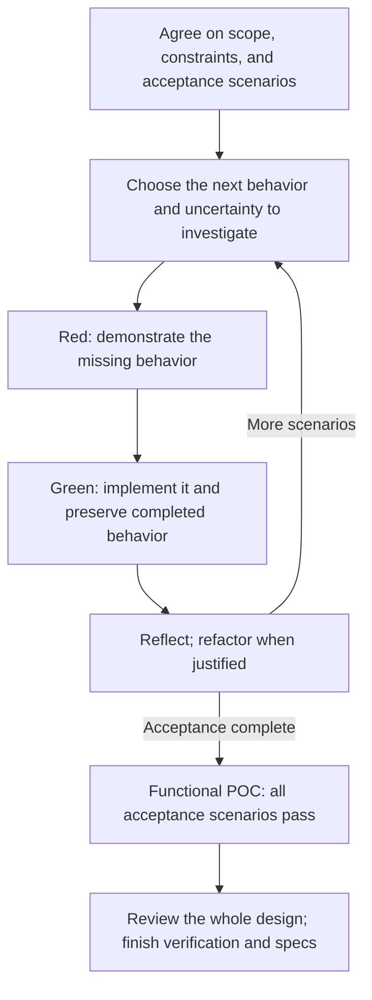

# Working Through a Change

Use this guide to develop, review, and integrate a change, or to establish documentation for existing
behavior. Paths beginning with `docs/` refer to the adopting project. Shared meanings, identities,
locations, and project choices follow the [Conventions Guide](./CONVENTIONS-GUIDE.md); specification
content follows the [Specification Guide](./SPECIFICATION-GUIDE.md).

## Choose the Work Route

Establish the baseline before developing, reviewing, or integrating. Before drafting or implementing,
inspect affected behavior, documentation, tests, active changes, contributor instructions, and
relevant dependencies. Installing guides or creating `docs/specs/` does not establish adoption.

| What exists? | Start here |
| --- | --- |
| No existing behavior | Prepare the change below. |
| Usable canonical specifications | Keep their promises, contracts, and IDs; reconcile isolated gaps through [Document Existing Behavior](#document-existing-behavior) before specifying affected changes. |
| Existing behavior with missing, conflicting, or differently organized documentation | Establish the affected baseline through [Document Existing Behavior](#document-existing-behavior) before specifying changes. |

Undocumented behavior is not new behavior. Code and tests evidence current behavior, not necessarily
intended behavior; resolve uncertain intent through [Questions and Decisions](#questions-and-decisions).
Use [Conventions: Specification Files](./CONVENTIONS-GUIDE.md#specification-files) for existing-document
migration authorization. Editing the guides themselves follows their source repository's contributor
instructions.

After checking the baseline, follow the applicable route:

| Work | Procedure and completion |
| --- | --- |
| Behavior change | [Prepare the Change](#prepare-the-change) → [Build Incrementally](#build-incrementally) → [Consolidate the Change](#consolidate-the-change) → [Promote Atomically](#promote-atomically). |
| Consequential uncertainty about feasibility, value, or scope | [Investigate a Consequential Uncertainty](#investigate-a-consequential-uncertainty) before commitment or when evidence challenges the approach. Then deliver, or [Complete an Investigation Without Delivery](#complete-an-investigation-without-delivery) after an authorized stop, deferral, or rejection. Experiments inform decisions; they do not satisfy acceptance. |
| Documentation for unchanged behavior | [Document Existing Behavior](#document-existing-behavior), including its audit and owner validation, then atomic promotion. Do not add tests or force shipped behavior red; discovered behavior changes get separate changes. |

Every behavior change, including code, tooling, configuration, and agent instructions, follows this
workflow regardless of size or type. Root `AGENTS.md` or equivalent MUST require it. Only explicit
rules here or user instructions grant exemptions. Before implementation, create or update the
issue-rooted product spec, technical spec, implementation plan, and questions and decisions log.
Before reporting completion, reconcile these artifacts with implementation, record validation, and
meet the chosen route's completion requirements, including atomic promotion at integration.

## Prepare the Change

Prepare affected portions for the current stage. Existing contracts and build constraints apply
throughout; a complete new component or workflow design is not a prerequisite. Specify intended
contracts as boundaries are selected for an increment, verify them as implemented, and reconcile
specs with the result.

1. **Establish scope and evidence.** Use the following handoff to the specification recipes.
2. **Resolve consequential choices.** Interview for ambiguity and uncovered boundaries under
   [Questions and Decisions](#questions-and-decisions). Reuse confirmed decisions; do not infer
   behavior from a preferred implementation or add unrequested behavior. Investigate consequential
   assumptions before costly commitments, presenting simpler alternatives when complexity, risk,
   or cost is disproportionate.
3. **Draft the specifications and plan.** Apply the relevant recipes and current-stage conformance
   checks; record hypotheses, build rules, and existing findings in the technical spec. Catalog all
   agreed scenarios and verification boundaries. Executable tests arrive incrementally; pending
   scenarios stay visible.
4. **Review the prepared change** before proceeding with behavior delivery.

| Artifact | Establish before authoring |
| --- | --- |
| Product spec | Problem; desired outcome IDs and success criteria; relevant capabilities and business workflows; participant allocation, happy paths, boundaries, and failures from confirmed intent and existing promises or evidence. Keep mechanisms out; human or third-party performance remains an assumption where software cannot guarantee it. Use [Specification Guide: Product Specifications](./SPECIFICATION-GUIDE.md#product-specifications). |
| Technical spec | Confirmed product capabilities, software allocation, requirements, UAT, and external assumptions. Inspect current components, behavior, and interactions for each relevant requirement/scenario to establish sufficiency or gaps. Clarify objectives, acceptable dependencies, and material tradeoffs; separate goals from mechanisms and define measures before selecting or optimizing an option. Use [Specification Guide: Technical Specifications](./SPECIFICATION-GUIDE.md#technical-specifications). |
| Implementation plan | The sources, software responsibilities, constraints, requirements, scenarios, and work nodes described below. |

### Plan Scope and Structure

A plan makes approved work executable and progress verifiable. Title it `<name> - Implementation
Plan`; order its five parts as **scope, work graph, test catalog, evidence/status, completion gates**.
Omit genuinely inapplicable parts.

Read approved product promises, existing technical contracts, hypotheses, and build rules; inspect
implementation, tests, dependencies, toolchain, and local changes. Record those sources, software
responsibilities in scope, and constraints. Preserve approved promises and contracts; add selected
boundaries and technical workflows as evidence develops, including when planning the first increment.
Reference behavior specs rather than copying Gherkin or inventing behavior. Explain strategy without
prescribing exact production or test code, assuming agent execution, or prescribing skills.
Unapproved alternatives remain investigations.

Plan **green nodes** for acceptance increments, relevant experiments, and local refactoring through
the [functional POC](./CONVENTIONS-GUIDE.md#functional-proof-of-concept-poc). Add **consolidation nodes** for actual whole-design findings. Reference
[Build Incrementally](#build-incrementally) once for execution and reflection, and
[Goals and Guards](#goals-and-guards) for consolidation entries and evidence.

### Work Graph

Use a Mermaid DAG with one cohesive work package per node. Render each catalog section's full
Luhmann ID and current node status; base its source identifier on that ID. Draw only real
prerequisites. Independent work gets separate nodes; table order alone sequences work within a node.
The graph owns dependencies, parallelism, and convergence: do not repeat them as catalog prose or
a branch tree.

Order ready work by information value as well as dependency. Revise unstarted work as evidence
changes its value, keeping graph and catalog consistent. Routine resequencing within approved scope
needs no new approval; raise blocking decisions when discovered. Materialize ready nodes under
[Worktree Execution](#worktree-execution).

### Test Catalog

Create one section per graph node with the same ID/title. List all agreed scenarios up front;
implement executable tests as increments begin and extend the catalog as technical contracts are
selected. Use **Gherkin**, **Classification**, **Why**, and **Status** columns; add **Properties** for
property-based entries. Non-test actions use **Work** instead of **Gherkin**. Initialize entries to
`Not started` and implement/validate top to bottom.

Give every relevant product/technical scenario at least one independently tracked test. Each row
has one scenario ID; a scenario may justify distinct tests at different boundaries. An Outline and
its examples count as one scenario when behavior and outcome match. Consolidate the owning specs
when scenarios duplicate a contract; distinct acceptance, component, boundary, interaction, and
workflow contracts retain distinct tests.

Prefix executable test names with the scenario ID, for example `TestCAP_1434b1a1SelectPriorMonth`.
Replace identifier-invalid punctuation with underscores without changing documented IDs. Outline
cases may inherit the ID through their parent test path. Split tests spanning scenarios into
ID-specific tests or ID-bearing subtests; never label a test with a scenario it does not verify.

#### Traceability and Verification Boundaries

Trace every in-scope software promise, including shared rules, through its realizations to tests.
Check allocation, scope, and required versus illustrative behavior under
[Specification Guide: Product Traceability](./SPECIFICATION-GUIDE.md#product-traceability) and
[Acceptance Scenarios](./SPECIFICATION-GUIDE.md#acceptance-scenarios).

Verify distinct parent, child, composition, and required contracts at their own boundaries under
[Specification Guide: Component Contracts](./SPECIFICATION-GUIDE.md#component-contracts) and
[Technical Workflow Specification](./SPECIFICATION-GUIDE.md#technical-workflow-specification).
Keep workflow tests within declared scope; reference deeper tests without expanding internals or
creating duplicate tests for references. Do not create product specs, tests, or nodes merely per
component or outside software scope. Apply provider/adapter compatibility rules when cataloging
required-contract verification.

#### Choose Test Methods

Record chosen project libraries, suite classifications, and approved commands once, following the
[Conventions Guide: Project Profile](./CONVENTIONS-GUIDE.md#project-profile). Justify each row's method without copying exact test code.

| Method | Use and required detail |
| --- | --- |
| Dedicated examples | Finite/exact contracts: syntax, branches, output/destination, intent-revealing boundary values, acceptance scenarios, or dependency behavior tied to a pinned version. Use named or table-driven cases. |
| Property-based | Pure behavior across a meaningful input space. In **Properties**, enumerate externally meaningful invariants/relations, valid generated-input bounds, and relevant success/failure shapes. Supplement named Gherkin examples; do not reproduce the production algorithm. |
| Interaction | Call counts, arguments, ordering, returned values, exclusive routes, forbidden effects, or impure boundaries. Use project doubles, interaction tools, and stdout/stderr capture. |

Do not introduce broad interfaces around pure functions or stable standard-library values solely
to mock them.

### Plan Completion Gates

Define checkable behavior-delivery gates:

- **Coverage:** every product/technical scenario, required example/property/interaction, and
  provider/adapter contract has evidence at the catalog's audited boundaries. Behavior and tests
  match approved specifications; selected contracts meet [Consolidation Criteria](#consolidation-criteria).
- **Quality:** required valid paths and invalid-path gating/preservation, full-suite checks, static
  analysis, and build pass using approved commands.
- **Progress:** every catalog entry is [Done](#test-and-action-status) and every graph node
  [Merged](#node-status), supported by [Checkpoint Verification](#checkpoint-verification), and all
  delivery phase reviews are complete.
- **Integration:** complete [Promote Atomically](#promote-atomically).

An investigation ending without delivery instead uses
[Complete an Investigation Without Delivery](#complete-an-investigation-without-delivery).
Documentation-only adoption uses [Close Out and Promote](#6-close-out-and-promote).
Record withdrawn work's disposition; never mark unexecuted scenarios passing or complete.

### Review the Prepared Change

At every handoff, check baseline/scope, single ownership, IDs, links, terms, decision log, and applicable
current-stage readiness. Resolve broken links, placeholders, contradictions, duplication, and
ambiguity; retain prose only when it helps apply a rule.

At the current authoring stage, check
[Specification Guide: Product Conformance](./SPECIFICATION-GUIDE.md#product-conformance) and
[Technical Conformance](./SPECIFICATION-GUIDE.md#technical-conformance). Before plan approval, verify
its five parts agree: approved scope, real prerequisites, independently traceable tests with
justified methods, evidence-based statuses, and checkable completion gates. Delivery gates need
not already pass.

Present for approval: product scope and structure, including desired outcomes, success criteria,
allocation, observable promises, and UAT; technical scope and structure; and the plan and strategy.
Apply each approval at the current stage. Review scope, handoffs, required versus illustrative ordering, checkable promises, testable
hypotheses, and build rules before proceeding. Readiness requires neither completed delivery nor a
complete new design; routine increments need no new interview or approval.

Behavior delivery has three milestones: **Red** (this preparation), **Green** (the full functional
POC), and **Refactor** (whole-change consolidation). Each MUST end with one agent review round
followed by one owner walkthrough, unless the owner requests more. Record outcomes and known
blocking questions under [Questions and Decisions](#questions-and-decisions). Local build loops and
reflection are author work, not extra review or approval milestones.

## Build Incrementally

Repeat the following loop until every agreed acceptance scenario has executable passing coverage.

### Choose the Next Increment

Choose a meaningful increment, usually one scenario or a cohesive group. Respect dependencies,
establish a thin working path, and investigate risk early. Prefer information value over the easiest test; state evidence that would
support or challenge an uncertain approach. Materialize ready nodes under
[Worktree Execution](#worktree-execution).

### Acceptance Handoff

Write acceptance and any smaller tests at software boundaries demonstrating approved results.
Translate conditions, actions, handoffs, and failures faithfully: the promise is the oracle, not
current output or provisional component/call structure. Identify controlled inputs and dependency
assumptions. An increment may need several independently tracked tests.

Demonstrate the missing or changed obligation failing for the expected reason. Retained assertions
may pass; setup failure is not evidence of missing behavior. If promised behavior already works,
record baseline evidence and reconcile planned work instead of manufacturing failure. Preserve
scenario IDs and coverage through harness changes; agree product changes before adjusting assertions
to match them.

### Make It Work

Implement the smallest sufficient change, preserving completed acceptance and regressions under
[Checkpoint Verification](#checkpoint-verification). Apply specification recipes as boundaries are selected; do not postpone consequential contracts until POC.

### Checkpoint Verification

Record the latest verified checkpoint, not intended progress. Commit every test, action, and graph
status transition with its evidence; do not proceed past an uncommitted transition.

Before `Green-all`, run required project commands for all implemented acceptance/technical tests
and existing regressions. Unimplemented catalog scenarios remain pending. Never disable checks,
omit unexplained failures, or count pending work as passing. Generic regression catalog rows are
unnecessary because these checks already require regressions.

If future acceptance tests already exist, name their exact IDs and expected missing-behavior
failures separately from the regression gate. Investigate additional or changed failures; record
verification scope and pending scenarios. This checkpoint is **not a full-suite pass**. Pending or
disabled tests cannot satisfy the full POC or final completion, which also requires all technical
coverage and full project checks.

### Reflection and Learning

After each meaningful green increment, use [Consolidation Criteria](#consolidation-criteria) for
preservation and concrete design benefit. Start with these questions:

| Question | What it helps detect |
| --- | --- |
| What surprised us, and what evidence supports it? | Incorrect assumptions and exposed constraints. |
| What was harder to implement or verify than the behavior warrants? | Entangled responsibilities, awkward dependencies, unclear ownership. |
| Can we simplify what works to ease understanding and modification without changing behavior? | Unnecessary abstractions, duplicated rules, avoidable coordination. |
| Which remaining scenario would most challenge this approach? | The next useful experiment. |

The author MUST also seek questions specific to the evidence, assumptions, risks, and interactions.
Pursue unexpected results and consequential unknowns through inspection, tests, or experiments.
Defaults do not finish learning. Do not invent a lesson when no useful finding emerges.

Reconsider design when change spreads across unrelated components, a boundary is hard to verify,
or an assumption fails. Investigate before costly public interfaces, persisted formats, or
dependency guarantees; do not wait for a passing test to address these risks.

Connect consequential lessons as **observation → implication → action**. Separate measured facts
from interpretations and bound conclusions to the evidence. Choose justified refactoring, further
investigation, revised product agreement, or unchanged continuation; apply the Specification Guide's
split/stop rules. Resolve routine technical questions through evidence and standing guidance.
Record durable choices and unresolved owner questions in the decision log; track deferred
consequential investigations in a plan entry or blocking row. No separate lessons document or
per-prompt journal is required.

If evidence invalidates an approved product assumption or promise, resolve agreement and acceptance
scenarios before dependent work continues. Never weaken acceptance to fit implementation.

### Record the Checkpoint

Reconcile contracts, coverage, plan status, and durable decisions using the status tables below.
Commit under [Checkpoint Verification](#checkpoint-verification) before selecting the next increment
using what was learned.

#### Test and Action Status

| Status | Latest verified evidence |
| --- | --- |
| `Not started` | Test not yet implemented and verified. |
| `Red` | Expected missing obligation fails, or a recorded guard probe establishes sensitivity for already-satisfied technical behavior. |
| `Green-single` | Focused test passes; record baseline evidence if behavior already worked. |
| `Green-all` | [Checkpoint verification](#checkpoint-verification) passes with pending future failures named. This alone is not a functional POC. |
| `Done` | Applicable technical verification, consolidation goals, and guard evidence pass and are committed, even without structural refactoring. Integration/promotion remain separate. |

Non-test actions use `Not started` → `In progress` → `Done`. For experiments, complete the hypothesis
record and revisit dependent assumptions after results; their `Done` approves neither alternatives
nor acceptance. Consolidation goals follow [Goals and Guards](#goals-and-guards).

#### Node Status

| Status | Evidence |
| --- | --- |
| `Blocked by: <node IDs>` | A direct dependency is incomplete or its commits are not in one base. |
| `Ready` | Every direct dependency is complete, the base exists, and work is unstarted. Roots use the development base. |
| `In progress: n/x entries complete` | Work started; n of x entries reached the node's completion checkpoint. |
| `Complete` | Green-node tests are `Green-all` or later; other actions/goals are `Done`; applicable verification passes and the result is committed. This is not whole-change completion. |
| `Merged` | Result is in every required downstream base, or development for terminal nodes; its dedicated branch/worktree is removed. |

### Reach the Functional POC

The **Green** milestone requires executable passing coverage of every agreed acceptance scenario,
with existing checks intact. Pending, skipped, or planned scenarios do not qualify. The design
remains provisional.

Complete hypothesis records with clause-level results, distinguishing measurements from judgments.
Include each build rule's literal output on one line. Evaluation artifacts are ephemeral; preserve
results in Git history and conclusions in the decision log. Product changes and consequential
tradeoffs go to the authorized owner. Review correctness, security, minimality, understandability,
modification effort, and standards across the change; carry findings and unresolved learning into
consolidation. Complete the Green agent review and owner walkthrough before continuing.

## Consolidate the Change

After POC, select a minimal sufficient design while keeping approved behavior and the full acceptance
suite green. Address review findings, duplicated ownership, unnecessary coordination, speculative
abstractions, and missing guarantees. [Refactoring](./CONVENTIONS-GUIDE.md#refactoring) improves understanding or modification effort
while preserving observable behavior; leave sufficient structure unchanged. Hardening and
performance improvements are distinct consolidation activities with their own evidence.

By consolidation's end, satisfy the criteria below, preserve relevant hypothesis conclusions as
requirement `Rationale:`, and complete consequential learning items. Add no product behavior in this
phase. Pass the final Refactor review and owner walkthrough before promotion.

### Consolidation Criteria

Before restructuring, name a concrete understanding/modification difficulty and expected benefit.
For local refactoring, apply preservation and design-benefit criteria to the affected scope and
retain required regression checks. Post-POC consolidation uses all applicable gates while full
acceptance stays green.

| Gate | Evidence |
| --- | --- |
| Preservation | Acceptance, regression, and affected-contract tests support preserved observable behavior. Restructuring tests preserves their obligations. |
| Design benefit | Before/after evidence supports easier understanding or lower modification effort for the named task, including effects on callers and dependencies. |
| Standards | Enabled lint, static analysis, and DI-boundary checks pass. |
| Hardening | Every review security/correctness finding has a test that failed before its fix. |
| Performance | A measured goal exceeded its budget before work and meets it afterward. |
| Minimality | Repository-owned code/dependencies meet the build rule, enforced by a check seen failing. |
| Complexity | Enabled complexity checks pass. |
| Spec conformance | Specs match results; direct component/workflow tests and real-provider/adapter compatibility verification pass under [Specification Guide: Component Contracts](./SPECIFICATION-GUIDE.md#component-contracts) and [Technical Workflow Specification](./SPECIFICATION-GUIDE.md#technical-workflow-specification). |

Track hardening/performance goals separately from refactoring benefit. Passing tests or reducing
structural counts alone does not prove design benefit; account for complexity transferred to
callers/dependencies. Quantitative gates require measurements; design benefit may use concrete
review or a representative exercise. Distinguish judgments from measurements and record their basis.

### Goals and Guards

These are consolidation work entries; business goals follow
[Specification Guide: Outcome Specification](./SPECIFICATION-GUIDE.md#outcome-specification).

| Entry | Plan and evidence |
| --- | --- |
| Goal: criterion unmet on current implementation | A node names finding, unmet criterion, and before/after evidence. `Not started` → `Red` → `Green` → `Done`: demonstrate unmet baseline, establish benefit/required result, commit. Do not manufacture behavior failure for qualitative design findings. |
| Guard: criterion already holds | Record evidence, including sensitivity for executable guards as below; no work node. |

For executable gates, including guards, prove the same check passes when its criterion holds and
fails for the expected reason when it is violated. Use a real failure or temporary deliberate
violation; remove any introduced violation and confirm the check passes again.

Record probes in a commit message or decision log, never committed fixtures. A limit on a nonexistent
file is a guard; probe it when content first appears. Reuse sensitivity evidence only for unchanged,
applicable guards, rerunning them on the current system; re-probe changed guards or applicability.

If a supposed goal already holds, check whether it was met or its criterion is too loose before
dropping the node. Keep full acceptance green and complete affected contracts/tests as design changes.
No structural change is required when design suffices.

## Promote Atomically

For behavior delivery, meet the [coverage, quality, and progress gates](#plan-completion-gates);
for documentation adoption, meet [Close Out and Promote](#6-close-out-and-promote). Then promotion
MUST integrate canonical specs and applicable implementation/test changes atomically:

1. Express every normative effect under [Specification Guide: Normative Deltas](./SPECIFICATION-GUIDE.md#normative-deltas),
   apply it to `docs/specs/`, and retain [Canonical Content](./SPECIFICATION-GUIDE.md#canonical-content).
2. Verify stable IDs, unique ownership, scope/handoffs, outcome-to-test traceability, Gherkin coverage,
   provider/refinement links, workflow scopes, and documentation links. Infer neither tests for
   human-only work nor matching business/technical steps.
3. Delete the completed change directory.

Keep no completed-change archive: Git history and external issues preserve removed artifacts and
rationale. Resolve overlapping spec edits through normal version control, without separate
documentation locking or merge protocols.

## Investigate a Consequential Uncertainty

Investigate consequential feasibility, value, cost, or risk uncertainty whenever it arises, including
before product agreement. Use the agreed question and proposed scope under confirmed constraints,
keeping unresolved assumptions explicit. Use technical-spec hypotheses and the decision log; no separate experiment
document or complete speculative design is required. A hypothesis tests confirmed or proposed
behavior; give it an ID/title and separate independently testable clauses. A build rule is a
checkable implementation constraint stated with RFC 2119 language.

### Plan and Record the Experiment

| Field | Required content |
| --- | --- |
| Hypothesis and reason | Claim/question, why it matters, desired outcome, objectives, constraints. |
| Candidates, when applicable | Credible alternatives under **Compare Options** below; omit inapplicable comparisons. |
| Experiment | Confirming/disconfirming evidence and criteria to choose, reject, or revisit; measurements and locations, representative inputs under comparable conditions. Cover relevant success/failure, performance, complexity, risk, and cost. |
| Bounds and stop | Proportionate authorized effort/resources. Stop when evidence suffices, an option is ruled out, or the bound is reached; report uncertainty before extension. Experiments confer no new spending, dependency-commitment, or external-action authority. |
| Results | Observations, conditions, estimates, limitations; literal build-rule output when applicable. Retain negative/inconclusive findings. |
| Conclusion | Interpretation, recommendation, decision/basis or unresolved choice, separate from observations and uncertainty. Attribute and date conclusions and decisions. |

Keep Results and Conclusion pending until evidence exists; retain findings across phases. Carry
relevant conclusions into `Rationale:` under justified requirements.

Make routine technical choices within standing authority. Raise material product, value, or commitment
tradeoffs with the stakeholder. Scope alternatives identify changed promises and lost value; update
product promises/UAT only after stakeholder agreement, before dependent work. Near matches do not
satisfy original acceptance.

A narrow prototype proves neither the whole design nor stakeholder value or acceptance. Maintained
reuse requires approved acceptance, regression, and applicable contract verification. Keep decision
evidence in the change; promote [Canonical Content](./SPECIFICATION-GUIDE.md#canonical-content).

### Compare Options

Build coherent holistic options from overlapping gap-filling changes. Compare with the simplest
relevant baseline over the same scope/constraints; state material exclusions and assess scope
changes separately. Drop categories distinguishing no feasible design. Add candidates only for
material remaining uncertainty, not an exhaustive sweep. Introduce new dependencies, toolchain
changes, metrics, options, and adoption costs before relying on them. Only selected contracts are
normative.

When counts help, use one ownership/unit model across options: repository-owned workflow behavior,
components, and behavioral clauses, including owned dependency-boundary interactions and excluding
dependency internals. Decompose totals by those units:

| Measure | Count |
| --- | --- |
| Risk | Existing units changed or removed. |
| Change complexity | Units added, changed, or removed. |
| Final complexity | Units in the complete relevant final system. |

Counts are comparison evidence, not contracts. Report excluded dependency surface and operational
tradeoffs separately. Label differing diagram scopes/abstraction levels; visual size MUST NOT imply
comparable complexity unless scopes are comparable.

### Complete an Investigation Without Delivery

For an authorized stop, deferral, or rejection leaving no production behavior or contract change,
replace delivery phase reviews with one findings/disposition review and owner walkthrough. Record
evidence, uncertainty, and decision; remove experimental production edits. Preserve findings in
committed history or a linked issue before removing completed change artifacts. No POC or canonical
deltas are required.

Remove withdrawn plan work with a decision reference; never mark unexecuted tests passing or `Done`.
Retiring an implemented canonical promise is a behavior change requiring normal delivery/promotion.

## Document Existing Behavior

This alternative route recovers missing specs, reconciles conflicts, or migrates legacy documentation
to an audited baseline. It **does not change behavior, add tests, or force unchanged behavior red**.
Shipped instructions, including skills, count as code: file defects rather than editing them here.

- **Local reconciliation:** inventory, specify, and audit affected owners; preserve IDs and leave
  unrelated documentation in place.
- **Broader adoption:** account for all legacy material in scope. Preserve usable canonical specs,
  IDs/incoming links, installed guides, and contributor instructions; verify retained specs too.

An adoption request authorizes its stated scope; otherwise agree scope with the owner before moving,
deleting, or renumbering documentation. Resume an applicable active adoption change, record
exclusions, and never claim local completion establishes repository-wide adoption. Record absent
sources/coverage gaps; skip nonexistent migration work without inventing requirements. Code/tests
are evidence, not intended-behavior authority. The owner rules on unresolved mismatches; continue
independent work until all remaining work is blocked.

### 1. Open the Adoption Change

Open/reuse the adoption issue and `docs/changes/<issue-key>_documentation-framework-adoption/`.
Use complete artifact keys under [Conventions Guide: Stable Luhmann IDs](./CONVENTIONS-GUIDE.md#stable-luhmann-ids):

| Artifact | Adoption content |
| --- | --- |
| `<key>_product-spec.md` | Problem statement, then inventoried outcome, capability, and business workflow sections. |
| `<key>_technical-spec.md` | Existing-system orientation; explain once why option analysis, impact, and alternatives are omitted. |
| `<key>_implementation-plan.md` | Migration and verification nodes from step 3. |
| `<key>_questions-and-decisions.md` | [Questions and Decisions](#questions-and-decisions) table; every open adoption question has a proposed default, not an assumed decision. |

Working inventories may occupy an artifact subdirectory; remove them with the completed change.

### 2. Map Owners and Sources

Reconcile documentation, including decision records and earlier spec archives; code/tests and shipped
commands, flags, and instructions; history/issues; project notes or memory. Removed or parked features
are not current behavior.

Inventory desired outcomes, capabilities, participant allocations, business workflows, qualifying
components, technical workflows, and shared rules through the Specification Guide's recipes. Record
rejected component candidates and reasons. Apply boundaries, split/stop rules, scopes, and traceability; default to flat
catalogs and purely navigational groupings. Entirely nonsoftware work remains context and assumptions,
without empty software specs, acceptance tests, implementation nodes, or audits. Agreed business goals
still receive outcome files. Technical refinement does not create product specs per component.

Create a **source map**: every separable legacy claim has exactly one destination—outcome, capability,
business workflow, component, technical workflow, central document, contributor guidance, separate
active change, or reasoned deletion. Split mixed-owner passages into entries; other destinations
reference the owner instead of copying it.

### 3. Plan and Quarantine

Plan one migration/verification node per outcome, supported capability, relevant business workflow,
component, and technical workflow. Name its template, source claims to migrate/delete, shipped
artifacts, and cautions. Order shared contracts before composition and product audits after supporting technical
specs; serialize nodes editing the same files. Plan step 6 closeout and any deferred test
classification afterward. Complete each documentation node's scoped migration and audit work using
the applicable [Close Out and Promote](#6-close-out-and-promote) criteria; use audit evidence for
status transitions under [Checkpoint Verification](#checkpoint-verification). Existing tests retain
their actual status; completing documentation never marks them passing or `Done`.

Move only replaced material into `docs/deprecated/` using version-control moves and retaining layout.
Earlier spec systems count as legacy whether moved or not. Keep/restore owner-selected central
documents, such as glossary/roadmap, under [Conventions Guide: Specification Files](./CONVENTIONS-GUIDE.md#specification-files). Repair temporarily broken references as targets migrate.

### 4. Migrate and Verify Each Owner

For each node:

1. Read sources, shipped artifacts, code, and tests. Retain usable canonical requirements; use
   [Specification Guide: Normative Deltas](./SPECIFICATION-GUIDE.md#normative-deltas), adding undocumented
   nodes and modifying/removing existing IDs.
2. Apply its owner recipe. Record divergent evidence for audit rather than silently resolving it.
   Update inventory/plan and earlier technical mappings, catalogs, and test names when discovery
   changes coverage. Move architecture sequence diagrams to technical workflow owners.
3. Put legacy rationale under its requirement as `Rationale:`. Full history may remain until
   [Specification Guide: Canonical Content](./SPECIFICATION-GUIDE.md#canonical-content) prunes it at promotion.
4. Remove only migrated source claims; mixed passages stay until all mapped claims migrate. Delete
   empty legacy files and repoint live references to removed content.

For each technical node, rename existing tests with scenario IDs they verify under
[Test Catalog](#test-catalog), updating live name references. Record scenario, old/new test names,
and classification in its catalog. List scenarios without tests, tests without scenarios, and
existing real-provider/adapter compatibility evidence for required assumptions. Run full quality
checks before committing the node; audit failures or unavailable checks under step 5.

Renames and reference rewrites MUST preserve historical evaluations, logs, transcripts,
completed-change archives, old-name lists, decision logs, and working inventories. Match exemptions
by substring, not path prefix; dry-run every bulk rewrite.

### 5. Audit the Baseline

Check outcome definitions and success criteria against confirmed intent and source documentation.
Resolve unknown goals or criteria with the owner; code and passing tests cannot establish intent.
This checks the goal specification, not whether the business goal has been achieved.

Inside the adoption change, audit each supported capability/relevant business workflow, including
retained specs. Cover every software requirement/scenario, shared rule, and supporting technical
requirement; reuse shared evidence. Assess evidence for allocated responsibility, required
composition/handoffs, and current provider/adapter behavior—not human competence, illustrative
sequencing, or consumer mocks as proof of provider compatibility.

Find code/tests; use temporary state for cheap binary or real-run checks. For mismatches, compare
when and why code/documentation changed, recovering deleted sources from history as needed:

| Finding | Action and verdict |
| --- | --- |
| Match | Leave the requirement unchanged; `match`. |
| Documentation problem | Code reflects a later deliberate decision: correct the spec and stale README/glossary/comment claims, preserving enduring IDs; `doc fixed`. |
| Code problem | Intended behavior is missing/regressed: retain it; file/link an issue with observation, reproduction, expected behavior, and compared commits; `code bug #<n>`. |
| Unclear | Record evidence and best judgment; owner rules on issue versus spec correction/removal; `unclear`. |
| Covered by pending change | Name that change. |

Every audit row records evidence and a verdict. File or link an issue for each unresolved
implementation defect or verification gap, including missing direct tests, unavailable checks, and
unverified provider/adapter compatibility. Identify affected requirement/scenario IDs, available
evidence, and what remains incorrect or unknown. Preserve intended requirements and label unverified
assumptions. A filed issue does not satisfy verification; remedial work stays separate from adoption.

For each independently shippable behavior change, create its own issue/change even when decided
together. Modifications/removals target existing IDs, including adoption-created ones. Replace
review notes with links to those changes and use normative delta rules.

### 6. Close Out and Promote

1. Migrate residual central-document content, contributor guidance, and useful research conclusions;
   delete superseded claims. History is the fallback; keep no restore copies.
2. Give each unbuilt draft its own issue-rooted change, creating the issue if absent.
3. Recover remaining rationale from old spec archives, then remove superseded material in scope.
   Remove tooling only with owner agreement and no out-of-scope consumers.
4. Remove migrated deprecated material and its directory when empty. Search for removed paths/IDs
   and repair live references; follow scripted bare-ID passes with review for name-only references
   under [Conventions Guide: References to Addressable Content](./CONVENTIONS-GUIDE.md#references-to-addressable-content).

Adoption is complete when documentation is current within the agreed scope and known problems have
issues filed and referenced. The source map must account for every claim with one owner or reasoned
deletion; retained/excluded material stays usable. Complete owner recipes, product audits, scenario
renames, coverage-gap records, and live links; run full quality checks and record actual results.
Correct errors introduced by migration and resolve unclear intent through owner rulings.

Pre-existing implementation defects and verification gaps may remain under the issue records from
[Audit the Baseline](#5-audit-the-baseline). Retain each open issue link and unresolved status beside
the affected canonical requirement/scenario through promotion; update them when resolved. Never count
failing, missing, or unverified evidence as passing. Owner validation confirms the documented baseline;
it does not supply missing verification. This allowance applies only to documentation adoption;
subsequent behavior delivery retains its verification gates for affected and relied-upon contracts.

Present the decision log for owner walkthrough. After owner validation, follow
[Promote Atomically](#promote-atomically), including completed adoption-artifact removal, and verify
shared documentation conventions.

## Questions and Decisions

Only confirmed scope is normative. Label assumptions/proposals and resolve material ambiguity before
making requirements or decisions; recommendations are not decisions. Investigate routine technical
questions through evidence and standing guidance. Ask only when a choice is blocked by contradiction,
untestability, undecided behavior, or material value/cost/risk outside author authority. Raise blockers
when discovered; continue independent work. For experimental tradeoffs, present evidence and
alternatives; scope reductions remain proposals until the authorized owner decides.

Every change MUST keep one `<key>_questions-and-decisions.md` table. Record items as they arise: one
ID-bearing row per item, `Open` resolved in place to `Decided` with context retained, or initially
`Decided` when no question preceded it.

| ID and topic | Status | Context, options, recommendation | Decision and rationale | Decided by / date | Blocks |
| --- | --- | --- | --- | --- | --- |
| CAP-1434d1 Reporting time zone | Open | A: UTC; B: account zone. Recommend B to match its reporting calendar. | — | — | Period-boundary scenarios |
| CAP-1434d2 Default reporting period | Decided | A: current month; B: prior month. | B, to cover a complete month. | Owner / 2026-10-19 | — |

- **Open rows** MUST state context, labeled options, recommendation, and blockers.
- **Decided rows** MUST state choice, rationale, alternatives, date, and decider: owner (the person
  owning the change), author, or reviewer. Separately label/link author or reviewer interpretations
  of owner answers for owner validation.
- **Before asking:** record accepted review findings as `Decided`, unresolved questions as `Open`.
  Present owner questions by row ID, batching every already-known item; call a batch final only
  if it is.
- **On an answer:** record it in the same commit that applies it. Standing-owner-rule choices are
  author decisions for walkthrough override, not new questions.

## Worktree Execution

Run independent ready nodes in parallel, using a separate branch/worktree for each concurrent node.
Follow project branch/integration policy when choosing bases and integrating results:

| Dependencies | Execution |
| --- | --- |
| None | Start at the development-branch commit. |
| One | Use its committed result. The sole downstream node may continue in the same branch/worktree; at a fan-out, create each ready node's separate branch/worktree even while siblings remain blocked. |
| Several | Continue one completed dependency branch and merge the others into it. Resolve inconsistencies, verify the combined [checkpoint](#checkpoint-verification), and commit. Combined pending lists must not hide regressions. Remove merged branches/worktrees; use the integration commit as the base. |
| No incomplete nodes remain | Merge active terminal branches into development, validate and commit integration, and remove intermediate branches/worktrees. |
