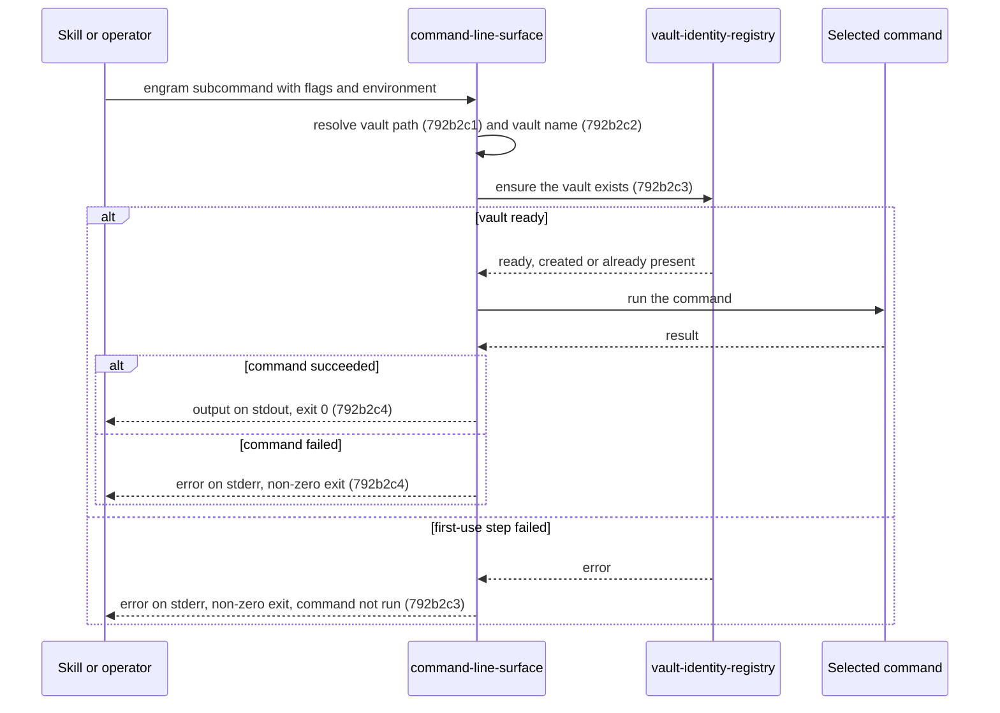

# Documentation Framework Adoption - Technical Spec

## 792b1 Orientation

- **Product problem:** [`792a1`](./792a_product-spec.md#792a1-problem-statement). Engram's shipped
  behavior has no specifications in the framework's format, and its tests can't be traced to any
  specification.
- **Current behavior:** The system already exists and is unchanged by this change. Its technical
  contracts are described only by the legacy C4 views, the ADRs, the invariants document, and the
  technical parts of the OpenSpec specs.
- **Insufficiency:** Those sources do not follow the framework's component qualification, ID, or
  product-traceability rules.
- **Recommended solution:** Document each qualifying component of the existing system as one
  **Added** component section. Map each section to the product scenarios it supports, and rename the
  existing tests that verify its scenarios.

This change describes the existing system and selects no new design. Its technical sections
therefore omit the guide's recommended-impact, relative-option-impact, and alternative-options
sections, because no options are being compared. They also omit component diffs: every component is
retained and documented as Added. Each component section instead uses the per-component structure in
[`792c3`](./792c_implementation-plan.md#792c3-spec-section-templates): orientation, sequences,
behavior requirements with Gherkin, and product-scenario mapping. Rationale appears under the
requirement or orientation it justifies.

Component sections `792b2` through `792b39` are added by the nodes of
[`792c_implementation-plan.md`](./792c_implementation-plan.md).

## 792b2 Added: command-line-surface

Canonical target: `docs/specs/technical/command-line-surface.md` (title `Command Line Surface - Technical Spec`).

### 792b2a Orientation

- Ownership: Repository component (caller), crossing the process argv, environment and stdio
  boundary through the targ library.
- Responsibility: turns one process invocation into one command run. It parses arguments and
  environment into a typed request, resolves the vault path and vault name, runs the first-use vault
  step before every vault-resolving command, routes to the command, and maps the result to the
  output streams and the exit status.
- Commands: `learn` (`fact`, `feedback`, `qa`, `runbook`), `query`, `query-chunks`, `show`,
  `show-chunk`, `amend`, `activate`, `resituate`, `ingest`, `prune`, `count`, `check`, `embed`
  (`apply`, `status`), `vocab` (`bootstrap`, `tag-definitions`, `propose`, `stats`, `refit`),
  `update`, `register-skills`, `serve` and `vault-id`. Every command except `prune`, `query-chunks`
  and `show-chunk` resolves a vault. Each command's behavior is specified by its capability.
- Current realization (informational): `internal/cli/targets.go` (`Targets`, `runInVault`,
  `newErrHandler`), `internal/cli/cli.go`, `resolveVault` in `internal/cli/learn.go`,
  `resolveVaultName` in `internal/cli/identity.go`, `DataDirFromHome` in `internal/cli/targets.go`;
  `cmd/engram/main.go` wires the production primitives.
- Qualification: responsibility, it owns parsing, precedence and routing for every command without
  depending on how any command works; ownership, its routing, gating and exit mapping are distinct
  from each command's own behavior; independent verification, its precedence and gating are tested
  through dispatch with injected environment and filesystem; stability, the surface survives any
  refactoring of command internals; necessity, every product capability is reached through it.
- Supported capabilities: 792a2 vault-identity. Later capabilities add their own routing
  requirements here (792d30, 792d51).

Rationale: each `engram <subcommand>` is its own process. Commands never call each other in
process; a skill reads one command's stdout and runs the next. (An earlier C3 draft drew an
in-process `query`→`learn` edge that does not exist.) Each skill step runs the CLI as a fresh
subprocess, and the skill layer reaches the vault only through it: it reads notes through
`engram show`, `engram show-chunk` and the query payload, and writes through `engram amend` and
`engram learn`, never by editing vault files directly.

### 792b2b Sequences



### 792b2c Behavior Requirements

#### 792b2c1 Vault path resolution

Requirement: 792b2c1 The command-line-surface MUST resolve the vault path to the `--vault` flag
when it is non-empty, else to `ENGRAM_VAULT_PATH` when it is non-empty, else to
`$XDG_DATA_HOME/engram/vault` when `XDG_DATA_HOME` is non-empty, else to
`$HOME/.local/share/engram/vault`, and MUST return that path without checking that it exists.

Supports: 792a2a1a, 792a2a1b, 792a2a1c, 792a2a1d.

##### 792b2c1a Scenarios

```gherkin
Scenario: 792b2c1a1 The flag wins
  Given the --vault flag is /explicit and ENGRAM_VAULT_PATH is /env
  When the vault path is resolved
  Then the path is /explicit

Scenario: 792b2c1a2 The environment is used without a flag
  Given the --vault flag is empty and ENGRAM_VAULT_PATH is /from/env
  When the vault path is resolved
  Then the path is /from/env

Scenario: 792b2c1a3 XDG_DATA_HOME sets the default
  Given no flag, no ENGRAM_VAULT_PATH, and XDG_DATA_HOME is /xdg/data
  When the vault path is resolved
  Then the path is /xdg/data/engram/vault

Scenario: 792b2c1a4 The home directory is the last fallback
  Given no flag, no ENGRAM_VAULT_PATH, no XDG_DATA_HOME, and home /home/u
  When the vault path is resolved
  Then the path is /home/u/.local/share/engram/vault
```

#### 792b2c2 Vault name resolution

Requirement: 792b2c2 The command-line-surface MUST resolve the vault name to the `--vault-name`
flag when it is non-empty, else to `ENGRAM_VAULT_NAME` when it is non-empty, else to `personal`.

Supports: 792a2b1a, 792a2b1b, 792a2b1c.

##### 792b2c2a Scenarios

```gherkin
Scenario: 792b2c2a1 The default is personal
  Given neither --vault-name nor ENGRAM_VAULT_NAME is set
  When the vault name is resolved
  Then the name is personal

Scenario: 792b2c2a2 The environment names the vault
  Given --vault-name is empty and ENGRAM_VAULT_NAME is team
  When the vault name is resolved
  Then the name is team

Scenario: 792b2c2a3 The flag wins
  Given --vault-name is work and ENGRAM_VAULT_NAME is personal-env
  When the vault name is resolved
  Then the name is work
```

#### 792b2c3 First-use gating

Requirement: 792b2c3 For every vault-resolving command, the command-line-surface MUST ask the
vault-identity-registry to ensure the vault at the resolved path before running the command, and
MUST NOT run the command when that step fails.

Supports: 792a2e1a, 792a2e1b, 792a2e1c, 792a2e1d, 792a2f1a, 792a2g1a.

Rationale: one shared first-use step in dispatch, rather than one per command, makes every command
create a missing vault the same way (#766).

##### 792b2c3a Scenarios

```gherkin
Scenario: 792b2c3a1 Every vault-resolving command ensures the vault first
  Given no vault exists at the resolved path
  When any vault-resolving command is dispatched
  Then the vault is created before the command runs, and the command then runs against it

Scenario: 792b2c3a2 A failed first-use step stops the command
  Given the resolved vault path names a regular file
  When a vault-resolving command is dispatched
  Then the error is reported and the command does not run
```

#### 792b2c4 Result reporting

Requirement: 792b2c4 The command-line-surface MUST write a failed command's error to stderr and exit
with a non-zero status, and MUST neither exit nor write to stderr on the command's behalf when the
command succeeds.

Supports: 792a2e1b, 792a2j1c, 792a2n1b, 792a2o1a.

##### 792b2c4a Scenarios

```gherkin
Scenario: 792b2c4a1 A failure is reported and exits non-zero
  Given a command that fails with the error "boom"
  When its result is reported
  Then stderr contains "boom" and the exit status is non-zero

Scenario: 792b2c4a2 A success neither exits nor writes stderr
  Given a command that succeeds
  When its result is reported
  Then nothing is written to stderr and no exit is requested
```

### 792b2d Product-Scenario Mapping

| Product scenario | Technical requirements |
| --- | --- |
| 792a2a1a | 792b2c1 |
| 792a2a1b | 792b2c1 |
| 792a2a1c | 792b2c1 |
| 792a2a1d | 792b2c1 |
| 792a2b1a | 792b2c2 |
| 792a2b1b | 792b2c2 |
| 792a2b1c | 792b2c2 |
| 792a2e1a | 792b2c3 |
| 792a2e1b | 792b2c3, 792b2c4 |
| 792a2e1c | 792b2c3 |
| 792a2e1d | 792b2c3 |
| 792a2f1a | 792b2c3 |
| 792a2g1a | 792b2c3 |
| 792a2j1c | 792b2c4 |
| 792a2n1b | 792b2c4 |
| 792a2o1a | 792b2c4 |

```gherkin
Scenario: 792a2a1a The flag wins over the environment
  Given ENGRAM_VAULT_PATH is set to /env/vault
  When the user runs an engram command with --vault /flag/vault
  Then the command uses /flag/vault

Scenario: 792a2a1b The environment variable is used without a flag
  Given ENGRAM_VAULT_PATH is set to /env/vault
  When the user runs an engram command without --vault
  Then the command uses /env/vault

Scenario: 792a2a1c The XDG data directory is the default
  Given neither --vault nor ENGRAM_VAULT_PATH is set and XDG_DATA_HOME is /data
  When the user runs an engram command
  Then the command uses /data/engram/vault

Scenario: 792a2a1d The home directory is the last fallback
  Given neither --vault, ENGRAM_VAULT_PATH nor XDG_DATA_HOME is set
  When the user runs an engram command
  Then the command uses ~/.local/share/engram/vault

Scenario: 792a2b1a The default vault name is personal
  Given neither --vault-name nor ENGRAM_VAULT_NAME is set
  When the user writes a note with engram learn
  Then the note's vault: field is personal

Scenario: 792a2b1b The environment names the vault
  Given ENGRAM_VAULT_NAME is set to team
  When the user writes a note with engram learn without --vault-name
  Then the note's vault: field is team

Scenario: 792a2b1c The flag wins over the environment
  Given ENGRAM_VAULT_NAME is set to team
  When the user writes a note with engram learn --vault-name org
  Then the note's vault: field is org

Scenario: 792a2e1a A read command creates the vault
  Given no vault exists at the resolved path
  When the user runs engram query --phrase x
  Then an initialized vault exists at that path, stderr carries one line naming it, and the query returns an empty result without error

Scenario: 792a2e1b amend and activate fail only on their own merits
  Given no vault exists at the resolved path
  When the user runs engram amend or engram activate on a target that does not exist
  Then the vault is created first, and the command fails because the target is not found, never on a vault lock error

Scenario: 792a2e1c A child host gets its own vault
  Given a host with ENGRAM_PARENT set and no vault at its resolved local path
  When the user runs engram query for the first time
  Then a local vault is created at the resolved local path, separate from the parent's vault

Scenario: 792a2e1d A second run creates nothing
  Given a vault that an engram command has just created
  When the user runs the same command again
  Then no creation line is printed and the vault ID is unchanged

Scenario: 792a2f1a An existing vault is untouched by read-only use
  Given an existing vault with no vault ID and no parent configured
  When the user runs a read-only command against it
  Then no vault file is created or modified, and no creation line is printed

Scenario: 792a2g1a A half-created vault gets its ID
  Given a vault with a .engram/ directory and no .engram-vault-id
  When the user runs any vault-resolving command
  Then .engram-vault-id is created and stderr carries one line saying the missing vault ID was stamped

Scenario: 792a2j1c vault-id reports the corrupt file
  Given a vault whose .engram-vault-id holds junk
  When the user runs engram vault-id
  Then it fails with an error saying the vault ID is invalid

Scenario: 792a2n1b Claim needs an ID
  Given an existing vault with no vault ID
  When the user runs engram vault-id --claim
  Then it fails with an error saying the vault has no vault ID

Scenario: 792a2o1a Both flags are refused
  Given a vault with a vault ID
  When the user runs engram vault-id --regenerate --claim
  Then it fails naming --regenerate, and the vault ID is unchanged
```
