# Documentation Framework Adoption - Technical Spec

## 792b1 Orientation

- **Product problem:** [`792a1`](./792a_product-spec.md#792a1-problem-statement). Engram's shipped
  behavior has no specifications in the framework's format, and its tests can't be traced to any
  specification.
- **Current behavior:** The system already exists and is unchanged by this change. Its technical
  contracts are described only by the legacy C4 views, the ADRs, the invariants document, and the
  technical parts of the OpenSpec specs.
- **Insufficiency:** Those sources do not follow the framework's component qualification, ID, or
  product-traceability rules.
- **Recommended solution:** Document each qualifying component of the existing system as one
  **Added** component section. Map each section to the product scenarios it supports, and rename the
  existing tests that verify its scenarios.

This change describes the existing system and selects no new design. Its technical sections
therefore omit the guide's recommended-impact, relative-option-impact, and alternative-options
sections, because no options are being compared. They also omit component diffs: every component is
retained and documented as Added. Each component section instead uses the per-component structure in
[`792c3`](./792c_implementation-plan.md#792c3-spec-section-templates): orientation, sequences,
behavior requirements with Gherkin, and product-scenario mapping. Rationale appears under the
requirement or orientation it justifies.

Component sections `792b2` through `792b39` are added by the nodes of
[`792c_implementation-plan.md`](./792c_implementation-plan.md).

## 792b2 Added: command-line-surface

Canonical target: `docs/specs/technical/command-line-surface.md` (title `Command Line Surface - Technical Spec`).

### 792b2a Orientation

- Ownership: Repository component (caller), crossing the process argv, environment and stdio
  boundary through the targ library.
- Responsibility: turns one process invocation into one command run. It parses arguments and
  environment into a typed request, resolves the vault path, the vault name and the chunk index
  directory, runs the first-use vault step before every vault-resolving command, routes to the
  command, and maps the result to the output streams and the exit status.
- Commands: `learn` (`fact`, `feedback`, `qa`, `runbook`), `query`, `query-chunks`, `show`,
  `show-chunk`, `amend`, `activate`, `resituate`, `ingest`, `prune`, `count`, `check`, `embed`
  (`apply`, `status`), `vocab` (`bootstrap`, `tag-definitions`, `propose`, `stats`, `refit`),
  `update`, `register-skills`, `serve` and `vault-id`. Every command except `prune`, `query-chunks`
  and `show-chunk` resolves a vault. Each command's behavior is specified by its capability.
- Current realization (informational): `internal/cli/targets.go` (`Targets`, `runInVault`,
  `newErrHandler`), `internal/cli/cli.go`, `resolveVault` in `internal/cli/learn.go`,
  `resolveVaultName` in `internal/cli/identity.go`, `DataDirFromHome` in `internal/cli/targets.go`,
  `ResolveChunksDir` in `internal/cli/ingest.go`;
  `cmd/engram/main.go` wires the production primitives.
- Qualification: responsibility, it owns parsing, precedence and routing for every command without
  depending on how any command works; ownership, its routing, gating and exit mapping are distinct
  from each command's own behavior; independent verification, its precedence and gating are tested
  through dispatch with injected environment and filesystem; stability, the surface survives any
  refactoring of command internals; necessity, every product capability is reached through it.
- Supported capabilities: 792a2 vault-identity, 792a3 note-writing, 792a4 note-revision, 792a5
  chunk-indexing, 792a6 controlled-vocabulary, 792a7 memory-query. Later capabilities add their own
  routing requirements here (792d30, 792d51).

Rationale: each `engram <subcommand>` is its own process. Commands never call each other in
process; a skill reads one command's stdout and runs the next. (An earlier C3 draft drew an
in-process `query`→`learn` edge that does not exist.) Each skill step runs the CLI as a fresh
subprocess, and the skill layer reaches the vault only through it: it reads notes through
`engram show`, `engram show-chunk` and the query payload, and writes through `engram amend` and
`engram learn`, never by editing vault files directly.

### 792b2b Sequences

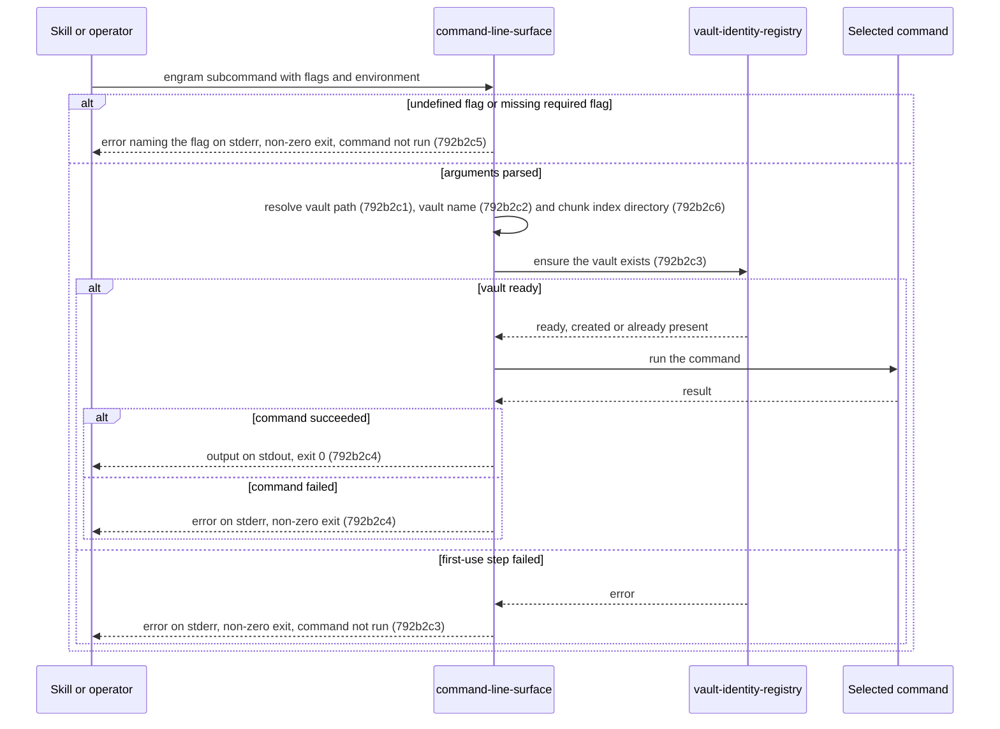

### 792b2c Behavior Requirements

#### 792b2c1 Vault path resolution

Requirement: 792b2c1 The command-line-surface MUST resolve the vault path to the `--vault` flag
when it is non-empty, else to `ENGRAM_VAULT_PATH` when it is non-empty, else to
`$XDG_DATA_HOME/engram/vault` when `XDG_DATA_HOME` is non-empty, else to
`$HOME/.local/share/engram/vault`, and MUST return that path without checking that it exists.

Supports: 792a2a1a, 792a2a1b, 792a2a1c, 792a2a1d, 792a6t1a.

##### 792b2c1a Scenarios

```gherkin
Scenario: 792b2c1a1 The flag wins
  Given the --vault flag is /explicit and ENGRAM_VAULT_PATH is /env
  When the vault path is resolved
  Then the path is /explicit

Scenario: 792b2c1a2 The environment is used without a flag
  Given the --vault flag is empty and ENGRAM_VAULT_PATH is /from/env
  When the vault path is resolved
  Then the path is /from/env

Scenario: 792b2c1a3 XDG_DATA_HOME sets the default
  Given no flag, no ENGRAM_VAULT_PATH, and XDG_DATA_HOME is /xdg/data
  When the vault path is resolved
  Then the path is /xdg/data/engram/vault

Scenario: 792b2c1a4 The home directory is the last fallback
  Given no flag, no ENGRAM_VAULT_PATH, no XDG_DATA_HOME, and home /home/u
  When the vault path is resolved
  Then the path is /home/u/.local/share/engram/vault
```

#### 792b2c2 Vault name resolution

Requirement: 792b2c2 The command-line-surface MUST resolve the vault name to the `--vault-name`
flag when it is non-empty, else to `ENGRAM_VAULT_NAME` when it is non-empty, else to `personal`.

Supports: 792a2b1a, 792a2b1b, 792a2b1c, 792a4h1f.

##### 792b2c2a Scenarios

```gherkin
Scenario: 792b2c2a1 The default is personal
  Given neither --vault-name nor ENGRAM_VAULT_NAME is set
  When the vault name is resolved
  Then the name is personal

Scenario: 792b2c2a2 The environment names the vault
  Given --vault-name is empty and ENGRAM_VAULT_NAME is team
  When the vault name is resolved
  Then the name is team

Scenario: 792b2c2a3 The flag wins
  Given --vault-name is work and ENGRAM_VAULT_NAME is personal-env
  When the vault name is resolved
  Then the name is work
```

#### 792b2c3 First-use gating

Requirement: 792b2c3 For every vault-resolving command, the command-line-surface MUST ask the
vault-identity-registry to ensure the vault at the resolved path before running the command, and
MUST NOT run the command when that step fails.

Supports: 792a2e1a, 792a2e1b, 792a2e1c, 792a2e1d, 792a2f1a, 792a2g1a, 792a6t1a.

Rationale: one shared first-use step in dispatch, rather than one per command, makes every command
create a missing vault the same way (#766).

##### 792b2c3a Scenarios

```gherkin
Scenario: 792b2c3a1 Every vault-resolving command ensures the vault first
  Given no vault exists at the resolved path
  When any vault-resolving command is dispatched
  Then the vault is created before the command runs, and the command then runs against it

Scenario: 792b2c3a2 A failed first-use step stops the command
  Given the resolved vault path names a regular file
  When a vault-resolving command is dispatched
  Then the error is reported and the command does not run
```

#### 792b2c4 Result reporting

Requirement: 792b2c4 The command-line-surface MUST write a failed command's error to stderr and exit
with a non-zero status, and MUST neither exit nor write to stderr on the command's behalf when the
command succeeds.

Supports: 792a2e1b, 792a2j1c, 792a2n1b, 792a2o1a, 792a3f1b, 792a3g1a, 792a3k1a, 792a3k1b, 792a3k1c,
792a3k1d, 792a3r1a, 792a3s1a, 792a4a1b, 792a4c1a, 792a4f1a, 792a4k1a, 792a4k1b, 792a4l1b, 792a4l1c,
792a4n1c, 792a6h1a, 792a6i1c, 792a6r1a, 792a6t1a, 792a8c1f, 792a8e1j, 792a8f1a, 792a8f1b, 792a8f1c,
792a9a1b, 792a9a1e, 792a9g1c, 792a9i1f.

##### 792b2c4a Scenarios

```gherkin
Scenario: 792b2c4a1 A failure is reported and exits non-zero
  Given a command that fails with the error "boom"
  When its result is reported
  Then stderr contains "boom" and the exit status is non-zero

Scenario: 792b2c4a2 A success neither exits nor writes stderr
  Given a command that succeeds
  When its result is reported
  Then nothing is written to stderr and no exit is requested
```

#### 792b2c5 Argument refusal

Requirement: 792b2c5 The command-line-surface MUST refuse an invocation that passes a flag the
command does not define, or omits a flag the command marks required, by writing an error naming the
flag to stderr and exiting non-zero without running the command.

Supports: 792a3e1a, 792a3f1a, 792a3f1c, 792a3g1a, 792a3r1a, 792a6h1a, 792a6i1c, 792a6r1a.

##### 792b2c5a Scenarios

```gherkin
Scenario: 792b2c5a1 An undefined flag is refused
  Given a command that defines no --skill-hash flag
  When it is dispatched with --skill-hash
  Then the exit status is non-zero and the command does not run

Scenario: 792b2c5a2 A missing required flag is refused
  Given a command that marks --done-when required
  When it is dispatched without --done-when
  Then stderr names --done-when, the exit status is non-zero, and the command does not run
```

#### 792b2c6 Chunk index directory resolution

Requirement: 792b2c6 For `ingest`, `prune`, `query`, `query-chunks`, `show-chunk`, `amend` and
`serve`, the command-line-surface MUST resolve the chunk index directory to the `--chunks-dir` flag
when it is non-empty, else to `ENGRAM_CHUNKS_DIR` when it is non-empty, else to
`$XDG_DATA_HOME/engram/chunks` when `XDG_DATA_HOME` is non-empty, else to
`$HOME/.local/share/engram/chunks`, and MUST return that path without checking that it exists.

Supports: 792a5a1a, 792a5a1b, 792a5a1c, 792a5a1d.

##### 792b2c6a Scenarios

```gherkin
Scenario: 792b2c6a1 The flag wins
  Given the --chunks-dir flag is /from/flag and ENGRAM_CHUNKS_DIR is /from/env
  When the chunk index directory is resolved
  Then the directory is /from/flag

Scenario: 792b2c6a2 The environment is used without a flag
  Given the --chunks-dir flag is empty and ENGRAM_CHUNKS_DIR is /from/env
  When the chunk index directory is resolved
  Then the directory is /from/env

Scenario: 792b2c6a3 XDG_DATA_HOME sets the default
  Given no flag, no ENGRAM_CHUNKS_DIR, and XDG_DATA_HOME is /xdg/data
  When the chunk index directory is resolved
  Then the directory is /xdg/data/engram/chunks

Scenario: 792b2c6a4 The home directory is the last fallback
  Given no flag, no ENGRAM_CHUNKS_DIR, no XDG_DATA_HOME, and home /home/dev
  When the chunk index directory is resolved
  Then the directory is /home/dev/.local/share/engram/chunks
```

#### 792b2c7 Note lookup

Requirement: 792b2c7 For `show`, the command-line-surface MUST read the note that the reference names,
a full basename, a Luhmann ID, or either of them in `[[ ]]` with an optional `|display` or with a
trailing `.md`, and MUST print its content exactly as stored, a newline after it when it lacks one,
a blank line, the line `# outbound links (fetch with: engram show <basename>)`, and then the target
of each link in the note's text (792b13c3), one per line, or `(none)`. It MUST fail with
`show: empty note reference` when the reference is blank, and with `show: note not found: "<ref>"`,
quoting the reference as given, when no note matches. It MUST NOT shorten a runbook's `red_flags`,
and MUST NOT change any note.

Supports: 792a7x1a, 792a7x1b, 792a7x1c, 792a7x1d, 792a7x1e, 792a7x1f, 792a7x1g, 792a7x1h.

Rationale: `engram show` is the full-fidelity source that the guidance shim names, so the preview
budget that bounds a query payload (792a7w) is not applied here. Resolving a note that is on the
parent vault, by `--parent` or by a miss with a parent configured, belongs to parent-sync, which adds
that routing (792d51).

##### 792b2c7a Scenarios

```gherkin
Scenario Outline: 792b2c7a1 Every reference form resolves
  Given a vault holding the note 1.hub
  When `engram show <ref>` runs
  Then the note's content is printed

  Examples:
    | ref             |
    | 1.hub           |
    | 1               |
    | [[1.hub]]       |
    | 1.hub.md        |
    | [[1.hub\|the hub]] |

Scenario: 792b2c7a2 The outbound links skip fenced code
  Given the note 1.hub linking [[2.alpha]] and [[3.beta]] and holding [[9.fenced]] inside a code fence
  When `engram show 1.hub` runs
  Then the outbound links section lists 2.alpha and 3.beta and not 9.fenced

Scenario: 792b2c7a3 An unknown reference fails
  Given a vault without a note 99.nonexistent
  When `engram show 99.nonexistent` runs
  Then it fails with a not-found error

Scenario: 792b2c7a4 A blank reference fails
  Given any vault
  When `engram show` runs with the reference "  "
  Then it fails

Scenario: 792b2c7a5 A runbook's red flags are printed whole
  Given a runbook with 20 red flags that take more than 1200 bytes
  When `engram show` runs for it
  Then every entry is printed in file order and the output holds no OMITTED marker

Scenario: 792b2c7a6 The production filesystem is read
  Given a temporary vault on disk holding 1.real, which links [[2.other]]
  When `engram show 1.real` runs over the production filesystem wiring
  Then the note's body and 2.other are printed
```

#### 792b2c8 Chunk lookup

Requirement: 792b2c8 For `show-chunk`, the command-line-surface MUST read every index file in the
resolved chunk index directory (792b2c6, 792b18c12) and print the text of the record whose
`<source>#<anchor>` equals the reference with surrounding whitespace trimmed, a newline after it when
it lacks one. It MUST fail with `show-chunk: empty chunk ref` when the reference is blank, and with
`chunk not found: <ref>` when no record has that ID. It MUST NOT embed anything and MUST NOT change
any file.

Supports: 792a7t1a, 792a7t1b, 792a7t1c.

Rationale: with `engram query --lazy-chunks` (792a7s) a payload omits chunk text, and the agent
fetches one chunk's evidence on demand; the lookup is by ID and needs no model.

##### 792b2c8a Scenarios

```gherkin
Scenario: 792b2c8a1 A chunk's text is printed
  Given an index holding /s/a.jsonl#turn-1 and /s/a.jsonl#turn-2
  When `engram show-chunk /s/a.jsonl#turn-2` runs
  Then only the second chunk's text is printed

Scenario: 792b2c8a2 An unknown chunk fails
  Given an index holding only /s/a.jsonl#turn-1
  When `engram show-chunk /s/a.jsonl#turn-9` runs
  Then it fails with "chunk not found: /s/a.jsonl#turn-9"

Scenario: 792b2c8a3 A blank reference fails
  Given any chunk index
  When `engram show-chunk` runs with the reference "   "
  Then it fails
```

### 792b2d Product-Scenario Mapping

| Product scenario | Technical requirements |
| --- | --- |
| 792a2a1a | 792b2c1 |
| 792a2a1b | 792b2c1 |
| 792a2a1c | 792b2c1 |
| 792a2a1d | 792b2c1 |
| 792a2b1a | 792b2c2 |
| 792a2b1b | 792b2c2 |
| 792a2b1c | 792b2c2 |
| 792a2e1a | 792b2c3 |
| 792a2e1b | 792b2c3, 792b2c4 |
| 792a2e1c | 792b2c3 |
| 792a2e1d | 792b2c3 |
| 792a2f1a | 792b2c3 |
| 792a2g1a | 792b2c3 |
| 792a2j1c | 792b2c4 |
| 792a2n1b | 792b2c4 |
| 792a2o1a | 792b2c4 |
| 792a3e1a | 792b2c5 |
| 792a3f1a | 792b2c5 |
| 792a3f1b | 792b2c4 |
| 792a3f1c | 792b2c5 |
| 792a3g1a | 792b2c4, 792b2c5 |
| 792a3k1a | 792b2c4 |
| 792a3k1b | 792b2c4 |
| 792a3k1c | 792b2c4 |
| 792a3k1d | 792b2c4 |
| 792a3r1a | 792b2c4, 792b2c5 |
| 792a3s1a | 792b2c4 |
| 792a4a1b | 792b2c4 |
| 792a4c1a | 792b2c4 |
| 792a4f1a | 792b2c4 |
| 792a4h1f | 792b2c2 |
| 792a4k1a | 792b2c4 |
| 792a4k1b | 792b2c4 |
| 792a4l1b | 792b2c4 |
| 792a4l1c | 792b2c4 |
| 792a4n1c | 792b2c4 |
| 792a5a1a | 792b2c6 |
| 792a5a1b | 792b2c6 |
| 792a5a1c | 792b2c6 |
| 792a5a1d | 792b2c6 |
| 792a5b1d | 792b2c4 |
| 792a5e1b | 792b2c4 |
| 792a5r1e | 792b2c4 |
| 792a6h1a | 792b2c4, 792b2c5 |
| 792a6i1c | 792b2c4, 792b2c5 |
| 792a6r1a | 792b2c4, 792b2c5 |
| 792a6t1a | 792b2c1, 792b2c3, 792b2c4 |
| 792a7t1a | 792b2c6, 792b2c8 |
| 792a7t1b | 792b2c8 |
| 792a7t1c | 792b2c8 |
| 792a7x1a | 792b2c7 |
| 792a7x1b | 792b2c7 |
| 792a7x1c | 792b2c7 |
| 792a7x1d | 792b2c7 |
| 792a7x1e | 792b2c7 |
| 792a7x1f | 792b2c7 |
| 792a7x1g | 792b2c7 |
| 792a7x1h | 792b2c7 |
| 792a8c1f | 792b2c4 |
| 792a8e1j | 792b2c4 |
| 792a8f1a | 792b2c4 |
| 792a8f1b | 792b2c4 |
| 792a8f1c | 792b2c4 |
| 792a9a1b | 792b2c4 |
| 792a9a1e | 792b2c4 |
| 792a9g1c | 792b2c4 |
| 792a9i1f | 792b2c4 |

```gherkin
Scenario: 792a2a1a The flag wins over the environment
  Given ENGRAM_VAULT_PATH is set to /env/vault
  When the user runs an engram command with --vault /flag/vault
  Then the command uses /flag/vault

Scenario: 792a2a1b The environment variable is used without a flag
  Given ENGRAM_VAULT_PATH is set to /env/vault
  When the user runs an engram command without --vault
  Then the command uses /env/vault

Scenario: 792a2a1c The XDG data directory is the default
  Given neither --vault nor ENGRAM_VAULT_PATH is set and XDG_DATA_HOME is /data
  When the user runs an engram command
  Then the command uses /data/engram/vault

Scenario: 792a2a1d The home directory is the last fallback
  Given neither --vault, ENGRAM_VAULT_PATH nor XDG_DATA_HOME is set
  When the user runs an engram command
  Then the command uses ~/.local/share/engram/vault

Scenario: 792a2b1a The default vault name is personal
  Given neither --vault-name nor ENGRAM_VAULT_NAME is set
  When the user writes a note with engram learn
  Then the note's vault: field is personal

Scenario: 792a2b1b The environment names the vault
  Given ENGRAM_VAULT_NAME is set to team
  When the user writes a note with engram learn without --vault-name
  Then the note's vault: field is team

Scenario: 792a2b1c The flag wins over the environment
  Given ENGRAM_VAULT_NAME is set to team
  When the user writes a note with engram learn --vault-name org
  Then the note's vault: field is org

Scenario: 792a2e1a A read command creates the vault
  Given no vault exists at the resolved path
  When the user runs engram query --phrase x
  Then an initialized vault exists at that path, stderr carries one line naming it, and the query returns an empty result without error

Scenario: 792a2e1b amend and activate fail only on their own merits
  Given no vault exists at the resolved path
  When the user runs engram amend or engram activate on a target that does not exist
  Then the vault is created first, and the command fails because the target is not found, never on a vault lock error

Scenario: 792a2e1c A child host gets its own vault
  Given a host with ENGRAM_PARENT set and no vault at its resolved local path
  When the user runs engram query for the first time
  Then a local vault is created at the resolved local path, separate from the parent's vault

Scenario: 792a2e1d A second run creates nothing
  Given a vault that an engram command has just created
  When the user runs the same command again
  Then no creation line is printed and the vault ID is unchanged

Scenario: 792a2f1a An existing vault is untouched by read-only use
  Given an existing vault with no vault ID and no parent configured
  When the user runs a read-only command against it
  Then no vault file is created or modified, and no creation line is printed

Scenario: 792a2g1a A half-created vault gets its ID
  Given a vault with a .engram/ directory and no .engram-vault-id
  When the user runs any vault-resolving command
  Then .engram-vault-id is created and stderr carries one line saying the missing vault ID was stamped

Scenario: 792a2j1c vault-id reports the corrupt file
  Given a vault whose .engram-vault-id holds junk
  When the user runs engram vault-id
  Then it fails with an error saying the vault ID is invalid

Scenario: 792a2n1b Claim needs an ID
  Given an existing vault with no vault ID
  When the user runs engram vault-id --claim
  Then it fails with an error saying the vault has no vault ID

Scenario: 792a2o1a Both flags are refused
  Given a vault with a vault ID
  When the user runs engram vault-id --regenerate --claim
  Then it fails naming --regenerate, and the vault ID is unchanged
```

```gherkin
Scenario: 792a3e1a A task type is refused
  Given an existing vault
  When the user runs engram learn runbook with --task-type foo
  Then it fails naming --task-type as an undefined flag, and no note is written

Scenario: 792a3f1a A missing situation is refused
  Given an existing vault
  When the user runs engram learn fact without --situation
  Then it fails naming --situation, and no note is written

Scenario: 792a3f1b A blank situation is refused
  Given an existing vault
  When the user runs engram learn feedback with --situation "  "
  Then it fails saying --situation is required, and no note is written

Scenario: 792a3f1c A runbook without done-when is refused
  Given an existing vault
  When the user runs engram learn runbook without --done-when
  Then it fails naming --done-when, and no note is written

Scenario Outline: 792a3g1a An invalid argument is refused before any write
  Given an existing vault
  When the user runs engram learn <kind> with <argument>
  Then it fails with an error saying <problem>, and no note is written

  Examples:
    | kind    | argument               | problem                                         |
    | fact    | no --source            | --source is a missing required flag             |
    | fact    | no --slug              | slug is required                                |
    | fact    | --slug X_y             | slug must match [a-z0-9-]+                      |
    | fact    | --project A            | project slug must match [a-z0-9-]+              |
    | fact    | --issue "a b"          | issue must be non-empty with no whitespace      |
    | fact    | --tag "A B"            | tag must be <family> or <family>/<value>        |
    | runbook | --trigger ab           | trigger must be at least 3 characters           |
    | fact    | --tier L9              | tier must be L2, or L1 or L3                    |
    | fact    | --supersedes "a\|bogus\|c" | supersedes type must be updates, narrows or refutes |

Scenario: 792a3k1a A missing position is refused
  Given an existing vault
  When the user runs engram learn fact without --position
  Then it fails saying the position must be top, continuation or sibling, and no note is written

Scenario: 792a3k1b A continuation without a target is refused
  Given an existing vault
  When the user runs engram learn fact --position continuation without --target
  Then it fails saying a target is required, and no note is written

Scenario: 792a3k1c A sibling of a top-level note is refused
  Given a vault whose note has ID 1
  When the user runs engram learn fact --position sibling --target 1
  Then it fails saying a sibling of a top-level note requires --position top, and no note is written

Scenario: 792a3k1d A malformed target is refused
  Given an existing vault
  When the user runs engram learn fact --position continuation --target abc
  Then it fails saying the ID must start with a digit, and no note is written

Scenario Outline: 792a3r1a An invalid pair is refused before any write
  Given an existing vault
  When the user runs engram learn qa with <argument>
  Then it fails with an error saying <problem>, and neither note is written

  Examples:
    | argument                       | problem                                      |
    | no --question                  | --question is required                       |
    | both --answer and --answer-file | exactly one of --answer or --answer-file is required |
    | neither --answer nor --answer-file | exactly one of --answer or --answer-file is required |
    | --certainty huge               | certainty must be high, medium, or low       |
    | --contributors nope            | contributor not found in vault               |
    | --slug X_y                     | slug must match [a-z0-9-]+                   |
    | no --source                    | --source is a missing required flag          |

Scenario: 792a3s1a A failed answer removes the question
  Given a vault that already holds a file named like today's answer note for slug why-x
  When the user runs engram learn qa --slug why-x
  Then it fails saying the answer note could not be written, and no question note for why-x remains
```

```gherkin
Scenario: 792a4a1b An unknown reference is refused
  Given a vault with no note 9
  When the user runs engram amend --target 9, or engram resituate --note 9 --situation s
  Then it fails saying note "9" was not found, and no note is written

Scenario: 792a4c1a A question-and-answer note is refused
  Given a vault holding an answer note qa.2026-10-09.why.a
  When the user runs engram amend --target qa.2026-10-09.why.a --situation s
  Then it fails saying the note type is unknown, and the note is unchanged

Scenario Outline: 792a4f1a An invalid amend argument is refused before any write
  Given a vault holding fact note 1
  When the user runs engram amend --target 1 with <argument>
  Then it fails with an error saying <problem>, and the note is unchanged

  Examples:
    | argument                     | problem                                        |
    | --supersedes "a\|bogus\|c"   | supersedes type must be updates, narrows or refutes |
    | --supersedes "a\|updates"    | supersedes format must be <basename>\|<type>\|<claim> |
    | --trigger ab                 | trigger must be at least 3 characters          |
    | --chunk-source nope#x        | unresolved chunk-source id "nope#x"            |

Scenario: 792a4h1f Without a vault name the default is stamped
  Given neither --vault-name nor ENGRAM_VAULT_NAME is set
  When the user runs engram amend --target <note> --object new
  Then the note's vault: is personal, never an empty string

Scenario: 792a4k1a Amend refuses an anchored edited key
  Given a fact note whose object: value carries an anchor that another key aliases
  When the user runs engram amend --target <note> --object new
  Then it fails naming object, and the note is unchanged

Scenario: 792a4k1b Resituate refuses an anchored situation
  Given a fact note whose situation: or created: carries an anchor
  When the user runs engram resituate --note <note> --situation new
  Then it fails naming the key, and the note is unchanged

Scenario: 792a4l1b A runbook cannot be resituated
  Given a vault holding runbook note 2
  When the user runs engram resituate --note 2 --situation new
  Then it fails saying the note type runbook is unknown, and the note is unchanged

Scenario: 792a4l1c A failed sidecar rebuild fails the command
  Given embedding fails for the note being resituated
  When the user runs engram resituate --note <note> --situation new
  Then the command fails naming the note, and the note's situation is already new

Scenario: 792a4n1c A missing note fails only its own ref
  Given no parent is configured, a note 3.2026-09-20.local, and no note 7.2026-09-01.gone
  When the user runs engram activate --note 3.2026-09-20.local --note 7.2026-09-01.gone.md
  Then 3.2026-09-20.local's last_used is today, stderr names 7.2026-09-01.gone.md as not found, and the command fails saying 1 of 2 refs failed
```

```gherkin
Scenario: 792a5a1a The flag wins over the environment
  Given ENGRAM_CHUNKS_DIR is set to /env/chunks
  When the user runs engram ingest --chunks-dir /flag/chunks --markdown notes.md
  Then notes.md is indexed under /flag/chunks

Scenario: 792a5a1b The environment variable is used without a flag
  Given ENGRAM_CHUNKS_DIR is set to /env/chunks
  When the user runs engram ingest --markdown notes.md
  Then notes.md is indexed under /env/chunks

Scenario: 792a5a1c The XDG data directory is the default
  Given neither --chunks-dir nor ENGRAM_CHUNKS_DIR is set and XDG_DATA_HOME is /data
  When the user runs engram ingest --markdown notes.md
  Then notes.md is indexed under /data/engram/chunks

Scenario: 792a5a1d The home directory is the last fallback
  Given neither --chunks-dir, ENGRAM_CHUNKS_DIR nor XDG_DATA_HOME is set
  When the user runs engram ingest --markdown notes.md
  Then notes.md is indexed under ~/.local/share/engram/chunks

Scenario Outline: 792a5b1d An unreadable named file fails the command
  Given no file exists at <file>
  When the user runs engram ingest <flag> <file>
  Then the command fails with an error naming <file>

  Examples:
    | flag         | file          |
    | --markdown   | missing.md    |
    | --transcript | missing.jsonl |

Scenario: 792a5e1b A malformed sweep file is refused
  Given a repository whose .engram/sweep.json is not valid JSON
  When the user runs engram ingest --auto inside it
  Then the command fails with an error naming .engram/sweep.json, and nothing is indexed

Scenario: 792a5r1e A failed removal is reported and fails the run
  Given an index with two removable duplicates, one of whose index files cannot be removed
  When the user runs engram prune --duplicates
  Then stderr has a "[FAIL]" line naming that file, the other duplicate is removed, and the command fails saying 1 of 2 removals failed

Scenario Outline: 792a6h1a A bad seed is refused
  Given a vault
  When the user runs engram vocab bootstrap <arguments>
  Then it fails with an error saying <problem>, and nothing is written

  Examples:
    | arguments                   | problem                              |
    | without --seed              | --seed is a missing required flag    |
    | --seed missing.yaml         | the seed file cannot be read         |
    | --seed with "term: [unclosed" | the seed YAML cannot be parsed     |

Scenario: 792a6i1c Both flags are required
  Given a vault
  When the user runs engram vocab propose --term x without --description
  Then it fails saying --description is a missing required flag, and nothing is written

Scenario Outline: 792a6r1a The plan flow is gone
  Given a vault
  When the user runs engram vocab refit <flag> x
  Then it fails saying the flag provided is not defined, and nothing is written

  Examples:
    | flag           |
    | --plan         |
    | --emit-request |

Scenario: 792a6t1a Stats on an empty vault
  Given an empty vault
  When the user runs engram vocab stats
  Then it prints "terms: 0  member-notes: 0  untagged: 0" and nothing on stderr
```

```gherkin
Scenario: 792a7t1a A chunk's text is printed
  Given an ingested document with a "Baking" section
  When the user runs engram show-chunk "<document>#Baking"
  Then stdout is that section's text

Scenario: 792a7t1b An unknown chunk is an error
  Given a chunk index that holds no chunk "nosuch#x"
  When the user runs engram show-chunk "nosuch#x"
  Then it fails with "chunk not found: nosuch#x" and exits non-zero

Scenario: 792a7t1c An empty ID is an error
  Given any chunk index
  When the user runs engram show-chunk with a blank ID
  Then it fails with "show-chunk: empty chunk ref"

Scenario: 792a7x1a A note is printed with its links
  Given a note 1.hub that links [[2.alpha]] and [[3.beta]]
  When the user runs engram show 1.hub
  Then stdout is the note, then the outbound links line and 2.alpha and 3.beta

Scenario: 792a7x1b A note with no links says so
  Given a note that links to nothing
  When the user runs engram show <basename>
  Then stdout ends with the outbound links line and (none)

Scenario: 792a7x1c Every reference form resolves
  Given the note 1.2026-10-09.go-testing
  When the user runs engram show with 1.2026-10-09.go-testing, [[1.2026-10-09.go-testing]], 1.2026-10-09.go-testing.md or 1
  Then each prints the same note

Scenario: 792a7x1d Show never truncates red flags
  Given a runbook whose red flags take more than 1200 bytes
  When the user runs engram show for it
  Then stdout holds every entry in file order and no omission marker

Scenario: 792a7x1e A fenced link is not listed
  Given a note whose body has [[9.fenced]] inside a code fence and [[2.alpha]] outside it
  When the user runs engram show for it
  Then only 2.alpha is listed

Scenario: 792a7x1f An unknown note is an error
  Given a vault with no note nosuch
  When the user runs engram show nosuch
  Then it fails with show: note not found: "nosuch" and exits non-zero

Scenario: 792a7x1g A blank reference is an error
  Given any vault
  When the user runs engram show with a blank reference
  Then it fails with show: empty note reference

Scenario: 792a7x1h Each link is listed once
  Given a note whose body links [[2.alpha]], [[3.beta.md]], [[2.alpha]] and [[4.gamma|the gamma note]]
  When the user runs engram show for it
  Then the outbound links are 2.alpha, 3.beta and 4.gamma|the gamma note, in that order
```

```gherkin
Scenario: 792a8c1f A filter without = is refused
  Given a vault
  When the user runs engram count --group-by type --filter bad
  Then it fails with an error saying --filter must be attr=value and quoting "bad", and prints nothing to stdout

Scenario: 792a8e1j An unreadable note fails the report
  Given a vault with a note the user cannot read
  When the user runs engram count --backlinks-of x
  Then it fails with an error naming the unreadable file, and prints nothing to stdout

Scenario: 792a8f1a Both flags are refused
  Given a vault
  When the user runs engram count --group-by type --backlinks-of note.name
  Then it fails with "count: --group-by and --backlinks-of are mutually exclusive"

Scenario: 792a8f1b Neither flag is refused
  Given a vault
  When the user runs engram count with no --group-by and no --backlinks-of
  Then it fails with "count: specify --group-by <attr> or --backlinks-of <basename>"

Scenario: 792a8f1c A filter alone is not a mode
  Given a vault
  When the user runs engram count --filter type=fact
  Then it fails with "count: specify --group-by <attr> or --backlinks-of <basename>"
```

```gherkin
Scenario: 792a9a1b A FAIL line fails the command
  Given a vault with a note whose link is a bare ID that should resolve
  When the user runs engram check
  Then a line beginning FAIL names G0 graph-resolution, stderr has "check: FAIL-class invariant violations found", and the exit status is non-zero

Scenario: 792a9a1e An unreadable note stops the check
  Given a vault with a note the user cannot read
  When the user runs engram check
  Then it fails with an error beginning "check: scan:" and naming the file, and prints no PASS, WARN or FAIL line

Scenario: 792a9g1c An unreadable note stops the census
  Given a vault with a note the user cannot read
  When the user runs engram embed status
  Then it fails with an error beginning "embed status: scan:" and naming the file

Scenario: 792a9i1f An unreadable note stops the run
  Given a vault with a note the user cannot read
  When the user runs engram embed apply
  Then it fails with an error beginning "embed apply: scan:" and nothing is embedded
```

## 792b3 Added: durable-file-store

Canonical target: `docs/specs/technical/durable-file-store.md` (title `Durable File Store - Technical Spec`).

### 792b3a Orientation

- Ownership: Repository-owned dependency-boundary interaction (the operating-system filesystem).
- Responsibility: every engram read and write of vault, sidecar, state and chunk-index files. It
  replaces a file atomically, creates a file exclusively, reports failures with the path and
  operation while keeping the underlying error identity, and lists the Markdown files that make up
  a vault directory.
- Current realization (informational): `primFS` in `internal/cli/edgefs.go` (the `EdgeFS`
  interface in `internal/cli/deps.go`), `vaultFS` in `internal/cli/vault_fs.go`, `listMDFromFS` in
  `internal/cli/deps_compose.go`, over the raw `FSPrims` that `cmd/engram/main.go` supplies.
- Qualification: responsibility, atomic replace, exclusive create and vault listing are stated
  without naming any caller; ownership, callers decide what to write and when, while this
  component decides how a write reaches the disk; independent verification, it is tested directly
  over fake primitives and over the real filesystem; stability, the contract survives any change to
  the injection seam; necessity, every vault-identity, note and index write depends on it.
- Supported capabilities: 792a2 vault-identity, 792a3 note-writing, 792a4 note-revision, 792a5
  chunk-indexing.

Rationale: `os.WriteFile` is not atomic. Before ADR-0013, unlocked non-atomic writes let two
concurrent `engram ingest` or `engram amend` runs corrupt state in production. A same-directory
rename is atomic on POSIX, so a reader sees either the old file or the new one, never a partial
write.

### 792b3b Sequences

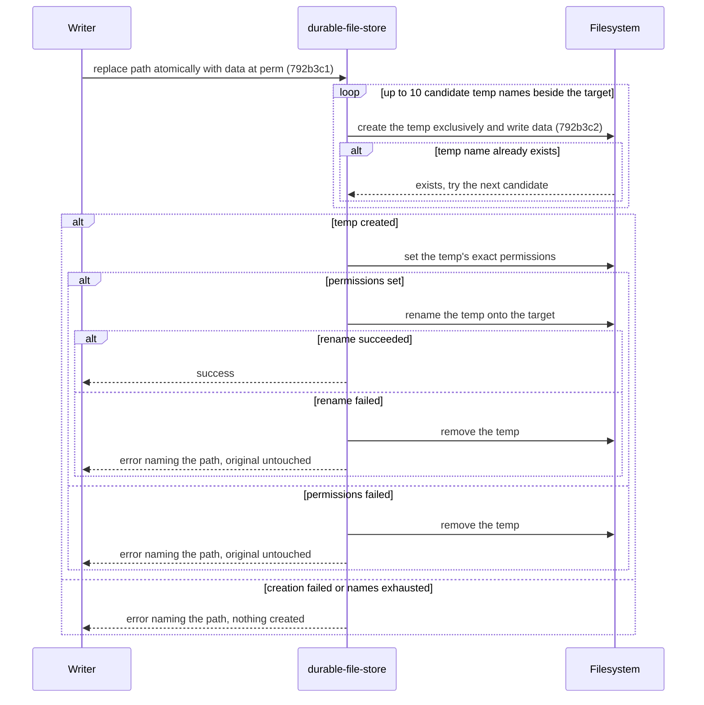

### 792b3c Behavior Requirements

#### 792b3c1 Atomic replace

Requirement: 792b3c1 The durable-file-store MUST replace a file's content by writing the new data
to a uniquely named temp file in the target's directory, setting the temp's permissions to exactly
the requested mode regardless of umask, and renaming the temp onto the target, so that a concurrent
reader sees either the old or the new content. On any failure after the temp is created it MUST
remove the temp, leave the original unchanged, and return an error naming the target path.

Supports: 792a2h1a, 792a2m1a, 792a2n1a, 792a3n1a, 792a3u1a, 792a3u1b, 792a4b1a, 792a4l1a, 792a4m1a,
792a4n1a.

Rationale: the unique temp name (target base, clock nanoseconds, attempt counter) is retried a
bounded number of times on a name collision, so two writers of the same file never share a temp.

##### 792b3c1a Scenarios

```gherkin
Scenario: 792b3c1a1 An existing file is replaced and no temp remains
  Given a file with old content
  When it is replaced atomically with new content
  Then the file holds the new content and no temp file remains in its directory

Scenario: 792b3c1a2 A new file is written
  Given no file at the target path
  When it is written atomically
  Then the file exists with the data

Scenario: 792b3c1a3 Permissions do not depend on umask
  Given a restrictive process umask
  When a file is written atomically with mode 0644
  Then the file's mode is exactly 0644

Scenario: 792b3c1a4 A rename failure removes the temp and keeps the original
  Given a file with original content and a rename that fails
  When it is replaced atomically
  Then an error naming the path is returned, the temp is removed, and the original content is unchanged

Scenario: 792b3c1a5 A permission failure removes the temp
  Given a temp file whose permissions cannot be set
  When a file is replaced atomically
  Then an error naming the path is returned and the temp is removed

Scenario: 792b3c1a6 A failed temp creation leaves the original untouched
  Given a target directory where no file can be created
  When a file in it is replaced atomically
  Then an error is returned, nothing is created, and the original content is unchanged

Scenario: 792b3c1a7 A temp-name collision tries a fresh name
  Given the first candidate temp name already exists
  When a file is replaced atomically
  Then the next candidate is used and the write succeeds

Scenario: 792b3c1a8 Exhausted temp names give a bounded error
  Given every candidate temp name already exists
  When a file is replaced atomically
  Then an error saying no unique temp name was available is returned after the bounded attempts
```

#### 792b3c2 Exclusive create

Requirement: 792b3c2 The durable-file-store MUST create a file only when no file exists at the path,
writing the data at the requested mode, and MUST fail with an error that names the path and
satisfies `errors.Is(err, fs.ErrExist)` when one does. When writing the data fails, that error
takes precedence over a close error; when the write succeeds and the close fails, the close error
is returned.

Supports: 792a2h1c, 792a3a1a, 792a3b1a, 792a3c1a, 792a3m1a, 792a3q1a, 792a3s1a.

Rationale: exclusive create is the collision backstop for concurrent creators, such as two
processes stamping the same vault ID or racing for the same Luhmann ID.

##### 792b3c2a Scenarios

```gherkin
Scenario: 792b3c2a1 An existing file is refused
  Given a file already exists at the path
  When the path is created exclusively
  Then the call fails with an error satisfying fs.ErrExist that names the path, and the existing content is unchanged

Scenario: 792b3c2a2 A new file is created with the data and mode
  Given no file exists at the path
  When the path is created exclusively with data and a mode
  Then the file holds the data with that mode

Scenario: 792b3c2a3 A write error wins over a close error
  Given a created file whose write and close both fail
  When the path is created exclusively
  Then the write error is returned

Scenario: 792b3c2a4 A close error surfaces after a good write
  Given a created file whose write succeeds and whose close fails
  When the path is created exclusively
  Then the close error is returned
```

#### 792b3c3 Error identity

Requirement: 792b3c3 The durable-file-store MUST wrap every failed filesystem operation in an error
that names the operation and path and still satisfies `errors.Is` for the underlying error, such as
`fs.ErrNotExist`.

Supports: 792a2e1a, 792a2f1a.

Rationale: callers decide "missing" versus "failed" by `errors.Is`. First-use creation, for
example, creates a vault only when the path is missing.

##### 792b3c3a Scenarios

```gherkin
Scenario: 792b3c3a1 A missing file still reads as not-exist
  Given no file at the path
  When the file is read
  Then the error names the path and satisfies fs.ErrNotExist

Scenario: 792b3c3a2 Every operation adds its context
  Given a filesystem whose every primitive fails
  When each operation is called
  Then each error names its operation and path and wraps the primitive's error
```

#### 792b3c4 Vault Markdown listing

Requirement: 792b3c4 The durable-file-store MUST list a vault directory as the names of the `.md`
files directly inside it, leaving out subdirectories, other files and the untouched starter
`README.md`, MUST return an empty list when the directory does not exist, and MUST return any other
read error.

Supports: 792a2c1a, 792a2d1a, 792a2d1b, 792a3r1a, 792a8a1e, 792a8b1c.

Rationale: this listing is the one shared point where every vault scanner (query, check, embed,
count) stops seeing subdirectories and the starter README.

##### 792b3c4a Scenarios

```gherkin
Scenario: 792b3c4a1 Only root Markdown files are listed
  Given a directory with note.md, readme.txt and a subdirectory
  When the vault directory is listed
  Then the list is exactly note.md

Scenario: 792b3c4a2 A missing directory lists as empty
  Given a directory path that does not exist, even behind a wrapped not-exist error
  When the vault directory is listed
  Then the list is empty and no error is returned

Scenario: 792b3c4a3 Other read errors are returned
  Given a path that names a regular file
  When it is listed as a vault directory
  Then an error is returned

Scenario: 792b3c4a4 The starter README is left out
  Given a directory holding the untouched starter README.md and one note
  When the vault directory is listed
  Then the list holds only the note, and an edited README.md would be listed
```

### 792b3d Product-Scenario Mapping

| Product scenario | Technical requirements |
| --- | --- |
| 792a2c1a | 792b3c4 |
| 792a2d1a | 792b3c4 |
| 792a2d1b | 792b3c4 |
| 792a2e1a | 792b3c3 |
| 792a2f1a | 792b3c3 |
| 792a2h1a | 792b3c1 |
| 792a2h1c | 792b3c2 |
| 792a2m1a | 792b3c1 |
| 792a2n1a | 792b3c1 |
| 792a3a1a | 792b3c2 |
| 792a3b1a | 792b3c2 |
| 792a3c1a | 792b3c2 |
| 792a3m1a | 792b3c2 |
| 792a3n1a | 792b3c1 |
| 792a3q1a | 792b3c2 |
| 792a3r1a | 792b3c4 |
| 792a3s1a | 792b3c2 |
| 792a3u1a | 792b3c1 |
| 792a3u1b | 792b3c1 |
| 792a4b1a | 792b3c1 |
| 792a4l1a | 792b3c1 |
| 792a4m1a | 792b3c1 |
| 792a4n1a | 792b3c1 |
| 792a5b1a | 792b3c1 |
| 792a5b1d | 792b3c3 |
| 792a5i1b | 792b3c1 |
| 792a5j1a | 792b3c1 |
| 792a5m1a | 792b3c1 |
| 792a5p1a | 792b3c1 |
| 792a5r1a | 792b3c1 |

```gherkin
Scenario: 792a2c1a A Markdown file in a subdirectory is not a note
  Given a vault with one note at its root and one Markdown file in a subdirectory
  When the user runs engram embed status on the vault
  Then it reports a total of 1 note

Scenario: 792a2d1a A fresh vault has no notes
  Given a vault that engram has just created
  When the user runs engram embed status and engram check on it
  Then embed status reports a total of 0 notes and check reports no note missing a sidecar

Scenario: 792a2d1b A user's README is a note
  Given a vault whose README.md the user has replaced with their own text
  When the user runs engram embed status and engram check on it
  Then embed status reports a total of 1 note and check reports 1 note missing a sidecar

Scenario: 792a2h1a serve stamps an existing vault
  Given an existing vault that has no .engram-vault-id
  When engram serve starts on it
  Then the file is created with a new ID, and later starts reuse it unchanged

Scenario: 792a2h1c Concurrent creation converges
  Given an existing vault that has no .engram-vault-id
  When two processes create the ID for it at the same moment
  Then exactly one file is written, and both processes use its ID

Scenario: 792a2m1a Regenerate gives a copy its own identity
  Given a copied vault
  When the user runs engram vault-id --regenerate in it
  Then its ID differs from the original's, exchange resumes, and no note file changed

Scenario: 792a2n1a Claim accepts a moved vault
  Given a vault that was moved to a new path
  When the user runs engram vault-id --claim
  Then the ID is unchanged, engram vault-id then reports location: ok, and exchange resumes
```

```gherkin
Scenario: 792a3a1a A fact note is written
  Given an empty vault
  When the user runs engram learn fact --slug ctx-fact --position top --source "smoke test" --situation "concurrent Go code" --subject goroutines --predicate "leak when" --object "ctx is ignored"
  Then stdout prints the path of 1.<today>.ctx-fact.md at the vault root, whose frontmatter has type: fact and whose body reads "Information learned: when in concurrent Go code, goroutines leak when ctx is ignored."

Scenario: 792a3b1a A feedback note is written
  Given an empty vault
  When the user runs engram learn feedback --slug ctx-rule --position top --source "smoke test" --situation "writing concurrent Go code" --behavior "ignoring ctx" --impact "leaks goroutines" --action "check ctx.Done()"
  Then stdout prints the path of 1.<today>.ctx-rule.md, whose frontmatter has type: feedback and whose body reads "Lesson learned: when writing concurrent Go code, check ctx.Done()."

Scenario: 792a3c1a A runbook note is written
  Given an empty vault
  When the user runs engram learn runbook --slug rb --position top --source src --situation "releasing a build" --done-when "the tag is pushed" --body "1. Run the checks"
  Then stdout prints the path of 1.<today>.rb.md, whose frontmatter has type: runbook, situation and done_when, and whose body is "1. Run the checks"

Scenario: 792a3m1a Concurrent learns get distinct IDs
  Given an existing vault
  When two engram learn fact --position top runs start at the same time
  Then two notes exist with different Luhmann IDs, each holding its own content

Scenario: 792a3n1a A learned note has its sidecar
  Given an empty vault
  When the user runs engram learn fact, feedback, runbook or qa
  Then every note written has a .vec.json sidecar beside it, and engram check reports no note missing a sidecar

Scenario: 792a3q1a A pair is captured
  Given a vault holding note 1.2026-10-09.a-fact
  When the user runs engram learn qa --slug why-x --question "Why X?" --answer "Because." --source src --contributors 1.2026-10-09.a-fact
  Then stdout prints the paths of qa.<today>.why-x.q.md and then qa.<today>.why-x.a.md, the question note ends "Answered by: [[qa.<today>.why-x.a]]", and the answer note ends "Answers: [[qa.<today>.why-x.q]]" and "Contributors: [[1.2026-10-09.a-fact]]"

Scenario: 792a3u1a A runbook is tagged
  Given a vault with a vocabulary term close to a runbook's text
  When the user runs engram learn runbook with that text
  Then the runbook carries the term's vocab tag

Scenario: 792a3u1b The answer is tagged and the question is not
  Given a vault with a vocabulary term close to both a question and its answer
  When the user runs engram learn qa with them
  Then the answer note carries the term's vocab tag, and the question note has no tags: field
```

```gherkin
Scenario: 792a4b1a A fact field is replaced
  Given a fact note whose situation is "testing", subject s, predicate p and object o
  When the user runs engram amend --target <note> --object o2
  Then the note's object: is o2, its other fields are unchanged, its body reads "Information learned: when in testing, s p o2.", and its path is printed

Scenario: 792a4l1a A fact is resituated
  Given a fact note whose situation is "old" and whose body reads "Information learned: when in old, s p o." followed by a related-notes section
  When the user runs engram resituate --note <note> --situation new
  Then situation: is new, the body's first line reads "Information learned: when in new, s p o.", the related-notes section is unchanged, the sidecar is rebuilt, and the note's path is printed

Scenario: 792a4m1a Amend converts a CRLF note
  Given a fact, feedback or runbook note whose lines end in \r\n
  When the user runs engram amend --target <note> with a content flag, --supersedes, --chunk-source or --activate
  Then the amend succeeds, the written note contains no \r\n, it is byte-identical to what the same amend writes for the note's LF form, and its sidecar is fresh

Scenario: 792a4n1a A note's use is recorded
  Given a note with a current sidecar
  When the user runs engram activate --note <basename>
  Then the sidecar's last_used is today, its vectors and content hash are unchanged, the note file is unchanged, and the command succeeds
```

```gherkin
Scenario: 792a5b1a A named transcript and document are indexed
  Given a session transcript s.jsonl and a Markdown document d.md
  When the user runs engram ingest --transcript s.jsonl --markdown d.md
  Then the chunk index holds chunks of both files, and stdout has one "ingest <path>: N chunks" line for each

Scenario: 792a5i1b A changed source embeds only its new text
  Given a Markdown document with sections A and B that was ingested, after which section B was edited
  When the user runs engram ingest again with the document
  Then stdout reads "ingest <path>: 3 chunks (1 reused, 1 embedded)", the third chunk being B's earlier text (792a5j)

Scenario: 792a5j1a Edited-away text stays searchable
  Given a document that was ingested with the paragraph "use flock for the manifest"
  When the paragraph is replaced by other text and the user runs engram ingest again
  Then the index holds both the old paragraph's chunk and the new text's chunk

Scenario: 792a5m1a A copy indexed first gives way to the preferred one
  Given /r/.claude/doc.md was indexed while /r/doc.md did not exist
  When /r/doc.md is created with the same bytes and the user runs engram ingest --auto from /r
  Then /r/doc.md is indexed and /r/.claude/doc.md no longer has chunks in the index

Scenario: 792a5p1a A deleted source is detached and stays searchable
  Given a transcript that was ingested and then deleted
  When the user runs engram prune and then engram query with a phrase matching it
  Then prune prints "prune: detached 1 source(s) — embedded chunks preserved (still searchable)", and the query returns its chunks with no re-indexing

Scenario: 792a5r1a A duplicate group is collapsed
  Given an index where /a/doc.md and /a/b/doc.md are both indexed with identical content and chunks
  When the user runs engram prune --duplicates
  Then /a/doc.md is kept, /a/b/doc.md no longer has chunks or a record, and it prints "prune: removed 1 duplicate(s), retained 1 canonical(s)"
```

## 792b4 Added: subprocess-runner

Canonical target: `docs/specs/technical/subprocess-runner.md` (title `Subprocess Runner - Technical Spec`).

### 792b4a Orientation

- Ownership: Repository-owned dependency-boundary interaction (operating-system processes).
- Responsibility: runs an external program, such as `git` or `go`, in a chosen directory and hands
  back what it printed, or reports why it failed, telling "program not installed" apart from other
  failures.
- Current realization (informational): `primCommander` in `internal/cli/commander.go` (the
  `update.Commander` interface), over the raw `ExecPrims` that `cmd/engram/main.go` supplies.
  `primSpawner` in `internal/cli/spawner.go` runs a child with inherited stdio; its requirements are
  added by install-and-update (792c7j1, 792d51).
- Qualification: responsibility, running a program and collecting its output is stated without
  naming any caller; ownership, callers choose the program and interpret its output, while this
  component owns collection, error context and not-found translation; independent verification, it
  is tested directly over a fake run primitive and over real processes; stability, the contract
  survives any change to the injection seam; necessity, the uncommitted vault-ID notice and note
  provenance depend on running `git`.
- Supported capabilities: 792a2 vault-identity, 792a3 note-writing.

No legacy document describes this component. It is derived from its realization and tests.

### 792b4b Sequences

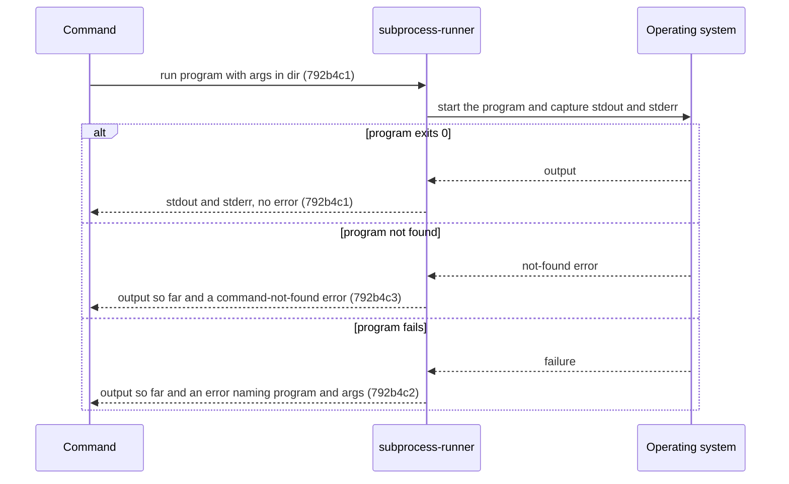

### 792b4c Behavior Requirements

#### 792b4c1 Run and collect output

Requirement: 792b4c1 The subprocess-runner MUST run the named program with the given arguments in
the given directory, or in the process's working directory when none is given, and MUST return
everything the program wrote to stdout and stderr with no error when it exits successfully.

Supports: 792a2i1a, 792a2i1b, 792a2i1c, 792a3o1a, 792a3o1b, 792a3o1c, 792a3p1a, 792a3p1b.

##### 792b4c1a Scenarios

```gherkin
Scenario: 792b4c1a1 Output is collected on success
  Given a program that writes to stdout and stderr and exits 0
  When it is run
  Then its stdout and stderr are returned and there is no error

Scenario: 792b4c1a2 The program runs in the given directory
  Given a directory
  When pwd -P is run in it
  Then the output is that directory's resolved path, and the program, arguments and directory reach the run primitive unchanged
```

#### 792b4c2 Failure reporting

Requirement: 792b4c2 When the program cannot run or exits unsuccessfully, the subprocess-runner MUST
return an error that names the program and its arguments and wraps the underlying failure, along
with whatever output was captured.

Supports: 792a2i1d, 792a3o1c, 792a3p1b, 792a3p1c.

##### 792b4c2a Scenarios

```gherkin
Scenario: 792b4c2a1 A failing program is reported with its output
  Given a program that writes output and then fails
  When it is run
  Then an error naming the program and arguments is returned, and the captured output is kept
```

#### 792b4c3 Not-found translation

Requirement: 792b4c3 When the failure is the platform's "program not found" error, the
subprocess-runner MUST also make the error satisfy `errors.Is(err, update.ErrCommandNotFound)`, and
it MUST NOT do so for any other failure, including when no platform not-found error is configured.

Supports: 792a2i1d.

Rationale: callers such as the self-installer report a missing `git` or `go` differently from a
failed one, without knowing the platform's error value.

##### 792b4c3a Scenarios

```gherkin
Scenario: 792b4c3a1 A missing program is reported as not found
  Given no program by the given name is installed
  When it is run
  Then the error satisfies errors.Is for the command-not-found error and still wraps the platform error

Scenario: 792b4c3a2 Without a configured not-found error nothing is translated
  Given no platform not-found error is configured and the program fails to start
  When it is run
  Then the error wraps the failure and does not satisfy errors.Is for the command-not-found error
```

### 792b4d Product-Scenario Mapping

| Product scenario | Technical requirements |
| --- | --- |
| 792a2i1a | 792b4c1 |
| 792a2i1b | 792b4c1 |
| 792a2i1c | 792b4c1 |
| 792a2i1d | 792b4c2, 792b4c3 |
| 792a3o1a | 792b4c1 |
| 792a3o1b | 792b4c1 |
| 792a3o1c | 792b4c1, 792b4c2 |
| 792a3p1a | 792b4c1 |
| 792a3p1b | 792b4c1, 792b4c2 |
| 792a3p1c | 792b4c2 |

```gherkin
Scenario: 792a2i1a Uncommitted ID is flagged
  Given a git-backed vault whose .engram-vault-id is untracked
  When the user runs engram update
  Then its report includes a notice asking for a one-time vault commit

Scenario: 792a2i1b An ignored ID is flagged
  Given a git-backed vault whose .engram-vault-id is ignored by its .gitignore
  When the user runs engram update
  Then its report includes the commit notice

Scenario: 792a2i1c A committed ID is not flagged
  Given a git-backed vault whose .engram-vault-id is committed and unmodified
  When the user runs engram update
  Then its report includes no commit notice

Scenario: 792a2i1d A vault outside git is not flagged
  Given a vault that is not a git work tree and has a .engram-vault-id
  When the user runs engram update
  Then its report includes no commit notice
```

```gherkin
Scenario: 792a3o1a The origin remote names the repo
  Given a working directory inside a git repository whose origin is git@example.com:o/r.git
  When the user runs engram learn fact
  Then the note's repo: is git@example.com:o/r.git

Scenario: 792a3o1b Without an origin the top-level directory names the repo
  Given a working directory inside a git repository named proj with no origin remote
  When the user runs engram learn fact
  Then the note's repo: is proj

Scenario: 792a3o1c Outside a git repository there is no repo
  Given a working directory outside any git repository
  When the user runs engram learn fact
  Then the note has no repo: field

Scenario: 792a3p1a The git email names the user
  Given git config user.email resolves to a@example.com
  When the user runs engram learn fact
  Then the note's user: is a@example.com

Scenario: 792a3p1b The OS username is the fallback
  Given git config user.email resolves to nothing and the OS username is joe
  When the user runs engram learn fact
  Then the note's user: is joe

Scenario: 792a3p1c No detectable user
  Given neither git config user.email nor the OS username resolves
  When the user runs engram learn fact
  Then the note has no user: field, vault: is stamped as usual, and stderr carries one warning that user detection resolved empty
```

## 792b5 Added: vault-identity-registry

Canonical target: `docs/specs/technical/vault-identity-registry.md` (title `Vault Identity Registry - Technical Spec`).

### 792b5a Orientation

- Ownership: Repository component.
- Responsibility: brings a vault into existence on first use and owns its identity: the tracked
  vault ID, the untracked `.engram/` state directory, and the location record that tells a copied,
  moved or cloned vault from the original. It stamps, validates, regenerates and claims the ID,
  checks and reports the location, refuses exchange with a parent that reports the vault's own ID,
  and detects an uncommitted ID file.
- Current realization (informational): `internal/cli/exchangestate.go` (`ensureVault`,
  `repairVaultID`, `stampVaultID`, `checkVaultLocation`, `warnVaultLocation`,
  `regenerateVaultID`, `claimVaultLocation`, `selfParentGuard`, `vaultIDUncommitted`),
  `internal/cli/vaultid.go` (`RunVaultID`), `internal/cli/vault_init.go` (`initializeVault`). The
  parent cache, declined pulls and exchange-identifier checks in `exchangestate.go` are added by
  parent-sync (792c7t1).
- Qualification: responsibility, the identity contract is stated without naming any command;
  ownership, commands decide when to exchange, while this component decides whether the vault's
  identity allows it; independent verification, every requirement is tested directly over a
  temp-dir or scripted filesystem and an injected random source; stability, the ID file, state
  directory and location record are on-disk contracts that survive refactoring; necessity,
  vault-identity's creation, ID and refusal requirements all depend on it.
- Supported capabilities: 792a2 vault-identity.

Rationale (ADR-0029 D2): every environment has its own local vault, created by the first command
that resolves its path, and a stable random vault ID in the tracked `.engram-vault-id`. Exchange
links key on that ID, never on URL or hostname, so DNS or IP churn breaks nothing. The untracked
`.engram/home.json` location record catches a `cp -R` copy or a `git clone` before it exchanges.
Transient exchange state lives in `.engram/`, which ignores itself, so the vault's tracked root
`.gitignore` is never touched. Losing `.engram/`, for example through a fresh clone, pauses
child-side exchange until `--claim` or `--regenerate` runs; links and IDs live in tracked files, so
no note content is lost.

### 792b5b Sequences

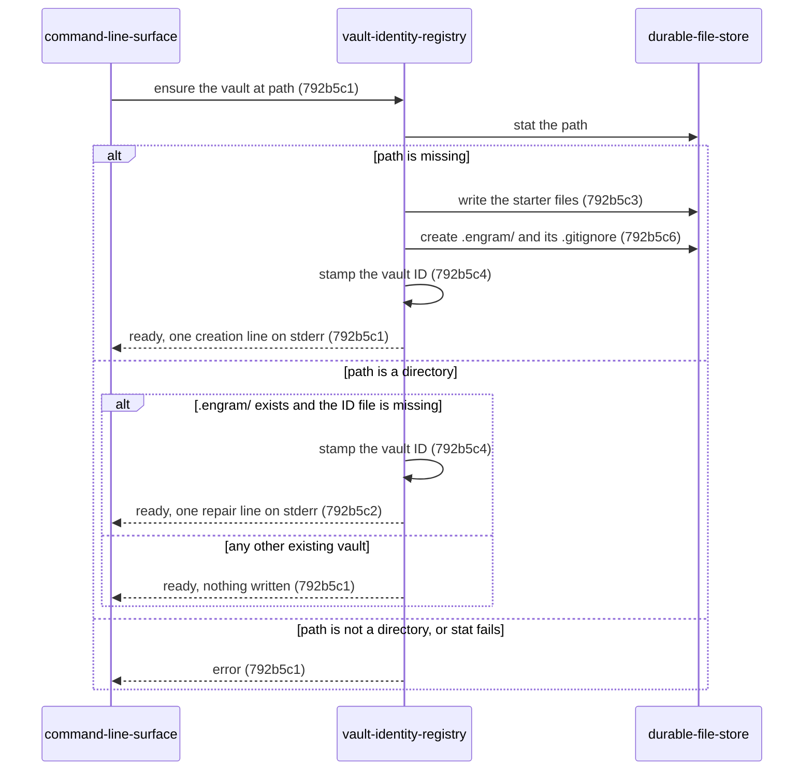

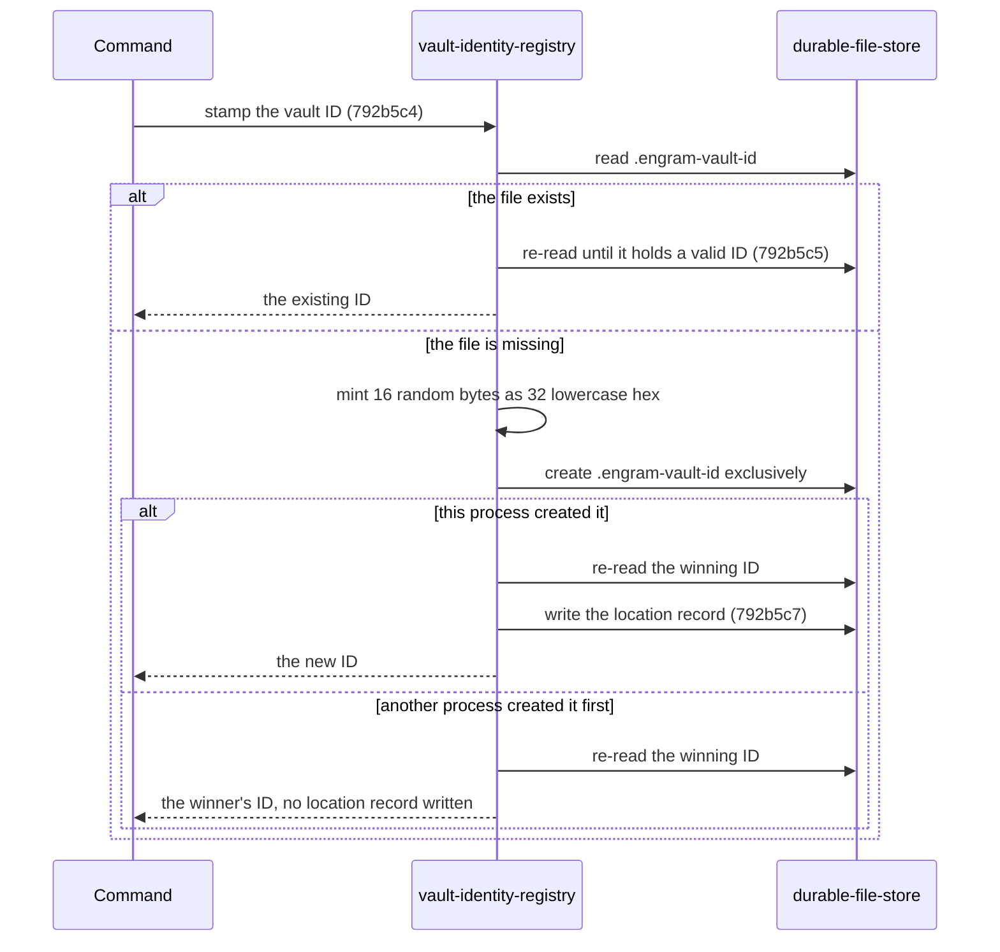

### 792b5c Behavior Requirements

#### 792b5c1 First-use ensure

Requirement: 792b5c1 Given a vault path, the vault-identity-registry MUST, when nothing exists at
the path, write the starter files, create `.engram/`, stamp a vault ID with its location record,
and print exactly one stderr line `engram: created new vault at <path>`. It MUST leave an existing
directory untouched (except the repair in 792b5c2), MUST fail when the path exists but is not a
directory, and MUST fail when the path can't be inspected or the random source fails.

Supports: 792a2e1a, 792a2e1b, 792a2e1c, 792a2e1d, 792a2f1a.

##### 792b5c1a Scenarios

```gherkin
Scenario: 792b5c1a1 A missing vault is created with its ID and state directory
  Given nothing exists at the vault path
  When the vault is ensured with a fixed random source
  Then the starters, a 32-hex ID from that source, .engram/.gitignore holding *, and a location record of exactly the ID and the canonical path exist, and stderr has exactly one creation line

Scenario: 792b5c1a2 An existing vault without an ID is left alone
  Given an existing vault directory with no ID file and no .engram/
  When the vault is ensured
  Then nothing is created or changed and nothing is printed

Scenario: 792b5c1a3 A second ensure creates and prints nothing
  Given a vault that was just created
  When the vault is ensured again
  Then nothing is printed and the ID is unchanged

Scenario: 792b5c1a4 A regular file is not a vault
  Given a regular file at the vault path
  When the vault is ensured
  Then it fails saying the path is not a directory

Scenario: 792b5c1a5 An inspection failure is an error
  Given a vault path whose stat fails with an error other than not-exist
  When the vault is ensured
  Then that error is returned

Scenario: 792b5c1a6 A random-source failure is an error
  Given nothing exists at the vault path and a failing random source
  When the vault is ensured
  Then an error naming the random source is returned
```

#### 792b5c2 Half-created vault repair

Requirement: 792b5c2 When an existing vault has `.engram/` but no `.engram-vault-id`, the
vault-identity-registry MUST stamp the vault ID and print exactly one stderr line
`engram: stamped the missing vault ID of <path>`.

Supports: 792a2g1a.

Rationale: first-use creation writes `.engram/` before the ID, so `.engram/` marks a vault engram
created, and a stamp that failed part-way is finished by the next run.

##### 792b5c2a Scenarios

```gherkin
Scenario: 792b5c2a1 A half-created vault is repaired
  Given an existing vault with .engram/ and no ID file
  When the vault is ensured
  Then the ID file and location record are written and stderr has exactly one repair line
```

#### 792b5c3 Starter files

Requirement: 792b5c3 The vault-identity-registry MUST initialize a vault by creating `.obsidian/`
and writing `.obsidian/app.json` (`{}`), a `.gitignore` listing `.luhmann.lock`,
`.obsidian/workspace*` and `.obsidian/cache`, and the starter `README.md`, writing each only when it
is missing, and MUST return any directory or write failure.

Supports: 792a2d1a, 792a2e1a.

Rationale: the minimal `.obsidian/app.json` lets Obsidian open the directory as a vault without
engram shipping an Obsidian configuration. The `.gitignore` keeps lock and workspace files out of
git for users who track their vault.

##### 792b5c3a Scenarios

```gherkin
Scenario: 792b5c3a1 The starter set is written
  Given an empty vault directory
  When the vault is initialized
  Then .obsidian/app.json, .gitignore and README.md exist with the starter content

Scenario: 792b5c3a2 Initialization is idempotent
  Given a vault whose starter files were edited
  When the vault is initialized again
  Then no existing file is changed

Scenario: 792b5c3a3 Directory and write failures are returned
  Given a filesystem whose directory creation or file write fails
  When the vault is initialized
  Then an error naming the failed step is returned
```

#### 792b5c4 Vault ID stamping

Requirement: 792b5c4 The vault-identity-registry MUST return the vault's existing ID when
`.engram-vault-id` exists, and otherwise MUST mint 16 bytes from the injected random source as 32
lowercase hex characters, create the file exclusively, re-read it, and use whatever ID the file
holds. Only the process whose exclusive create succeeded writes the location record. An existing
vault is stamped only by `engram serve` at startup and by a command's first parent contact.

Supports: 792a2h1a, 792a2h1b, 792a2h1c.

Rationale: exclusive create followed by a re-read makes concurrent creators converge on one ID. The
random source is injected so tests are deterministic.

##### 792b5c4a Scenarios

```gherkin
Scenario: 792b5c4a1 Concurrent creators converge
  Given two processes stamping the same vault at once
  When both finish
  Then the file holds one ID and both processes returned it

Scenario: 792b5c4a2 The loser adopts the winner's ID
  Given the exclusive create reports the file already exists and its first read is empty
  When the vault ID is stamped
  Then the loser retries the read, returns the winner's ID, and writes no location record

Scenario: 792b5c4a3 The ID comes from the injected random source
  Given a fixed random source
  When a new vault ID is stamped
  Then the ID is the hex encoding of that source's bytes

Scenario: 792b5c4a4 An existing ID is reused
  Given a vault with a valid ID file
  When the vault ID is stamped
  Then the existing ID is returned and the file is unchanged
```

#### 792b5c5 Vault ID validation

Requirement: 792b5c5 The vault-identity-registry MUST accept the ID file's content, ignoring
trailing whitespace, only when it is 32 lowercase hex characters, and MUST otherwise fail with an
error saying the vault ID is invalid and naming `engram vault-id --regenerate`. A re-read after a
lost race retries an invalid read a bounded number of times before failing.

Supports: 792a2j1a, 792a2j1b, 792a2j1c.

##### 792b5c5a Scenarios

```gherkin
Scenario: 792b5c5a1 Invalid content is refused
  Given an ID file holding something other than 32 lowercase hex characters
  When the vault ID is read
  Then it fails with the invalid-vault-ID error naming engram vault-id --regenerate

Scenario: 792b5c5a2 A read failure is returned
  Given an ID file that cannot be read
  When the vault ID is read
  Then the read error is returned
```

#### 792b5c6 State directory

Requirement: 792b5c6 The vault-identity-registry MUST create `<vault>/.engram/` with a `.gitignore`
holding only `*`, writing that `.gitignore` only when it is missing, and MUST NOT write the vault's
root `.gitignore`.

Supports: 792a2k1a, 792a2k1b.

##### 792b5c6a Scenarios

```gherkin
Scenario: 792b5c6a1 The root .gitignore is untouched
  Given an existing vault with its own root .gitignore and no ID
  When its ID is stamped
  Then .engram/.gitignore holds *, the root .gitignore is unchanged, and a second stamp reuses the ID

Scenario: 792b5c6a2 State-directory failures are returned
  Given a filesystem where .engram/ or its .gitignore cannot be created
  When the state directory is ensured
  Then the failure is returned
```

#### 792b5c7 Location record and check

Requirement: 792b5c7 The vault-identity-registry MUST record a vault's location in
`.engram/home.json` as exactly its vault ID and its canonical path (symlinks evaluated, made
absolute against the working directory, cleaned), with no hostname. Checking the location MUST
report `no vault id` when there is no ID, `missing` when there is no record, `mismatch` when the
record is unparseable or names another ID or path, and `ok` otherwise.

Supports: 792a2l1a, 792a2l1b, 792a2l1c, 792a2p1a, 792a2p1b, 792a2p1c, 792a2p1d, 792a2p1e.

Rationale: a hostname would give false positives, because DHCP, `.local` renames and containers
change it without the vault moving. Canonicalizing the path keeps a symlinked route to the same
vault from failing.

##### 792b5c7a Scenarios

```gherkin
Scenario: 792b5c7a1 A copy is a mismatch
  Given a vault copied to another path
  When the copy's location is checked
  Then the result is mismatch

Scenario: 792b5c7a2 A missing record is missing
  Given a vault with an ID and no location record
  When its location is checked
  Then the result is missing

Scenario: 792b5c7a3 No ID is reported
  Given a vault with no ID file
  When its location is checked
  Then the result is no vault id

Scenario: 792b5c7a4 A record for another ID is a mismatch
  Given a location record naming a different vault ID
  When the location is checked
  Then the result is mismatch

Scenario: 792b5c7a5 A symlinked path passes
  Given a vault reached through a symlink to its recorded path
  When its location is checked
  Then the result is ok
```

#### 792b5c8 Location warning

Requirement: 792b5c8 When the location check does not pass, or cannot run, the
vault-identity-registry MUST print exactly one warning naming the vault, the check result, and both
`engram vault-id --regenerate` and `engram vault-id --claim`, and report the failure to the caller;
a passing check prints nothing.

Supports: 792a2p1a, 792a2p1b, 792a2p1c.

##### 792b5c8a Scenarios

```gherkin
Scenario: 792b5c8a1 A failed check warns once with both remedies
  Given a vault whose location check fails
  When the location warning runs
  Then exactly one warning naming both remedies is printed and the failure is reported, while a passing check prints nothing
```

#### 792b5c9 Regenerate

Requirement: 792b5c9 Regenerating MUST mint a new vault ID, atomically rewrite `.engram-vault-id`
and the location record with it, and touch no note.

Supports: 792a2m1a.

##### 792b5c9a Scenarios

```gherkin
Scenario: 792b5c9a1 A copy gets its own identity
  Given a copied vault with notes
  When its ID is regenerated
  Then the ID differs from the original's, the location check passes, and no note file changed
```

#### 792b5c10 Claim

Requirement: 792b5c10 Claiming MUST rewrite only the location record for the vault's current ID and
path, and MUST fail with an error saying the vault has no vault ID when the ID file is absent.

Supports: 792a2n1a, 792a2n1b.

##### 792b5c10a Scenarios

```gherkin
Scenario: 792b5c10a1 A moved vault keeps its ID and passes
  Given a vault moved to a new path
  When its location is claimed
  Then the ID is unchanged and the location check passes

Scenario: 792b5c10a2 Claim without an ID fails
  Given a vault with no ID file
  When its location is claimed
  Then it fails saying the vault has no vault ID
```

#### 792b5c11 vault-id report

Requirement: 792b5c11 The `vault-id` command MUST refuse `--regenerate` and `--claim` together,
print `vault_id: <id> (regenerated)` or `vault_id: <id> (location claimed)` after those actions, and
with no flag print `vault_id:` (the ID or `none`) and `location:` (the check result), adding one
remedy line naming both commands when the result is `missing` or `mismatch`, without writing
anything.

Supports: 792a2l1a, 792a2l1b, 792a2l1c, 792a2o1a.

##### 792b5c11a Scenarios

```gherkin
Scenario: 792b5c11a1 The report prints the ID and the check
  Given a vault with an ID at its recorded path
  When the vault-id report runs with no flag
  Then it prints vault_id: with the ID and location: ok, and writes nothing

Scenario: 792b5c11a2 Both flags are refused
  Given both --regenerate and --claim
  When the vault-id command runs
  Then it fails as mutually exclusive and changes nothing
```

#### 792b5c12 Self-parent guard

Requirement: 792b5c12 Given the local vault ID and a parent's reported vault ID, the
vault-identity-registry MUST report a self-parent, and print exactly one warning naming
`engram vault-id --regenerate`, exactly when the local ID is non-empty and equal to the parent's,
and MUST print nothing otherwise.

Supports: 792a2q1a.

##### 792b5c12a Scenarios

```gherkin
Scenario: 792b5c12a1 Only an equal, non-empty ID is a self-parent
  Given any local vault ID, possibly empty, and any parent vault ID
  When the self-parent guard runs
  Then it fires with one warning naming engram vault-id --regenerate exactly when the local ID is non-empty and equals the parent's
```

#### 792b5c13 Uncommitted ID detection

Requirement: 792b5c13 The vault-identity-registry MUST report the vault ID as uncommitted when
`.engram-vault-id` exists in a git work tree and is either not in the index (untracked or ignored)
or staged or modified relative to the last commit, and MUST report it as committed when the file is
absent, the vault is not a git work tree, the file is committed and unchanged, or git status fails.

Supports: 792a2i1a, 792a2i1b, 792a2i1c, 792a2i1d.

Rationale: `git status` alone hides an ignored file, so index membership is checked first.

##### 792b5c13a Scenarios

```gherkin
Scenario Outline: 792b5c13a1 Uncommitted detection
  Given a vault where <case>
  When uncommitted detection runs
  Then it reports <result>

  Examples:
    | case                                  | result      |
    | the ID file is untracked              | uncommitted |
    | the ID file is ignored                | uncommitted |
    | the ID file is staged, not committed  | uncommitted |
    | the ID file is committed              | committed   |
    | git status fails                      | committed   |
    | the vault is not a git work tree      | committed   |
    | there is no ID file                   | committed   |

Scenario: 792b5c13a2 The update report carries the notice only when flagged
  Given the uncommitted flag is set or clear
  When the update report is written
  Then it names .engram-vault-id and asks for a commit only when the flag is set
```

### 792b5d Product-Scenario Mapping

| Product scenario | Technical requirements |
| --- | --- |
| 792a2d1a | 792b5c3 |
| 792a2e1a | 792b5c1, 792b5c3 |
| 792a2e1b | 792b5c1 |
| 792a2e1c | 792b5c1 |
| 792a2e1d | 792b5c1 |
| 792a2f1a | 792b5c1 |
| 792a2g1a | 792b5c2 |
| 792a2h1a | 792b5c4 |
| 792a2h1b | 792b5c4 |
| 792a2h1c | 792b5c4 |
| 792a2i1a | 792b5c13 |
| 792a2i1b | 792b5c13 |
| 792a2i1c | 792b5c13 |
| 792a2i1d | 792b5c13 |
| 792a2j1a | 792b5c5 |
| 792a2j1b | 792b5c5 |
| 792a2j1c | 792b5c5 |
| 792a2k1a | 792b5c6 |
| 792a2k1b | 792b5c6 |
| 792a2l1a | 792b5c7, 792b5c11 |
| 792a2l1b | 792b5c7, 792b5c11 |
| 792a2l1c | 792b5c7, 792b5c11 |
| 792a2m1a | 792b5c9 |
| 792a2n1a | 792b5c10 |
| 792a2n1b | 792b5c10 |
| 792a2o1a | 792b5c11 |
| 792a2p1a | 792b5c7, 792b5c8 |
| 792a2p1b | 792b5c7, 792b5c8 |
| 792a2p1c | 792b5c7, 792b5c8 |
| 792a2p1d | 792b5c7 |
| 792a2p1e | 792b5c7 |
| 792a2q1a | 792b5c12 |

```gherkin
Scenario: 792a2h1b The first parent contact stamps an existing vault
  Given an existing vault that has no .engram-vault-id and ENGRAM_PARENT set
  When the user runs engram query
  Then .engram-vault-id is created and no location warning is printed

Scenario: 792a2j1a serve starts despite a corrupt ID
  Given a vault whose .engram-vault-id is empty or holds a git conflict marker
  When engram serve starts on it
  Then it warns naming engram vault-id --regenerate, serves, and leaves the file unchanged

Scenario: 792a2j1b A merged query warns and still runs
  Given a vault whose .engram-vault-id holds junk and ENGRAM_PARENT set
  When the user runs engram query
  Then stderr says the vault ID could not be stamped and names engram vault-id --regenerate, and the local results are returned

Scenario: 792a2k1a State does not dirty the vault's git
  Given a git-backed vault
  When an offer is queued in it
  Then git status --porcelain in the vault shows no change caused by exchange state

Scenario: 792a2k1b The root .gitignore is untouched
  Given an existing vault with its own root .gitignore
  When engram stamps the vault's ID and creates .engram/
  Then the root .gitignore is byte-for-byte unchanged

Scenario: 792a2l1a A healthy vault reports its ID
  Given a vault that engram created at its current path
  When the user runs engram vault-id
  Then stdout shows its vault ID and location: ok, and stderr is empty

Scenario: 792a2l1b A moved vault reports a mismatch with both remedies
  Given a vault that was moved after engram created it
  When the user runs engram vault-id
  Then stdout shows location: mismatch and names both engram vault-id --claim and engram vault-id --regenerate

Scenario: 792a2l1c A vault without an ID is reported without writing
  Given an existing vault with no vault ID
  When the user runs engram vault-id
  Then stdout shows location: no vault id, and no file in the vault is created or changed

Scenario: 792a2p1a A cloned child is caught before it offers
  Given vault A is cloned with git to a new host with ENGRAM_PARENT set
  When the clone runs engram learn
  Then the note is written locally and queued, no offer is sent, and the warning names both engram vault-id remedies

Scenario: 792a2p1b A cloned child's merged query still runs
  Given a vault with ENGRAM_PARENT set whose location record is missing
  When the user runs engram query
  Then the query returns its results, and stderr carries one warning naming both engram vault-id remedies

Scenario: 792a2p1c serve starts despite a mismatched record
  Given a vault whose location record is missing or differs
  When engram serve starts on it
  Then it prints the warning and serves normally

Scenario: 792a2p1d A symlinked path is not a false positive
  Given a vault reached through a symlink to its recorded path
  When the location check runs
  Then the check passes

Scenario: 792a2p1e A hostname change is not a false positive
  Given a host whose name changed while the vault path did not
  When the location check runs
  Then the check passes

Scenario: 792a2q1a A copied vault served back to itself
  Given a copy of vault V is served and V's environment points ENGRAM_PARENT at it
  When the user runs engram query in V
  Then it returns local-only results with a warning naming engram vault-id --regenerate, and no offer is sent
```

## 792b6 Added: note-document-format

Canonical target: `docs/specs/technical/note-document-format.md` (title `Note Document Format - Technical Spec`).

### 792b6a Orientation

- Ownership: Repository component, crossing the YAML library boundary.
- Responsibility: the on-disk shape of a vault note. It names the note's file, renders its
  frontmatter block with each kind's keys in a fixed order, quotes the scalars that must stay
  strings, renders the body formulas and the machine-written link lines, splits a note's text
  into frontmatter and body, reads a CRLF note as its LF form, and edits an existing note's
  frontmatter in place.
- Current realization (informational): in `internal/cli/learn.go`, `learnPath`,
  `marshalFrontmatter`, `quotedString`, the `factFrontmatterDoc`, `feedbackFrontmatterDoc` and
  `runbookFrontmatterDoc` types and their `render*` functions; in `internal/cli/qa.go`,
  `qaQuestionPath`, `qaAnswerPath`, `renderQAQuestionNote` and `renderQAAnswerNote`;
  `renderSupersedes` in `internal/cli/supersedes.go`; the exchange fields in
  `internal/cli/exchangefields.go`; `SplitFrontmatter` in `internal/embed/hash.go`; the YAML-node
  edits in `internal/cli/frontmatter_node.go`; `toLF` in `internal/cli/luhmann_reparent.go`.
- Qualification: responsibility, the file and document shape is stated without naming any writer or
  reader; ownership, writers decide what a note says and when it is written, while this component
  decides how it is laid out; independent verification, rendering, naming and splitting are tested
  directly on strings; stability, the shape survives any change to the commands that write it, and
  hand-edited and Obsidian-edited notes depend on it; necessity, every note engram writes or reads
  passes through it.
- Supported capabilities: 792a3 note-writing, 792a4 note-revision, 792a6 controlled-vocabulary.
  Vault-counting, skill-runbook-registration and parent-sync add their requirements here (792d30,
  792d61).

Rationale: the vault is flat. Notes sit at the vault root, and a note's place in the hierarchy is
carried by the Luhmann ID that leads its filename, not by a folder (792a2c). A fact or feedback note
states its situation twice: in the `situation:` field, which recall's situation vector is built
from, and again in the body formula. A legacy invariant asked for a single representation of any
datum that affects retrieval; the two copies are instead kept in step by the writers that change a
situation (792d62).

### 792b6b Sequences

The note-document-format owns no flow. Note-authoring calls it to name and render a new note, and
every reader of a note calls it to split the note's text.

### 792b6c Behavior Requirements

#### 792b6c1 Note filenames

Requirement: 792b6c1 The note-document-format MUST name a fact, feedback or runbook note
`<luhmann>.<YYYY-MM-DD>.<slug>.md` in the vault root, using its creation date, and MUST name a
question-and-answer pair `qa.<YYYY-MM-DD>.<slug>.q.md` and `qa.<YYYY-MM-DD>.<slug>.a.md`.

Supports: 792a3a1a, 792a3b1a, 792a3c1a, 792a3q1a, 792a6a1a, 792a6b1a.

##### 792b6c1a Scenarios

```gherkin
Scenario: 792b6c1a1 A Luhmann note's filename
  Given vault /vault, Luhmann ID 1a3, creation date 2026-05-09 and slug subagent-driven-recovery
  When the note's path is formed
  Then it is /vault/1a3.2026-05-09.subagent-driven-recovery.md

Scenario: 792b6c1a2 A pair's filenames
  Given vault /vault, creation date 2026-07-03 and slug my-slug
  When the pair's paths are formed
  Then they are /vault/qa.2026-07-03.my-slug.q.md and /vault/qa.2026-07-03.my-slug.a.md
```

#### 792b6c2 Frontmatter block

Requirement: 792b6c2 The note-document-format MUST render a note's frontmatter as a line `---`, the
fields as YAML, a line `---` and one blank line, and MUST encode every value so that it reads back
unchanged, whatever newlines, colons, leading dashes or other YAML-significant characters it holds.

Supports: 792a3a1a, 792a3b1a, 792a3c1a, 792a3q1a.

Rationale: frontmatter was once built by concatenating strings, and a multi-line value ended the
block early. Encoding through the YAML library fixed that for every value.

##### 792b6c2a Scenarios

```gherkin
Scenario: 792b6c2a1 The block is delimited
  Given the fields k: v
  When they are rendered as frontmatter
  Then the result is "---", "k: v", "---" and a blank line

Scenario: 792b6c2a2 Tricky values read back unchanged
  Given field values holding a newline, a colon, a leading dash and a leading asterisk, or any printable text
  When a fact or feedback frontmatter is rendered and parsed again
  Then every field reads back exactly as given
```

#### 792b6c3 Kind schemas

Requirement: 792b6c3 The note-document-format MUST render each kind's keys in this order, leaving
out any optional key whose value is empty:

- fact: `type`, `tier`, `situation`, `subject`, `predicate`, `object`, `luhmann`, `created`,
  `source`, `project`, `repo`, `user`, `vault`, `pending`, `issue`, `sources`, `vocab_version`,
  `tags`, `supersedes`, then the exchange fields;
- feedback: `type`, `tier`, `situation`, `behavior`, `impact`, `action`, `luhmann`, `created`,
  `source`, `project`, `repo`, `user`, `vault`, `pending`, `issue`, `sources`, `tags`,
  `supersedes`, then the exchange fields;
- runbook: `type`, `tier`, `situation`, `done_when`, `red_flags`, `triggers`, `luhmann`, `created`,
  `source`, `project`, `repo`, `user`, `vault`, `skill_hash`, `skill_key`, `skill_source`,
  `pending`, `issue`, `sources`, `tags`, `supersedes`, then the exchange fields.

`type`, `luhmann`, `created` and `source` are always written, and so are a fact's or feedback note's
`situation` and content fields. `luhmann` and `issue` MUST be double-quoted, `created` MUST be the
date as `YYYY-MM-DD`, and list values MUST keep their order.

Supports: 792a3a1a, 792a3b1a, 792a3c1a, 792a3d1a, 792a3d1b, 792a3d1c, 792a3h1a, 792a3h1b, 792a3i1a,
792a3i1b, 792a3o1c, 792a3p1c, 792a4b1c, 792a6a1a, 792a6b1a.

Rationale: a Luhmann ID is quoted so that an ID such as `1e1` is not read back as the number 10, and
so that notes written by engram, migrated and written by hand all read the same way. A fact or
feedback note always carries `situation:`, because recall finds a note by its situation.

##### 792b6c3a Scenarios

```gherkin
Scenario: 792b6c3a1 A fact's frontmatter
  Given a fact with situation, subject, predicate, object, Luhmann ID 11, creation date 2026-05-09 and a source
  When its frontmatter is rendered
  Then it has type fact, the given fields, luhmann 11 and created 2026-05-09

Scenario: 792b6c3a2 A feedback note's frontmatter holds exactly its keys
  Given a feedback note with situation, behavior, impact, action, Luhmann ID 9z, creation date 2026-05-09, a source and nothing else
  When its frontmatter is rendered and parsed
  Then it holds exactly type, situation, behavior, impact, action, luhmann, created and source

Scenario: 792b6c3a3 A runbook's frontmatter holds exactly its keys
  Given a runbook with situation, done_when, Luhmann ID 7a, creation date 2026-05-09, a source and nothing else
  When its frontmatter is rendered and parsed
  Then it holds exactly type, situation, done_when, luhmann, created and source

Scenario: 792b6c3a4 The Luhmann ID is double-quoted
  Given a feedback note with Luhmann ID 9aa
  When its frontmatter is rendered
  Then it contains luhmann: "9aa"

Scenario: 792b6c3a5 Project and issue follow the source
  Given a fact or feedback note with project engram and issue 636
  When its frontmatter is rendered
  Then project: engram and issue: "636" follow source:, in that order

Scenario: 792b6c3a6 Empty optional keys are left out
  Given a fact, feedback or runbook note with no project, issue or red flags
  When its frontmatter is rendered
  Then it has no project:, issue: or red_flags: key

Scenario: 792b6c3a7 Lists keep their order
  Given a runbook with red flags A then B, or a fact with any list of valid tags
  When its frontmatter is rendered and parsed
  Then the list reads back with the same entries in the same order
```

#### 792b6c4 Body formulas

Requirement: 792b6c4 The note-document-format MUST render a fact's body as
`Information learned: when in <situation>, <subject> <predicate> <object>.`, a feedback note's as
`Lesson learned: when <situation>, <action>.`, dropping one case-insensitive leading `when ` from the
situation, and a runbook's as its steps with trailing newlines reduced to one, each followed by a
blank line and then one line `Supersedes: [[<note>]] — <type>: <claim>` per supersession, with any
`.md` dropped from the linked note.

Supports: 792a3a1a, 792a3a1b, 792a3b1a, 792a3b1b, 792a3c1a, 792a3h1a, 792a4b1a, 792a4b1b, 792a4d1a,
792a4d1b, 792a4l1a, 792a6a1a.

Rationale: situations are usually phrased "When …", while the formulas already say "when"; without
the strip, a body would read "when When". A supersession link drops `.md` because links resolve by
extension-less basename.

##### 792b6c4a Scenarios

```gherkin
Scenario: 792b6c4a1 A fact's body
  Given a fact whose situation is "reasoning about agent coordination", subject "subagent dispatch", predicate "is fundamentally" and object "a verification problem dressed as coordination"
  When its body is rendered
  Then it is "Information learned: when in reasoning about agent coordination, subagent dispatch is fundamentally a verification problem dressed as coordination." and a blank line

Scenario: 792b6c4a2 A feedback note's body
  Given a feedback note whose situation is "orchestrating multi-step work" and action "shrink the task"
  When its body is rendered
  Then it is "Lesson learned: when orchestrating multi-step work, shrink the task." and a blank line

Scenario: 792b6c4a3 A runbook's body is its steps
  Given a runbook whose steps are three numbered lines
  When its body is rendered
  Then it begins with those three lines unchanged

Scenario: 792b6c4a4 A leading When is dropped
  Given a fact or feedback situation beginning "When "
  When its body is rendered
  Then the body reads "when <rest of situation>" and never "when When"

Scenario: 792b6c4a5 A supersession line drops .md
  Given a supersession of 9e.2026-01-01.old-note.md of type updates with claim "old note superseded"
  When its body line is rendered
  Then it is "Supersedes: [[9e.2026-01-01.old-note]] — updates: old note superseded"
```

#### 792b6c5 Question-and-answer documents

Requirement: 792b6c5 The note-document-format MUST render a question note with frontmatter `type:
qa-question`, `date`, `answered_by` (the answer's basename) and `source`, and a body of the question
followed by a blank line and `Answered by: [[<answer basename>]]`; and an answer note with
frontmatter `type: qa-answer`, `date`, `answers` (the question's basename), `certainty`,
`contributors` when there are any, and `source`, and a body of the answer followed by a blank line,
`Answers: [[<question basename>]]` and, when there are contributors, `Contributors:` and a
comma-separated link to each.

Supports: 792a3q1a, 792a3q1b, 792a3q1c.

##### 792b6c5a Scenarios

```gherkin
Scenario: 792b6c5a1 A question note
  Given the question "What is the question?", slug my-slug and date 2026-07-03
  When the question note is rendered
  Then its frontmatter has type: qa-question and answered_by: qa.2026-07-03.my-slug.a, and its body holds the question and "Answered by: [[qa.2026-07-03.my-slug.a]]"

Scenario: 792b6c5a2 An answer note with contributors
  Given an answer, slug my-slug, date 2026-07-03, certainty medium and two contributors
  When the answer note is rendered
  Then its frontmatter has type: qa-answer, answers: qa.2026-07-03.my-slug.q and certainty: medium, and its body holds the answer, "Answers: [[qa.2026-07-03.my-slug.q]]" and "Contributors: [[<first>]], [[<second>]]"

Scenario: 792b6c5a3 An answer note without contributors
  Given an answer with no contributors
  When the answer note is rendered
  Then it has no Contributors: line
```

#### 792b6c6 Frontmatter splitting

Requirement: 792b6c6 The note-document-format MUST split a note's text into the frontmatter between
a leading `---` line and the next line that is exactly `---`, and the text after that line. A value
that ends in `---`, or an indented `---` inside a block value, MUST NOT close the frontmatter, an
empty frontmatter MUST split cleanly, and a text that has no leading `---` line or no closing line
MUST be treated as having no frontmatter.

Supports: 792a3n1a, 792a3u1a, 792a3u1b, 792a8d1a, 792a8d1c.

Rationale: a skill key, for example, can end in `---`; matching only a whole line keeps such a value
from cutting the frontmatter short.

##### 792b6c6a Scenarios

```gherkin
Scenario: 792b6c6a1 Only a whole --- line closes the frontmatter
  Given frontmatter holding a value that ends in ---, or a block value with an indented --- line, followed by a body that may itself start with ---
  When the note is split
  Then the frontmatter runs to the first line that is exactly ---, and the body is everything after it

Scenario: 792b6c6a2 An empty frontmatter splits cleanly
  Given a note whose --- line is immediately followed by the closing --- line
  When the note is split
  Then the frontmatter is empty and the body follows

Scenario: 792b6c6a3 A note without frontmatter
  Given a note with no leading --- line, or with no closing --- line
  When the note is split
  Then it has no frontmatter, and its whole text is the body
```

#### 792b6c7 Frontmatter node edits

Requirement: 792b6c7 The note-document-format MUST write an edit to an existing note's frontmatter
as edits to its parsed YAML mapping: a key whose value the edit changes MUST be replaced in place, a
key the edit adds MUST be inserted after the nearest key that precedes it in its kind's order
(before the nearest following one when none precedes, at the end when neither is present), a key
the edit clears MUST be deleted, and every other key, including keys no kind defines, MUST be left
exactly as parsed, with its anchors and style. A replaced `supersedes:` list MUST keep, for each new
entry whose `note:` names the same note as an old entry (compared without a trailing `.md`), the
old entry's keys that no kind defines. It MUST refuse the edit, naming the key, when a key it would
set or delete, its value, or anything beneath the value carries a YAML anchor; MUST refuse a
frontmatter block that is not a mapping; and MUST refuse a result whose frontmatter does not decode.
For a note whose frontmatter holds only keys its kind defines and no anchors, the edited text MUST
be byte-identical to the note rendered afresh with the edit.

Supports: 792a4j1a, 792a4j1b, 792a4j1c, 792a4j1d, 792a4k1a, 792a4k1b.

Rationale: re-rendering the whole frontmatter from the typed note model dropped every key the model
does not define (#780); editing the parsed mapping keeps them. An anchored value cannot be replaced
without leaving its aliases dangling, and decoding the result again before it is written keeps a
note that no reader could parse from ever reaching the disk. Byte-identical output for ordinary
notes keeps their exchange hash unchanged, so the offer paths that compare these bytes behave as
they did before the node edits.

##### 792b6c7a Scenarios

```gherkin
Scenario: 792b6c7a1 Keys the edit does not change are kept
  Given a note's frontmatter carrying keys no kind defines, a nested unknown map, and an anchor on a key the edit does not change
  When an edit replaces one key its kind defines
  Then every other key keeps its value and its anchor

Scenario: 792b6c7a2 A set key keeps or takes its kind's position
  Given the key order a, b, c, d
  When b is set in "a: 1\nb: 2\n", in "a: 1\nd: 4\n", in "x: 0\nd: 4\n", and c is set in "x: 0\n"
  Then the results are "a: 1\nb: new\n", "a: 1\nb: new\nd: 4\n", "x: 0\nb: new\nd: 4\n" and "x: 0\nc: new\n"

Scenario: 792b6c7a3 A kept supersession entry keeps its unknown keys
  Given a supersedes: list naming A with an extra key x_reason: kept, and naming B
  When the list is replaced by entries naming A and C
  Then the A entry carries the new type and claim and x_reason: kept, B is gone, and C carries only note, type and claim

Scenario: 792b6c7a4 An anchored edited key is refused
  Given frontmatter whose key to be replaced carries an anchor that another key aliases
  When the edit is made
  Then it fails naming the key, and nothing is written

Scenario: 792b6c7a5 A result that does not decode is refused
  Given rendered note text whose frontmatter holds a dangling alias, is not a mapping, or is missing
  When it is checked before a write
  Then it is refused as undecodable; valid frontmatter, an anchor with its alias, and an empty block pass

Scenario: 792b6c7a6 A frontmatter block must be a mapping
  Given a frontmatter block
  When it is parsed for editing
  Then a mapping is returned as one, an empty block is an empty mapping, a list is refused as not a mapping, and malformed YAML is refused

Scenario: 792b6c7a7 An ordinary note is written as a fresh render
  Given a fact, feedback or runbook note holding only keys its kind defines and no anchors
  When any amend kind edits it
  Then the result is byte-identical to the note rendered afresh with the edit, and its exchange hash is unchanged
```

#### 792b6c8 CRLF reading

Requirement: 792b6c8 The note-document-format MUST read a note for splitting and editing as its LF
form, converting each `\r\n` to `\n` and keeping a lone `\r`, while frontmatter splitting itself
stays LF-only (792b6c6).

Supports: 792a4m1a, 792a4m1b, 792a6f1a, 792a8d1c.

Rationale: a CRLF-aware split would hand the writers that splice its slices back into a note CRLF
lines, and they would write mixed line endings; converting at the reader leaves every writer working
on the LF form, and a writer converts a note only inside a write it makes anyway.

##### 792b6c8a Scenarios

```gherkin
Scenario: 792b6c8a1 CRLF pairs become LF
  Given the text "a\r\nb\rc\r\n\r\n"
  When it is read as LF
  Then it is "a\nb\rc\n\n", and text without CRLF is unchanged
```

### 792b6d Product-Scenario Mapping

| Product scenario | Technical requirements |
| --- | --- |
| 792a3a1a | 792b6c1, 792b6c2, 792b6c3, 792b6c4 |
| 792a3a1b | 792b6c4 |
| 792a3b1a | 792b6c1, 792b6c2, 792b6c3, 792b6c4 |
| 792a3b1b | 792b6c4 |
| 792a3c1a | 792b6c1, 792b6c2, 792b6c3, 792b6c4 |
| 792a3d1a | 792b6c3 |
| 792a3d1b | 792b6c3 |
| 792a3d1c | 792b6c3 |
| 792a3h1a | 792b6c3, 792b6c4 |
| 792a3h1b | 792b6c3 |
| 792a3i1a | 792b6c3 |
| 792a3i1b | 792b6c3 |
| 792a3n1a | 792b6c6 |
| 792a3o1c | 792b6c3 |
| 792a3p1c | 792b6c3 |
| 792a3q1a | 792b6c1, 792b6c2, 792b6c5 |
| 792a3q1b | 792b6c5 |
| 792a3q1c | 792b6c5 |
| 792a3u1a | 792b6c6 |
| 792a3u1b | 792b6c6 |
| 792a4b1a | 792b6c4 |
| 792a4b1b | 792b6c4 |
| 792a4b1c | 792b6c3 |
| 792a4d1a | 792b6c4 |
| 792a4d1b | 792b6c4 |
| 792a4j1a | 792b6c7 |
| 792a4j1b | 792b6c7 |
| 792a4j1c | 792b6c7 |
| 792a4j1d | 792b6c7 |
| 792a4k1a | 792b6c7 |
| 792a4k1b | 792b6c7 |
| 792a4l1a | 792b6c4 |
| 792a4m1a | 792b6c8 |
| 792a4m1b | 792b6c8 |
| 792a6a1a | 792b6c1, 792b6c3, 792b6c4 |
| 792a6b1a | 792b6c1, 792b6c3 |
| 792a6f1a | 792b6c8 |
| 792a8d1a | 792b6c6 |
| 792a8d1c | 792b6c6, 792b6c8 |

```gherkin
Scenario: 792a3a1b A leading When is not doubled
  Given an empty vault
  When the user runs engram learn fact with --situation "When testing" --subject s --predicate p --object o
  Then the note's body reads "Information learned: when in testing, s p o."

Scenario: 792a3b1b A leading When is not doubled
  Given an empty vault
  When the user runs engram learn feedback with --situation "When x" --action a
  Then the note's body reads "Lesson learned: when x, a."

Scenario: 792a3d1a Red flags are kept in order
  Given an empty vault
  When the user runs engram learn runbook with --red-flag "A" --red-flag "B"
  Then the note's red_flags: lists A then B

Scenario: 792a3d1b Triggers follow the red flags in order
  Given an empty vault
  When the user runs engram learn runbook with --red-flag "A" --trigger "cue one" --trigger "cue two"
  Then the note's triggers: lists "cue one" then "cue two", after red_flags:

Scenario: 792a3d1c Neither flag means neither field
  Given an empty vault
  When the user runs engram learn runbook with no --red-flag and no --trigger
  Then the note is written with no red_flags: and no triggers: field

Scenario: 792a3h1a Optional metadata is written
  Given an empty vault
  When the user runs engram learn runbook with --project proj --issue 12 --tag fam/val --chunk-source "a#b" --supersedes "1.x|updates|claim"
  Then the note carries project: proj, issue: "12", tags: [fam/val], sources: [a#b], a supersedes: entry for 1.x of type updates, and the body line "Supersedes: [[1.x]] — updates: claim"

Scenario: 792a3h1b Absent metadata writes no field
  Given an empty vault
  When the user runs engram learn fact with none of those flags
  Then the note has no project:, issue:, tags:, sources: or supersedes: field

Scenario: 792a3i1a The tier defaults to L2
  Given an empty vault
  When the user runs engram learn fact or feedback without --tier
  Then the note carries tier: L2

Scenario: 792a3i1b A legacy tier is written as given
  Given an empty vault
  When the user runs engram learn fact with --tier L3
  Then the note carries tier: L3

Scenario: 792a3q1b A pair without contributors
  Given an existing vault
  When the user runs engram learn qa without --contributors
  Then the answer note has no contributors: field and no Contributors: line

Scenario: 792a3q1c The answer can come from a file
  Given a file holding the answer text
  When the user runs engram learn qa with --answer-file naming it
  Then the answer note's body is that file's text
```

```gherkin
Scenario: 792a4b1b A feedback field is replaced
  Given a feedback note whose situation is x and action a
  When the user runs engram amend --target <note> --action b
  Then the note's action: is b and its body reads "Lesson learned: when x, b."

Scenario: 792a4b1c A runbook's steps and red flags are replaced
  Given a runbook note with body "1. old" and red flags A and B
  When the user runs engram amend --target <note> --body "1. new" --red-flag C
  Then the note's body is "1. new" and its red_flags: lists only C

Scenario: 792a4d1a A supersession is written in canonical form
  Given a vault holding note 107.2026-06-27.validate-lazy-retrieval-by-measuring-fetch-behavior
  When the user runs engram amend --target <note> --supersedes "107.2026-06-27.validate-lazy-retrieval-by-measuring-fetch-behavior.md|refutes|claim"
  Then the body line is "Supersedes: [[107.2026-06-27.validate-lazy-retrieval-by-measuring-fetch-behavior]] — refutes: claim", and the supersedes: entry's note: is 107.2026-06-27.validate-lazy-retrieval-by-measuring-fetch-behavior.md

Scenario: 792a4d1b The list is replaced, not appended to
  Given a note whose supersedes: names A and B, with a Supersedes: line for each
  When the user runs engram amend --target <note> --supersedes "C|narrows|c"
  Then the note's supersedes: names only C, and its body has one Supersedes: line, for C

Scenario: 792a4j1a Amend keeps an unmodeled key
  Given a fact, feedback or runbook note whose frontmatter carries luhmann_old: "12" and a nested map that engram does not define
  When the user runs engram amend --target <note> with a content flag, --supersedes or --chunk-source
  Then the written note still carries luhmann_old: "12" and the nested map with the same values

Scenario: 792a4j1b Amend keeps an anchor on a key it does not edit
  Given a fact note whose source: &src test is aliased by another key
  When the user runs engram amend --target <note> --object new
  Then the amend succeeds, and source: and the aliasing key both still read test

Scenario: 792a4j1c Amend keeps the extra keys of a kept supersession
  Given a note whose supersedes: names A with an extra key x_reason: kept, and names B
  When the user runs engram amend --target <note> --supersedes "A|refutes|new" --supersedes "C|narrows|c"
  Then the A entry carries type: refutes, claim: new and x_reason: kept; B is gone; and the C entry carries only note, type and claim

Scenario: 792a4j1d Resituate keeps every untouched field
  Given a fact note carrying tags:, sources:, supersedes:, pending: true, parent:, aliases: and luhmann_old: "12"
  When the user runs engram resituate --note <note> --situation new
  Then all of those are unchanged, and only situation: and the body's first line differ

Scenario: 792a4m1b Resituate converts a CRLF note
  Given a fact or feedback note whose lines end in \r\n
  When the user runs engram resituate --note <note> --situation new
  Then the rewrite succeeds, the written note contains no \r, and only situation: and the body's first line changed

Scenario: 792a6a1a A definition note carries its self-tag
  Given a vault and a seed file naming the term cooking with the description "recipes and kitchens" and one exemplar
  When the user runs engram vocab bootstrap --seed with that file
  Then the vault holds a note <id>.<date>.vocab-cooking-definition.md with tags [vocab, vocab/cooking], object "recipes and kitchens", an Exemplars: list holding the exemplar, and a sidecar

Scenario: 792a6b1a Bootstrap creates the family note
  Given a vault with no vocabulary
  When the user runs engram vocab bootstrap with a seed file naming two terms
  Then the vault holds one note <id>.<date>.vocab-definition.md tagged only vocab, carrying vocab_version "1.0", and its text names neither term

Scenario: 792a6f1a Vocab tagging reads a CRLF note
  Given a note whose lines end in \r\n
  When vocabulary tagging adds a new term to it
  Then the tag is written and the note is written as LF; a CRLF note whose tags do not change is not written
```

```gherkin
Scenario: 792a8d1a A note without usable frontmatter is skipped
  Given one well-formed note with type: feedback, one note with no frontmatter, and one note whose frontmatter is malformed YAML
  When the user runs engram count --group-by type
  Then stdout is "feedback", a tab and 1, then "total: 1"

Scenario: 792a8d1c A CRLF note is counted
  Given a note with type: feedback whose lines end in \r\n
  When the user runs engram count --group-by type
  Then feedback is printed with the count 1, followed by "total: 1"
```

## 792b7 Added: luhmann-addressing

Canonical target: `docs/specs/technical/luhmann-addressing.md` (title `Luhmann Addressing - Technical Spec`).

### 792b7a Orientation

- Ownership: Repository component.
- Responsibility: the Luhmann ID scheme. It parses an ID into its alternating number and letter
  segments, reads the ID that leads a note's filename, orders letter segments, and allocates the
  next unused ID for a new note from the existing IDs, a target and a position.
- Current realization (informational): `ParseID`, `FromBasename` and `LetterLess` in
  `internal/luhmann/luhmann.go`; `nextLuhmannID` and its helpers in `internal/cli/luhmann.go`;
  `extractLuhmannFromFilename` in `internal/cli/learn.go`. The parse and order functions are a
  shared kernel: note-authoring, the vault scanner, Luhmann reparenting and the exchange code all
  use them.
- Qualification: responsibility, the scheme is stated without naming any caller; ownership, callers
  choose the target and position, while this component decides what ID they yield; independent
  verification, parsing, ordering and allocation are pure functions tested directly; stability, the
  scheme is the vault's addressing convention and outlives any refactoring; necessity, every fact,
  feedback and runbook note is placed by it.
- Supported capabilities: 792a3 note-writing. Vault-migration adds reparenting's needs (792d30).

Rationale: Luhmann IDs must be unique across the vault and well formed, a digit-led run of digits
and letters. The allocator only ever returns an ID that no existing note holds; two concurrent
writers are kept from allocating the same one by the vault-write-lock.

### 792b7b Sequences

The luhmann-addressing owns no flow. Note-authoring calls it, under the vault write lock, with the
vault's existing IDs.

### 792b7c Behavior Requirements

#### 792b7c1 ID parsing

Requirement: 792b7c1 The luhmann-addressing MUST split an ID into its alternating runs of digits and
letters, MUST refuse an empty ID, and MUST refuse an ID that does not start with a digit.

Supports: 792a3j1a, 792a3j1b, 792a3j1c, 792a3j1d, 792a3j1e, 792a3k1d.

##### 792b7c1a Scenarios

```gherkin
Scenario: 792b7c1a1 Segments alternate
  Given the IDs 1a3b and 12ab3
  When they are parsed
  Then they split into 1, a, 3, b and into 12, ab, 3

Scenario: 792b7c1a2 A top-level ID is one segment
  Given the ID 1
  When it is parsed
  Then it is the single segment 1

Scenario: 792b7c1a3 An empty ID is refused
  Given an empty ID
  When it is parsed
  Then the empty-ID error is returned

Scenario: 792b7c1a4 A leading letter is refused
  Given the ID a1
  When it is parsed
  Then the leading-letter error is returned
```

#### 792b7c2 ID from a filename

Requirement: 792b7c2 The luhmann-addressing MUST read a note's ID as the part of its `.md`
filename before the first dot, when that part starts with a digit and holds only digits and
letters, and MUST report no ID for any other filename.

Supports: 792a3j1a, 792a3j1b, 792a3j1c, 792a3j1d, 792a3j1e.

##### 792b7c2a Scenarios

```gherkin
Scenario: 792b7c2a1 The leading ID is read
  Given the filenames 1a3.2026-05-09.subagent-recovery.md and 9o1.2026-05-10.slug
  When their IDs are read
  Then they are 1a3 and 9o1

Scenario: 792b7c2a2 A filename without a leading ID has none
  Given README.md, a name starting with a dot, a name with no dot, or a name not starting with a digit
  When its ID is read
  Then no ID is reported

Scenario: 792b7c2a3 A file that is not Markdown has no ID
  Given 1a3.2026-05-09.subagent-recovery.txt
  When its ID is read
  Then no ID is reported
```

#### 792b7c3 Letter order

Requirement: 792b7c3 The luhmann-addressing MUST order letter segments shorter first, then
alphabetically, so that `z` comes before `aa`, `az` before `ba`, and `zz` before `aaa`.

Supports: 792a3j1e.

Rationale: an allocator once compared letter segments lexically, so with children `a` to `z`, `aa`
and `ab`, it took `z` as the largest and allocated `aa` again.

##### 792b7c3a Scenarios

```gherkin
Scenario: 792b7c3a1 Shorter letter segments come first
  Given the letter segments z, aa, ab, az, ba, zz and aaa
  When they are compared
  Then z < aa < ab, az < ba, zz < aaa, and no segment is less than itself
```

#### 792b7c4 Next-ID allocation

Requirement: 792b7c4 Given the existing IDs, the luhmann-addressing MUST allocate, for `top`, one
more than the largest top-level number, or `1` when there is none; for `continuation`, the next
child of the target, counting only the target's direct children: after an ID ending in a number,
the letter after its largest letter child in Luhmann order, or `a`, and after an ID ending in a
letter, the number after its largest numeric child, or `1`; and for `sibling`, the next child of
the target's parent.

Supports: 792a3j1a, 792a3j1b, 792a3j1c, 792a3j1d, 792a3j1e.

##### 792b7c4a Scenarios

```gherkin
Scenario: 792b7c4a1 Top takes the next top-level number
  Given the IDs 1, 1a, 2 and 2a, or no IDs at all
  When an ID is allocated at top
  Then it is 3, or 1 for no IDs

Scenario: 792b7c4a2 A continuation of a number takes the next letter
  Given the IDs 1 and 2, the IDs 1, 1a and 1b, or the IDs 1, 2, 2a and 1a3
  When an ID is allocated as a continuation of 1
  Then it is 1a, 1c and 1a respectively, ignoring IDs that are not direct children of 1

Scenario: 792b7c4a3 A continuation of a letter takes the next number
  Given the IDs 1 and 1a, or the IDs 1, 1a, 1a1 and 1a2
  When an ID is allocated as a continuation of 1a
  Then it is 1a1 or 1a3 respectively

Scenario: 792b7c4a4 Letters roll over
  Given the IDs 1 and 1a through 1z, optionally with 1aa and 1ab
  When an ID is allocated as a continuation of 1
  Then it is 1aa, or 1ac when 1aa and 1ab exist

Scenario: 792b7c4a5 A sibling takes the next child of the parent
  Given the IDs 1 and 1a
  When an ID is allocated as a sibling of 1a
  Then it is 1b
```

#### 792b7c5 Allocation refusals

Requirement: 792b7c5 The luhmann-addressing MUST refuse to allocate for a position other than `top`,
`continuation` or `sibling`, for a `continuation` or `sibling` with no target or with a target that
is not a valid ID, and for a `sibling` of a top-level ID.

Supports: 792a3k1a, 792a3k1b, 792a3k1c, 792a3k1d.

##### 792b7c5a Scenarios

```gherkin
Scenario: 792b7c5a1 An unknown position is refused
  Given the position bogus
  When an ID is allocated
  Then an error is returned

Scenario: 792b7c5a2 A missing target is refused
  Given a continuation or a sibling with no target
  When an ID is allocated
  Then an error is returned

Scenario: 792b7c5a3 A malformed target is refused
  Given a continuation or a sibling whose target is abc
  When an ID is allocated
  Then an error is returned

Scenario: 792b7c5a4 A sibling of a top-level ID is refused
  Given the IDs 1 and 2
  When an ID is allocated as a sibling of 1
  Then an error is returned
```

### 792b7d Product-Scenario Mapping

| Product scenario | Technical requirements |
| --- | --- |
| 792a3j1a | 792b7c1, 792b7c2, 792b7c4 |
| 792a3j1b | 792b7c1, 792b7c2, 792b7c4 |
| 792a3j1c | 792b7c1, 792b7c2, 792b7c4 |
| 792a3j1d | 792b7c1, 792b7c2, 792b7c4 |
| 792a3j1e | 792b7c1, 792b7c2, 792b7c3, 792b7c4 |
| 792a3k1a | 792b7c5 |
| 792a3k1b | 792b7c5 |
| 792a3k1c | 792b7c5 |
| 792a3k1d | 792b7c1, 792b7c5 |

```gherkin
Scenario: 792a3j1a Top takes the next top-level number
  Given a vault whose notes have IDs 1, 2 and 2a
  When the user runs engram learn fact --position top
  Then the new note's ID is 3

Scenario: 792a3j1b A continuation of a number takes the next letter
  Given a vault whose notes have IDs 1 and 1a
  When the user runs engram learn fact --position continuation --target 1
  Then the new note's ID is 1b

Scenario: 792a3j1c A continuation of a letter takes the next number
  Given a vault whose note has ID 1a
  When the user runs engram learn runbook --position continuation --target 1a
  Then the new note's ID is 1a1

Scenario: 792a3j1d A sibling takes the next child of the target's parent
  Given a vault whose notes have IDs 1, 1a and 1a1
  When the user runs engram learn feedback --position sibling --target 1a1
  Then the new note's ID is 1a2

Scenario: 792a3j1e Letters roll over from z to aa
  Given a vault whose notes have IDs 1 and 1a through 1z
  When the user runs engram learn fact --position continuation --target 1
  Then the new note's ID is 1aa
```

## 792b8 Added: vault-write-lock

Canonical target: `docs/specs/technical/vault-write-lock.md` (title `Vault Write Lock - Technical Spec`).

### 792b8a Orientation

- Ownership: Repository-owned dependency-boundary interaction (operating-system advisory file
  locks).
- Responsibility: gives one process at a time exclusive hold of a lock file. It creates the lock
  file when absent, waits while another holder has it, and on release lets the lock go and closes
  the file, reporting any failure with the lock's path. The vault's lock is the file
  `.luhmann.lock` at the vault root.
- Current realization (informational): `primLocker` in `internal/cli/locker.go` (the `FileLocker`
  interface), over the raw `LockPrims` that `cmd/engram/main.go` supplies; `vaultLockFromLocker`
  in `internal/cli/deps_compose.go`. Callers also lock `.manifest.lock` in the chunk index
  directory; which writer takes which lock, and what it does while holding it, is each caller's
  requirement (792d63).
- Qualification: responsibility, exclusive hold of a lock file is stated without naming any writer;
  ownership, callers decide what to do under the lock and when to take it, while this component
  owns acquiring, waiting and releasing; independent verification, it is tested directly over fake
  primitives and over a real lock file; stability, the contract survives any change to the
  injection seam; necessity, concurrent note writes depend on it.
- Supported capabilities: 792a3 note-writing, 792a4 note-revision, 792a5 chunk-indexing.
  Controlled-vocabulary adds its callers' requirements (792d30, 792d63).

Rationale: before every read-modify-write writer took a lock, only `learn`'s Luhmann-ID allocation
was locked, and two concurrent `ingest`, `amend`, `resituate` or `activate` runs corrupted the vault
or the chunk index in production; many parallel sub-recalls make that common. Every such writer
now takes the lock at its command's entry point: `.luhmann.lock` for notes and sidecars, and
`.manifest.lock` for the chunk index. The helpers they share never take a lock themselves, so a
command never waits on a lock it already holds. That rule is a convention, not a checked
invariant. The lock works on a raw file descriptor rather than a Go file object, because a dropped
file object's finalizer would close the descriptor and silently release the lock while it was still
meant to be held.

### 792b8b Sequences

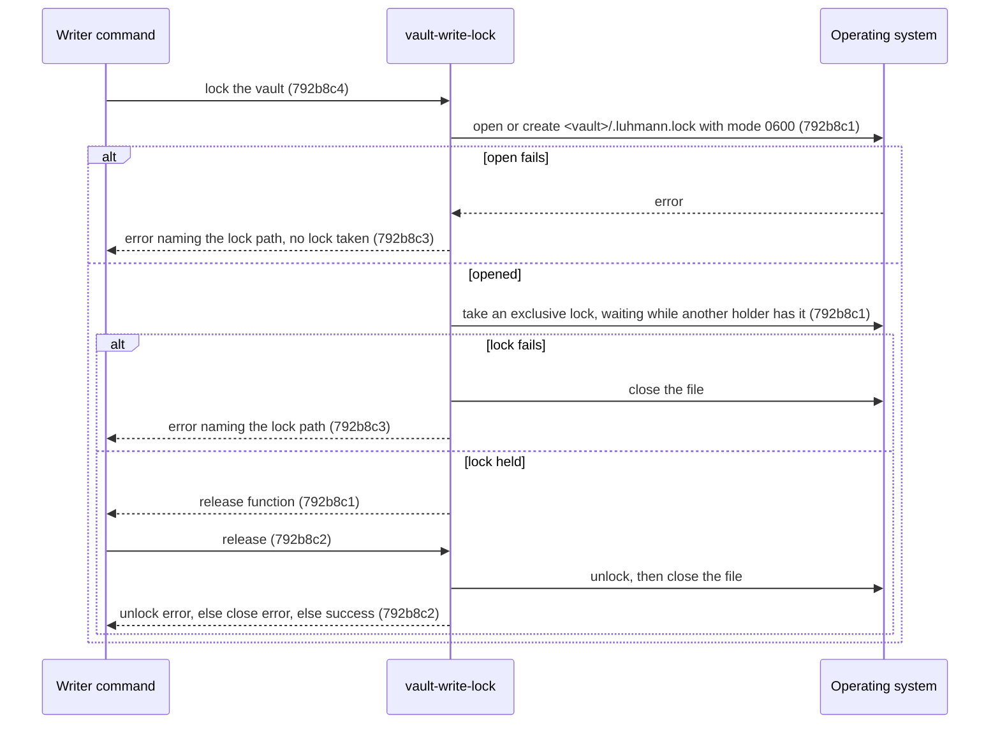

### 792b8c Behavior Requirements

#### 792b8c1 Exclusive hold

Requirement: 792b8c1 The vault-write-lock MUST open the lock file at the given path, creating it
with mode `0600` when absent, MUST take an exclusive advisory lock on it, waiting while another
holder has it, and MUST then return a release function.

Supports: 792a3m1a, 792a3q1a, 792a4o1a, 792a4o1b.

##### 792b8c1a Scenarios

```gherkin
Scenario: 792b8c1a1 A second holder waits for the first
  Given one holder has the lock on a lock file
  When a second holder asks for the same lock
  Then the second waits until the first releases it, and then gets it

Scenario: 792b8c1a2 An absent lock file is created
  Given a lock path with no file
  When the lock is taken
  Then the lock file is created with mode 0600
```

#### 792b8c2 Release

Requirement: 792b8c2 The vault-write-lock's release MUST unlock and then close the lock file, MUST
close the file even when unlocking fails, and MUST return the unlock error when unlocking fails,
else the close error when closing fails, each naming the lock path, else nothing.

Supports: 792a3m1a.

##### 792b8c2a Scenarios

```gherkin
Scenario: 792b8c2a1 Release unlocks, then closes
  Given a held lock
  When it is released
  Then the file is unlocked and then closed, and no error is returned

Scenario: 792b8c2a2 An unlock failure is reported and the file still closed
  Given a held lock whose unlock fails
  When it is released
  Then the unlock error is returned, naming the operation, and the file is closed

Scenario: 792b8c2a3 A close failure is reported
  Given a held lock whose unlock succeeds and whose close fails
  When it is released
  Then the close error is returned
```

#### 792b8c3 Acquire failures

Requirement: 792b8c3 When the lock file cannot be opened, the vault-write-lock MUST return an error
naming the lock path without trying to lock it; when the lock cannot be taken, it MUST close the
file and return an error naming the lock path.

Supports: 792a3m1a.

##### 792b8c3a Scenarios

```gherkin
Scenario: 792b8c3a1 An open failure names the path
  Given a lock file that cannot be opened
  When the lock is taken
  Then the error names the lock path, and no lock is attempted

Scenario: 792b8c3a2 A lock failure closes the file
  Given a lock file that opens but cannot be locked
  When the lock is taken
  Then the file is closed and the error names the lock path
```

#### 792b8c4 The vault's lock

Requirement: 792b8c4 The vault-write-lock MUST lock a vault by locking the file `.luhmann.lock` at
the vault root, and releasing that lock MUST release the file's lock.

Supports: 792a3m1a, 792a3q1a, 792a4o1a, 792a4o1b.

##### 792b8c4a Scenarios

```gherkin
Scenario: 792b8c4a1 A vault is locked through .luhmann.lock
  Given the vault /vault
  When the vault is locked and then released
  Then /vault/.luhmann.lock was locked, and released
```

### 792b8d Product-Scenario Mapping

| Product scenario | Technical requirements |
| --- | --- |
| 792a3m1a | 792b8c1, 792b8c2, 792b8c4 |
| 792a3q1a | 792b8c1, 792b8c4 |
| 792a4o1a | 792b8c1, 792b8c4 |
| 792a4o1b | 792b8c1, 792b8c4 |
| 792a5o1a | 792b8c1 |

```gherkin
Scenario: 792a4o1a Concurrent amends both take effect
  Given a fact note
  When engram amend --target <note> --subject s2 and engram amend --target <note> --chunk-source a#1 start at the same time
  Then the note carries both subject: s2 and a#1 in sources:

Scenario: 792a4o1b An activation does not undo a re-embed
  Given a fact note with a current sidecar
  When engram amend --target <note> --object new and engram activate --note <note> start at the same time
  Then the sidecar holds the vectors of the amended text
```

```gherkin
Scenario: 792a5o1a An ingest and a prune at the same time both take effect
  Given a chunk index that records a source whose file is gone
  When engram ingest --transcript new.jsonl and engram prune start at the same time
  Then afterwards the index records new.jsonl and no longer records the gone source
```

## 792b9 Added: text-embedder

Canonical target: `docs/specs/technical/text-embedder.md` (title `Text Embedder - Technical Spec`).

### 792b9a Orientation

- Ownership: Repository-owned dependency-boundary interaction (the Hugot and GoMLX inference
  libraries, the bundled ONNX model, and the model cache directory).
- Responsibility: turns text into a fixed-length vector with the bundled model, in process and
  offline. It unpacks the model into a cache directory once, builds the model only when first
  needed, fits long input to the model's window, and reports a model ID and dimension for the
  vectors it makes.
- Current realization (informational): `internal/embed/hugot.go` (`HugotEmbedder`,
  `LazyEmbedder`, the bundled `assets/model`, `BundledModelID` `minilm-l6-v2@384`),
  `internal/embed/runtime.go` (the runtime backend), `internal/embed/cache.go` and
  `internal/embed/cachefs.go` (model cache), `CacheDirFromHome` in `internal/cli/targets.go`, and
  `cmd/engram/hugot.go`, the thin Hugot runtime.
- Qualification: responsibility, embedding text is stated without naming any caller; ownership,
  callers decide what text to embed and what to do with the vector, while this component owns the
  model, its cache and its window; independent verification, it is tested directly over fake
  backends and cache filesystems and over the real bundled model; stability, the contract survives
  a change of runtime library; necessity, every sidecar and every query phrase depends on it.
- Supported capabilities: 792a3 note-writing, 792a5 chunk-indexing, 792a6 controlled-vocabulary,
  792a7 memory-query. Vault-health adds its mappings (792d30).

Rationale: an early design embedded through an external API, which brought a network dependency,
per-call cost and latency, and sent vault content off the machine. Instead the
`sentence-transformers/all-MiniLM-L6-v2` model (384 dimensions) is bundled into the binary with
`go:embed` and run in pure Go through Hugot and GoMLX's `simplego` backend, with no CGO, no daemon
and no network. The only external API in the system is the LLM that runs the agent. Embeddings are
therefore deterministic, offline and free per call, and the embedder is part of the engram binary
rather than an external system. Engram embeds note text when it writes a note and query text when
it reads.

### 792b9b Sequences

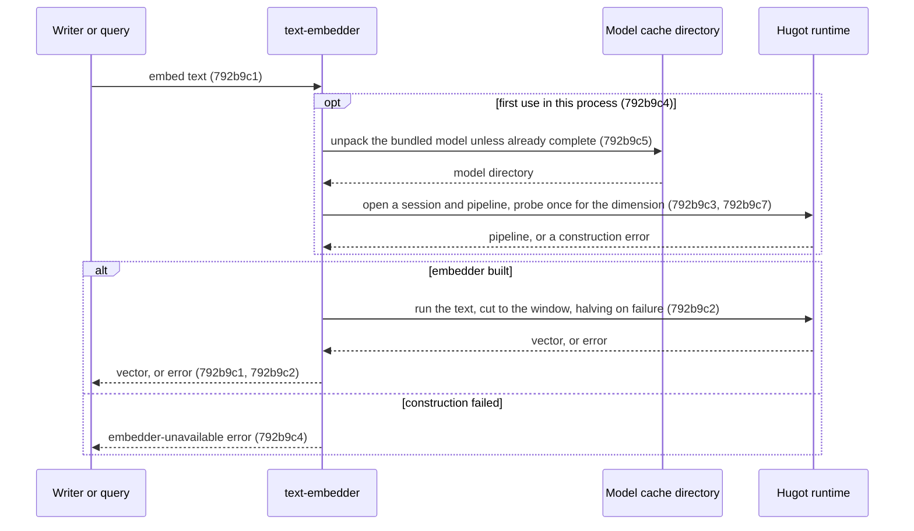

### 792b9c Behavior Requirements

#### 792b9c1 Bundled-model embedding

Requirement: 792b9c1 The text-embedder MUST embed text with the bundled model, model ID
`minilm-l6-v2@384`, returning one 384-value vector per text, and MUST match the reference
implementation's similarities for that model.

Supports: 792a3n1a, 792a6a1a, 792a9i1a.

##### 792b9c1a Scenarios

```gherkin
Scenario: 792b9c1a1 The bundled model embeds text
  Given the bundled embedder
  When it embeds "hello world" and a 4000-character text
  Then its model ID is minilm-l6-v2@384, its dimension is 384, and each vector has 384 values

Scenario: 792b9c1a2 The binary carries the model
  Given the binary's bundled assets
  When the model directory is listed
  Then it holds the model files

Scenario: 792b9c1a3 Similarities match the reference
  Given five text pairs with cosine similarities computed by the Python reference implementation
  When the bundled model embeds them
  Then each pair's cosine matches the reference

Scenario: 792b9c1a4 A run returns the pipeline's vector
  Given a pipeline that returns a vector for the text
  When the text is embedded and the embedder closed twice
  Then that vector is returned, and the pipeline is released once
```

#### 792b9c2 Input window

Requirement: 792b9c2 The text-embedder MUST cut text longer than 1500 characters to its first 1500,
and when the model run fails MUST halve the text and retry until a run succeeds or the text is
shorter than 100 characters, then return the error; a run that yields no vector MUST be an error.

Supports: 792a3n1a.

Rationale: 1500 characters fit the model's 512-token window for prose, but dense text such as code
can tokenize past it. Halving degrades a long chunk to a shorter prefix instead of failing a whole
ingest.

##### 792b9c2a Scenarios

```gherkin
Scenario: 792b9c2a1 An over-long failure retries shorter
  Given a model run that fails on long input and succeeds on shorter input
  When a long text is embedded
  Then a shorter prefix is embedded and its vector returned

Scenario: 792b9c2a2 A persistent failure surfaces
  Given a model run that always fails
  When a text is embedded
  Then the error is returned once the text is shorter than 100 characters

Scenario: 792b9c2a3 An empty result is an error
  Given a model run that returns no vector
  When a text is embedded
  Then the empty-result error is returned
```

#### 792b9c3 Construction

Requirement: 792b9c3 The text-embedder MUST build itself by opening the model's pipeline and
embedding one probe text to learn the dimension. It MUST return the open error when the pipeline
cannot open, and when the probe fails or yields an empty vector it MUST release the pipeline and
return the error, or the empty-probe error. It MUST refuse a model directory the runtime cannot
load, and closing it MUST release the pipeline and return any release error.

Supports: 792a3n1a, 792a3n1b.

##### 792b9c3a Scenarios

```gherkin
Scenario: 792b9c3a1 A probed embedder is built
  Given a pipeline whose probe returns a 2-value vector
  When the embedder is built
  Then its dimension is 2, and closing it releases the pipeline

Scenario: 792b9c3a2 An open failure is returned
  Given a pipeline that cannot open
  When the embedder is built
  Then the open error is returned

Scenario: 792b9c3a3 A failed probe releases the pipeline
  Given a pipeline whose probe fails
  When the embedder is built
  Then the pipeline is released and the probe error returned

Scenario: 792b9c3a4 An empty probe releases the pipeline
  Given a pipeline whose probe returns no vector, or a zero-length one
  When the embedder is built
  Then the pipeline is released and the empty-probe error returned

Scenario: 792b9c3a5 An invalid model directory is refused
  Given a model directory without a valid model.onnx
  When the real runtime builds an embedder from it
  Then an error is returned

Scenario: 792b9c3a6 A release error on close is returned
  Given a built embedder whose pipeline release fails
  When it is closed
  Then the release error is returned
```

#### 792b9c4 Lazy construction

Requirement: 792b9c4 The text-embedder MUST build the model at most once per process, on the first
embedding or dimension request, MUST report the bundled model ID without building it, and when
building fails MUST return an embedder-unavailable error from every embedding request and a
dimension of 0.

Supports: 792a3n1a, 792a3n1b.

Rationale: commands that never embed, such as `--help` or `update`, neither pay to unpack the model
nor fail when it cannot load.

##### 792b9c4a Scenarios

```gherkin
Scenario: 792b9c4a1 The model ID needs no build
  Given an embedder that has not been built
  When its model ID is asked
  Then it is the bundled model ID, and nothing is built

Scenario: 792b9c4a2 A failed build makes the embedder unavailable
  Given an embedder whose build fails
  When it is asked to embed and for its dimension
  Then embedding returns an embedder-unavailable error wrapping the build error, the dimension is 0, and the model ID is still the bundled one

Scenario: 792b9c4a3 A successful build is reused
  Given an embedder whose build succeeds
  When it is asked its dimension and model ID and to embed
  Then all three are served by the built embedder
```

#### 792b9c5 Model cache

Requirement: 792b9c5 The text-embedder MUST unpack the bundled model into the cache directory
`$XDG_CACHE_HOME/engram/models/<model ID>`, or `~/.cache/engram/models/<model ID>` without
`XDG_CACHE_HOME`, at most once: it MUST reuse a cache that carries its `.complete` marker, and
otherwise MUST unpack into a new sibling directory, write the marker, and rename that directory into
place. When the rename finds the cache already complete, it MUST discard its own copy and use the
cache; any other failure MUST remove its copy and be returned. A binary without the bundled model
MUST fail with an error saying the model is missing. Closing the embedder MUST NOT remove the cache.

Supports: 792a3n1a, 792a3n1b.

Rationale: the model is about 90 MB, so it is unpacked once and shared by every later run. The
rename makes the unpacked cache appear all at once, so a concurrent process never sees a half-written
model.

##### 792b9c5a Scenarios

```gherkin
Scenario: 792b9c5a1 The first use unpacks the model
  Given no cache directory
  When the embedder is built
  Then the model is unpacked into a sibling directory, marked complete, and renamed into place

Scenario: 792b9c5a2 A complete cache is reused
  Given a cache directory carrying its .complete marker
  When the embedder is built
  Then nothing is unpacked

Scenario: 792b9c5a3 A lost race uses the winner's cache
  Given another process completes the cache first
  When this process's rename finds the cache present and complete
  Then its own copy is removed and the cache is used

Scenario: 792b9c5a4 A race without a complete cache fails
  Given the rename finds the cache present but not complete
  When the embedder is built
  Then its own copy is removed and the rename error returned

Scenario: 792b9c5a5 Unpacking failures clean up
  Given creating the sibling directory, writing a model file, writing the marker, or renaming fails
  When the embedder is built
  Then any copy is removed and the error returned

Scenario: 792b9c5a6 A missing bundled model is a clear error
  Given a binary built without the model files
  When the embedder is built
  Then it fails with an error saying the bundled model is missing

Scenario: 792b9c5a7 Closing keeps the cache
  Given a built embedder
  When it is closed
  Then the cache directory still exists

Scenario: 792b9c5a8 The cache directory follows XDG
  Given home /Users/joe, model ID minilm-l6-v2@384, and XDG_CACHE_HOME unset or set to /custom/cache
  When the cache directory is resolved
  Then it is /Users/joe/.cache/engram/models/minilm-l6-v2@384, or /custom/cache/engram/models/minilm-l6-v2@384
```

#### 792b9c6 Cache filesystem

Requirement: 792b9c6 The text-embedder's cache filesystem MUST report a rename onto an existing,
populated directory as an "already exists" error, whatever error the platform gives, and MUST
report whether a directory carries the `.complete` marker it writes.

Supports: 792a3n1a.

Rationale: macOS reports a directory renamed over a non-empty one as "directory not empty", not
"exists"; translating it lets the race in 792b9c5 be recognized on every platform.

##### 792b9c6a Scenarios

```gherkin
Scenario: 792b9c6a1 A rename onto a populated directory is "exists"
  Given a destination directory that already holds files, on the real filesystem or behind either platform error
  When a directory is renamed onto it
  Then the error satisfies errors.Is for fs.ErrExist

Scenario: 792b9c6a2 The marker round-trips
  Given a directory
  When the .complete marker is written into it
  Then the directory is reported complete, and a directory without it is not
```

#### 792b9c7 Runtime lifecycle

Requirement: 792b9c7 The text-embedder's runtime backend MUST open a session and then a pipeline
named `engram-embed` over the model's `model.onnx`, MUST release the session when the pipeline
cannot open, and MUST return session, pipeline, run and release failures with their context. A
backend with no runtime wired MUST fail with the runtime-missing error rather than crash.

Supports: 792a3n1a.

##### 792b9c7a Scenarios

```gherkin
Scenario: 792b9c7a1 The pipeline is configured internally
  Given a runtime
  When a pipeline is opened for /models/m1
  Then the runtime gets the model path /models/m1, the name engram-embed and the file model.onnx

Scenario: 792b9c7a2 A pipeline failure releases the session
  Given a runtime whose pipeline cannot open
  When a pipeline is opened
  Then the session is released and the error names the pipeline

Scenario: 792b9c7a3 Session, run and release failures carry context
  Given a runtime whose session, run or release fails
  When the pipeline is opened, run or released
  Then the error names the failing step and wraps the cause

Scenario: 792b9c7a4 A run maps the vectors
  Given a pipeline run that returns vectors
  When it is run
  Then the same vectors are returned

Scenario: 792b9c7a5 A missing runtime fails loudly
  Given a backend with no runtime wired
  When a pipeline is opened
  Then the runtime-missing error is returned
```

### 792b9d Product-Scenario Mapping

| Product scenario | Technical requirements |
| --- | --- |
| 792a3n1a | 792b9c1, 792b9c2, 792b9c3, 792b9c4, 792b9c5, 792b9c6, 792b9c7 |
| 792a3n1b | 792b9c3, 792b9c4, 792b9c5 |
| 792a5b1a | 792b9c1, 792b9c2 |
| 792a5i1b | 792b9c1 |
| 792a6a1a | 792b9c1 |
| 792a7d1a | 792b9c1 |
| 792a7zc1a | 792b9c1 |
| 792a9i1a | 792b9c1 |

```gherkin
Scenario: 792a3n1b A failed embedding keeps the note
  Given embedding fails for the note being learned
  When the user runs engram learn fact
  Then the note is written, stderr carries a warning naming it, and the command succeeds
```

```gherkin
Scenario: 792a7d1a Notes are ranked by their better axis
  Given a note whose situation is close to the phrase and whose body is not, and a note whose body is close and whose situation is not
  When the user runs engram query with that phrase
  Then each note's score is its higher cosine, and the notes are ordered by it, highest first

Scenario: 792a7zc1a Every payload names its model
  Given any vault
  When the user runs engram query with a phrase
  Then the payload's model_id is minilm-l6-v2@384
```

```gherkin
Scenario: 792a9i1a A missing sidecar is written
  Given a note 1.foo.md with no sidecar
  When the user runs engram embed apply
  Then stdout has "embedded  1.foo.md (missing)" and the sidecar 1.foo.vec.json exists
```

## 792b10 Added: embedding-sidecar

Canonical target: `docs/specs/technical/embedding-sidecar.md` (title `Embedding Sidecar - Technical Spec`).

### 792b10a Orientation

- Ownership: Repository component.
- Responsibility: each note's `.vec.json` sidecar. It decides which text of a note is embedded and
  hashed, builds and writes the sidecar with two vectors, a model ID and a content hash, decodes
  and validates one, classifies a note's sidecar against the current model, and measures cosine
  similarity between vectors. It also runs the operator's census of a vault's sidecars and the
  re-embed of the notes whose sidecar is missing, stale, incompatible or broken.
- Current realization (informational): `internal/embed/sidecar.go` (`Sidecar` format,
  `SidecarPath`, `MarshalSidecar`, `UnmarshalSidecar`), `internal/embed/embedder.go`
  (`BuildSidecar`, `State`), `internal/embed/hash.go` (`SituationText`, `BodyText`, `ContentHash`),
  `internal/embed/state.go` (`ComputeState`), `internal/embed/cosine.go` (`Cosine`), and
  `autoEmbedNote` in `internal/cli/learn.go`, and `RunEmbedApply`, `RunEmbedStatus` and
  `selectStates` in `internal/cli/embed.go` (the operator's census and re-embed, 792d99).
- Qualification: responsibility, the sidecar contract is stated without naming any writer or
  reader; ownership, callers decide when to build, read or classify a sidecar, while this component
  decides its content and what makes it current; independent verification, building, decoding,
  hashing and classification are tested directly over fake embedders and filesystems; stability,
  the on-disk format is versioned and outlives any refactoring; necessity, every retrieval over notes
  reads it.
- Supported capabilities: 792a2 vault-identity, 792a3 note-writing, 792a4 note-revision, 792a5
  chunk-indexing, 792a6 controlled-vocabulary, 792a7 memory-query, 792a9 vault-health.
  Vault-migration adds its mappings (792d30).

Rationale: semantic search needs vectors, but a vector database or a separate rebuild step is a
moving part that can drift from the notes. Instead every note carries its own sidecar, written as
part of the same command: there is no index to maintain or invalidate, and a copied vault is
self-contained. Each sidecar holds two vectors, one for the note's situation and one for its body,
so retrieval can match a query against whichever fits better. Notes of every kind embed this way;
the retired episode kind once embedded only its situation.

### 792b10b Sequences

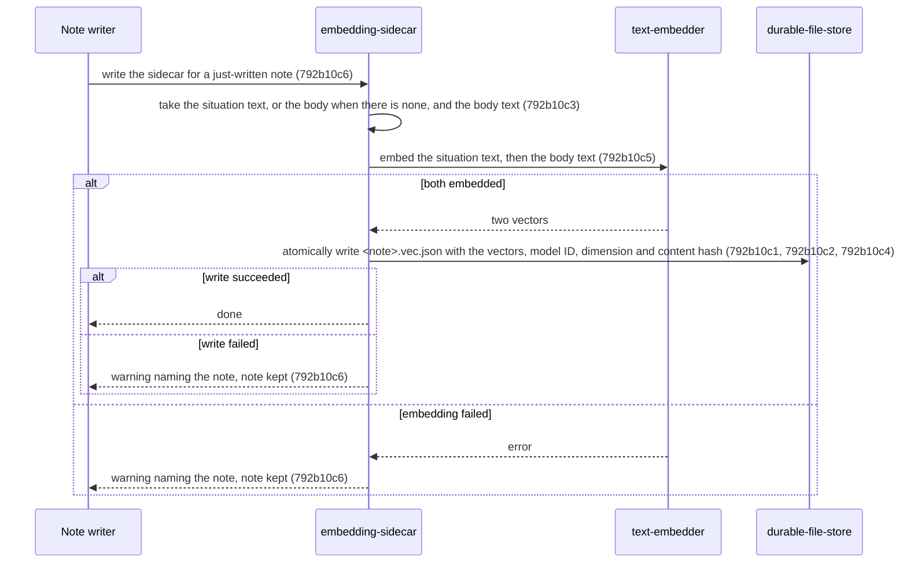

The operator's census and re-embed is a second flow:

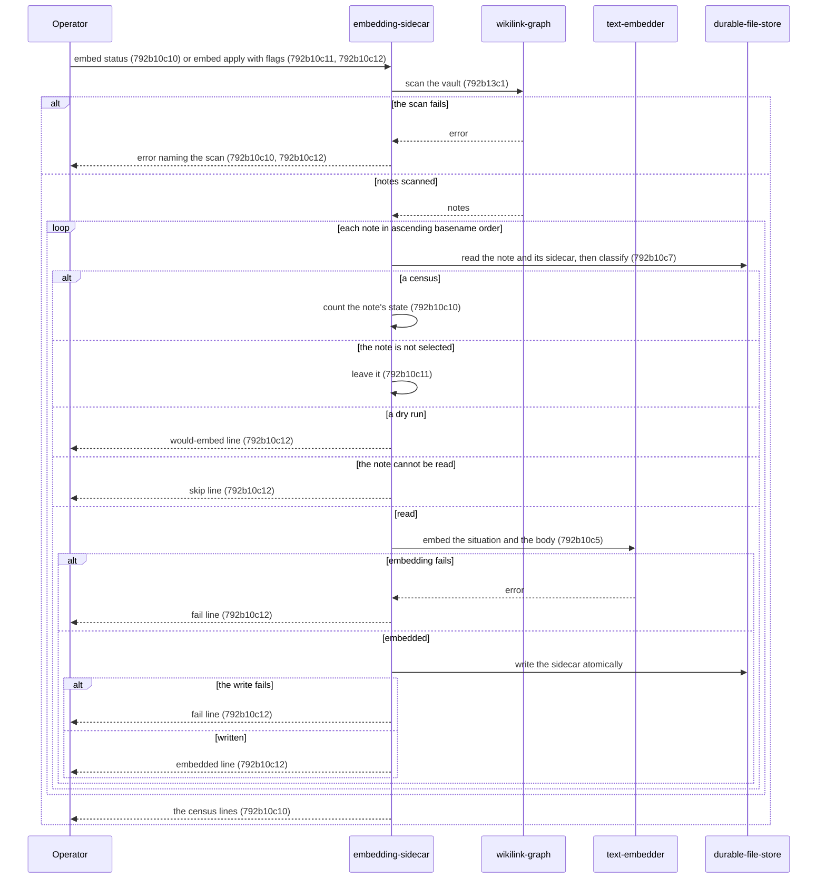

### 792b10c Behavior Requirements

#### 792b10c1 Sidecar format

Requirement: 792b10c1 The embedding-sidecar MUST store a sidecar as JSON with `schema_version` 1,
`embedding_model_id`, `dims`, `situation_vector`, `body_vector`, `content_hash`, and `last_used`
only when set. Decoding MUST refuse malformed JSON, MUST refuse any other schema version, such as an
old single-vector sidecar, before checking lengths, MUST refuse a sidecar whose either vector's
length differs from `dims`, and MUST read an absent `last_used` as empty.

Supports: 792a3n1a, 792a3u1a, 792a3u1b, 792a4n1a, 792a4n1d.

Rationale: `last_used` is added metadata. It does not bump the schema version, and it is kept out of
the content hash, so recording a use never makes a note look stale.

##### 792b10c1a Scenarios

```gherkin
Scenario: 792b10c1a1 A dual-vector sidecar round-trips
  Given a sidecar with both vectors, a model ID, a dimension and a content hash
  When it is encoded and decoded
  Then every field reads back unchanged

Scenario: 792b10c1a2 last_used is optional
  Given a sidecar with and without last_used
  When each is encoded and decoded
  Then last_used round-trips when set, and a sidecar without it decodes with last_used empty

Scenario: 792b10c1a3 A vector of the wrong length is refused
  Given a sidecar whose situation or body vector length differs from dims
  When it is decoded
  Then the dims-mismatch error is returned

Scenario: 792b10c1a4 Malformed JSON is refused
  Given text that is not valid sidecar JSON
  When it is decoded
  Then the malformed-sidecar error is returned

Scenario: 792b10c1a5 An old single-vector sidecar is a schema error
  Given a sidecar written by the earlier single-vector schema
  When it is decoded
  Then the schema-version error is returned
```

#### 792b10c2 Sidecar path

Requirement: 792b10c2 The embedding-sidecar MUST place a note's sidecar beside it, named after the
note with `.md` replaced by `.vec.json`, and MUST append `.vec.json` to any other path.

Supports: 792a3n1a, 792a6a1a.

##### 792b10c2a Scenarios

```gherkin
Scenario: 792b10c2a1 A note's sidecar path
  Given the note path 1aa.note.md
  When its sidecar path is formed
  Then it is 1aa.note.vec.json

Scenario: 792b10c2a2 A non-Markdown path gets the suffix appended
  Given a path that does not end in .md
  When its sidecar path is formed
  Then .vec.json is appended to it
```

#### 792b10c3 Embedding sources

Requirement: 792b10c3 The embedding-sidecar MUST take a note's situation text from its
`situation:` frontmatter value, trimmed, for any kind of note, and its body text from the text after
the frontmatter, less one leading blank line, with every machine-written line removed (lines
starting `Supersedes:`, `Contributors:`, `Answered by:` or `Answers:`) and trailing blank lines
reduced to one newline. Other body lines MUST be kept. A note with no frontmatter is all body.

Supports: 792a3n1a, 792a3q1a, 792a4g1a, 792a4g1b, 792a6d1a, 792a6j1a.

Rationale: the machine-written lines are link channels rewritten in place by learn, amend and
curation. Leaving them out means a link-only change neither moves the body vector nor makes the
sidecar stale. Trailing blanks are normalized because the writers end bodies differently.

##### 792b10c3a Scenarios

```gherkin
Scenario: 792b10c3a1 The situation is read from the frontmatter
  Given notes of any kind with a situation: value, including after a value ending in --- and with surrounding whitespace
  When the situation text is taken
  Then it is the value, trimmed

Scenario: 792b10c3a2 The body is the text after the frontmatter
  Given a note with frontmatter followed by a blank line and a body, or a note without frontmatter
  When the body text is taken
  Then it is the body alone, or the whole text

Scenario: 792b10c3a3 Machine-written lines are left out
  Given a body with Supersedes:, Contributors:, Answered by: or Answers: lines
  When the body text is taken
  Then those lines are gone and the rest is unchanged

Scenario: 792b10c3a4 Ordinary lines are kept
  Given a body with a "Related to" section or a vocabulary line
  When the body text is taken
  Then those lines are kept

Scenario: 792b10c3a5 Trailing blank lines are normalized
  Given bodies that differ only in their trailing blank lines
  When their body text is taken
  Then each ends in exactly one newline
```

#### 792b10c4 Content hash

Requirement: 792b10c4 The embedding-sidecar MUST hash a note as `sha256:` followed by the hex
SHA-256 of its situation text, a zero byte, and its body text, so the hash changes when either
changes, does not change for any other frontmatter edit, and is the same for the same note.

Supports: 792a3n1a, 792a4g1a, 792a4g1b, 792a6u1a.

##### 792b10c4a Scenarios

```gherkin
Scenario: 792b10c4a1 The hash covers situation and body
  Given a note with a situation and a body
  When it is hashed
  Then the hash is sha256: and the hex SHA-256 of the situation, a zero byte and the body

Scenario: 792b10c4a2 Changing either source changes the hash
  Given a note whose situation or body text changes, for any such texts
  When it is hashed again
  Then the hash differs

Scenario: 792b10c4a3 Other frontmatter does not change the hash
  Given a note whose triggers, tags or other non-situation frontmatter changes
  When it is hashed again
  Then the hash is the same

Scenario: 792b10c4a4 Hashing is repeatable
  Given any note
  When it is hashed twice
  Then both hashes are equal
```

#### 792b10c5 Building a sidecar

Requirement: 792b10c5 The embedding-sidecar MUST build a sidecar by embedding the situation text,
or the body text when the note has no situation, and the body text, and stamping schema version 1,
the embedder's model ID and dimension, and the note's content hash; an embedding failure MUST be
returned.

Supports: 792a3n1a, 792a3n1b, 792a4g1a, 792a4g1c, 792a4l1a, 792a4l1c, 792a4o1b, 792a6a1a.

##### 792b10c5a Scenarios

```gherkin
Scenario: 792b10c5a1 Both vectors are embedded and stamped
  Given a note with a situation and a body, and an embedder
  When its sidecar is built
  Then the situation vector embeds the situation, the body vector the body, and the model ID, dimension and hash are stamped

Scenario: 792b10c5a2 A note without a situation embeds its body twice
  Given a note with no situation: field
  When its sidecar is built
  Then both vectors embed the body text
```

#### 792b10c6 Writing a learned note's sidecar

Requirement: 792b10c6 After `engram learn` writes a note, the embedding-sidecar MUST build its
sidecar and atomically write it to the note's sidecar path. When building or writing fails, it MUST
log a warning naming the note and return without failing the command. With no embedder or no
sidecar writer wired, it MUST do nothing.

Supports: 792a3n1a, 792a3n1b, 792a6e1b.

Rationale: the note itself is already written in one atomic step, so a missing sidecar is
recoverable later by `engram embed apply --missing`.

##### 792b10c6a Scenarios

```gherkin
Scenario: 792b10c6a1 A learned note gets a valid sidecar
  Given a just-written note and an embedder
  When its sidecar is written
  Then a sidecar that decodes, with the embedder's model ID, is at its sidecar path

Scenario: 792b10c6a2 An embedding failure only warns
  Given an embedder that fails
  When the sidecar is written
  Then a warning naming the note is logged, and no error is returned

Scenario: 792b10c6a3 A write failure only warns
  Given a sidecar writer that fails
  When the sidecar is written
  Then a warning naming the note is logged, and no error is returned

Scenario: 792b10c6a4 Nothing is done without an embedder or writer
  Given no embedder, or no sidecar writer
  When the sidecar is written
  Then nothing is embedded or written
```

#### 792b10c7 State classification

Requirement: 792b10c7 The embedding-sidecar MUST classify a note against the current model as
`broken` when the note cannot be read; `missing` when its sidecar does not exist; `broken` when the
sidecar cannot be read, is malformed or has a dims mismatch; `incompatible` when it has another
schema version or another model ID; `stale` when its content hash differs from the note's; and `ok`
otherwise, checking the model before the hash.

Supports: 792a2c1a, 792a2d1a, 792a2d1b, 792a6u1a, 792a9g1a, 792a9g1b, 792a9h1a, 792a9h1b, 792a9h1c,
792a9h1f.

Rationale: a re-embed under a new model also picks up any content change, so a model mismatch takes
precedence. Every failure is a state rather than an error, so a pass over the whole vault never
stops early. All sidecars are expected to share one model ID. A query skips sidecars made by another
model with only an advisory, and fails only when none remains, so after a partial model change its
results can be silently thinner (792d66).

##### 792b10c7a Scenarios

```gherkin
Scenario: 792b10c7a1 A current sidecar is ok
  Given a note whose sidecar matches its content and the current model
  When it is classified
  Then it is ok

Scenario: 792b10c7a2 An absent sidecar is missing
  Given a note with no sidecar, whether the read error is fs.ErrNotExist, wraps it, or reports IsNotExist
  When it is classified
  Then it is missing, and an unrelated or nil error is not treated as absent

Scenario: 792b10c7a3 Changed content is stale
  Given a note whose body changed after its sidecar was written, including by adding a related-notes section
  When it is classified
  Then it is stale

Scenario: 792b10c7a4 Another model or schema is incompatible
  Given a sidecar made by another model, or by the old single-vector schema
  When it is classified
  Then it is incompatible

Scenario: 792b10c7a5 An unreadable sidecar is broken
  Given a sidecar that is malformed JSON or has a vector of the wrong length
  When it is classified
  Then it is broken

Scenario: 792b10c7a6 States have labels
  Given each state
  When it is printed
  Then it reads ok, missing, stale, incompatible or broken
```

#### 792b10c8 Cosine similarity

Requirement: 792b10c8 The embedding-sidecar MUST measure two vectors' cosine similarity, and MUST
return 0 when their lengths differ, when they are empty, or when either has zero magnitude.

Supports: 792a3t1a, 792a3u1a, 792a3u1b, 792a6d1a, 792a6d1c.

##### 792b10c8a Scenarios

```gherkin
Scenario: 792b10c8a1 A vector is fully similar to itself
  Given any non-zero vector
  When its cosine with itself is measured
  Then it is 1

Scenario: 792b10c8a2 Orthogonal vectors are not similar
  Given two orthogonal vectors
  When their cosine is measured
  Then it is 0

Scenario: 792b10c8a3 Vectors without signal score 0
  Given vectors of different lengths, or a zero vector
  When their cosine is measured
  Then it is 0
```

#### 792b10c9 CRLF notes

Requirement: 792b10c9 The embedding-sidecar MUST take the situation text, the body text and the
content hash of a note whose lines end in `\r\n` from its LF form, so that each equals the value
for the note's LF form.

Supports: 792a4m1a, 792a9j1a, 792a9j1b.

Rationale: a CRLF note used to be embedded from the wrong text, and a conversion to LF then changed
its hash. Reading the LF form makes the conversion that a revision makes leave the hash as it
would be for the LF note.

##### 792b10c9a Scenarios

```gherkin
Scenario: 792b10c9a1 A CRLF note embeds and hashes as its LF form
  Given a note whose lines end in \r\n, and the same note with LF line endings
  When their situation text, body text and content hash are taken
  Then each equals the LF note's
```

#### 792b10c10 Embedding census

Requirement: 792b10c10 The embedding-sidecar MUST, for a census, scan the vault, classify each scanned
note (792b10c7) and print six lines: `total:` and the number of notes, then `with-embeddings:` (ok),
`without:` (missing), `stale:`, `incompatible:` and `broken:` with their numbers, each label padded
so the numbers align. It MUST return a scan failure as `embed status: scan: <error>`.

Supports: 792a9g1a, 792a9g1b, 792a9g1c, 792a9j1a.

##### 792b10c10a Scenarios

```gherkin
Scenario: 792b10c10a1 Notes without sidecars are counted as without
  Given a vault of two notes and no sidecar
  When the census is taken
  Then the output has "total:           2", "with-embeddings: 0" and "without:         2"

Scenario: 792b10c10a2 Every state is counted
  Given notes that are ok, stale, incompatible and broken
  When the census is taken
  Then each of those counts is 1 and the total is 4

Scenario: 792b10c10a3 A scan failure is returned
  Given a vault whose scan fails
  When the census is taken
  Then it fails with an error beginning "embed status: scan:"
```

#### 792b10c11 Embedding selection

Requirement: 792b10c11 The embedding-sidecar MUST select, with no mode flag or with the missing flag,
the notes whose state is missing; with the stale flag, the stale notes; with the force flag, the
incompatible notes; and with the all flag, every note. Mode flags other than all MUST combine, and all
MUST select every state. It MUST select a note whose state is broken under every selection.

Supports: 792a9h1a, 792a9h1b, 792a9h1c, 792a9h1d, 792a9h1e, 792a9h1f.

Rationale: a broken sidecar cannot be classified against the content, and no selection should leave
it, so every selection takes it. The force flag is separate from the stale flag because replacing
another model's sidecars changes the model a vault runs under (792b10c7).

##### 792b10c11a Scenarios

```gherkin
Scenario: 792b10c11a1 No flag selects the missing notes
  Given no mode flag
  When each state is tested for selection
  Then missing and broken are selected and ok, stale and incompatible are not

Scenario: 792b10c11a2 The all flag selects every state
  Given the all flag
  When each state is tested for selection
  Then every state is selected

Scenario: 792b10c11a3 The stale flag selects stale and broken
  Given the stale flag
  When each state is tested for selection
  Then stale and broken are selected and the others are not

Scenario: 792b10c11a4 The force flag selects incompatible and broken
  Given the force flag
  When each state is tested for selection
  Then incompatible and broken are selected and the others are not

Scenario: 792b10c11a5 The missing flag is the explicit default
  Given the missing flag
  When each state is tested for selection
  Then missing and broken are selected and the others are not

Scenario: 792b10c11a6 Mode flags combine
  Given the stale and force flags
  When each state is tested for selection
  Then stale, incompatible and broken are selected and missing and ok are not
```

#### 792b10c12 Embedding run

Requirement: 792b10c12 The embedding-sidecar MUST, for each selected note in ascending basename order,
read the note, build its sidecar (792b10c5), write it atomically beside the note and print
`embedded  <note>.md (<state>)`. With the dry-run flag it MUST print `would-embed <note>.md (<state>)`
and write nothing. It MUST print `skip      <note>.md: read error: <error>` for a note it
cannot read, and `fail      <note>.md: embed: <error>` or `fail      <note>.md: write: <error>` for an
embedding or a write that fails, and MUST continue with the remaining notes and return no error
for them. It MUST write nothing but sidecars, and MUST return a scan failure as `embed apply: scan:
<error>`.

Supports: 792a9h1a, 792a9h1b, 792a9h1c, 792a9h1d, 792a9h1f, 792a9i1a, 792a9i1b, 792a9i1c, 792a9i1d,
792a9i1e, 792a9i1f, 792a9j1b.

Rationale: a sidecar is a derived file, not part of the note's git-tracked content. It is recomputed
from the current note, so its content hash stays honest, and it is never stored in or versioned with
the note file. No lock is taken: a sidecar write does not collide with Luhmann ID assignment.

##### 792b10c12a Scenarios

```gherkin
Scenario: 792b10c12a1 A missing sidecar is written
  Given a note with no sidecar
  When the run embeds the missing notes
  Then the output has "embedded  <note>.md (missing)" and the sidecar holds the schema version, model ID, dims, both vectors and a sha256 content hash

Scenario: 792b10c12a2 A dry run writes nothing
  Given a note with no sidecar
  When the run is a dry run
  Then the output has "would-embed <note>.md (missing)" and no sidecar is written

Scenario: 792b10c12a3 The stale flag leaves another model's sidecar and the force flag replaces it
  Given a note whose sidecar names another model
  When the run uses the stale flag, then the force flag
  Then the first leaves the sidecar unchanged and the second rewrites it under the current model

Scenario: 792b10c12a4 A failed write is reported
  Given a note whose sidecar cannot be written
  When the run embeds it
  Then the output has a line beginning "fail      " for the note and containing the write error, and no error is returned

Scenario: 792b10c12a5 A failed embedding is reported
  Given an embedder that fails
  When the run embeds a note
  Then the output has a line beginning "fail      " for the note, and no error is returned

Scenario: 792b10c12a6 A stale and a broken note are both embedded
  Given a stale note and a note with a malformed sidecar
  When the run uses the stale flag
  Then both are embedded, printing their states

Scenario: 792b10c12a7 A note that cannot be read is skipped
  Given a selected note that cannot be read
  When the run embeds it
  Then the output has a line beginning "skip      " for the note and the run goes on

Scenario: 792b10c12a8 A scan failure is returned
  Given a vault whose scan fails
  When the run starts
  Then it fails with an error beginning "embed apply: scan:" and writes nothing

Scenario: 792b10c12a9 Notes are embedded in ascending order
  Given several selected notes
  When the run embeds them
  Then their lines are in ascending basename order

Scenario: 792b10c12a10 Only sidecars are written
  Given selected notes
  When the run embeds them
  Then no note file changes and every file written is a sidecar
```

### 792b10d Product-Scenario Mapping

| Product scenario | Technical requirements |
| --- | --- |
| 792a2c1a | 792b10c7 |
| 792a2d1a | 792b10c7 |
| 792a2d1b | 792b10c7 |
| 792a3n1a | 792b10c1, 792b10c2, 792b10c3, 792b10c4, 792b10c5, 792b10c6 |
| 792a3n1b | 792b10c5, 792b10c6 |
| 792a3q1a | 792b10c3 |
| 792a3t1a | 792b10c8 |
| 792a3u1a | 792b10c1, 792b10c8 |
| 792a3u1b | 792b10c1, 792b10c8 |
| 792a4g1a | 792b10c3, 792b10c4, 792b10c5 |
| 792a4g1b | 792b10c3, 792b10c4 |
| 792a4g1c | 792b10c5 |
| 792a4l1a | 792b10c5 |
| 792a4l1c | 792b10c5 |
| 792a4m1a | 792b10c9 |
| 792a4n1a | 792b10c1 |
| 792a4n1d | 792b10c1 |
| 792a4o1b | 792b10c5 |
| 792a5n1a | 792b10c2 |
| 792a6a1a | 792b10c2, 792b10c5 |
| 792a6d1a | 792b10c3, 792b10c8 |
| 792a6d1c | 792b10c8 |
| 792a6e1b | 792b10c6 |
| 792a6j1a | 792b10c3 |
| 792a6u1a | 792b10c4, 792b10c7 |
| 792a7c1a | 792b10c1 |
| 792a7c1b | 792b10c1 |
| 792a7c1c | 792b10c1 |
| 792a7d1a | 792b10c1, 792b10c8 |
| 792a7f1b | 792b10c1 |
| 792a7zh1a | 792b10c1 |
| 792a9g1a | 792b10c10, 792b10c7 |
| 792a9g1b | 792b10c10, 792b10c7 |
| 792a9g1c | 792b10c10 |
| 792a9h1a | 792b10c11, 792b10c12, 792b10c7 |
| 792a9h1b | 792b10c11, 792b10c12, 792b10c7 |
| 792a9h1c | 792b10c11, 792b10c12, 792b10c7 |
| 792a9h1d | 792b10c11, 792b10c12 |
| 792a9h1e | 792b10c11 |
| 792a9h1f | 792b10c11, 792b10c12, 792b10c7 |
| 792a9i1a | 792b10c12 |
| 792a9i1b | 792b10c12 |
| 792a9i1c | 792b10c12 |
| 792a9i1d | 792b10c12 |
| 792a9i1e | 792b10c12 |
| 792a9i1f | 792b10c12 |
| 792a9j1a | 792b10c10, 792b10c9 |
| 792a9j1b | 792b10c12, 792b10c9 |

```gherkin
Scenario: 792a3t1a The answer is found and the question is not
  Given a vault holding a pair whose question and answer both match a phrase
  When the user runs engram query with that phrase
  Then the answer note can appear in the results, and the question note never does
```

```gherkin
Scenario: 792a4g1a A content amend re-embeds
  Given a fact note with a current sidecar
  When the user runs engram amend --target <note> --object new
  Then the note's sidecar is rebuilt from the amended text, and engram embed status reports it ok

Scenario: 792a4g1b A provenance-only amend does not re-embed
  Given a fact note with a current sidecar
  When the user runs engram amend --target <note> with only --supersedes or --chunk-source
  Then the note's sidecar file is unchanged

Scenario: 792a4g1c A failed re-embed keeps the amend
  Given embedding fails for the note being amended
  When the user runs engram amend --target <note> --object new
  Then the note is amended, stderr carries a warning naming it, and the command succeeds

Scenario: 792a4n1d Amend records a use
  Given a note with a current sidecar
  When the user runs engram amend --target <note> --activate
  Then the sidecar's last_used is today
```

```gherkin
Scenario: 792a5n1a A vault-note copy outside the vault is skipped
  Given a swept directory holding 1.2026-10-09.x.md with 1.2026-10-09.x.vec.json beside it, and plain.md with no sidecar, outside the vault
  When the user runs engram ingest --sweep <dir>
  Then plain.md is indexed and 1.2026-10-09.x.md is not

Scenario: 792a6d1a A learned note is tagged with its closest terms
  Given a vault whose vocabulary holds the terms build-tooling and cooking
  When the user runs engram learn fact about running a linter before committing Go code
  Then the note carries vocab/build-tooling and not vocab/cooking

Scenario: 792a6d1c At most three terms are kept
  Given a vault with four terms, each close to one note's text
  When the user writes that note with engram learn
  Then the note carries the three closest terms, closest first

Scenario: 792a6e1b A note whose embedding failed is not tagged
  Given a vault with a vocabulary, where embedding the new note fails
  When the user runs engram learn fact
  Then the note is written, stderr carries a warning naming it, and the note has no vocab/ tag

Scenario: 792a6j1a The term count follows the vault's clusters
  Given a vault of notes in two clear topics
  When the user runs engram vocab refit --dry-run
  Then it prints "vocab refit (dry-run): K=2 silhouette=<s>"

Scenario: 792a6u1a Backfill adds missing self-tags
  Given a vault whose definition notes carry only the bare vocab tag
  When the user runs engram vocab tag-definitions
  Then each per-term definition's tags become [vocab, vocab/<term>], engram embed status reports none of them stale, and one "added" line is printed per note
```

```gherkin
Scenario: 792a7c1a Notes of another model are dropped with a warning
  Given a vault of ten notes of which nine have sidecars made by another model
  When the user runs engram query --phrase pasta
  Then stderr says "dropped 9 sidecar(s)" and names the other model and the active one, and the one note with a current sidecar can still be returned

Scenario: 792a7c1b A vault with no usable embeddings is an error
  Given a vault of notes whose sidecars are all from another model, or missing
  When the user runs engram query --phrase pasta
  Then it fails with "query: vault has notes but no current-model embeddings; run `engram embed apply --all`"

Scenario: 792a7c1c Old-schema sidecars are skipped with their own warning
  Given a vault in which a sidecar is on an old schema version
  When the user runs engram query --phrase pasta
  Then stderr says "1 sidecar(s) on an old schema were skipped" and names engram embed apply --force

Scenario: 792a7f1b A long-unused note is scaled down
  Given two notes with the same text, one whose sidecar says last_used today and one 120 days ago
  When the user runs engram query with a phrase that matches them
  Then the first scores four times the second and is listed first

Scenario: 792a7zh1a A query leaves the vault as it was
  Given a vault with notes and sidecars
  When the user runs engram query with a phrase that matches them
  Then every note, sidecar and chunk-index file is byte-identical afterwards, and the payload has no activated field
```

```gherkin
Scenario: 792a9g1a Notes without sidecars are counted as without
  Given a vault of two notes and no sidecar
  When the user runs engram embed status
  Then stdout has "total:           2", "with-embeddings: 0" and "without:         2"

Scenario: 792a9g1b Every state is counted
  Given a vault of four notes: one embedded and current, one whose body changed after embedding, one whose sidecar names another model, and one whose sidecar is malformed
  When the user runs engram embed status
  Then total is 4, and with-embeddings, stale, incompatible and broken are each 1

Scenario: 792a9h1a The default embeds only notes without a sidecar
  Given one note without a sidecar and one with a current sidecar
  When the user runs engram embed apply
  Then only the note without a sidecar is embedded

Scenario: 792a9h1b --stale embeds changed notes and not another model's sidecars
  Given a note whose body changed after its sidecar and a note whose sidecar names another model
  When the user runs engram embed apply --stale
  Then the changed note is re-embedded and the other model's sidecar is unchanged

Scenario: 792a9h1c --force replaces another model's sidecar
  Given a note whose sidecar names another model
  When the user runs engram embed apply --force
  Then its sidecar is rewritten under the current model

Scenario: 792a9h1d --all embeds every note
  Given a note with a current sidecar
  When the user runs engram embed apply --all
  Then it is embedded again

Scenario: 792a9h1e Mode flags combine
  Given a stale note, an incompatible note and a missing note
  When the user runs engram embed apply --stale --force
  Then the stale and the incompatible notes are embedded and the missing one is not

Scenario: 792a9h1f A broken sidecar is always replaced
  Given a note whose sidecar is malformed
  When the user runs engram embed apply, then with --stale, then with --force
  Then the note is embedded each time

Scenario: 792a9i1b A dry run writes nothing
  Given a note 1.foo.md with no sidecar
  When the user runs engram embed apply --dry-run
  Then stdout has "would-embed 1.foo.md (missing)" and no sidecar exists

Scenario: 792a9i1c Only sidecars are written
  Given notes needing embedding
  When the user runs engram embed apply --all
  Then every note file is byte-identical afterwards, none of them contains a vector or a model ID, and the only files created are sidecars

Scenario: 792a9i1d A failed write is reported and the run goes on
  Given two notes, where a directory stands where the first note's sidecar would be
  When the user runs engram embed apply
  Then stdout has a line beginning "fail      " for the first note and ending with the write error, the second note is embedded, and the exit status is zero

Scenario: 792a9i1e Notes are embedded in order
  Given three notes without sidecars
  When the user runs engram embed apply
  Then the "embedded" lines are in ascending basename order

Scenario: 792a9j1a A CRLF note is not stale
  Given a note embedded with LF line endings and then converted to CRLF
  When the user runs engram embed status
  Then the note is counted with-embeddings, and stale is 0

Scenario: 792a9j1b A CRLF note gets its LF form's sidecar
  Given a note with LF line endings and the same note with CRLF line endings
  When the user runs engram embed apply --all on each
  Then the two sidecars are byte-identical
```

## 792b11 Added: note-provenance

Canonical target: `docs/specs/technical/note-provenance.md` (title `Note Provenance - Technical Spec`).

### 792b11a Orientation

- Ownership: Repository-owned dependency-boundary interaction (`git`, through the
  subprocess-runner, and the operating system's user lookup).
- Responsibility: works out who and where a note write comes from: the repository of the working
  directory and the writing user. It stamps them, with the vault name, on a note's first write and
  re-stamps them on a revision, and omits, with a warning, any value that does not resolve, except
  that a re-stamp keeps a user the note already has.
- Current realization (informational): `detectRepo`, `detectUser`, `firstWriteIdentity` and
  `identityStamp` in `internal/cli/identity.go`; `newLearnDeps` wires them for `learn`. The amend
  re-stamp is `identityStamp.stampPreservingUser`; identity backfill
  (`internal/cli/identity_backfill.go`) is specified by vault-migration (792d67).
- Qualification: responsibility, provenance detection is stated without naming any command;
  ownership, writers decide when to stamp, while this component decides what the values are;
  independent verification, detection and stamping are tested directly over a fake `git` and user
  lookup; stability, the fields and their sources survive any change to the writers; necessity,
  every note's `repo:`, `user:` and `vault:` come from it.
- Supported capabilities: 792a2 vault-identity, 792a3 note-writing, 792a4 note-revision. Vault-migration,
  vault-serving and parent-sync add their requirements (792d30, 792d67).

Rationale: detection shells out to `git` rather than reading `.git/config`, because reproducing
git's own configuration precedence (worktrees, `includeIf` and so on) would bring no benefit.
Identity is self-reported: it is detected from the writer's own environment at the moment of the
write and never verified, as `source:` already was; a verified identity could later replace it
without changing the fields. Detection never fails a write. A working directory outside git, like
an absent `project:`, simply leaves the field out.

### 792b11b Sequences

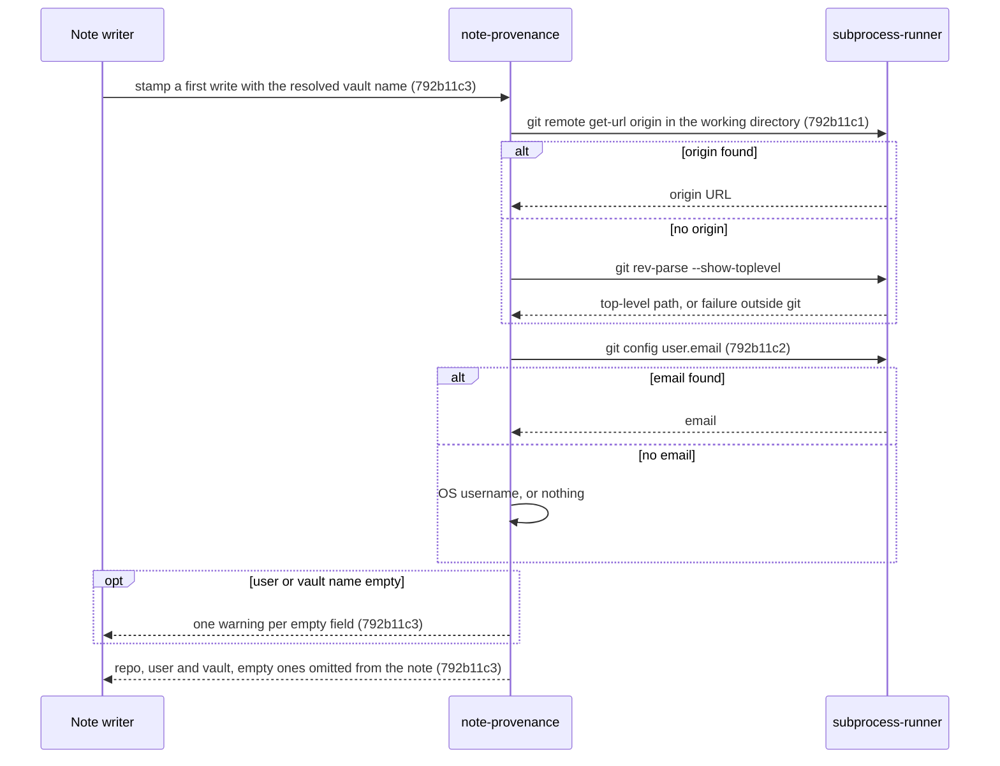

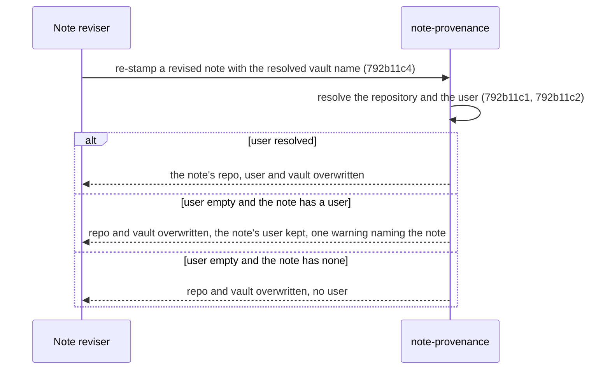

### 792b11c Behavior Requirements

#### 792b11c1 Repository detection

Requirement: 792b11c1 The note-provenance MUST resolve the repository as the output of
`git remote get-url origin` in the working directory, trimmed; when that fails or prints nothing,
as the basename of the path printed by `git rev-parse --show-toplevel`; and otherwise, including
when the working directory cannot be resolved, as empty, without failing.

Supports: 792a3o1a, 792a3o1b, 792a3o1c, 792a4h1a, 792a4h1b, 792a4h1c.

##### 792b11c1a Scenarios

```gherkin
Scenario: 792b11c1a1 The origin remote names the repository
  Given git remote get-url origin prints git@github.com:example/repo.git
  When the repository is resolved
  Then it is git@github.com:example/repo.git

Scenario: 792b11c1a2 Without an origin the top-level basename names it
  Given no origin remote, and git rev-parse --show-toplevel prints /home/joe/src/engram
  When the repository is resolved
  Then it is engram

Scenario: 792b11c1a3 Outside git there is no repository
  Given both git commands fail
  When the repository is resolved
  Then it is empty

Scenario: 792b11c1a4 An unresolvable working directory has no repository
  Given the working directory cannot be resolved
  When the repository is resolved
  Then it is empty, and git is never run
```

#### 792b11c2 User detection

Requirement: 792b11c2 The note-provenance MUST resolve the user as the output of
`git config user.email`, trimmed; when that fails or prints nothing, as the OS username; and when
that also fails or is unavailable, as empty, without failing.

Supports: 792a3p1a, 792a3p1b, 792a3p1c, 792a4h1a, 792a4h1b, 792a4h1d, 792a4h1e.

##### 792b11c2a Scenarios

```gherkin
Scenario: 792b11c2a1 The git email names the user
  Given git config user.email prints agent@example.com
  When the user is resolved
  Then it is agent@example.com, and the OS username is not used

Scenario: 792b11c2a2 The OS username is the fallback
  Given git config user.email prints nothing or fails, and the OS username is joe
  When the user is resolved
  Then it is joe

Scenario: 792b11c2a3 No source resolves
  Given git config user.email fails and the OS username lookup fails or is unavailable
  When the user is resolved
  Then it is empty
```

#### 792b11c3 First-write stamp

Requirement: 792b11c3 On a note's first write, the note-provenance MUST stamp the resolved
repository, user and vault name; a stamp whose user is empty MUST leave `user:` out and log one
warning that user detection resolved empty, naming the command, and a stamp whose vault name is
empty MUST leave `vault:` out and log one warning.

Supports: 792a2b1a, 792a2b1b, 792a2b1c, 792a3o1a, 792a3o1b, 792a3o1c, 792a3p1a, 792a3p1b,
792a3p1c.

Rationale: an empty `user: ""` or `vault: ""` would look like a real value to every later reader.
Identity backfill, or a later amend that re-stamps, fills a missing user in.

##### 792b11c3a Scenarios

```gherkin
Scenario: 792b11c3a1 All three fields are stamped
  Given repository git@github.com:example/vault.git, user agent@example.com and vault name work
  When a fact or feedback note is first written
  Then it carries repo, user and vault with those values, and no warning is logged

Scenario: 792b11c3a2 An empty user is left out
  Given user detection resolves empty and the vault name is personal
  When a note is first written
  Then it has no user: key, carries vault: personal, and one warning says user detection resolved empty

Scenario: 792b11c3a3 An empty vault name is left out
  Given no vault name was resolved
  When a note is first written
  Then it has no vault: key, and a warning names the vault
```

#### 792b11c4 Re-stamp

Requirement: 792b11c4 When a revision re-stamps a note, the note-provenance MUST overwrite the
note's repository, user and vault with the resolved repository, user and vault name; when the
resolved user is empty it MUST keep a non-empty user the note already has, logging one warning that
names the note and says user detection resolved empty, and MUST leave the user out when the note has
none. With no re-stamp to apply, it MUST change nothing.

Supports: 792a4h1a, 792a4h1b, 792a4h1c, 792a4h1d, 792a4h1e, 792a4h1f, 792a4h1g.

Rationale: the alternatives for an empty user were to refuse the revision, which blocks content
edits on a machine with broken identity, or to keep the old value silently, which hides the broken
environment (#776). The repository keeps fresh detection even when empty, because a working
directory outside git is legitimate.

##### 792b11c4a Scenarios

```gherkin
Scenario: 792b11c4a1 All three are overwritten
  Given a note with repo old-repo, user old-user and vault old-vault, and resolved repository new-repo, user bob and vault name new-vault
  When the note is re-stamped
  Then its repo is new-repo, its user bob and its vault new-vault

Scenario: 792b11c4a2 An empty user keeps the note's user
  Given a fact, feedback or runbook note whose user is alice, and user detection resolves empty
  When the note is re-stamped
  Then its user is still alice, and exactly one warning names the note and says user detection resolved empty

Scenario: 792b11c4a3 An empty user with none on the note is left out
  Given a fact, feedback or runbook note with no user, and user detection resolves empty
  When the note is re-stamped
  Then it has no user: key, and no warning is logged

Scenario: 792b11c4a4 No re-stamp changes nothing
  Given a note with repo r, user u and vault v
  When a revision applies no re-stamp
  Then its repo, user and vault are still r, u and v
```

### 792b11d Product-Scenario Mapping

| Product scenario | Technical requirements |
| --- | --- |
| 792a2b1a | 792b11c3 |
| 792a2b1b | 792b11c3 |
| 792a2b1c | 792b11c3 |
| 792a3o1a | 792b11c1, 792b11c3 |
| 792a3o1b | 792b11c1, 792b11c3 |
| 792a3o1c | 792b11c1, 792b11c3 |
| 792a3p1a | 792b11c2, 792b11c3 |
| 792a3p1b | 792b11c2, 792b11c3 |
| 792a3p1c | 792b11c2, 792b11c3 |
| 792a4h1a | 792b11c1, 792b11c2, 792b11c4 |
| 792a4h1b | 792b11c1, 792b11c2, 792b11c4 |
| 792a4h1c | 792b11c1, 792b11c4 |
| 792a4h1d | 792b11c2, 792b11c4 |
| 792a4h1e | 792b11c2, 792b11c4 |
| 792a4h1f | 792b11c4 |
| 792a4h1g | 792b11c4 |

```gherkin
Scenario: 792a4h1a Amend from another environment re-stamps
  Given a fact note whose repo:, user: and vault: differ from the current environment's
  When the user runs engram amend --target <note> with a content flag, --supersedes or --chunk-source
  Then the note's repo:, user: and vault: are the current environment's detected values

Scenario: 792a4h1b Amend backfills missing identity
  Given a fact note with no repo:, user: or vault:
  When the user runs engram amend --target <note> --object new
  Then the note gains the current environment's repo:, user: and vault:

Scenario: 792a4h1c The project field does not stand in for the repo
  Given a note whose project: differs from the current working directory's repository
  When the user runs engram amend --target <note> --object new
  Then the note's repo: is the current working directory's repository, not the project: value

Scenario: 792a4h1d Empty user detection keeps the prior user
  Given a note whose user: is alice, and neither git config user.email nor the OS username resolves
  When the user runs engram amend --target <note> --object new
  Then the note's user: is still alice, stderr carries a warning naming the note, and the amend succeeds

Scenario: 792a4h1e Empty user detection never writes an empty user
  Given a note with no user:, and neither git config user.email nor the OS username resolves
  When the user runs engram amend --target <note> --object new
  Then the note has no user: field

Scenario: 792a4h1g Recording a use keeps the declared identity
  Given a note whose repo:, user: and vault: differ from the current environment's
  When the user runs engram amend --target <note> --activate
  Then the note's repo:, user: and vault: are unchanged
```

## 792b12 Added: note-authoring

Canonical target: `docs/specs/technical/note-authoring.md` (title `Note Authoring - Technical Spec`).

### 792b12a Orientation

- Ownership: Repository component (caller of note-document-format, luhmann-addressing,
  vault-write-lock, embedding-sidecar, note-provenance and durable-file-store).
- Responsibility: carries out `engram learn fact`, `feedback`, `runbook` and `qa`. It validates the
  arguments, turns them into a note's fields, and orders the write: lock the vault, allocate the
  Luhmann ID, stamp provenance, render and create the note, write its sidecar and vocabulary tags,
  release the lock and report the path. For a question-and-answer pair it writes both notes and
  undoes the first when the second fails.
- Current realization (informational): `RunLearn`, `writeLearnUnderLock`, `writeLearnLocked`,
  `assembleLearnContent`, the `validate*` functions and the `learnArgsFrom*` mappings in
  `internal/cli/learn.go`; `RunLearnQA`, `writeQANotesUnderLock` and the QA validators in
  `internal/cli/qa.go`; the learn argument types in `internal/cli/targets.go` and `qa.go`;
  `newLearnDeps` and `newQaDeps`. Each `learn` subcommand is its own process; nothing here calls
  another subcommand.
- Qualification: responsibility, capturing a note is stated without naming any function or seam;
  ownership, it owns validation, field mapping and the order of the write, while the components it
  calls own the format, the IDs, the lock, the sidecar and provenance; independent verification,
  it is tested directly over injected dependencies; stability, the capture flow survives any
  refactoring of the components it calls; necessity, every new note is written through it.
- Supported capabilities: 792a3 note-writing, 792a6 controlled-vocabulary. Skill-runbook-registration,
  write-memory, learn, vault-serving and parent-sync add their requirements (792d30).

Rationale: the vault lock spans everything from listing the existing IDs to creating the note, so
two concurrent writers never allocate the same ID; creating the note exclusively is a backstop that
fails rather than overwrites. A question-and-answer pair has no Luhmann ID, so it takes the lock only
around its two writes and embeds after releasing it: sidecar writes are atomic per file and need no
lock, and holding it through embedding would stall other writers.

### 792b12b Sequences

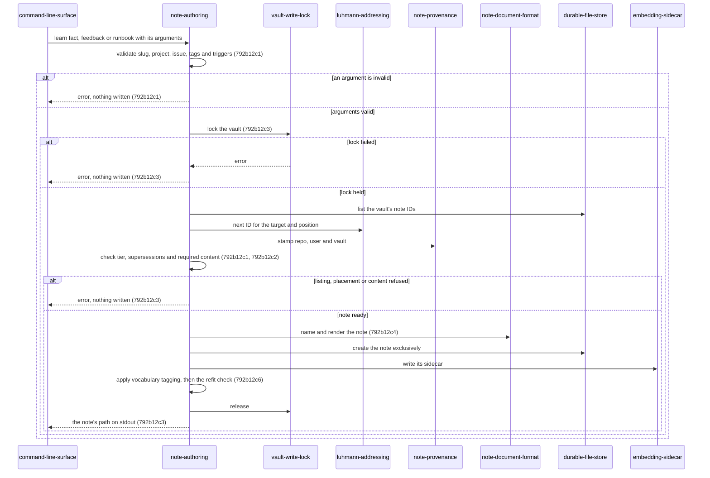

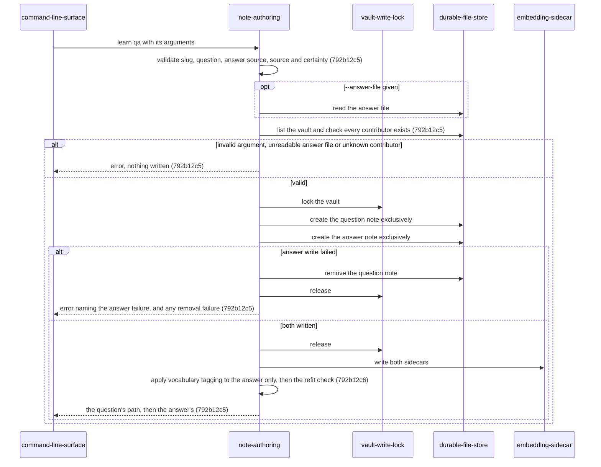

### 792b12c Behavior Requirements

#### 792b12c1 Argument validation

Requirement: 792b12c1 The note-authoring MUST refuse, before writing anything, a slug that is empty
or does not match `[a-z0-9-]+`, a project that is not kebab-case, an issue containing whitespace, a
tag that is not `<family>` or `<family>/<value>` with kebab-case segments, a trigger shorter than
three characters after trimming, a tier other than `L1`, `L2` or `L3`, a supersession that is not
`<note>|<type>|<claim>` with a non-empty note and claim and a type of `updates`, `narrows` or
`refutes`, and a note type other than fact, feedback or runbook. A claim MAY itself contain `|`.

Supports: 792a3g1a.

##### 792b12c1a Scenarios

```gherkin
Scenario: 792b12c1a1 An invalid slug is refused
  Given a learn with slug "Bad Slug"
  When it runs
  Then it fails with the invalid-slug error and nothing is written

Scenario: 792b12c1a2 Project, issue and tag shapes are checked
  Given a project, issue or tag value, empty or not
  When it is validated
  Then an empty project, issue or tag list and well-shaped values pass, and a badly shaped project, an issue with whitespace or a malformed tag is refused before any write

Scenario: 792b12c1a3 A short trigger is refused
  Given a runbook learn with a trigger shorter than three characters
  When it runs
  Then it fails and nothing is written

Scenario: 792b12c1a4 An unknown tier is refused
  Given a learn with tier L9
  When it runs
  Then it fails with the bad-tier error and nothing is written

Scenario: 792b12c1a5 A malformed supersession is refused
  Given a supersession with too few fields, an unknown type, an empty note or an empty claim
  When it is parsed
  Then it is refused with the matching error

Scenario: 792b12c1a6 A well-formed supersession is accepted
  Given a supersession of type updates, narrows or refutes, whose claim may contain |
  When it is parsed
  Then its note, type and claim are read, with the claim's | kept

Scenario: 792b12c1a7 An unknown note type is refused
  Given a learn of an unknown type such as principle
  When it runs
  Then it fails with the unknown-type error
```

#### 792b12c2 Required content

Requirement: 792b12c2 The note-authoring MUST refuse a fact, feedback or runbook whose situation is
empty or whitespace, and a runbook whose done-when is empty or whitespace, with an error naming the
missing flag and nothing written.

Supports: 792a3f1a, 792a3f1b, 792a3f1c.

##### 792b12c2a Scenarios

```gherkin
Scenario: 792b12c2a1 A fact or feedback without a situation is refused
  Given a fact or feedback learn whose situation is empty or whitespace
  When it runs
  Then it fails naming --situation and nothing is written

Scenario: 792b12c2a2 A runbook without a situation is refused
  Given a runbook learn whose situation is empty
  When it runs
  Then it fails naming --situation and nothing is written

Scenario: 792b12c2a3 A runbook without done-when is refused
  Given a runbook learn whose done-when is empty
  When it runs
  Then it fails naming --done-when and nothing is written
```

#### 792b12c3 Locked write

Requirement: 792b12c3 The note-authoring MUST, for a fact, feedback or runbook, take the vault lock;
list the vault's note IDs, which are the IDs of the Markdown files at its root; allocate the next ID
for the target and position; stamp provenance; render and exclusively create the note; write its
sidecar and apply vocabulary tagging; release the lock; and print the note's path. A lock failure,
a listing failure, a refused placement or refused content MUST return an error with nothing
written.

Supports: 792a3a1a, 792a3b1a, 792a3c1a, 792a3j1a, 792a3j1b, 792a3j1c, 792a3j1d, 792a3j1e,
792a3k1a, 792a3k1b, 792a3k1c, 792a3k1d, 792a3m1a, 792a3n1a, 792a3n1b, 792a3o1a, 792a3p1a, 792a3u1a.

##### 792b12c3a Scenarios

```gherkin
Scenario: 792b12c3a1 A note is written at its allocated path
  Given an empty vault and a fact, feedback or runbook learn with slug fact-slug at top on 2026-05-09
  When it runs
  Then the note is created at /vault/1.2026-05-09.fact-slug.md with its kind's frontmatter and body, and its path is printed

Scenario: 792b12c3a2 A lock failure writes nothing
  Given a vault lock that cannot be taken
  When a learn runs
  Then it fails with the lock error and nothing is written

Scenario: 792b12c3a3 A listing failure writes nothing
  Given a vault whose note IDs cannot be listed
  When a learn runs
  Then it fails with the listing error and nothing is written

Scenario: 792b12c3a4 Only root notes count as IDs
  Given a vault with notes 1 and 1a at its root, a note in a subdirectory and a README.md
  When its note IDs are listed
  Then they are exactly 1 and 1a
```

#### 792b12c4 Arguments to fields

Requirement: 792b12c4 The note-authoring MUST give a note `tier: L2` when no tier is given and the
given tier otherwise, and MUST carry the project, issue, tags, chunk sources, supersessions, and a
runbook's red flags and triggers in order, into the note's fields, with none written when none is
given.

Supports: 792a3d1a, 792a3d1b, 792a3d1c, 792a3h1a, 792a3h1b, 792a3i1a, 792a3i1b.

##### 792b12c4a Scenarios

```gherkin
Scenario: 792b12c4a1 The tier defaults to L2
  Given a fact or feedback learn without a tier, or with tier L3
  When it runs
  Then the note carries tier: L2, or tier: L3

Scenario: 792b12c4a2 Project and issue are carried
  Given a fact learn with --project engram and --issue 636
  When it runs
  Then the note carries project: engram and issue: "636"

Scenario: 792b12c4a3 Tags are carried
  Given a fact or feedback learn with tags, or with none
  When it runs
  Then the note carries the tags in order, or no tags: key

Scenario: 792b12c4a4 Chunk sources are carried
  Given a fact learn with chunk sources, or with none
  When it runs
  Then the note carries them under sources:, or no sources: key

Scenario: 792b12c4a5 Supersessions are carried
  Given a feedback learn with a supersession
  When it runs
  Then the note carries it under supersedes: and as a Supersedes: body line

Scenario: 792b12c4a6 Red flags are carried
  Given a runbook learn with repeated --red-flag values, or with none
  When it runs
  Then the note carries them in order under red_flags:, or no red_flags: key and no error

Scenario: 792b12c4a7 Triggers are carried
  Given a runbook learn with repeated --trigger values, or with none
  When it runs
  Then the note carries them in order under triggers: after red_flags:, or no triggers: key, for any valid triggers
```

#### 792b12c5 Question-and-answer write

Requirement: 792b12c5 The note-authoring MUST, for a question-and-answer pair, validate the
arguments, defaulting certainty to `medium`; read the answer from `--answer-file` when given; check
every contributor against the vault's Markdown files; and only then take the vault lock, create the
question note and then the answer note, both exclusively, and release the lock. When the answer note
cannot be created it MUST remove the question note and return an error saying so, also naming the
failure when the question cannot be removed. After a successful write it MUST write both sidecars,
apply vocabulary tagging to the answer only, and print the question's path and then the answer's.
A lock failure MUST return an error with nothing written.

Supports: 792a3n1a, 792a3q1a, 792a3q1b, 792a3q1c, 792a3r1a, 792a3r1b, 792a3s1a, 792a3u1b.

##### 792b12c5a Scenarios

```gherkin
Scenario: 792b12c5a1 A pair is written question first
  Given a valid pair
  When it is learned
  Then two notes are created, the .q.md first and the .a.md second

Scenario: 792b12c5a2 The answer comes from a file
  Given a pair whose answer is given by --answer-file
  When it is learned
  Then both notes are created with the file's text as the answer

Scenario: 792b12c5a3 Invalid arguments are refused
  Given a pair with an invalid slug, no question, both or neither answer source, no source, or an unknown certainty
  When it is validated
  Then it is refused with the matching error, and a fully valid pair passes

Scenario: 792b12c5a4 An unknown contributor is refused before any write
  Given a pair whose contributor names no note in the vault
  When it is learned
  Then it fails saying the contributor was not found, and nothing is written

Scenario: 792b12c5a5 A lock failure writes nothing
  Given a vault lock that cannot be taken
  When a pair is learned
  Then it fails with the lock error

Scenario: 792b12c5a6 A failed answer removes the question
  Given an answer note that cannot be created
  When a pair is learned
  Then the question note is removed and an error is returned

Scenario: 792b12c5a7 A failed removal is reported too
  Given an answer note that cannot be created and a question note that cannot be removed
  When a pair is learned
  Then the error names the orphaned question note
```

#### 792b12c6 Vocabulary tagging after a write

Requirement: 792b12c6 After creating a fact, feedback or runbook note and writing its sidecar, and
after writing both sidecars of a question-and-answer pair, the note-authoring MUST have the
vocabulary-engine tag the written note (the answer only, never the question) and then check whether
a refit is due, and MUST still succeed when tagging or the check does nothing.

Supports: 792a3u1a, 792a3u1b, 792a6c1a, 792a6d1a, 792a6e1a, 792a6e1b, 792a6s1a, 792a6s1c.

##### 792b12c6a Scenarios

```gherkin
Scenario: 792b12c6a1 A learned note is tagged after its write
  Given a vault with a term close to the note's text and a readable sidecar for the note
  When the note is learned
  Then the note is rewritten with the term's vocab/ tag after its sidecar is written

Scenario: 792b12c6a2 The refit check runs after a learn
  Given a vault whose refit baseline is 100 notes 20 days ago, now holding 150 notes, and no term vectors wired
  When a note is learned
  Then the vault's refit is marked pending

Scenario: 792b12c6a3 The question of a pair is not tagged
  Given a vault with a term close to both a question and its answer
  When the pair is learned
  Then only the answer note is tagged
```

### 792b12d Product-Scenario Mapping

| Product scenario | Technical requirements |
| --- | --- |
| 792a3a1a | 792b12c3 |
| 792a3b1a | 792b12c3 |
| 792a3c1a | 792b12c3 |
| 792a3d1a | 792b12c4 |
| 792a3d1b | 792b12c4 |
| 792a3d1c | 792b12c4 |
| 792a3f1a | 792b12c2 |
| 792a3f1b | 792b12c2 |
| 792a3f1c | 792b12c2 |
| 792a3g1a | 792b12c1 |
| 792a3h1a | 792b12c4 |
| 792a3h1b | 792b12c4 |
| 792a3i1a | 792b12c4 |
| 792a3i1b | 792b12c4 |
| 792a3j1a | 792b12c3 |
| 792a3j1b | 792b12c3 |
| 792a3j1c | 792b12c3 |
| 792a3j1d | 792b12c3 |
| 792a3j1e | 792b12c3 |
| 792a3k1a | 792b12c3 |
| 792a3k1b | 792b12c3 |
| 792a3k1c | 792b12c3 |
| 792a3k1d | 792b12c3 |
| 792a3m1a | 792b12c3 |
| 792a3n1a | 792b12c3, 792b12c5 |
| 792a3n1b | 792b12c3 |
| 792a3o1a | 792b12c3 |
| 792a3p1a | 792b12c3 |
| 792a3q1a | 792b12c5 |
| 792a3q1b | 792b12c5 |
| 792a3q1c | 792b12c5 |
| 792a3r1a | 792b12c5 |
| 792a3r1b | 792b12c5 |
| 792a3s1a | 792b12c5 |
| 792a3u1a | 792b12c3, 792b12c6 |
| 792a3u1b | 792b12c5, 792b12c6 |
| 792a6c1a | 792b12c4, 792b12c6 |
| 792a6d1a | 792b12c6 |
| 792a6e1a | 792b12c6 |
| 792a6e1b | 792b12c6 |
| 792a6s1a | 792b12c6 |
| 792a6s1c | 792b12c6 |

```gherkin
Scenario: 792a3r1b Certainty defaults to medium
  Given an existing vault
  When the user runs engram learn qa without --certainty
  Then the answer note carries certainty: medium

Scenario: 792a6c1a A categorical tag survives tagging
  Given a vault whose vocabulary holds the term build-tooling
  When the user runs engram learn fact --tag work-kind/review with text close to build-tooling
  Then the note's tags are [work-kind/review, vocab/build-tooling], in that order

Scenario: 792a6e1a A vault without a vocabulary writes plain notes
  Given a vault with no definition notes
  When the user runs engram learn fact
  Then the note is written with no vocab/ tag

Scenario: 792a6s1a Growth marks a refit pending
  Given a vault whose refit baseline is 100 notes 20 days ago, now holding 150 notes
  When the user runs engram learn fact
  Then engram vocab stats reports "verdict: REFIT_PENDING (growth: <N> notes, <D> days)"

Scenario: 792a6s1c A first write records the baseline
  Given a vault with no refit baseline
  When the user runs engram learn fact
  Then a baseline is recorded, and engram vocab stats reports verdict: OK
```

## 792b13 Added: wikilink-graph

Canonical target: `docs/specs/technical/wikilink-graph.md` (title `Wikilink Graph - Technical Spec`).

### 792b13a Orientation

- Ownership: Repository component.
- Responsibility: the vault seen as a set of linked notes. It scans the notes at the vault root,
  keying each by its basename without `.md` and recording its leading Luhmann ID and the link
  targets in its text, and it resolves a reference a user gives for a note to the note it names.
  It builds the directed link graph, reads a note's in-degree for the vault-counter, and lists the
  links that resolve to no note for vault-health.
- Current realization (informational): `internal/vaultgraph` (`ScanVault`, `ParseBasename`,
  `ParseWikilinks`, `BuildGraph`, `UnresolvedTargets`); `normalizeNoteRef` in
  `internal/cli/note_ref.go`; `findNote` in `internal/cli/resituate.go`. `BFSWithCap`,
  `InDegreeIn` and `UndirectedNeighbors` have no production caller.
- Qualification: responsibility, scanning and reference resolution are stated without naming any
  command; ownership, callers decide what to do with a note once found, while this component
  decides what a note's key is and which note a reference names; independent verification, the
  scan and the lookup are tested directly over a fake vault listing and a note list; stability, the
  basename key is the link form notes and Obsidian share, and it survives any refactoring;
  necessity, every command that reads or revises a named note finds it here.
- Supported capabilities: 792a2 vault-identity, 792a4 note-revision, 792a7 memory-query, 792a8
  vault-counting, 792a9 vault-health. Vault-migration adds its mappings (792d30, 792d75).

Rationale: navigation lives in authored relations, the wikilinks in note text, rather than in a
separate graph store that could drift from the notes, so the graph is derived from the notes each
time and is always current. A note is keyed by its basename because that is what a wikilink names
and what Obsidian resolves.

### 792b13b Sequences

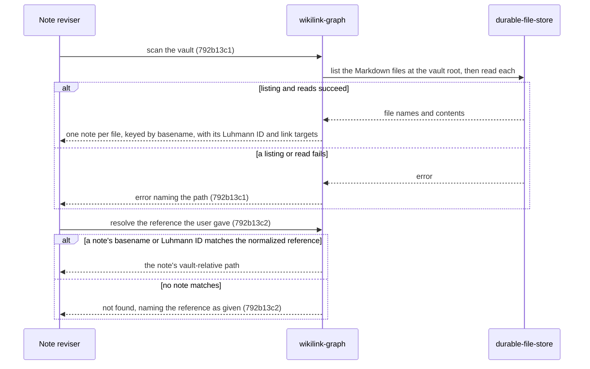

### 792b13c Behavior Requirements

#### 792b13c1 Vault scan

Requirement: 792b13c1 The wikilink-graph MUST scan a vault by listing the `.md` files at its root,
ignoring subdirectories and other files, and MUST return one note per file, keyed by its filename
without `.md`, with the Luhmann ID that leads the filename (empty when there is none) and the
targets of the links in its text. A failure to list the vault or to read a file MUST be returned,
naming the path.

Supports: 792a2c1a, 792a2d1a, 792a2d1b, 792a4a1a, 792a4a1b, 792a8e1i, 792a8e1j.

##### 792b13c1a Scenarios

```gherkin
Scenario: 792b13c1a1 Root notes are scanned with their keys and links
  Given a vault whose root holds 1a.2026-05-09.note.md, linking [[2.other]], and notes.md
  When the vault is scanned
  Then 1a.2026-05-09.note has Luhmann ID 1a and the link target 2.other, and notes has no Luhmann ID

Scenario: 792b13c1a2 An empty vault has no notes
  Given a vault whose root holds no Markdown file
  When the vault is scanned
  Then no note is returned and no error

Scenario: 792b13c1a3 Only Markdown files are notes
  Given a vault whose listing holds a file that does not end in .md
  When the vault is scanned
  Then that file is not a note

Scenario: 792b13c1a4 A listing failure is returned
  Given a vault whose listing fails
  When the vault is scanned
  Then the error is returned, naming the vault path

Scenario: 792b13c1a5 A read failure is returned
  Given a vault one of whose notes cannot be read
  When the vault is scanned
  Then the error is returned, naming that note's path
```

#### 792b13c2 Note references

Requirement: 792b13c2 The wikilink-graph MUST resolve a note reference by trimming surrounding
whitespace, removing enclosing `[[` and `]]` and any `|display` part, and dropping a trailing
`.md`, and then returning the vault-relative path of the first scanned note whose basename or
Luhmann ID equals the result. When no note matches, it MUST fail with a not-found error quoting the
reference as given.

Supports: 792a4a1a, 792a4a1b.

Rationale: an agent copies a note's name from wherever it saw it, as a wikilink from a note's text,
a filename from a listing, or a Luhmann ID, so each form names the same note. The error quotes what
the user typed, not its normalized form, so the user can see which reference failed.

##### 792b13c2a Scenarios

```gherkin
Scenario Outline: 792b13c2a1 Every reference form names the note
  Given a scanned note 1.linting with Luhmann ID 1
  When the reference <ref> is resolved
  Then the result is 1.linting.md

  Examples:
    | ref             |
    | 1.linting       |
    | 1               |
    | 1.linting.md    |
    | [[1.linting]]   |

Scenario: 792b13c2a2 An unknown reference quotes what was given
  Given a scanned note 1.linting
  When the reference 99.missing.md is resolved
  Then it fails as not found, quoting "99.missing.md"
```

#### 792b13c3 Link targets

Requirement: 792b13c3 The wikilink-graph MUST list the targets of the links in a text: the text between
`[[` and the next `]]` on one line, each target once, in order of first appearance, after a trailing
`.md` is dropped. It MUST leave out a link whose target is empty, a link that would span a line break,
and every link inside a fenced code block, whose fence is a run of three or more backticks or tildes
and ends at a line of the same character, at least as long, followed only by whitespace, or at the end
of the text when none follows. It MUST keep a `|display` part as part of the target, and MUST NOT
treat brackets inside a target as nesting.

Supports: 792a7x1a, 792a7x1e, 792a7x1h, 792a8e1f, 792a8e1g, 792a9b1c, 792a9c1b, 792a9c1d.

Rationale: Obsidian does not resolve a link inside a fenced code block, so verbatim transcript text
pasted into a note must not make graph edges. The legacy `.md`-suffixed form that engram once wrote
resolves to the same note as the bare basename, so both are one target. A bare link that ends in the
three characters `.md` is always read as the suffixed form, because the text cannot say which was
meant.

##### 792b13c3a Scenarios

```gherkin
Scenario: 792b13c3a1 A link is a target
  Given the text "see [[9o.2026-05-09.holistic-final-review]] for context."
  When its link targets are listed
  Then the result is 9o.2026-05-09.holistic-final-review

Scenario: 792b13c3a2 Targets are listed once in order of appearance
  Given the text "ref [[B]] then [[A]] then [[B]] then [[C]]", across lines or on one
  When its link targets are listed
  Then the result is B, A, C

Scenario: 792b13c3a3 A .md suffix is dropped
  Given the text "see [[x]] and [[x.md]] and [[y.md]] and [[0.md]]"
  When its link targets are listed
  Then the result is x, y, 0

Scenario: 792b13c3a4 Empty links give nothing
  Given empty text, text without links, and the text "empty [[]] valid [[Real]]."
  When their link targets are listed
  Then the first two give none and the last gives Real

Scenario: 792b13c3a5 A link cannot span lines
  Given the text "partial [[start" followed by a line break and "end]] not a link"
  When its link targets are listed
  Then the result is empty

Scenario: 792b13c3a6 Brackets do not nest
  Given the text "[[outer[[inner]]"
  When its link targets are listed
  Then the result is the single target outer[[inner

Scenario: 792b13c3a7 A fenced link is skipped
  Given the text "outside [[y]]" then a fenced block holding "inside [[x]]" then "after [[z]]"
  When its link targets are listed
  Then the result is y, z, whichever fence characters surround the block

Scenario: 792b13c3a8 An unclosed fence runs to the end
  Given the text "outside [[y]]" then a fence opener then "inside [[x]]" with no closer
  When its link targets are listed
  Then the result is y

Scenario: 792b13c3a9 A shorter fence does not close a longer one
  Given a four-backtick block that holds a three-backtick line and links on either side of it
  When its link targets are listed
  Then every link between the four-backtick lines is skipped and the links outside are kept

Scenario: 792b13c3a10 A display part stays in the target
  Given the text "see [[4.gamma|the gamma note]]"
  When its link targets are listed
  Then the result is 4.gamma|the gamma note
```

#### 792b13c4 Link graph

Requirement: 792b13c4 The wikilink-graph MUST build, from scanned notes, a directed graph with one
node per note, keyed by its basename, and one edge from a note to each distinct target among its
link targets that is the basename of a scanned note. It MUST leave out a link whose target is not a
scanned note and a link from a note to itself, and MUST collapse repeated links to the same target
into one edge.

Supports: 792a8e1d, 792a8e1e, 792a8e1h.

Rationale: a wikilink names a note by its basename, and Obsidian resolves it the same way. A link
to no note is not a backlink of any note, and a note linking to itself is not evidence that anything
else refers to it.

##### 792b13c4a Scenarios

```gherkin
Scenario: 792b13c4a1 No notes make an empty graph
  Given no notes
  When the graph is built
  Then it has no nodes and no edges

Scenario: 792b13c4a2 A link to a missing note is dropped
  Given a note A that links B and MISSING, and a note B
  When the graph is built
  Then A has an edge to B and none to MISSING, and MISSING has in-degree 0

Scenario: 792b13c4a3 A link to itself is dropped
  Given a note A that links A and B, and a note B
  When the graph is built
  Then A has an edge to B and none to A

Scenario: 792b13c4a4 Edges never outnumber links, and in-degrees sum to out-degrees
  Given any set of notes
  When the graph is built
  Then the number of edges is at most the number of link targets, and the in-degrees of all notes sum to the number of edges

Scenario: 792b13c4a5 No node has an edge to itself
  Given any set of notes
  When the graph is built
  Then no note has an edge to itself
```

#### 792b13c5 In-degree

Requirement: 792b13c5 The wikilink-graph MUST report a note's in-degree as the number of distinct
notes with an edge to it (792b13c4), and 0 for a basename that is not a node.

Supports: 792a8e1a, 792a8e1b, 792a8e1c.

##### 792b13c5a Scenarios

```gherkin
Scenario: 792b13c5a1 In-degree counts the linking notes
  Given A and B link C, C links A, and D is linked by none
  When the in-degrees are read
  Then C has 2, A has 1, and B and D have 0

Scenario: 792b13c5a2 An unknown basename has in-degree 0
  Given a built graph
  When the in-degree of a basename that is not a node is read
  Then it is 0
```

#### 792b13c6 Unresolved links

Requirement: 792b13c6 The wikilink-graph MUST list, for scanned notes, each link target of a note that
is neither that note's own basename nor the basename of a scanned note, as the linking note's
basename and the target, in note order and then in link order.

Supports: 792a9b1a, 792a9b1c, 792a9c1a, 792a9c1b, 792a9c1c, 792a9c1e.

Rationale: the graph drops a link to no note without a sound (792b13c4), so this is the list of the
edges it dropped. A vault that writes links in a form the graph does not resolve, such as a bare
Luhmann ID against a basename key, loses most of its edges without it.

##### 792b13c6a Scenarios

```gherkin
Scenario: 792b13c6a1 A link in the wrong form is listed
  Given a note 105.2026-05-30.foo that links 105, and a note 1a.2026-05-30.bar that links 105.2026-05-30.foo
  When the unresolved links are listed
  Then only 105.2026-05-30.foo linking 105 is listed

Scenario: 792b13c6a2 Self-links and resolved links are not listed
  Given a note A that links A and B, and a note B
  When the unresolved links are listed
  Then none is listed

Scenario: 792b13c6a3 A legacy suffixed link resolves
  Given a note A whose text links B.md, gone.md and missing, and a note B
  When the links are parsed and the unresolved links are listed
  Then gone and missing are listed and B is not
```

### 792b13d Product-Scenario Mapping

| Product scenario | Technical requirements |
| --- | --- |
| 792a2c1a | 792b13c1 |
| 792a2d1a | 792b13c1 |
| 792a2d1b | 792b13c1 |
| 792a4a1a | 792b13c1, 792b13c2 |
| 792a4a1b | 792b13c1, 792b13c2 |
| 792a7b1a | 792b13c1 |
| 792a7x1a | 792b13c3 |
| 792a7x1c | 792b13c2 |
| 792a7x1e | 792b13c3 |
| 792a7x1h | 792b13c3 |
| 792a8e1a | 792b13c5 |
| 792a8e1b | 792b13c5 |
| 792a8e1c | 792b13c5 |
| 792a8e1d | 792b13c4 |
| 792a8e1e | 792b13c4 |
| 792a8e1f | 792b13c3 |
| 792a8e1g | 792b13c3 |
| 792a8e1h | 792b13c4 |
| 792a8e1i | 792b13c1 |
| 792a8e1j | 792b13c1 |
| 792a9b1a | 792b13c6 |
| 792a9b1b | 792b13c6 |
| 792a9b1c | 792b13c3, 792b13c6 |
| 792a9c1a | 792b13c6 |
| 792a9c1b | 792b13c3, 792b13c6 |
| 792a9c1c | 792b13c6 |
| 792a9c1d | 792b13c3 |
| 792a9c1e | 792b13c6 |

```gherkin
Scenario Outline: 792a4a1a Every reference form finds the note
  Given a vault holding note 1.2026-10-09.a
  When the user runs engram amend --target <ref> --object new
  Then note 1.2026-10-09.a is amended and its path is printed on stdout

  Examples:
    | ref                     |
    | 1.2026-10-09.a          |
    | 1.2026-10-09.a.md       |
    | "[[1.2026-10-09.a]]"    |
    | "[[1.2026-10-09.a\|x]]" |
    | 1                       |
```

```gherkin
Scenario: 792a7b1a The payload has the documented shape
  Given a vault of six notes, each with a current sidecar, and no chunk index
  When the user runs engram query --phrase "writing Go tests"
  Then stdout is a YAML document with version 1, phrases ["writing Go tests"], items, clusters and a budget whose total_notes and with_embeddings are both 6, and a model_id
```

```gherkin
Scenario: 792a8e1d A repeated link counts once
  Given a note x that contains [[y]] twice
  When the user runs engram count --backlinks-of y
  Then stdout is "in-degree: 1" then "x"

Scenario: 792a8e1e A note's link to itself does not count
  Given a note x whose only link is [[x]]
  When the user runs engram count --backlinks-of x
  Then stdout is "in-degree: 0"

Scenario: 792a8e1f A link inside a fenced code block does not count
  Given a note x that contains [[z]] only inside a fenced code block
  When the user runs engram count --backlinks-of z
  Then stdout is "in-degree: 0"

Scenario: 792a8e1g A link ending in .md counts as the bare link
  Given a note x that contains [[y.md]]
  When the user runs engram count --backlinks-of y
  Then stdout is "in-degree: 1" then "x"

Scenario: 792a8e1h A link to a missing note counts for no note
  Given a note x that contains [[nowhere]], and no note named nowhere
  When the user runs engram count --backlinks-of nowhere
  Then stdout is "in-degree: 0"

Scenario: 792a8e1i Only notes at the vault root link
  Given a note in a subdirectory that contains [[x]], and a note x at the vault root
  When the user runs engram count --backlinks-of x
  Then stdout is "in-degree: 0"
```

```gherkin
Scenario: 792a8e1a A note with incoming links
  Given three notes that contain [[foo.alpha]]
  When the user runs engram count --backlinks-of foo.alpha
  Then stdout starts with "in-degree: 3", followed by the three linkers' basenames, one per line, in ascending order

Scenario: 792a8e1b A note with no incoming links
  Given no note links to unknown.note
  When the user runs engram count --backlinks-of unknown.note
  Then stdout is "in-degree: 0" and no linker lines

Scenario: 792a8e1c A basename that is not a note
  Given a vault in which the basename nosuchfile never appears
  When the user runs engram count --backlinks-of nosuchfile
  Then stdout is "in-degree: 0" and no linker lines
```

```gherkin
Scenario: 792a9b1a A bare-ID link fails
  Given a note 1.2026-05-30.foo that links [[2]], and a note 2.2026-05-30.bar
  When the user runs engram check
  Then stdout has "FAIL  G0 graph-resolution: 1 bare-id links that should resolve" and the line "1.2026-05-30.foo → [[2]]"

Scenario: 792a9b1b A basename link passes
  Given a note A that links [[B]], and a note B
  When the user runs engram check
  Then stdout has "PASS  G0 graph-resolution: every authored link resolves by form"

Scenario: 792a9b1c A legacy suffixed link resolves
  Given a note body containing "Supersedes: [[B.md]]" and a note B
  When the user runs engram check
  Then the link is not reported, neither under G0 nor as dangling under G3

Scenario: 792a9c1a A link to a missing note warns
  Given a fact note that links [[999]] and no note has the ID 999
  When the user runs engram check
  Then stdout has a WARN G3 dangling line listing the link, G0 still passes, and the exit status is zero

Scenario: 792a9c1b A missing note is reported once however it is spelled
  Given a note that links [[vocab.X]] and [[vocab.X.md]], and no such note
  When the user runs engram check
  Then stdout has "WARN  G3 dangling: 1 authored links target no note"

Scenario: 792a9c1c A note's link to itself is not reported
  Given a note that links its own basename
  When the user runs engram check
  Then no G3 line is printed

Scenario: 792a9c1d A link inside a fenced code block is not reported
  Given a note whose only link to a missing note is inside a fenced code block
  When the user runs engram check
  Then no G3 line is printed

Scenario: 792a9c1e A vault with no dangling link prints no G3 line
  Given a vault whose links all resolve
  When the user runs engram check
  Then stdout has no line mentioning G3
```

## 792b14 Added: note-amendment

Canonical target: `docs/specs/technical/note-amendment.md` (title `Note Amendment - Technical Spec`).

### 792b14a Orientation

- Ownership: Repository component (caller of wikilink-graph, note-document-format,
  note-provenance, embedding-sidecar, durable-file-store and vault-write-lock).
- Responsibility: revises a note that already exists. Under the vault lock it finds the note,
  reads it as LF, checks the revision's arguments, applies the field, supersession, chunk-source and
  identity changes, writes the note once, and rebuilds its sidecar when what is embedded changed. It
  rewrites a fact's or feedback note's situation in both of its places, and records a note's use
  in its sidecar.
- Current realization (informational): `internal/cli/amend.go` (`RunAmend`), `resituate.go`
  (`RunResituate`), `supersedes.go` (`replaceSupersedes`, `parseAllSupersedes`), `activate.go`
  (`RunActivate`, `bumpLastUsed`); the amend and resituate targets in `internal/cli/targets.go`.
  The curation flags in `amend_fold.go`, the offer hooks and the pull-down are added by curate and
  parent-sync.
- Qualification: responsibility, revising a stored note is stated without naming any function;
  ownership, it owns the ordering of lookup, validation, edit, write and re-embed, while the format,
  provenance, sidecar and lock contracts belong to the components it calls; independent
  verification, `RunAmend`, `RunResituate` and `RunActivate` are tested directly over injected
  lookup, read, write, lock and embedder fakes; stability, the read-modify-write contract survives any
  change to the flags that drive it; necessity, every change an agent makes to an existing note
  goes through it.
- Supported capabilities: 792a4 note-revision, 792a6 controlled-vocabulary. Write-memory, recall,
  parent-sync and curate add their requirements (792d30).

Rationale: a revision is a read-modify-write of a note and its sidecar, so two revisions, or a
revision and a learn, that interleave could each overwrite the other's change. Every revision takes
the vault's lock at its command's entry point and holds it through the note write, the sidecar
rebuild and the last-used bump. The helpers it shares with other writers never take the lock
themselves, because the lock is held per file descriptor and a nested acquire would wait on itself.

### 792b14b Sequences

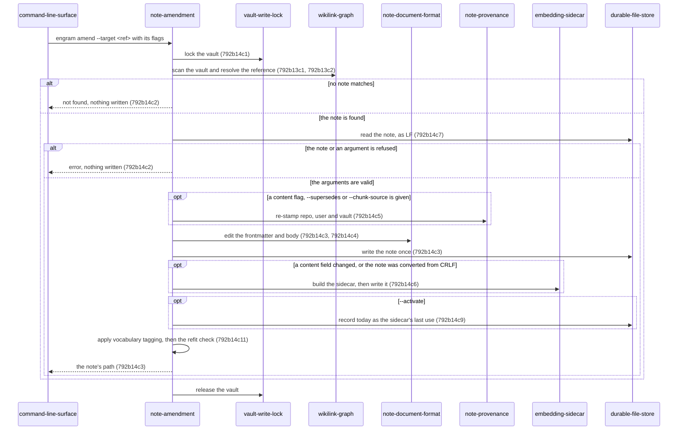

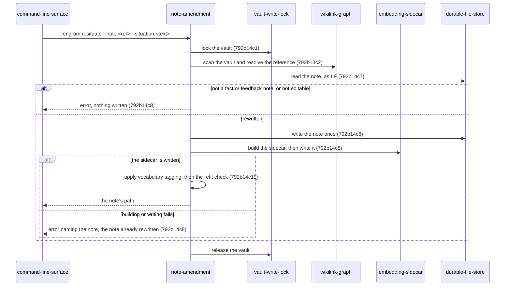

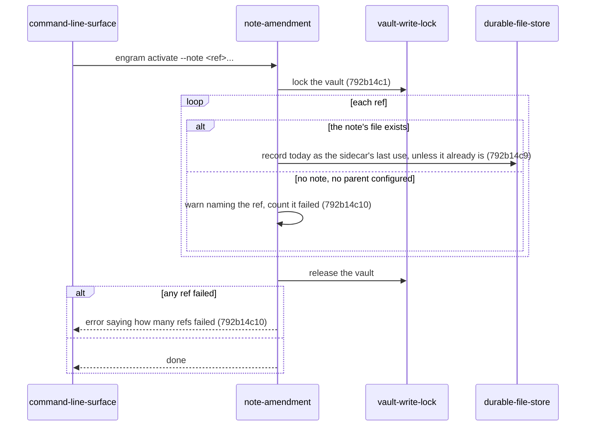

### 792b14c Behavior Requirements

#### 792b14c1 Locked revision

Requirement: 792b14c1 The note-amendment MUST take the vault lock (792b8c4) before amend, resituate
or activate reads any note or sidecar, MUST hold it through every read and write of the note and
its sidecar, including the sidecar rebuild and the last-used bump, MUST release it before
returning, and MUST NOT take it again in the helpers it calls while holding it. A failure to take the
lock MUST be returned with nothing read or written.

Supports: 792a4o1a, 792a4o1b.

##### 792b14c1a Scenarios

```gherkin
Scenario: 792b14c1a1 An amend holds the lock across its read-modify-write
  Given a lock that records when it is taken and released
  When an amend reads, writes and re-embeds a note
  Then the lock is taken before the scan and the read, and released after the note and sidecar writes

Scenario: 792b14c1a2 A resituate holds the lock across its read-modify-write
  Given a lock that records when it is taken and released
  When a resituate rewrites a note and its sidecar
  Then the lock is taken before the read and released after both writes

Scenario: 792b14c1a3 An activate holds the lock around its bumps
  Given a lock that records when it is taken and released
  When an activate bumps two notes' sidecars
  Then the lock is taken once before the first bump and released after the last
```

#### 792b14c2 Amend refusals

Requirement: 792b14c2 The note-amendment MUST refuse an amend, writing nothing, when no note
matches the reference, when the note has no frontmatter, is not a fact, feedback or runbook note, or
has a `created:` that is not a `YYYY-MM-DD` date, when a `--chunk-source` ID is not in the chunk
index, when a `--supersedes` value does not parse (792b12c1), or when a `--trigger` is shorter than
three characters after trimming.

Supports: 792a4a1b, 792a4c1a, 792a4f1a.

##### 792b14c2a Scenarios

```gherkin
Scenario: 792b14c2a1 No matching note
  Given a vault with no note matching the target
  When an amend runs
  Then it fails as not found, and nothing is written

Scenario: 792b14c2a2 A note without frontmatter
  Given a target note with no frontmatter
  When an amend runs
  Then it fails saying the note has no parseable frontmatter, and nothing is written

Scenario: 792b14c2a3 A note of another kind
  Given a target note whose type is not fact, feedback or runbook
  When an amend runs
  Then it fails saying the note type is unknown, and nothing is written

Scenario: 792b14c2a4 A malformed creation date
  Given a target note whose created: is not a YYYY-MM-DD date
  When an amend runs
  Then it fails, and nothing is written

Scenario: 792b14c2a5 An unknown chunk source
  Given a chunk index that does not hold nope#x
  When an amend runs with --chunk-source nope#x
  Then it fails naming nope#x as unresolved, and nothing is written

Scenario: 792b14c2a6 A trigger that is too short
  Given a runbook note
  When an amend runs with --trigger ab
  Then it fails saying a trigger must be at least 3 characters, and nothing is written
```

#### 792b14c3 Field replacement

Requirement: 792b14c3 The note-amendment MUST overwrite each content field of the note's kind that
the amend supplies with a value different from the note's, MUST replace a runbook's whole
`red_flags:` or `triggers:` list when one is supplied and differs, and MUST treat the amend as
changing content exactly when one of these values changed. When content changed it MUST rebuild a
fact or feedback body from its formula (792b6c4) and a runbook body from the supplied steps, or the
note's own steps when none are supplied, followed by the supersession lines; otherwise it MUST keep
the body and only replace its supersession lines. It MUST write the note once and print its path.

Supports: 792a4b1a, 792a4b1b, 792a4b1c, 792a4g1a, 792a4g1b.

##### 792b14c3a Scenarios

```gherkin
Scenario: 792b14c3a1 One fact field is replaced
  Given a fact note
  When an amend supplies only --subject with a new value
  Then only subject: changes in the frontmatter, the body formula is rebuilt with it, and the note's path is printed

Scenario: 792b14c3a2 Feedback fields are replaced
  Given a feedback note
  When an amend supplies --action with a new value
  Then action: and the body formula carry the new action

Scenario: 792b14c3a3 A runbook's body, done-when and red flags are replaced
  Given a runbook note
  When an amend supplies --body, --done-when and --red-flag
  Then the body is the new steps, done_when: is new, and red_flags: holds only the given flags

Scenario: 792b14c3a4 A runbook's situation alone keeps its steps
  Given a runbook note with steps
  When an amend supplies only --situation
  Then situation: changes and the body keeps the note's steps

Scenario: 792b14c3a5 Triggers are replaced whole
  Given a runbook note whose triggers: lists two triggers
  When an amend supplies one --trigger
  Then triggers: lists only that trigger

Scenario: 792b14c3a6 An unchanged value is not a content change
  Given a note
  When an amend supplies only values equal to the note's own
  Then the amend is not a content change, and the sidecar is not rebuilt
```

#### 792b14c4 Supersessions and chunk sources

Requirement: 792b14c4 The note-amendment MUST replace a note's whole `supersedes:` list with the
entries an amend supplies, rewriting the body's `Supersedes:` lines to match (792b6c4), and MUST
merge each supplied `--chunk-source` ID into `sources:` after the IDs already there, once.

Supports: 792a4d1a, 792a4d1b, 792a4e1a.

##### 792b14c4a Scenarios

```gherkin
Scenario: 792b14c4a1 A supersession is written to the frontmatter and the body
  Given a fact or feedback note
  When an amend supplies --supersedes "<note>.md|refutes|claim"
  Then supersedes: holds the entry with note <note>.md, and the body ends with "Supersedes: [[<note>]] — refutes: claim"

Scenario: 792b14c4a2 Chunk sources are merged
  Given a note whose sources: lists one ID, and a chunk index holding it and another
  When an amend supplies both IDs
  Then sources: lists the existing ID and then the new one, each once
```

#### 792b14c5 Identity re-stamp gating

Requirement: 792b14c5 The note-amendment MUST have note-provenance re-stamp a note (792b11c4) exactly
when the amend supplies a content flag of any kind, a `--red-flag`, a `--trigger`, a `--supersedes`
or a `--chunk-source`, detecting the repository from the working directory whatever the note's
`project:`, and MUST NOT re-stamp it otherwise. On every amend it writes, it MUST fill an absent or
empty `vault:` with the resolved vault name, keep a declared one, and, when no vault name was
resolved, leave `vault:` out and log a warning.

Supports: 792a4h1a, 792a4h1b, 792a4h1c, 792a4h1f, 792a4h1g, 792a4i1a.

##### 792b14c5a Scenarios

```gherkin
Scenario: 792b14c5a1 A content, supersession or chunk-source amend re-stamps
  Given a note whose repo:, user: and vault: differ from the detected ones
  When an amend supplies a content flag, --supersedes or --chunk-source
  Then repo:, user: and vault: are the detected ones

Scenario: 792b14c5a2 A note without identity gains it
  Given a note with no repo:, user: or vault:
  When an amend supplies --chunk-source
  Then it gains the detected repo:, user: and vault:

Scenario: 792b14c5a3 The project field is not the repository
  Given a note whose project: differs from the detected repository
  When an amend re-stamps it
  Then repo: is the detected repository

Scenario: 792b14c5a4 Re-stamping follows the flags exactly
  Given any combination of amend flags on any kind of note
  When the amend runs
  Then identity is re-stamped exactly when a content flag of that kind, --supersedes or --chunk-source is present, and is otherwise as declared

Scenario: 792b14c5a5 A bookkeeping amend keeps the declared identity
  Given a fact, feedback or runbook note with a declared identity
  When an amend supplies only --activate
  Then repo:, user: and vault: are unchanged, and the note was rewritten

Scenario: 792b14c5a6 An empty vault is filled, never written empty
  Given a note with no vault:
  When an amend that does not re-stamp runs with the vault name personal, and again with no vault name
  Then the first writes vault: personal with no warning, and the second writes no vault: key and warns naming vault
```

#### 792b14c6 Sidecar rebuild after an amend

Requirement: 792b14c6 After writing the note, the note-amendment MUST build the note's sidecar from
the written text (792b10c5) and write it to the sidecar path (792b3c1) when the amend changed content
or converted the note from CRLF, and MUST NOT rebuild it otherwise. When building or writing fails,
it MUST log a warning naming the note and complete the amend.

Supports: 792a4g1a, 792a4g1b, 792a4g1c, 792a4m1a.

##### 792b14c6a Scenarios

```gherkin
Scenario: 792b14c6a1 A provenance-only amend does not re-embed
  Given a note
  When an amend supplies only --supersedes, or only values equal to the note's own
  Then the embedder is not called and no sidecar is written

Scenario: 792b14c6a2 A failed re-embed only warns
  Given an embedder that fails
  When an amend changes a content field
  Then the note is written, a warning naming the note is logged, and the amend succeeds
```

#### 792b14c7 CRLF revision

Requirement: 792b14c7 The note-amendment MUST read the note an amend or resituate edits as its LF
form (792b6c8), MUST write it as LF in the single write it makes, byte-identical to the same
revision of the note's LF form, and MUST count the conversion as a reason to rebuild the sidecar.

Supports: 792a4m1a, 792a4m1b.

##### 792b14c7a Scenarios

```gherkin
Scenario: 792b14c7a1 An amend converts a CRLF note
  Given a fact, feedback or runbook note whose lines end in \r\n
  When an amend of any kind that writes the note runs
  Then the note is written once with no \r\n, and its sidecar is rebuilt

Scenario: 792b14c7a2 The output equals the LF note's
  Given any note and its CRLF form
  When the same amend runs on each
  Then the two written notes are byte-identical

Scenario: 792b14c7a3 A resituate converts a CRLF note
  Given a fact or feedback note whose lines end in \r\n
  When a resituate runs
  Then it is written once with no \r, keeping its other keys
```

#### 792b14c8 Resituation

Requirement: 792b14c8 The note-amendment MUST resituate only a fact or feedback note with a
`created:` that is a `YYYY-MM-DD` date, by setting `situation:` and re-emitting `created:` as the
note's own string (792b6c7), replacing the body's first line with the formula's first line for the
new situation and keeping the rest of the body, writing the note once and printing its path. It
MUST then build and write the note's sidecar, and MUST return a failure to scan, read, write, embed
or write the sidecar.

Supports: 792a4j1d, 792a4l1a, 792a4l1b, 792a4l1c.

##### 792b14c8a Scenarios

```gherkin
Scenario: 792b14c8a1 A fact is resituated
  Given a fact note
  When it is resituated
  Then the written note equals the original with the old situation replaced in situation: and the body formula, and the sidecar's content hash tracks the new text

Scenario: 792b14c8a2 A feedback note is resituated
  Given a feedback note
  When it is resituated
  Then situation: and the body's first line carry the new situation, and the rest is unchanged

Scenario: 792b14c8a3 Other notes are refused
  Given a note with no frontmatter, malformed frontmatter, an unparseable created:, or another kind
  When it is resituated
  Then it fails and nothing is written

Scenario: 792b14c8a4 Every untouched key and the created string are kept
  Given a note carrying any other keys, and a created: written in its quoted form
  When it is resituated
  Then every key but situation: is unchanged, and created: keeps the note's own string

Scenario: 792b14c8a5 Every failure is returned
  Given a scan, read, note write, embedding or sidecar write that fails
  When a note is resituated
  Then that failure is returned
```

#### 792b14c9 Recording a use

Requirement: 792b14c9 The note-amendment MUST record a use by reading the note's sidecar, setting
its last-used date to today and writing it back atomically with every other field unchanged, and
MUST skip the write when the date is already today. A sidecar that cannot be read or decoded MUST
fail the bump with an error naming the sidecar. An amend with `--activate` MUST bump after any
rebuild, so the rebuilt sidecar carries today's date, and MUST warn and complete the amend when the
bump fails.

Supports: 792a4n1a, 792a4n1d.

Rationale: the last-used date is metadata outside the content hash, so the bump never makes the
sidecar stale and never triggers a re-embed.

##### 792b14c9a Scenarios

```gherkin
Scenario: 792b14c9a1 The date is set and the vectors kept
  Given a sidecar with vectors and a content hash
  When a use is recorded on 2026-06-17
  Then the sidecar's last_used is 2026-06-17 and its vectors and content hash are unchanged

Scenario: 792b14c9a2 The same date is not rewritten
  Given a sidecar whose last_used is already today
  When a use is recorded
  Then nothing is written

Scenario: 792b14c9a3 An unreadable sidecar fails the bump
  Given a sidecar that cannot be read
  When a use is recorded
  Then the error names the sidecar's path

Scenario: 792b14c9a4 Amend records a use, after a rebuild
  Given a note whose amend changes a content field
  When the amend supplies --activate
  Then the sidecar written last carries today's last_used

Scenario: 792b14c9a5 The production wiring writes the real sidecar
  Given a note with a sidecar on disk
  When a use is recorded through the production dependencies
  Then the sidecar file on disk carries today's last_used
```

#### 792b14c10 Activation refs

Requirement: 792b14c10 With no parent configured, the note-amendment MUST resolve each activate ref
to a note file, as given when absolute and otherwise under the vault, adding `.md` when missing; MUST
record a use for each ref whose note file exists, counting one without a sidecar as activated; and
MUST log a warning naming each ref whose note does not exist, continue with the others, and fail
with an error saying how many refs failed.

Supports: 792a4n1a, 792a4n1b, 792a4n1c.

##### 792b14c10a Scenarios

```gherkin
Scenario: 792b14c10a1 Every existing note is activated
  Given two notes with sidecars
  When both are activated
  Then each sidecar's last_used is today, and the command succeeds

Scenario: 792b14c10a2 Absolute and vault-relative refs resolve
  Given a note named by its absolute path, or by its name under the vault
  When it is activated
  Then its sidecar is bumped

Scenario: 792b14c10a3 A missing note is warned and the rest continue
  Given one existing note and one ref naming no note
  When both are activated
  Then a warning names the missing ref, the existing note is bumped, and the command fails

Scenario: 792b14c10a4 All refs failing fails the command
  Given refs none of whose notes exist
  When they are activated
  Then the command fails
```

#### 792b14c11 Vocabulary tagging after a revision

Requirement: 792b14c11 After an amend or a resituate writes the note (and, for a resituate, after its
sidecar is rewritten), the note-amendment MUST have the vocabulary-engine tag the note's written
content and then check whether a refit is due.

Supports: 792a6d1d, 792a6d1e.

##### 792b14c11a Scenarios

```gherkin
Scenario: 792b14c11a1 An amended note is tagged
  Given a vault with a term close to the amended note and a readable sidecar for it
  When the note is amended
  Then the note is rewritten with the term's vocab/ tag

Scenario: 792b14c11a2 The refit check runs after an amend
  Given a vault whose refit baseline is 100 notes 20 days ago, now holding 150 notes, and no term vectors wired
  When a note is amended
  Then the vault's refit is marked pending

Scenario: 792b14c11a3 A resituated note is tagged
  Given a vault with a term close to the resituated note
  When the note is resituated
  Then the term vectors are loaded after the note is written, and the note gains the term's vocab/ tag

Scenario: 792b14c11a4 The refit check runs after a resituate
  Given a vault whose refit baseline is 100 notes 20 days ago, now holding 150 notes
  When a note is resituated
  Then the vault's refit is marked pending
```

### 792b14d Product-Scenario Mapping

| Product scenario | Technical requirements |
| --- | --- |
| 792a4a1a | 792b14c3 |
| 792a4a1b | 792b14c2 |
| 792a4b1a | 792b14c3 |
| 792a4b1b | 792b14c3 |
| 792a4b1c | 792b14c3 |
| 792a4c1a | 792b14c2 |
| 792a4d1a | 792b14c4 |
| 792a4d1b | 792b14c4 |
| 792a4e1a | 792b14c4 |
| 792a4f1a | 792b14c2 |
| 792a4g1a | 792b14c3, 792b14c6 |
| 792a4g1b | 792b14c3, 792b14c6 |
| 792a4g1c | 792b14c6 |
| 792a4h1a | 792b14c5 |
| 792a4h1b | 792b14c5 |
| 792a4h1c | 792b14c5 |
| 792a4h1d | 792b14c5 |
| 792a4h1e | 792b14c5 |
| 792a4h1f | 792b14c5 |
| 792a4h1g | 792b14c5 |
| 792a4i1a | 792b14c5 |
| 792a4j1a | 792b14c3 |
| 792a4j1b | 792b14c3 |
| 792a4j1c | 792b14c4 |
| 792a4j1d | 792b14c8 |
| 792a4k1a | 792b14c3 |
| 792a4k1b | 792b14c8 |
| 792a4l1a | 792b14c8 |
| 792a4l1b | 792b14c8 |
| 792a4l1c | 792b14c8 |
| 792a4m1a | 792b14c6, 792b14c7 |
| 792a4m1b | 792b14c7 |
| 792a4n1a | 792b14c9, 792b14c10 |
| 792a4n1b | 792b14c10 |
| 792a4n1c | 792b14c10 |
| 792a4n1d | 792b14c9 |
| 792a4o1a | 792b14c1 |
| 792a4o1b | 792b14c1 |
| 792a6d1d | 792b14c11 |
| 792a6d1e | 792b14c11 |

```gherkin
Scenario: 792a4e1a Chunk sources are merged without duplicates
  Given a note whose sources: lists a#1, and a chunk index holding a#1 and b#2
  When the user runs engram amend --target <note> --chunk-source a#1 --chunk-source b#2
  Then the note's sources: lists a#1 then b#2

Scenario: 792a4i1a A use recorded on a note without vault fills it in
  Given a note with no user: and no vault:, and no vault name configured
  When the user runs engram amend --target <note> --activate
  Then the note gains vault: personal and gains no user: field

Scenario: 792a4n1b A note without a sidecar still counts
  Given a note that has no sidecar
  When the user runs engram activate --note <basename>
  Then the command succeeds and writes no sidecar

Scenario: 792a6d1d An amend re-tags the note
  Given a note tagged vocab/cooking whose object is then rewritten to describe a linter
  When the user runs engram amend --object with the new text
  Then the note carries vocab/build-tooling and no longer vocab/cooking

Scenario: 792a6d1e A resituated note is re-tagged
  Given a fact note and a vault vocabulary
  When the user runs engram resituate on it
  Then its vocab/ tags are set from its rewritten text
```

## 792b15 Added: transcript-reader

Canonical target: `docs/specs/technical/transcript-reader.md` (title `Transcript Reader - Technical Spec`).

### 792b15a Orientation

- Ownership: Repository component, at the boundary of the harnesses' session-transcript file
  format (Claude Code and Pi JSONL).
- Responsibility: turns one session transcript file into conversation text. It reads the file,
  keeps the user and assistant entries, drops harness-injected noise, shortens oversized content,
  compresses each tool call and its result to one line, and returns the text with the timestamp of
  the last entry it kept.
- Session stores: engram reads the harnesses' transcripts as files, not through a harness API.
  Claude Code writes `~/.claude/projects/<slug>/*.jsonl`; Pi writes session JSONL under `.pi`
  directories, which chunk-indexing sweeps (792a5d) or names with `--pi-sessions` (792a5b). Only
  JSONL is read.
- Current realization (informational): `JSONLReader.ReadFrom` in `internal/transcript/transcript.go`,
  over `StripWithConfigIndexed` with `ToolSummaryMode` and the shared cleaning helpers in
  `internal/context/strip.go`, `stripconfig.go` and `toolsummary.go`; chunk ingestion wires it in
  `newIngestDeps` (`internal/cli/ingest.go`). `ReadFrom` also takes a start time and a byte budget,
  which ingestion leaves unset; `SegmentsFrom`, `Strip` and the `KeepToolCalls` mode have no
  production caller. None of these is specified (792d81).
- Qualification: responsibility, turning a transcript into conversation text is stated without
  naming any function; ownership, the caller decides which files to read and what to do with the
  text, while this component owns the file format and what is kept; independent verification, it is
  tested directly over a fake file reader and on raw transcript lines; stability, the contract
  survives any change to how the cleaning is split across packages; necessity, every transcript
  chunk is made from its output.
- Supported capabilities: 792a5 chunk-indexing, and memory-query's 792a7p (the last timestamp).

Rationale: sessions were once read through finder and reader interfaces with two backends, Claude
Code JSONL and OpenCode SQLite, and a composite that tried each in turn, so that marker
forward-progress, stripping and emitting did not depend on the backend. The OpenCode backend was
never wired into production ingestion and was removed, and markers were subsumed into the chunk
index's manifest. What survives is one reader for JSONL, which both Claude Code and Pi write.

### 792b15b Sequences

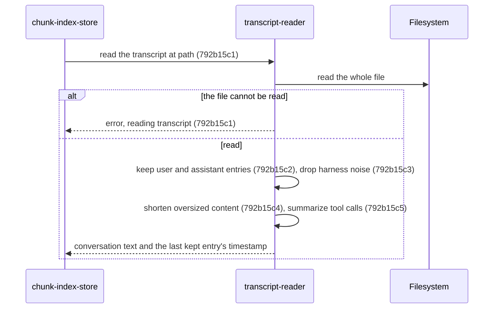

### 792b15c Behavior Requirements

#### 792b15c1 Reading a transcript

Requirement: 792b15c1 The transcript-reader MUST read the whole transcript file at the given path
and return its conversation text, and MUST return an error wrapping the read failure as
`reading transcript` when the file cannot be read.

Supports: 792a5b1d, 792a5g1a.

##### 792b15c1a Scenarios

```gherkin
Scenario: 792b15c1a1 An unreadable transcript is an error
  Given a file reader that fails with "file not found"
  When a transcript is read
  Then the error says reading transcript and file not found
```

#### 792b15c2 Conversation entries

Requirement: 792b15c2 The transcript-reader MUST keep only entries whose top-level `type`, or else
whose `message.role`, is `user` or `assistant`, MUST render each kept entry's text, given as a string
or as text content blocks joined by spaces, as one line prefixed `USER: ` or `ASSISTANT: `, and MUST
drop entries that are not JSON, have another type, or have no text.

Supports: 792a5g1a, 792a5h1b.

##### 792b15c2a Scenarios

```gherkin
Scenario: 792b15c2a1 User and assistant text become prefixed lines
  Given a user entry "plain question" and an assistant entry "plain answer", each with string content
  When the entries are read
  Then the text is "USER: plain question" then "ASSISTANT: plain answer"

Scenario: 792b15c2a2 Other entries are dropped
  Given a non-JSON line, a progress entry, a user entry with empty content, and a user entry "real question"
  When the entries are read
  Then the only line is "USER: real question"

Scenario: 792b15c2a3 An entry with another role is dropped
  Given a user entry "hello", an entry whose role is toolResult, and an assistant entry "response"
  When the transcript is read
  Then the text holds "USER: hello" and "ASSISTANT: response" and nothing of the toolResult entry
```

#### 792b15c3 Harness noise

Requirement: 792b15c3 The transcript-reader MUST drop text that starts with `<system-reminder`,
`Base directory for this skill:`, `<local-command-stdout>`, `<local-command-caveat>` or
`<task-notification>`, MUST replace text holding a `<command-name>` slash-command block with the
trimmed text of its `<command-args>` block, and MUST drop that text when the block has no
arguments.

Rationale: the harness writes these into the user's turns. They are not what the user said, and
an injected skill body would otherwise repeat the whole skill in every chunk of every session that
used it.

Supports: 792a5g1a.

##### 792b15c3a Scenarios

```gherkin
Scenario: 792b15c3a1 A system reminder is dropped
  Given a user entry whose text is a <system-reminder> block, and a user entry "real question"
  When the entries are read
  Then the only line is "USER: real question"

Scenario: 792b15c3a2 Injected skill bodies, command output and task notifications are dropped
  Given user entries starting "Base directory for this skill:", "<local-command-stdout>", "<local-command-caveat>" and "<task-notification>"
  When the entries are read
  Then none of them yields a line

Scenario: 792b15c3a3 A slash command keeps only its arguments
  Given a user entry holding <command-name>/learn</command-name> and <command-args>remember X</command-args>, and one holding a <command-name> block with no arguments
  When the entries are read
  Then the only line is "USER: remember X"
```

#### 792b15c4 Oversized content

Requirement: 792b15c4 The transcript-reader MUST replace every run of 100 or more base64 characters
(letters, digits, `+`, `/`, `=`) in an entry with `[base64 removed]`, and MUST cut any text line
longer than 2000 characters to its first 2000 followed by `[truncated]`.

Supports: 792a5g1a.

##### 792b15c4a Scenarios

```gherkin
Scenario: 792b15c4a1 Base64 data is replaced
  Given a user entry whose text holds a 200-character base64 run
  When the entry is read
  Then its line holds [base64 removed] in place of the run

Scenario: 792b15c4a2 An oversized line is cut
  Given a user entry whose text is 3000 characters long
  When the entry is read
  Then its line, prefix included, is cut to its first 2000 characters followed by [truncated]
```

#### 792b15c5 Tool-call summaries

Requirement: 792b15c5 The transcript-reader MUST render each `tool_use` block that a later
`tool_result` block with string content answers by ID as one line,
`[tool] <name>(<key>=<value>, ...) → exit <0|1> | <first non-empty result line>`, at the position of
the result, with the arguments sorted by key and string values quoted, exit 1 when the result is an
error, the argument list and the result line each cut to 120 characters followed by `[truncated]`,
and the ` | ...` part left out when the result is empty. It MUST drop a `tool_use` that no such
result answers, and every other `tool_result`.

Supports: 792a5g1a.

Rationale: a tool call's full input and output are usually the bulk of a session. One line keeps
what was done and whether it worked, which is what an agent reading the chunk back needs. A
`tool_result` whose content is a list of blocks matches no summary, so its call is dropped
(792d81).

##### 792b15c5a Scenarios

```gherkin
Scenario: 792b15c5a1 A tool call and its result become one line
  Given an assistant entry "Let me read" with a Read tool_use of file_path /src/main.go, and its tool_result "package main"
  When the entries are read
  Then the lines are "ASSISTANT: Let me read" and a line starting "[tool] Read(" holding file_path="/src/main.go", exit 0 and package main

Scenario: 792b15c5a2 An error result exits 1
  Given a Bash tool_use and its tool_result "Error: test failed" marked as an error
  When the entries are read
  Then the one line starts "[tool] Bash(" and holds exit 1 and Error: test failed

Scenario: 792b15c5a3 Only the first output line is kept
  Given a tool_result whose content is "first line", "second line" and "third line" on separate lines
  When the entries are read
  Then the summary line holds first line and not second line

Scenario: 792b15c5a4 Several calls keep their order among the text
  Given a user entry, an assistant entry with text and a tool_use, its result, two more tool calls, and a closing assistant entry
  When the entries are read
  Then the text lines and the [tool] lines appear in the order of the entries

Scenario: 792b15c5a5 An unanswered tool call is dropped
  Given an assistant entry "Let me check" with a tool_use that no tool_result answers, and an assistant entry "Done."
  When the entries are read
  Then the lines are "ASSISTANT: Let me check" and "ASSISTANT: Done."

Scenario: 792b15c5a6 Long arguments and output are cut
  Given a tool_use whose arguments, and a tool_result whose output, are each over 120 characters
  When the entries are read
  Then the summary line holds [truncated] for each
```

#### 792b15c6 Last timestamp

Requirement: 792b15c6 The transcript-reader MUST return, with the conversation text, the timestamp of the
last entry it kept, treating an entry whose timestamp is absent, null or unreadable, or that is not
JSON, as carrying the timestamp of the entry before it, and MUST return no timestamp when no entry
carries a readable one.

Supports: 792a7p1b.

Rationale: the timestamp becomes every chunk's first-indexed time (792b18c14), which orders the
newest chunks of a query (792a7o), so a session with a few rows that lack a time must still report
when it ended.

##### 792b15c6a Scenarios

```gherkin
Scenario: 792b15c6a1 Unreadable timestamps are skipped
  Given a transcript whose first rows are not JSON, lack a timestamp or carry "not-a-date", and whose last row is stamped 2026-01-01T00:03:00Z
  When it is read
  Then the last timestamp is 2026-01-01T00:03:00Z

Scenario: 792b15c6a2 A null timestamp inherits the previous one
  Given a transcript whose first row has a null timestamp and whose second is stamped 2026-01-01T00:01:00Z
  When it is read
  Then both rows are kept, the last timestamp is 2026-01-01T00:01:00Z and the read is not partial
```

### 792b15d Product-Scenario Mapping

| Product scenario | Technical requirements |
| --- | --- |
| 792a5b1d | 792b15c1 |
| 792a5g1a | 792b15c1, 792b15c2, 792b15c3, 792b15c4, 792b15c5 |
| 792a5h1b | 792b15c2 |
| 792a7p1b | 792b15c6 |

```gherkin
Scenario: 792a5g1a A conversation is indexed as text with tool summaries
  Given a transcript where the user asks to run the tests, the assistant runs a Bash tool that prints "ok", and a system reminder is injected
  When the user runs engram ingest --transcript <file> and reads the chunk with engram show-chunk
  Then the chunk text has a USER: line, an ASSISTANT: line and a "[tool] Bash(command=...) → exit 0 | ok" line, and no system-reminder text

Scenario: 792a5h1b A transcript is chunked by turns
  Given s.jsonl holding many short user and assistant turns
  When the user runs engram ingest --transcript s.jsonl
  Then each chunk holds consecutive turns, and their IDs are s.jsonl#turn-1, then the turn numbers at which later chunks start
```

```gherkin
Scenario: 792a7p1b A transcript chunk takes the session's last timestamp
  Given a transcript whose last entry is stamped 2026-05-10 14:00, ingested on 2026-06-01
  When its index file is read
  Then each record's ingested_at is 2026-05-10 14:00
```

## 792b16 Added: source-chunking

Canonical target: `docs/specs/technical/source-chunking.md` (title `Source Chunking - Technical Spec`).

### 792b16a Orientation

- Ownership: Repository component.
- Responsibility: cuts one source's text into embedding-sized chunks, each with an anchor that
  locates it in the source. A Markdown document is cut by heading section, and a transcript's
  conversation text by user turn; oversized pieces are split on line boundaries and pieces too short
  to carry meaning are dropped. It does no input or output.
- Current realization (informational): `Markdown` and `Transcript` in `internal/chunk/chunk.go`,
  called by `chunkSource` in `internal/cli/ingest.go` with a 500-character transcript target and a
  1500-character maximum.
- Qualification: responsibility, cutting text into anchored chunks is stated without naming any
  function; ownership, the caller decides which text to cut and what to do with the chunks, while
  this component owns the boundaries and anchors; independent verification, it is tested directly on
  strings; stability, the contract survives any change to the index format; necessity, every chunk
  in the index is one of its pieces.
- Supported capabilities: 792a5 chunk-indexing.

Rationale: a chunk is the unit that is embedded and retrieved, so it must fit the embedder's
window (792b9c2) and still read as a coherent piece of evidence. Heading sections are the natural
units of a document. Single transcript turns are often a few words, so consecutive turns are merged
until the chunk is worth embedding on its own.

### 792b16b Sequences

The source-chunking owns no flow: it is a pure function from text to chunks, called by
chunk-index-store (792b18).

### 792b16c Behavior Requirements

#### 792b16c1 Markdown sections

Requirement: 792b16c1 The source-chunking MUST cut Markdown into one piece per section, where a
section starts at each ATX heading line (one to six `#` followed by a space) outside fenced code and
includes that heading line, a line whose trimmed text starts with three backticks opens or closes a
fence, the anchor is the heading's text without its `#` marks and surrounding spaces, and text
before the first heading is anchored `preamble`.

Supports: 792a5h1a, 792a5h1d.

##### 792b16c1a Scenarios

```gherkin
Scenario: 792b16c1a1 Each heading starts a section
  Given "# Title", "## Section A" and "## Section B", each followed by a sentence
  When the Markdown is chunked
  Then there are three chunks, anchored Title, Section A and Section B

Scenario: 792b16c1a2 A heading inside a code fence does not split
  Given a "## Real section" holding a fenced block whose line is "# not a heading"
  When the Markdown is chunked
  Then there is one chunk, and it holds the fenced line

Scenario: 792b16c1a3 Text before the first heading is the preamble
  Given a sentence followed by "## Setup" and another sentence
  When the Markdown is chunked
  Then the first chunk is anchored preamble and the second Setup
```

#### 792b16c2 Transcript turns

Requirement: 792b16c2 The source-chunking MUST group a transcript's lines into turns, each starting
at a line that begins `USER: ` and running to the next, with any lines before the first such line
as one leading unit, MUST append whole turns to a chunk until its text reaches the 500-character
target and then start the next chunk, and MUST anchor each chunk `turn-<N>`, where `<N>` counts the
first turn it holds among the user turns from 1, or `preamble` when it starts with the leading unit.

Supports: 792a5h1b.

##### 792b16c2a Scenarios

```gherkin
Scenario: 792b16c2a1 Short turns merge into one chunk
  Given three short user turns with their replies, together under 500 characters
  When the transcript is chunked
  Then there is one chunk holding all three, anchored turn-1

Scenario: 792b16c2a2 A chunk past the target closes
  Given a first user turn of about 600 characters, then a second turn
  When the transcript is chunked
  Then there are two chunks, the second anchored turn-2

Scenario: 792b16c2a3 Text before the first user turn is the preamble
  Given an ASSISTANT: line followed by the first USER: line
  When the transcript is chunked
  Then the first chunk is anchored preamble
```

#### 792b16c3 Oversized pieces

Requirement: 792b16c3 The source-chunking MUST split a section or chunk whose trimmed text is longer
than 1500 characters by packing its non-blank lines, in order, into pieces, starting a new piece
whenever adding the next line would take the piece past 1500 characters, and MUST give every piece
the anchor of the text it came from.

Supports: 792a5h1d.

Rationale: 1500 characters fits the embedder's window. A single line longer than that is not cut
here; it stays one piece, and the embedder embeds its first 1500 characters (792b9c2).

##### 792b16c3a Scenarios

```gherkin
Scenario: 792b16c3a1 An oversized section is split under its anchor
  Given a "## Big" section of three paragraphs of about 940 characters each
  When the Markdown is chunked
  Then there is more than one chunk, each at most 1500 characters and anchored Big

Scenario: 792b16c3a2 An oversized turn is split
  Given one user turn followed by 80 assistant lines of 50 characters each
  When the transcript is chunked
  Then there is more than one chunk, each at most 1500 characters
```

#### 792b16c4 Noise floor

Requirement: 792b16c4 The source-chunking MUST drop every section, chunk and split piece whose
trimmed text is shorter than 40 characters.

Supports: 792a5h1c.

##### 792b16c4a Scenarios

```gherkin
Scenario: 792b16c4a1 A tiny transcript yields nothing
  Given the transcript text "USER: ok"
  When the transcript is chunked
  Then there are no chunks

Scenario: 792b16c4a2 A tiny section yields nothing
  Given the Markdown "## A" followed by "tiny"
  When the Markdown is chunked
  Then there are no chunks
```

### 792b16d Product-Scenario Mapping

| Product scenario | Technical requirements |
| --- | --- |
| 792a5h1a | 792b16c1 |
| 792a5h1b | 792b16c2 |
| 792a5h1c | 792b16c4 |
| 792a5h1d | 792b16c1, 792b16c3 |

```gherkin
Scenario: 792a5h1a Markdown is chunked by heading
  Given d.md holding text before any heading, a "## Setup" section and a "## Usage" section, each over 40 characters
  When the user runs engram ingest --markdown d.md
  Then the index holds the chunks d.md#preamble, d.md#Setup and d.md#Usage

Scenario: 792a5h1c Short sections are not indexed
  Given d.md whose only section is "## A" followed by "tiny"
  When the user runs engram ingest --markdown d.md
  Then no chunk of d.md is indexed

Scenario: 792a5h1d A long section is split under one anchor
  Given d.md whose "## Big" section is three paragraphs of about 940 characters each
  When the user runs engram ingest --markdown d.md
  Then the index holds several chunks d.md#Big, each at most 1500 characters long
```

## 792b17 Added: ingestion-source-discovery

Canonical target: `docs/specs/technical/ingestion-source-discovery.md` (title `Ingestion Source Discovery - Technical Spec`).

### 792b17a Orientation

- Ownership: Repository component, walking the local filesystem through the durable-file-store's
  directory walk.
- Responsibility: turns one `engram ingest` invocation into the list of source files to index. It
  takes the named files, expands the named Pi session directories, resolves the sweep roots, both
  the `--sweep` directories and the declarative `--auto` roots with their per-repository
  configuration, walks each root under its exclusion rules, and tags every source with how it was
  found: the origin and, for an ancestor directory, its distance from the working directory.
- Current realization (informational): `gatherSources`, `explicitSources`, `piSessionSources`,
  `assembleSweepRoots`, `sweptSources`, `resolveAutoSpec`, `sessionDirFrom`, `sweepListerFrom`
  and `shouldSkipDir` in `internal/cli/ingest.go`; `sourceRefsFromRoot` and the origin constants in
  `internal/cli/ingest_dedup.go`; `SweepSpec`, `DefaultSweepSpec`, `LoadSweepSpec`,
  `ResolveSweepRoots` and `dropNonPersistentRoots` in `internal/cli/sweepspec.go`.
- Qualification: responsibility, finding the sources to index is stated without naming any
  function; ownership, the chunk-index-store decides what to do with each source, while this
  component owns which files are sources and how each was found; independent verification, root
  resolution is tested as a pure function of the spec and an injected directory check, and
  gathering over fake listings; stability, the contract survives any change to the index;
  necessity, every source the index holds is one it found.
- Supported capabilities: 792a5 chunk-indexing.

Rationale: the sweep is declarative and inspectable: what `--auto` covers is data, compiled in as
defaults and overridable per repository, so a developer tunes it without changing code. Two
throwaway-workspace rules exist because each reaches what the other cannot. Directory names catch
session-log project directories, which Claude Code names after the slugified working directory
(`-private-tmp-...`). Root paths catch a root that is itself throwaway, such as a repository root
that resolves to `/tmp/eval-pool/warm0` because it has no repository marker; the walk never checks
a root's own path against the exclusions, so such a root was once swept whole and permanently
indexed. Named files, `--sweep` and `extra_roots` are deliberate choices, so neither rule applies
to them.

### 792b17b Sequences

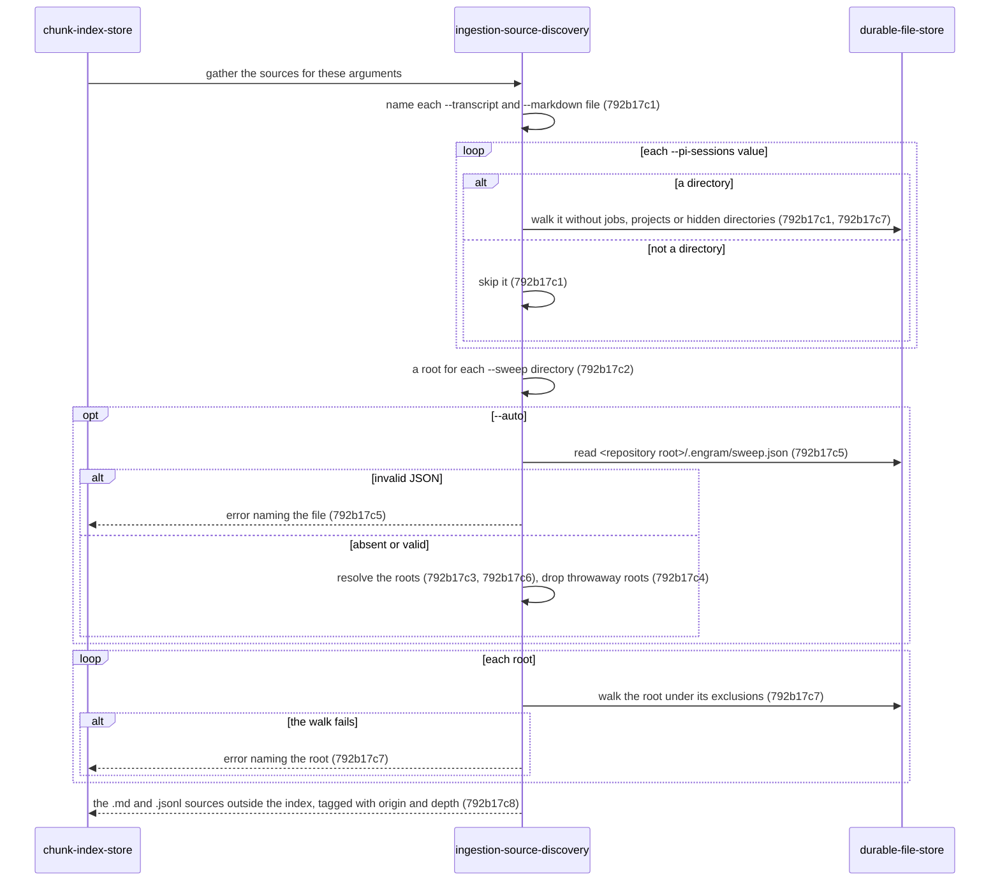

### 792b17c Behavior Requirements

#### 792b17c1 Named sources

Requirement: 792b17c1 The ingestion-source-discovery MUST make each `--transcript` and `--markdown`
path a source with the explicit origin, without checking that it exists, and for each `--pi-sessions`
value that is a directory MUST make each `.md` and `.jsonl` file under it, outside its `jobs`,
`projects` and hidden subdirectories, a source with the explicit origin. It MUST skip a
`--pi-sessions` value that is not a directory.

Supports: 792a5b1a, 792a5b1b, 792a5b1c, 792a5b1d, 792a5f1d, 792a5l1b.

##### 792b17c1a Scenarios

```gherkin
Scenario: 792b17c1a1 Named files and Pi directories are gathered together
  Given --transcript /docs/markdown.md and --pi-sessions /.pi holding session.jsonl
  When the sources are gathered and ingested
  Then both files are indexed

Scenario: 792b17c1a2 Every session file of each Pi directory is a source
  Given --pi-sessions naming a directory that holds two .jsonl files
  When the sources are gathered and ingested
  Then both files are indexed

Scenario: 792b17c1a3 A Pi value that is not a directory is skipped
  Given --pi-sessions /.pi, a directory holding session1.jsonl, and /nonexistent/pi
  When the sources are gathered and ingested
  Then session1.jsonl is indexed and the run succeeds
```

#### 792b17c2 Swept directories

Requirement: 792b17c2 The ingestion-source-discovery MUST make each `--sweep` directory a root with
the manual-sweep origin, the default excluded directory names (792b17c5) and hidden directories
pruned, and no throwaway-name or throwaway-path rule.

Supports: 792a5c1a, 792a5f1d.

##### 792b17c2a Scenarios

```gherkin
Scenario: 792b17c2a1 A swept directory under a throwaway path is still swept
  Given --sweep /private/tmp/eval-ws, which holds s.jsonl
  When the sources are gathered and ingested
  Then s.jsonl is indexed
```

#### 792b17c3 Automatic roots

Requirement: 792b17c3 For `--auto`, the ingestion-source-discovery MUST resolve, in this order and
each only when its setting is on: the repository root (the nearest of the working directory and its
ancestors holding a `.git`, `.hg` or `.jj` directory, else the working directory) with the
repository origin; each `.claude` directory from the working directory up to the filesystem root,
nearest first, with the claude-ancestor origin; each `.pi` directory on the same chain with the
pi-ancestor origin; the session-log directory (792b17c6), when it is a directory, with the
session-log origin; and each `extra_roots` entry with the manual-sweep origin. Every root MUST carry
`exclude_dirs` and prune hidden directories unless `include_hidden_dirs` is set; a `.claude` root
MUST also carry `claude_exclude_dirs`, a `.pi` root only `jobs` and `projects`, and only the
session-log root `non_persistent_prefixes`. Each ancestor root MUST record its depth: the number of
directory levels climbed from the working directory to reach the directory holding it.

Supports: 792a5d1a, 792a5d1b, 792a5d1c, 792a5d1d, 792a5e1a, 792a5f1a, 792a5l1a, 792a5l1c.

##### 792b17c3a Scenarios

```gherkin
Scenario: 792b17c3a1 The repository, its ancestors and the session logs are roots
  Given the working directory /home/dev/proj/sub, a /home/dev/proj/.git, .claude directories in /home/dev/proj and /home/dev, and a session-log directory
  When the roots are resolved with the defaults
  Then the roots include /home/dev/proj, both .claude directories and the session-log directory, the .claude roots exclude projects, plugins and cache, and the repository root does not exclude projects

Scenario: 792b17c3a2 Without a marker the working directory is the repository root
  Given the working directory /home/dev/scratch with no marker in it or any ancestor
  When the roots are resolved with the defaults
  Then /home/dev/scratch is a root

Scenario: 792b17c3a3 A .claude root excludes jobs
  Given a repository at /home/dev/proj with a .claude directory
  When the roots are resolved with the defaults
  Then the .claude root excludes jobs

Scenario: 792b17c3a4 Only the session-log root carries the throwaway names
  Given a repository and a session-log directory
  When the roots are resolved with the defaults
  Then the session-log root's name prefixes include -private-tmp- and the repository root has none

Scenario: 792b17c3a5 Settings turn roots off
  Given repo_markdown, ancestor_claude_dirs and session_logs off and extra_roots ["/opt/notes"]
  When the roots are resolved
  Then /opt/notes is the only root

Scenario: 792b17c3a6 Ancestor depth is the physical distance
  Given a .pi directory in the working directory and the nearest .claude directory one level up
  When the roots are resolved
  Then the .pi root has depth 0 and the .claude root depth 1
```

#### 792b17c4 Throwaway roots

Requirement: 792b17c4 The ingestion-source-discovery MUST drop every `--auto` root, before
`extra_roots` are added, whose own path equals or lies under a `non_persistent_path_prefixes` entry,
comparing whole path segments, so that `/tmpfoo` is not under `/tmp`.

Supports: 792a5f1b, 792a5f1c.

##### 792b17c4a Scenarios

```gherkin
Scenario: 792b17c4a1 Roots under a throwaway path are dropped
  Given the working directory /private/tmp/work/proj with no marker and a .claude directory in it
  When the roots are resolved with the defaults
  Then no root lies under /private/tmp

Scenario: 792b17c4a2 Extra roots are kept under a throwaway path
  Given every root setting off and extra_roots ["/tmp/mydata"], with the default path prefixes
  When the roots are resolved
  Then /tmp/mydata is the only root
```

#### 792b17c5 Sweep configuration

Requirement: 792b17c5 The ingestion-source-discovery MUST default every root setting on,
`exclude_dirs` to `node_modules`, `vendor`, `.git`, `.hg`, `.jj`, `dist`, `build`, `target`,
`.venv`, `venv`, `__pycache__`, `.next`, `.cache` and `.idea`, `claude_exclude_dirs` to `projects`,
`jobs`, `plugins`, `cache`, `todos`, `shell-snapshots`, `file-history`, `history`, `ide`,
`statsig`, `session-env`, `debug` and `worktrees`, `non_persistent_prefixes` to `-private-tmp-`,
`-tmp-`, `-var-folders-` and `-private-var-folders-`, `non_persistent_path_prefixes` to `/tmp`,
`/private/tmp`, `/var/folders` and `/private/var/folders`, and `extra_roots` to none. For `--auto`
it MUST read `.engram/sweep.json` at the repository root, overlay each key the file sets on the
defaults, and return an error naming the file when it is not valid JSON; it MUST return an error
when the working directory cannot be found.

Supports: 792a5c1a, 792a5d1c, 792a5e1a, 792a5e1b, 792a5f1a, 792a5f1b.

##### 792b17c5a Scenarios

```gherkin
Scenario: 792b17c5a1 The defaults sweep everything and exclude dependency trees
  Given no sweep configuration
  When the default settings are read
  Then repo_markdown, ancestor_claude_dirs and session_logs are on, exclude_dirs holds node_modules, vendor and .git, and non_persistent_prefixes holds -private-tmp-, -tmp- and -var-folders-

Scenario: 792b17c5a2 A configuration file overlays the defaults
  Given {"repo_markdown": false, "exclude_dirs": ["node_modules", "gen"]}
  When the configuration is loaded
  Then repo_markdown is off, exclude_dirs is exactly node_modules and gen, and session_logs keeps its default

Scenario: 792b17c5a3 The repository's file is read by --auto
  Given a repository /repo whose .engram/sweep.json is {"session_logs": false}
  When --auto sources are gathered and ingested from /repo
  Then /repo/README.md is indexed and no session log is

Scenario: 792b17c5a4 An invalid configuration file is an error
  Given a repository whose .engram/sweep.json is not valid JSON
  When --auto sources are gathered
  Then the error names .engram/sweep.json
```

#### 792b17c6 Session-log directory

Requirement: 792b17c6 The ingestion-source-discovery MUST take the session-log directory from
`ENGRAM_TRANSCRIPT_DIR` when it is non-empty, else `<home>/.claude/projects`, and MUST use no
session-log directory when the home directory cannot be found.

Supports: 792a5d1a, 792a5d1d.

Rationale: memory learns from every recorded conversation of every project, not only the current
one's. A headless or eval run sets `ENGRAM_TRANSCRIPT_DIR` so it sweeps only its own sessions.

##### 792b17c6a Scenarios

```gherkin
Scenario: 792b17c6a1 The default is every project's sessions
  Given no ENGRAM_TRANSCRIPT_DIR and the home directory /home/u
  When the session-log directory is found
  Then it is /home/u/.claude/projects, and it is empty when the home directory cannot be found

Scenario: 792b17c6a2 The environment names the directory
  Given ENGRAM_TRANSCRIPT_DIR is /custom/sessions
  When the session-log directory is found
  Then it is /custom/sessions
```

#### 792b17c7 Walking a root

Requirement: 792b17c7 The ingestion-source-discovery MUST walk each root and return its files,
pruning every directory below the root whose name is in the root's excluded names, starts with one
of its name prefixes, or, when the root prunes hidden directories, starts with `.`, and MUST return
an error naming the root when the walk fails.

Supports: 792a5b1b, 792a5c1a, 792a5d1c, 792a5f1a.

##### 792b17c7a Scenarios

```gherkin
Scenario: 792b17c7a1 Excluded and hidden directories are pruned
  Given a directory holding docs/real.md, node_modules/pkg/dep.md and .layer-run/cfg/junk.md
  When it is walked as a root excluding node_modules and pruning hidden directories
  Then docs/real.md is returned and neither of the others is

Scenario: 792b17c7a2 A throwaway-named directory is pruned
  Given the name prefixes -private-tmp- and -tmp-
  When the directories -private-tmp-cummatrix-x, node_modules and -Users-joe-repos-engram are checked
  Then the first two are pruned and the third is kept

Scenario: 792b17c7a3 A failed walk is an error
  Given a Pi sessions directory whose walk fails
  When the sources are gathered
  Then gathering fails
```

#### 792b17c8 Source files

Requirement: 792b17c8 The ingestion-source-discovery MUST keep only `.md` and `.jsonl` files of a
walked root, MUST drop, for every root but a `--pi-sessions` directory, each file under the chunk
index directory, and MUST tag each source with its root's origin and depth, as explicit only when
the origin is explicit.

Supports: 792a5c1a, 792a5c1c, 792a5l1a.

##### 792b17c8a Scenarios

```gherkin
Scenario: 792b17c8a1 Only documents and transcripts are sources
  Given a root holding a.md, b.jsonl and c.json
  When its sources are gathered
  Then a.md and b.jsonl are sources and c.json is not

Scenario: 792b17c8a2 The chunk index is never a source
  Given a swept root that contains the chunk index directory
  When its sources are gathered
  Then no file under the chunk index directory is a source

Scenario: 792b17c8a3 A swept root's files are found
  Given --sweep / over a filesystem holding /.pi/session.jsonl
  When the sources are gathered and ingested
  Then /.pi/session.jsonl is indexed
```

### 792b17d Product-Scenario Mapping

| Product scenario | Technical requirements |
| --- | --- |
| 792a5b1a | 792b17c1 |
| 792a5b1b | 792b17c1, 792b17c7 |
| 792a5b1c | 792b17c1 |
| 792a5b1d | 792b17c1 |
| 792a5c1a | 792b17c2, 792b17c5, 792b17c7, 792b17c8 |
| 792a5c1c | 792b17c8 |
| 792a5d1a | 792b17c3, 792b17c6 |
| 792a5d1b | 792b17c3 |
| 792a5d1c | 792b17c3, 792b17c5, 792b17c7 |
| 792a5d1d | 792b17c3, 792b17c6 |
| 792a5e1a | 792b17c3, 792b17c5 |
| 792a5e1b | 792b17c5 |
| 792a5f1a | 792b17c3, 792b17c5, 792b17c7 |
| 792a5f1b | 792b17c4, 792b17c5 |
| 792a5f1c | 792b17c4 |
| 792a5f1d | 792b17c1, 792b17c2 |
| 792a5l1a | 792b17c3, 792b17c8 |
| 792a5l1b | 792b17c1 |
| 792a5l1c | 792b17c3 |

```gherkin
Scenario: 792a5b1b A Pi sessions directory is indexed without its scratch
  Given a directory p holding a.jsonl, jobs/b.jsonl, projects/c.jsonl and .hidden/d.jsonl
  When the user runs engram ingest --pi-sessions p
  Then a.jsonl is indexed and none of the other three files is

Scenario: 792a5b1c A Pi sessions value that is not a directory is ignored
  Given a regular file f
  When the user runs engram ingest --pi-sessions f
  Then the command succeeds and indexes nothing

Scenario: 792a5c1a A swept directory's documents and transcripts are indexed
  Given a directory r holding a.md, sub/b.jsonl, node_modules/c.md, .git/d.md and notes.txt
  When the user runs engram ingest --sweep r
  Then a.md and sub/b.jsonl are indexed, and node_modules/c.md, .git/d.md and notes.txt are not

Scenario: 792a5c1c The chunk index directory is never indexed
  Given a chunk index directory inside the swept directory r
  When the user runs engram ingest --sweep r --chunks-dir r/chunks
  Then no file under r/chunks is indexed

Scenario: 792a5d1a The repository, its ancestors and the session logs are swept
  Given a working directory /r/sub inside a git repository /r, a /r/.claude directory, a /r/sub/.pi directory, and session logs under ~/.claude/projects
  When the user runs engram ingest --auto from /r/sub
  Then Markdown under /r, the files of /r/.claude and /r/sub/.pi, and the session transcripts are indexed

Scenario: 792a5d1b Without a repository marker the working directory is the root
  Given a working directory /w with no .git, .hg or .jj in it or any ancestor
  When the user runs engram ingest --auto from /w
  Then Markdown under /w is indexed

Scenario: 792a5d1c Harness scratch and state are not swept
  Given an ancestor .claude directory holding notes.md, jobs/snap.md, projects/p/s.jsonl and plugins/x.md
  When the user runs engram ingest --auto
  Then notes.md is indexed and jobs/snap.md, projects/p/s.jsonl and plugins/x.md are not

Scenario: 792a5d1d ENGRAM_TRANSCRIPT_DIR names the session logs
  Given ENGRAM_TRANSCRIPT_DIR is set to /logs, which holds a.jsonl
  When the user runs engram ingest --auto
  Then /logs/a.jsonl is indexed, and no transcript under ~/.claude/projects is

Scenario: 792a5e1a A repository adds a root and turns one off
  Given a repository whose .engram/sweep.json is {"session_logs": false, "extra_roots": ["/x"]}
  When the user runs engram ingest --auto inside it
  Then /x and the repository are swept, and no session log is indexed

Scenario: 792a5f1a Sessions recorded in a throwaway directory are skipped
  Given session logs under ~/.claude/projects/-private-tmp-eval-1/ and ~/.claude/projects/-Users-u-repo/
  When the user runs engram ingest --auto
  Then the -Users-u-repo sessions are indexed and the -private-tmp-eval-1 sessions are not

Scenario: 792a5f1b A throwaway working directory is not swept
  Given a working directory /tmp/test-pool/run123 with no repository marker
  When the user runs engram ingest --auto from it
  Then no file under /tmp/test-pool/run123 is indexed

Scenario: 792a5f1c An ancestor directory under the macOS temp root is dropped
  Given a working directory under /private/var/folders/xy/ with a .claude directory on its ancestor chain there
  When the user runs engram ingest --auto from it
  Then no file of that .claude directory is indexed

Scenario: 792a5f1d Explicit sources are indexed anywhere
  Given a transcript /tmp/explicit-session.jsonl and a directory /tmp/sweep-me holding a.md
  When the user runs engram ingest --transcript /tmp/explicit-session.jsonl --sweep /tmp/sweep-me
  Then both files are indexed

Scenario: 792a5l1a A repository file outranks its copy in an ancestor .claude directory
  Given byte-identical files /r/doc.md in the repository and /r/.claude/doc.md
  When the user runs engram ingest --auto from /r
  Then /r/doc.md is indexed and /r/.claude/doc.md is not

Scenario: 792a5l1b A named file outranks the repository copy
  Given byte-identical files /x/doc.md and /r/doc.md in the repository
  When the user runs engram ingest --auto --markdown /x/doc.md from /r
  Then /x/doc.md is indexed and /r/doc.md is not

Scenario: 792a5l1c The nearer ancestor directory wins
  Given byte-identical files in /r/a/.pi and in /r/.claude, and the working directory /r/a
  When the user runs engram ingest --auto from /r/a
  Then the /r/a/.pi copy is indexed and the /r/.claude copy is not
```

## 792b18 Added: chunk-index-store

Canonical target: `docs/specs/technical/chunk-index-store.md` (title `Chunk Index Store - Technical Spec`).

### 792b18a Orientation

- Ownership: Repository component (caller of ingestion-source-discovery, transcript-reader,
  source-chunking, text-embedder, durable-file-store and vault-write-lock).
- Responsibility: keeps the chunk index in its directory: one index file of embedded chunk records
  per indexed source, and a manifest recording every source it knows with its staleness signature
  and, for a copy, the source it copies. Under the manifest lock it reconciles the index with the
  gathered sources: it skips unchanged sources, rebuilds changed ones by appending only new chunks,
  indexes one source per group of identical copies and evicts a copy only when nothing would be lost,
  and drops stray vault-note copies. It detaches vanished sources, removes empty index files and
  collapses old duplicate groups on `engram prune`, and lists index files and chunk IDs for its
  readers.
- Current realization (informational): `RunIngest` and its helpers in `internal/cli/ingest.go`
  (`rebuildIndex`, `mergeChunkRecords`, `readManifest`, `writeManifestFile`, `manifestLockFrom`,
  `buildChunkIDSet`, `sourceSlug`); the dedup pass in `internal/cli/ingest_dedup.go`
  (`buildHashedSources`, `selectCanonical`, `reconcileGroupCanonicalFirst`, `reconcileDuplicate`,
  `duplicateRecordsCoveredBy`, `removeDuplicateIndex`, `dropVaultCopiesOutsideVault`);
  `RunPrune` in `internal/cli/prune.go`; `pruneDuplicatesLocked` in
  `internal/cli/prune_duplicates.go`; `listJSONLIndexes` in `internal/cli/query_chunks.go`; the
  record format in `internal/chunk/index.go`. The chunk index lives in the chunks directory
  (792b2c6), part of the binary's operational state rather than a store of its own.
- Qualification: responsibility, maintaining an index of embedded chunks is stated without naming
  any function; ownership, it owns the index's files and their consistency, while discovery, reading,
  chunking, embedding, writing and locking belong to the components it calls; independent
  verification, `RunIngest` and `RunPrune` are tested directly over in-memory filesystems, fake
  embedders and recording locks, and over the real filesystem; stability, the contract survives any
  change to how sources are found or chunked; necessity, every chunk a query returns comes from it.
- Supported capabilities: 792a5 chunk-indexing, 792a4 note-revision (chunk IDs), 792a7 memory-query
  (the first-indexed time). Install-and-update and learn add their requirements (792d30).

Rationale: the index is rebuilt incrementally and offline, with no LLM. A source's index file is
append-only: an embedded chunk is the memory and its source only provenance, so editing or deleting
a source never loses what was learned from it (#659). Across sources that guarantee is narrowed, not
reversed: a copy's index file may be removed, but only when every one of its chunks is provably in a
retained twin's index, so no chunk ever becomes unsearchable. Separate locks protect the chunk index
(`.manifest.lock`) and the vault (`.luhmann.lock`), because ingest and prune never touch notes.

### 792b18b Sequences

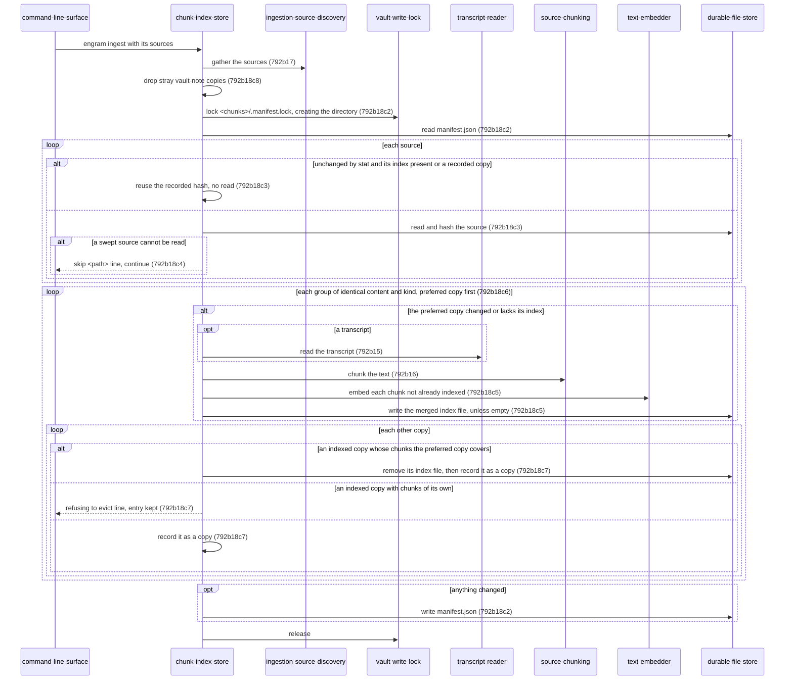

```mermaid
sequenceDiagram
  participant CLI as command-line-surface
  participant Store as chunk-index-store
  participant Lock as vault-write-lock
  participant Files as durable-file-store
  CLI->>Store: engram prune [--empty | --duplicates] [--dry-run]
  Store->>Lock: lock <chunks>/.manifest.lock (792b18c2)
  alt --empty
    Store->>Files: list the index files (792b18c12) and remove each empty one (792b18c10)
  else --duplicates
    Store->>Files: read manifest.json, group the recorded sources (792b18c11)
    loop each group of two or more
      Store->>Files: remove each covered copy's index file and entry (792b18c11)
    end
    opt something was removed and not a dry run
      Store->>Files: write manifest.json
    end
  else default
    Store->>Files: read manifest.json, drop every source whose file is gone (792b18c9)
    opt something was dropped and not a dry run
      Store->>Files: write manifest.json
    end
  end
  Store->>Lock: release
  Store-->>CLI: report lines, or an error (792b18c9, 792b18c10, 792b18c11)
```

### 792b18c Behavior Requirements

#### 792b18c1 Index layout

Requirement: 792b18c1 The chunk-index-store MUST keep each indexed source's chunks in the file
`<source base name without extension>-<first 8 hex digits of the SHA-256 of the source path>.jsonl`
in the chunks directory, one JSON record per line holding `source`, `anchor`, `content_hash`
(`sha256:` and the hex SHA-256 of the text), `text`, `vector`, and `ingested_at` when set, and MUST
keep `manifest.json` there mapping each known source path to its `mtime_unix_nano`, `size`,
`file_hash` (`sha256:` and the hex SHA-256 of its bytes) and, for a recorded copy, `duplicate_of`.
It MUST write both through the durable-file-store's atomic replace (792b3c1) with mode `0600`,
creating the chunks directory with mode `0700` when absent. Reading an index file MUST skip blank
lines and fail on a line that is not a record.

Supports: 792a5b1a, 792a5i1b, 792a5p1a.

Rationale: the path hash keeps two `README.md` files in different directories from sharing an
index file, and the base name keeps the directory readable.

##### 792b18c1a Scenarios

```gherkin
Scenario: 792b18c1a1 A transcript's chunk is recorded with its vector and hash
  Given a transcript /sessions/abc.jsonl whose text forms one chunk
  When it is ingested
  Then its index file holds one record whose source is /sessions/abc.jsonl, whose vector is not empty, and whose content_hash starts sha256:

Scenario: 792b18c1a2 An index file is written atomically into a created directory
  Given a chunks directory that does not exist
  When the index file /chunks/idx.jsonl is written
  Then /chunks is created with mode 0700 and the file is replaced atomically with mode 0600

Scenario: 792b18c1a3 A source's staleness signature is its modification time and size
  Given a source file whose modification time and size are known
  When its signature is taken
  Then it is that modification time in nanoseconds and that size, and a failed stat is an error
```

#### 792b18c2 Locked reconciliation

Requirement: 792b18c2 The chunk-index-store MUST create the chunks directory and take the
vault-write-lock on `<chunks>/.manifest.lock` (792b8c1) before `engram ingest` or `engram prune`
reads the manifest, MUST hold it through every index-file and manifest write of the run, and MUST
release it before returning. Its helpers, the manifest write among them, MUST NOT take the lock
themselves. A failure to create the directory or take the lock MUST be returned with nothing read.
A missing manifest MUST be read as empty, and a manifest that is not valid JSON MUST be an error.

Supports: 792a5o1a.

Rationale: two concurrent runs once lost manifest updates in production: each read the manifest,
and the later write overwrote the earlier one's change (#660). Creating the directory first lets a
prune of a fresh index take its lock.

##### 792b18c2a Scenarios

```gherkin
Scenario: 792b18c2a1 Ingest holds the lock across its read-modify-write
  Given a lock that records when it is taken and released
  When an ingest adds a source
  Then the lock is taken before the manifest is read and released after it is written

Scenario: 792b18c2a2 Prune holds the lock across its read-modify-write
  Given a lock that records when it is taken and released
  When a prune detaches a source
  Then the lock is taken before the manifest is read and released after it is written

Scenario: 792b18c2a3 A concurrent ingest and prune both take effect
  Given a manifest recording a source whose file is gone, and the real file lock
  When an ingest of a new source and a prune run at the same time against the same chunks directory
  Then the final manifest records the new source and not the gone one

Scenario: 792b18c2a4 The directory is created before the lock is taken
  Given a chunks directory /chunks
  When the manifest lock is taken and released
  Then /chunks is created with mode 0700, then /chunks/.manifest.lock is locked, then unlocked

Scenario: 792b18c2a5 A directory failure takes no lock
  Given creating the chunks directory fails
  When the manifest lock is taken
  Then the error is returned and no lock is attempted
```

#### 792b18c3 Change detection

Requirement: 792b18c3 The chunk-index-store MUST NOT read a known source whose modification time
and size equal its manifest entry's and which is a recorded copy or has its index file, and MUST use
the recorded content hash for it. It MUST read and hash every other source. A source that is the
preferred copy of its group, whose recorded hash equals its current hash and whose index file exists,
MUST NOT be rebuilt: when it was read, only its recorded signature is refreshed, and otherwise
nothing about it is written. A recorded source whose index file is missing MUST be rebuilt.

Supports: 792a5i1a.

Rationale: an automatic sweep runs before every learn over every known source, so an unchanged
source must cost one stat. The index-file check closes the window between removing a copy's index
file and its manifest entry: a crash there would otherwise leave a source recorded as indexed with
no index, forever.

##### 792b18c3a Scenarios

```gherkin
Scenario: 792b18c3a1 An unchanged source is not re-embedded
  Given a swept document that was ingested and has not changed
  When it is ingested again
  Then nothing is embedded

Scenario: 792b18c3a2 An unchanged known source is not read
  Given a source recorded in the manifest with its index file, whose signature has not changed
  When it is ingested again
  Then the source file is not read

Scenario: 792b18c3a3 Re-ingesting identical content adds nothing
  Given a transcript that was ingested
  When it is ingested again with the same text
  Then its index file is unchanged and holds one record

Scenario: 792b18c3a4 A missing index file is rebuilt
  Given a source recorded in the manifest, unchanged, whose index file is gone
  When it is ingested
  Then its index file is rebuilt
```

#### 792b18c4 Read and write failures

Requirement: 792b18c4 When a source cannot be read, the chunk-index-store MUST return an error
naming it if the source was named (792b17c1), and otherwise MUST print `skip <path>: <error>` on
stdout and go on without it. Every other failure, of the transcript-reader, the embedder, or an
index-file or manifest write, MUST be returned as an error.

Supports: 792a5b1d, 792a5c1b.

##### 792b18c4a Scenarios

```gherkin
Scenario: 792b18c4a1 A vanished swept source is skipped and a named one fails
  Given a sweep listing /docs/conv.md and /docs/gone.md, where gone.md cannot be read
  When the sweep is ingested, and then /docs/gone.md is ingested by name
  Then the sweep indexes conv.md and writes the manifest, and the named ingest fails

Scenario: 792b18c4a2 A named document that cannot be read fails
  Given no file at /missing.md
  When /missing.md is ingested by name
  Then the ingest fails

Scenario: 792b18c4a3 A transcript-reader failure fails the ingest
  Given a named or Pi transcript whose reader fails
  When it is ingested
  Then the ingest fails with that error

Scenario: 792b18c4a4 An index-file write failure fails the ingest
  Given index-file writes fail
  When a document is ingested
  Then the ingest fails with that error

Scenario: 792b18c4a5 A manifest write failure fails the ingest
  Given manifest writes fail
  When a swept document is ingested
  Then the ingest fails with that error
```

#### 792b18c5 Rebuilding a source's index

Requirement: 792b18c5 To rebuild a source, the chunk-index-store MUST chunk it (792b16), a `.jsonl`
source as transcript text from the transcript-reader (792b15) and any other as Markdown, MUST keep
every record already in its index file, an absent or undecodable file counting as none, MUST embed
(792b9c1) and append each chunk whose content hash is not among them, and MUST write the merged
records, or write nothing when there are none. It MUST record the source's signature and content
hash in the manifest and print `ingest <path>: <records> chunks (<reused> reused, <embedded> embedded)`.

Supports: 792a5b1a, 792a5h1a, 792a5i1b, 792a5j1a, 792a5k1a.

Rationale: reusing a chunk's vector by its text's hash means editing one section re-embeds only
that section. Keeping every earlier record makes the index append-only within a source (792a5j),
which is also why two byte-identical sources can hold different records (792b18c7).

##### 792b18c5a Scenarios

```gherkin
Scenario: 792b18c5a1 A new document is chunked and embedded
  Given a swept document with sections A and B
  When it is ingested
  Then its index file holds two records and the embedder ran twice

Scenario: 792b18c5a2 A named document is indexed under its heading
  Given /docs/conventions.md with one "## Conventions" section
  When it is ingested by name
  Then its index holds one record anchored Conventions

Scenario: 792b18c5a3 An edited section re-embeds and the old text stays
  Given an ingested document whose section B is rewritten
  When it is ingested again
  Then its index holds three records, the old B text among them, and the embedder ran once

Scenario: 792b18c5a4 New content is appended to a changed source
  Given an ingested transcript to which a turn is appended, or whose content is replaced
  When it is ingested again
  Then the index holds the earlier chunk and the new one

Scenario: 792b18c5a5 A source with no chunks writes no index file
  Given an empty transcript
  When it is ingested
  Then no index file is written for it, and the manifest is written

Scenario: 792b18c5a6 The production wiring indexes a swept document
  Given a temporary directory holding a Markdown document, and the production filesystem wiring
  When it is swept twice and then searched
  Then the second sweep changes nothing and the search finds the document's text
```

#### 792b18c6 Grouping identical content

Requirement: 792b18c6 The chunk-index-store MUST group the gathered sources by content hash and
kind, `.jsonl` sources being transcripts and all others Markdown, and MUST pick each group's
preferred copy, the same whatever order the sources were found in, by origin (explicit, then
repository, then claude-ancestor or pi-ancestor, then session-log or manual-sweep), then the smaller
ancestor depth, then the fewer path separators, then the lexicographically smaller path. It MUST
reconcile the preferred copy before any other member of its group.

Supports: 792a5l1a, 792a5l1b, 792a5l1c, 792a5l1d.

Rationale: the precedence is a pure function of the candidates, so the same content always resolves
to the same copy. Grouping by kind as well as hash keeps a transcript and a Markdown document with
the same bytes apart, since their chunks differ. Reconciling the preferred copy first means its
index exists, or is known to be empty, before any copy is judged against it, so a copy found earlier
in the sweep than its preferred twin is not refused for an accident of order.

##### 792b18c6a Scenarios

```gherkin
Scenario Outline: 792b18c6a1 Each precedence rule picks the preferred copy
  Given copies whose origins, depths and paths differ as in <case>
  When the preferred copy is picked
  Then it is <winner>

  Examples:
    | case                                               | winner                  |
    | explicit against repository                        | the explicit copy       |
    | repository against ancestor                        | the repository copy     |
    | ancestor against session-log                       | the ancestor copy       |
    | depth 0 against depth 2 ancestors                  | the depth-0 copy        |
    | /sessions/a.md against /tmp/sweep/a.md, both rank 4 | /sessions/a.md          |
    | equal separators                                   | the lexicographically first |

Scenario: 792b18c6a2 The pick does not depend on order
  Given any set of copies, in any two orders
  When the preferred copy is picked from each
  Then both picks are the same

Scenario: 792b18c6a3 A repository copy is indexed and its ancestor copy recorded
  Given byte-identical /repo/doc.md and /repo/.claude/doc.md found by one sweep
  When they are ingested
  Then only /repo/doc.md has an index file, and /repo/.claude/doc.md is recorded as its copy

Scenario: 792b18c6a4 A transcript and a document with the same bytes are both indexed
  Given a .md and a .jsonl source with identical bytes
  When they are ingested
  Then both have index files

Scenario: 792b18c6a5 A nearer .pi copy beats a farther .claude copy
  Given identical files in a .pi directory at the working directory and a .claude directory one level up
  When they are ingested with --auto
  Then the .pi copy is indexed

Scenario: 792b18c6a6 A preferred copy found later is still reconciled first
  Given a lower-precedence copy found by --sweep before its new preferred twin found by --auto, the lower copy already indexed
  When they are ingested
  Then in this one run the preferred copy is indexed and the lower copy evicted
```

#### 792b18c7 Recording and evicting copies

Requirement: 792b18c7 The chunk-index-store MUST record each other member of a group as a copy of
the preferred copy, with its signature and hash and no index file, writing nothing when it is
already so recorded. A member indexed by an earlier run MUST be evicted, its index file removed and
then its manifest entry, before it is recorded as a copy, but only when the preferred copy's index
file exists and holds every content hash of the member's records; a member with no index file is
covered, and one whose index cannot be decoded is not. Otherwise its entry MUST be left unchanged and
``ingest: refusing to evict <path>: canonical <path> does not verifiably cover its records (needs review — run `engram prune --duplicates` once resolved)``
printed. The preferred copy's records MUST be read at most once per group. A recorded copy whose
preferred copy is no longer gathered MUST become its group's preferred copy and be read and indexed.

Supports: 792a5m1a, 792a5m1b, 792a5m1c.

Rationale: byte identity of current content is necessary but not sufficient. A source's index
holds every chunk of its earlier versions, so two files equal today can hold disjoint histories. A
weaker gate that checked only that the preferred copy's index existed ran once against a real index
and removed 1,960 files, two of which held content found nowhere else. Removing the index file before
the manifest entry means an interrupted eviction leaves an entry without a file, which change
detection repairs (792b18c3), never a file nothing points to.

##### 792b18c7a Scenarios

```gherkin
Scenario: 792b18c7a1 A copy indexed first is evicted by its preferred twin
  Given /repo/.claude/doc.md was indexed while /repo/doc.md did not exist
  When /repo/doc.md appears with the same bytes and both are ingested
  Then /repo/doc.md is indexed, and /repo/.claude/doc.md's index file is gone and it is recorded as a copy

Scenario: 792b18c7a2 A preferred copy with no chunks cannot cover
  Given an indexed copy with a real history, and a new preferred twin whose content yields no chunks
  When they are ingested
  Then the eviction is refused and the copy keeps its index file and entry

Scenario: 792b18c7a3 A copy with records of its own is kept
  Given an indexed copy holding a record its new preferred twin's fresh index lacks
  When they are ingested
  Then the eviction is refused, its index file kept and its entry not marked as a copy

Scenario Outline: 792b18c7a4 The coverage check
  Given <state>
  When the copy's coverage is checked
  Then it is <verdict>

  Examples:
    | state                                                  | verdict     |
    | the preferred copy has no index file                   | not covered |
    | every record of the copy is in the preferred copy's    | covered     |
    | the copy holds a record the preferred copy lacks       | not covered |
    | the copy has no index file                             | covered     |
    | the preferred copy's index file is empty               | not covered |

Scenario: 792b18c7a5 The preferred copy's index is read once per group
  Given a group with one preferred copy and several indexed copies
  When they are ingested
  Then the preferred copy's index file is read once

Scenario: 792b18c7a6 A copy is promoted when its preferred twin goes away
  Given /repo/doc.md indexed and /repo/.claude/doc.md recorded as its copy
  When only /repo/.claude/doc.md is gathered and ingested
  Then /repo/.claude/doc.md is read and indexed
```

#### 792b18c8 Stray vault-note copies

Requirement: 792b18c8 Before reconciling, the chunk-index-store MUST drop every gathered source that
is not explicit, ends in `.md`, lies outside the resolved vault path, and has a sidecar (792b10c2)
beside it. It MUST keep every source when the vault path is empty.

Supports: 792a5n1a.

Rationale: a sidecar marks a vault note, so such a file outside the vault is a copy, often a drifted
one that identical-content grouping cannot match to its original. The rule is specific to vault
notes; a drifted copy of any other document is not caught.

##### 792b18c8a Scenarios

```gherkin
Scenario: 792b18c8a1 A swept vault-note copy is dropped and a plain document kept
  Given a swept .md with a sidecar outside the vault, and a swept .md without one
  When they are ingested
  Then only the one without a sidecar is indexed

Scenario Outline: 792b18c8a2 Which sources are vault-note copies
  Given <source>
  When it is checked against the vault
  Then it is <verdict>

  Examples:
    | source                                          | verdict          |
    | an explicit .md with a sidecar outside the vault | kept             |
    | a non-.md source                                 | kept             |
    | a .md under the vault                            | kept             |
    | a .md with no sidecar                            | kept             |
    | a .md with a sidecar outside the vault           | a dropped copy   |
```

#### 792b18c9 Detaching vanished sources

Requirement: 792b18c9 With neither `--empty` nor `--duplicates`, the chunk-index-store MUST remove
from the manifest every source whose path no longer exists, leaving every index file in place, MUST
write the manifest unless `--dry-run` is given, and MUST print
`prune: detached <N> source(s) — embedded chunks preserved (still searchable)`, prefixed
`[dry-run] ` for a dry run. With nothing to detach it MUST print `prune: no dead sources` and write
nothing; with no manifest it MUST print `prune: no manifest, nothing to prune` and succeed. A
manifest write failure MUST be returned.

Supports: 792a5p1a, 792a5p1b, 792a5p1c, 792a5p1d.

##### 792b18c9a Scenarios

```gherkin
Scenario: 792b18c9a1 A dead source is detached and its index kept
  Given a manifest recording a live and a dead source, each with an index file
  When the index is pruned
  Then the dead source's entry is gone, both index files remain, and the output says detached 1 source and preserved

Scenario: 792b18c9a2 With nothing dead the manifest is kept
  Given a manifest whose every source exists
  When the index is pruned
  Then the manifest is unchanged

Scenario: 792b18c9a3 No manifest is not an error
  Given a chunks directory with no manifest
  When the index is pruned
  Then the prune succeeds

Scenario: 792b18c9a4 A dry run writes no manifest
  Given a manifest recording a dead source
  When the index is pruned with --dry-run
  Then the manifest is not written and the output is prefixed [dry-run]

Scenario: 792b18c9a5 A manifest write failure is returned
  Given a manifest recording a dead source and failing writes
  When the index is pruned
  Then the prune fails with that error

Scenario: 792b18c9a6 Existence and removal go through the filesystem
  Given the production prune wiring over a filesystem where /live.jsonl exists and /dead.jsonl does not
  When existence is checked and /chunks/empty.jsonl removed
  Then /live.jsonl exists, /dead.jsonl does not, and the removal reaches the filesystem
```

#### 792b18c10 Removing empty index files

Requirement: 792b18c10 With `--empty`, the chunk-index-store MUST read every index file (792b18c12),
remove each that is empty unless `--dry-run` is given, leave the manifest and every other file alone,
and print `prune: removed <N> empty chunk-index file(s) of <M> scanned`, prefixed `[dry-run] ` for a
dry run. A read or removal failure MUST be returned.

Supports: 792a5q1a, 792a5q1b.

##### 792b18c10a Scenarios

```gherkin
Scenario: 792b18c10a1 Only empty index files are removed
  Given two empty index files, one holding a record, and a manifest
  When the index is pruned with --empty
  Then the two empty files are gone and the other file and the manifest are unchanged

Scenario: 792b18c10a2 A dry run removes nothing
  Given one empty and one non-empty index file
  When the index is pruned with --empty --dry-run
  Then the empty file remains and the output says [dry-run], removed 1 and of 2 scanned
```

#### 792b18c11 Collapsing duplicate groups

Requirement: 792b18c11 With `--duplicates`, the chunk-index-store MUST group the manifest's entries
that are not recorded copies by content hash and kind, and in each group of two or more MUST keep the
entry with the fewest path separators, then the lexicographically smallest path, and remove each
other entry whose records the kept entry's index file covers (792b18c7): its index file when present,
then its entry. It MUST count a refusal in a group where no member has an index file in one
`prune: refused <K> removal(s): canonical has no index file (zero-chunk sources; nothing to lose)`
line, and print every other refusal as
`prune: refusing to remove <path>: canonical <path> does not verifiably cover its records (needs review — a sibling's content survives)`
followed by a count line. It MUST report a removal failure through the warning log as
`[FAIL] <path>: <error>` and go on, write the manifest only when something was removed and it is not
a dry run, print `prune: removed <N> duplicate(s), retained <M> canonical(s)`, prefix every line
`[dry-run] ` for a dry run, and fail with `prune: <F> of <T> removals failed` when any removal
failed. No manifest MUST print `prune: no manifest, nothing to prune`; an undecodable one MUST be an
error.

Supports: 792a5r1a, 792a5r1b, 792a5r1c, 792a5r1d, 792a5r1e.

Rationale: this mode exists for groups indexed before ingest-time grouping, so it knows only the
paths in the manifest, not how each was found; the kept copy is chosen by path alone, and a later
`--auto` ingest may replace it once with a preferred copy (792b18c7). Recorded copies are skipped
because they were never indexed. One real run printed 47,396 near-identical refusal lines for groups
whose sources yield no chunks, burying the real removals, so those are counted rather than listed.

##### 792b18c11a Scenarios

```gherkin
Scenario: 792b18c11a1 A group collapses to its kept entry
  Given two indexed entries with the same hash and kind whose records are covered
  When the index is pruned with --duplicates
  Then the removed entry's index file and entry are gone, the kept entry's remain, and the manifest is rewritten

Scenario: 792b18c11a2 A covered superset is removed
  Given a kept entry whose index holds every record of the other entry, with distinct content hashes
  When the index is pruned with --duplicates
  Then the other entry's index file and entry are removed

Scenario: 792b18c11a3 An entry whose index is already gone is dropped
  Given an entry with no index file whose kept twin's index exists
  When the index is pruned with --duplicates
  Then no removal is attempted and its manifest entry is dropped

Scenario: 792b18c11a4 Groups with no chunks are summarized
  Given a group in which no member has an index file
  When the index is pruned with --duplicates
  Then no "refusing to remove" line is printed, the summary counts the refusal, and every entry remains

Scenario: 792b18c11a5 An uncovered copy is refused and named
  Given a group whose kept entry has no index file while the other entry's index exists, or whose other entry holds a record the kept entry lacks
  When the index is pruned with --duplicates
  Then nothing is removed, the other entry remains, and the output has "refusing to remove <path>" and "refused 1 removal(s) listed above"

Scenario: 792b18c11a6 Kinds never group
  Given a .md and a .jsonl entry with the same hash
  When the index is pruned with --duplicates
  Then nothing is removed and the manifest is unchanged

Scenario: 792b18c11a7 Recorded copies are left alone
  Given an entry recorded as a copy
  When the index is pruned with --duplicates
  Then no removal is attempted and its entry remains

Scenario: 792b18c11a8 A dry run changes nothing
  Given a group with one removable entry
  When the index is pruned with --duplicates --dry-run
  Then nothing is written or removed and the output says [dry-run], removed 1 and retained 1

Scenario: 792b18c11a9 A second run is a no-op
  Given an index just collapsed by --duplicates
  When it is pruned with --duplicates again
  Then the output says removed 0, nothing is written, and the manifest is byte-identical

Scenario: 792b18c11a10 A removal failure is reported and the rest go on
  Given a group with two removable entries, one of whose index files cannot be removed
  When the index is pruned with --duplicates
  Then the warning log has "[FAIL] <path>:", the other entry is removed, the failed entry remains, and the prune fails with "1 of 2 removals failed"

Scenario: 792b18c11a11 Missing and undecodable manifests
  Given no manifest, or a manifest that is not valid JSON
  When the index is pruned with --duplicates
  Then the first prints "no manifest" and succeeds, and the second fails saying reading manifest

Scenario: 792b18c11a12 A manifest write failure is returned
  Given a removable entry and failing manifest writes
  When the index is pruned with --duplicates
  Then the prune fails with that error
```

#### 792b18c12 Listing index files

Requirement: 792b18c12 The chunk-index-store MUST list its index files as the entries of the chunks
directory that are not directories and end in `.jsonl`, never from the manifest, MUST list none when
the directory does not exist, and MUST return any other listing failure.

Supports: 792a5p1a, 792a5q1a.

Rationale: a detached source has no manifest entry, so its chunks stay searchable only because
readers find index files by listing the directory (#659).

##### 792b18c12a Scenarios

```gherkin
Scenario: 792b18c12a1 Index files are found by listing the directory
  Given a missing chunks directory, then one holding a.jsonl, notes.md, a sub directory and b.jsonl, then one whose listing fails
  When the index files are listed
  Then the first lists none, the second lists a.jsonl and b.jsonl, and the third fails
```

#### 792b18c13 Chunk IDs

Requirement: 792b18c13 The chunk-index-store MUST give the set of chunk IDs in the index, each
record's `<source>#<anchor>`, read from every index file it lists, and MUST return an error when
listing, reading or decoding an index file fails.

Supports: 792a4e1a, 792a4f1a.

##### 792b18c13a Scenarios

```gherkin
Scenario: 792b18c13a1 The set holds every record's ID
  Given index files holding /sessions/a.jsonl#turn-1 and /docs/b.md#Heading
  When the chunk IDs are read
  Then the set holds both IDs and no other

Scenario: 792b18c13a2 A failure is an error
  Given a listing, read or decode failure
  When the chunk IDs are read
  Then the error is returned
```

#### 792b18c14 First-indexed time

Requirement: 792b18c14 When rebuilding a source (792b18c5), the chunk-index-store MUST stamp each chunk
it embeds with `ingested_at`: for a transcript the last timestamp the transcript-reader returned
(792b15c6) when there is one, and otherwise, and for any other source, the current time. It MUST keep
the `ingested_at` of every record it already holds, including one whose chunk is unchanged on a later
rebuild. It MUST give a held record that has none the modification time that the manifest records for
its source, and none when the manifest has no entry. A record MUST decode with the `ingested_at` it was
encoded with, and with none when the field is absent.

Supports: 792a7p1a, 792a7p1b, 792a7p1c, 792a7p1d.

Rationale: recency was once approximated from each source file's modification time, so one edit made
every chunk of a source look new. Stamping each chunk when it is first indexed orders chunks within and
across sessions; every chunk of one transcript shares the session's last timestamp, a sufficient
approximation because each session is its own source. A record that predates the field is stamped from
the manifest in place, because that is the only time the store has for it.

##### 792b18c14a Scenarios

```gherkin
Scenario: 792b18c14a1 A Markdown chunk takes the current time
  Given a Markdown document and a clock reading 2026-06-15T12:00:00Z
  When it is ingested
  Then its record's ingested_at is 2026-06-15T12:00:00Z

Scenario: 792b18c14a2 A transcript chunk takes the session's last timestamp
  Given a transcript whose last entry is stamped 2026-05-10T14:00:00Z and a clock reading 2026-06-01
  When it is ingested
  Then its record's ingested_at is 2026-05-10T14:00:00Z

Scenario: 792b18c14a3 A rebuilt chunk keeps its first time
  Given an ingested transcript chunk stamped 2026-04-01, and the same text read again with a last timestamp of 2026-06-01
  When it is ingested again
  Then the index still holds one record for it, stamped 2026-04-01

Scenario: 792b18c14a4 A record without a time takes the manifest's time
  Given an index record with no ingested_at and a manifest entry for its source modified 2026-01-20
  When the source is ingested again with unchanged text
  Then the record's ingested_at is 2026-01-20

Scenario: 792b18c14a5 A record reads back with its time
  Given a record stamped 2026-03-10T08:00:00Z, encoded to an index file and read back
  When it is decoded, by the codec and by the loader of prior records
  Then its ingested_at is 2026-03-10T08:00:00Z

Scenario: 792b18c14a6 A record without the field has no time
  Given an index line that lacks ingested_at
  When it is decoded
  Then its ingested_at is the zero time
```

### 792b18d Product-Scenario Mapping

| Product scenario | Technical requirements |
| --- | --- |
| 792a4e1a | 792b18c13 |
| 792a4f1a | 792b18c13 |
| 792a5b1a | 792b18c1, 792b18c5 |
| 792a5b1d | 792b18c4 |
| 792a5c1b | 792b18c4 |
| 792a5h1a | 792b18c5 |
| 792a5i1a | 792b18c3 |
| 792a5i1b | 792b18c1, 792b18c5 |
| 792a5j1a | 792b18c5 |
| 792a5k1a | 792b18c5 |
| 792a5l1a | 792b18c6 |
| 792a5l1b | 792b18c6 |
| 792a5l1c | 792b18c6 |
| 792a5l1d | 792b18c6 |
| 792a5m1a | 792b18c7 |
| 792a5m1b | 792b18c7 |
| 792a5m1c | 792b18c7 |
| 792a5n1a | 792b18c8 |
| 792a5o1a | 792b18c2 |
| 792a5p1a | 792b18c1, 792b18c9, 792b18c12 |
| 792a5p1b | 792b18c9 |
| 792a5p1c | 792b18c9 |
| 792a5p1d | 792b18c9 |
| 792a5q1a | 792b18c10, 792b18c12 |
| 792a5q1b | 792b18c10 |
| 792a5r1a | 792b18c11 |
| 792a5r1b | 792b18c11 |
| 792a5r1c | 792b18c11 |
| 792a5r1d | 792b18c11 |
| 792a5r1e | 792b18c11 |
| 792a7p1a | 792b18c14 |
| 792a7p1b | 792b18c14 |
| 792a7p1c | 792b18c14 |
| 792a7p1d | 792b18c14 |
| 792a7zf1e | 792b18c12 |

```gherkin
Scenario: 792a5c1b A swept file that vanishes is skipped
  Given a swept directory whose file gone.md cannot be read when the sweep reaches it
  When the user runs engram ingest --sweep <dir>
  Then stdout has a "skip <dir>/gone.md:" line, the directory's other files are indexed, and the command succeeds

Scenario: 792a5i1a An unchanged source costs nothing
  Given a source that was ingested and has not changed since
  When the user runs engram ingest again with the same source
  Then the source is not read, nothing is embedded, and stdout has no line for it

Scenario: 792a5k1a An empty transcript writes no index file
  Given an empty transcript e.jsonl
  When the user runs engram ingest --transcript e.jsonl
  Then stdout reads "ingest e.jsonl: 0 chunks (0 reused, 0 embedded)", and no index file exists for e.jsonl

Scenario: 792a5l1d A transcript and a document with the same bytes are both indexed
  Given a.jsonl and a.md with byte-identical content
  When the user runs engram ingest --transcript a.jsonl --markdown a.md
  Then both files have chunks in the index

Scenario: 792a5m1b A copy with a history of its own is kept
  Given /r/.claude/doc.md was indexed with an earlier version, then edited to equal a new /r/doc.md
  When the user runs engram ingest --auto from /r
  Then /r/.claude/doc.md's chunks are kept, and stdout has a "refusing to evict /r/.claude/doc.md" line

Scenario: 792a5m1c The remaining copy is indexed when the preferred one goes away
  Given /r/doc.md is indexed and /r/.claude/doc.md is recorded as its copy
  When /r/doc.md is deleted and the user runs engram ingest --auto from /r
  Then /r/.claude/doc.md is indexed

Scenario: 792a5p1b A source that still exists is kept
  Given an ingested source whose file still exists
  When the user runs engram prune
  Then it prints "prune: no dead sources", and the source is still recorded

Scenario: 792a5p1c An empty index has nothing to prune
  Given a chunk index directory with nothing ingested
  When the user runs engram prune
  Then it prints "prune: no manifest, nothing to prune" and succeeds

Scenario: 792a5p1d A dry run changes nothing
  Given an ingested source that was then deleted
  When the user runs engram prune --dry-run
  Then it prints "[dry-run] prune: detached 1 source(s) — embedded chunks preserved (still searchable)", and the source is still recorded

Scenario: 792a5q1a Empty index files are removed
  Given a chunk index with three index files, one of them empty
  When the user runs engram prune --empty
  Then the empty file is gone, the other two remain, and it prints "prune: removed 1 empty chunk-index file(s) of 3 scanned"

Scenario: 792a5q1b A dry run removes nothing
  Given a chunk index with one empty index file
  When the user runs engram prune --empty --dry-run
  Then the file remains, and it prints "[dry-run] prune: removed 1 empty chunk-index file(s) of 1 scanned"

Scenario: 792a5r1b A duplicate with chunks of its own is refused
  Given two indexed copies of one content, where the copy that would be removed holds a chunk the kept copy lacks
  When the user runs engram prune --duplicates
  Then both copies keep their chunks, and stdout has a "refusing to remove" line naming the copy

Scenario: 792a5r1c A dry run removes nothing
  Given an index with one removable duplicate
  When the user runs engram prune --duplicates --dry-run
  Then it prints "[dry-run] prune: removed 1 duplicate(s), retained 1 canonical(s)", and both copies remain

Scenario: 792a5r1d A second run removes nothing more
  Given an index on which engram prune --duplicates has just run
  When the user runs engram prune --duplicates again
  Then it prints "prune: removed 0 duplicate(s), retained 0 canonical(s)", and nothing changes
```

```gherkin
Scenario: 792a7p1a A Markdown chunk takes the ingest time
  Given a Markdown document ingested at 2026-06-15 12:00
  When its index file is read
  Then each record's ingested_at is 2026-06-15 12:00

Scenario: 792a7p1c Ingesting again keeps the first time
  Given an ingested transcript whose chunk is unchanged on a second ingest
  When the second ingest runs
  Then the chunk's ingested_at is still the first one

Scenario: 792a7p1d An old chunk gets its source's modification time
  Given an index record with no ingested_at whose source the manifest records as modified 2026-01-20
  When the source is ingested again
  Then the record's ingested_at is 2026-01-20

Scenario: 792a7zf1e An empty index is an empty payload
  Given a chunk index directory that does not exist
  When the user runs engram query-chunks --phrase p
  Then the payload has no items, and the budget says total_chunks: 0
```

## 792b19 Added: similarity-clustering

Canonical target: `docs/specs/technical/similarity-clustering.md` (title `Similarity Clustering - Technical Spec`).

### 792b19a Orientation

- Ownership: Repository component.
- Responsibility: partitions a set of embedding vectors into clusters by cosine distance, scores a
  partition by its silhouette, and chooses the number of clusters with the best score within a range,
  returning each vector's cluster and each cluster's mean. Given the same vectors, range and seed it
  always returns the same result. It does no input or output.
- Current realization (informational): `CosineDistance`, `KMeans`, `Silhouette` and `AutoK` in
  `internal/cluster`; called by `deriveAtKRange` in `internal/cli/vocab_derive.go` (K from 2 to 40,
  floor 0.02, seed 1), and by the query path.
- Qualification: responsibility, clustering vectors is stated without naming any function;
  ownership, callers decide which vectors to cluster, the range, the floor and the seed, and what a
  cluster means, while this component owns the partition and its score; independent verification,
  it is tested directly on vectors; stability, the contract survives any change to its callers or to
  how vectors are stored; necessity, the vocabulary's terms are its clusters.
- Supported capabilities: 792a6 controlled-vocabulary, 792a7 memory-query. Vault-migration adds its
  mappings and requirements (792d30).

Rationale: the vocabulary is derived from the vault's own geometry, so it reuses the clustering that
recall already relied on rather than a second algorithm. A fixed seed makes clustering
deterministic, so the same vault always yields the same vocabulary and naming requests stay valid
between two runs.

### 792b19b Sequences

The similarity-clustering owns no flow: it is a pure function from vectors to a partition, called by
vocabulary-engine (792b20).

### 792b19c Behavior Requirements

#### 792b19c1 Cosine distance

Requirement: 792b19c1 The similarity-clustering MUST measure the distance between two vectors as one
minus their cosine similarity, and MUST return 1 for vectors of different lengths, empty vectors or a
zero vector.

Supports: 792a6j1a.

##### 792b19c1a Scenarios

```gherkin
Scenario Outline: 792b19c1a1 Distances between vectors
  Given the vectors <a> and <b>
  When their distance is measured
  Then it is <distance>

  Examples:
    | a          | b           | distance |
    | [1, 0]     | [1, 0]      | 0        |
    | [1, 0]     | [0, 1]      | 1        |
    | [1, 0]     | [-1, 0]     | 2        |
    | [0, 0]     | [1, 0]      | 1        |
```

#### 792b19c2 K-means partition

Requirement: 792b19c2 The similarity-clustering MUST, given vectors, a cluster count k and a seed,
pick k starting centroids by distance-weighted random draws from a generator seeded by the seed,
then repeatedly assign each vector to its nearest centroid (792b19c1) and move each centroid to the
mean of its vectors, stopping when no assignment changes or after 100 rounds, and return every
vector's cluster and every centroid. The same vectors, k and seed MUST give the same result. It MUST
fail when there are no vectors, when k is less than 2, or when k exceeds the number of vectors.

Supports: 792a6j1a.

Rationale: the earlier invariant C1 asked that clustering return the same result for a fixed vault
and phrase; the query path meets it by seeding from the phrase, and refit by a fixed seed, both
relying on this determinism.

##### 792b19c2a Scenarios

```gherkin
Scenario: 792b19c2a1 The same seed gives the same partition
  Given a set of vectors, a cluster count and a seed
  When they are clustered twice
  Then both runs return the same assignments and centroids

Scenario: 792b19c2a2 Separated groups are found
  Given two well-separated groups of three vectors and a count of 2
  When they are clustered
  Then each group falls in its own cluster

Scenario Outline: 792b19c2a3 Impossible counts are refused
  Given <vectors>
  When they are clustered with k = <k>
  Then it fails

  Examples:
    | vectors          | k |
    | no vectors       | 2 |
    | two vectors      | 5 |
    | two vectors      | 1 |
```

#### 792b19c3 Silhouette score

Requirement: 792b19c3 The similarity-clustering MUST score a partition as the mean, over every
vector, of (b − a) / max(a, b), where a is the vector's mean distance to the other members of its
cluster and b its smallest mean distance to another cluster's members, counting 0 for a vector that
is alone in its cluster or whose a and b are both 0, and MUST score an empty set 0.

Supports: 792a6j1a, 792a6l1a.

##### 792b19c3a Scenarios

```gherkin
Scenario: 792b19c3a1 Well-separated clusters score high
  Given two tight, well-separated clusters
  When the partition is scored
  Then the score is above 0.5

Scenario: 792b19c3a2 A poor partition scores low
  Given vectors assigned to clusters at random
  When the partition is scored
  Then the score is below 0.1

Scenario: 792b19c3a3 Singleton clusters score zero
  Given a partition in which every vector is alone in its cluster
  When the partition is scored
  Then the score is 0
```

#### 792b19c4 Choosing the number of clusters

Requirement: 792b19c4 The similarity-clustering MUST, given vectors, a range of cluster counts, a
floor and a seed, partition the vectors (792b19c2) at every count from the range's minimum to the
smaller of its maximum and the number of vectors; move each vector left alone in its cluster to the
nearest cluster with more than one member; skip a count that leaves fewer than two clusters; renumber
the clusters from 0; and keep the partition with the highest silhouette score (792b19c3) above 0,
the earliest count on a tie. It MUST return that partition's cluster count, score, assignments and
member means, and MUST return no clusters (K of 0) when there are fewer vectors than the range's
minimum, when the range is empty, or when the best score is below the floor.

Supports: 792a6j1a, 792a6j1b, 792a6k1a, 792a6l1a.

Rationale: a cluster of one vector would make a term of one note, so singletons are folded into
their nearest real cluster before the partition is scored. The floor lets each caller reject input
without structure rather than force clusters onto it.

##### 792b19c4a Scenarios

```gherkin
Scenario: 792b19c4a1 Three groups give three clusters
  Given three well-separated groups of four vectors and a range of 2 to 7
  When the number of clusters is chosen with a floor of 0.10
  Then K is 3 and the score is above 0.5

Scenario: 792b19c4a2 No structure gives no clusters
  Given eight identical vectors
  When the number of clusters is chosen with a floor of 0.10
  Then K is 0 and no assignments are returned

Scenario: 792b19c4a3 The range is capped by the number of vectors
  Given three vectors and a range of 2 to 7
  When the number of clusters is chosen
  Then K is at most 3

Scenario: 792b19c4a4 Singletons are folded into a cluster
  Given five close vectors and one outlier, and a range of 2 to 2
  When the number of clusters is chosen
  Then every returned cluster has at least two members
```

#### 792b19c5 Per-point silhouette

Requirement: 792b19c5 The similarity-clustering MUST score one point, given every vector, the members of
each cluster, the point's cluster and its own index, as (b - a) / max(a, b) with a and b as in 792b19c3,
and MUST score 0 when the point's cluster is out of range or holds only that point, when no other
non-empty cluster exists, and when a and b are both 0.

Supports: 792a7g1a.

Rationale: the query reports each cluster's silhouette as the mean of its members' scores, which the
whole-partition mean of 792b19c3 cannot give.

##### 792b19c5a Scenarios

```gherkin
Scenario: 792b19c5a1 A point in a separated cluster scores high
  Given two clusters of two well-separated vectors each
  When the first vector is scored
  Then the score is above 0.5

Scenario: 792b19c5a2 A point alone in its cluster scores zero
  Given two clusters of one vector each
  When the first vector is scored
  Then the score is 0

Scenario: 792b19c5a3 An out-of-range cluster scores zero
  Given a point whose cluster number is -1 or beyond the clusters
  When it is scored
  Then the score is 0

Scenario: 792b19c5a4 Identical vectors score zero
  Given four identical vectors in two clusters of two
  When the first vector is scored
  Then the score is 0
```

### 792b19d Product-Scenario Mapping

| Product scenario | Technical requirements |
| --- | --- |
| 792a6j1a | 792b19c1, 792b19c2, 792b19c3, 792b19c4 |
| 792a6j1b | 792b19c4 |
| 792a6k1a | 792b19c4 |
| 792a6l1a | 792b19c3, 792b19c4 |
| 792a7g1a | 792b19c4, 792b19c5 |
| 792a7g1b | 792b19c4 |
| 792a7g1d | 792b19c2 |
| 792a7zf1c | 792b19c4 |

```gherkin
Scenario: 792a6j1b A vault without structure keeps its vocabulary
  Given an empty vault, or one whose notes are too few to cluster
  When the user runs engram vocab refit
  Then it prints "vocab refit: no structure found; vocabulary unchanged" and no file changes

Scenario: 792a6k1a A cluster keeps its term's name
  Given a vault whose term build-tooling sits at the centre of one of its clusters
  When the user runs engram vocab refit --dry-run
  Then it prints "matched: build-tooling (cluster <n>, similarity <s>)" with s at least 0.800

Scenario: 792a6l1a Dry run reports the derivation diff without writing
  Given a vault whose derivation matches one term, finds one new cluster and retires one term
  When the user runs engram vocab refit --dry-run
  Then the K and silhouette line, the matched, new and retired lines are printed, and no vault file or centroids file is modified
```

```gherkin
Scenario: 792a7g1a Matches form clusters with a representative
  Given a vault whose matches fall into two topics
  When the user runs engram query with phrases for both
  Then clusters holds two clusters, each listing its members by score and marking exactly one representative

Scenario: 792a7g1b Matches with no structure form one cluster
  Given a vault whose matches are too alike to split
  When the user runs engram query with a phrase that matches them
  Then clusters holds one cluster holding every match, with silhouette 0

Scenario: 792a7g1d The same query gives the same clusters
  Given a vault and a set of phrases
  When the user runs engram query with them twice
  Then both payloads hold the same clusters

Scenario: 792a7zf1c Many chunks are clustered
  Given a chunk index of twelve chunks about two topics
  When the user runs engram query-chunks with a phrase
  Then the payload has clusters, each with an id, a size and members
```

## 792b20 Added: vocabulary-engine

Canonical target: `docs/specs/technical/vocabulary-engine.md` (title `Vocabulary Engine - Technical Spec`).

### 792b20a Orientation

- Ownership: Repository component (caller of vault-write-lock, durable-file-store,
  luhmann-addressing, note-document-format, text-embedder, embedding-sidecar and
  similarity-clustering).
- Responsibility: keeps the vault's controlled vocabulary. It recognizes definition notes and their
  terms, chooses each term's vector, tags a note with its closest terms, records the refit baseline and
  marks a refit due, reports vocabulary statistics, and carries out bootstrap, propose, refit, the
  self-tag backfill and the old-format migration, including writing definition notes, the family
  note's version and the vault's centroid record. It also tells `engram update` whether a vault needs
  either of those two repairs.
- Current realization (informational): `internal/cli/vocab.go` (tagging), `vocab_centroids.go`
  (`vocab.centroids.json`, term vectors, the two-pass retag), `vocab_trigger.go`,
  `vocab_commands.go` (the `Run*` commands, statistics, definition and family notes),
  `vocab_derive.go` (derivation and matching), `vocab_apply.go` (naming, applying, retiring),
  `vocab_regen.go`; `collectVaultStats`'s question helpers `countQAPairs` and `isQAQuestionFilename`
  in `qa.go`; `oldVocabFilesPresent` and `vocabDefinitionsMissingSelfTags` in `update.go`; and the
  `vocab` group in `targets.go`.
- Qualification: responsibility, keeping a vocabulary is stated without naming any function or seam;
  ownership, writers decide when a note is tagged and `engram update` decides when to report or
  migrate, while this component owns what a term is, which terms a note gets and how the term set is
  derived; independent verification, it is tested directly over injected dependencies; stability, the
  contract survives any refactoring of the commands that call it; necessity, every `vocab/` tag and
  definition note is written through it.
- Supported capabilities: 792a6 controlled-vocabulary, note-writing's 792a3u and 792a7 memory-query.

Rationale: tags are assigned at write time by cosine alone, so the write path needs no LLM and the
vocabulary's cost stays off retrieval. Controlled-vocabulary tags were adopted after graph traversal
over wikilinks was measured and rejected for retrieval; each write once assigned terms through two
channels, and since the vocabulary moved onto tags (792a6c) the `tags:` list is the only one. The
term set used to be edited from an LLM-authored plan, which only ever grew; it is now derived from
the vault's geometry (792a6j). The centroids live in a separate `vocab.centroids.json` rather than in
the definitions' sidecars, because a sidecar must stay a pure function of its note's content:
`engram embed apply` rebuilds sidecars from content and would overwrite a centroid stored there,
while a separate file survives it. The file carries the embedding model's ID so that centroids from
another model are ignored rather than mixed in.

### 792b20b Sequences

```mermaid
sequenceDiagram
  participant Writer as note-authoring or note-amendment
  participant Vocab as vocabulary-engine
  participant Store as durable-file-store
  Writer->>Vocab: tag the written note (792b20c5)
  Vocab->>Store: read the definitions and the centroid record for term vectors (792b20c2)
  Vocab->>Store: read the note's sidecar
  alt no terms, no readable sidecar, or the note is a definition
    Vocab-->>Writer: nothing written (792b20c5)
  else tagged
    Vocab->>Vocab: choose up to three terms (792b20c3) and rewrite the vocab/ tags (792b20c4)
    alt the tags changed
      Vocab->>Store: write the note
    else unchanged, or changed only by line endings
      Vocab-->>Writer: nothing written (792b20c5)
    end
  end
  Writer->>Vocab: check whether a refit is due (792b20c6)
  alt a refit is already pending
    Vocab-->>Writer: nothing written (792b20c6)
  else no baseline recorded
    Vocab->>Store: record the note count and date as the baseline (792b20c6)
  else growth of 40 notes and 14 days
    Vocab->>Store: mark the refit pending with its reason (792b20c6)
  else not due
    Vocab-->>Writer: nothing written (792b20c6)
  end
```

```mermaid
sequenceDiagram
  participant CLI as command-line-surface
  participant Vocab as vocabulary-engine
  participant Lock as vault-write-lock
  participant Store as durable-file-store
  participant Sidecar as embedding-sidecar
  participant Cluster as similarity-clustering
  CLI->>Vocab: vocab refit [--dry-run] [--names <file>]
  Vocab->>Lock: lock the vault for the whole run (792b20c15)
  Vocab->>Store: read every non-definition note's sidecar, and the existing terms with their origins (792b20c13)
  Vocab->>Cluster: choose K from 2 to 40, floor 0.02, seed 1, then the previous K (792b20c13)
  Vocab->>Vocab: match clusters to terms (792b20c14)
  alt no structure
    Vocab-->>CLI: "no structure found; vocabulary unchanged" (792b20c15)
  else --dry-run
    Vocab-->>CLI: the derivation diff (792b20c15)
  else new clusters and no --names
    Vocab-->>CLI: the naming-request JSON (792b20c15, 792b20c16)
  else --names given for new clusters
    Vocab->>Store: read the answer
    alt unreadable or refused
      Vocab-->>CLI: error, nothing written (792b20c15, 792b20c17)
    else accepted
      Vocab->>Vocab: apply the derivation (792b20c18)
      Vocab-->>CLI: "vocab refit applied: ..." (792b20c18)
    end
  else nothing to name
    Vocab->>Vocab: apply the derivation (792b20c18)
    Vocab-->>CLI: "vocab refit applied: ..." (792b20c18)
  end
  Vocab->>Lock: release
```

```mermaid
sequenceDiagram
  participant Vocab as vocabulary-engine
  participant Store as durable-file-store
  participant Embedder as text-embedder
  participant Sidecar as embedding-sidecar
  Vocab->>Store: raise the family note's major version (792b20c9)
  Vocab->>Store: delete each retired term's definition and sidecar, scrub references, strip its tags (792b20c19)
  loop each named cluster
    Vocab->>Store: write its definition note at the next top-level ID (792b20c8)
    Vocab->>Embedder: embed it
    Vocab->>Sidecar: write its sidecar (792b20c8)
  end
  Vocab->>Store: re-tag every non-question note against the derived centroids (792b20c4, 792b20c18)
  Vocab->>Store: write the centroid record with origins, the derivation and a new baseline (792b20c18)
```

```mermaid
sequenceDiagram
  participant CLI as command-line-surface
  participant Vocab as vocabulary-engine
  participant Lock as vault-write-lock
  participant Store as durable-file-store
  CLI->>Vocab: vocab bootstrap --seed <file>
  Vocab->>Store: read and parse the seed (792b20c10)
  alt unreadable or unparseable
    Vocab-->>CLI: error, nothing written (792b20c10)
  else parsed
    Vocab->>Lock: lock the vault (792b20c10)
    Vocab->>Store: write the family note when absent (792b20c9)
    Vocab->>Store: write a definition for each seed term without one (792b20c8, 792b20c10)
    Vocab->>Store: tag every member note in two passes and write the centroid record and baseline (792b20c11)
    Vocab->>Lock: release
    Vocab-->>CLI: "vocab bootstrap: <N> terms, <M> notes assigned" (792b20c10)
  end
```

The propose, statistics, self-tag backfill and migration commands are single straight-line flows,
specified by 792b20c12, 792b20c7, 792b20c20 and 792b20c21.

### 792b20c Behavior Requirements

#### 792b20c1 Definition recognition

Requirement: 792b20c1 The vocabulary-engine MUST treat a note as a definition exactly when its
frontmatter `tags:` list, read as its LF form, contains the bare entry `vocab`, whatever the note's
filename or `type:`; MUST take a definition's term from its slug `vocab-<term>-definition` (the slug
being everything after the second `.` of `<id>.<date>.<slug>.md`), and none from the family slug
`vocab-definition`, a slug without that prefix and suffix, or an empty term; and MUST take a note's
terms from its `vocab/<term>` entries in order, block or inline, ignoring the bare entry and every
other tag.

Supports: 792a6a1b, 792a6t1c, 792a6u1a.

##### 792b20c1a Scenarios

```gherkin
Scenario: 792b20c1a1 The bare tag marks a definition
  Given notes tagged [vocab], [vocab, vocab/cooking], [vocab/cooking] and [fam/x]
  When each is checked
  Then the first two are definitions and the others are not, whatever their filenames or types

Scenario: 792b20c1a2 The term comes from the slug
  Given the slugs vocab-retrieval-design-definition, vocab-definition, vocab--definition and notes-definition
  When each is parsed
  Then only the first yields a term, retrieval-design

Scenario: 792b20c1a3 A note's terms are its vocab/ entries
  Given a note tagged [fam/x, vocab, vocab/a, vocab/b], in block or inline form
  When its terms are read
  Then they are a and b, in that order
```

#### 792b20c2 Term vectors

Requirement: 792b20c2 The vocabulary-engine MUST take the vocabulary to be the terms of the
definition notes whose sidecar has a body vector, keeping the first definition of a term in the
vault's listing order, with that body vector as the term's vector; and, for tagging, MUST replace a
term's vector with its centroid from `vocab.centroids.json` when the file parses, its embedding model
ID is empty or matches the definitions' sidecars, and it holds a non-empty vector for the term. It
MUST fail when the vault cannot be listed.

Supports: 792a6d1a, 792a6q1a.

##### 792b20c2a Scenarios

```gherkin
Scenario: 792b20c2a1 Each definition's sidecar gives its term's vector
  Given two definition notes with sidecars, the family note, and a definition without a sidecar
  When the term vectors are loaded
  Then there are two terms, each with its sidecar's body vector

Scenario: 792b20c2a2 The first definition of a term wins
  Given two definition notes for one term
  When the term vectors are loaded
  Then the term appears once, with the first note's vector

Scenario: 792b20c2a3 A stored centroid replaces the description vector
  Given terms x and y, and a centroid record from the same model holding only x
  When the tagging vectors are loaded
  Then x uses its centroid and y its sidecar vector; with a record from another model, or a malformed one, both use their sidecars
```

#### 792b20c3 Term selection

Requirement: 792b20c3 The vocabulary-engine MUST select, for a note's body vector, the terms whose
vector has a cosine similarity at or above the floor, at most three, ordered by similarity
descending and then by term name, and none when the vector or the term list is empty.

Supports: 792a3u1a, 792a3u1b, 792a6d1a, 792a6d1b, 792a6d1c.

Rationale: the cap of three and the 0.35 floor are 792a6d's measured setting.

##### 792b20c3a Scenarios

```gherkin
Scenario: 792b20c3a1 Terms below the floor are dropped
  Given terms scoring 0.9, 0.5 and 0.2 against a note and a floor of 0.35
  When terms are selected
  Then the first two are returned; with every term below the floor, none is

Scenario: 792b20c3a2 At most three are kept, best first
  Given four terms all above the floor
  When terms are selected
  Then the three highest are returned in descending order

Scenario: 792b20c3a3 No vector or no terms gives no terms
  Given an empty body vector, or an empty term list
  When terms are selected
  Then none is returned
```

#### 792b20c4 Rewriting a note's vocabulary tags

Requirement: 792b20c4 The vocabulary-engine MUST rewrite a note's `tags:` list so that its
`vocab/<term>` entries are exactly the given terms, after every other tag in its original order and
without any bare `vocab` entry; MUST keep the `tags:` key where it was, rendered as a block list with
four-space items, and remove the key when the list ends up empty; MUST leave every other frontmatter
line and the body unchanged, writing the note's LF form; and MUST return a note without frontmatter
unchanged. Rewriting the same terms again MUST change nothing, and the rewrite MUST NOT make the
note's sidecar stale.

Supports: 792a6c1a, 792a6c1b, 792a6d1a, 792a6d1b, 792a6d1d, 792a6u1a.

##### 792b20c4a Scenarios

```gherkin
Scenario: 792b20c4a1 Vocab entries are replaced and other tags kept
  Given a note tagged [fam/x, vocab/old]
  When its terms are rewritten to [new]
  Then its tags are [fam/x, vocab/new], and rewriting [new] again changes nothing

Scenario: 792b20c4a2 An emptied list is removed
  Given a note tagged only [vocab/old]
  When its terms are rewritten to none
  Then the note has no tags: key; with another tag present, only the vocab/ entries go

Scenario: 792b20c4a3 The rest of the note is untouched
  Given a note whose tags: key sits between other keys, in block or inline form, and whose body mentions vocab/
  When its terms are rewritten
  Then the key stays in place as a block list and every other line, and the body, is byte-identical

Scenario: 792b20c4a4 A note without frontmatter is unchanged
  Given a note with no frontmatter block
  When its terms are rewritten
  Then it is returned unchanged

Scenario: 792b20c4a5 A tags-only rewrite keeps the sidecar current
  Given a note embedded before its tags are rewritten
  When its terms are rewritten
  Then its sidecar is still classified current
```

#### 792b20c5 Tagging a written note

Requirement: 792b20c5 When a writer asks it to tag a written note, the vocabulary-engine MUST load the
tagging vectors (792b20c2) and the note's sidecar body vector, select terms with the 0.35 floor
(792b20c3), rewrite the tags (792b20c4) and write the note; it MUST write nothing when it is given no
way to read or write, the vault has no terms, the sidecar is unreadable or has no body vector, the
note is a definition, or the rewrite changes nothing or only the note's line endings; and a failed
write MUST be logged as a warning, not returned.

Supports: 792a3u1a, 792a3u1b, 792a6d1a, 792a6d1d, 792a6d1e, 792a6e1a, 792a6e1b, 792a6f1a.

##### 792b20c5a Scenarios

```gherkin
Scenario: 792b20c5a1 A written note is tagged
  Given a vault with a term close to a written note that has a sidecar
  When the note is tagged
  Then it is written with the term's vocab/ tag

Scenario: 792b20c5a2 Nothing to tag with writes nothing
  Given a writer with no term source wired, or a vault with no terms
  When a note is tagged
  Then the note is not written

Scenario: 792b20c5a3 A note without a sidecar is not tagged
  Given a written note whose sidecar is missing
  When it is tagged
  Then the note is not written

Scenario: 792b20c5a4 A definition is never tagged
  Given a definition note whose vector is close to a term
  When it is tagged
  Then it is not written

Scenario: 792b20c5a5 A CRLF note is tagged as LF and only when its tags change
  Given a note whose lines end in \r\n
  When it gains a term, or is tagged with the terms it already has
  Then the first is written with LF endings and the second is not written
```

#### 792b20c6 Refit check

Requirement: 792b20c6 When a writer asks whether a refit is due, the vocabulary-engine MUST do
nothing when it is given no way to list, read or write, or when `vocab.centroids.json` already marks a
refit pending; MUST otherwise count the vault's Markdown files that are not question notes and not
definitions (counting a file it cannot read); when no baseline is recorded (including when the file is
absent) MUST record that count and today's date as `last_refit` and stop; and when the count exceeds
the baseline's by at least 40 and at least 14 days have passed since its date MUST set
`refit_pending` with the reason `growth: <N> notes, <D> days`, keeping every other field. A baseline
whose date does not parse MUST never trigger, and neither the untagged rate nor a term's share of
notes MUST affect the check. A failed write MUST be logged as a warning.

Supports: 792a6s1a, 792a6s1b, 792a6s1c, 792a6s1d.

##### 792b20c6a Scenarios

```gherkin
Scenario: 792b20c6a1 The first check records the baseline
  Given a vault with no centroid record, or a record without a baseline
  When the refit check runs
  Then the note count and today's date are recorded as the baseline and no refit is pending; a vault that cannot be listed records 0

Scenario: 792b20c6a2 Growth past both thresholds marks a refit pending
  Given a baseline of 100 notes 20 days ago and 150 notes now
  When the refit check runs
  Then refit_pending is set with the reason "growth: 50 notes, 20 days"

Scenario: 792b20c6a3 Growth without the days does not trigger
  Given a baseline of 100 notes 5 days ago and 150 notes now
  When the refit check runs
  Then no refit is pending

Scenario: 792b20c6a4 Untagged rate and hubs never trigger
  Given a vault with a high untagged rate, or one term tagging most notes, and growth below 40
  When the refit check runs
  Then no refit is pending

Scenario: 792b20c6a5 A pending refit is left alone
  Given a centroid record already marking a refit pending
  When the refit check runs
  Then nothing is read beyond the record and nothing is written

Scenario: 792b20c6a6 Definitions and questions are not counted
  Given a vault whose definitions do or do not carry self-tags, and which holds question notes
  When the refit check runs, and when bootstrap records a baseline for the same vault
  Then both counts leave out the definitions and the questions and agree

Scenario: 792b20c6a7 A failed write is a warning
  Given a centroid record that cannot be written
  When the refit check needs to write it
  Then a warning is logged and the writer still succeeds

Scenario: 792b20c6a8 Nothing wired does nothing
  Given a writer with no way to list or write the vault
  When the refit check runs
  Then nothing is read or written
```

#### 792b20c7 Statistics

Requirement: 792b20c7 For `engram vocab stats`, the vocabulary-engine MUST list the vault, take its
terms from the definition notes (792b20c1), count as member notes the readable files with
frontmatter that are neither definitions nor question notes, count a member without `vocab/` tags as
untagged and every `vocab/<term>` entry toward its term, read the version from the family note
(792b20c9) and the pending refit from `vocab.centroids.json` (none when it is absent), count the
question notes whose answer note exists, and print the report of 792a6t. It MUST write nothing.

Supports: 792a6b1b, 792a6s1a, 792a6s1b, 792a6s1c, 792a6s1d, 792a6t1a, 792a6t1b, 792a6t1c, 792a6t1d,
792a6q1a.

Rationale: question notes are recognized by their filename, `qa.<…>.q.md`, and their answer by the
same name ending `.a.md`.

##### 792b20c7a Scenarios

```gherkin
Scenario: 792b20c7a1 An empty vault reports zero
  Given an empty vault
  When the statistics are printed
  Then they show version 1.0, 0 terms, 0 member notes, 0 untagged, verdict: OK

Scenario: 792b20c7a2 Hubs, orphans and a high untagged rate are flagged
  Given terms tagging more than a quarter of the member notes, fewer than two notes, and a vault more than 8% untagged
  When the statistics are printed
  Then the terms carry [hub] and [orphan] and the rate carries [high], with verdict: OK

Scenario: 792b20c7a3 Definitions, questions and plain files are not members
  Given a vault with definitions, a question-and-answer pair and a file without frontmatter
  When the statistics are printed
  Then only the answer and the other notes count as members

Scenario: 792b20c7a4 The verdict follows the pending flag
  Given a centroid record marking a refit pending with a reason
  When the statistics are printed
  Then the verdict line is "verdict: REFIT_PENDING (<reason>)"

Scenario: 792b20c7a5 Question-and-answer pairs are counted
  Given 1 complete pair, a question without an answer, and then 20 complete pairs
  When the statistics are printed
  Then the first shows "qa pairs: 1" and "qa round-2 gate: accumulating (1/20)", the second "qa round-2 gate: READY (20>=20)"
```

#### 792b20c8 Writing a definition note

Requirement: 792b20c8 The vocabulary-engine MUST write a definition note at the next free top-level
Luhmann ID of the vault (counting the notes it has written in the same run), with today's date and
the fields of 792a6a, rendered as a fact note whose body formula drops one trailing period from the
description so it ends in a single period, followed by an `Exemplars:` list when there are exemplars,
and MUST then build and write its sidecar. A failure to embed or to write the sidecar MUST be logged
as a warning, leaving the note; a failure to write the note MUST be logged as a warning and the
command MUST continue.

Supports: 792a6a1a, 792a6g1a, 792a6i1a, 792a6o1a.

##### 792b20c8a Scenarios

```gherkin
Scenario: 792b20c8a1 A definition takes the next top-level ID and its self-tag
  Given a vault whose highest top-level ID is 4
  When a definition for cooking is written
  Then it is 5.<date>.vocab-cooking-definition.md tagged [vocab, vocab/cooking], the bare tag first

Scenario: 792b20c8a2 The body ends in one period and carries the exemplars
  Given the description "recipes." and two exemplars
  When the definition is rendered
  Then its body sentence ends "recipes." once, its object: keeps "recipes.", and an Exemplars: list holds both exemplars

Scenario: 792b20c8a3 A failed embedding keeps the note
  Given an embedder that fails, or a sidecar that cannot be written
  When a definition is written
  Then the note exists without a sidecar and the command succeeds

Scenario: 792b20c8a4 A failed note write is a warning
  Given a definition note that cannot be written
  When it is written
  Then a warning is logged and the command continues
```

#### 792b20c9 The family note and the version

Requirement: 792b20c9 The vocabulary-engine MUST find the family note as the definition whose slug
is `vocab-definition`; when it is absent and the command creates the vocabulary, MUST write it
(792b20c8) with `tags: [vocab]`, `vocab_version: "1.0"` and an object that names no term, reporting
whether it was written; MUST read the version from it, `1.0` when the vault cannot be listed, the
note is absent or the key is empty; MUST raise the minor or major part as 792a6b says, leaving a
version that is not `<major>.<minor>` unchanged; and MUST rewrite only that note's `vocab_version`
line, in place. When there is no family note, writing the version MUST fail, and the command MUST
log that as a warning and continue.

Supports: 792a6b1a, 792a6b1b, 792a6i1a, 792a6i1b, 792a6o1a.

##### 792b20c9a Scenarios

```gherkin
Scenario: 792b20c9a1 The family note is created bare and names no term
  Given a vault without a family note and a vocabulary of several terms
  When the family note is ensured
  Then it is written tagged only vocab, and its text names none of the terms

Scenario: 792b20c9a2 A failed family write is reported as not written
  Given a family note that cannot be written
  When it is ensured
  Then it reports that no family note was written

Scenario: 792b20c9a3 The version is read with a default
  Given a family note carrying vocab_version "6.1", no family note, or a vault that cannot be listed
  When the version is read
  Then it is 6.1, 1.0 and 1.0

Scenario: 792b20c9a4 The version is raised in place
  Given a family note at "6.1" among other definitions, and a version that is not <major>.<minor>
  When the minor and the major versions are raised and written
  Then the family note alone reads "6.2" and then "7.0" with every other line unchanged, and the malformed version is returned unchanged

Scenario: 792b20c9a5 Writing a version without a family note fails
  Given a vault without a family note, or one that cannot be listed
  When the version is written
  Then it fails saying the family note was not found, or the listing failed
```

#### 792b20c10 Bootstrap

Requirement: 792b20c10 For `engram vocab bootstrap`, the vocabulary-engine MUST read and parse the
seed file before taking the lock, failing with an error naming the read or parse failure; MUST then
hold the vault lock while it ensures the family note (792b20c9), writes a definition (792b20c8) for
each seed term the vault has no definition for, loads the term vectors (792b20c2) and, when there is
at least one, re-tags the vault (792b20c11); MUST NOT write a `vocab.index.md`; and MUST print
`vocab bootstrap: <N> terms, <M> notes assigned`. A note it cannot read, or whose sidecar is missing,
MUST be skipped. `--floor` 0 MUST mean 0.35.

Supports: 792a6g1a, 792a6g1b, 792a6h1a.

##### 792b20c10a Scenarios

```gherkin
Scenario: 792b20c10a1 Bootstrap seeds the terms and tags the vault
  Given a vault holding a note close to a seed term
  When bootstrap runs with that seed
  Then the term's definition note and sidecar are written and the note is tagged with the term

Scenario: 792b20c10a2 A second bootstrap writes no new definition
  Given a vault already holding the seed's definitions and the family note
  When bootstrap runs again with the same seed
  Then no definition or family note is written

Scenario: 792b20c10a3 No index file is written
  Given any vault and seed
  When bootstrap runs
  Then no vocab.index.md is written

Scenario: 792b20c10a4 Unreadable notes are skipped
  Given a note without a sidecar and a sidecar without a note
  When bootstrap runs
  Then neither is written and bootstrap succeeds

Scenario: 792b20c10a5 A bad seed fails before the lock
  Given a seed file that cannot be read, or is not a YAML list of entries
  When bootstrap runs
  Then it fails naming the problem and writes nothing
```

#### 792b20c11 Two-pass re-tagging

Requirement: 792b20c11 To re-tag a vault from description vectors, the vocabulary-engine MUST read the
body vector of every note that is not a definition and has a readable sidecar, select each one's
terms against the description vectors (792b20c3), set each term with members to the mean of its
members' vectors (keeping the description vector for a term with none), tag every note that is not a
question against those vectors (792b20c4), and write `vocab.centroids.json` with the means, their
member counts, the definitions' embedding model ID and dimensions, and the given baseline, with no
refit pending. Definitions MUST NOT contribute to any mean or be rewritten. A failure to list the
vault MUST be logged as a warning.

Supports: 792a6a1b, 792a6g1a, 792a6w1a.

##### 792b20c11a Scenarios

```gherkin
Scenario: 792b20c11a1 The second pass tags against member centroids
  Given a note just below the floor against a term's description but close to its members' mean
  When the vault is re-tagged
  Then the note is tagged with the term

Scenario: 792b20c11a2 Definitions are neither inputs nor targets
  Given definitions with self-tags whose vectors are close to their own terms, and an unreadable note
  When the vault is re-tagged
  Then no definition's vector enters a centroid, every definition's tags are byte-identical, and the unreadable note is skipped

Scenario: 792b20c11a3 The baseline is recorded
  Given a baseline of 3 notes dated today
  When the vault is re-tagged
  Then vocab.centroids.json records last_refit {note_count: 3, date: today}

Scenario: 792b20c11a4 A listing failure is a warning
  Given a vault that cannot be listed
  When the vault is re-tagged
  Then a warning is logged
```

#### 792b20c12 Propose

Requirement: 792b20c12 For `engram vocab propose`, the vocabulary-engine MUST, holding the vault lock,
raise the minor version (792b20c9), write the term's definition (792b20c8) with the source
`vocab lifecycle (propose v<version>)`, and record the term in `vocab.centroids.json` with
`origin: proposed`, keeping every other entry and field, keeping the term's existing vector and
member count or else taking its definition's sidecar vector (none when it is not embedded), and
creating the file with the definitions' model ID and dimensions when it is absent; and MUST print
`vocab propose: created <term> (version → <v>)`. The origin MUST be recorded even when writing the
definition fails.

Supports: 792a6i1a, 792a6i1b, 792a6q1a.

##### 792b20c12a Scenarios

```gherkin
Scenario: 792b20c12a1 A proposed term is written and the minor version raised
  Given a vault at vocab_version "1.0"
  When gardening is proposed
  Then its definition note exists and the family note reads "1.1"

Scenario: 792b20c12a2 The proposed origin is recorded
  Given a centroid record holding other terms, or no record
  When gardening is proposed
  Then the record holds gardening with origin proposed and its sidecar vector, and every other entry unchanged

Scenario: 792b20c12a3 The origin survives a failed definition write
  Given a definition note that cannot be written
  When gardening is proposed
  Then the record still holds gardening with origin proposed
```

#### 792b20c13 Deriving clusters

Requirement: 792b20c13 For a refit, the vocabulary-engine MUST cluster the body vectors of every note
that is not a definition and has a readable sidecar, in name order, with the similarity-clustering
(792b19c4) over K from 2 to 40 with floor 0.02 and seed 1; when the previous derivation's K (the
number of existing terms not marked proposed, an absent origin counting as derived) is at least 2
and differs from the result, it MUST also cluster at exactly that K and keep that result when it has
clusters and its silhouette is within 0.02 of the first. Each cluster MUST carry its members' names
and their mean vector. It MUST also fingerprint the input as `n<count>-<SHA-256 over each name and its
vector's bits>`.

Supports: 792a6j1a, 792a6j1b, 792a6m1a, 792a6n1a.

##### 792b20c13a Scenarios

```gherkin
Scenario: 792b20c13a1 Clusters hold their members and mean vectors
  Given note vectors in separated groups
  When clusters are derived
  Then every note is in exactly one cluster, each cluster's vector is its members' mean, and K is above 0

Scenario: 792b20c13a2 No structure gives no clusters
  Given identical vectors, or fewer than two notes
  When clusters are derived
  Then K is 0

Scenario: 792b20c13a3 The previous K is kept on a near tie
  Given a previous K whose silhouette is within 0.02 of the best, or equal to the best K
  When clusters are derived
  Then the previous K's clustering is used

Scenario: 792b20c13a4 A clearly better K replaces the previous one
  Given a previous K more than 0.02 worse than the best, or one that finds no clusters
  When clusters are derived
  Then the best K's clustering is used
```

#### 792b20c14 Matching clusters to terms

Requirement: 792b20c14 The vocabulary-engine MUST pair clusters with existing terms by the cosine
similarity of a cluster's mean and a term's tagging vector, taking pairs at or above 0.80 from the
highest down (ties by term name, then cluster), each cluster and each term at most once; a cluster
left unpaired MUST be new, and an unpaired term MUST be retired unless its origin is proposed.

Supports: 792a6k1a, 792a6k1b, 792a6q1a.

##### 792b20c14a Scenarios

```gherkin
Scenario: 792b20c14a1 A close cluster keeps the term's name
  Given a cluster whose mean has cosine 0.9 with term a
  When clusters are matched
  Then the cluster is paired with a

Scenario: 792b20c14a2 The best pair is taken first
  Given two clusters both above 0.80 with term a, one closer
  When clusters are matched
  Then the closer cluster gets a and the other is new

Scenario: 792b20c14a3 Below the threshold, both sides are left
  Given a cluster and a derived term with cosine below 0.80
  When clusters are matched
  Then the cluster is new and the term retired, and every cluster is either paired or new and every term either paired, retired or proposed

Scenario: 792b20c14a4 A proposed term is never retired
  Given an unpaired term whose origin is proposed
  When clusters are matched
  Then it is not retired
```

#### 792b20c15 Refit routing

Requirement: 792b20c15 For `engram vocab refit`, the vocabulary-engine MUST hold the vault lock for the
whole run; after deriving (792b20c13) and matching (792b20c14), it MUST print the no-structure line
when K is 0, print the dry-run diff of 792a6l when `--dry-run` is given, print the naming requests
(792b20c16) when there are new clusters and no `--names`, fail when the `--names` file cannot be
read or its answer is refused (792b20c17), and otherwise apply the derivation (792b20c18), writing
nothing on every path but the last.

Supports: 792a6j1a, 792a6j1b, 792a6k1a, 792a6k1b, 792a6l1a, 792a6m1a, 792a6n1a, 792a6o1a, 792a6o1b.

Rationale: refit rewrites tags across the whole vault, so no other writer may interleave with it.
The two-run naming protocol is sound only while the vault is unchanged between the runs, which the
fingerprint checks.

##### 792b20c15a Scenarios

```gherkin
Scenario: 792b20c15a1 No structure writes nothing
  Given a vault whose derivation finds no clusters
  When refit runs
  Then it prints the no-structure line and writes nothing

Scenario: 792b20c15a2 A dry run writes nothing
  Given a vault with a derivation to report
  When refit runs with --dry-run
  Then it prints the K, silhouette, matched, new and retired lines and writes nothing

Scenario: 792b20c15a3 New clusters without names emit requests
  Given a derivation with a new cluster
  When refit runs without --names
  Then it prints the naming requests and writes nothing

Scenario: 792b20c15a4 A bad or stale answer writes nothing
  Given a --names file that cannot be read, or one whose fingerprint predates a change to the vault
  When refit runs with it
  Then it fails and writes nothing

Scenario: 792b20c15a5 An accepted answer applies the derivation
  Given a derivation with a new cluster and a valid answer naming it
  When refit runs with --names
  Then the derivation is applied and the applied line printed
```

#### 792b20c16 Naming requests

Requirement: 792b20c16 The vocabulary-engine MUST build one naming request per new cluster with its
index, member count and, as exemplars, its three members nearest the cluster's mean, nearest first,
each with its basename, its slug as title (the basename when it has none) and the first 200 bytes of
its trimmed body as snippet, and MUST print them as indented JSON with the instruction and the
fingerprint (792b20c13).

Supports: 792a6m1a.

##### 792b20c16a Scenarios

```gherkin
Scenario: 792b20c16a1 Exemplars are the members nearest the centroid
  Given a new cluster of five members at different distances from its mean
  When its naming request is built
  Then it carries the three nearest, nearest first, each with its title and snippet
```

#### 792b20c17 Naming answers

Requirement: 792b20c17 The vocabulary-engine MUST accept a naming answer only when it is JSON whose
fingerprint equals the current derivation's and whose entries each name a new cluster, none twice,
with a non-empty term and description, covering every new cluster, refusing it otherwise with the
error of 792a6n; and each named cluster MUST become a term whose exemplars are its request's
snippets.

Supports: 792a6n1a, 792a6o1a.

##### 792b20c17a Scenarios

```gherkin
Scenario: 792b20c17a1 A complete answer is accepted
  Given new clusters 1 and 3 and an answer naming both with the right fingerprint
  When the answer is parsed
  Then both names are returned, for any such clusters and names

Scenario: 792b20c17a2 An incomplete, unknown or stale answer is refused
  Given an answer that omits a cluster, names an unknown cluster, or carries another fingerprint
  When the answer is parsed
  Then it is refused with the matching error

Scenario: 792b20c17a3 A named cluster becomes a term with its snippets
  Given a naming request with exemplar snippets and an answer naming its cluster
  When the named terms are built
  Then the term carries the answer's name and description and the snippets as exemplars
```

#### 792b20c18 Applying a derivation

Requirement: 792b20c18 To apply a derivation, the vocabulary-engine MUST raise the major version
(792b20c9), retire the retired terms (792b20c19), write a definition for each named cluster
(792b20c8) with the source `vocab lifecycle (refit v<version>)`, re-tag every note that is not a
question (792b20c4) against the paired and named clusters' means and the unpaired proposed terms'
vectors with the 0.35 floor, and write `vocab.centroids.json` with each paired or named term's mean,
member count and `origin: derived`, each unpaired proposed term's vector with `origin: proposed`, the
derivation's K, silhouette and date, a new baseline, and no refit pending; and MUST print the applied
line of 792a6o. A field left unset MUST be omitted from the file.

Supports: 792a6c1b, 792a6o1a, 792a6o1b, 792a6p1a, 792a6q1a.

##### 792b20c18a Scenarios

```gherkin
Scenario: 792b20c18a1 The centroid record carries origins and the derivation
  Given an applied derivation with a derived and a proposed term
  When the centroid record is written and read back
  Then each term has its origin, member count and vector, the derivation's K, silhouette and date are recorded, and an absent origin or derivation is omitted from the file
```

#### 792b20c19 Retiring terms

Requirement: 792b20c19 To retire terms, the vocabulary-engine MUST delete each retired term's
definition note and sidecar; then, in every other note, MUST drop `supersedes:` entries whose `note:`
names a deleted file (and the key with its last entry), drop body lines starting `Supersedes: ` that
link a deleted note, and replace every other `[[<deleted>]]` or `[[<deleted>.md]]` with the plain
basename, leaving unchanged notes byte-identical; and MUST remove the retired `vocab/<term>` tags from
every note but definitions and questions. It MUST record no supersession, and a failure to list,
delete or write MUST be logged as a warning without stopping the rest.

Supports: 792a6p1a, 792a6p1b.

##### 792b20c19a Scenarios

```gherkin
Scenario: 792b20c19a1 The definition and its sidecar are deleted
  Given a retired term with a definition note and sidecar
  When it is retired
  Then both files are deleted and no note records a supersession of it

Scenario: 792b20c19a2 References to the deleted note are scrubbed
  Given notes whose supersedes: entry, Supersedes: line and body link name the deleted definition, one with no other supersedes: entry, and a note without frontmatter linking it
  When the term is retired
  Then the entries and lines are gone, the emptied supersedes: key is removed, each link reads as the plain basename, and untouched notes are byte-identical

Scenario: 792b20c19a3 Member tags are stripped, definitions untouched
  Given a member note tagged with the retired term and a definition note mentioning it
  When the term is retired
  Then the member loses the tag, the definition is unchanged, and a note not mentioning the term is not read for rewriting

Scenario: 792b20c19a4 Failures are warnings
  Given a vault that cannot be listed, or files that cannot be deleted or written
  When terms are retired
  Then a warning is logged for each failure and the rest continues
```

#### 792b20c20 Self-tag backfill

Requirement: 792b20c20 For `engram vocab tag-definitions`, the vocabulary-engine MUST list the vault,
then hold the vault lock while, for every definition note (792b20c1), it appends the missing
`vocab/<term>` tag to the note's tags, keeping the rest of the note, and prints the per-note lines of
792a6u; a definition whose frontmatter cannot be split MUST print `<basename>: unparseable frontmatter
(skipped)`, and one that cannot be written MUST print `<basename>: write failed (<error>)` and
continue. It MUST NOT touch any sidecar.

Supports: 792a6u1a, 792a6u1b.

##### 792b20c20a Scenarios

```gherkin
Scenario: 792b20c20a1 Missing self-tags are added once
  Given definitions with and without their self-tag, and the family note
  When the backfill runs twice
  Then the first run adds each missing tag and prints "added", the second changes nothing and prints "already present", and the family note is skipped both times

Scenario: 792b20c20a2 A failed write is reported
  Given a definition note that cannot be written
  When the backfill runs
  Then it prints "<basename>: write failed (<error>)" and continues
```

#### 792b20c21 Migrating an old-format vocabulary

Requirement: 792b20c21 For `engram update --regen-vocab`, the vocabulary-engine MUST list the vault;
harvest each `vocab.<term>.md` file other than `vocab.index.md` whose frontmatter has a `term:` as a
seed term with its `description:` and the bullets of its `Exemplars:` section, skipping files it
cannot read or parse; count the `vocab.<name>.md` files and the notes holding a `vocab:` frontmatter
line or a `Vocab:` body line; and report those counts and the number of seeds. When there is nothing
to migrate, or on a dry run, it MUST write nothing. Otherwise it MUST ensure the family note
(792b20c9), write the seed terms' definitions (792b20c8), remove the first `vocab:` and `Vocab:` lines
from those notes, delete the old files and, best effort, their sidecars (counting only the files
deleted and warning about the others), and re-tag the vault (792b20c11), reporting the number of
assignments. A listing failure MUST be returned as an error.

Supports: 792a6w1a, 792a6w1b, 792a6w1c.

##### 792b20c21a Scenarios

```gherkin
Scenario: 792b20c21a1 An old-format vocabulary is migrated
  Given a vault with vocab.recall.md, vocab.index.md and a note carrying a vocab: line and a Vocab: line
  When the migration runs
  Then the recall definition is written, both old files are deleted, the note keeps everything but those two lines, and the counts are 2 files, 1 note and 1 seed

Scenario: 792b20c21a2 A dry run writes nothing
  Given the same vault
  When the migration runs as a dry run
  Then the same counts are reported and nothing is written or deleted

Scenario: 792b20c21a3 Nothing to migrate writes nothing
  Given a vault with no old files and no legacy lines
  When the migration runs
  Then every count is 0 and nothing is written

Scenario: 792b20c21a4 An unparseable term file is skipped
  Given old term files that cannot be read, have no frontmatter or have an empty term:, beside one good one
  When the migration is previewed
  Then it seeds only the good term, and still counts all four files as old files to delete

Scenario: 792b20c21a5 A listing failure is an error
  Given a vault that cannot be listed
  When the migration runs
  Then it fails

Scenario: 792b20c21a6 A file that cannot be deleted is warned about and not counted
  Given an old file whose deletion fails
  When the old files are removed
  Then a warning names it and it is not counted as removed
```

#### 792b20c22 Repairs a vault needs

Requirement: 792b20c22 For `engram update`'s notices, the vocabulary-engine MUST report that a vault
holds old-format files when its directory holds a regular file named `vocab.<name>.md` (never
`vocab.centroids.json`), and that a definition lacks its self-tag when a file whose slug names a term
(792b20c1) is a definition whose tags lack `vocab/<term>`; and MUST report neither, without failing,
when the vault cannot be read.

Supports: 792a6v1a, 792a6v1b, 792a6v1c, 792a6w1a.

##### 792b20c22a Scenarios

```gherkin
Scenario: 792b20c22a1 Old-format files are detected
  Given vaults holding vocab.index.md, vocab.recall.md, only ordinary notes, or no vault at all
  When the vault is checked for old-format files
  Then only the first two report them

Scenario: 792b20c22a2 A missing self-tag is detected
  Given vaults with an untagged definition, only tagged definitions, only the family note, a member note, a definition slug without the bare tag, a mix with one untagged definition, and no vault at all
  When each vault is checked for missing self-tags
  Then only the vaults holding an untagged definition report one
```

### 792b20d Product-Scenario Mapping

| Product scenario | Technical requirements |
| --- | --- |
| 792a3u1a | 792b20c3, 792b20c5 |
| 792a3u1b | 792b20c3, 792b20c5 |
| 792a6a1a | 792b20c8 |
| 792a6a1b | 792b20c1, 792b20c11 |
| 792a6b1a | 792b20c9 |
| 792a6b1b | 792b20c7, 792b20c9 |
| 792a6c1a | 792b20c4 |
| 792a6c1b | 792b20c4, 792b20c18 |
| 792a6d1a | 792b20c2, 792b20c3, 792b20c4, 792b20c5 |
| 792a6d1b | 792b20c3, 792b20c4 |
| 792a6d1c | 792b20c3 |
| 792a6d1d | 792b20c4, 792b20c5 |
| 792a6d1e | 792b20c5 |
| 792a6e1a | 792b20c5 |
| 792a6e1b | 792b20c5 |
| 792a6f1a | 792b20c5 |
| 792a6g1a | 792b20c8, 792b20c10, 792b20c11 |
| 792a6g1b | 792b20c10 |
| 792a6h1a | 792b20c10 |
| 792a6i1a | 792b20c8, 792b20c9, 792b20c12 |
| 792a6i1b | 792b20c9, 792b20c12 |
| 792a6j1a | 792b20c13, 792b20c15 |
| 792a6j1b | 792b20c13, 792b20c15 |
| 792a6k1a | 792b20c14, 792b20c15 |
| 792a6k1b | 792b20c14, 792b20c15 |
| 792a6l1a | 792b20c15 |
| 792a6m1a | 792b20c13, 792b20c15, 792b20c16 |
| 792a6n1a | 792b20c13, 792b20c15, 792b20c17 |
| 792a6o1a | 792b20c8, 792b20c9, 792b20c15, 792b20c17, 792b20c18 |
| 792a6o1b | 792b20c15, 792b20c18 |
| 792a6p1a | 792b20c18, 792b20c19 |
| 792a6p1b | 792b20c19 |
| 792a6q1a | 792b20c2, 792b20c7, 792b20c12, 792b20c14, 792b20c18 |
| 792a6s1a | 792b20c6, 792b20c7 |
| 792a6s1b | 792b20c6, 792b20c7 |
| 792a6s1c | 792b20c6, 792b20c7 |
| 792a6s1d | 792b20c6, 792b20c7 |
| 792a6t1a | 792b20c7 |
| 792a6t1b | 792b20c7 |
| 792a6t1c | 792b20c1, 792b20c7 |
| 792a6t1d | 792b20c7 |
| 792a6u1a | 792b20c1, 792b20c4, 792b20c20 |
| 792a6u1b | 792b20c20 |
| 792a6v1a | 792b20c22 |
| 792a6v1b | 792b20c22 |
| 792a6v1c | 792b20c22 |
| 792a6w1a | 792b20c11, 792b20c21, 792b20c22 |
| 792a6w1b | 792b20c21 |
| 792a6w1c | 792b20c21 |
| 792a7d1g | 792b20c1 |
| 792a7e1d | 792b20c1 |
| 792a7k1b | 792b20c1 |
| 792a7zd1a | 792b20c6 |
| 792a7zd1b | 792b20c6 |

```gherkin
Scenario: 792a6a1b A definition is never assigned a term
  Given a vault whose vocabulary holds the term cooking
  When the user runs engram vocab refit or engram vocab bootstrap
  Then the cooking definition note's tags are still exactly [vocab, vocab/cooking]

Scenario: 792a6b1b The version follows propose and refit
  Given a vault whose family note carries vocab_version "2.0"
  When the user runs engram vocab propose and then an engram vocab refit that applies
  Then engram vocab stats reports version 2.1 after the propose and 3.0 after the refit

Scenario: 792a6c1b A categorical tag survives a refit
  Given a note tagged [work-kind/review, vocab/old-term]
  When the user runs an engram vocab refit that retires old-term
  Then the note still carries work-kind/review

Scenario: 792a6d1b A note close to no term gets no tag
  Given a vault whose vocabulary holds only the term cooking
  When the user runs engram learn fact about configuring a TLS certificate
  Then the note has no vocab/ tag and no tags: field

Scenario: 792a6g1a Bootstrap seeds terms and tags existing notes
  Given a vault holding notes about Go builds and about cooking, and a seed file naming build-tooling
  When the user runs engram vocab bootstrap --seed with that file
  Then it prints "vocab bootstrap: 1 terms, <M> notes assigned", the build notes carry vocab/build-tooling, and engram vocab stats reports verdict: OK

Scenario: 792a6g1b A second bootstrap creates nothing new
  Given a vault already bootstrapped with a seed file
  When the user runs engram vocab bootstrap with the same seed file again
  Then no new definition note or family note is created

Scenario: 792a6i1a A proposed term is created
  Given a bootstrapped vault at vocab_version "1.0"
  When the user runs engram vocab propose --term gardening --description "growing plants"
  Then it prints "vocab propose: created gardening (version → 1.1)" and the vault holds a vocab-gardening-definition note

Scenario: 792a6i1b Propose in a vault without a family note
  Given a vault with no vocabulary
  When the user runs engram vocab propose --term test-term --description "a test"
  Then it prints "vocab propose: created test-term", and stderr warns that the family definition note (vocab-definition) was not found

Scenario: 792a6k1b Unmatched clusters and terms are reported
  Given a vault with an unmatched cluster and an unmatched derived term astronomy
  When the user runs engram vocab refit --dry-run
  Then it prints "new: cluster <n> (<m> members, needs naming)" and "retired: astronomy"

Scenario: 792a6m1a New clusters are emitted as naming requests
  Given a vault whose derivation finds one cluster that matches no term
  When the user runs engram vocab refit
  Then it prints a naming_requests document for that cluster with its member count, three exemplars and a fingerprint, and no vault file changes

Scenario Outline: 792a6n1a A bad naming answer is refused
  Given a vault whose refit emitted naming requests for cluster 1
  When the user runs engram vocab refit --names with <answer>
  Then it fails with an error saying <problem>, and nothing is written

  Examples:
    | answer                                      | problem                                                     |
    | a fingerprint that does not match           | the vault changed since the naming requests were emitted    |
    | no entry for cluster 1                      | --names must name every new cluster: cluster 1 unnamed      |
    | an entry for cluster 7                      | --names references an unknown cluster                       |
    | two entries for cluster 1                   | --names names the same cluster twice                        |
    | an entry with an empty description          | --names entry needs non-empty term and description          |
    | a file that is not JSON                     | cannot parse --names JSON                                   |

Scenario: 792a6o1a A named cluster becomes a term
  Given a vault at version 1.0 whose refit emitted a naming request for cluster 1
  When the user runs engram vocab refit --names with cooking for cluster 1 and the emitted fingerprint
  Then it prints "vocab refit applied: version → 2.0 (K=2, matched=1, new=1, retired=0)", a vocab-cooking-definition note exists, and the cluster's notes carry vocab/cooking

Scenario: 792a6o1b A refit with nothing to name applies at once
  Given a vault whose derivation matches every cluster to a term
  When the user runs engram vocab refit
  Then it applies without emitting naming requests, and engram vocab stats reports the new major version and verdict: OK

Scenario: 792a6p1a A retired term is deleted with its references
  Given a vault whose derived term astronomy matches no cluster, whose definition another note's body links to and names in a supersedes: entry
  When the user runs engram vocab refit
  Then the astronomy definition note and its sidecar are gone, no note carries vocab/astronomy, the supersedes: entry and its Supersedes: line are gone, and the body link reads as the plain basename

Scenario: 792a6p1b Retirement leaves no dangling body link
  Given a vault whose family note links to a term's definition that refit retires
  When the user runs engram vocab refit and then engram check
  Then engram check reports no dangling link to the deleted basename from a note body

Scenario: 792a6q1a An unmatched proposed term is kept
  Given a vault where the term gardening was proposed and no derived cluster matches it
  When the user runs engram vocab refit
  Then the gardening definition note remains and engram vocab stats still lists gardening

Scenario: 792a6s1b Growth without enough time does not trigger
  Given a vault whose refit baseline is 100 notes 5 days ago, now holding 150 notes
  When the user runs engram learn fact
  Then engram vocab stats reports verdict: OK

Scenario: 792a6s1d A high untagged rate alone does not trigger
  Given a vault where more than 8% of notes are untagged and growth is below 40 notes
  When the user writes a note
  Then engram vocab stats reports the untagged rate with [high] and verdict: OK

Scenario: 792a6t1b Hubs and orphans are flagged
  Given a vault with term a tagging 3 of 4 member notes and term b tagging none
  When the user runs engram vocab stats
  Then it prints "  a: 3 members [hub]" and "  b: 0 members [orphan]"

Scenario: 792a6t1c Questions and definitions are not member notes
  Given a vault with one definition note, one fact note and a question-and-answer pair
  When the user runs engram vocab stats
  Then member-notes counts the fact and the answer only, and it prints "qa pairs: 1" and "qa round-2 gate: accumulating (1/20)"

Scenario: 792a6t1d A pending refit is the verdict
  Given a vault with a refit pending for "growth: 45 notes, 20 days"
  When the user runs engram vocab stats
  Then it prints "verdict: REFIT_PENDING (growth: 45 notes, 20 days)"

Scenario: 792a6u1b Backfill is idempotent
  Given a vault on which engram vocab tag-definitions has run
  When the user runs it a second time
  Then no note changes and every definition is reported "already present", the family note "family note (skipped)"

Scenario: 792a6v1a An old-format vault is flagged
  Given a vault holding vocab.index.md
  When the user runs engram update
  Then it prints the old-format vocab notice and the file is still there

Scenario: 792a6v1b A missing self-tag is flagged
  Given a vault with a definition note tagged only vocab
  When the user runs engram update
  Then it prints the missing self-tag notice and the note is unchanged

Scenario: 792a6v1c A current vault gets no vocab notice
  Given a vault with no vocab.<name>.md file and fully self-tagged definitions
  When the user runs engram update
  Then neither vocab notice is printed

Scenario: 792a6w1a An old-format vocabulary is migrated
  Given a vault holding vocab.cooking.md, vocab.index.md and a note with a Vocab: line
  When the user runs engram update --regen-vocab
  Then a vocab-cooking-definition note exists, both old files are gone, the note has no Vocab: line, and the report says removed 2 old-format file(s) and cleaned 1 member note(s)

Scenario: 792a6w1b A dry run changes nothing
  Given the same vault
  When the user runs engram update --regen-vocab --dry-run
  Then it prints "[dry-run] update --regen-vocab: would remove 2 old-format file(s), ..." and every file is unchanged

Scenario: 792a6w1c Nothing to migrate
  Given a vault with no old-format vocabulary
  When the user runs engram update --regen-vocab
  Then it prints "update --regen-vocab: nothing to regenerate"
```

```gherkin
Scenario: 792a7d1g A definition note is an ordinary match
  Given a vault whose only note close to the phrase is a vocabulary definition note
  When the user runs engram query with that phrase
  Then the definition note is returned

Scenario: 792a7e1d A definition note is promoted like any other
  Given a phrase that 30 chunks match above a vocabulary definition note that scores 0.45
  When the user runs engram query with that phrase
  Then the definition note appears among the results

Scenario: 792a7k1b Definition notes are never picked
  Given a term whose definition note is the closest note to its centroid
  When the explore notes are picked
  Then the definition note is not among them

Scenario: 792a7zd1a A pending refit is reported
  Given a vault whose vocab.centroids.json has refit_pending true
  When the user runs engram query with a phrase
  Then the payload has refit_pending: true

Scenario: 792a7zd1b Otherwise the field is absent
  Given a vault whose vocab.centroids.json has no pending refit, or no such file
  When the user runs engram query with a phrase
  Then the payload has no refit_pending
```

## 792b21 Added: recency-ranking

Canonical target: `docs/specs/technical/recency-ranking.md` (title `Recency Ranking - Technical Spec`).

### 792b21a Orientation

- Ownership: Repository component (the wall clock is supplied by the caller).
- Responsibility: turns time into ranking weight and orders chunks by recency. Given an age in days and
  a position within a session it returns the factor a score is multiplied by; given a note's dates it
  returns the note's age; given a note's text it reads the creation date; given a chunk's anchor it
  reads the turn number; and given chunks it picks the newest. It does no input or output and reads
  no clock.
- Current realization (informational): `recencyMultiplier`, `defaultRecencyParams`, `noteAgeDays`,
  `parseCreatedFromNote`, `parseTurnN`, `maxTurnBySource` and `newestChunkItems` in
  `internal/cli/recency.go`; the query engine applies the factor to note and chunk scores. The band
  helpers `fillRecencyBand`, `spliceRecent` and `mostRecentlyUsedNoteItems` have no production caller
  and are not specified (792d93).
- Qualification: responsibility, mapping ages and positions to a factor and ordering chunks is stated
  without naming any function; ownership, the query engine decides which scores to scale and where the
  clock comes from, while this component owns the curve, the age rules and the ordering; independent
  verification, it is tested directly on numbers, note texts and chunk lists; stability, the contract
  survives any change to what is scored; necessity, recency scaling (792a7f) and the newest chunks
  (792a7o) both rest on it.
- Supported capabilities: 792a7 memory-query.

Rationale: operators work in monthly cycles, so a short half-life would suppress legitimate older
content. A 60-day half-life is a soft tilt (2 weeks 0.85, 1 month 0.71, 2 months 0.50, 4 months 0.25)
that slightly favours recent content without drowning relevance; the in-suite experiment
`recency_eval_test` swept half-lives of 1, 7, 30 and 60 days over a pool of chunks of every age and
chose 60. The re-rank is only a tilt: the guarantee that fresh content reaches the reader comes from
the newest chunks (792b21c5), picked by age whatever their cosine. A note's age counts from when it
last proved useful, not from when it was written, so a note that keeps being used stays fresh and one
that is never used fades.

### 792b21b Sequences

The recency-ranking owns no flow: it is a set of pure functions called by the query-engine (792b24)
when it scores notes and chunks and when it picks the newest chunks.

### 792b21c Behavior Requirements

#### 792b21c1 Recency factor

Requirement: 792b21c1 The recency-ranking MUST return, for an age in days of zero or more, a half-life
in days, a tail weight and a position in a session from 0 to 1, the factor
2^(-age / half-life) × (1 + tail weight × position), so that the factor is 1 at age 0 and position 0,
halves with each half-life of age and gains the tail weight at position 1. The weights used to rank
MUST be a half-life of 60 days and a tail weight of 0.2.

Supports: 792a7f1a, 792a7f1b, 792a7f1e.

##### 792b21c1a Scenarios

```gherkin
Scenario Outline: 792b21c1a1 Factors for an age and a position
  Given a half-life of 3 days and a tail weight of 0.2
  When the factor is taken for age <age> and position <position>
  Then it is <factor>

  Examples:
    | age | position | factor           |
    | 0   | 0        | 1.0              |
    | 3   | 0        | 0.5              |
    | 0   | 1        | 1.2              |
    | 6   | 0        | less than at 3   |

Scenario: 792b21c1a2 Production ranking uses a 60-day half-life
  Given the weights the query ranks with
  When they are read
  Then the half-life is 60 days and the tail weight is 0.2
```

#### 792b21c2 Note age

Requirement: 792b21c2 The recency-ranking MUST give a note's age in days at a given time as the time
since the date in its sidecar's `last_used`, or, when that is empty, since the date in its `created`
field, reading a `YYYY-MM-DD` date as midnight UTC, and MUST give an age of 0 when both are empty, when
the date does not read, and when it is in the future.

Supports: 792a7f1b, 792a7f1d.

##### 792b21c2a Scenarios

```gherkin
Scenario Outline: 792b21c2a1 Ages from the two dates
  Given the time 2026-06-17 12:00 UTC
  When the age is taken for last_used <last_used> and created <created>
  Then it is <age> days

  Examples:
    | last_used  | created    | age |
    | 2026-06-15 | 2026-01-01 | 2.5 |
    |            | 2026-06-10 | 7.5 |
    |            |            | 0   |

Scenario: 792b21c2a2 An unreadable or future date is no age
  Given a created value of "2026-07-01" with its quotes, or a date after the time
  When the age is taken
  Then it is 0
```

#### 792b21c3 Creation date of a note

Requirement: 792b21c3 The recency-ranking MUST read a note's creation date as the value of the
`created:` key at the start of a line in the note's frontmatter, trimmed and otherwise exactly as
written, quotes included, from the note read as its LF form, and MUST read none when the note has no
frontmatter. It MUST NOT take a `created:` line that follows the closing fence, that is indented, or
that falls inside a block scalar, and an indented `---` inside a block scalar MUST NOT close the
frontmatter.

Supports: 792a7f1d, 792a7zg1d.

Rationale: `engram learn` writes `created` quoted, and the quoted value cannot be read as a date, so
such a note reads as age 0 until it is used. Reading it without its quotes would put about 972 of the
1,006 notes of the real vault under decay at once, a ranking change that needs the measured check of
vault note 655 first (#774, controller ruling R33).

##### 792b21c3a Scenarios

```gherkin
Scenario: 792b21c3a1 The frontmatter date is read
  Given a note whose frontmatter has created: 2026-06-10, and a text without frontmatter
  When the creation date is read
  Then the first gives 2026-06-10 and the second gives nothing

Scenario: 792b21c3a2 A body line is not the date
  Given a note with created: 2026-06-10 in its frontmatter and created: 2020-01-01 after the closing fence, and a text of only a created: line
  When the creation date is read
  Then the first gives 2026-06-10 and the second gives nothing

Scenario: 792b21c3a3 An indented line is not the date
  Given a note whose situation is a block scalar holding the line "    created: 2020-01-01", then created: 2026-06-10
  When the creation date is read
  Then it is 2026-06-10

Scenario: 792b21c3a4 An indented fence does not end the frontmatter
  Given a note whose block scalar holds an indented --- line before created: 2026-06-10
  When the creation date is read
  Then it is 2026-06-10

Scenario: 792b21c3a5 A quoted date keeps its quotes
  Given a note with created: "2026-07-01"
  When the creation date is read
  Then it is "2026-07-01" with its quotes

Scenario: 792b21c3a6 A CRLF note is read as its LF form
  Given a note whose lines end in \r\n and whose created line is 2026-06-10
  When the creation date is read
  Then it is 2026-06-10
```

#### 792b21c4 Turn positions

Requirement: 792b21c4 The recency-ranking MUST read the turn number of an anchor of the form `turn-N`, with
N a non-negative whole number, and MUST read none from any other anchor. It MUST give for a list of
chunk records the highest turn number of each source, leaving out a source that has none.

Supports: 792a7f1e.

##### 792b21c4a Scenarios

```gherkin
Scenario Outline: 792b21c4a1 Turn numbers
  Given the anchor <anchor>
  When its turn number is read
  Then it is <turn>

  Examples:
    | anchor       | turn |
    | turn-0       | 0    |
    | turn-42      | 42   |
    | preamble     | none |
    | Some Heading | none |
    | turn-        | none |
    | turn-x       | none |

Scenario: 792b21c4a2 The highest turn of each source
  Given records at turn-0, turn-5 and preamble of a.jsonl, turn-2 of b.jsonl, and a heading of c.md
  When the highest turns are taken
  Then a.jsonl is 5, b.jsonl is 2 and c.md is absent
```

#### 792b21c5 Newest chunks

Requirement: 792b21c5 The recency-ranking MUST pick, from a list of scored chunks and a count, the chunks
with the latest `ingested_at`, newest first, ignoring their scores, with ties going to the later turn
number, a chunk without a time after every chunk that has one, and ties among those too going to the
later turn number. It MUST return nothing when the count is zero or less, and MUST give each chunk
picked as an item with its chunk ID as path, its text as content, its score, the given provenance and
the kind `chunk`.

Supports: 792a7o1a, 792a7o1c, 792a7o1f.

##### 792b21c5a Scenarios

```gherkin
Scenario: 792b21c5a1 A count of zero picks nothing
  Given one chunk and a count of 0
  When the newest chunks are picked
  Then nothing is returned

Scenario: 792b21c5a2 Newest first, whatever the score
  Given chunks ingested 60 days, 14 days and 12 hours ago, with scores 0.9, 0.5 and 0.2
  When the newest two are picked
  Then they are the 12-hour chunk and then the 14-day chunk

Scenario: 792b21c5a3 A tie goes to the later turn
  Given three chunks of one source with the same ingested_at, at turn-2, turn-9 and turn-5
  When the newest two are picked
  Then they are turn-9 and then turn-5

Scenario: 792b21c5a4 A chunk without a time comes last
  Given a chunk with no ingested_at and a chunk with one
  When the newest one is picked
  Then it is the chunk with a time
```

### 792b21d Product-Scenario Mapping

| Product scenario | Technical requirements |
| --- | --- |
| 792a7f1a | 792b21c1 |
| 792a7f1b | 792b21c1, 792b21c2 |
| 792a7f1d | 792b21c2, 792b21c3 |
| 792a7f1e | 792b21c1, 792b21c4 |
| 792a7o1a | 792b21c5 |
| 792a7o1c | 792b21c5 |
| 792a7o1f | 792b21c5 |
| 792a7zg1d | 792b21c3 |

```gherkin
Scenario: 792a7f1a An old chunk is scaled down
  Given an indexed chunk first indexed 120 days ago, and the same chunk indexed today
  When the user runs engram query with a phrase that matches it
  Then the old chunk's score is a quarter of the fresh chunk's

Scenario: 792a7f1d A note that was never used is not scaled
  Given a note engram learn wrote 120 days ago, with no last_used in its sidecar
  When the user runs engram query with a phrase that matches it
  Then its score is its cosine

Scenario: 792a7f1e A late turn is lifted
  Given two chunks of one transcript with the same cosine to the phrase, one at its first turn and one at its last, both first indexed today
  When the user runs engram query with a phrase that matches them
  Then the last turn's score is 1.2 times the first turn's

Scenario: 792a7o1a Recent chunks follow the matches
  Given a chunk index of three chunks, one of which matches the phrase
  When the user runs engram query with that phrase
  Then items ends with the two other chunks, newest first, each with provenance recent and score 0, and they are in no cluster

Scenario: 792a7o1c The count can be set
  Given a chunk index of three chunks and none matched
  When the user runs engram query --recent-fill 1, or sets ENGRAM_RECENT_FILL=1
  Then exactly one recent chunk is returned, the newest

Scenario: 792a7o1f A chunk without a time sorts last
  Given a chunk index holding a chunk with no first-indexed time and a chunk with one
  When the user runs engram query with a count of 1
  Then the chunk with a time is the one returned

Scenario: 792a7zg1d The creation date of a CRLF note is read
  Given a CRLF note whose created line is the bare date 120 days ago and whose sidecar has no last_used
  When the user runs engram query with a phrase that matches it
  Then its score is scaled by that age, as for the same note with LF line endings
```

## 792b22 Added: runbook-trigger-matching

Canonical target: `docs/specs/technical/runbook-trigger-matching.md` (title `Runbook Trigger Matching - Technical Spec`).

### 792b22a Orientation

- Ownership: Repository component.
- Responsibility: decides which runbooks a user's message triggers and puts them first. It indexes the
  literal triggers of the runbook notes, matches them against the message as whole words without regard
  to case or runs of whitespace, and places each hit ahead of every other result with the provenance
  `trigger`. It reads no files, embeds nothing and never ranks by similarity.
- Current realization (informational): `matchTriggers`, `containsWholeWord`, `applyTriggerHits` and
  `runTriggerOnlyQuery` in `internal/cli/query_triggers.go`; the trigger index filled by
  `loadAllVaultNotesMeta` in `internal/cli/query_vault_meta.go`; the ordering rule `resolvedItemLess`
  in `internal/cli/query.go`.
- Qualification: responsibility, finding and placing triggered runbooks is stated without naming any
  function; ownership, the query engine decides what to pass in and what the payload looks like, while
  this component owns what counts as a hit and where hits go; independent verification, matching is
  tested directly on texts and trigger lists, with a property test against a regular-expression
  oracle; stability, the contract survives any change to how notes are scanned or the payload is
  rendered; necessity, a cue-triggered runbook can be surfaced reliably only through it.
- Supported capabilities: 792a7 memory-query. Ambient-guidance extends it (the shim passes the
  message, 792d30).

Rationale: a runbook is normally found by the similarity of its situation to the agent's phrases, but
the agent paraphrases the user's request into those phrases and the paraphrase drops the cue. On a real
`/please` ask "please" and "end-to-end" vanished and the deliverable was named instead, so the runbook
did not surface when only the shim was loaded (0 of 3 trials), still missed in one of three after the
shim was fixed, and missed whenever the paraphrase named the deliverable. Adding the user's words as a
third semantic phrase changed the runbook's rank or score in none of 95 scratch-vault cells, because
embedding a paraphrase cannot reproduce a literal cue. So the author declares literal cues
(`triggers:`, written by `engram learn runbook --trigger` and replaced by `engram amend --trigger`),
and the message is matched against them lexically and never embedded. `triggers:` is not part of the
content hash, so declaring one re-embeds nothing, and a runbook without a hit, and a query without a
message, rank as they always did. A hit is only a candidate: the agent still judges it against the
runbook's own applicability text. Matching first used a plain substring and deferred word boundaries
until a false positive was measured; with bare-word triggers such as `curate` and `please` the false
hits (`accurate`, `pleased`) were certain, so the match became whole-word on 2026-09-21.

### 792b22b Sequences

```mermaid
sequenceDiagram
  participant Engine as query-engine
  participant Match as runbook-trigger-matching
  Engine->>Match: the message and the notes' trigger index (792b22c1)
  alt the message is empty after normalization
    Match-->>Engine: no hits (792b22c3)
  else the message has text
    Match->>Match: normalize message and triggers, test whole-word occurrence (792b22c2)
    Match-->>Engine: the hits' basenames, sorted (792b22c3)
  end
  Engine->>Match: the ranked items and the hits
  alt there are hits
    Match-->>Engine: the hits first, then the other items (792b22c4)
  else there are none
    Match-->>Engine: the items unchanged (792b22c4)
  end
```

### 792b22c Behavior Requirements

#### 792b22c1 Trigger index

Requirement: 792b22c1 The runbook-trigger-matching MUST index, from each note read as its LF form, the
non-empty entries of the `triggers:` list of every note whose `type` is `runbook`, under the note's
basename and in the order written, and MUST NOT index a runbook that has none or a `triggers:` list on a
note of any other kind. Only a note with a current sidecar MUST be indexed.

Supports: 792a7za1c, 792a7zg1b.

Rationale: triggers are read in the same pass over the vault that finds vocabulary tags and
supersessions, so a query needs no second scan, and only `runbook` notes carry a contract for them.

##### 792b22c1a Scenarios

```gherkin
Scenario: 792b22c1a1 A runbook's triggers are indexed
  Given a runbook with a sidecar and triggers ["/please", "take this end-to-end"]
  When the index is built
  Then it maps the runbook's basename to both triggers in order

Scenario: 792b22c1a2 Other kinds are not indexed
  Given a fact note with a sidecar whose frontmatter lists triggers ["/please"]
  When a message containing /please is matched
  Then the note is not a hit and its item has no trigger provenance

Scenario: 792b22c1a3 A CRLF runbook is indexed and matched
  Given a runbook whose lines end in \r\n and whose triggers include "rotate the keys"
  When the index is built and the message "please rotate the keys today" is matched
  Then the index maps the basename to ["rotate the keys"] and the runbook is the one hit
```

#### 792b22c2 Whole-word occurrence

Requirement: 792b22c2 The runbook-trigger-matching MUST treat a trigger as occurring in a message when,
after the message and the trigger are lowercased and each run of whitespace in them is collapsed to one
space, the trigger is found in the message with, on each side where the trigger's own edge character is
a letter or a digit, no letter or digit next to it, letters and digits being those of Unicode, so
punctuation, an underscore and a hyphen are boundaries, as are the start and end of the message. On a side
where the trigger's edge character is neither, there MUST be no boundary requirement. Every occurrence
MUST be tried. A trigger that is empty after normalization MUST never occur.

Supports: 792a7zb1a, 792a7zb1b, 792a7zb1c, 792a7zb1d, 792a7zb1e, 792a7zb1f, 792a7zb1g, 792a7zb1h,
792a7zb1i.

Rationale: the boundary is enforced only where the trigger itself ends in a letter or a digit, because
an author who wrote punctuation at the edge supplied the delimiter: `/please` hits in `do/please` and
not in `/pleased`. The scan is two rune lookups over `strings.Index`, not a regular expression built
from author text, which needs escaping and could be abused; the property test uses a regular
expression as an independent oracle, so each implementation cross-checks the other.

##### 792b22c2a Scenarios

```gherkin
Scenario Outline: 792b22c2a1 Occurrence in a message
  Given the trigger <trigger>
  When the message is <message>
  Then the result is <result>

  Examples:
    | case | message | trigger | result |
    | bare word mid sentence | please curate the offers | curate | hit |
    | bare word at start | curate the offers | curate | hit |
    | bare word at end | time to curate | curate | hit |
    | bare word is whole text | curate | curate | hit |
    | trailing punctuation | Curate! | curate | hit |
    | parentheses | (curate) | curate | hit |
    | slash before is a boundary | /curate | curate | hit |
    | hyphen is a boundary | re-curate-now | curate | hit |
    | underscore is a boundary | do_curate_it | curate | hit |
    | inside longer word (prefix) | that is accurate | curate | no hit |
    | inside longer word (in-) | inaccurate | curate | no hit |
    | suffix letters | curated offers | curate | no hit |
    | plural suffix | curates | curate | no hit |
    | pleased is not please | I am pleased | please | no hit |
    | displease is not please | do not displease | please | no hit |
    | first occurrence fails, later matches | accurate, curate now | curate | hit |
    | all occurrences fail | accurate and curated | curate | no hit |
    | digit after blocks | curate2 now | curate | no hit |
    | digit before blocks | 2curate now | curate | no hit |
    | unicode letter before blocks | écurate | curate | no hit |
    | unicode letter after blocks | curateé | curate | no hit |
    | unicode punctuation neighbor allows | «curate» | curate | hit |
    | case insensitive | CURATE the offers | Curate | hit |
    | slash trigger at start | /please fix it | /please | hit |
    | slash trigger at end | do /please | /please | hit |
    | slash trigger needs no left boundary | x/please fix | /please | hit |
    | slash trigger still needs right boundary | /pleased | /please | no hit |
    | phrase after prefix word | Please take this end-to-end: X | take this end-to-end | hit |
    | phrase left boundary enforced | retake this end-to-end | take this end-to-end | no hit |
    | trigger ending in punctuation needs no right boundary | ok e.g.x | e.g. | hit |
    | whitespace collapse | PLEASE   take\tthis<newline>end-to-end | take this end-to-end | hit |
    | empty text | (empty) | curate | no hit |

Scenario: 792b22c2a2 A runbook is a hit exactly when a trigger occurs as a whole word
  Given any message and any trigger lists drawn from letters, digits, é, underscore, slash, dot and hyphen
  When the runbooks are matched
  Then a runbook is a hit if and only if one of its triggers occurs, by the rule of 792b22c2, in the normalized message

Scenario: 792b22c2a3 Case and whitespace are ignored in a full query
  Given a runbook with the trigger "take this end-to-end"
  When the user runs engram query with the message "PLEASE   TAKE   this\tend-to-end: rename X"
  Then the runbook is the first item, with provenance trigger
```

#### 792b22c3 The hits

Requirement: 792b22c3 The runbook-trigger-matching MUST return the basenames of the runbooks with at
least one occurring trigger, each once, in ascending order, and MUST return none for a message that is
empty after normalization.

Supports: 792a7y1a, 792a7za1a.

##### 792b22c3a Scenarios

```gherkin
Scenario: 792b22c3a1 Hits are listed once, in order
  Given three runbooks whose triggers occur in the message, one of them by two triggers
  When the runbooks are matched
  Then their basenames are listed in ascending order, each once

Scenario: 792b22c3a2 An empty message has no hits
  Given the message "" and a runbook with the trigger "curate"
  When the runbooks are matched
  Then there are no hits
```

#### 792b22c4 Placing the hits

Requirement: 792b22c4 The runbook-trigger-matching MUST, given the ranked items and the hits, put every
hit ahead of all other items with `trigger` added to its provenances. A hit that is already ranked MUST
keep its score, content and other provenances. A hit that is not ranked MUST be added with a score of 0,
the provenance `trigger`, and its note's content, and MUST NOT be added when a project is requested and
the note's frontmatter does not name it. A chunk MUST NOT be turned into a hit. The hits MUST be ordered
among themselves by the ordinary rule, more provenances first, then the higher provenance rank, then the
higher score. With no hits the items MUST be returned unchanged.

Supports: 792a7za1a, 792a7za1b, 792a7za1d, 792a7za1e.

##### 792b22c4a Scenarios

```gherkin
Scenario: 792b22c4a1 A hit with no similarity match leads the payload
  Given a runbook whose situation is unrelated to the phrases but whose trigger "/please" is in the message, and a similarity-matched feedback note
  When the user runs engram query with the phrases and the message "/please fix the flaky login test"
  Then the first item is the runbook, kind runbook, with provenance trigger and its content, and the feedback note follows

Scenario: 792b22c4a2 A ranked hit keeps its score
  Given a runbook that is both similarity-matched and a hit
  When the hits are placed
  Then the runbook is first with provenances including direct and trigger and its own score

Scenario: 792b22c4a3 A chunk is not a hit
  Given a chunk item whose path equals a hit's path
  When the hits are placed
  Then the chunk keeps its place after the hits and gains no trigger provenance

Scenario: 792b22c4a4 A hit outside the requested project is not added
  Given a hit that is not ranked and whose note names another project
  When the hits are placed with a project requested
  Then the note is not added

Scenario: 792b22c4a5 No hits changes nothing
  Given no hits
  When the hits are placed
  Then the items are returned as they were
```

#### 792b22c5 Trigger rank

Requirement: 792b22c5 The runbook-trigger-matching MUST order any item whose provenances include
`trigger` before every item whose provenances do not, whatever their numbers of provenances, their
ranks and their scores.

Supports: 792a7za1b.

Rationale: a hit may have only the one role, and it must still beat an item that matched by similarity
under two.

##### 792b22c5a Scenarios

```gherkin
Scenario: 792b22c5a1 A trigger always sorts first
  Given any provenance sets and scores for two items, one of which includes trigger
  When they are compared
  Then the one with trigger precedes the other, and not the reverse
```

#### 792b22c6 Lookup by message alone

Requirement: 792b22c6 When a query has a message and no phrase, the runbook-trigger-matching MUST answer
from the hits alone: it MUST embed nothing, match no notes by similarity, cluster nothing, sample no
explore notes and add no recent chunks, and MUST return the hits as the items with no clusters and an
empty `explore_allocated`.

Supports: 792a7y1a.

##### 792b22c6a Scenarios

```gherkin
Scenario: 792b22c6a1 The message alone returns the hit
  Given a runbook with the trigger "/please" and a similarity-matched feedback note
  When the user runs engram query with only the message "/please anything"
  Then the payload has one item, the runbook, with provenances [trigger]
```

#### 792b22c7 No message, no matching

Requirement: 792b22c7 When a query has no message, the runbook-trigger-matching MUST NOT match any
trigger, and a message that hits nothing MUST leave the payload equal to the payload without a message.

Supports: 792a7y1b.

##### 792b22c7a Scenarios

```gherkin
Scenario: 792b22c7a1 A query without a hit is unchanged
  Given a vault whose runbooks carry triggers
  When the user runs engram query with phrases and no message, and then with a message that hits nothing
  Then the two payloads are equal and no item has provenance trigger
```

### 792b22d Product-Scenario Mapping

| Product scenario | Technical requirements |
| --- | --- |
| 792a7y1a | 792b22c3, 792b22c6 |
| 792a7y1b | 792b22c7 |
| 792a7y1c | 792b22c6 |
| 792a7za1a | 792b22c3, 792b22c4 |
| 792a7za1b | 792b22c4, 792b22c5 |
| 792a7za1c | 792b22c1 |
| 792a7za1d | 792b22c4 |
| 792a7za1e | 792b22c4 |
| 792a7zb1a | 792b22c2 |
| 792a7zb1b | 792b22c2 |
| 792a7zb1c | 792b22c2 |
| 792a7zb1d | 792b22c2 |
| 792a7zb1e | 792b22c2 |
| 792a7zb1f | 792b22c2 |
| 792a7zb1g | 792b22c2 |
| 792a7zb1h | 792b22c2 |
| 792a7zb1i | 792b22c2 |
| 792a7zg1b | 792b22c1 |

```gherkin
Scenario: 792a7y1a Text alone is a trigger lookup
  Given a runbook with triggers ["/release"]
  When the user runs engram query --text "please /Release it now"
  Then items holds only that runbook, with provenances [trigger] and score 0, and phrases and clusters are empty

Scenario: 792a7y1b Without text nothing changes
  Given a vault whose runbooks carry triggers
  When the user runs engram query with phrases and no --text
  Then the payload is the same as before --text existed and no item has provenance trigger

Scenario: 792a7y1c Text is not matched by similarity
  Given a runbook whose situation is close to the text but whose triggers are not in it
  When the user runs engram query --text "<that text>"
  Then the runbook is not returned

Scenario: 792a7za1a A hit with no similarity match is first
  Given a runbook with triggers ["/please"] and no similarity match above the floor
  When the user runs engram query --text "/please fix the flaky login test" --phrase "fixing a flaky test"
  Then the runbook is items[0] with provenances [trigger] and kind runbook

Scenario: 792a7za1b A hit outranks a stronger match
  Given a feedback note that scores 0.9 and a runbook that scores 0.3 and is a trigger hit
  When the user runs engram query with the message and a phrase
  Then the runbook precedes the feedback note

Scenario: 792a7za1c Other kinds never hit
  Given a fact note whose frontmatter has a triggers list matching the text
  When the user runs engram query --text "<the text>"
  Then it has no trigger provenance and ranks by similarity only

Scenario: 792a7za1d A hit that matched keeps its score
  Given a runbook that both matches a phrase and is a trigger hit
  When the user runs engram query with the phrase and the message
  Then its provenances include direct and trigger and its score is its similarity score

Scenario: 792a7za1e A hit outside the project is not surfaced
  Given a runbook trigger hit whose project is beta
  When the user runs engram query --project alpha with the message
  Then the runbook is not returned

Scenario: 792a7zb1a Case and whitespace are ignored
  Given triggers ["take this end-to-end"]
  When --text is "PLEASE   take this end-to-end: rename X"
  Then the runbook is a trigger hit

Scenario: 792a7zb1b A bare word hits as a whole word
  Given triggers ["curate"]
  When --text is "please curate the offers", "Curate!" or "(curate)"
  Then the runbook is a trigger hit

Scenario: 792a7zb1c A bare word does not hit inside a longer word
  Given triggers ["curate"]
  When --text is "that is accurate", "inaccurate", "curated offers" or "curates"
  Then the runbook is not a trigger hit

Scenario: 792a7zb1d A slash form needs only a right boundary
  Given triggers ["/please"]
  When --text is "/please fix it" or "do /please", and when it is "/pleased"
  Then the first two hit and the last does not

Scenario: 792a7zb1e A slash before a bare word is a boundary
  Given triggers ["curate"]
  When --text is "/curate"
  Then the runbook is a trigger hit

Scenario: 792a7zb1f The edges of the text are boundaries
  Given triggers ["curate"]
  When --text is "curate"
  Then the runbook is a trigger hit

Scenario: 792a7zb1g A later occurrence can match
  Given triggers ["curate"]
  When --text is "accurate, curate now"
  Then the runbook is a trigger hit

Scenario: 792a7zb1h Unicode letters and digits are not boundaries
  Given triggers ["curate"]
  When --text is "écurate", "curateé" or "curate2 now"
  Then the runbook is not a trigger hit

Scenario: 792a7zb1i Hyphen and underscore are boundaries
  Given triggers ["curate"]
  When --text is "re-curate-now" or "do_curate_it"
  Then the runbook is a trigger hit

Scenario: 792a7zg1b A CRLF runbook's trigger matches
  Given a runbook whose lines end in \r\n and whose triggers include "curate"
  When the user runs engram query --text "curate"
  Then it is returned as a trigger hit with kind runbook
```

## 792b23 Added: query-payload-renderer

Canonical target: `docs/specs/technical/query-payload-renderer.md` (title `Query Payload Renderer - Technical Spec`).

### 792b23a Orientation

- Ownership: Repository component; the YAML document goes to stdout.
- Responsibility: turns what the query-engine found into the payload the reader gets. It puts the
  trigger hits first and the newest chunks last, cuts the matched items to the limit, applies the chunk
  content policy (full text, snippets or none), previews an oversized red-flag list, labels each item,
  fills the budget block and the header fields, adds the stage timings and encodes the YAML document.
  It decides nothing about what matched.
- Current realization (informational): `renderQueryPayload`, `renderItems`, `kindFromContent`,
  `capItemsToLimit`, `splitTriggerItems`, `applyContentPolicy`, `capChunkContent`, `clearChunkContent`,
  `snippet`, `resolveContentBudget`, `renderTimings` and the types `queryPayload`, `queryItem`,
  `queryBudget` and `queryTimings` in `internal/cli/query.go`, `query_triggers.go` and
  `merged_query.go`; `capRedFlagsForPreview` in `internal/cli/redflags_truncation.go`. The keys that
  lead a payload with pending offers (curate) and those of a merged payload (parent-sync) are added by
  those capabilities (792d51).
- Qualification: responsibility, shaping and cutting a payload is stated without naming any
  function; ownership, the query-engine decides what is in it, while this component owns its order,
  its cuts and its labels; independent verification, it is tested directly on item lists and notes,
  with a property test for the red-flag preview; stability, the contract survives any change to how
  matches are found; necessity, every query payload is made by it.
- Supported capabilities: 792a7 memory-query. Recall extends it (792d30).

Rationale: a recall pass should carry less to read without losing reach, so the payload is cut where
the reader gains least: chunk text is shortened or fetched on demand, the newest chunks have a count of
their own, and the matched items have a limit. The cuts are measured on the real vault (792a7o, 792a7s).
A reader that opens the payload through a tool that truncates its output must still see the most
recent red flag: in #763 a runbook's fifteenth and newest entry sat past a truncation boundary of about
2 KB applied outside engram and never reached the agent.

### 792b23b Sequences

```mermaid
sequenceDiagram
  participant Engine as query-engine
  participant Render as query-payload-renderer
  participant Out as stdout
  Engine->>Render: ranked items, clusters, counts, flags and the stage clock
  Render->>Render: label each item (792b23c2)
  Render->>Render: hits first, matched items cut to the limit, then the newest chunks (792b23c3)
  alt lazy chunks
    Render->>Render: clear every chunk's content (792b23c5)
  else
    Render->>Render: keep the first chunks whole, snippet the rest (792b23c4)
  end
  Render->>Render: fill the budget block (792b23c6) and the timings (792b23c7)
  Render->>Out: one YAML document (792b23c1)
```

### 792b23c Behavior Requirements

#### 792b23c1 The document

Requirement: 792b23c1 The query-payload-renderer MUST encode one YAML document with the keys `version`
(always 1), `phrases`, `items`, `clusters`, `budget`, `refit_pending`, `model_id` and `timings`, in that
order, indented by two spaces. It MUST omit `refit_pending` unless the vault has a refit pending and
`timings` unless timing is on, MUST give `model_id` the embedding model of the run even when the vault
is empty, and MUST give `items` and `clusters` as empty lists, not omit them, when there are none.

Supports: 792a7b1a, 792a7zc1a, 792a7zd1a, 792a7zd1b.

##### 792b23c1a Scenarios

```gherkin
Scenario: 792b23c1a1 A pending refit is reported
  Given a result whose refit is pending
  When the payload is rendered
  Then it contains refit_pending: true

Scenario: 792b23c1a2 Otherwise the key is absent
  Given a result whose refit is not pending
  When the payload is rendered
  Then it has no refit_pending

Scenario: 792b23c1a3 The model is named
  Given an empty vault and an embedder whose model is m@4
  When the user runs engram query with a phrase
  Then the payload's model_id is m@4

Scenario: 792b23c1a4 The keys come in order
  Given a result with items and clusters
  When the payload is rendered
  Then version, phrases, items, clusters, budget and model_id appear in that order
```

#### 792b23c2 Item labels

Requirement: 792b23c2 The query-payload-renderer MUST give each item its `path`, `kind`, `score` and
`provenances`, its `content` unless that is empty, and its `source_term` when it has one. The kind of a
chunk MUST be `chunk`; the kind of a note MUST be the value of the `type:` line found within the first
256 bytes of its content read as LF, and `unknown` when the content is shorter than the shortest
frontmatter that has a type, has no such line there, or has the line later.

Supports: 792a7b1b, 792a7m1a, 792a7zg1f.

##### 792b23c2a Scenarios

```gherkin
Scenario Outline: 792b23c2a1 The kind of a note
  Given the content <content>
  When its kind is read
  Then it is <kind>

  Examples:
    | case                     | content                                        | kind     |
    | empty content            | (empty)                                        | unknown  |
    | shorter than a type line | ---                                            | unknown  |
    | no type line             | ---\nsituation: x\n---\nbody                   | unknown  |
    | a fact                   | ---\ntype: fact\nluhmann: "1"\n---\nbody        | fact     |
    | a feedback note          | ---\ntype: feedback\n---\nbody                 | feedback |
    | the type is too far in   | 80 lines of "a: b" then type: fact             | unknown  |

Scenario: 792b23c2a2 A CRLF note has its kind
  Given a fact note whose lines end in \r\n
  When its kind is read
  Then it is fact

Scenario: 792b23c2a3 An explore item shows its term
  Given a resolved item with provenance explore and source term topic-a
  When the payload is rendered
  Then it contains "- explore" and "source_term: topic-a"
```

#### 792b23c3 Order and limit

Requirement: 792b23c3 The query-payload-renderer MUST place the items that are trigger hits first, then the
other items that are not recent chunks, cut to the first `limit` of them in the order given, then the
recent chunks, which it MUST NOT cut. A limit of zero or less MUST cut nothing. It MUST NOT count a
trigger hit or a recent chunk against the limit.

Supports: 792a7q1a, 792a7q1b, 792a7q1c, 792a7q1d, 792a7q1e.

Rationale: the recency channel has its own count, so cutting both under one limit would displace the
whole channel in any vault whose matches reach the limit, which is routine; trigger hits are exempt so
that a cue the author declared is never cut by an unrelated limit (792b22).

##### 792b23c3a Scenarios

```gherkin
Scenario: 792b23c3a1 Only the first N are kept
  Given the paths a, b, c, d, e in rank order
  When they are cut to 3
  Then a, b and c remain

Scenario: 792b23c3a2 Fewer than the limit are all kept
  Given the paths a and b and a limit of 5
  When they are cut
  Then a and b remain

Scenario: 792b23c3a3 An explicit limit caps the payload
  Given ten matched notes
  When the user runs engram query --limit 3
  Then items holds three

Scenario: 792b23c3a4 A small result is whole
  Given one matched note
  When the user runs engram query
  Then items holds that note

Scenario: 792b23c3a5 The recent chunks survive a full set of matches
  Given 25 matched notes, a recent chunk and the default limit
  When the user runs engram query
  Then items holds the recent chunk, with provenance recent

Scenario: 792b23c3a6 A trigger hit does not use the limit
  Given a trigger hit, a similarity-matched note and one more note, and a limit of 1
  When the user runs engram query with the message and the phrases
  Then items holds the hit first and then one other item
```

#### 792b23c4 Chunk content budget

Requirement: 792b23c4 The query-payload-renderer MUST keep the first `budget` chunk items of the payload,
in the order printed, with their full content and MUST replace the content of every later chunk item
with a snippet, counting the replaced items. The budget MUST be the default of 15 when given as zero, no
limit when negative, and otherwise as given. A snippet MUST be the content with each run of whitespace
collapsed to one space and the ends trimmed, and when it is longer than 160 characters it MUST be cut to
159 and end in `…`. Note items MUST NOT be changed.

Supports: 792a7r1a, 792a7r1b, 792a7r1c, 792a7r1d.

##### 792b23c4a Scenarios

```gherkin
Scenario: 792b23c4a1 Later chunks become snippets
  Given a note and four long multi-line chunks, and a budget of 2
  When the content is cut
  Then the note and the first two chunks are unchanged, the others are single-line snippets ending in …, and 2 are counted

Scenario: 792b23c4a2 A budget of zero or less cuts nothing
  Given three long chunks and a budget of 0 passed straight to the cut
  When the content is cut
  Then every chunk is unchanged and none is counted

Scenario: 792b23c4a3 The budget defaults and overrides
  Given budgets of 0, 8 and -1
  When each is resolved
  Then they are the default of 15, 8, and no limit

Scenario: 792b23c4a4 A snippet collapses and truncates
  Given the text "  hello\n\n  world  " and a text of 500 characters
  When each is made a snippet
  Then the first is "hello world" and the second is at most 160 characters ending in …
```

#### 792b23c5 Lazy chunks

Requirement: 792b23c5 When lazy chunks are on, the query-payload-renderer MUST clear the content of every
chunk item, MUST leave every note item's content, MUST NOT snippet anything, and MUST put
`lazy_chunks: true` in the budget. Otherwise it MUST NOT put `lazy_chunks` in the budget.

Supports: 792a7s1a, 792a7s1b, 792a7s1c, 792a7s1d.

##### 792b23c5a Scenarios

```gherkin
Scenario: 792b23c5a1 Chunks are cleared and notes kept
  Given a note and two chunks
  When the chunk content is cleared
  Then the note keeps its content and both chunks have none

Scenario: 792b23c5a2 Lazy mode is reported and snippets nothing
  Given a note and two long chunks, lazy chunks on and a budget of 1
  When the payload is rendered
  Then the budget has lazy_chunks: true and chunks_snippeted: 0

Scenario: 792b23c5a3 Without lazy mode the key is absent
  Given the same items, lazy chunks off and a budget of 1
  When the payload is rendered
  Then the budget has no lazy_chunks and chunks_snippeted: 1
```

#### 792b23c6 Budget block

Requirement: 792b23c6 The query-payload-renderer MUST fill the budget with the phrases queried, the notes
in the vault, the notes with embeddings, the clusters found, the limit and the explore allocation as
the query-engine gives them, `direct_hits_returned` as the number of items printed whose provenances include `direct`,
`items_with_full_content` as the number of items printed with content, less those reduced to snippets,
`content_budget` as the budget resolved by 792b23c4 and `chunks_snippeted` as the number reduced, and
MUST print `explore_allocated` in every payload, `{}` when empty.

Supports: 792a7b1a, 792a7m1c, 792a7q1a.

##### 792b23c6a Scenarios

```gherkin
Scenario: 792b23c6a1 The limit is reported as given
  Given a limit of 7 and one matched note
  When the user runs engram query --limit 7
  Then the budget's limit is 7

Scenario: 792b23c6a2 Counts follow what is printed
  Given a payload of two matched notes and one snippeted chunk
  When it is rendered
  Then direct_hits_returned counts the direct items, items_with_full_content leaves out the snippet and chunks_snippeted is 1

Scenario: 792b23c6a3 The allocation is always present
  Given a result whose explore allocation is empty
  When the payload is rendered
  Then the budget has explore_allocated: {}
```

#### 792b23c7 Stage timings

Requirement: 792b23c7 When timing is on, the query-payload-renderer MUST read the injected clock to end the
render stage and MUST add the `timings` block with `scan_ms`, `embed_ms`, `cluster_ms`, `nominate_ms`
and `render_ms`, each the whole milliseconds between the readings that the query-engine took at the
start of the query and at the end of each stage, the stages following one another. A run MUST read the
clock six times in all. When timing is off, or there is no clock, it MUST NOT read the clock for
timing and MUST NOT add the block.

Supports: 792a7ze1a, 792a7ze1b.

Rationale: a measurement-only diagnostic (#691): the clock is injected so that tests can script it, and
the default payload stays unchanged so that consumers that ignore the block are unaffected.

##### 792b23c7a Scenarios

```gherkin
Scenario: 792b23c7a1 Each stage is the gap between readings
  Given a clock reading 0, 500, 1500, 1600, 1700 and 1720 milliseconds
  When the user runs engram query --timings with a phrase
  Then scan_ms is 500, embed_ms 1000, cluster_ms 100, nominate_ms 100 and render_ms 20

Scenario: 792b23c7a2 No timing, no block
  Given a query without --timings
  When the payload is rendered
  Then it contains no timings
```

#### 792b23c8 Red-flag preview

Requirement: 792b23c8 The query-payload-renderer MUST preview the content of a note read as its LF form
so that a `red_flags:` list taking more than 1200 bytes of rendered YAML keeps its newest entries,
those listed last, in a run that ends at the last entry and, with the marker, takes at most 1200
bytes, and replaces the earlier ones with the entry
`"[<n> EARLIER RED_FLAGS OMITTED — run engram show <basename> for all <total>]"` naming the number
omitted, the list's total and the note's real basename. Everything before and after the list MUST be
unchanged, and a note without a red-flag list, or whose list fits the budget, MUST be returned unchanged.
`engram show` MUST NOT be subject to the preview.

Supports: 792a7w1a, 792a7w1b, 792a7w1c, 792a7w1d, 792a7zg1e.

Rationale: callers append new entries, so the newest is last; dropping from the front keeps the entry
most likely to matter now. The marker names the real basename and counts so that the command it prints
resolves and the reader knows how much it has not seen. The budget is counted in rendered bytes, and
the marker's own length depends on how many entries it says were dropped, so the cut is refitted until
the kept set stops shrinking.

##### 792b23c8a Scenarios

```gherkin
Scenario: 792b23c8a1 An oversized list keeps its newest entry
  Given a runbook with 20 long red flags and a newest one after them
  When it is previewed
  Then the newest entry and the marker are present, the content before and after the list is unchanged, and the list is smaller

Scenario: 792b23c8a2 The marker names the count, the total and the basename
  Given 15 entries of exactly 100 bytes each and the basename 1.test-note
  When the note is previewed
  Then the list holds the marker "[4 EARLIER RED_FLAGS OMITTED — run engram show 1.test-note for all 15]" and the last 11 entries

Scenario: 792b23c8a3 The command in the marker returns the whole list
  Given a previewed oversized list and the vault's full note
  When the command in the marker is run
  Then engram show prints every entry, including the omitted ones

Scenario: 792b23c8a4 A note without red flags is unchanged
  Given a fact note
  When it is previewed
  Then it is returned unchanged

Scenario: 792b23c8a5 A list within the budget is unchanged
  Given a runbook with two short red flags
  When it is previewed
  Then it is returned byte for byte

Scenario: 792b23c8a6 Any list is cut to a contiguous newest run
  Given any red-flag list, of 0 to 25 entries of up to 120 characters
  When it is previewed
  Then a list within the budget is unchanged, and otherwise the result is the exact marker followed by a contiguous run of entries ending at the newest, within 1200 bytes

Scenario: 792b23c8a7 A CRLF note is previewed as its LF form
  Given a runbook whose lines end in \r\n and whose red flags take more than 1200 bytes
  When it is previewed
  Then the result equals the preview of the same note with LF line endings

Scenario: 792b23c8a8 A query previews a matched runbook
  Given a runbook with 21 red flags and a phrase that matches it
  When the user runs engram query
  Then its content holds the newest entry, the marker "EARLIER RED_FLAGS OMITTED" and "run engram show 1.2026-09-18.oversized-red-flags for all 21"

Scenario: 792b23c8a9 A query shows a runbook's red flags
  Given a runbook with two red flags and a phrase that matches it
  When the user runs engram query
  Then its content holds done_when, red_flags and both entries
```

### 792b23d Product-Scenario Mapping

| Product scenario | Technical requirements |
| --- | --- |
| 792a7b1a | 792b23c1, 792b23c6 |
| 792a7b1b | 792b23c2 |
| 792a7m1a | 792b23c2 |
| 792a7m1c | 792b23c6 |
| 792a7q1a | 792b23c3, 792b23c6 |
| 792a7q1b | 792b23c3 |
| 792a7q1c | 792b23c3 |
| 792a7q1d | 792b23c3 |
| 792a7q1e | 792b23c3 |
| 792a7r1a | 792b23c4 |
| 792a7r1b | 792b23c4 |
| 792a7r1c | 792b23c4 |
| 792a7r1d | 792b23c4 |
| 792a7s1a | 792b23c5 |
| 792a7s1b | 792b23c5 |
| 792a7s1c | 792b23c5 |
| 792a7s1d | 792b23c5 |
| 792a7w1a | 792b23c8 |
| 792a7w1b | 792b23c8 |
| 792a7w1c | 792b23c8 |
| 792a7w1d | 792b23c8 |
| 792a7ze1a | 792b23c7 |
| 792a7ze1b | 792b23c7 |
| 792a7zc1a | 792b23c1 |
| 792a7zd1a | 792b23c1 |
| 792a7zd1b | 792b23c1 |
| 792a7zg1e | 792b23c8 |
| 792a7zg1f | 792b23c2 |


```gherkin
Scenario: 792a7b1b A note item is labelled by its type
  Given a vault holding a fact note
  When the user runs engram query with a phrase that matches it
  Then its item has kind fact, provenances [direct] and its full file text as content

Scenario: 792a7m1a An explore note names its term
  Given a bootstrapped vault with a term go-tooling
  When the user runs engram query with a phrase about cooking
  Then an item has provenance explore, source_term go-tooling and a score equal to its cosine to that term's centroid

Scenario: 792a7m1c The budget counts what was delivered
  Given a payload whose explore half holds two notes of one term
  When its budget is read
  Then explore_allocated maps that term to 2

Scenario: 792a7q1a The default caps a large result
  Given a vault whose matches exceed 20 items
  When the user runs engram query with no --limit
  Then items holds exactly 20 of them, the highest ranked, and the budget's limit is 20

Scenario: 792a7q1b An explicit limit caps the result
  Given a vault whose matches exceed 5 items
  When the user runs engram query --limit 5
  Then items holds at most 5 of them

Scenario: 792a7q1c A small result is returned whole
  Given a vault whose matches total fewer than the limit
  When the user runs engram query
  Then every match is returned

Scenario: 792a7q1d Trigger hits do not use the limit
  Given a message that hits one runbook, and several matched notes
  When the user runs engram query --text "<message>" --limit 1 with a phrase
  Then items lists the hit first, then one matched item, and the hit is not counted against the limit

Scenario: 792a7q1e The recent chunks survive a full set of matches
  Given matches that alone reach the limit, and a chunk index with recent chunks
  When the user runs engram query --limit 2
  Then items holds two matched items followed by the recent chunks

Scenario: 792a7r1a Later chunks become snippets
  Given a payload with three chunk items
  When the user runs engram query with a content budget of 1
  Then the first chunk keeps its content, the other two carry snippets, and chunks_snippeted is 2

Scenario: 792a7r1b A long chunk is cut with an ellipsis
  Given a chunk item of 300 characters beyond the budget
  When the user runs engram query with a content budget of 0 chunks kept in full
  Then its content is 160 characters ending in …

Scenario: 792a7r1c Notes are never reduced
  Given a payload with a note and chunks beyond the budget
  When the user runs engram query with a content budget of 1
  Then the note keeps its full content

Scenario: 792a7r1d A negative budget means none
  Given a payload with 20 chunk items
  When the user runs engram query --content-budget=-1
  Then every chunk keeps its full content

Scenario: 792a7s1a Chunks carry no content
  Given a vault with a matching chunk
  When the user runs engram query --lazy-chunks
  Then the chunk item has a path and a score and no content, and the budget says lazy_chunks: true

Scenario: 792a7s1b Notes keep their content
  Given a vault with a matching note
  When the user runs engram query --lazy-chunks
  Then the note item keeps its full content

Scenario: 792a7s1c The environment can turn it on
  Given ENGRAM_LAZY_CHUNKS=true
  When the user runs engram query with a phrase that matches a chunk
  Then the chunk item has no content

Scenario: 792a7s1d Without the flag the field is absent
  Given a vault with a matching chunk
  When the user runs engram query with no --lazy-chunks
  Then the chunk item has its content and the budget has no lazy_chunks

Scenario: 792a7w1a Red flags are in the payload
  Given a runbook with two short red flags
  When the user runs engram query with a phrase that matches it
  Then its item's content includes both entries

Scenario: 792a7w1b An oversized list keeps its newest entries
  Given a runbook with 30 red flags of about 100 characters each
  When the user runs engram query with a phrase that matches it
  Then its content holds a marker saying "20 EARLIER RED_FLAGS OMITTED" with the note's basename and "all 30", followed by the last ten entries

Scenario: 792a7w1c A short list is unchanged
  Given a runbook whose red flags take under 1200 bytes
  When the user runs engram query with a phrase that matches it
  Then its red_flags block is identical to the note file's

Scenario: 792a7w1d A trigger hit is truncated the same way
  Given the same oversized runbook and a message that hits one of its triggers
  When the user runs engram query --text "<message>"
  Then its content holds the same marker

Scenario: 792a7ze1a Timings are reported on request
  Given a vault with notes
  When the user runs engram query --timings with a phrase
  Then the payload has a timings block with five keys: scan_ms, embed_ms, cluster_ms, nominate_ms and render_ms

Scenario: 792a7ze1b Timings are absent by default
  Given the same vault
  When the user runs engram query with a phrase and no --timings
  Then the payload has no timings block

Scenario: 792a7zg1e A CRLF runbook's red flags are previewed
  Given a runbook whose lines end in \r\n and whose red flags take more than 1200 bytes
  When the user runs engram query with a phrase that matches it
  Then its content holds the omission marker and the newest entries, as for the same note with LF line endings

Scenario: 792a7zg1f A CRLF note keeps its kind
  Given a fact note whose lines end in \r\n
  When the user runs engram query with a phrase that matches it
  Then its item has kind fact
```

## 792b24 Added: query-engine

Canonical target: `docs/specs/technical/query-engine.md` (title `Query Engine - Technical Spec`).

### 792b24a Orientation

- Ownership: Repository component (the caller of the text-embedder, the embedding-sidecar, the
  chunk-index-store, the similarity-clustering, the vocabulary-engine, the recency-ranking, the
  runbook-trigger-matching and the query-payload-renderer).
- Responsibility: answers a query. It reads the vault's notes and their sidecars and the chunk index,
  embeds each phrase, scores notes and chunks against it, keeps the best of each phrase, merges and
  bounds the matches, clusters them once, nominates each cluster's candidate notes, samples the
  vocabulary's terms for the explore half, inserts the notes that supersede a match, adds the newest
  chunks and the trigger hits, and hands the result to the renderer. It also answers a search of the
  chunk index alone. It writes nothing.
- Current realization (informational): `RunQuery` and its stages in `internal/cli/query.go`;
  `internal/cli/query_chunks.go` (`RunChunkQuery`, chunk scoring, `listJSONLIndexes`);
  `internal/cli/query_vault_meta.go` (the one pass over every note's metadata, the supersession
  ride-along); `internal/cli/query_explore.go` (the explore half). The pending-offer exclusion in
  `internal/cli/offer.go` and the merge with a parent vault in `internal/cli/merged_query.go` are
  added by curate and parent-sync.
- Qualification: responsibility, finding and bounding what answers a query is stated without naming
  any function; ownership, the renderer shapes the payload and the callers choose the vault and the
  flags, while this component owns what is matched, clustered and sampled; independent verification,
  it is tested through `RunQuery` and its helpers over an in-memory vault and a fixed embedder, and by
  property tests; stability, the contract survives any change to the embedder, the index layout or
  the payload's shape; necessity, every recall passes through it.
- Supported capabilities: 792a7 memory-query and note-writing's 792a3t. Recall, ambient-guidance,
  vault-serving and parent-sync extend it (792d30).

Rationale: the engine is one deterministic pass with no LLM, so the same vault and phrases give the
same payload, and the judgment about coverage stays with the reader. A single query process loads the
vault once and computes everything from it; every command is its own process, so nothing is cached
between queries. The matched set is bounded before it is clustered because the cost of scoring a
silhouette grows with the square of its size: the cap of 300 is the 10 phrases a deep recall uses times
the 30 kept for each, and the chunks the recency channel adds never enter the clustering. The explore
half exists because matching only finds what resembles the query: tag nomination reached further by
joining any note that shared a term with the top three notes of a cluster, which tied the reach to an
accident of rank, treated every term-sharing note alike and needed a per-cluster cap, so it was
replaced on 2026-07-29 with direct sampling by closeness of the query to each term's centroid.
Superseding notes ride along in `items`, not in a cluster's candidates, so the candidates stay the
cluster's own nearest notes.

### 792b24b Sequences

```mermaid
sequenceDiagram
  participant Caller as command-line-surface
  participant Engine as query-engine
  participant Store as vault and chunk index
  participant Embed as text-embedder
  participant Cluster as similarity-clustering
  participant Render as query-payload-renderer
  Caller->>Engine: phrases, message, flags
  alt no phrase and a blank message
    Engine-->>Caller: query: empty query string (792b24c1)
  else
    Engine->>Store: scan the notes, read their sidecars and the chunk index
    alt notes exist and none has a usable sidecar
      Engine-->>Caller: no current-model embeddings (792b24c2)
    else
      loop each phrase
        Engine->>Embed: embed the phrase
        Engine->>Engine: score notes and chunks, keep the best 30 and reserve note slots (792b24c3, 792b24c4, 792b24c5, 792b24c6)
      end
      Engine->>Engine: merge phrases, drop below the floor, cap at 300 (792b24c5)
      Engine->>Cluster: cluster the matched set once (792b24c9)
      Cluster-->>Engine: clusters, centroids, silhouettes
      Engine->>Engine: candidate notes (792b24c10), supersession (792b24c17), explore half (792b24c13 to 792b24c16)
      Engine->>Engine: recent chunks (792b24c19), trigger hits (792b22)
      Engine->>Render: items, clusters, counts, flags
    end
  end
```

### 792b24c Behavior Requirements

#### 792b24c1 Input and defaults

Requirement: 792b24c1 The query-engine MUST fail with `query: empty query string` when given no phrase and
a message that is empty after trimming, MUST accept any number of phrases, and MUST use a limit of 20
when the limit is zero. It MUST fail, wrapping the cause as `query: embed`, when the embedder fails on a
phrase. It MUST give an empty list of items for a vault with no notes, and MUST report the number of
phrases it was given.

Supports: 792a7a1a, 792a7a1b, 792a7b1a, 792a7q1a.

##### 792b24c1a Scenarios

```gherkin
Scenario: 792b24c1a1 Nothing to search for is an error
  Given a vault, and no phrase and no message, or no phrase and the message "  "
  When a query runs
  Then it fails

Scenario: 792b24c1a2 Several phrases are accepted
  Given the phrases "a" and "b"
  When a query runs
  Then it succeeds and the budget counts 2 phrases queried

Scenario: 792b24c1a3 The default limit is 20
  Given 25 matched notes and no limit
  When a query runs
  Then items holds 20

Scenario: 792b24c1a4 An embedding failure is an error
  Given an embedder that fails
  When a query runs
  Then it fails with an error that names the embedder's failure

Scenario: 792b24c1a5 An empty vault has no items
  Given a vault with no notes
  When a query runs
  Then items is empty and the query succeeds
```

#### 792b24c2 Usable embeddings

Requirement: 792b24c2 The query-engine MUST use only the notes whose sidecar reads, is of the current
schema and was made by the embedding model of the run. It MUST warn once for the sidecars of another
model, naming how many, their model IDs, the active one and `engram embed apply --all`, and once for
sidecars of an old schema, naming `engram embed apply --force`. It MUST fail with
`query: vault has notes but no current-model embeddings; run `engram embed apply --all`` when the vault
has notes and none is usable. A note with a missing or unparseable sidecar MUST be left out silently.

Supports: 792a7c1a, 792a7c1b, 792a7c1c.

Rationale: a silent model swap would empty the results with no explanation, so the warning names the
cause and the remedy; the all-mismatch case fails because an empty payload would read as "nothing is
relevant".

##### 792b24c2a Scenarios

```gherkin
Scenario: 792b24c2a1 Notes without sidecars are an error
  Given a vault of notes with no sidecars
  When a query runs
  Then it fails with an error naming engram embed apply --all

Scenario: 792b24c2a2 Notes with incompatible sidecars are an error
  Given a vault of notes whose sidecars were made by another model
  When a query runs
  Then it fails with an error naming engram embed apply --all

Scenario: 792b24c2a3 Old-schema sidecars are skipped with an advisory
  Given sidecars on an old schema
  When a query runs
  Then a warning names the schema and the skipped notes are left out

Scenario: 792b24c2a4 Another model's sidecars are warned about
  Given sidecars of another model alongside current ones
  When a query runs
  Then one warning names the number dropped, their model and the active model
```

#### 792b24c3 Scoring notes

Requirement: 792b24c3 For each phrase the query-engine MUST score each usable note whose file reads by the
higher of the cosines between the phrase's vector and the note's situation and body vectors, keep the
vector of the higher as the note's coordinate, multiply the score by the recency factor of its age
(792b21c1, 792b21c2) using the time at the end of the scan stage when timing is on and otherwise the
clock, and not multiply it when no clock was supplied. The unscaled cosine MUST be kept for the floor.
A note's content MUST show each wikilink as its display text or target, and be previewed for red flags
(792b23c8). Notes MUST be ordered by score, highest first.

Supports: 792a7b1c, 792a7d1a, 792a7f1b, 792a7v1c.

##### 792b24c3a Scenarios

```gherkin
Scenario: 792b24c3a1 Notes are ranked by descending cosine
  Given notes whose cosines to the phrase are 0.9, 0.5 and 0.7
  When a query runs
  Then they are returned as 0.9, 0.7, 0.5

Scenario: 792b24c3a2 The situation axis can win
  Given a note whose situation vector matches the phrase and whose body vector does not
  When a query runs
  Then its score is the situation cosine

Scenario: 792b24c3a3 The body axis can win
  Given a note whose body vector matches the phrase and whose situation vector does not
  When a query runs
  Then its score is the body cosine

Scenario: 792b24c3a4 Wikilinks are flattened
  Given a note whose body contains [[1.target]] and [[2.other|the other note]]
  When a query runs
  Then the item's content has 1.target and the other note, and no [[

Scenario: 792b24c3a5 A recently used note outranks a stale one
  Given two notes with equal cosine, last used 2 days and 120 days before the clock
  When a query runs with a clock
  Then the fresher note is first with the higher score

Scenario: 792b24c3a6 A runbook competes like a fact
  Given a runbook and a fact with the same situation text, in a vault with the chunk index
  When a query runs
  Then both appear with the same score, and the runbook is among the candidate notes
```

#### 792b24c4 Scoring chunks

Requirement: 792b24c4 For each phrase the query-engine MUST score each chunk by the cosine between the
phrase's vector and the chunk's vector, multiplied by the recency factor (792b21c1) of the days since
the chunk's `ingested_at`, counting zero when it has none or the clock is absent, and of the chunk's
turn number over the highest turn number of its source (792b21c4), counting zero when its anchor has no
turn or its source has none above zero. The unscaled cosine MUST be kept for the floor.

Supports: 792a7f1a, 792a7f1c, 792a7f1e.

##### 792b24c4a Scenarios

```gherkin
Scenario: 792b24c4a1 A recent low-cosine chunk surfaces among stale ones
  Given a chunk ingested an hour ago with cosine 0.32 and five chunks ingested 120 days ago with cosine 0.71
  When a query runs with a clock
  Then the recent chunk is among the items

Scenario: 792b24c4a2 A newer chunk outranks an older one with the same vector
  Given two chunks with the same vector, ingested a day and 100 days before the clock
  When a query runs
  Then the newer chunk scores higher

Scenario: 792b24c4a3 The floor uses the unscaled cosine
  Given a chunk with cosine 0.53 ingested 120 days ago
  When a query runs
  Then it is a direct match, scored about 0.13
```

#### 792b24c5 The matched set

Requirement: 792b24c5 For each phrase the query-engine MUST rank the notes and chunks together by score,
ties by key, and keep the first 30 after the reservation of 792b24c6. It MUST then merge the phrases
keeping, for each key, the item with the highest score, drop each item whose unscaled cosine is below
0.25, and keep at most the 300 highest-scored, in key order. It MUST give each kept item the provenance
`direct`.

Supports: 792a7d1b, 792a7d1c, 792a7d1d, 792a7d1e.

##### 792b24c5a Scenarios

```gherkin
Scenario: 792b24c5a1 Items below the floor are dropped
  Given a note and a chunk whose cosines are 0.2
  When a query runs
  Then neither is a direct match

Scenario: 792b24c5a2 Only the best 30 of a phrase enter the union
  Given a phrase that 40 chunks match above the floor
  When a query runs
  Then 30 are matched, the 30 with the highest scores

Scenario: 792b24c5a3 The union is capped at 300
  Given twelve phrases that each match 30 different chunks above the floor, and generated chunk sets of any size
  When a query runs
  Then 300 chunks are clustered at most

Scenario: 792b24c5a4 An item keeps its best score across phrases
  Given a note scoring 0.4 for one phrase and 0.7 for another
  When a query runs with both
  Then it is scored 0.7

Scenario: 792b24c5a5 An item appears once
  Given a note matched by every phrase
  When a query runs
  Then items holds it once
```

#### 792b24c6 The matched-note floor

Requirement: 792b24c6 When a phrase's ranked list is longer than 30, the query-engine MUST reserve up to
5 of the 30 kept for notes whose unscaled cosine is at least 0.25, promoting the best such notes from
below the cut and evicting the lowest-scoring chunks to make room, and MUST keep the result ordered by
score. It MUST NOT promote a note below the floor or a question note, and MUST treat a vocabulary
definition note as any other note.

Supports: 792a7e1a, 792a7e1b, 792a7e1c, 792a7e1d, 792a7d1g.

##### 792b24c6a Scenarios

```gherkin
Scenario: 792b24c6a1 A relevant note survives a flood of chunks
  Given 30 chunks scoring above a note whose cosine is 0.4
  When the phrase's list is cut
  Then the note is kept and the lowest-scoring chunk is evicted

Scenario: 792b24c6a2 A definition note is promoted like any other
  Given 30 chunks scoring 0.50 above a definition note scoring 0.45 and a normal note scoring 0.30
  When the phrase's list is cut
  Then the definition note is kept

Scenario: 792b24c6a3 A definition note alone is returned
  Given a definition note as the only matched item
  When the phrase's list is cut
  Then the definition note is kept
```

#### 792b24c7 Question notes

Requirement: 792b24c7 The query-engine MUST leave a question note out of the matched set at each of the
four places that build it: when promoting under the matched-note floor, when merging a phrase into the
union, when dropping below the floor, and when indexing vocabulary members for the explore half. An
answer note MUST compete as any other note.

Supports: 792a3t1a, 792a7k1a.

##### 792b24c7a Scenarios

```gherkin
Scenario Outline: 792b24c7a1 Which kinds are left out
  Given the content <content>
  When it is tested for exclusion from queries
  Then the result is <excluded>

  Examples:
    | case                  | content                           | excluded |
    | a vocabulary note     | ---\ntype: vocab\n---\n            | no       |
    | a vocabulary index    | ---\ntype: vocab-index\n---\n      | no       |
    | a question note       | ---\ntype: qa-question\n---\n      | yes      |
    | an answer note        | ---\ntype: qa-answer\n---\n        | no       |
    | a fact                | ---\ntype: fact\n---\n             | no       |
    | a feedback note       | ---\ntype: feedback\n---\n         | no       |
    | a runbook             | ---\ntype: runbook\n---\n          | no       |
```

#### 792b24c8 Chunks and notes together

Requirement: 792b24c8 The query-engine MUST rank the chunks of the chunk index with the notes when a chunk
index directory and a lister are supplied, cluster them together (792b24c9), and MUST behave as a
query over the vault alone when none is. A missing chunk index directory MUST be an empty index.

Supports: 792a7d1f.

##### 792b24c8a Scenarios

```gherkin
Scenario: 792b24c8a1 Chunks and notes are ranked together
  Given a note and a chunk that both match
  When a query runs with the chunk index
  Then both appear, the chunk with kind chunk and the note with kind fact

Scenario: 792b24c8a2 Without a chunk index only notes are returned
  Given no chunk index directory
  When a query runs
  Then the payload is that of the vault alone
```

#### 792b24c9 Clusters

Requirement: 792b24c9 The query-engine MUST cluster the matched set once with the similarity-clustering
(792b19c4) for 2 to 7 clusters and a floor of 0.10, seeded from the FNV-1a hash of the phrases joined
by line breaks, so that the same vault and phrases give the same clusters. When no clustering is found,
or it fails, the whole set MUST be one cluster, its centroid the mean of the members' vectors and its
silhouette 0. It MUST report for each cluster the mean per-point silhouette (792b19c5) of its members,
list its members by score, highest first, with ties kept in order, and mark as representative the
member whose vector is closest to the centroid, ties going to the higher score and then to the lower
path. An empty matched set MUST give no clusters.

Supports: 792a7g1a, 792a7g1b, 792a7g1c, 792a7g1d.

Rationale: clustering the union once, not per phrase, keeps the number of clusters small, and the seed
from the phrases removes run-to-run variation (the former invariant C1).

##### 792b24c9a Scenarios

```gherkin
Scenario: 792b24c9a1 The number of clusters stays in range
  Given any vault of one to 30 notes and a phrase
  When a query runs
  Then clusters_found is between 0 and 7

Scenario: 792b24c9a2 The same query gives the same payload
  Given a generated vault with at least six matches and a phrase
  When a query runs twice
  Then both payloads are byte for byte identical and have at least one cluster

Scenario: 792b24c9a3 Ties for the representative are broken
  Given two members at the same distance from the centroid
  When the representative is chosen
  Then the higher-scoring member wins, and on equal scores the lower path
```

#### 792b24c10 Candidate notes

Requirement: 792b24c10 The query-engine MUST give each cluster that has note members a `candidate_l2s`
list of at most five of those notes, ordered by the higher of the cosines between the cluster's
centroid and each note's situation and body vectors, highest first, ties by path, each with its
`path`, `cosine` and `content`. It MUST list no chunk, no note from another cluster and no explore or
superseding note, and a cluster with no note has none.

Supports: 792a7h1a, 792a7h1b, 792a7h1c.

##### 792b24c10a Scenarios

```gherkin
Scenario: 792b24c10a1 Chunk clusters carry candidates with inline content
  Given a note about linting and eight chunks in two neighbourhoods
  When a query runs for "linter conventions"
  Then at least one cluster has candidate_l2s, and one candidate carries the note's content

Scenario: 792b24c10a2 A near-duplicate of the centroid has a high cosine
  Given 1 to 6 notes exactly at the query vector and one note within 0.3 of it on another axis
  When a query runs
  Then every cluster's first candidate has cosine at least 0.95
```

#### 792b24c11 Item order

Requirement: 792b24c11 The query-engine MUST order the direct matches that are notes by the number of
their provenances, then by the highest rank among them, `trigger` 4, `direct` 3, `cluster_rep` 2 and any
other 0 (no path of a query gives an item `cluster_rep`, 792d96), then by score, and MUST add a provenance to an item at most once. In `items` the matched notes
MUST be followed by the notes that ride along (792b24c17), the explore notes (792b24c16), the matched
chunks by score, the recent chunks (792b24c19), with the trigger hits moved to the front (792b22c4).

Supports: 792a7d1f, 792a7m1a, 792a7n1a, 792a7o1a.

##### 792b24c11a Scenarios

```gherkin
Scenario Outline: 792b24c11a1 The rank of a role
  Given the role <role>
  When its rank is read
  Then it is <rank>

  Examples:
    | role         | rank |
    | trigger      | 4    |
    | direct       | 3    |
    | cluster_rep  | 2    |
    | anything else | 0   |

Scenario: 792b24c11a2 More provenances sort first, then rank, then score
  Given items with two roles and one role, with equal counts and ranks, and with equal both
  When they are compared
  Then the item with more provenances precedes, then the one with the higher rank, then the higher score

Scenario: 792b24c11a3 A provenance is added once
  Given an item that already has the provenance direct
  When direct is added again, and when cluster_rep is added
  Then it keeps direct once and gains cluster_rep
```

#### 792b24c12 Project filter

Requirement: 792b24c12 When a project is requested the query-engine MUST drop each matched note whose
content, read as LF, has no frontmatter or has no `project:` line equal to it, the line being at the
start of a line inside the frontmatter and its slug made of lowercase letters, digits and hyphens, and
MUST NOT drop anything when no project is requested. The filter MUST apply only to the matched notes
before the superseding, explore, chunk and recent items are added.

Supports: 792a7u1a, 792a7u1b, 792a7u1c.

##### 792b24c12a Scenarios

```gherkin
Scenario: 792b24c12a1 A body mention does not match
  Given a note with project: alpha only in its body
  When the project alpha is requested
  Then the note is dropped

Scenario: 792b24c12a2 Notes of other projects are dropped
  Given notes with project: alpha and project: beta
  When the project alpha is requested
  Then only the alpha note remains

Scenario: 792b24c12a3 No project keeps everything
  Given matched notes of several projects
  When no project is requested
  Then all remain

Scenario: 792b24c12a4 Only the frontmatter is read
  Given a note whose body repeats a project line after the closing fence
  When the project is tested
  Then only the frontmatter line counts

Scenario: 792b24c12a5 A full query is restricted
  Given notes of two projects
  When the user runs engram query --project alpha
  Then the items hold only the alpha notes among the matched notes

Scenario: 792b24c12a6 A CRLF note's project is read
  Given a note whose lines end in \r\n and whose project is widgets
  When the project widgets is tested
  Then the note matches
```

#### 792b24c13 Explore budget and allocation

Requirement: 792b24c13 The query-engine MUST size the explore half as the number of distinct notes among
the matched notes after the project filter, and MUST skip it when that is zero or when
`vocab.centroids.json` is absent, unreadable or has no terms, returning an empty allocation. Otherwise it
MUST divide the budget among the file's terms by the softmax of the cosine between the mean of the
phrases' vectors and each term's centroid, divided by 0.106, after adding 0.05 once to the cosine of
each term that has a member among the matched notes, giving each term the floor of its share and the
remainder, one each, to the terms with the largest fractional parts, ties by higher cosine and then by
name, so that the allocation always sums to the budget.

Supports: 792a7i1a, 792a7i1b, 792a7i1c, 792a7j1a, 792a7j1b, 792a7j1c.

##### 792b24c13a Scenarios

```gherkin
Scenario: 792b24c13a1 The allocation adds up
  Given any set of terms, temperature and budget
  When the budget is allocated
  Then the allocations sum to the budget

Scenario: 792b24c13a2 Nearer terms get at least as much
  Given terms with cosines 0.95 and 0.40
  When the budget is allocated
  Then the nearer term's allocation is at least the other's

Scenario: 792b24c13a3 Nearness never reverses
  Given any two terms whose cosines differ
  When the budget is allocated
  Then the nearer term never receives less

Scenario: 792b24c13a4 No terms or no budget give nothing
  Given no terms, or a budget of zero
  When the budget is allocated
  Then the allocation is empty

Scenario: 792b24c13a5 Evidence adds a flat bonus
  Given a term with one member among the matched notes and a term with three
  When the bonus is applied
  Then each has the bonus once, and the other terms none

Scenario: 792b24c13a6 Evidence can lift a distant term
  Given a term at the vault's median cosine with a member among the matches and a term half a bonus above it with none
  When the bonus is applied
  Then the first ranks above the second

Scenario: 792b24c13a7 The bonus never reorders unevidenced terms
  Given any two terms with no member among the matches
  When the bonus is applied
  Then their order is unchanged

Scenario: 792b24c13a8 Members among the matches are found
  Given terms whose members include a matched note
  When the evidence is read
  Then only those terms are marked
```

#### 792b24c14 Picking a term's core

Requirement: 792b24c14 The query-engine MUST rank a term's member notes by the cosine between each
note's body vector and the term's centroid, highest first, ties by path, and pick the first as many as
the term was allocated, all of them when there are fewer, none for an allocation of zero or no members.
A member MUST be a note tagged `vocab/<term>` that is not a definition note or a question note and
has a vector, and a note with several terms MUST be a member of each.

Supports: 792a7k1a, 792a7k1b.

##### 792b24c14a Scenarios

```gherkin
Scenario: 792b24c14a1 The core comes first
  Given members at cosines 0.99, 0.9 and 0.3 to the centroid and an allocation of 2
  When the picks are made
  Then they are the 0.99 and 0.9 members

Scenario: 792b24c14a2 An allocation above the members returns them all
  Given one member and an allocation of 5
  When the picks are made
  Then the one member is returned

Scenario: 792b24c14a3 An allocation of zero picks nothing
  Given members and an allocation of 0
  When the picks are made
  Then the result is empty

Scenario: 792b24c14a4 Definitions and vectorless members are left out
  Given a definition note and a note with no vector among a term's members
  When the explore half is computed
  Then neither is picked
```

#### 792b24c15 Dedupe and backfill

Requirement: 792b24c15 The query-engine MUST fill each term's allocation from its own ranked members in
order of the cosines, skipping a note that is among the matched notes or that another term already
picked, and MUST then sweep the terms again in that order, taking one note at a time from whichever
still has candidates, until the budget is met or none remain.

Supports: 792a7l1a, 792a7l1b, 792a7l1c.

##### 792b24c15a Scenarios

```gherkin
Scenario: 792b24c15a1 A note under two terms is picked once
  Given a note that is the nearest member of two allocated terms
  When the picks are made
  Then it is picked under one term only, and the other term takes its next member

Scenario: 792b24c15a2 A matched note is replaced
  Given a pick that is among the matched notes and another term with an unpicked member
  When the picks are made
  Then the pick is dropped and the slot is filled from the other term

Scenario: 792b24c15a3 Too few candidates leave the budget unmet
  Given fewer eligible notes than the budget
  When the picks are made
  Then every eligible note is picked and the result is shorter than the budget
```

#### 792b24c16 Delivering the explore half

Requirement: 792b24c16 The query-engine MUST deliver each explore pick as an item with provenance
`explore`, its term as `source_term`, its cosine to the term's centroid as score and content, after the
matched notes and the notes that ride along and before the matched chunks, and MUST report the
allocation as the number delivered for each term.

Supports: 792a7i1a, 792a7i1b, 792a7m1a, 792a7m1b, 792a7m1c.

##### 792b24c16a Scenarios

```gherkin
Scenario: 792b24c16a1 A member outside the matches is delivered
  Given a term whose member is not among the matched notes
  When the explore half is computed
  Then the member is delivered under that term with its cosine

Scenario: 792b24c16a2 A zero budget delivers nothing
  Given a budget of 0
  When the explore half is computed
  Then there are no picks and the allocation is {}

Scenario: 792b24c16a3 A full query delivers an explore note
  Given a vault with a term and a member orthogonal to the query
  When a query runs
  Then the member is an item with provenance explore and its source term, and the budget reports it

Scenario: 792b24c16a4 Missing centroids leave only the matches
  Given no vocab.centroids.json
  When a query runs
  Then no item is an explore item and explore_allocated is {}
```

#### 792b24c17 Superseding notes

Requirement: 792b24c17 The query-engine MUST read, in one pass over every usable note, the notes that
supersede each other from the `supersedes:` lists of their frontmatter, and MUST insert each note that
supersedes a matched note directly after it with provenance `ride_along` and score 0 and its content, in
the order listed, unless it is already among the items or is not a usable note. It MUST examine only
the matched notes, not chunks, recent chunks or notes it inserted, and MUST change nothing when no note
supersedes another.

Supports: 792a7n1a, 792a7n1b, 792a7n1c, 792a7n1d.

##### 792b24c17a Scenarios

```gherkin
Scenario: 792b24c17a1 No superseding notes changes nothing
  Given a vault with no supersedes lists
  When the ride-along is applied
  Then the items are unchanged

Scenario: 792b24c17a2 The newer note follows the older one
  Given a matched note P and a note N that supersedes it
  When the ride-along is applied
  Then N follows P with provenance ride_along

Scenario: 792b24c17a3 A note already present is not inserted again
  Given N already among the items
  When the ride-along is applied
  Then N appears once

Scenario: 792b24c17a4 A missing superseder is skipped
  Given a superseder that is not a usable note
  When the ride-along is applied
  Then nothing is inserted

Scenario: 792b24c17a5 Several superseders are all inserted
  Given two notes that supersede P
  When the ride-along is applied
  Then both follow P in order

Scenario: 792b24c17a6 The inverse of the supersedes lists is built
  Given notes whose supersedes lists name older notes
  When the inverse is built
  Then each older note maps to its superseders
```

#### 792b24c18 The metadata pass

Requirement: 792b24c18 The query-engine MUST read, from each usable note's frontmatter read as its LF
form, the `vocab/<term>` entries of `tags:`, in block or inline form, ignoring the bare `vocab` entry and
every other tag, the `supersedes:` entries, and the `triggers:` (792b22c1), and MUST index the notes by
term for the explore half, leaving out question notes. A frontmatter that is absent or does not parse
MUST give nothing. A vault with no terms and no supersedes lists MUST give empty indexes.

Supports: 792a7zg1g, 792a7k1a.

##### 792b24c18a Scenarios

```gherkin
Scenario: 792b24c18a1 The bare vocab tag contributes no term
  Given a definition note tagged [vocab]
  When the metadata is read
  Then it contributes no term

Scenario: 792b24c18a2 The term index and the inverse are built
  Given notes tagged with terms and a note that supersedes another
  When the vault is read
  Then the term index lists each term's members with their vectors, and the inverse maps the older note to its superseder

Scenario: 792b24c18a3 Only vocab terms are indexed
  Given a note tagged [work-kind/review, vocab/a, vocab/b]
  When the metadata is read
  Then the terms are a and b

Scenario: 792b24c18a4 A vault without vocabulary has empty indexes
  Given notes with no vocab tags and no supersedes
  When the vault is read
  Then the indexes are empty

Scenario: 792b24c18a5 A block-style tags list is read
  Given a note whose tags are written one per line
  When the frontmatter is parsed
  Then the vocab terms are found

Scenario: 792b24c18a6 A note without frontmatter gives nothing
  Given a text with no frontmatter
  When the frontmatter is parsed
  Then the result is empty

Scenario: 792b24c18a7 Supersedes entries are parsed
  Given a note with a supersedes list
  When the frontmatter is parsed
  Then each entry has its note, type and claim

Scenario: 792b24c18a8 A CRLF note is parsed as LF
  Given a note whose lines end in \r\n and which has tags and supersedes lists
  When the frontmatter is parsed
  Then the lists are read as for the LF note
```

#### 792b24c19 The newest chunks

Requirement: 792b24c19 The query-engine MUST append the newest chunks (792b21c5) up to the recent-fill
count, skipping chunks that are matched, with provenance `recent` and score 0, outside every cluster.
The count MUST be 25 when the flag is zero, the flag's value when positive and none when negative. All
chunks MUST be returned when there are fewer than the count.

Supports: 792a7o1a, 792a7o1b, 792a7o1c, 792a7o1d, 792a7o1e.

##### 792b24c19a Scenarios

```gherkin
Scenario: 792b24c19a1 Recent chunks follow the matches with provenance recent
  Given a chunk index of chunks of different ages
  When a query runs
  Then the newest unmatched chunks follow with provenance recent

Scenario: 792b24c19a2 Recent chunks are in no cluster
  Given a payload with recent chunks
  When its clusters are read
  Then no recent chunk is a member

Scenario: 792b24c19a3 A matched chunk is not repeated
  Given a chunk that is both matched and among the newest
  When a query runs
  Then it appears once

Scenario: 792b24c19a4 Fewer chunks than the count are all returned
  Given three chunks and the default count
  When a query runs
  Then all three are returned

Scenario Outline: 792b24c19a5 The count resolves
  Given the flag value <flag>
  When the count is resolved
  Then it is <count>

  Examples:
    | flag | count |
    | 0    | 25    |
    | 5    | 5     |
    | -1   | 0     |
```

#### 792b24c20 A query writes nothing

Requirement: 792b24c20 The query-engine MUST NOT write or change any file and MUST NOT put an `activated`
field on any item.

Supports: 792a7zh1a.

##### 792b24c20a Scenarios

```gherkin
Scenario: 792b24c20a1 No item is activated and no sidecar changes
  Given a high-cosine note and a low-cosine note with sidecars
  When a query runs
  Then no item has an activated field and the sidecar files are unchanged
```

#### 792b24c21 The refit flag

Requirement: 792b24c21 The query-engine MUST report a pending refit when `vocab.centroids.json` records one
and MUST report none when the file is absent or does not parse.

Supports: 792a7zd1a, 792a7zd1b.

##### 792b24c21a Scenarios

```gherkin
Scenario: 792b24c21a1 A pending refit is read from the centroids file
  Given a centroids file with refit_pending true
  When a query runs
  Then the payload has refit_pending: true
```

#### 792b24c22 A note is found by its situation

Requirement: 792b24c22 A note whose embedded text is S MUST be returned by a query for the phrase S, with
a cosine of 1.

Supports: 792a7d1h.

Rationale: learn and recall are inverse over the situation field, so what was written for a situation
is found by asking for it (the former invariant R1).

##### 792b24c22a Scenarios

```gherkin
Scenario: 792b24c22a1 A note is returned for its own situation
  Given several notes whose body is their situation
  When a query runs with one situation as the phrase
  Then that note is among the items with cosine 1
```

#### 792b24c23 Searching chunks alone

Requirement: 792b24c23 For `query-chunks` the query-engine MUST fail with
`query chunks: at least one --phrase is required` when given no phrase, MUST read every index file
(792b18c12) and fail, wrapping the cause, when one cannot be listed, read or decoded, and MUST return an
empty payload with `total_chunks: 0` and without embedding when the index holds no chunk. Otherwise it
MUST score each chunk by its highest cosine over the phrases, rank by score, keep the first `limit`
(20 when zero), and print `version: 1`, `space: chunks`, the phrases, the items, the clusters of the
returned chunks, found by the similarity-clustering for 2 to 7 clusters, a floor of 0.10 and the seed 1,
when there are at least six, and the budget `total_chunks` and `returned`.

Supports: 792a7zf1a, 792a7zf1b, 792a7zf1c, 792a7zf1d, 792a7zf1e.

##### 792b24c23a Scenarios

```gherkin
Scenario: 792b24c23a1 Chunks are ranked by cosine
  Given a chunk index of chunks with different cosines to the phrase
  When a chunk query runs
  Then the items are in descending score order

Scenario: 792b24c23a2 The limit is honoured
  Given ten chunks and a limit of 3
  When a chunk query runs
  Then three items are returned

Scenario: 792b24c23a3 Many chunks are clustered
  Given enough chunks in two neighbourhoods
  When a chunk query runs
  Then the output has clusters

Scenario: 792b24c23a4 A phrase is required
  Given no phrase
  When a chunk query runs
  Then it fails

Scenario: 792b24c23a5 An empty index is an empty payload
  Given an index with no chunks
  When a chunk query runs
  Then total_chunks is 0

Scenario: 792b24c23a6 A missing chunk directory is an empty index
  Given a chunk directory that does not exist
  When a chunk query runs
  Then total_chunks is 0

Scenario: 792b24c23a7 A malformed index is an error
  Given an index file that does not decode
  When a chunk query runs
  Then it fails
```

#### 792b24c24 Stage readings

Requirement: 792b24c24 When timing is on, the query-engine MUST read the injected clock at the start of the
query and at the end of its scan, embed, cluster and nominate stages, the scan stage ending when the
notes, sidecars and chunk index have been read, the embed stage when the phrases are embedded and the
matches found, the cluster stage when the matched set is clustered, and the nominate stage when the
explore half, the ride-alongs, the chunks and the recent chunks have been assembled, and MUST use the
reading that ends the scan stage as the time for recency. It MUST NOT read the clock for timing
otherwise.

Supports: 792a7ze1a.

##### 792b24c24a Scenarios

```gherkin
Scenario: 792b24c24a1 Each stage ends with a reading
  Given timing on and a clock that advances between readings
  When a query runs
  Then each of scan_ms, embed_ms, cluster_ms and nominate_ms is the gap between its stage's readings
```

### 792b24d Product-Scenario Mapping

| Product scenario | Technical requirements |
| --- | --- |
| 792a3t1a | 792b24c7 |
| 792a7a1a | 792b24c1 |
| 792a7a1b | 792b24c1 |
| 792a7b1a | 792b24c1 |
| 792a7b1c | 792b24c3 |
| 792a7c1a | 792b24c2 |
| 792a7c1b | 792b24c2 |
| 792a7c1c | 792b24c2 |
| 792a7d1a | 792b24c3 |
| 792a7d1b | 792b24c5 |
| 792a7d1c | 792b24c5 |
| 792a7d1d | 792b24c5 |
| 792a7d1e | 792b24c5 |
| 792a7d1f | 792b24c8, 792b24c11 |
| 792a7d1g | 792b24c6 |
| 792a7d1h | 792b24c22 |
| 792a7e1a | 792b24c6 |
| 792a7e1b | 792b24c6 |
| 792a7e1c | 792b24c6 |
| 792a7e1d | 792b24c6 |
| 792a7f1a | 792b24c4 |
| 792a7f1b | 792b24c3 |
| 792a7f1c | 792b24c4 |
| 792a7f1e | 792b24c4 |
| 792a7g1a | 792b24c9 |
| 792a7g1b | 792b24c9 |
| 792a7g1c | 792b24c9 |
| 792a7g1d | 792b24c9 |
| 792a7h1a | 792b24c10 |
| 792a7h1b | 792b24c10 |
| 792a7h1c | 792b24c10 |
| 792a7i1a | 792b24c13, 792b24c16 |
| 792a7i1b | 792b24c13, 792b24c16 |
| 792a7i1c | 792b24c13 |
| 792a7i1d | 792b24c15 |
| 792a7j1a | 792b24c13 |
| 792a7j1b | 792b24c13 |
| 792a7j1c | 792b24c13 |
| 792a7k1a | 792b24c7, 792b24c14, 792b24c18 |
| 792a7k1b | 792b24c14 |
| 792a7l1a | 792b24c15 |
| 792a7l1b | 792b24c15 |
| 792a7l1c | 792b24c15 |
| 792a7m1a | 792b24c11, 792b24c16 |
| 792a7m1b | 792b24c16 |
| 792a7m1c | 792b24c16 |
| 792a7n1a | 792b24c11, 792b24c17 |
| 792a7n1b | 792b24c17 |
| 792a7n1c | 792b24c17 |
| 792a7n1d | 792b24c17 |
| 792a7o1a | 792b24c11, 792b24c19 |
| 792a7o1b | 792b24c19 |
| 792a7o1c | 792b24c19 |
| 792a7o1d | 792b24c19 |
| 792a7o1e | 792b24c19 |
| 792a7q1a | 792b24c1 |
| 792a7u1a | 792b24c12 |
| 792a7u1b | 792b24c12 |
| 792a7u1c | 792b24c12 |
| 792a7v1a | 792b24c3 |
| 792a7v1b | 792b24c3, 792b24c10 |
| 792a7v1c | 792b24c3 |
| 792a7zd1a | 792b24c21 |
| 792a7zd1b | 792b24c21 |
| 792a7ze1a | 792b24c24 |
| 792a7zf1a | 792b24c23 |
| 792a7zf1b | 792b24c23 |
| 792a7zf1c | 792b24c23 |
| 792a7zf1d | 792b24c23 |
| 792a7zf1e | 792b24c23 |
| 792a7zg1a | 792b24c12 |
| 792a7zg1c | 792b24c20 |
| 792a7zg1g | 792b24c18 |
| 792a7zh1a | 792b24c20 |

```gherkin
Scenario: 792a7a1a A query with nothing to search for fails
  Given any vault
  When the user runs engram query with no --phrase and no --text, or with --text "   "
  Then it fails with "query: empty query string" and exits non-zero

Scenario: 792a7a1b Several phrases are searched together
  Given a vault holding a note about Go tests and a chunk about baking
  When the user runs engram query --phrase "writing Go tests" --phrase "how to bake sourdough bread"
  Then the payload's phrases lists both phrases in order, and its items hold the note and the chunk

Scenario: 792a7b1c Wikilinks are flattened in the content
  Given a matched note whose body contains [[1.target]] and [[2.other|the other note]]
  When the user runs engram query with a phrase that matches it
  Then its content contains 1.target and the other note, and no [[

Scenario: 792a7d1b An item below the floor is dropped
  Given a note and a chunk whose cosine to the phrase is below 0.25
  When the user runs engram query with that phrase
  Then neither appears among the direct matches

Scenario: 792a7d1c Only the best 30 of a phrase are kept
  Given a phrase that 40 chunks match above the floor
  When the user runs engram query with it
  Then 30 of them are direct matches, the 30 with the highest scores

Scenario: 792a7d1d An item keeps its best score across phrases
  Given a note that scores 0.4 for one phrase and 0.7 for another
  When the user runs engram query with both phrases
  Then the note appears once, scored 0.7

Scenario: 792a7d1e The matched set is capped at 300
  Given twelve phrases that each match 30 different chunks above the floor
  When the user runs engram query with them
  Then 300 matched items are clustered, the 300 with the highest scores

Scenario: 792a7d1f Notes and chunks compete in one list
  Given a vault note and an indexed chunk that match the phrase
  When the user runs engram query with that phrase
  Then both appear, the note first

Scenario: 792a7d1h A note is found by its own situation
  Given several notes whose body text is their situation
  When the user runs engram query with one note's situation as the phrase
  Then that note is among the items, with cosine 1

Scenario: 792a7e1a A relevant note survives a flood of chunks
  Given a phrase that matches 30 or more chunks above a note that scores 0.4 for it
  When the user runs engram query with that phrase
  Then the note appears among the results, in place of the lowest-scoring chunk

Scenario: 792a7e1b A note below the floor is not promoted
  Given a phrase that matches 30 or more chunks, and a note that scores 0.2 for it
  When the user runs engram query with that phrase
  Then the note is not among the results

Scenario: 792a7e1c Several notes share the reserved slots
  Given a phrase that 40 chunks match above seven notes that each score above 0.25
  When the user runs engram query with that phrase
  Then five of the notes appear, the five with the highest scores

Scenario: 792a7f1c The floor ignores the scaling
  Given a chunk first indexed 120 days ago whose cosine to the phrase is 0.53
  When the user runs engram query with that phrase
  Then the chunk is a direct match, scored about 0.13

Scenario: 792a7g1c Nothing matched means no clusters
  Given a vault with no note above the floor
  When the user runs engram query with a phrase
  Then clusters is empty

Scenario: 792a7h1a Candidates are the cluster's nearest notes
  Given a cluster of seven notes and three chunks
  When the user runs engram query with a phrase that matches them
  Then candidate_l2s lists five of the notes, ordered by cosine to the centroid, and no chunk

Scenario: 792a7h1b A cluster of chunks has no candidates
  Given a cluster whose members are all chunks
  When the user runs engram query with a phrase that matches them
  Then that cluster has no candidate_l2s

Scenario: 792a7h1c A small cluster lists all its notes
  Given a cluster of three notes
  When the user runs engram query with a phrase that matches them
  Then candidate_l2s lists all three

Scenario: 792a7i1a The halves are equal on a healthy vault
  Given a bootstrapped vault with enough notes
  When the user runs engram query with a phrase that matches two notes
  Then the payload holds those two notes and two explore notes

Scenario: 792a7i1b Missing centroids leave only the matches
  Given a vault whose vocab.centroids.json is absent or unreadable
  When the user runs engram query with a phrase that matches notes
  Then no item has provenance explore and the budget's explore_allocated is {}

Scenario: 792a7i1c No matched note means no explore half
  Given a vault whose only matches are chunks
  When the user runs engram query with a phrase
  Then no item has provenance explore and explore_allocated is {}

Scenario: 792a7i1d A small vault shortens the explore half
  Given a vault whose notes are all in the exploit half
  When the user runs engram query with a phrase
  Then the explore half is smaller than the exploit half and explore_allocated sums to the number delivered

Scenario: 792a7j1a Nearer terms sample more
  Given two terms, one with a centroid nearer the query
  When the explore budget is divided
  Then the nearer term's allocation is at least the other's, and together they equal the budget

Scenario: 792a7j1b Evidence lifts a distant term
  Given a distant term with one member in the exploit half and an equally distant term with none
  When the explore budget is divided
  Then the term with a member is allocated more

Scenario: 792a7j1c The bonus does not stack
  Given two terms of equal distance, one with one member in the exploit half and one with three
  When the explore budget is divided
  Then the two are allocated the same

Scenario: 792a7k1a The core outranks the fringe
  Given a term with five member notes and an allocation of two
  When the explore notes are picked
  Then they are the two members closest to the term's centroid

Scenario: 792a7l1a A duplicate is replaced
  Given an explore pick that is already in the exploit half, and other terms with unpicked members
  When the explore notes are picked
  Then the duplicate is dropped and its slot is filled from the next term in allocation order

Scenario: 792a7l1b A note under two terms is picked once
  Given a note that is the nearest member of two allocated terms
  When the explore notes are picked
  Then it appears once

Scenario: 792a7l1c Exhausted candidates leave the budget unmet
  Given fewer eligible notes than the explore budget
  When the explore notes are picked
  Then every eligible note is picked and the half is smaller than its budget

Scenario: 792a7m1b Explore notes are outside the clusters
  Given a payload with an explore note
  When its clusters are read
  Then the explore note is not a member of any cluster and not in any candidate_l2s

Scenario: 792a7n1a The newer note follows the older one
  Given a note P matched by the phrase, and a note N that supersedes P but does not match
  When the user runs engram query with that phrase
  Then N is the item directly after P, with provenance ride_along and score 0

Scenario: 792a7n1b A note already present is not inserted again
  Given both P and N matched
  When the user runs engram query with a phrase that matches them
  Then N appears once

Scenario: 792a7n1c Several superseders are all inserted
  Given two notes N1 and N2 that both supersede P
  When the user runs engram query with a phrase that matches P
  Then N1 and N2 follow P in order

Scenario: 792a7n1d A missing superseder is skipped
  Given a note P whose superseder has no usable sidecar
  When the user runs engram query with a phrase that matches P
  Then no item is inserted and the query succeeds

Scenario: 792a7o1b A matched chunk is not repeated
  Given a chunk that is both matched and among the newest
  When the user runs engram query with a phrase that matches it
  Then it appears once, with provenance direct

Scenario: 792a7o1d A negative count turns the channel off
  Given a chunk index of three chunks
  When the user runs engram query --recent-fill=-1
  Then no item has provenance recent

Scenario: 792a7o1e Zero means the default
  Given a chunk index of three chunks
  When the user runs engram query --recent-fill 0
  Then all three chunks are returned as recent, as with no flag

Scenario: 792a7u1a Notes of other projects are dropped
  Given matched notes with project: alpha and project: beta
  When the user runs engram query --project alpha
  Then only the alpha note remains among the matched notes

Scenario: 792a7u1b A body mention does not match
  Given a matched note whose body says "project: alpha" and whose frontmatter has no project
  When the user runs engram query --project alpha
  Then the note is dropped

Scenario: 792a7u1c No filter drops nothing
  Given matched notes of several projects
  When the user runs engram query with no --project
  Then all of them are returned

Scenario: 792a7v1a A runbook is returned like a fact
  Given a runbook whose situation is close to the phrase
  When the user runs engram query with that phrase
  Then it appears in items with kind runbook

Scenario: 792a7v1b Surfacing does not need a candidate slot
  Given a runbook in items whose cluster's candidate_l2s does not list it
  When the payload is read
  Then the runbook has surfaced

Scenario: 792a7v1c A runbook has no kind boost
  Given a runbook and a feedback note whose situations are equally close to the phrase, and no trigger hit
  When the user runs engram query with that phrase
  Then their order follows their scores alone

Scenario: 792a7zf1a Chunks are ranked by cosine
  Given a chunk index holding a baking chunk and a networking chunk
  When the user runs engram query-chunks --phrase "sourdough"
  Then items lists the baking chunk first, each with source, anchor, score and content, and the budget says total_chunks: 2 and returned: 2

Scenario: 792a7zf1b The limit is honoured
  Given a chunk index of five chunks
  When the user runs engram query-chunks --phrase p --limit 2
  Then two items are returned and the budget says returned: 2

Scenario: 792a7zf1d A phrase is required
  Given any chunk index
  When the user runs engram query-chunks with no phrase
  Then it fails with "query chunks: at least one --phrase is required"

Scenario: 792a7zg1a The project filter reads a CRLF note
  Given a note with CRLF line endings and project: alpha
  When the user runs engram query --project alpha with a phrase that matches it
  Then the note is returned

Scenario: 792a7zg1c A CRLF note is not rewritten
  Given a note with CRLF line endings
  When the user runs engram query with a phrase that matches it
  Then the note's file is byte-identical afterwards

Scenario: 792a7zg1g The lists in a CRLF note's frontmatter are read
  Given a CRLF note tagged vocab/cooking, and a CRLF note that supersedes another
  When the user runs engram query with phrases that match the term's members, and the superseded note
  Then the tagged note can be an explore note, and the superseding note rides along
```

## 792b25 Added: vault-counter

Canonical target: `docs/specs/technical/vault-counter.md` (title `Vault Counter - Technical Spec`).

### 792b25a Orientation

- Ownership: Repository component.
- Responsibility: turns the notes at a vault's root into exact counts. It counts the notes that
  carry each value of a frontmatter attribute, optionally restricted by attribute filters, and it
  reports how many notes link to a named note and which ones. It reads notes and never writes.
- Current realization (informational): `internal/cli/count.go` (`RunCount`, `CountArgs`, `CountDeps`).
- Qualification: responsibility, counting by attribute value and by incoming link is stated without
  naming any function; ownership, the command-line-surface decides when to run it and how to report
  its error, while this component decides what is counted, in what order, and what is skipped;
  independent verification, it is tested directly over a fake vault listing and fake note contents;
  stability, an exact count over the whole vault is a lasting need that a change to recall does not
  touch; necessity, `engram count` is this contract.
- Supported capabilities: 792a8 vault-counting. The route capability extends it by using it as its
  audit surface (792d30).

Rationale: a count and a recall answer different questions. Recall returns a similarity-ranked,
truncated sample of the vault, so it cannot say how many notes carry a tag or link to a note.
Counting is therefore a separate, read-only surface that never embeds, scores cosine similarity or
clusters (ADR-0018). Its design goal is that each mode can be checked by hand against its own
Obsidian view: `--group-by` against a property or tag filter, `--backlinks-of` against the
backlinks panel.

### 792b25b Sequences

```mermaid
sequenceDiagram
  participant Caller as command-line-surface
  participant Counter as vault-counter
  participant Store as durable-file-store
  participant Graph as wikilink-graph
  Caller->>Counter: count with --group-by, --filter and --backlinks-of as given
  alt both --group-by and --backlinks-of are set
    Counter-->>Caller: error: the flags are mutually exclusive (792b25c1)
  else --backlinks-of is set
    Counter->>Graph: scan the vault (792b13c1)
    alt the scan succeeds
      Graph-->>Counter: notes with their link targets
      Counter->>Graph: build the link graph and read the note's in-degree (792b13c4, 792b13c5)
      Counter-->>Caller: in-degree, then the linkers in ascending order (792b25c6)
    else the scan fails
      Graph-->>Counter: error
      Counter-->>Caller: error naming the scan (792b25c6)
    end
  else --group-by is not set
    Counter-->>Caller: error: specify --group-by or --backlinks-of (792b25c1)
  else --group-by is set
    alt a --filter has no =
      Counter-->>Caller: error quoting the filter (792b25c3)
    else filters parsed
      Counter->>Store: list the Markdown files at the vault root
      alt the listing fails
        Store-->>Counter: error
        Counter-->>Caller: error naming the listing (792b25c2)
      else listed
        Store-->>Counter: file names
        loop each file
          Counter->>Store: read the file
          Store-->>Counter: contents, or an error (the file is skipped, 792b25c4)
        end
        Counter-->>Caller: value lines, absent line, total (792b25c2, 792b25c5)
      end
    end
  end
```

### 792b25c Behavior Requirements

#### 792b25c1 Mode selection

Requirement: 792b25c1 The vault-counter MUST fail with `count: --group-by and --backlinks-of are
mutually exclusive` when both an attribute and a basename are given, and MUST fail with `count:
specify --group-by <attr> or --backlinks-of <basename>` when neither is given, whatever filters
accompany it. Otherwise it MUST run the incoming-link report (792b25c6) when a basename is given
and the attribute count (792b25c2) when an attribute is given.

Supports: 792a8f1a, 792a8f1b, 792a8f1c.

Rationale: the two modes measure different quantities (792b25c7), so one run does not mix them.

##### 792b25c1a Scenarios

```gherkin
Scenario: 792b25c1a1 Both modes are refused
  Given the attribute type and the basename note.name
  When the vault is counted
  Then it fails with "count: --group-by and --backlinks-of are mutually exclusive" and prints nothing

Scenario: 792b25c1a2 No mode is refused
  Given neither an attribute nor a basename, with or without a filter
  When the vault is counted
  Then it fails with "count: specify --group-by <attr> or --backlinks-of <basename>" and prints nothing

Scenario: 792b25c1a3 A basename alone selects the incoming-link report
  Given only a basename
  When the vault is counted
  Then the incoming-link report is printed

Scenario: 792b25c1a4 An attribute alone selects the attribute count
  Given only an attribute
  When the vault is counted
  Then the attribute count is printed
```

#### 792b25c2 Attribute membership counting

Requirement: 792b25c2 The vault-counter MUST, given an attribute, count each note that is readable
(792b25c4) and satisfies every filter (792b25c3) once in the total. A scalar value MUST contribute
its text as the note's one value, a list MUST contribute each distinct element once, and a null or
empty value MUST contribute none. It MUST count a note that has no such key as absent, and MUST
count the notes per value. It MUST return a failure to list the vault wrapped as `count: listing
vault: <error>`.

Supports: 792a8a1a, 792a8a1b, 792a8a1c, 792a8a1e, 792a8b1a, 792a8b1b, 792a8b1d.

##### 792b25c2a Scenarios

```gherkin
Scenario: 792b25c2a1 A scalar value is counted per note
  Given notes with type feedback, fact and qa-answer
  When the vault is counted by type
  Then each value's count is the number of notes carrying it

Scenario: 792b25c2a2 List elements are counted per note
  Given a note with vocab [x, y, z] and no other note with vocab values
  When the vault is counted by vocab
  Then x, y and z each count 1 and the total is 1

Scenario: 792b25c2a3 A repeated element counts once
  Given a note with vocab [dup, dup, other]
  When the vault is counted by vocab
  Then dup counts 1, other counts 1 and the total is 1

Scenario: 792b25c2a4 An empty value counts only toward the total
  Given a note with the key foo and no value, a note with foo: [], and a note with foo: 3
  When the vault is counted by foo
  Then 3 counts 1, nothing is absent and the total is 3

Scenario: 792b25c2a5 A note without the key is absent
  Given a note with vocab [x] and a note with no vocab key
  When the vault is counted by vocab
  Then x counts 1, one note is absent and the total is 2

Scenario: 792b25c2a6 A listing failure is returned
  Given a vault whose listing fails
  When the vault is counted by type
  Then it fails with an error beginning "count: listing vault:"
```

#### 792b25c3 Filters

Requirement: 792b25c3 The vault-counter MUST read each filter as an attribute and a value split at
the first `=`, MUST count a note only when it satisfies every filter, and MUST treat a note as
satisfying a filter when the attribute's distinct values include the value. A note without the
attribute MUST NOT satisfy it. It MUST fail with `count: --filter must be attr=value: "<filter>"`
for a filter that has no `=`, before it lists the vault.

Supports: 792a8c1a, 792a8c1b, 792a8c1c, 792a8c1d, 792a8c1f.

##### 792b25c3a Scenarios

```gherkin
Scenario: 792b25c3a1 A scalar filter matches by equality
  Given notes of type feedback and notes of type fact
  When the vault is counted by type with the filter type=feedback
  Then only feedback is counted

Scenario: 792b25c3a2 A list filter matches by membership
  Given a note with tags [tier/haiku, vocab/x]
  When the vault is counted by tags with the filter tags=tier/haiku
  Then the note is counted

Scenario: 792b25c3a3 Every filter must match
  Given a fact with outcome pass, a fact with outcome fail, and a feedback with outcome pass
  When the vault is counted by outcome with the filters type=fact and outcome=pass
  Then only the first note is counted

Scenario: 792b25c3a4 A note without the attribute does not match
  Given a note with no outcome key
  When the vault is counted by type with the filter outcome=pass
  Then the note is not counted

Scenario: 792b25c3a5 A filter without = fails
  Given the filter "bad"
  When the vault is counted by type
  Then it fails with "count: --filter must be attr=value" quoting "bad"
```

#### 792b25c4 Uncountable notes

Requirement: 792b25c4 The vault-counter MUST skip a note whose file cannot be read, a note with no
frontmatter, and a note whose frontmatter is not a valid YAML mapping, without counting it as a
value, as absent or in the total. It MUST read a note with CRLF line endings as its LF form.

Supports: 792a8d1a, 792a8d1b, 792a8d1c.

Rationale: one stray file must not stop a count of the rest. A frontmatter split that is CRLF-aware
would hand writers mixed line endings, so notes are read as LF (792b6c8).

##### 792b25c4a Scenarios

```gherkin
Scenario: 792b25c4a1 A note without usable frontmatter is skipped
  Given a well-formed note, a note with no frontmatter, and a note with malformed YAML frontmatter
  When the vault is counted by type
  Then only the well-formed note is counted

Scenario: 792b25c4a2 An unreadable note is skipped
  Given a listed note whose file cannot be read
  When the vault is counted by type
  Then nothing is counted and no error is returned

Scenario: 792b25c4a3 A CRLF note is read as LF
  Given a fact note whose lines end in \r\n
  When its frontmatter is read for counting
  Then its type is fact
```

#### 792b25c5 Attribute count report

Requirement: 792b25c5 The vault-counter MUST report an attribute count as one line per value, the
value, a tab and its count, ordered by count descending and then value ascending, then the line
`(<attr> absent): <N>` when `<N>` is above zero, then the line `total: <T>`. It MUST report nothing
when no note was counted.

Supports: 792a8a1a, 792a8a1b, 792a8a1d, 792a8b1a, 792a8b1b, 792a8b1c, 792a8c1e.

##### 792b25c5a Scenarios

```gherkin
Scenario: 792b25c5a1 Values are ordered by count, then value
  Given counts of 349 for feedback, 192 for fact, 8 for qa-answer, and 2 each for b and a
  When the counts are reported
  Then the lines are feedback, fact, qa-answer, a, b

Scenario: 792b25c5a2 The absent line precedes the total
  Given one note with vocab [x] and one without vocab
  When the counts are reported
  Then the output is "x", a tab and 1, then "(vocab absent): 1", then "total: 2"

Scenario: 792b25c5a3 Every note is absent
  Given notes none of which has the attribute
  When the counts are reported
  Then the output is only the absent line and the total

Scenario: 792b25c5a4 Nothing counted prints nothing
  Given no note passes the filters
  When the counts are reported
  Then nothing is printed, not even a total

Scenario: 792b25c5a5 The total counts notes, not values
  Given one note with three values
  When the counts are reported
  Then the total is 1
```

#### 792b25c6 Incoming-link report

Requirement: 792b25c6 The vault-counter MUST scan the vault (792b13c1), build the link graph
(792b13c4) and print `in-degree: <N>` with the named note's in-degree (792b13c5), then the basenames
of the notes that link to it, one per line, in ascending order. It MUST print an in-degree of 0 and
no linkers for a basename that no note links to or that is not a scanned note. It MUST return a
scan failure wrapped as `count: scan: <error>`, printing nothing.

Supports: 792a8e1a, 792a8e1b, 792a8e1c, 792a8e1d, 792a8e1e, 792a8e1f, 792a8e1g, 792a8e1h, 792a8e1i,
792a8e1j.

##### 792b25c6a Scenarios

```gherkin
Scenario: 792b25c6a1 The linkers are listed in ascending order
  Given three notes that link to foo.alpha
  When the incoming links of foo.alpha are reported
  Then the output is "in-degree: 3" followed by the three basenames in ascending order

Scenario: 792b25c6a2 A note nothing links to
  Given no note links to unknown.note
  When the incoming links of unknown.note are reported
  Then the output is "in-degree: 0" and no linker line

Scenario: 792b25c6a3 A basename that is not a note
  Given no note named nosuchfile
  When the incoming links of nosuchfile are reported
  Then the output is "in-degree: 0" and no linker line

Scenario: 792b25c6a4 A scan failure is returned
  Given a scan that fails
  When the incoming links of C are reported
  Then it fails with an error beginning "count: scan:"
```

#### 792b25c7 The two measures are independent

Requirement: 792b25c7 The vault-counter MUST count by attribute only the notes that carry the value
(792b25c2) and MUST count by incoming link every note that links (792b25c6), so that a node's
in-degree equals the attribute count of its value plus the number of linkers that do not carry it.

Supports: 792a8g1a, 792a8g1b.

##### 792b25c7a Scenarios

```gherkin
Scenario: 792b25c7a1 The measures agree when every linker is a member
  Given notes n1 and n2 with foo [alpha] that each link foo.alpha, and the note foo.alpha
  When the vault is counted by foo and the incoming links of foo.alpha are reported
  Then the attribute count of alpha and the in-degree are both 2

Scenario: 792b25c7a2 The in-degree exceeds the count by the non-member linkers
  Given n1 with foo [alpha] that links foo.alpha, idx with no foo that links foo.alpha, and the note foo.alpha
  When the vault is counted by foo and the incoming links of foo.alpha are reported
  Then the attribute count of alpha is 1, the in-degree is 2, and the linkers are idx and n1
```

#### 792b25c8 No writes

Requirement: 792b25c8 The vault-counter MUST NOT create, modify or delete any file, and MUST count
from the notes alone, without a sidecar or an embedding.

Supports: 792a8h1a, 792a8h1b.

Rationale: counting is read-only and off the recall path (ADR-0018). The component is given only
listing and reading capabilities, so it cannot write.

##### 792b25c8a Scenarios

```gherkin
Scenario: 792b25c8a1 A count writes nothing
  Given a vault of notes without sidecars
  When it is counted in each mode
  Then no file is created, changed or deleted

Scenario: 792b25c8a2 Notes are counted without sidecars
  Given 600 notes and no sidecar
  When the vault is counted by type
  Then all 600 are counted
```

### 792b25d Product-Scenario Mapping

| Product scenario | Technical requirements |
| --- | --- |
| 792a8a1a | 792b25c2, 792b25c5 |
| 792a8a1b | 792b25c2, 792b25c5 |
| 792a8a1c | 792b25c2 |
| 792a8a1d | 792b25c5 |
| 792a8a1e | 792b25c2, 792b3c4 |
| 792a8b1a | 792b25c2, 792b25c5 |
| 792a8b1b | 792b25c2, 792b25c5 |
| 792a8b1c | 792b25c5, 792b3c4 |
| 792a8b1d | 792b25c2 |
| 792a8c1a | 792b25c3 |
| 792a8c1b | 792b25c3 |
| 792a8c1c | 792b25c3 |
| 792a8c1d | 792b25c3 |
| 792a8c1e | 792b25c5 |
| 792a8c1f | 792b25c3, 792b2c4 |
| 792a8d1a | 792b25c4, 792b6c6 |
| 792a8d1b | 792b25c4 |
| 792a8d1c | 792b25c4, 792b6c6, 792b6c8 |
| 792a8e1a | 792b25c6 |
| 792a8e1b | 792b25c6 |
| 792a8e1c | 792b25c6 |
| 792a8e1d | 792b25c6, 792b13c4 |
| 792a8e1e | 792b25c6, 792b13c4 |
| 792a8e1f | 792b25c6, 792b13c3 |
| 792a8e1g | 792b25c6, 792b13c3 |
| 792a8e1h | 792b25c6, 792b13c4 |
| 792a8e1i | 792b25c6, 792b13c1 |
| 792a8e1j | 792b25c6, 792b13c1, 792b2c4 |
| 792a8f1a | 792b25c1, 792b2c4 |
| 792a8f1b | 792b25c1, 792b2c4 |
| 792a8f1c | 792b25c1, 792b2c4 |
| 792a8g1a | 792b25c7 |
| 792a8g1b | 792b25c7 |
| 792a8h1a | 792b25c8 |
| 792a8h1b | 792b25c8 |

```gherkin
Scenario: 792a8a1a A scalar attribute is counted per value
  Given a vault of 349 feedback notes, 192 fact notes and 8 qa-answer notes
  When the user runs engram count --group-by type
  Then stdout is "feedback", a tab and 349, then "fact", a tab and 192, then "qa-answer", a tab and 8, then the line "total: 549"

Scenario: 792a8a1b A list attribute counts each distinct element once per note
  Given the only note with vocab values is one whose frontmatter has vocab: [x, y, z]
  When the user runs engram count --group-by vocab
  Then each of x, y and z is printed with the count 1, followed by "total: 1"

Scenario: 792a8a1c A repeated element counts once
  Given a note whose frontmatter has vocab: [dup, dup, other]
  When the user runs engram count --group-by vocab
  Then dup and other are each printed with the count 1, not dup with 2, followed by "total: 1"

Scenario: 792a8a1d Equal counts are ordered by value
  Given two notes with type: fact and two notes with type: feedback
  When the user runs engram count --group-by type
  Then fact is printed before feedback

Scenario: 792a8a1e Only notes at the vault root are counted
  Given a vault with one note at its root and another note in a subdirectory, both with type: fact
  When the user runs engram count --group-by type
  Then fact is printed with the count 1
```

```gherkin
Scenario: 792a8b1a Notes without the attribute are reported
  Given one note with vocab: [x] and one note with no vocab key
  When the user runs engram count --group-by vocab
  Then stdout is "x", a tab and 1, then "(vocab absent): 1", then "total: 2"

Scenario: 792a8b1b No note has the attribute
  Given 557 notes and none has the attribute attr
  When the user runs engram count --group-by attr
  Then stdout is "(attr absent): 557" then "total: 557", with no value line

Scenario: 792a8b1c An empty vault prints nothing
  Given a vault with no notes
  When the user runs engram count --group-by type
  Then nothing is printed to stdout or stderr

Scenario: 792a8b1d An empty attribute counts only toward the total
  Given a note whose frontmatter has the key foo with no value
  When the user runs engram count --group-by foo
  Then stdout is "total: 1"

Scenario: 792a8c1a A scalar filter matches by equality
  Given notes of type feedback and notes of type fact
  When the user runs engram count --group-by type --filter type=feedback
  Then only the feedback notes are counted, and no other type is printed

Scenario: 792a8c1b A list filter matches by membership
  Given a note with tags: [tier/haiku, vocab/x]
  When the user runs engram count --group-by tags --filter tags=tier/haiku
  Then the note is counted

Scenario: 792a8c1c Every filter must match
  Given a fact note with outcome: pass, a fact note with outcome: fail, and a feedback note with outcome: pass
  When the user runs engram count --group-by outcome --filter type=fact --filter outcome=pass
  Then only the first note is counted, and the output is "pass", a tab and 1, then "total: 1"

Scenario: 792a8c1d A note without the filter's attribute is excluded
  Given a note that has no outcome key
  When the user runs engram count --group-by type --filter outcome=pass
  Then the note is not counted

Scenario: 792a8c1e No note matches
  Given a vault with no feedback note
  When the user runs engram count --group-by type --filter type=feedback
  Then nothing is printed

Scenario: 792a8d1b An unreadable note is skipped
  Given a vault with a note with type: fact that the user cannot read, and a readable note with type: fact
  When the user runs engram count --group-by type
  Then fact is printed with the count 1, followed by "total: 1"

Scenario: 792a8g1a The modes agree when every linker is a member
  Given notes n1 and n2 with foo: [alpha] that each contain [[foo.alpha]], and the note foo.alpha
  When the user runs engram count --group-by foo and engram count --backlinks-of foo.alpha
  Then --group-by prints alpha with the count 2 and --backlinks-of prints "in-degree: 2"

Scenario: 792a8g1b The in-degree exceeds the count by the non-member linkers
  Given n1 with foo: [alpha] that contains [[foo.alpha]], idx with no foo attribute that contains [[foo.alpha]], and the note foo.alpha
  When the user runs engram count --group-by foo and engram count --backlinks-of foo.alpha
  Then --group-by prints alpha with the count 1 and --backlinks-of prints "in-degree: 2" then n1 and idx

Scenario: 792a8h1a A count leaves the vault as it was
  Given an existing vault with notes
  When the user runs engram count --group-by type and then engram count --backlinks-of x
  Then every file in the vault is byte-identical afterwards, and no file was created

Scenario: 792a8h1b Every note is counted without sidecars
  Given a vault of 600 notes with type: fact and no sidecars
  When the user runs engram count --group-by type
  Then stdout is "fact", a tab and 600, then "total: 600"
```
