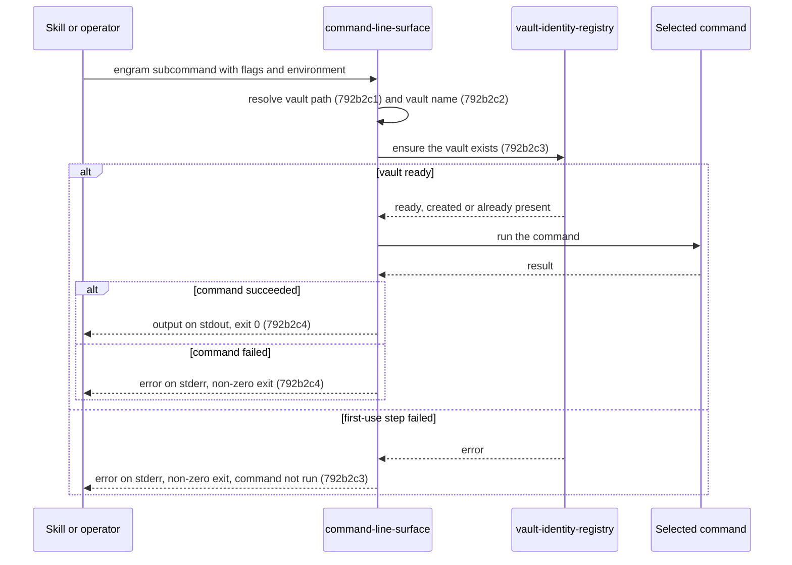
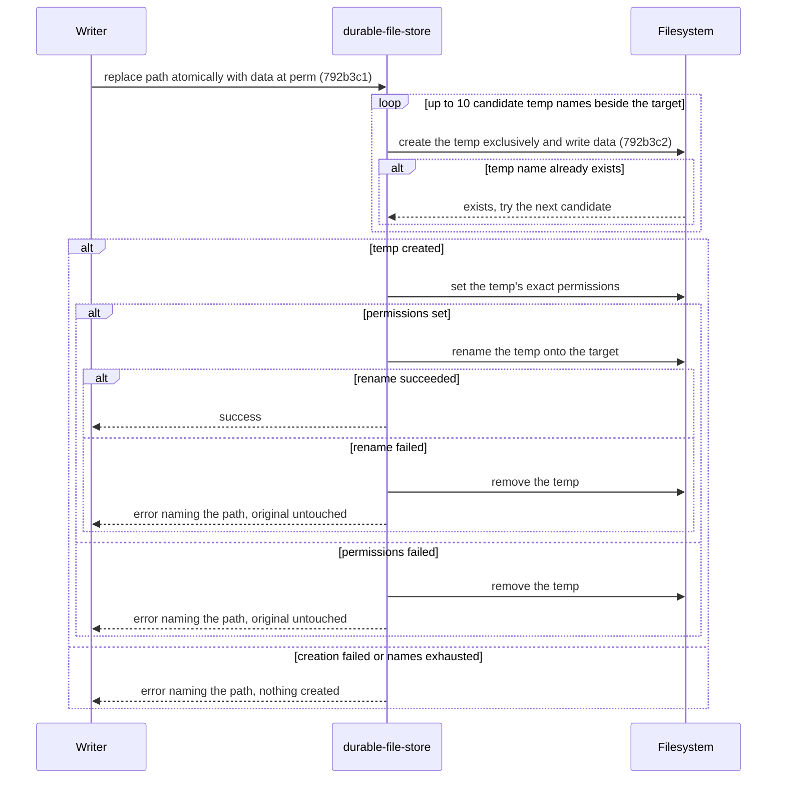
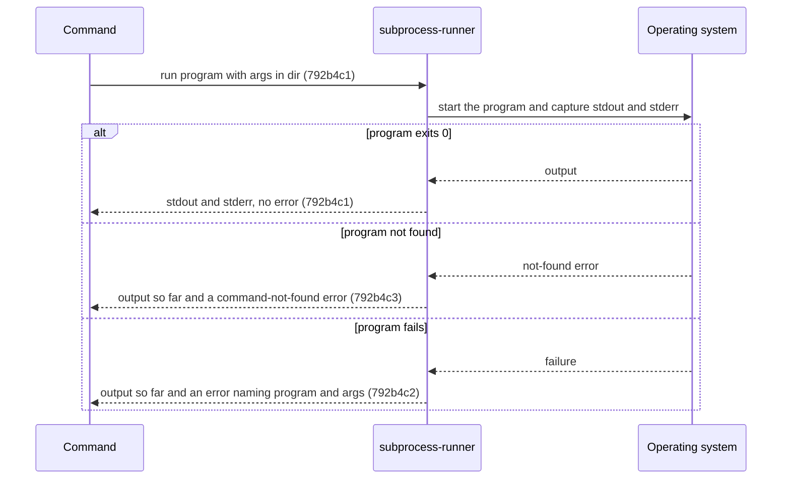

# Documentation Framework Adoption - Technical Spec

## 792b1 Orientation

- **Product problem:** [`792a1`](./792a_product-spec.md#792a1-problem-statement). Engram's shipped
  behavior has no specifications in the framework's format, and its tests can't be traced to any
  specification.
- **Current behavior:** The system already exists and is unchanged by this change. Its technical
  contracts are described only by the legacy C4 views, the ADRs, the invariants document, and the
  technical parts of the OpenSpec specs.
- **Insufficiency:** Those sources do not follow the framework's component qualification, ID, or
  product-traceability rules.
- **Recommended solution:** Document each qualifying component of the existing system as one
  **Added** component section. Map each section to the product scenarios it supports, and rename the
  existing tests that verify its scenarios.

This change describes the existing system and selects no new design. Its technical sections
therefore omit the guide's recommended-impact, relative-option-impact, and alternative-options
sections, because no options are being compared. They also omit component diffs: every component is
retained and documented as Added. Each component section instead uses the per-component structure in
[`792c3`](./792c_implementation-plan.md#792c3-spec-section-templates): orientation, sequences,
behavior requirements with Gherkin, and product-scenario mapping. Rationale appears under the
requirement or orientation it justifies.

Component sections `792b2` through `792b39` are added by the nodes of
[`792c_implementation-plan.md`](./792c_implementation-plan.md).

## 792b2 Added: command-line-surface

Canonical target: `docs/specs/technical/command-line-surface.md` (title `Command Line Surface - Technical Spec`).

### 792b2a Orientation

- Ownership: Repository component (caller), crossing the process argv, environment and stdio
  boundary through the targ library.
- Responsibility: turns one process invocation into one command run. It parses arguments and
  environment into a typed request, resolves the vault path and vault name, runs the first-use vault
  step before every vault-resolving command, routes to the command, and maps the result to the
  output streams and the exit status.
- Commands: `learn` (`fact`, `feedback`, `qa`, `runbook`), `query`, `query-chunks`, `show`,
  `show-chunk`, `amend`, `activate`, `resituate`, `ingest`, `prune`, `count`, `check`, `embed`
  (`apply`, `status`), `vocab` (`bootstrap`, `tag-definitions`, `propose`, `stats`, `refit`),
  `update`, `register-skills`, `serve` and `vault-id`. Every command except `prune`, `query-chunks`
  and `show-chunk` resolves a vault. Each command's behavior is specified by its capability.
- Current realization (informational): `internal/cli/targets.go` (`Targets`, `runInVault`,
  `newErrHandler`), `internal/cli/cli.go`, `resolveVault` in `internal/cli/learn.go`,
  `resolveVaultName` in `internal/cli/identity.go`, `DataDirFromHome` in `internal/cli/targets.go`;
  `cmd/engram/main.go` wires the production primitives.
- Qualification: responsibility, it owns parsing, precedence and routing for every command without
  depending on how any command works; ownership, its routing, gating and exit mapping are distinct
  from each command's own behavior; independent verification, its precedence and gating are tested
  through dispatch with injected environment and filesystem; stability, the surface survives any
  refactoring of command internals; necessity, every product capability is reached through it.
- Supported capabilities: 792a2 vault-identity. Later capabilities add their own routing
  requirements here (792d30, 792d51).

Rationale: each `engram <subcommand>` is its own process. Commands never call each other in
process; a skill reads one command's stdout and runs the next. (An earlier C3 draft drew an
in-process `query`→`learn` edge that does not exist.) Each skill step runs the CLI as a fresh
subprocess, and the skill layer reaches the vault only through it: it reads notes through
`engram show`, `engram show-chunk` and the query payload, and writes through `engram amend` and
`engram learn`, never by editing vault files directly.

### 792b2b Sequences



### 792b2c Behavior Requirements

#### 792b2c1 Vault path resolution

Requirement: 792b2c1 The command-line-surface MUST resolve the vault path to the `--vault` flag
when it is non-empty, else to `ENGRAM_VAULT_PATH` when it is non-empty, else to
`$XDG_DATA_HOME/engram/vault` when `XDG_DATA_HOME` is non-empty, else to
`$HOME/.local/share/engram/vault`, and MUST return that path without checking that it exists.

Supports: 792a2a1a, 792a2a1b, 792a2a1c, 792a2a1d.

##### 792b2c1a Scenarios

```gherkin
Scenario: 792b2c1a1 The flag wins
  Given the --vault flag is /explicit and ENGRAM_VAULT_PATH is /env
  When the vault path is resolved
  Then the path is /explicit

Scenario: 792b2c1a2 The environment is used without a flag
  Given the --vault flag is empty and ENGRAM_VAULT_PATH is /from/env
  When the vault path is resolved
  Then the path is /from/env

Scenario: 792b2c1a3 XDG_DATA_HOME sets the default
  Given no flag, no ENGRAM_VAULT_PATH, and XDG_DATA_HOME is /xdg/data
  When the vault path is resolved
  Then the path is /xdg/data/engram/vault

Scenario: 792b2c1a4 The home directory is the last fallback
  Given no flag, no ENGRAM_VAULT_PATH, no XDG_DATA_HOME, and home /home/u
  When the vault path is resolved
  Then the path is /home/u/.local/share/engram/vault
```

#### 792b2c2 Vault name resolution

Requirement: 792b2c2 The command-line-surface MUST resolve the vault name to the `--vault-name`
flag when it is non-empty, else to `ENGRAM_VAULT_NAME` when it is non-empty, else to `personal`.

Supports: 792a2b1a, 792a2b1b, 792a2b1c.

##### 792b2c2a Scenarios

```gherkin
Scenario: 792b2c2a1 The default is personal
  Given neither --vault-name nor ENGRAM_VAULT_NAME is set
  When the vault name is resolved
  Then the name is personal

Scenario: 792b2c2a2 The environment names the vault
  Given --vault-name is empty and ENGRAM_VAULT_NAME is team
  When the vault name is resolved
  Then the name is team

Scenario: 792b2c2a3 The flag wins
  Given --vault-name is work and ENGRAM_VAULT_NAME is personal-env
  When the vault name is resolved
  Then the name is work
```

#### 792b2c3 First-use gating

Requirement: 792b2c3 For every vault-resolving command, the command-line-surface MUST ask the
vault-identity-registry to ensure the vault at the resolved path before running the command, and
MUST NOT run the command when that step fails.

Supports: 792a2e1a, 792a2e1b, 792a2e1c, 792a2e1d, 792a2f1a, 792a2g1a.

Rationale: one shared first-use step in dispatch, rather than one per command, makes every command
create a missing vault the same way (#766).

##### 792b2c3a Scenarios

```gherkin
Scenario: 792b2c3a1 Every vault-resolving command ensures the vault first
  Given no vault exists at the resolved path
  When any vault-resolving command is dispatched
  Then the vault is created before the command runs, and the command then runs against it

Scenario: 792b2c3a2 A failed first-use step stops the command
  Given the resolved vault path names a regular file
  When a vault-resolving command is dispatched
  Then the error is reported and the command does not run
```

#### 792b2c4 Result reporting

Requirement: 792b2c4 The command-line-surface MUST write a failed command's error to stderr and exit
with a non-zero status, and MUST neither exit nor write to stderr on the command's behalf when the
command succeeds.

Supports: 792a2e1b, 792a2j1c, 792a2n1b, 792a2o1a.

##### 792b2c4a Scenarios

```gherkin
Scenario: 792b2c4a1 A failure is reported and exits non-zero
  Given a command that fails with the error "boom"
  When its result is reported
  Then stderr contains "boom" and the exit status is non-zero

Scenario: 792b2c4a2 A success neither exits nor writes stderr
  Given a command that succeeds
  When its result is reported
  Then nothing is written to stderr and no exit is requested
```

### 792b2d Product-Scenario Mapping

| Product scenario | Technical requirements |
| --- | --- |
| 792a2a1a | 792b2c1 |
| 792a2a1b | 792b2c1 |
| 792a2a1c | 792b2c1 |
| 792a2a1d | 792b2c1 |
| 792a2b1a | 792b2c2 |
| 792a2b1b | 792b2c2 |
| 792a2b1c | 792b2c2 |
| 792a2e1a | 792b2c3 |
| 792a2e1b | 792b2c3, 792b2c4 |
| 792a2e1c | 792b2c3 |
| 792a2e1d | 792b2c3 |
| 792a2f1a | 792b2c3 |
| 792a2g1a | 792b2c3 |
| 792a2j1c | 792b2c4 |
| 792a2n1b | 792b2c4 |
| 792a2o1a | 792b2c4 |

```gherkin
Scenario: 792a2a1a The flag wins over the environment
  Given ENGRAM_VAULT_PATH is set to /env/vault
  When the user runs an engram command with --vault /flag/vault
  Then the command uses /flag/vault

Scenario: 792a2a1b The environment variable is used without a flag
  Given ENGRAM_VAULT_PATH is set to /env/vault
  When the user runs an engram command without --vault
  Then the command uses /env/vault

Scenario: 792a2a1c The XDG data directory is the default
  Given neither --vault nor ENGRAM_VAULT_PATH is set and XDG_DATA_HOME is /data
  When the user runs an engram command
  Then the command uses /data/engram/vault

Scenario: 792a2a1d The home directory is the last fallback
  Given neither --vault, ENGRAM_VAULT_PATH nor XDG_DATA_HOME is set
  When the user runs an engram command
  Then the command uses ~/.local/share/engram/vault

Scenario: 792a2b1a The default vault name is personal
  Given neither --vault-name nor ENGRAM_VAULT_NAME is set
  When the user writes a note with engram learn
  Then the note's vault: field is personal

Scenario: 792a2b1b The environment names the vault
  Given ENGRAM_VAULT_NAME is set to team
  When the user writes a note with engram learn without --vault-name
  Then the note's vault: field is team

Scenario: 792a2b1c The flag wins over the environment
  Given ENGRAM_VAULT_NAME is set to team
  When the user writes a note with engram learn --vault-name org
  Then the note's vault: field is org

Scenario: 792a2e1a A read command creates the vault
  Given no vault exists at the resolved path
  When the user runs engram query --phrase x
  Then an initialized vault exists at that path, stderr carries one line naming it, and the query returns an empty result without error

Scenario: 792a2e1b amend and activate fail only on their own merits
  Given no vault exists at the resolved path
  When the user runs engram amend or engram activate on a target that does not exist
  Then the vault is created first, and the command fails because the target is not found, never on a vault lock error

Scenario: 792a2e1c A child host gets its own vault
  Given a host with ENGRAM_PARENT set and no vault at its resolved local path
  When the user runs engram query for the first time
  Then a local vault is created at the resolved local path, separate from the parent's vault

Scenario: 792a2e1d A second run creates nothing
  Given a vault that an engram command has just created
  When the user runs the same command again
  Then no creation line is printed and the vault ID is unchanged

Scenario: 792a2f1a An existing vault is untouched by read-only use
  Given an existing vault with no vault ID and no parent configured
  When the user runs a read-only command against it
  Then no vault file is created or modified, and no creation line is printed

Scenario: 792a2g1a A half-created vault gets its ID
  Given a vault with a .engram/ directory and no .engram-vault-id
  When the user runs any vault-resolving command
  Then .engram-vault-id is created and stderr carries one line saying the missing vault ID was stamped

Scenario: 792a2j1c vault-id reports the corrupt file
  Given a vault whose .engram-vault-id holds junk
  When the user runs engram vault-id
  Then it fails with an error saying the vault ID is invalid

Scenario: 792a2n1b Claim needs an ID
  Given an existing vault with no vault ID
  When the user runs engram vault-id --claim
  Then it fails with an error saying the vault has no vault ID

Scenario: 792a2o1a Both flags are refused
  Given a vault with a vault ID
  When the user runs engram vault-id --regenerate --claim
  Then it fails naming --regenerate, and the vault ID is unchanged
```

## 792b3 Added: durable-file-store

Canonical target: `docs/specs/technical/durable-file-store.md` (title `Durable File Store - Technical Spec`).

### 792b3a Orientation

- Ownership: Repository-owned dependency-boundary interaction (the operating-system filesystem).
- Responsibility: every engram read and write of vault, sidecar, state and chunk-index files. It
  replaces a file atomically, creates a file exclusively, reports failures with the path and
  operation while keeping the underlying error identity, and lists the Markdown files that make up
  a vault directory.
- Current realization (informational): `primFS` in `internal/cli/edgefs.go` (the `EdgeFS`
  interface in `internal/cli/deps.go`), `vaultFS` in `internal/cli/vault_fs.go`, `listMDFromFS` in
  `internal/cli/deps_compose.go`, over the raw `FSPrims` that `cmd/engram/main.go` supplies.
- Qualification: responsibility, atomic replace, exclusive create and vault listing are stated
  without naming any caller; ownership, callers decide what to write and when, while this
  component decides how a write reaches the disk; independent verification, it is tested directly
  over fake primitives and over the real filesystem; stability, the contract survives any change to
  the injection seam; necessity, every vault-identity, note and index write depends on it.
- Supported capabilities: 792a2 vault-identity.

Rationale: `os.WriteFile` is not atomic. Before ADR-0013, unlocked non-atomic writes let two
concurrent `engram ingest` or `engram amend` runs corrupt state in production. A same-directory
rename is atomic on POSIX, so a reader sees either the old file or the new one, never a partial
write.

### 792b3b Sequences



### 792b3c Behavior Requirements

#### 792b3c1 Atomic replace

Requirement: 792b3c1 The durable-file-store MUST replace a file's content by writing the new data
to a uniquely named temp file in the target's directory, setting the temp's permissions to exactly
the requested mode regardless of umask, and renaming the temp onto the target, so that a concurrent
reader sees either the old or the new content. On any failure after the temp is created it MUST
remove the temp, leave the original unchanged, and return an error naming the target path.

Supports: 792a2h1a, 792a2m1a, 792a2n1a.

Rationale: the unique temp name (target base, clock nanoseconds, attempt counter) is retried a
bounded number of times on a name collision, so two writers of the same file never share a temp.

##### 792b3c1a Scenarios

```gherkin
Scenario: 792b3c1a1 An existing file is replaced and no temp remains
  Given a file with old content
  When it is replaced atomically with new content
  Then the file holds the new content and no temp file remains in its directory

Scenario: 792b3c1a2 A new file is written
  Given no file at the target path
  When it is written atomically
  Then the file exists with the data

Scenario: 792b3c1a3 Permissions do not depend on umask
  Given a restrictive process umask
  When a file is written atomically with mode 0644
  Then the file's mode is exactly 0644

Scenario: 792b3c1a4 A rename failure removes the temp and keeps the original
  Given a file with original content and a rename that fails
  When it is replaced atomically
  Then an error naming the path is returned, the temp is removed, and the original content is unchanged

Scenario: 792b3c1a5 A permission failure removes the temp
  Given a temp file whose permissions cannot be set
  When a file is replaced atomically
  Then an error naming the path is returned and the temp is removed

Scenario: 792b3c1a6 A failed temp creation leaves the original untouched
  Given a target directory where no file can be created
  When a file in it is replaced atomically
  Then an error is returned, nothing is created, and the original content is unchanged

Scenario: 792b3c1a7 A temp-name collision tries a fresh name
  Given the first candidate temp name already exists
  When a file is replaced atomically
  Then the next candidate is used and the write succeeds

Scenario: 792b3c1a8 Exhausted temp names give a bounded error
  Given every candidate temp name already exists
  When a file is replaced atomically
  Then an error saying no unique temp name was available is returned after the bounded attempts
```

#### 792b3c2 Exclusive create

Requirement: 792b3c2 The durable-file-store MUST create a file only when no file exists at the path,
writing the data at the requested mode, and MUST fail with an error that names the path and
satisfies `errors.Is(err, fs.ErrExist)` when one does. When writing the data fails, that error
takes precedence over a close error; when the write succeeds and the close fails, the close error
is returned.

Supports: 792a2h1c.

Rationale: exclusive create is the collision backstop for concurrent creators, such as two
processes stamping the same vault ID or racing for the same Luhmann ID.

##### 792b3c2a Scenarios

```gherkin
Scenario: 792b3c2a1 An existing file is refused
  Given a file already exists at the path
  When the path is created exclusively
  Then the call fails with an error satisfying fs.ErrExist that names the path, and the existing content is unchanged

Scenario: 792b3c2a2 A new file is created with the data and mode
  Given no file exists at the path
  When the path is created exclusively with data and a mode
  Then the file holds the data with that mode

Scenario: 792b3c2a3 A write error wins over a close error
  Given a created file whose write and close both fail
  When the path is created exclusively
  Then the write error is returned

Scenario: 792b3c2a4 A close error surfaces after a good write
  Given a created file whose write succeeds and whose close fails
  When the path is created exclusively
  Then the close error is returned
```

#### 792b3c3 Error identity

Requirement: 792b3c3 The durable-file-store MUST wrap every failed filesystem operation in an error
that names the operation and path and still satisfies `errors.Is` for the underlying error, such as
`fs.ErrNotExist`.

Supports: 792a2e1a, 792a2f1a.

Rationale: callers decide "missing" versus "failed" by `errors.Is`. First-use creation, for
example, creates a vault only when the path is missing.

##### 792b3c3a Scenarios

```gherkin
Scenario: 792b3c3a1 A missing file still reads as not-exist
  Given no file at the path
  When the file is read
  Then the error names the path and satisfies fs.ErrNotExist

Scenario: 792b3c3a2 Every operation adds its context
  Given a filesystem whose every primitive fails
  When each operation is called
  Then each error names its operation and path and wraps the primitive's error
```

#### 792b3c4 Vault Markdown listing

Requirement: 792b3c4 The durable-file-store MUST list a vault directory as the names of the `.md`
files directly inside it, leaving out subdirectories, other files and the untouched starter
`README.md`, MUST return an empty list when the directory does not exist, and MUST return any other
read error.

Supports: 792a2c1a, 792a2d1a, 792a2d1b.

Rationale: this listing is the one shared point where every vault scanner (query, check, embed,
count) stops seeing subdirectories and the starter README.

##### 792b3c4a Scenarios

```gherkin
Scenario: 792b3c4a1 Only root Markdown files are listed
  Given a directory with note.md, readme.txt and a subdirectory
  When the vault directory is listed
  Then the list is exactly note.md

Scenario: 792b3c4a2 A missing directory lists as empty
  Given a directory path that does not exist, even behind a wrapped not-exist error
  When the vault directory is listed
  Then the list is empty and no error is returned

Scenario: 792b3c4a3 Other read errors are returned
  Given a path that names a regular file
  When it is listed as a vault directory
  Then an error is returned

Scenario: 792b3c4a4 The starter README is left out
  Given a directory holding the untouched starter README.md and one note
  When the vault directory is listed
  Then the list holds only the note, and an edited README.md would be listed
```

### 792b3d Product-Scenario Mapping

| Product scenario | Technical requirements |
| --- | --- |
| 792a2c1a | 792b3c4 |
| 792a2d1a | 792b3c4 |
| 792a2d1b | 792b3c4 |
| 792a2e1a | 792b3c3 |
| 792a2f1a | 792b3c3 |
| 792a2h1a | 792b3c1 |
| 792a2h1c | 792b3c2 |
| 792a2m1a | 792b3c1 |
| 792a2n1a | 792b3c1 |

```gherkin
Scenario: 792a2c1a A Markdown file in a subdirectory is not a note
  Given a vault with one note at its root and one Markdown file in a subdirectory
  When the user runs engram embed status on the vault
  Then it reports a total of 1 note

Scenario: 792a2d1a A fresh vault has no notes
  Given a vault that engram has just created
  When the user runs engram embed status and engram check on it
  Then embed status reports a total of 0 notes and check reports no note missing a sidecar

Scenario: 792a2d1b A user's README is a note
  Given a vault whose README.md the user has replaced with their own text
  When the user runs engram embed status and engram check on it
  Then embed status reports a total of 1 note and check reports 1 note missing a sidecar

Scenario: 792a2h1a serve stamps an existing vault
  Given an existing vault that has no .engram-vault-id
  When engram serve starts on it
  Then the file is created with a new ID, and later starts reuse it unchanged

Scenario: 792a2h1c Concurrent creation converges
  Given an existing vault that has no .engram-vault-id
  When two processes create the ID for it at the same moment
  Then exactly one file is written, and both processes use its ID

Scenario: 792a2m1a Regenerate gives a copy its own identity
  Given a copied vault
  When the user runs engram vault-id --regenerate in it
  Then its ID differs from the original's, exchange resumes, and no note file changed

Scenario: 792a2n1a Claim accepts a moved vault
  Given a vault that was moved to a new path
  When the user runs engram vault-id --claim
  Then the ID is unchanged, engram vault-id then reports location: ok, and exchange resumes
```

## 792b4 Added: subprocess-runner

Canonical target: `docs/specs/technical/subprocess-runner.md` (title `Subprocess Runner - Technical Spec`).

### 792b4a Orientation

- Ownership: Repository-owned dependency-boundary interaction (operating-system processes).
- Responsibility: runs an external program, such as `git` or `go`, in a chosen directory and hands
  back what it printed, or reports why it failed, telling "program not installed" apart from other
  failures.
- Current realization (informational): `primCommander` in `internal/cli/commander.go` (the
  `update.Commander` interface), over the raw `ExecPrims` that `cmd/engram/main.go` supplies.
  `primSpawner` in `internal/cli/spawner.go` runs a child with inherited stdio; its requirements are
  added by install-and-update (792c7j1, 792d51).
- Qualification: responsibility, running a program and collecting its output is stated without
  naming any caller; ownership, callers choose the program and interpret its output, while this
  component owns collection, error context and not-found translation; independent verification, it
  is tested directly over a fake run primitive and over real processes; stability, the contract
  survives any change to the injection seam; necessity, the uncommitted vault-ID notice depends on
  running `git`.
- Supported capabilities: 792a2 vault-identity.

No legacy document describes this component. It is derived from its realization and tests.

### 792b4b Sequences



### 792b4c Behavior Requirements

#### 792b4c1 Run and collect output

Requirement: 792b4c1 The subprocess-runner MUST run the named program with the given arguments in
the given directory, or in the process's working directory when none is given, and MUST return
everything the program wrote to stdout and stderr with no error when it exits successfully.

Supports: 792a2i1a, 792a2i1b, 792a2i1c.

##### 792b4c1a Scenarios

```gherkin
Scenario: 792b4c1a1 Output is collected on success
  Given a program that writes to stdout and stderr and exits 0
  When it is run
  Then its stdout and stderr are returned and there is no error

Scenario: 792b4c1a2 The program runs in the given directory
  Given a directory
  When pwd -P is run in it
  Then the output is that directory's resolved path, and the program, arguments and directory reach the run primitive unchanged
```

#### 792b4c2 Failure reporting

Requirement: 792b4c2 When the program cannot run or exits unsuccessfully, the subprocess-runner MUST
return an error that names the program and its arguments and wraps the underlying failure, along
with whatever output was captured.

Supports: 792a2i1d.

##### 792b4c2a Scenarios

```gherkin
Scenario: 792b4c2a1 A failing program is reported with its output
  Given a program that writes output and then fails
  When it is run
  Then an error naming the program and arguments is returned, and the captured output is kept
```

#### 792b4c3 Not-found translation

Requirement: 792b4c3 When the failure is the platform's "program not found" error, the
subprocess-runner MUST also make the error satisfy `errors.Is(err, update.ErrCommandNotFound)`, and
it MUST NOT do so for any other failure, including when no platform not-found error is configured.

Supports: 792a2i1d.

Rationale: callers such as the self-installer report a missing `git` or `go` differently from a
failed one, without knowing the platform's error value.

##### 792b4c3a Scenarios

```gherkin
Scenario: 792b4c3a1 A missing program is reported as not found
  Given no program by the given name is installed
  When it is run
  Then the error satisfies errors.Is for the command-not-found error and still wraps the platform error

Scenario: 792b4c3a2 Without a configured not-found error nothing is translated
  Given no platform not-found error is configured and the program fails to start
  When it is run
  Then the error wraps the failure and does not satisfy errors.Is for the command-not-found error
```

### 792b4d Product-Scenario Mapping

| Product scenario | Technical requirements |
| --- | --- |
| 792a2i1a | 792b4c1 |
| 792a2i1b | 792b4c1 |
| 792a2i1c | 792b4c1 |
| 792a2i1d | 792b4c2, 792b4c3 |

```gherkin
Scenario: 792a2i1a Uncommitted ID is flagged
  Given a git-backed vault whose .engram-vault-id is untracked
  When the user runs engram update
  Then its report includes a notice asking for a one-time vault commit

Scenario: 792a2i1b An ignored ID is flagged
  Given a git-backed vault whose .engram-vault-id is ignored by its .gitignore
  When the user runs engram update
  Then its report includes the commit notice

Scenario: 792a2i1c A committed ID is not flagged
  Given a git-backed vault whose .engram-vault-id is committed and unmodified
  When the user runs engram update
  Then its report includes no commit notice

Scenario: 792a2i1d A vault outside git is not flagged
  Given a vault that is not a git work tree and has a .engram-vault-id
  When the user runs engram update
  Then its report includes no commit notice
```
