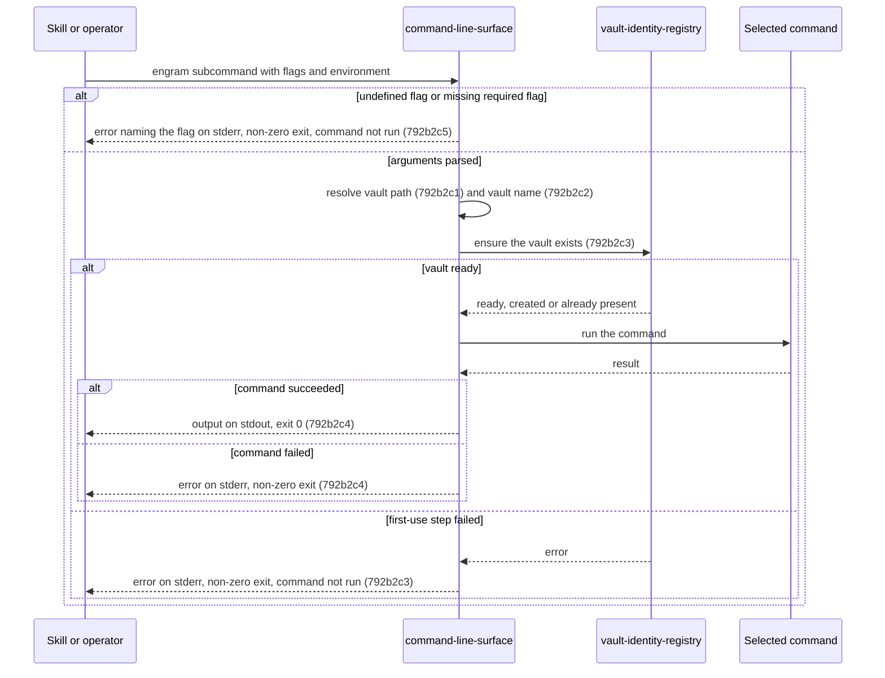
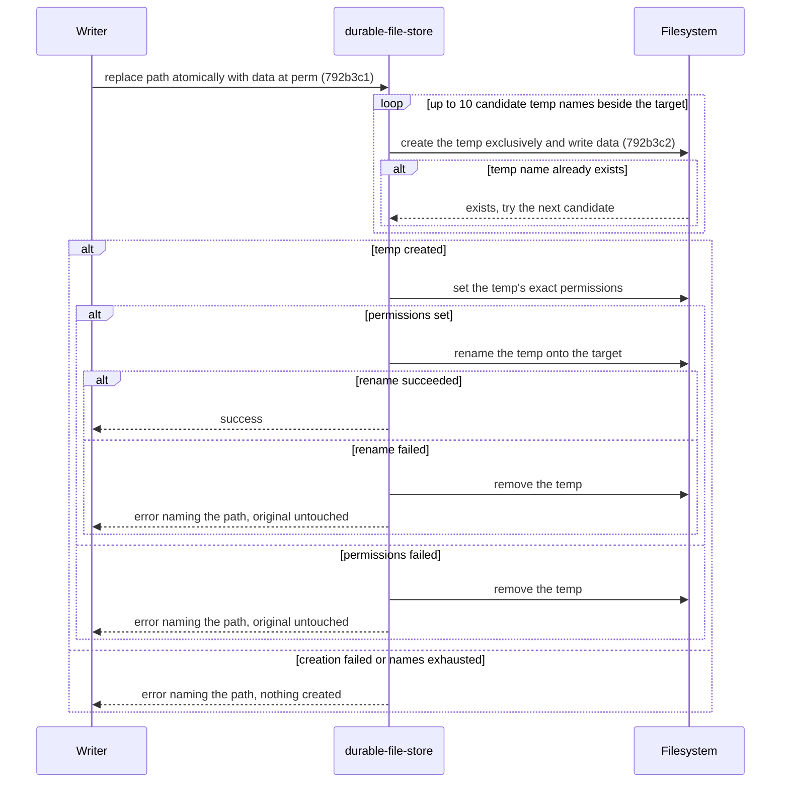
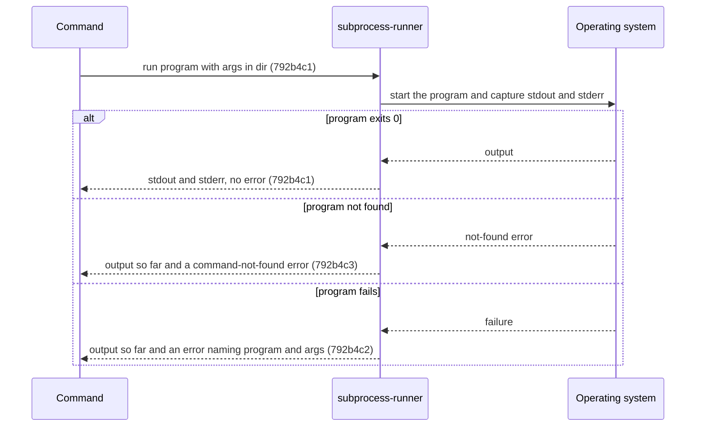
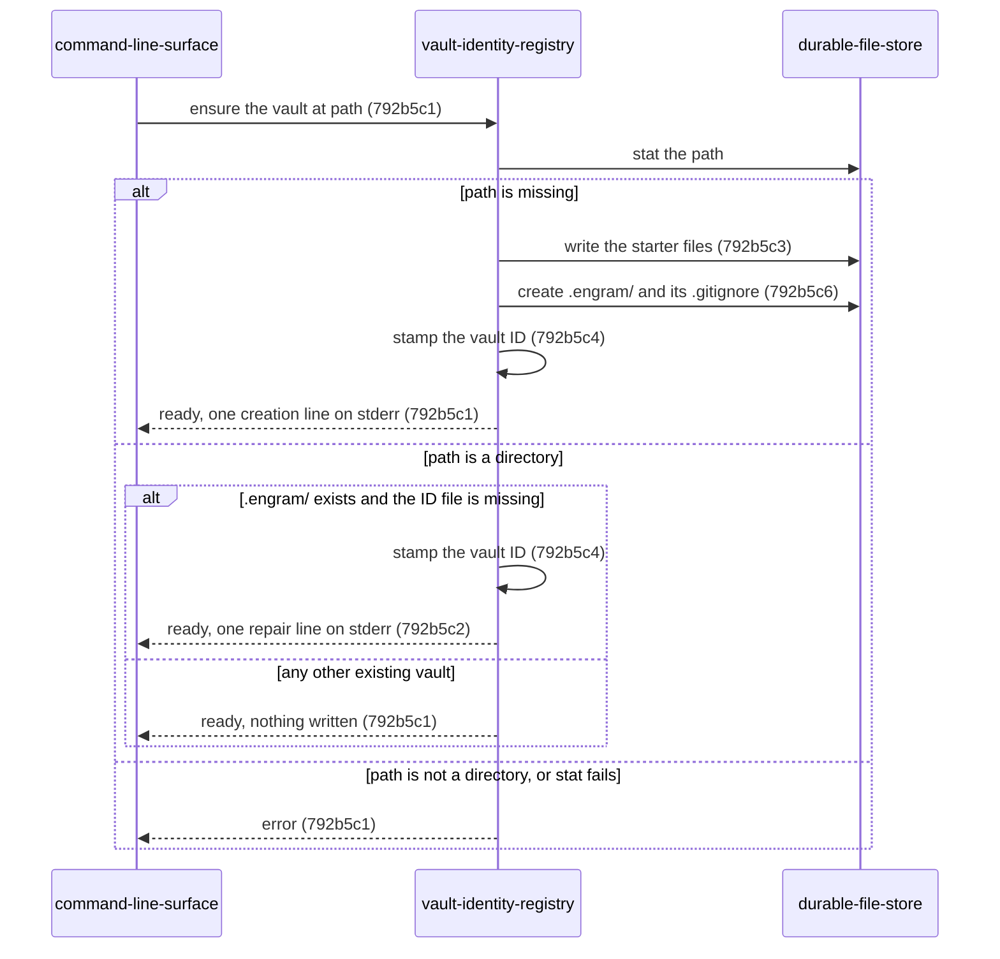
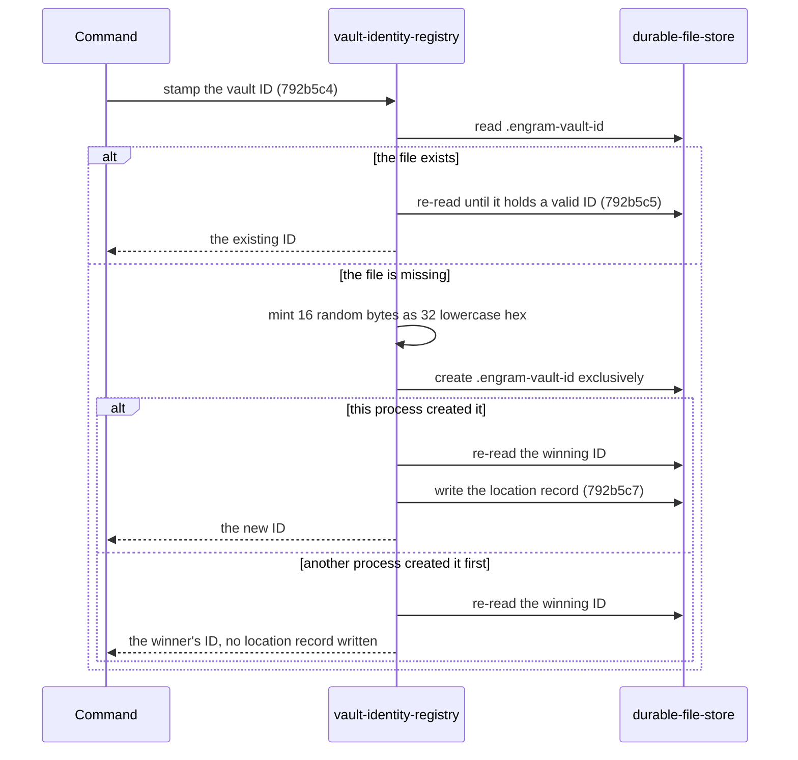
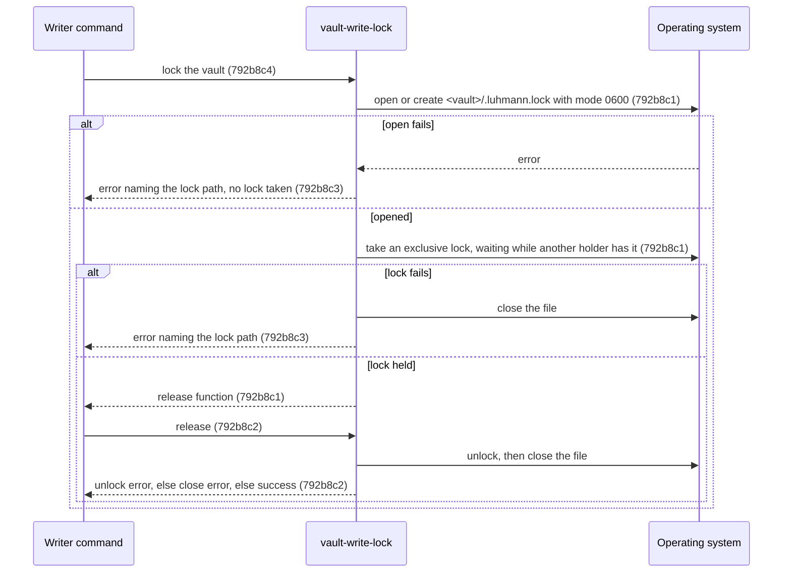
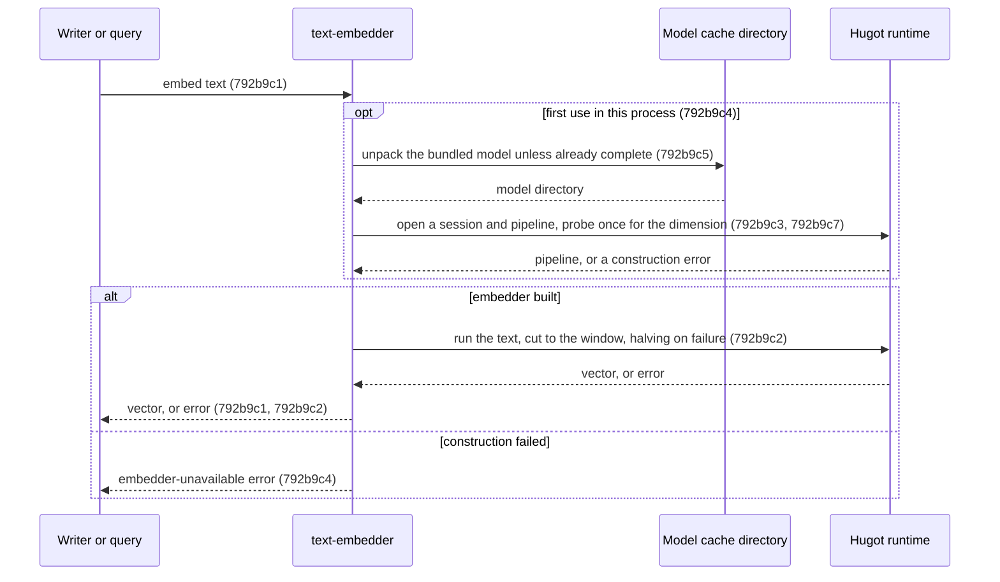

# Documentation Framework Adoption - Technical Spec

## 792b1 Orientation

- **Product problem:** [`792a1`](./792a_product-spec.md#792a1-problem-statement). Engram's shipped
  behavior has no specifications in the framework's format, and its tests can't be traced to any
  specification.
- **Current behavior:** The system already exists and is unchanged by this change. Its technical
  contracts are described only by the legacy C4 views, the ADRs, the invariants document, and the
  technical parts of the OpenSpec specs.
- **Insufficiency:** Those sources do not follow the framework's component qualification, ID, or
  product-traceability rules.
- **Recommended solution:** Document each qualifying component of the existing system as one
  **Added** component section. Map each section to the product scenarios it supports, and rename the
  existing tests that verify its scenarios.

This change describes the existing system and selects no new design. Its technical sections
therefore omit the guide's recommended-impact, relative-option-impact, and alternative-options
sections, because no options are being compared. They also omit component diffs: every component is
retained and documented as Added. Each component section instead uses the per-component structure in
[`792c3`](./792c_implementation-plan.md#792c3-spec-section-templates): orientation, sequences,
behavior requirements with Gherkin, and product-scenario mapping. Rationale appears under the
requirement or orientation it justifies.

Component sections `792b2` through `792b39` are added by the nodes of
[`792c_implementation-plan.md`](./792c_implementation-plan.md).

## 792b2 Added: command-line-surface

Canonical target: `docs/specs/technical/command-line-surface.md` (title `Command Line Surface - Technical Spec`).

### 792b2a Orientation

- Ownership: Repository component (caller), crossing the process argv, environment and stdio
  boundary through the targ library.
- Responsibility: turns one process invocation into one command run. It parses arguments and
  environment into a typed request, resolves the vault path and vault name, runs the first-use vault
  step before every vault-resolving command, routes to the command, and maps the result to the
  output streams and the exit status.
- Commands: `learn` (`fact`, `feedback`, `qa`, `runbook`), `query`, `query-chunks`, `show`,
  `show-chunk`, `amend`, `activate`, `resituate`, `ingest`, `prune`, `count`, `check`, `embed`
  (`apply`, `status`), `vocab` (`bootstrap`, `tag-definitions`, `propose`, `stats`, `refit`),
  `update`, `register-skills`, `serve` and `vault-id`. Every command except `prune`, `query-chunks`
  and `show-chunk` resolves a vault. Each command's behavior is specified by its capability.
- Current realization (informational): `internal/cli/targets.go` (`Targets`, `runInVault`,
  `newErrHandler`), `internal/cli/cli.go`, `resolveVault` in `internal/cli/learn.go`,
  `resolveVaultName` in `internal/cli/identity.go`, `DataDirFromHome` in `internal/cli/targets.go`;
  `cmd/engram/main.go` wires the production primitives.
- Qualification: responsibility, it owns parsing, precedence and routing for every command without
  depending on how any command works; ownership, its routing, gating and exit mapping are distinct
  from each command's own behavior; independent verification, its precedence and gating are tested
  through dispatch with injected environment and filesystem; stability, the surface survives any
  refactoring of command internals; necessity, every product capability is reached through it.
- Supported capabilities: 792a2 vault-identity, 792a3 note-writing. Later capabilities add their own routing
  requirements here (792d30, 792d51).

Rationale: each `engram <subcommand>` is its own process. Commands never call each other in
process; a skill reads one command's stdout and runs the next. (An earlier C3 draft drew an
in-process `query`→`learn` edge that does not exist.) Each skill step runs the CLI as a fresh
subprocess, and the skill layer reaches the vault only through it: it reads notes through
`engram show`, `engram show-chunk` and the query payload, and writes through `engram amend` and
`engram learn`, never by editing vault files directly.

### 792b2b Sequences



### 792b2c Behavior Requirements

#### 792b2c1 Vault path resolution

Requirement: 792b2c1 The command-line-surface MUST resolve the vault path to the `--vault` flag
when it is non-empty, else to `ENGRAM_VAULT_PATH` when it is non-empty, else to
`$XDG_DATA_HOME/engram/vault` when `XDG_DATA_HOME` is non-empty, else to
`$HOME/.local/share/engram/vault`, and MUST return that path without checking that it exists.

Supports: 792a2a1a, 792a2a1b, 792a2a1c, 792a2a1d.

##### 792b2c1a Scenarios

```gherkin
Scenario: 792b2c1a1 The flag wins
  Given the --vault flag is /explicit and ENGRAM_VAULT_PATH is /env
  When the vault path is resolved
  Then the path is /explicit

Scenario: 792b2c1a2 The environment is used without a flag
  Given the --vault flag is empty and ENGRAM_VAULT_PATH is /from/env
  When the vault path is resolved
  Then the path is /from/env

Scenario: 792b2c1a3 XDG_DATA_HOME sets the default
  Given no flag, no ENGRAM_VAULT_PATH, and XDG_DATA_HOME is /xdg/data
  When the vault path is resolved
  Then the path is /xdg/data/engram/vault

Scenario: 792b2c1a4 The home directory is the last fallback
  Given no flag, no ENGRAM_VAULT_PATH, no XDG_DATA_HOME, and home /home/u
  When the vault path is resolved
  Then the path is /home/u/.local/share/engram/vault
```

#### 792b2c2 Vault name resolution

Requirement: 792b2c2 The command-line-surface MUST resolve the vault name to the `--vault-name`
flag when it is non-empty, else to `ENGRAM_VAULT_NAME` when it is non-empty, else to `personal`.

Supports: 792a2b1a, 792a2b1b, 792a2b1c.

##### 792b2c2a Scenarios

```gherkin
Scenario: 792b2c2a1 The default is personal
  Given neither --vault-name nor ENGRAM_VAULT_NAME is set
  When the vault name is resolved
  Then the name is personal

Scenario: 792b2c2a2 The environment names the vault
  Given --vault-name is empty and ENGRAM_VAULT_NAME is team
  When the vault name is resolved
  Then the name is team

Scenario: 792b2c2a3 The flag wins
  Given --vault-name is work and ENGRAM_VAULT_NAME is personal-env
  When the vault name is resolved
  Then the name is work
```

#### 792b2c3 First-use gating

Requirement: 792b2c3 For every vault-resolving command, the command-line-surface MUST ask the
vault-identity-registry to ensure the vault at the resolved path before running the command, and
MUST NOT run the command when that step fails.

Supports: 792a2e1a, 792a2e1b, 792a2e1c, 792a2e1d, 792a2f1a, 792a2g1a.

Rationale: one shared first-use step in dispatch, rather than one per command, makes every command
create a missing vault the same way (#766).

##### 792b2c3a Scenarios

```gherkin
Scenario: 792b2c3a1 Every vault-resolving command ensures the vault first
  Given no vault exists at the resolved path
  When any vault-resolving command is dispatched
  Then the vault is created before the command runs, and the command then runs against it

Scenario: 792b2c3a2 A failed first-use step stops the command
  Given the resolved vault path names a regular file
  When a vault-resolving command is dispatched
  Then the error is reported and the command does not run
```

#### 792b2c4 Result reporting

Requirement: 792b2c4 The command-line-surface MUST write a failed command's error to stderr and exit
with a non-zero status, and MUST neither exit nor write to stderr on the command's behalf when the
command succeeds.

Supports: 792a2e1b, 792a2j1c, 792a2n1b, 792a2o1a, 792a3f1b, 792a3g1a, 792a3k1a, 792a3k1b, 792a3k1c,
792a3k1d, 792a3r1a, 792a3s1a.

##### 792b2c4a Scenarios

```gherkin
Scenario: 792b2c4a1 A failure is reported and exits non-zero
  Given a command that fails with the error "boom"
  When its result is reported
  Then stderr contains "boom" and the exit status is non-zero

Scenario: 792b2c4a2 A success neither exits nor writes stderr
  Given a command that succeeds
  When its result is reported
  Then nothing is written to stderr and no exit is requested
```

#### 792b2c5 Argument refusal

Requirement: 792b2c5 The command-line-surface MUST refuse an invocation that passes a flag the
command does not define, or omits a flag the command marks required, by writing an error naming the
flag to stderr and exiting non-zero without running the command.

Supports: 792a3e1a, 792a3f1a, 792a3f1c, 792a3g1a, 792a3r1a.

##### 792b2c5a Scenarios

```gherkin
Scenario: 792b2c5a1 An undefined flag is refused
  Given a command that defines no --skill-hash flag
  When it is dispatched with --skill-hash
  Then the exit status is non-zero and the command does not run

Scenario: 792b2c5a2 A missing required flag is refused
  Given a command that marks --done-when required
  When it is dispatched without --done-when
  Then stderr names --done-when, the exit status is non-zero, and the command does not run
```

### 792b2d Product-Scenario Mapping

| Product scenario | Technical requirements |
| --- | --- |
| 792a2a1a | 792b2c1 |
| 792a2a1b | 792b2c1 |
| 792a2a1c | 792b2c1 |
| 792a2a1d | 792b2c1 |
| 792a2b1a | 792b2c2 |
| 792a2b1b | 792b2c2 |
| 792a2b1c | 792b2c2 |
| 792a2e1a | 792b2c3 |
| 792a2e1b | 792b2c3, 792b2c4 |
| 792a2e1c | 792b2c3 |
| 792a2e1d | 792b2c3 |
| 792a2f1a | 792b2c3 |
| 792a2g1a | 792b2c3 |
| 792a2j1c | 792b2c4 |
| 792a2n1b | 792b2c4 |
| 792a2o1a | 792b2c4 |
| 792a3e1a | 792b2c5 |
| 792a3f1a | 792b2c5 |
| 792a3f1b | 792b2c4 |
| 792a3f1c | 792b2c5 |
| 792a3g1a | 792b2c4, 792b2c5 |
| 792a3k1a | 792b2c4 |
| 792a3k1b | 792b2c4 |
| 792a3k1c | 792b2c4 |
| 792a3k1d | 792b2c4 |
| 792a3r1a | 792b2c4, 792b2c5 |
| 792a3s1a | 792b2c4 |

```gherkin
Scenario: 792a2a1a The flag wins over the environment
  Given ENGRAM_VAULT_PATH is set to /env/vault
  When the user runs an engram command with --vault /flag/vault
  Then the command uses /flag/vault

Scenario: 792a2a1b The environment variable is used without a flag
  Given ENGRAM_VAULT_PATH is set to /env/vault
  When the user runs an engram command without --vault
  Then the command uses /env/vault

Scenario: 792a2a1c The XDG data directory is the default
  Given neither --vault nor ENGRAM_VAULT_PATH is set and XDG_DATA_HOME is /data
  When the user runs an engram command
  Then the command uses /data/engram/vault

Scenario: 792a2a1d The home directory is the last fallback
  Given neither --vault, ENGRAM_VAULT_PATH nor XDG_DATA_HOME is set
  When the user runs an engram command
  Then the command uses ~/.local/share/engram/vault

Scenario: 792a2b1a The default vault name is personal
  Given neither --vault-name nor ENGRAM_VAULT_NAME is set
  When the user writes a note with engram learn
  Then the note's vault: field is personal

Scenario: 792a2b1b The environment names the vault
  Given ENGRAM_VAULT_NAME is set to team
  When the user writes a note with engram learn without --vault-name
  Then the note's vault: field is team

Scenario: 792a2b1c The flag wins over the environment
  Given ENGRAM_VAULT_NAME is set to team
  When the user writes a note with engram learn --vault-name org
  Then the note's vault: field is org

Scenario: 792a2e1a A read command creates the vault
  Given no vault exists at the resolved path
  When the user runs engram query --phrase x
  Then an initialized vault exists at that path, stderr carries one line naming it, and the query returns an empty result without error

Scenario: 792a2e1b amend and activate fail only on their own merits
  Given no vault exists at the resolved path
  When the user runs engram amend or engram activate on a target that does not exist
  Then the vault is created first, and the command fails because the target is not found, never on a vault lock error

Scenario: 792a2e1c A child host gets its own vault
  Given a host with ENGRAM_PARENT set and no vault at its resolved local path
  When the user runs engram query for the first time
  Then a local vault is created at the resolved local path, separate from the parent's vault

Scenario: 792a2e1d A second run creates nothing
  Given a vault that an engram command has just created
  When the user runs the same command again
  Then no creation line is printed and the vault ID is unchanged

Scenario: 792a2f1a An existing vault is untouched by read-only use
  Given an existing vault with no vault ID and no parent configured
  When the user runs a read-only command against it
  Then no vault file is created or modified, and no creation line is printed

Scenario: 792a2g1a A half-created vault gets its ID
  Given a vault with a .engram/ directory and no .engram-vault-id
  When the user runs any vault-resolving command
  Then .engram-vault-id is created and stderr carries one line saying the missing vault ID was stamped

Scenario: 792a2j1c vault-id reports the corrupt file
  Given a vault whose .engram-vault-id holds junk
  When the user runs engram vault-id
  Then it fails with an error saying the vault ID is invalid

Scenario: 792a2n1b Claim needs an ID
  Given an existing vault with no vault ID
  When the user runs engram vault-id --claim
  Then it fails with an error saying the vault has no vault ID

Scenario: 792a2o1a Both flags are refused
  Given a vault with a vault ID
  When the user runs engram vault-id --regenerate --claim
  Then it fails naming --regenerate, and the vault ID is unchanged
```

```gherkin
Scenario: 792a3e1a A task type is refused
  Given an existing vault
  When the user runs engram learn runbook with --task-type foo
  Then it fails naming --task-type as an undefined flag, and no note is written

Scenario: 792a3f1a A missing situation is refused
  Given an existing vault
  When the user runs engram learn fact without --situation
  Then it fails naming --situation, and no note is written

Scenario: 792a3f1b A blank situation is refused
  Given an existing vault
  When the user runs engram learn feedback with --situation "  "
  Then it fails saying --situation is required, and no note is written

Scenario: 792a3f1c A runbook without done-when is refused
  Given an existing vault
  When the user runs engram learn runbook without --done-when
  Then it fails naming --done-when, and no note is written

Scenario Outline: 792a3g1a An invalid argument is refused before any write
  Given an existing vault
  When the user runs engram learn <kind> with <argument>
  Then it fails with an error saying <problem>, and no note is written

  Examples:
    | kind    | argument               | problem                                         |
    | fact    | no --source            | --source is a missing required flag             |
    | fact    | no --slug              | slug is required                                |
    | fact    | --slug X_y             | slug must match [a-z0-9-]+                      |
    | fact    | --project A            | project slug must match [a-z0-9-]+              |
    | fact    | --issue "a b"          | issue must be non-empty with no whitespace      |
    | fact    | --tag "A B"            | tag must be <family> or <family>/<value>        |
    | runbook | --trigger ab           | trigger must be at least 3 characters           |
    | fact    | --tier L9              | tier must be L2, or L1 or L3                    |
    | fact    | --supersedes "a\|bogus\|c" | supersedes type must be updates, narrows or refutes |

Scenario: 792a3k1a A missing position is refused
  Given an existing vault
  When the user runs engram learn fact without --position
  Then it fails saying the position must be top, continuation or sibling, and no note is written

Scenario: 792a3k1b A continuation without a target is refused
  Given an existing vault
  When the user runs engram learn fact --position continuation without --target
  Then it fails saying a target is required, and no note is written

Scenario: 792a3k1c A sibling of a top-level note is refused
  Given a vault whose note has ID 1
  When the user runs engram learn fact --position sibling --target 1
  Then it fails saying a sibling of a top-level note requires --position top, and no note is written

Scenario: 792a3k1d A malformed target is refused
  Given an existing vault
  When the user runs engram learn fact --position continuation --target abc
  Then it fails saying the ID must start with a digit, and no note is written

Scenario Outline: 792a3r1a An invalid pair is refused before any write
  Given an existing vault
  When the user runs engram learn qa with <argument>
  Then it fails with an error saying <problem>, and neither note is written

  Examples:
    | argument                       | problem                                      |
    | no --question                  | --question is required                       |
    | both --answer and --answer-file | exactly one of --answer or --answer-file is required |
    | neither --answer nor --answer-file | exactly one of --answer or --answer-file is required |
    | --certainty huge               | certainty must be high, medium, or low       |
    | --contributors nope            | contributor not found in vault               |
    | --slug X_y                     | slug must match [a-z0-9-]+                   |
    | no --source                    | --source is a missing required flag          |

Scenario: 792a3s1a A failed answer removes the question
  Given a vault that already holds a file named like today's answer note for slug why-x
  When the user runs engram learn qa --slug why-x
  Then it fails saying the answer note could not be written, and no question note for why-x remains
```

## 792b3 Added: durable-file-store

Canonical target: `docs/specs/technical/durable-file-store.md` (title `Durable File Store - Technical Spec`).

### 792b3a Orientation

- Ownership: Repository-owned dependency-boundary interaction (the operating-system filesystem).
- Responsibility: every engram read and write of vault, sidecar, state and chunk-index files. It
  replaces a file atomically, creates a file exclusively, reports failures with the path and
  operation while keeping the underlying error identity, and lists the Markdown files that make up
  a vault directory.
- Current realization (informational): `primFS` in `internal/cli/edgefs.go` (the `EdgeFS`
  interface in `internal/cli/deps.go`), `vaultFS` in `internal/cli/vault_fs.go`, `listMDFromFS` in
  `internal/cli/deps_compose.go`, over the raw `FSPrims` that `cmd/engram/main.go` supplies.
- Qualification: responsibility, atomic replace, exclusive create and vault listing are stated
  without naming any caller; ownership, callers decide what to write and when, while this
  component decides how a write reaches the disk; independent verification, it is tested directly
  over fake primitives and over the real filesystem; stability, the contract survives any change to
  the injection seam; necessity, every vault-identity, note and index write depends on it.
- Supported capabilities: 792a2 vault-identity, 792a3 note-writing.

Rationale: `os.WriteFile` is not atomic. Before ADR-0013, unlocked non-atomic writes let two
concurrent `engram ingest` or `engram amend` runs corrupt state in production. A same-directory
rename is atomic on POSIX, so a reader sees either the old file or the new one, never a partial
write.

### 792b3b Sequences



### 792b3c Behavior Requirements

#### 792b3c1 Atomic replace

Requirement: 792b3c1 The durable-file-store MUST replace a file's content by writing the new data
to a uniquely named temp file in the target's directory, setting the temp's permissions to exactly
the requested mode regardless of umask, and renaming the temp onto the target, so that a concurrent
reader sees either the old or the new content. On any failure after the temp is created it MUST
remove the temp, leave the original unchanged, and return an error naming the target path.

Supports: 792a2h1a, 792a2m1a, 792a2n1a, 792a3n1a, 792a3u1a, 792a3u1b.

Rationale: the unique temp name (target base, clock nanoseconds, attempt counter) is retried a
bounded number of times on a name collision, so two writers of the same file never share a temp.

##### 792b3c1a Scenarios

```gherkin
Scenario: 792b3c1a1 An existing file is replaced and no temp remains
  Given a file with old content
  When it is replaced atomically with new content
  Then the file holds the new content and no temp file remains in its directory

Scenario: 792b3c1a2 A new file is written
  Given no file at the target path
  When it is written atomically
  Then the file exists with the data

Scenario: 792b3c1a3 Permissions do not depend on umask
  Given a restrictive process umask
  When a file is written atomically with mode 0644
  Then the file's mode is exactly 0644

Scenario: 792b3c1a4 A rename failure removes the temp and keeps the original
  Given a file with original content and a rename that fails
  When it is replaced atomically
  Then an error naming the path is returned, the temp is removed, and the original content is unchanged

Scenario: 792b3c1a5 A permission failure removes the temp
  Given a temp file whose permissions cannot be set
  When a file is replaced atomically
  Then an error naming the path is returned and the temp is removed

Scenario: 792b3c1a6 A failed temp creation leaves the original untouched
  Given a target directory where no file can be created
  When a file in it is replaced atomically
  Then an error is returned, nothing is created, and the original content is unchanged

Scenario: 792b3c1a7 A temp-name collision tries a fresh name
  Given the first candidate temp name already exists
  When a file is replaced atomically
  Then the next candidate is used and the write succeeds

Scenario: 792b3c1a8 Exhausted temp names give a bounded error
  Given every candidate temp name already exists
  When a file is replaced atomically
  Then an error saying no unique temp name was available is returned after the bounded attempts
```

#### 792b3c2 Exclusive create

Requirement: 792b3c2 The durable-file-store MUST create a file only when no file exists at the path,
writing the data at the requested mode, and MUST fail with an error that names the path and
satisfies `errors.Is(err, fs.ErrExist)` when one does. When writing the data fails, that error
takes precedence over a close error; when the write succeeds and the close fails, the close error
is returned.

Supports: 792a2h1c, 792a3a1a, 792a3b1a, 792a3c1a, 792a3m1a, 792a3q1a, 792a3s1a.

Rationale: exclusive create is the collision backstop for concurrent creators, such as two
processes stamping the same vault ID or racing for the same Luhmann ID.

##### 792b3c2a Scenarios

```gherkin
Scenario: 792b3c2a1 An existing file is refused
  Given a file already exists at the path
  When the path is created exclusively
  Then the call fails with an error satisfying fs.ErrExist that names the path, and the existing content is unchanged

Scenario: 792b3c2a2 A new file is created with the data and mode
  Given no file exists at the path
  When the path is created exclusively with data and a mode
  Then the file holds the data with that mode

Scenario: 792b3c2a3 A write error wins over a close error
  Given a created file whose write and close both fail
  When the path is created exclusively
  Then the write error is returned

Scenario: 792b3c2a4 A close error surfaces after a good write
  Given a created file whose write succeeds and whose close fails
  When the path is created exclusively
  Then the close error is returned
```

#### 792b3c3 Error identity

Requirement: 792b3c3 The durable-file-store MUST wrap every failed filesystem operation in an error
that names the operation and path and still satisfies `errors.Is` for the underlying error, such as
`fs.ErrNotExist`.

Supports: 792a2e1a, 792a2f1a.

Rationale: callers decide "missing" versus "failed" by `errors.Is`. First-use creation, for
example, creates a vault only when the path is missing.

##### 792b3c3a Scenarios

```gherkin
Scenario: 792b3c3a1 A missing file still reads as not-exist
  Given no file at the path
  When the file is read
  Then the error names the path and satisfies fs.ErrNotExist

Scenario: 792b3c3a2 Every operation adds its context
  Given a filesystem whose every primitive fails
  When each operation is called
  Then each error names its operation and path and wraps the primitive's error
```

#### 792b3c4 Vault Markdown listing

Requirement: 792b3c4 The durable-file-store MUST list a vault directory as the names of the `.md`
files directly inside it, leaving out subdirectories, other files and the untouched starter
`README.md`, MUST return an empty list when the directory does not exist, and MUST return any other
read error.

Supports: 792a2c1a, 792a2d1a, 792a2d1b, 792a3r1a.

Rationale: this listing is the one shared point where every vault scanner (query, check, embed,
count) stops seeing subdirectories and the starter README.

##### 792b3c4a Scenarios

```gherkin
Scenario: 792b3c4a1 Only root Markdown files are listed
  Given a directory with note.md, readme.txt and a subdirectory
  When the vault directory is listed
  Then the list is exactly note.md

Scenario: 792b3c4a2 A missing directory lists as empty
  Given a directory path that does not exist, even behind a wrapped not-exist error
  When the vault directory is listed
  Then the list is empty and no error is returned

Scenario: 792b3c4a3 Other read errors are returned
  Given a path that names a regular file
  When it is listed as a vault directory
  Then an error is returned

Scenario: 792b3c4a4 The starter README is left out
  Given a directory holding the untouched starter README.md and one note
  When the vault directory is listed
  Then the list holds only the note, and an edited README.md would be listed
```

### 792b3d Product-Scenario Mapping

| Product scenario | Technical requirements |
| --- | --- |
| 792a2c1a | 792b3c4 |
| 792a2d1a | 792b3c4 |
| 792a2d1b | 792b3c4 |
| 792a2e1a | 792b3c3 |
| 792a2f1a | 792b3c3 |
| 792a2h1a | 792b3c1 |
| 792a2h1c | 792b3c2 |
| 792a2m1a | 792b3c1 |
| 792a2n1a | 792b3c1 |
| 792a3a1a | 792b3c2 |
| 792a3b1a | 792b3c2 |
| 792a3c1a | 792b3c2 |
| 792a3m1a | 792b3c2 |
| 792a3n1a | 792b3c1 |
| 792a3q1a | 792b3c2 |
| 792a3r1a | 792b3c4 |
| 792a3s1a | 792b3c2 |
| 792a3u1a | 792b3c1 |
| 792a3u1b | 792b3c1 |

```gherkin
Scenario: 792a2c1a A Markdown file in a subdirectory is not a note
  Given a vault with one note at its root and one Markdown file in a subdirectory
  When the user runs engram embed status on the vault
  Then it reports a total of 1 note

Scenario: 792a2d1a A fresh vault has no notes
  Given a vault that engram has just created
  When the user runs engram embed status and engram check on it
  Then embed status reports a total of 0 notes and check reports no note missing a sidecar

Scenario: 792a2d1b A user's README is a note
  Given a vault whose README.md the user has replaced with their own text
  When the user runs engram embed status and engram check on it
  Then embed status reports a total of 1 note and check reports 1 note missing a sidecar

Scenario: 792a2h1a serve stamps an existing vault
  Given an existing vault that has no .engram-vault-id
  When engram serve starts on it
  Then the file is created with a new ID, and later starts reuse it unchanged

Scenario: 792a2h1c Concurrent creation converges
  Given an existing vault that has no .engram-vault-id
  When two processes create the ID for it at the same moment
  Then exactly one file is written, and both processes use its ID

Scenario: 792a2m1a Regenerate gives a copy its own identity
  Given a copied vault
  When the user runs engram vault-id --regenerate in it
  Then its ID differs from the original's, exchange resumes, and no note file changed

Scenario: 792a2n1a Claim accepts a moved vault
  Given a vault that was moved to a new path
  When the user runs engram vault-id --claim
  Then the ID is unchanged, engram vault-id then reports location: ok, and exchange resumes
```

```gherkin
Scenario: 792a3a1a A fact note is written
  Given an empty vault
  When the user runs engram learn fact --slug ctx-fact --position top --source "smoke test" --situation "concurrent Go code" --subject goroutines --predicate "leak when" --object "ctx is ignored"
  Then stdout prints the path of 1.<today>.ctx-fact.md at the vault root, whose frontmatter has type: fact and whose body reads "Information learned: when in concurrent Go code, goroutines leak when ctx is ignored."

Scenario: 792a3b1a A feedback note is written
  Given an empty vault
  When the user runs engram learn feedback --slug ctx-rule --position top --source "smoke test" --situation "writing concurrent Go code" --behavior "ignoring ctx" --impact "leaks goroutines" --action "check ctx.Done()"
  Then stdout prints the path of 1.<today>.ctx-rule.md, whose frontmatter has type: feedback and whose body reads "Lesson learned: when writing concurrent Go code, check ctx.Done()."

Scenario: 792a3c1a A runbook note is written
  Given an empty vault
  When the user runs engram learn runbook --slug rb --position top --source src --situation "releasing a build" --done-when "the tag is pushed" --body "1. Run the checks"
  Then stdout prints the path of 1.<today>.rb.md, whose frontmatter has type: runbook, situation and done_when, and whose body is "1. Run the checks"

Scenario: 792a3m1a Concurrent learns get distinct IDs
  Given an existing vault
  When two engram learn fact --position top runs start at the same time
  Then two notes exist with different Luhmann IDs, each holding its own content

Scenario: 792a3n1a A learned note has its sidecar
  Given an empty vault
  When the user runs engram learn fact, feedback, runbook or qa
  Then every note written has a .vec.json sidecar beside it, and engram check reports no note missing a sidecar

Scenario: 792a3q1a A pair is captured
  Given a vault holding note 1.2026-10-09.a-fact
  When the user runs engram learn qa --slug why-x --question "Why X?" --answer "Because." --source src --contributors 1.2026-10-09.a-fact
  Then stdout prints the paths of qa.<today>.why-x.q.md and then qa.<today>.why-x.a.md, the question note ends "Answered by: [[qa.<today>.why-x.a]]", and the answer note ends "Answers: [[qa.<today>.why-x.q]]" and "Contributors: [[1.2026-10-09.a-fact]]"

Scenario: 792a3u1a A runbook is tagged
  Given a vault with a vocabulary term close to a runbook's text
  When the user runs engram learn runbook with that text
  Then the runbook carries the term's vocab tag

Scenario: 792a3u1b The answer is tagged and the question is not
  Given a vault with a vocabulary term close to both a question and its answer
  When the user runs engram learn qa with them
  Then the answer note carries the term's vocab tag, and the question note has no tags: field
```

## 792b4 Added: subprocess-runner

Canonical target: `docs/specs/technical/subprocess-runner.md` (title `Subprocess Runner - Technical Spec`).

### 792b4a Orientation

- Ownership: Repository-owned dependency-boundary interaction (operating-system processes).
- Responsibility: runs an external program, such as `git` or `go`, in a chosen directory and hands
  back what it printed, or reports why it failed, telling "program not installed" apart from other
  failures.
- Current realization (informational): `primCommander` in `internal/cli/commander.go` (the
  `update.Commander` interface), over the raw `ExecPrims` that `cmd/engram/main.go` supplies.
  `primSpawner` in `internal/cli/spawner.go` runs a child with inherited stdio; its requirements are
  added by install-and-update (792c7j1, 792d51).
- Qualification: responsibility, running a program and collecting its output is stated without
  naming any caller; ownership, callers choose the program and interpret its output, while this
  component owns collection, error context and not-found translation; independent verification, it
  is tested directly over a fake run primitive and over real processes; stability, the contract
  survives any change to the injection seam; necessity, the uncommitted vault-ID notice and note
  provenance depend on running `git`.
- Supported capabilities: 792a2 vault-identity, 792a3 note-writing.

No legacy document describes this component. It is derived from its realization and tests.

### 792b4b Sequences



### 792b4c Behavior Requirements

#### 792b4c1 Run and collect output

Requirement: 792b4c1 The subprocess-runner MUST run the named program with the given arguments in
the given directory, or in the process's working directory when none is given, and MUST return
everything the program wrote to stdout and stderr with no error when it exits successfully.

Supports: 792a2i1a, 792a2i1b, 792a2i1c, 792a3o1a, 792a3o1b, 792a3o1c, 792a3p1a, 792a3p1b.

##### 792b4c1a Scenarios

```gherkin
Scenario: 792b4c1a1 Output is collected on success
  Given a program that writes to stdout and stderr and exits 0
  When it is run
  Then its stdout and stderr are returned and there is no error

Scenario: 792b4c1a2 The program runs in the given directory
  Given a directory
  When pwd -P is run in it
  Then the output is that directory's resolved path, and the program, arguments and directory reach the run primitive unchanged
```

#### 792b4c2 Failure reporting

Requirement: 792b4c2 When the program cannot run or exits unsuccessfully, the subprocess-runner MUST
return an error that names the program and its arguments and wraps the underlying failure, along
with whatever output was captured.

Supports: 792a2i1d, 792a3o1c, 792a3p1b, 792a3p1c.

##### 792b4c2a Scenarios

```gherkin
Scenario: 792b4c2a1 A failing program is reported with its output
  Given a program that writes output and then fails
  When it is run
  Then an error naming the program and arguments is returned, and the captured output is kept
```

#### 792b4c3 Not-found translation

Requirement: 792b4c3 When the failure is the platform's "program not found" error, the
subprocess-runner MUST also make the error satisfy `errors.Is(err, update.ErrCommandNotFound)`, and
it MUST NOT do so for any other failure, including when no platform not-found error is configured.

Supports: 792a2i1d.

Rationale: callers such as the self-installer report a missing `git` or `go` differently from a
failed one, without knowing the platform's error value.

##### 792b4c3a Scenarios

```gherkin
Scenario: 792b4c3a1 A missing program is reported as not found
  Given no program by the given name is installed
  When it is run
  Then the error satisfies errors.Is for the command-not-found error and still wraps the platform error

Scenario: 792b4c3a2 Without a configured not-found error nothing is translated
  Given no platform not-found error is configured and the program fails to start
  When it is run
  Then the error wraps the failure and does not satisfy errors.Is for the command-not-found error
```

### 792b4d Product-Scenario Mapping

| Product scenario | Technical requirements |
| --- | --- |
| 792a2i1a | 792b4c1 |
| 792a2i1b | 792b4c1 |
| 792a2i1c | 792b4c1 |
| 792a2i1d | 792b4c2, 792b4c3 |
| 792a3o1a | 792b4c1 |
| 792a3o1b | 792b4c1 |
| 792a3o1c | 792b4c1, 792b4c2 |
| 792a3p1a | 792b4c1 |
| 792a3p1b | 792b4c1, 792b4c2 |
| 792a3p1c | 792b4c2 |

```gherkin
Scenario: 792a2i1a Uncommitted ID is flagged
  Given a git-backed vault whose .engram-vault-id is untracked
  When the user runs engram update
  Then its report includes a notice asking for a one-time vault commit

Scenario: 792a2i1b An ignored ID is flagged
  Given a git-backed vault whose .engram-vault-id is ignored by its .gitignore
  When the user runs engram update
  Then its report includes the commit notice

Scenario: 792a2i1c A committed ID is not flagged
  Given a git-backed vault whose .engram-vault-id is committed and unmodified
  When the user runs engram update
  Then its report includes no commit notice

Scenario: 792a2i1d A vault outside git is not flagged
  Given a vault that is not a git work tree and has a .engram-vault-id
  When the user runs engram update
  Then its report includes no commit notice
```

```gherkin
Scenario: 792a3o1a The origin remote names the repo
  Given a working directory inside a git repository whose origin is git@example.com:o/r.git
  When the user runs engram learn fact
  Then the note's repo: is git@example.com:o/r.git

Scenario: 792a3o1b Without an origin the top-level directory names the repo
  Given a working directory inside a git repository named proj with no origin remote
  When the user runs engram learn fact
  Then the note's repo: is proj

Scenario: 792a3o1c Outside a git repository there is no repo
  Given a working directory outside any git repository
  When the user runs engram learn fact
  Then the note has no repo: field

Scenario: 792a3p1a The git email names the user
  Given git config user.email resolves to a@example.com
  When the user runs engram learn fact
  Then the note's user: is a@example.com

Scenario: 792a3p1b The OS username is the fallback
  Given git config user.email resolves to nothing and the OS username is joe
  When the user runs engram learn fact
  Then the note's user: is joe

Scenario: 792a3p1c No detectable user
  Given neither git config user.email nor the OS username resolves
  When the user runs engram learn fact
  Then the note has no user: field, vault: is stamped as usual, and stderr carries one warning that user detection resolved empty
```

## 792b5 Added: vault-identity-registry

Canonical target: `docs/specs/technical/vault-identity-registry.md` (title `Vault Identity Registry - Technical Spec`).

### 792b5a Orientation

- Ownership: Repository component.
- Responsibility: brings a vault into existence on first use and owns its identity: the tracked
  vault ID, the untracked `.engram/` state directory, and the location record that tells a copied,
  moved or cloned vault from the original. It stamps, validates, regenerates and claims the ID,
  checks and reports the location, refuses exchange with a parent that reports the vault's own ID,
  and detects an uncommitted ID file.
- Current realization (informational): `internal/cli/exchangestate.go` (`ensureVault`,
  `repairVaultID`, `stampVaultID`, `checkVaultLocation`, `warnVaultLocation`,
  `regenerateVaultID`, `claimVaultLocation`, `selfParentGuard`, `vaultIDUncommitted`),
  `internal/cli/vaultid.go` (`RunVaultID`), `internal/cli/vault_init.go` (`initializeVault`). The
  parent cache, declined pulls and exchange-identifier checks in `exchangestate.go` are added by
  parent-sync (792c7t1).
- Qualification: responsibility, the identity contract is stated without naming any command;
  ownership, commands decide when to exchange, while this component decides whether the vault's
  identity allows it; independent verification, every requirement is tested directly over a
  temp-dir or scripted filesystem and an injected random source; stability, the ID file, state
  directory and location record are on-disk contracts that survive refactoring; necessity,
  vault-identity's creation, ID and refusal requirements all depend on it.
- Supported capabilities: 792a2 vault-identity.

Rationale (ADR-0029 D2): every environment has its own local vault, created by the first command
that resolves its path, and a stable random vault ID in the tracked `.engram-vault-id`. Exchange
links key on that ID, never on URL or hostname, so DNS or IP churn breaks nothing. The untracked
`.engram/home.json` location record catches a `cp -R` copy or a `git clone` before it exchanges.
Transient exchange state lives in `.engram/`, which ignores itself, so the vault's tracked root
`.gitignore` is never touched. Losing `.engram/`, for example through a fresh clone, pauses
child-side exchange until `--claim` or `--regenerate` runs; links and IDs live in tracked files, so
no note content is lost.

### 792b5b Sequences





### 792b5c Behavior Requirements

#### 792b5c1 First-use ensure

Requirement: 792b5c1 Given a vault path, the vault-identity-registry MUST, when nothing exists at
the path, write the starter files, create `.engram/`, stamp a vault ID with its location record,
and print exactly one stderr line `engram: created new vault at <path>`. It MUST leave an existing
directory untouched (except the repair in 792b5c2), MUST fail when the path exists but is not a
directory, and MUST fail when the path can't be inspected or the random source fails.

Supports: 792a2e1a, 792a2e1b, 792a2e1c, 792a2e1d, 792a2f1a.

##### 792b5c1a Scenarios

```gherkin
Scenario: 792b5c1a1 A missing vault is created with its ID and state directory
  Given nothing exists at the vault path
  When the vault is ensured with a fixed random source
  Then the starters, a 32-hex ID from that source, .engram/.gitignore holding *, and a location record of exactly the ID and the canonical path exist, and stderr has exactly one creation line

Scenario: 792b5c1a2 An existing vault without an ID is left alone
  Given an existing vault directory with no ID file and no .engram/
  When the vault is ensured
  Then nothing is created or changed and nothing is printed

Scenario: 792b5c1a3 A second ensure creates and prints nothing
  Given a vault that was just created
  When the vault is ensured again
  Then nothing is printed and the ID is unchanged

Scenario: 792b5c1a4 A regular file is not a vault
  Given a regular file at the vault path
  When the vault is ensured
  Then it fails saying the path is not a directory

Scenario: 792b5c1a5 An inspection failure is an error
  Given a vault path whose stat fails with an error other than not-exist
  When the vault is ensured
  Then that error is returned

Scenario: 792b5c1a6 A random-source failure is an error
  Given nothing exists at the vault path and a failing random source
  When the vault is ensured
  Then an error naming the random source is returned
```

#### 792b5c2 Half-created vault repair

Requirement: 792b5c2 When an existing vault has `.engram/` but no `.engram-vault-id`, the
vault-identity-registry MUST stamp the vault ID and print exactly one stderr line
`engram: stamped the missing vault ID of <path>`.

Supports: 792a2g1a.

Rationale: first-use creation writes `.engram/` before the ID, so `.engram/` marks a vault engram
created, and a stamp that failed part-way is finished by the next run.

##### 792b5c2a Scenarios

```gherkin
Scenario: 792b5c2a1 A half-created vault is repaired
  Given an existing vault with .engram/ and no ID file
  When the vault is ensured
  Then the ID file and location record are written and stderr has exactly one repair line
```

#### 792b5c3 Starter files

Requirement: 792b5c3 The vault-identity-registry MUST initialize a vault by creating `.obsidian/`
and writing `.obsidian/app.json` (`{}`), a `.gitignore` listing `.luhmann.lock`,
`.obsidian/workspace*` and `.obsidian/cache`, and the starter `README.md`, writing each only when it
is missing, and MUST return any directory or write failure.

Supports: 792a2d1a, 792a2e1a.

Rationale: the minimal `.obsidian/app.json` lets Obsidian open the directory as a vault without
engram shipping an Obsidian configuration. The `.gitignore` keeps lock and workspace files out of
git for users who track their vault.

##### 792b5c3a Scenarios

```gherkin
Scenario: 792b5c3a1 The starter set is written
  Given an empty vault directory
  When the vault is initialized
  Then .obsidian/app.json, .gitignore and README.md exist with the starter content

Scenario: 792b5c3a2 Initialization is idempotent
  Given a vault whose starter files were edited
  When the vault is initialized again
  Then no existing file is changed

Scenario: 792b5c3a3 Directory and write failures are returned
  Given a filesystem whose directory creation or file write fails
  When the vault is initialized
  Then an error naming the failed step is returned
```

#### 792b5c4 Vault ID stamping

Requirement: 792b5c4 The vault-identity-registry MUST return the vault's existing ID when
`.engram-vault-id` exists, and otherwise MUST mint 16 bytes from the injected random source as 32
lowercase hex characters, create the file exclusively, re-read it, and use whatever ID the file
holds. Only the process whose exclusive create succeeded writes the location record. An existing
vault is stamped only by `engram serve` at startup and by a command's first parent contact.

Supports: 792a2h1a, 792a2h1b, 792a2h1c.

Rationale: exclusive create followed by a re-read makes concurrent creators converge on one ID. The
random source is injected so tests are deterministic.

##### 792b5c4a Scenarios

```gherkin
Scenario: 792b5c4a1 Concurrent creators converge
  Given two processes stamping the same vault at once
  When both finish
  Then the file holds one ID and both processes returned it

Scenario: 792b5c4a2 The loser adopts the winner's ID
  Given the exclusive create reports the file already exists and its first read is empty
  When the vault ID is stamped
  Then the loser retries the read, returns the winner's ID, and writes no location record

Scenario: 792b5c4a3 The ID comes from the injected random source
  Given a fixed random source
  When a new vault ID is stamped
  Then the ID is the hex encoding of that source's bytes

Scenario: 792b5c4a4 An existing ID is reused
  Given a vault with a valid ID file
  When the vault ID is stamped
  Then the existing ID is returned and the file is unchanged
```

#### 792b5c5 Vault ID validation

Requirement: 792b5c5 The vault-identity-registry MUST accept the ID file's content, ignoring
trailing whitespace, only when it is 32 lowercase hex characters, and MUST otherwise fail with an
error saying the vault ID is invalid and naming `engram vault-id --regenerate`. A re-read after a
lost race retries an invalid read a bounded number of times before failing.

Supports: 792a2j1a, 792a2j1b, 792a2j1c.

##### 792b5c5a Scenarios

```gherkin
Scenario: 792b5c5a1 Invalid content is refused
  Given an ID file holding something other than 32 lowercase hex characters
  When the vault ID is read
  Then it fails with the invalid-vault-ID error naming engram vault-id --regenerate

Scenario: 792b5c5a2 A read failure is returned
  Given an ID file that cannot be read
  When the vault ID is read
  Then the read error is returned
```

#### 792b5c6 State directory

Requirement: 792b5c6 The vault-identity-registry MUST create `<vault>/.engram/` with a `.gitignore`
holding only `*`, writing that `.gitignore` only when it is missing, and MUST NOT write the vault's
root `.gitignore`.

Supports: 792a2k1a, 792a2k1b.

##### 792b5c6a Scenarios

```gherkin
Scenario: 792b5c6a1 The root .gitignore is untouched
  Given an existing vault with its own root .gitignore and no ID
  When its ID is stamped
  Then .engram/.gitignore holds *, the root .gitignore is unchanged, and a second stamp reuses the ID

Scenario: 792b5c6a2 State-directory failures are returned
  Given a filesystem where .engram/ or its .gitignore cannot be created
  When the state directory is ensured
  Then the failure is returned
```

#### 792b5c7 Location record and check

Requirement: 792b5c7 The vault-identity-registry MUST record a vault's location in
`.engram/home.json` as exactly its vault ID and its canonical path (symlinks evaluated, made
absolute against the working directory, cleaned), with no hostname. Checking the location MUST
report `no vault id` when there is no ID, `missing` when there is no record, `mismatch` when the
record is unparseable or names another ID or path, and `ok` otherwise.

Supports: 792a2l1a, 792a2l1b, 792a2l1c, 792a2p1a, 792a2p1b, 792a2p1c, 792a2p1d, 792a2p1e.

Rationale: a hostname would give false positives, because DHCP, `.local` renames and containers
change it without the vault moving. Canonicalizing the path keeps a symlinked route to the same
vault from failing.

##### 792b5c7a Scenarios

```gherkin
Scenario: 792b5c7a1 A copy is a mismatch
  Given a vault copied to another path
  When the copy's location is checked
  Then the result is mismatch

Scenario: 792b5c7a2 A missing record is missing
  Given a vault with an ID and no location record
  When its location is checked
  Then the result is missing

Scenario: 792b5c7a3 No ID is reported
  Given a vault with no ID file
  When its location is checked
  Then the result is no vault id

Scenario: 792b5c7a4 A record for another ID is a mismatch
  Given a location record naming a different vault ID
  When the location is checked
  Then the result is mismatch

Scenario: 792b5c7a5 A symlinked path passes
  Given a vault reached through a symlink to its recorded path
  When its location is checked
  Then the result is ok
```

#### 792b5c8 Location warning

Requirement: 792b5c8 When the location check does not pass, or cannot run, the
vault-identity-registry MUST print exactly one warning naming the vault, the check result, and both
`engram vault-id --regenerate` and `engram vault-id --claim`, and report the failure to the caller;
a passing check prints nothing.

Supports: 792a2p1a, 792a2p1b, 792a2p1c.

##### 792b5c8a Scenarios

```gherkin
Scenario: 792b5c8a1 A failed check warns once with both remedies
  Given a vault whose location check fails
  When the location warning runs
  Then exactly one warning naming both remedies is printed and the failure is reported, while a passing check prints nothing
```

#### 792b5c9 Regenerate

Requirement: 792b5c9 Regenerating MUST mint a new vault ID, atomically rewrite `.engram-vault-id`
and the location record with it, and touch no note.

Supports: 792a2m1a.

##### 792b5c9a Scenarios

```gherkin
Scenario: 792b5c9a1 A copy gets its own identity
  Given a copied vault with notes
  When its ID is regenerated
  Then the ID differs from the original's, the location check passes, and no note file changed
```

#### 792b5c10 Claim

Requirement: 792b5c10 Claiming MUST rewrite only the location record for the vault's current ID and
path, and MUST fail with an error saying the vault has no vault ID when the ID file is absent.

Supports: 792a2n1a, 792a2n1b.

##### 792b5c10a Scenarios

```gherkin
Scenario: 792b5c10a1 A moved vault keeps its ID and passes
  Given a vault moved to a new path
  When its location is claimed
  Then the ID is unchanged and the location check passes

Scenario: 792b5c10a2 Claim without an ID fails
  Given a vault with no ID file
  When its location is claimed
  Then it fails saying the vault has no vault ID
```

#### 792b5c11 vault-id report

Requirement: 792b5c11 The `vault-id` command MUST refuse `--regenerate` and `--claim` together,
print `vault_id: <id> (regenerated)` or `vault_id: <id> (location claimed)` after those actions, and
with no flag print `vault_id:` (the ID or `none`) and `location:` (the check result), adding one
remedy line naming both commands when the result is `missing` or `mismatch`, without writing
anything.

Supports: 792a2l1a, 792a2l1b, 792a2l1c, 792a2o1a.

##### 792b5c11a Scenarios

```gherkin
Scenario: 792b5c11a1 The report prints the ID and the check
  Given a vault with an ID at its recorded path
  When the vault-id report runs with no flag
  Then it prints vault_id: with the ID and location: ok, and writes nothing

Scenario: 792b5c11a2 Both flags are refused
  Given both --regenerate and --claim
  When the vault-id command runs
  Then it fails as mutually exclusive and changes nothing
```

#### 792b5c12 Self-parent guard

Requirement: 792b5c12 Given the local vault ID and a parent's reported vault ID, the
vault-identity-registry MUST report a self-parent, and print exactly one warning naming
`engram vault-id --regenerate`, exactly when the local ID is non-empty and equal to the parent's,
and MUST print nothing otherwise.

Supports: 792a2q1a.

##### 792b5c12a Scenarios

```gherkin
Scenario: 792b5c12a1 Only an equal, non-empty ID is a self-parent
  Given any local vault ID, possibly empty, and any parent vault ID
  When the self-parent guard runs
  Then it fires with one warning naming engram vault-id --regenerate exactly when the local ID is non-empty and equals the parent's
```

#### 792b5c13 Uncommitted ID detection

Requirement: 792b5c13 The vault-identity-registry MUST report the vault ID as uncommitted when
`.engram-vault-id` exists in a git work tree and is either not in the index (untracked or ignored)
or staged or modified relative to the last commit, and MUST report it as committed when the file is
absent, the vault is not a git work tree, the file is committed and unchanged, or git status fails.

Supports: 792a2i1a, 792a2i1b, 792a2i1c, 792a2i1d.

Rationale: `git status` alone hides an ignored file, so index membership is checked first.

##### 792b5c13a Scenarios

```gherkin
Scenario Outline: 792b5c13a1 Uncommitted detection
  Given a vault where <case>
  When uncommitted detection runs
  Then it reports <result>

  Examples:
    | case                                  | result      |
    | the ID file is untracked              | uncommitted |
    | the ID file is ignored                | uncommitted |
    | the ID file is staged, not committed  | uncommitted |
    | the ID file is committed              | committed   |
    | git status fails                      | committed   |
    | the vault is not a git work tree      | committed   |
    | there is no ID file                   | committed   |

Scenario: 792b5c13a2 The update report carries the notice only when flagged
  Given the uncommitted flag is set or clear
  When the update report is written
  Then it names .engram-vault-id and asks for a commit only when the flag is set
```

### 792b5d Product-Scenario Mapping

| Product scenario | Technical requirements |
| --- | --- |
| 792a2d1a | 792b5c3 |
| 792a2e1a | 792b5c1, 792b5c3 |
| 792a2e1b | 792b5c1 |
| 792a2e1c | 792b5c1 |
| 792a2e1d | 792b5c1 |
| 792a2f1a | 792b5c1 |
| 792a2g1a | 792b5c2 |
| 792a2h1a | 792b5c4 |
| 792a2h1b | 792b5c4 |
| 792a2h1c | 792b5c4 |
| 792a2i1a | 792b5c13 |
| 792a2i1b | 792b5c13 |
| 792a2i1c | 792b5c13 |
| 792a2i1d | 792b5c13 |
| 792a2j1a | 792b5c5 |
| 792a2j1b | 792b5c5 |
| 792a2j1c | 792b5c5 |
| 792a2k1a | 792b5c6 |
| 792a2k1b | 792b5c6 |
| 792a2l1a | 792b5c7, 792b5c11 |
| 792a2l1b | 792b5c7, 792b5c11 |
| 792a2l1c | 792b5c7, 792b5c11 |
| 792a2m1a | 792b5c9 |
| 792a2n1a | 792b5c10 |
| 792a2n1b | 792b5c10 |
| 792a2o1a | 792b5c11 |
| 792a2p1a | 792b5c7, 792b5c8 |
| 792a2p1b | 792b5c7, 792b5c8 |
| 792a2p1c | 792b5c7, 792b5c8 |
| 792a2p1d | 792b5c7 |
| 792a2p1e | 792b5c7 |
| 792a2q1a | 792b5c12 |

```gherkin
Scenario: 792a2h1b The first parent contact stamps an existing vault
  Given an existing vault that has no .engram-vault-id and ENGRAM_PARENT set
  When the user runs engram query
  Then .engram-vault-id is created and no location warning is printed

Scenario: 792a2j1a serve starts despite a corrupt ID
  Given a vault whose .engram-vault-id is empty or holds a git conflict marker
  When engram serve starts on it
  Then it warns naming engram vault-id --regenerate, serves, and leaves the file unchanged

Scenario: 792a2j1b A merged query warns and still runs
  Given a vault whose .engram-vault-id holds junk and ENGRAM_PARENT set
  When the user runs engram query
  Then stderr says the vault ID could not be stamped and names engram vault-id --regenerate, and the local results are returned

Scenario: 792a2k1a State does not dirty the vault's git
  Given a git-backed vault
  When an offer is queued in it
  Then git status --porcelain in the vault shows no change caused by exchange state

Scenario: 792a2k1b The root .gitignore is untouched
  Given an existing vault with its own root .gitignore
  When engram stamps the vault's ID and creates .engram/
  Then the root .gitignore is byte-for-byte unchanged

Scenario: 792a2l1a A healthy vault reports its ID
  Given a vault that engram created at its current path
  When the user runs engram vault-id
  Then stdout shows its vault ID and location: ok, and stderr is empty

Scenario: 792a2l1b A moved vault reports a mismatch with both remedies
  Given a vault that was moved after engram created it
  When the user runs engram vault-id
  Then stdout shows location: mismatch and names both engram vault-id --claim and engram vault-id --regenerate

Scenario: 792a2l1c A vault without an ID is reported without writing
  Given an existing vault with no vault ID
  When the user runs engram vault-id
  Then stdout shows location: no vault id, and no file in the vault is created or changed

Scenario: 792a2p1a A cloned child is caught before it offers
  Given vault A is cloned with git to a new host with ENGRAM_PARENT set
  When the clone runs engram learn
  Then the note is written locally and queued, no offer is sent, and the warning names both engram vault-id remedies

Scenario: 792a2p1b A cloned child's merged query still runs
  Given a vault with ENGRAM_PARENT set whose location record is missing
  When the user runs engram query
  Then the query returns its results, and stderr carries one warning naming both engram vault-id remedies

Scenario: 792a2p1c serve starts despite a mismatched record
  Given a vault whose location record is missing or differs
  When engram serve starts on it
  Then it prints the warning and serves normally

Scenario: 792a2p1d A symlinked path is not a false positive
  Given a vault reached through a symlink to its recorded path
  When the location check runs
  Then the check passes

Scenario: 792a2p1e A hostname change is not a false positive
  Given a host whose name changed while the vault path did not
  When the location check runs
  Then the check passes

Scenario: 792a2q1a A copied vault served back to itself
  Given a copy of vault V is served and V's environment points ENGRAM_PARENT at it
  When the user runs engram query in V
  Then it returns local-only results with a warning naming engram vault-id --regenerate, and no offer is sent
```

## 792b6 Added: note-document-format

Canonical target: `docs/specs/technical/note-document-format.md` (title `Note Document Format - Technical Spec`).

### 792b6a Orientation

- Ownership: Repository component, crossing the YAML library boundary.
- Responsibility: the on-disk shape of a vault note. It names the note's file, renders its
  frontmatter block with each kind's keys in a fixed order, quotes the scalars that must stay
  strings, renders the body formulas and the machine-written link lines, and splits a note's text
  into frontmatter and body.
- Current realization (informational): in `internal/cli/learn.go`, `learnPath`,
  `marshalFrontmatter`, `quotedString`, the `factFrontmatterDoc`, `feedbackFrontmatterDoc` and
  `runbookFrontmatterDoc` types and their `render*` functions; in `internal/cli/qa.go`,
  `qaQuestionPath`, `qaAnswerPath`, `renderQAQuestionNote` and `renderQAAnswerNote`;
  `renderSupersedes` in `internal/cli/supersedes.go`; the exchange fields in
  `internal/cli/exchangefields.go`; `SplitFrontmatter` in `internal/embed/hash.go`. The YAML-node
  edits in `internal/cli/frontmatter_node.go` are specified by the capabilities that edit existing
  notes (792d61).
- Qualification: responsibility, the file and document shape is stated without naming any writer or
  reader; ownership, writers decide what a note says and when it is written, while this component
  decides how it is laid out; independent verification, rendering, naming and splitting are tested
  directly on strings; stability, the shape survives any change to the commands that write it, and
  hand-edited and Obsidian-edited notes depend on it; necessity, every note engram writes or reads
  passes through it.
- Supported capabilities: 792a3 note-writing. Note-revision, vault-counting,
  skill-runbook-registration and parent-sync add their requirements here (792d30, 792d61).

Rationale: the vault is flat. Notes sit at the vault root, and a note's place in the hierarchy is
carried by the Luhmann ID that leads its filename, not by a folder (792a2c). A fact or feedback note
states its situation twice: in the `situation:` field, which recall's situation vector is built
from, and again in the body formula. A legacy invariant asked for a single representation of any
datum that affects retrieval; the two copies are instead kept in step by the writers that change a
situation (792d62).

### 792b6b Sequences

The note-document-format owns no flow. Note-authoring calls it to name and render a new note, and
every reader of a note calls it to split the note's text.

### 792b6c Behavior Requirements

#### 792b6c1 Note filenames

Requirement: 792b6c1 The note-document-format MUST name a fact, feedback or runbook note
`<luhmann>.<YYYY-MM-DD>.<slug>.md` in the vault root, using its creation date, and MUST name a
question-and-answer pair `qa.<YYYY-MM-DD>.<slug>.q.md` and `qa.<YYYY-MM-DD>.<slug>.a.md`.

Supports: 792a3a1a, 792a3b1a, 792a3c1a, 792a3q1a.

##### 792b6c1a Scenarios

```gherkin
Scenario: 792b6c1a1 A Luhmann note's filename
  Given vault /vault, Luhmann ID 1a3, creation date 2026-05-09 and slug subagent-driven-recovery
  When the note's path is formed
  Then it is /vault/1a3.2026-05-09.subagent-driven-recovery.md

Scenario: 792b6c1a2 A pair's filenames
  Given vault /vault, creation date 2026-07-03 and slug my-slug
  When the pair's paths are formed
  Then they are /vault/qa.2026-07-03.my-slug.q.md and /vault/qa.2026-07-03.my-slug.a.md
```

#### 792b6c2 Frontmatter block

Requirement: 792b6c2 The note-document-format MUST render a note's frontmatter as a line `---`, the
fields as YAML, a line `---` and one blank line, and MUST encode every value so that it reads back
unchanged, whatever newlines, colons, leading dashes or other YAML-significant characters it holds.

Supports: 792a3a1a, 792a3b1a, 792a3c1a, 792a3q1a.

Rationale: frontmatter was once built by concatenating strings, and a multi-line value ended the
block early. Encoding through the YAML library fixed that for every value.

##### 792b6c2a Scenarios

```gherkin
Scenario: 792b6c2a1 The block is delimited
  Given the fields k: v
  When they are rendered as frontmatter
  Then the result is "---", "k: v", "---" and a blank line

Scenario: 792b6c2a2 Tricky values read back unchanged
  Given field values holding a newline, a colon, a leading dash and a leading asterisk, or any printable text
  When a fact or feedback frontmatter is rendered and parsed again
  Then every field reads back exactly as given
```

#### 792b6c3 Kind schemas

Requirement: 792b6c3 The note-document-format MUST render each kind's keys in this order, leaving
out any optional key whose value is empty:

- fact: `type`, `tier`, `situation`, `subject`, `predicate`, `object`, `luhmann`, `created`,
  `source`, `project`, `repo`, `user`, `vault`, `pending`, `issue`, `sources`, `vocab_version`,
  `tags`, `supersedes`, then the exchange fields;
- feedback: `type`, `tier`, `situation`, `behavior`, `impact`, `action`, `luhmann`, `created`,
  `source`, `project`, `repo`, `user`, `vault`, `pending`, `issue`, `sources`, `tags`,
  `supersedes`, then the exchange fields;
- runbook: `type`, `tier`, `situation`, `done_when`, `red_flags`, `triggers`, `luhmann`, `created`,
  `source`, `project`, `repo`, `user`, `vault`, `skill_hash`, `skill_key`, `skill_source`,
  `pending`, `issue`, `sources`, `tags`, `supersedes`, then the exchange fields.

`type`, `luhmann`, `created` and `source` are always written, and so are a fact's or feedback note's
`situation` and content fields. `luhmann` and `issue` MUST be double-quoted, `created` MUST be the
date as `YYYY-MM-DD`, and list values MUST keep their order.

Supports: 792a3a1a, 792a3b1a, 792a3c1a, 792a3d1a, 792a3d1b, 792a3d1c, 792a3h1a, 792a3h1b, 792a3i1a,
792a3i1b, 792a3o1c, 792a3p1c.

Rationale: a Luhmann ID is quoted so that an ID such as `1e1` is not read back as the number 10, and
so that notes written by engram, migrated and written by hand all read the same way. A fact or
feedback note always carries `situation:`, because recall finds a note by its situation.

##### 792b6c3a Scenarios

```gherkin
Scenario: 792b6c3a1 A fact's frontmatter
  Given a fact with situation, subject, predicate, object, Luhmann ID 11, creation date 2026-05-09 and a source
  When its frontmatter is rendered
  Then it has type fact, the given fields, luhmann 11 and created 2026-05-09

Scenario: 792b6c3a2 A feedback note's frontmatter holds exactly its keys
  Given a feedback note with situation, behavior, impact, action, Luhmann ID 9z, creation date 2026-05-09, a source and nothing else
  When its frontmatter is rendered and parsed
  Then it holds exactly type, situation, behavior, impact, action, luhmann, created and source

Scenario: 792b6c3a3 A runbook's frontmatter holds exactly its keys
  Given a runbook with situation, done_when, Luhmann ID 7a, creation date 2026-05-09, a source and nothing else
  When its frontmatter is rendered and parsed
  Then it holds exactly type, situation, done_when, luhmann, created and source

Scenario: 792b6c3a4 The Luhmann ID is double-quoted
  Given a feedback note with Luhmann ID 9aa
  When its frontmatter is rendered
  Then it contains luhmann: "9aa"

Scenario: 792b6c3a5 Project and issue follow the source
  Given a fact or feedback note with project engram and issue 636
  When its frontmatter is rendered
  Then project: engram and issue: "636" follow source:, in that order

Scenario: 792b6c3a6 Empty optional keys are left out
  Given a fact, feedback or runbook note with no project, issue or red flags
  When its frontmatter is rendered
  Then it has no project:, issue: or red_flags: key

Scenario: 792b6c3a7 Lists keep their order
  Given a runbook with red flags A then B, or a fact with any list of valid tags
  When its frontmatter is rendered and parsed
  Then the list reads back with the same entries in the same order
```

#### 792b6c4 Body formulas

Requirement: 792b6c4 The note-document-format MUST render a fact's body as
`Information learned: when in <situation>, <subject> <predicate> <object>.`, a feedback note's as
`Lesson learned: when <situation>, <action>.`, dropping one case-insensitive leading `when ` from the
situation, and a runbook's as its steps with trailing newlines reduced to one, each followed by a
blank line and then one line `Supersedes: [[<note>]] — <type>: <claim>` per supersession, with any
`.md` dropped from the linked note.

Supports: 792a3a1a, 792a3a1b, 792a3b1a, 792a3b1b, 792a3c1a, 792a3h1a.

Rationale: situations are usually phrased "When …", while the formulas already say "when"; without
the strip, a body would read "when When". A supersession link drops `.md` because links resolve by
extension-less basename.

##### 792b6c4a Scenarios

```gherkin
Scenario: 792b6c4a1 A fact's body
  Given a fact whose situation is "reasoning about agent coordination", subject "subagent dispatch", predicate "is fundamentally" and object "a verification problem dressed as coordination"
  When its body is rendered
  Then it is "Information learned: when in reasoning about agent coordination, subagent dispatch is fundamentally a verification problem dressed as coordination." and a blank line

Scenario: 792b6c4a2 A feedback note's body
  Given a feedback note whose situation is "orchestrating multi-step work" and action "shrink the task"
  When its body is rendered
  Then it is "Lesson learned: when orchestrating multi-step work, shrink the task." and a blank line

Scenario: 792b6c4a3 A runbook's body is its steps
  Given a runbook whose steps are three numbered lines
  When its body is rendered
  Then it begins with those three lines unchanged

Scenario: 792b6c4a4 A leading When is dropped
  Given a fact or feedback situation beginning "When "
  When its body is rendered
  Then the body reads "when <rest of situation>" and never "when When"

Scenario: 792b6c4a5 A supersession line drops .md
  Given a supersession of 9e.2026-01-01.old-note.md of type updates with claim "old note superseded"
  When its body line is rendered
  Then it is "Supersedes: [[9e.2026-01-01.old-note]] — updates: old note superseded"
```

#### 792b6c5 Question-and-answer documents

Requirement: 792b6c5 The note-document-format MUST render a question note with frontmatter `type:
qa-question`, `date`, `answered_by` (the answer's basename) and `source`, and a body of the question
followed by a blank line and `Answered by: [[<answer basename>]]`; and an answer note with
frontmatter `type: qa-answer`, `date`, `answers` (the question's basename), `certainty`,
`contributors` when there are any, and `source`, and a body of the answer followed by a blank line,
`Answers: [[<question basename>]]` and, when there are contributors, `Contributors:` and a
comma-separated link to each.

Supports: 792a3q1a, 792a3q1b, 792a3q1c.

##### 792b6c5a Scenarios

```gherkin
Scenario: 792b6c5a1 A question note
  Given the question "What is the question?", slug my-slug and date 2026-07-03
  When the question note is rendered
  Then its frontmatter has type: qa-question and answered_by: qa.2026-07-03.my-slug.a, and its body holds the question and "Answered by: [[qa.2026-07-03.my-slug.a]]"

Scenario: 792b6c5a2 An answer note with contributors
  Given an answer, slug my-slug, date 2026-07-03, certainty medium and two contributors
  When the answer note is rendered
  Then its frontmatter has type: qa-answer, answers: qa.2026-07-03.my-slug.q and certainty: medium, and its body holds the answer, "Answers: [[qa.2026-07-03.my-slug.q]]" and "Contributors: [[<first>]], [[<second>]]"

Scenario: 792b6c5a3 An answer note without contributors
  Given an answer with no contributors
  When the answer note is rendered
  Then it has no Contributors: line
```

#### 792b6c6 Frontmatter splitting

Requirement: 792b6c6 The note-document-format MUST split a note's text into the frontmatter between
a leading `---` line and the next line that is exactly `---`, and the text after that line. A value
that ends in `---`, or an indented `---` inside a block value, MUST NOT close the frontmatter, an
empty frontmatter MUST split cleanly, and a text that has no leading `---` line or no closing line
MUST be treated as having no frontmatter.

Supports: 792a3n1a, 792a3u1a, 792a3u1b.

Rationale: a skill key, for example, can end in `---`; matching only a whole line keeps such a value
from cutting the frontmatter short.

##### 792b6c6a Scenarios

```gherkin
Scenario: 792b6c6a1 Only a whole --- line closes the frontmatter
  Given frontmatter holding a value that ends in ---, or a block value with an indented --- line, followed by a body that may itself start with ---
  When the note is split
  Then the frontmatter runs to the first line that is exactly ---, and the body is everything after it

Scenario: 792b6c6a2 An empty frontmatter splits cleanly
  Given a note whose --- line is immediately followed by the closing --- line
  When the note is split
  Then the frontmatter is empty and the body follows

Scenario: 792b6c6a3 A note without frontmatter
  Given a note with no leading --- line, or with no closing --- line
  When the note is split
  Then it has no frontmatter, and its whole text is the body
```

### 792b6d Product-Scenario Mapping

| Product scenario | Technical requirements |
| --- | --- |
| 792a3a1a | 792b6c1, 792b6c2, 792b6c3, 792b6c4 |
| 792a3a1b | 792b6c4 |
| 792a3b1a | 792b6c1, 792b6c2, 792b6c3, 792b6c4 |
| 792a3b1b | 792b6c4 |
| 792a3c1a | 792b6c1, 792b6c2, 792b6c3, 792b6c4 |
| 792a3d1a | 792b6c3 |
| 792a3d1b | 792b6c3 |
| 792a3d1c | 792b6c3 |
| 792a3h1a | 792b6c3, 792b6c4 |
| 792a3h1b | 792b6c3 |
| 792a3i1a | 792b6c3 |
| 792a3i1b | 792b6c3 |
| 792a3n1a | 792b6c6 |
| 792a3o1c | 792b6c3 |
| 792a3p1c | 792b6c3 |
| 792a3q1a | 792b6c1, 792b6c2, 792b6c5 |
| 792a3q1b | 792b6c5 |
| 792a3q1c | 792b6c5 |
| 792a3u1a | 792b6c6 |
| 792a3u1b | 792b6c6 |

```gherkin
Scenario: 792a3a1b A leading When is not doubled
  Given an empty vault
  When the user runs engram learn fact with --situation "When testing" --subject s --predicate p --object o
  Then the note's body reads "Information learned: when in testing, s p o."

Scenario: 792a3b1b A leading When is not doubled
  Given an empty vault
  When the user runs engram learn feedback with --situation "When x" --action a
  Then the note's body reads "Lesson learned: when x, a."

Scenario: 792a3d1a Red flags are kept in order
  Given an empty vault
  When the user runs engram learn runbook with --red-flag "A" --red-flag "B"
  Then the note's red_flags: lists A then B

Scenario: 792a3d1b Triggers follow the red flags in order
  Given an empty vault
  When the user runs engram learn runbook with --red-flag "A" --trigger "cue one" --trigger "cue two"
  Then the note's triggers: lists "cue one" then "cue two", after red_flags:

Scenario: 792a3d1c Neither flag means neither field
  Given an empty vault
  When the user runs engram learn runbook with no --red-flag and no --trigger
  Then the note is written with no red_flags: and no triggers: field

Scenario: 792a3h1a Optional metadata is written
  Given an empty vault
  When the user runs engram learn runbook with --project proj --issue 12 --tag fam/val --chunk-source "a#b" --supersedes "1.x|updates|claim"
  Then the note carries project: proj, issue: "12", tags: [fam/val], sources: [a#b], a supersedes: entry for 1.x of type updates, and the body line "Supersedes: [[1.x]] — updates: claim"

Scenario: 792a3h1b Absent metadata writes no field
  Given an empty vault
  When the user runs engram learn fact with none of those flags
  Then the note has no project:, issue:, tags:, sources: or supersedes: field

Scenario: 792a3i1a The tier defaults to L2
  Given an empty vault
  When the user runs engram learn fact or feedback without --tier
  Then the note carries tier: L2

Scenario: 792a3i1b A legacy tier is written as given
  Given an empty vault
  When the user runs engram learn fact with --tier L3
  Then the note carries tier: L3

Scenario: 792a3q1b A pair without contributors
  Given an existing vault
  When the user runs engram learn qa without --contributors
  Then the answer note has no contributors: field and no Contributors: line

Scenario: 792a3q1c The answer can come from a file
  Given a file holding the answer text
  When the user runs engram learn qa with --answer-file naming it
  Then the answer note's body is that file's text
```

## 792b7 Added: luhmann-addressing

Canonical target: `docs/specs/technical/luhmann-addressing.md` (title `Luhmann Addressing - Technical Spec`).

### 792b7a Orientation

- Ownership: Repository component.
- Responsibility: the Luhmann ID scheme. It parses an ID into its alternating number and letter
  segments, reads the ID that leads a note's filename, orders letter segments, and allocates the
  next unused ID for a new note from the existing IDs, a target and a position.
- Current realization (informational): `ParseID`, `FromBasename` and `LetterLess` in
  `internal/luhmann/luhmann.go`; `nextLuhmannID` and its helpers in `internal/cli/luhmann.go`;
  `extractLuhmannFromFilename` in `internal/cli/learn.go`. The parse and order functions are a
  shared kernel: note-authoring, the vault scanner, Luhmann reparenting and the exchange code all
  use them.
- Qualification: responsibility, the scheme is stated without naming any caller; ownership, callers
  choose the target and position, while this component decides what ID they yield; independent
  verification, parsing, ordering and allocation are pure functions tested directly; stability, the
  scheme is the vault's addressing convention and outlives any refactoring; necessity, every fact,
  feedback and runbook note is placed by it.
- Supported capabilities: 792a3 note-writing. Vault-migration adds reparenting's needs (792d30).

Rationale: Luhmann IDs must be unique across the vault and well formed, a digit-led run of digits
and letters. The allocator only ever returns an ID that no existing note holds; two concurrent
writers are kept from allocating the same one by the vault-write-lock.

### 792b7b Sequences

The luhmann-addressing owns no flow. Note-authoring calls it, under the vault write lock, with the
vault's existing IDs.

### 792b7c Behavior Requirements

#### 792b7c1 ID parsing

Requirement: 792b7c1 The luhmann-addressing MUST split an ID into its alternating runs of digits and
letters, MUST refuse an empty ID, and MUST refuse an ID that does not start with a digit.

Supports: 792a3j1a, 792a3j1b, 792a3j1c, 792a3j1d, 792a3j1e, 792a3k1d.

##### 792b7c1a Scenarios

```gherkin
Scenario: 792b7c1a1 Segments alternate
  Given the IDs 1a3b and 12ab3
  When they are parsed
  Then they split into 1, a, 3, b and into 12, ab, 3

Scenario: 792b7c1a2 A top-level ID is one segment
  Given the ID 1
  When it is parsed
  Then it is the single segment 1

Scenario: 792b7c1a3 An empty ID is refused
  Given an empty ID
  When it is parsed
  Then the empty-ID error is returned

Scenario: 792b7c1a4 A leading letter is refused
  Given the ID a1
  When it is parsed
  Then the leading-letter error is returned
```

#### 792b7c2 ID from a filename

Requirement: 792b7c2 The luhmann-addressing MUST read a note's ID as the part of its `.md`
filename before the first dot, when that part starts with a digit and holds only digits and
letters, and MUST report no ID for any other filename.

Supports: 792a3j1a, 792a3j1b, 792a3j1c, 792a3j1d, 792a3j1e.

##### 792b7c2a Scenarios

```gherkin
Scenario: 792b7c2a1 The leading ID is read
  Given the filenames 1a3.2026-05-09.subagent-recovery.md and 9o1.2026-05-10.slug
  When their IDs are read
  Then they are 1a3 and 9o1

Scenario: 792b7c2a2 A filename without a leading ID has none
  Given README.md, a name starting with a dot, a name with no dot, or a name not starting with a digit
  When its ID is read
  Then no ID is reported

Scenario: 792b7c2a3 A file that is not Markdown has no ID
  Given 1a3.2026-05-09.subagent-recovery.txt
  When its ID is read
  Then no ID is reported
```

#### 792b7c3 Letter order

Requirement: 792b7c3 The luhmann-addressing MUST order letter segments shorter first, then
alphabetically, so that `z` comes before `aa`, `az` before `ba`, and `zz` before `aaa`.

Supports: 792a3j1e.

Rationale: an allocator once compared letter segments lexically, so with children `a` to `z`, `aa`
and `ab`, it took `z` as the largest and allocated `aa` again.

##### 792b7c3a Scenarios

```gherkin
Scenario: 792b7c3a1 Shorter letter segments come first
  Given the letter segments z, aa, ab, az, ba, zz and aaa
  When they are compared
  Then z < aa < ab, az < ba, zz < aaa, and no segment is less than itself
```

#### 792b7c4 Next-ID allocation

Requirement: 792b7c4 Given the existing IDs, the luhmann-addressing MUST allocate, for `top`, one
more than the largest top-level number, or `1` when there is none; for `continuation`, the next
child of the target, counting only the target's direct children: after an ID ending in a number,
the letter after its largest letter child in Luhmann order, or `a`, and after an ID ending in a
letter, the number after its largest numeric child, or `1`; and for `sibling`, the next child of
the target's parent.

Supports: 792a3j1a, 792a3j1b, 792a3j1c, 792a3j1d, 792a3j1e.

##### 792b7c4a Scenarios

```gherkin
Scenario: 792b7c4a1 Top takes the next top-level number
  Given the IDs 1, 1a, 2 and 2a, or no IDs at all
  When an ID is allocated at top
  Then it is 3, or 1 for no IDs

Scenario: 792b7c4a2 A continuation of a number takes the next letter
  Given the IDs 1 and 2, the IDs 1, 1a and 1b, or the IDs 1, 2, 2a and 1a3
  When an ID is allocated as a continuation of 1
  Then it is 1a, 1c and 1a respectively, ignoring IDs that are not direct children of 1

Scenario: 792b7c4a3 A continuation of a letter takes the next number
  Given the IDs 1 and 1a, or the IDs 1, 1a, 1a1 and 1a2
  When an ID is allocated as a continuation of 1a
  Then it is 1a1 or 1a3 respectively

Scenario: 792b7c4a4 Letters roll over
  Given the IDs 1 and 1a through 1z, optionally with 1aa and 1ab
  When an ID is allocated as a continuation of 1
  Then it is 1aa, or 1ac when 1aa and 1ab exist

Scenario: 792b7c4a5 A sibling takes the next child of the parent
  Given the IDs 1 and 1a
  When an ID is allocated as a sibling of 1a
  Then it is 1b
```

#### 792b7c5 Allocation refusals

Requirement: 792b7c5 The luhmann-addressing MUST refuse to allocate for a position other than `top`,
`continuation` or `sibling`, for a `continuation` or `sibling` with no target or with a target that
is not a valid ID, and for a `sibling` of a top-level ID.

Supports: 792a3k1a, 792a3k1b, 792a3k1c, 792a3k1d.

##### 792b7c5a Scenarios

```gherkin
Scenario: 792b7c5a1 An unknown position is refused
  Given the position bogus
  When an ID is allocated
  Then an error is returned

Scenario: 792b7c5a2 A missing target is refused
  Given a continuation or a sibling with no target
  When an ID is allocated
  Then an error is returned

Scenario: 792b7c5a3 A malformed target is refused
  Given a continuation or a sibling whose target is abc
  When an ID is allocated
  Then an error is returned

Scenario: 792b7c5a4 A sibling of a top-level ID is refused
  Given the IDs 1 and 2
  When an ID is allocated as a sibling of 1
  Then an error is returned
```

### 792b7d Product-Scenario Mapping

| Product scenario | Technical requirements |
| --- | --- |
| 792a3j1a | 792b7c1, 792b7c2, 792b7c4 |
| 792a3j1b | 792b7c1, 792b7c2, 792b7c4 |
| 792a3j1c | 792b7c1, 792b7c2, 792b7c4 |
| 792a3j1d | 792b7c1, 792b7c2, 792b7c4 |
| 792a3j1e | 792b7c1, 792b7c2, 792b7c3, 792b7c4 |
| 792a3k1a | 792b7c5 |
| 792a3k1b | 792b7c5 |
| 792a3k1c | 792b7c5 |
| 792a3k1d | 792b7c1, 792b7c5 |

```gherkin
Scenario: 792a3j1a Top takes the next top-level number
  Given a vault whose notes have IDs 1, 2 and 2a
  When the user runs engram learn fact --position top
  Then the new note's ID is 3

Scenario: 792a3j1b A continuation of a number takes the next letter
  Given a vault whose notes have IDs 1 and 1a
  When the user runs engram learn fact --position continuation --target 1
  Then the new note's ID is 1b

Scenario: 792a3j1c A continuation of a letter takes the next number
  Given a vault whose note has ID 1a
  When the user runs engram learn runbook --position continuation --target 1a
  Then the new note's ID is 1a1

Scenario: 792a3j1d A sibling takes the next child of the target's parent
  Given a vault whose notes have IDs 1, 1a and 1a1
  When the user runs engram learn feedback --position sibling --target 1a1
  Then the new note's ID is 1a2

Scenario: 792a3j1e Letters roll over from z to aa
  Given a vault whose notes have IDs 1 and 1a through 1z
  When the user runs engram learn fact --position continuation --target 1
  Then the new note's ID is 1aa
```

## 792b8 Added: vault-write-lock

Canonical target: `docs/specs/technical/vault-write-lock.md` (title `Vault Write Lock - Technical Spec`).

### 792b8a Orientation

- Ownership: Repository-owned dependency-boundary interaction (operating-system advisory file
  locks).
- Responsibility: gives one process at a time exclusive hold of a lock file. It creates the lock
  file when absent, waits while another holder has it, and on release lets the lock go and closes
  the file, reporting any failure with the lock's path. The vault's lock is the file
  `.luhmann.lock` at the vault root.
- Current realization (informational): `primLocker` in `internal/cli/locker.go` (the `FileLocker`
  interface), over the raw `LockPrims` that `cmd/engram/main.go` supplies; `vaultLockFromLocker`
  in `internal/cli/deps_compose.go`. Callers also lock `.manifest.lock` in the chunk index
  directory; which writer takes which lock, and what it does while holding it, is each caller's
  requirement (792d63).
- Qualification: responsibility, exclusive hold of a lock file is stated without naming any writer;
  ownership, callers decide what to do under the lock and when to take it, while this component
  owns acquiring, waiting and releasing; independent verification, it is tested directly over fake
  primitives and over a real lock file; stability, the contract survives any change to the
  injection seam; necessity, concurrent note writes depend on it.
- Supported capabilities: 792a3 note-writing. Note-revision, chunk-indexing and
  controlled-vocabulary add their callers' requirements (792d30, 792d63).

Rationale: before every read-modify-write writer took a lock, only `learn`'s Luhmann-ID allocation
was locked, and two concurrent `ingest`, `amend`, `resituate` or `activate` runs corrupted the vault
or the chunk index in production; many parallel sub-recalls make that common. Every such writer
now takes the lock at its command's entry point: `.luhmann.lock` for notes and sidecars, and
`.manifest.lock` for the chunk index. The helpers they share never take a lock themselves, so a
command never waits on a lock it already holds. That rule is a convention, not a checked
invariant. The lock works on a raw file descriptor rather than a Go file object, because a dropped
file object's finalizer would close the descriptor and silently release the lock while it was still
meant to be held.

### 792b8b Sequences



### 792b8c Behavior Requirements

#### 792b8c1 Exclusive hold

Requirement: 792b8c1 The vault-write-lock MUST open the lock file at the given path, creating it
with mode `0600` when absent, MUST take an exclusive advisory lock on it, waiting while another
holder has it, and MUST then return a release function.

Supports: 792a3m1a, 792a3q1a.

##### 792b8c1a Scenarios

```gherkin
Scenario: 792b8c1a1 A second holder waits for the first
  Given one holder has the lock on a lock file
  When a second holder asks for the same lock
  Then the second waits until the first releases it, and then gets it

Scenario: 792b8c1a2 An absent lock file is created
  Given a lock path with no file
  When the lock is taken
  Then the lock file is created with mode 0600
```

#### 792b8c2 Release

Requirement: 792b8c2 The vault-write-lock's release MUST unlock and then close the lock file, MUST
close the file even when unlocking fails, and MUST return the unlock error when unlocking fails,
else the close error when closing fails, each naming the lock path, else nothing.

Supports: 792a3m1a.

##### 792b8c2a Scenarios

```gherkin
Scenario: 792b8c2a1 Release unlocks, then closes
  Given a held lock
  When it is released
  Then the file is unlocked and then closed, and no error is returned

Scenario: 792b8c2a2 An unlock failure is reported and the file still closed
  Given a held lock whose unlock fails
  When it is released
  Then the unlock error is returned, naming the operation, and the file is closed

Scenario: 792b8c2a3 A close failure is reported
  Given a held lock whose unlock succeeds and whose close fails
  When it is released
  Then the close error is returned
```

#### 792b8c3 Acquire failures

Requirement: 792b8c3 When the lock file cannot be opened, the vault-write-lock MUST return an error
naming the lock path without trying to lock it; when the lock cannot be taken, it MUST close the
file and return an error naming the lock path.

Supports: 792a3m1a.

##### 792b8c3a Scenarios

```gherkin
Scenario: 792b8c3a1 An open failure names the path
  Given a lock file that cannot be opened
  When the lock is taken
  Then the error names the lock path, and no lock is attempted

Scenario: 792b8c3a2 A lock failure closes the file
  Given a lock file that opens but cannot be locked
  When the lock is taken
  Then the file is closed and the error names the lock path
```

#### 792b8c4 The vault's lock

Requirement: 792b8c4 The vault-write-lock MUST lock a vault by locking the file `.luhmann.lock` at
the vault root, and releasing that lock MUST release the file's lock.

Supports: 792a3m1a, 792a3q1a.

##### 792b8c4a Scenarios

```gherkin
Scenario: 792b8c4a1 A vault is locked through .luhmann.lock
  Given the vault /vault
  When the vault is locked and then released
  Then /vault/.luhmann.lock was locked, and released
```

### 792b8d Product-Scenario Mapping

| Product scenario | Technical requirements |
| --- | --- |
| 792a3m1a | 792b8c1, 792b8c2, 792b8c4 |
| 792a3q1a | 792b8c1, 792b8c4 |

## 792b9 Added: text-embedder

Canonical target: `docs/specs/technical/text-embedder.md` (title `Text Embedder - Technical Spec`).

### 792b9a Orientation

- Ownership: Repository-owned dependency-boundary interaction (the Hugot and GoMLX inference
  libraries, the bundled ONNX model, and the model cache directory).
- Responsibility: turns text into a fixed-length vector with the bundled model, in process and
  offline. It unpacks the model into a cache directory once, builds the model only when first
  needed, fits long input to the model's window, and reports a model ID and dimension for the
  vectors it makes.
- Current realization (informational): `internal/embed/hugot.go` (`HugotEmbedder`,
  `LazyEmbedder`, the bundled `assets/model`, `BundledModelID` `minilm-l6-v2@384`),
  `internal/embed/runtime.go` (the runtime backend), `internal/embed/cache.go` and
  `internal/embed/cachefs.go` (model cache), `CacheDirFromHome` in `internal/cli/targets.go`, and
  `cmd/engram/hugot.go`, the thin Hugot runtime.
- Qualification: responsibility, embedding text is stated without naming any caller; ownership,
  callers decide what text to embed and what to do with the vector, while this component owns the
  model, its cache and its window; independent verification, it is tested directly over fake
  backends and cache filesystems and over the real bundled model; stability, the contract survives
  a change of runtime library; necessity, every sidecar and every query phrase depends on it.
- Supported capabilities: 792a3 note-writing. Chunk-indexing, controlled-vocabulary,
  memory-query and vault-health add their mappings (792d30).

Rationale: an early design embedded through an external API, which brought a network dependency,
per-call cost and latency, and sent vault content off the machine. Instead the
`sentence-transformers/all-MiniLM-L6-v2` model (384 dimensions) is bundled into the binary with
`go:embed` and run in pure Go through Hugot and GoMLX's `simplego` backend, with no CGO, no daemon
and no network. The only external API in the system is the LLM that runs the agent. Embeddings are
therefore deterministic, offline and free per call, and the embedder is part of the engram binary
rather than an external system. Engram embeds note text when it writes a note and query text when
it reads.

### 792b9b Sequences



### 792b9c Behavior Requirements

#### 792b9c1 Bundled-model embedding

Requirement: 792b9c1 The text-embedder MUST embed text with the bundled model, model ID
`minilm-l6-v2@384`, returning one 384-value vector per text, and MUST match the reference
implementation's similarities for that model.

Supports: 792a3n1a.

##### 792b9c1a Scenarios

```gherkin
Scenario: 792b9c1a1 The bundled model embeds text
  Given the bundled embedder
  When it embeds "hello world" and a 4000-character text
  Then its model ID is minilm-l6-v2@384, its dimension is 384, and each vector has 384 values

Scenario: 792b9c1a2 The binary carries the model
  Given the binary's bundled assets
  When the model directory is listed
  Then it holds the model files

Scenario: 792b9c1a3 Similarities match the reference
  Given five text pairs with cosine similarities computed by the Python reference implementation
  When the bundled model embeds them
  Then each pair's cosine matches the reference

Scenario: 792b9c1a4 A run returns the pipeline's vector
  Given a pipeline that returns a vector for the text
  When the text is embedded and the embedder closed twice
  Then that vector is returned, and the pipeline is released once
```

#### 792b9c2 Input window

Requirement: 792b9c2 The text-embedder MUST cut text longer than 1500 characters to its first 1500,
and when the model run fails MUST halve the text and retry until a run succeeds or the text is
shorter than 100 characters, then return the error; a run that yields no vector MUST be an error.

Supports: 792a3n1a.

Rationale: 1500 characters fit the model's 512-token window for prose, but dense text such as code
can tokenize past it. Halving degrades a long chunk to a shorter prefix instead of failing a whole
ingest.

##### 792b9c2a Scenarios

```gherkin
Scenario: 792b9c2a1 An over-long failure retries shorter
  Given a model run that fails on long input and succeeds on shorter input
  When a long text is embedded
  Then a shorter prefix is embedded and its vector returned

Scenario: 792b9c2a2 A persistent failure surfaces
  Given a model run that always fails
  When a text is embedded
  Then the error is returned once the text is shorter than 100 characters

Scenario: 792b9c2a3 An empty result is an error
  Given a model run that returns no vector
  When a text is embedded
  Then the empty-result error is returned
```

#### 792b9c3 Construction

Requirement: 792b9c3 The text-embedder MUST build itself by opening the model's pipeline and
embedding one probe text to learn the dimension. It MUST return the open error when the pipeline
cannot open, and when the probe fails or yields an empty vector it MUST release the pipeline and
return the error, or the empty-probe error. It MUST refuse a model directory the runtime cannot
load, and closing it MUST release the pipeline and return any release error.

Supports: 792a3n1a, 792a3n1b.

##### 792b9c3a Scenarios

```gherkin
Scenario: 792b9c3a1 A probed embedder is built
  Given a pipeline whose probe returns a 2-value vector
  When the embedder is built
  Then its dimension is 2, and closing it releases the pipeline

Scenario: 792b9c3a2 An open failure is returned
  Given a pipeline that cannot open
  When the embedder is built
  Then the open error is returned

Scenario: 792b9c3a3 A failed probe releases the pipeline
  Given a pipeline whose probe fails
  When the embedder is built
  Then the pipeline is released and the probe error returned

Scenario: 792b9c3a4 An empty probe releases the pipeline
  Given a pipeline whose probe returns no vector, or a zero-length one
  When the embedder is built
  Then the pipeline is released and the empty-probe error returned

Scenario: 792b9c3a5 An invalid model directory is refused
  Given a model directory without a valid model.onnx
  When the real runtime builds an embedder from it
  Then an error is returned

Scenario: 792b9c3a6 A release error on close is returned
  Given a built embedder whose pipeline release fails
  When it is closed
  Then the release error is returned
```

#### 792b9c4 Lazy construction

Requirement: 792b9c4 The text-embedder MUST build the model at most once per process, on the first
embedding or dimension request, MUST report the bundled model ID without building it, and when
building fails MUST return an embedder-unavailable error from every embedding request and a
dimension of 0.

Supports: 792a3n1a, 792a3n1b.

Rationale: commands that never embed, such as `--help` or `update`, neither pay to unpack the model
nor fail when it cannot load.

##### 792b9c4a Scenarios

```gherkin
Scenario: 792b9c4a1 The model ID needs no build
  Given an embedder that has not been built
  When its model ID is asked
  Then it is the bundled model ID, and nothing is built

Scenario: 792b9c4a2 A failed build makes the embedder unavailable
  Given an embedder whose build fails
  When it is asked to embed and for its dimension
  Then embedding returns an embedder-unavailable error wrapping the build error, the dimension is 0, and the model ID is still the bundled one

Scenario: 792b9c4a3 A successful build is reused
  Given an embedder whose build succeeds
  When it is asked its dimension and model ID and to embed
  Then all three are served by the built embedder
```

#### 792b9c5 Model cache

Requirement: 792b9c5 The text-embedder MUST unpack the bundled model into the cache directory
`$XDG_CACHE_HOME/engram/models/<model ID>`, or `~/.cache/engram/models/<model ID>` without
`XDG_CACHE_HOME`, at most once: it MUST reuse a cache that carries its `.complete` marker, and
otherwise MUST unpack into a new sibling directory, write the marker, and rename that directory into
place. When the rename finds the cache already complete, it MUST discard its own copy and use the
cache; any other failure MUST remove its copy and be returned. A binary without the bundled model
MUST fail with an error saying the model is missing. Closing the embedder MUST NOT remove the cache.

Supports: 792a3n1a, 792a3n1b.

Rationale: the model is about 90 MB, so it is unpacked once and shared by every later run. The
rename makes the unpacked cache appear all at once, so a concurrent process never sees a half-written
model.

##### 792b9c5a Scenarios

```gherkin
Scenario: 792b9c5a1 The first use unpacks the model
  Given no cache directory
  When the embedder is built
  Then the model is unpacked into a sibling directory, marked complete, and renamed into place

Scenario: 792b9c5a2 A complete cache is reused
  Given a cache directory carrying its .complete marker
  When the embedder is built
  Then nothing is unpacked

Scenario: 792b9c5a3 A lost race uses the winner's cache
  Given another process completes the cache first
  When this process's rename finds the cache present and complete
  Then its own copy is removed and the cache is used

Scenario: 792b9c5a4 A race without a complete cache fails
  Given the rename finds the cache present but not complete
  When the embedder is built
  Then its own copy is removed and the rename error returned

Scenario: 792b9c5a5 Unpacking failures clean up
  Given creating the sibling directory, writing a model file, writing the marker, or renaming fails
  When the embedder is built
  Then any copy is removed and the error returned

Scenario: 792b9c5a6 A missing bundled model is a clear error
  Given a binary built without the model files
  When the embedder is built
  Then it fails with an error saying the bundled model is missing

Scenario: 792b9c5a7 Closing keeps the cache
  Given a built embedder
  When it is closed
  Then the cache directory still exists

Scenario: 792b9c5a8 The cache directory follows XDG
  Given home /Users/joe, model ID minilm-l6-v2@384, and XDG_CACHE_HOME unset or set to /custom/cache
  When the cache directory is resolved
  Then it is /Users/joe/.cache/engram/models/minilm-l6-v2@384, or /custom/cache/engram/models/minilm-l6-v2@384
```

#### 792b9c6 Cache filesystem

Requirement: 792b9c6 The text-embedder's cache filesystem MUST report a rename onto an existing,
populated directory as an "already exists" error, whatever error the platform gives, and MUST
report whether a directory carries the `.complete` marker it writes.

Supports: 792a3n1a.

Rationale: macOS reports a directory renamed over a non-empty one as "directory not empty", not
"exists"; translating it lets the race in 792b9c5 be recognized on every platform.

##### 792b9c6a Scenarios

```gherkin
Scenario: 792b9c6a1 A rename onto a populated directory is "exists"
  Given a destination directory that already holds files, on the real filesystem or behind either platform error
  When a directory is renamed onto it
  Then the error satisfies errors.Is for fs.ErrExist

Scenario: 792b9c6a2 The marker round-trips
  Given a directory
  When the .complete marker is written into it
  Then the directory is reported complete, and a directory without it is not
```

#### 792b9c7 Runtime lifecycle

Requirement: 792b9c7 The text-embedder's runtime backend MUST open a session and then a pipeline
named `engram-embed` over the model's `model.onnx`, MUST release the session when the pipeline
cannot open, and MUST return session, pipeline, run and release failures with their context. A
backend with no runtime wired MUST fail with the runtime-missing error rather than crash.

Supports: 792a3n1a.

##### 792b9c7a Scenarios

```gherkin
Scenario: 792b9c7a1 The pipeline is configured internally
  Given a runtime
  When a pipeline is opened for /models/m1
  Then the runtime gets the model path /models/m1, the name engram-embed and the file model.onnx

Scenario: 792b9c7a2 A pipeline failure releases the session
  Given a runtime whose pipeline cannot open
  When a pipeline is opened
  Then the session is released and the error names the pipeline

Scenario: 792b9c7a3 Session, run and release failures carry context
  Given a runtime whose session, run or release fails
  When the pipeline is opened, run or released
  Then the error names the failing step and wraps the cause

Scenario: 792b9c7a4 A run maps the vectors
  Given a pipeline run that returns vectors
  When it is run
  Then the same vectors are returned

Scenario: 792b9c7a5 A missing runtime fails loudly
  Given a backend with no runtime wired
  When a pipeline is opened
  Then the runtime-missing error is returned
```

### 792b9d Product-Scenario Mapping

| Product scenario | Technical requirements |
| --- | --- |
| 792a3n1a | 792b9c1, 792b9c2, 792b9c3, 792b9c4, 792b9c5, 792b9c6, 792b9c7 |
| 792a3n1b | 792b9c3, 792b9c4, 792b9c5 |

```gherkin
Scenario: 792a3n1b A failed embedding keeps the note
  Given embedding fails for the note being learned
  When the user runs engram learn fact
  Then the note is written, stderr carries a warning naming it, and the command succeeds
```
