# Documentation Framework Adoption - Implementation Plan

## 792c1 Purpose

This plan moves engram's legacy documentation into the change specifications
[`792a_product-spec.md`](./792a_product-spec.md) (product capabilities) and
[`792b_technical-spec.md`](./792b_technical-spec.md) (technical components). For each capability and
component, the plan ports the legacy content, deletes the source, repoints stale references, and
renames the existing tests that verify each scenario. It tracks progress through the inventory
until nothing remains in `docs/deprecated/` or `openspec/`.

This is a documentation migration, so the guide's test-driven cycle and test-status ladder do not
apply. No test is written, and the only test changes are renames (792d10, 792d11). Promoting the
specs into `docs/specs/` is not part of this plan. It happens after Joe validates
[`792d_decision-log.md`](./792d_decision-log.md) and answers
[`792e_open-questions.md`](./792e_open-questions.md) (792d44). The inventory reconciled here is
derived from the working reports in `792f_discovery/` (792d45).

## 792c2 Migration Shape

- **Inventory:** 22 capabilities (`792a2`–`792a23`) and 38 components (`792b2`–`792b39`). Each
  component is migrated once, in the first capability whose node lists it. Later capability nodes
  extend it with mappings and any added requirements (792d30).
- **Order:** foundational capabilities come first (vault, notes, chunks, vocabulary, query), then
  vault maintenance, deployment, the skills, guidance, the exchange between vaults, and evaluation
  (792d29).
- **Node granularity:** one node per capability product-spec migration and one node per component
  technical-spec migration, including its test renames. Five closing nodes follow (792c8).
- **Source ownership:** every legacy item is listed under exactly one node, which ports it or
  deletes it with a reason. A node removes only what it ports. A legacy file is deleted once it is
  empty, and node 792c8d removes whatever remains (792d31).
- **Toolchain:** `targ check-full` must pass at the end of every node. No dependency or toolchain
  change happens before node 792c8e.
- **Topology:** the nodes form a linear chain on the development branch. Every node writes to the
  same `792a`, `792b`, and `792c` files, and Joe asked for the work to run in capability order, so
  there is no parallel worktree method (792d29). The one fork is 792c8b, which waits on 792e2 for an
  issue key, and 792c8c, which can run alongside it. Both must finish before 792c8d removes
  `docs/deprecated/`.

## 792c3 Spec Section Templates

Every node uses these templates exactly. Replace `N` with the section number assigned in the
catalog. Child tokens alternate letters and numbers, beginning at `a` or `1`.

### 792c3a Product Capability Section

````text
## 792aN Added: <capability-name>

Canonical target: `docs/specs/product/<capability-name>.md` (title `<Capability Name> - Product Spec`).

<Optional one-paragraph context.>

### 792aNa <Requirement title>

Requirement: 792aNa <Actor> MUST <observable behavior>.

Rationale: <why, ported from ADR/design/archive sources; omit when none exists>.

#### 792aNa1 UAT Scenarios

```gherkin
Scenario: 792aNa1a <Scenario title>
  Given <state>
  When <action>
  Then <observable outcome>
```
````

- Each requirement uses one RFC 2119 keyword and describes behavior a user can observe. An enduring
  absence that a legacy source promises is a **MUST NOT** requirement.
- Every **MUST** and **MUST NOT** branch has at least one scenario. A **MAY** requirement has none.

### 792c3b Technical Component Section

````text
## 792bN Added: <component-name>

Canonical target: `docs/specs/technical/<component-name>.md` (title `<Component Name> - Technical Spec`).

### 792bNa Orientation

- Ownership: <Repository component | Repository-owned dependency-boundary interaction (<boundary>)>.
- Responsibility: <contract stated without naming functions, files, packages or injection seams>.
- Current realization (informational): <packages/files>.
- Qualification: <one clause each for responsibility, ownership, independent verification,
  stability, necessity>.
- Supported capabilities: <792aN capability-name, ...>.

Rationale: <component-level why>.

### 792bNb Sequences

<One Mermaid sequenceDiagram per normative flow this component owns, ported from the C4 views.
If the component owns no flow, write one sentence saying so.>

### 792bNc Behavior Requirements

#### 792bNc1 <Requirement title>

Requirement: 792bNc1 The <component-name> MUST <what it accepts, does, returns or fails with>.

Supports: <792a scenario IDs>.

Rationale: <why; omit when none exists>.

##### 792bNc1a Scenarios

```gherkin
Scenario: 792bNc1a1 <Scenario title>
  Given <state>
  When <action>
  Then <outcome>
```

### 792bNd Product-Scenario Mapping

| Product scenario | Technical requirements |
| --- | --- |
| 792aNa1a | 792bNc1, 792bNc2 |

<At the first place in 792b where a product scenario is mapped, restate it in full in a gherkin
block beneath the table, headed with its ID. Every later mapping uses the ID only.>
````

- Interaction requirements (routing, ordering, continuation, gating) belong to the calling
  component. Every `alt` or `else` branch in a sequence has its own requirement and scenario.
- A request and its response share one behavior requirement.

### 792c3c ID Rules

- Letter tokens run `a`–`y`, then `za`–`zy`, then `zza`, and so on. Number tokens are decimal
  (`9`, `10`, `11`).
- IDs are never renumbered or reused. A deleted node's ID is retired.
- A requirement added to an already-migrated section takes the next free child ID beneath that
  section.
- A test name is `Test<ScenarioID>_<PreviousDescriptiveName>`, and a Python test name is
  `test_<ScenarioID>_<previous_name>` (792d10).

## 792c4 Per-Node Workflow

### 792c4a Capability Node Workflow

1. Read every legacy source listed for the node. When those sources don't fully describe current
   behavior, also read the shipped artifacts the node names.
2. Add `## 792aN Added: <capability-name>` to 792a using template 792c3a. Port each current behavior
   as a requirement with UAT scenarios; existing OpenSpec scenarios are ported and re-IDed rather
   than rewritten. Put the rationale under the requirement it justifies. Leave out removed and
   parked features (792d6).
3. Remove the ported content from each legacy source. Delete a source file once nothing unported
   remains in it. Content listed for a later node stays where it is.
4. Repoint every live reference to removed content at the new `792aN` section (792d34).
5. Confirm the supporting components listed for the node. If a component is missing from the
   inventory, or a listed one fails qualification, record the decision in 792d and add or remove the
   node in this plan before continuing.
6. For each already-migrated supporting component, add to its `792b` section: mapping rows for this
   capability's scenarios, plus any requirements this capability's sources carry for it. Then rename
   the tests that newly verify those scenarios, as in 792c4b steps 4 and 5.
7. Record any new choice in 792d and any question for Joe in 792e. Update the entry and node
   statuses.

### 792c4b Component Node Workflow

1. Read the node's legacy sources. Then read the current realization and its tests to describe
   present behavior, without judging correctness (792d33).
2. Add `## 792bN Added: <component-name>` to 792b using template 792c3b. Port its sequence diagrams
   from the C4 views as Mermaid, write its behavior requirements with Gherkin, and map the 792a
   scenarios it supports.
3. Remove the ported legacy content and repoint references, as in 792c4a steps 3 and 4, targeting
   `792bN`.
4. Find the existing tests that verify a scenario in either spec, and rename each to
   `Test<ScenarioID>_<PreviousDescriptiveName>`. Before renaming, grep the old name across the
   repository and update every reference to it. A test that verifies several scenarios takes the
   first scenario's ID and lists the others as `split deferred` (792d10).
5. Add a **Test Traceability** table beneath the node's catalog section, with columns Gherkin, Test
   (old → new), Classification (existing method), Why, and Status. After the table, list scenarios
   that have no test under **Coverage gaps**, and list the component's tests that verify no scenario
   under **No-scenario tests**; those keep their names. Don't write new tests.
6. Run `targ check-full`; the node can't be completed until it passes. Record new choices and
   questions, and update statuses.

The executing agent commits each node once all of its entries are Done (792d54).

## 792c5 Status Vocabulary

- **Work and test-rename entries** are non-test actions: `Not started` → `In progress` → `Done`.
- **Nodes:**
  - **Blocked by: `<node IDs>`:** a direct dependency isn't Complete, or an open question the node
    needs (792e) is unanswered.
  - **Ready:** every direct dependency is Complete, and work hasn't started.
  - **In progress: `n/x entries complete`:** work has started.
  - **Complete:** every entry is Done, `targ check-full` passes, and the result is committed.
- The guide's **Merged** status is omitted. There are no per-node branches, so a Complete node is
  already the next node's base.
- Update every status in the commit that establishes it.

## 792c6 Dependency Tree

```mermaid
flowchart TD
  N792c7a1["792c7a1 vault-identity product spec<br/>Complete"]
  N792c7a2["792c7a2 command-line-surface tech spec<br/>Complete"]
  N792c7a3["792c7a3 durable-file-store tech spec<br/>Complete"]
  N792c7a4["792c7a4 subprocess-runner tech spec<br/>Complete"]
  N792c7a5["792c7a5 vault-identity-registry tech spec<br/>Complete"]
  N792c7b1["792c7b1 note-writing product spec<br/>Complete"]
  N792c7b2["792c7b2 note-document-format tech spec<br/>Complete"]
  N792c7b3["792c7b3 luhmann-addressing tech spec<br/>Complete"]
  N792c7b4["792c7b4 vault-write-lock tech spec<br/>Complete"]
  N792c7b5["792c7b5 text-embedder tech spec<br/>Complete"]
  N792c7b6["792c7b6 embedding-sidecar tech spec<br/>Complete"]
  N792c7b7["792c7b7 note-provenance tech spec<br/>Complete"]
  N792c7b8["792c7b8 note-authoring tech spec<br/>Complete"]
  N792c7c1["792c7c1 note-revision product spec<br/>Complete"]
  N792c7c2["792c7c2 wikilink-graph tech spec<br/>Complete"]
  N792c7c3["792c7c3 note-amendment tech spec<br/>Complete"]
  N792c7d1["792c7d1 chunk-indexing product spec<br/>Complete"]
  N792c7d2["792c7d2 transcript-reader tech spec<br/>Complete"]
  N792c7d3["792c7d3 source-chunking tech spec<br/>Complete"]
  N792c7d4["792c7d4 ingestion-source-discovery tech spec<br/>Complete"]
  N792c7d5["792c7d5 chunk-index-store tech spec<br/>Complete"]
  N792c7e1["792c7e1 controlled-vocabulary product spec<br/>Complete"]
  N792c7e2["792c7e2 similarity-clustering tech spec<br/>Complete"]
  N792c7e3["792c7e3 vocabulary-engine tech spec<br/>Complete"]
  N792c7f1["792c7f1 memory-query product spec<br/>Complete"]
  N792c7f2["792c7f2 recency-ranking tech spec<br/>Complete"]
  N792c7f3["792c7f3 runbook-trigger-matching tech spec<br/>Complete"]
  N792c7f4["792c7f4 query-payload-renderer tech spec<br/>Complete"]
  N792c7f5["792c7f5 query-engine tech spec<br/>Complete"]
  N792c7g1["792c7g1 vault-counting product spec<br/>Complete"]
  N792c7g2["792c7g2 vault-counter tech spec<br/>Complete"]
  N792c7h1["792c7h1 vault-health product spec<br/>Complete"]
  N792c7h2["792c7h2 vault-invariant-checker tech spec<br/>Complete"]
  N792c7i1["792c7i1 vault-migration product spec<br/>Complete"]
  N792c7i2["792c7i2 note-reparenting tech spec<br/>Complete"]
  N792c7j1["792c7j1 install-and-update product spec<br/>Complete"]
  N792c7j2["792c7j2 self-installer tech spec<br/>Complete"]
  N792c7j3["792c7j3 harness-deploy-sync tech spec<br/>Complete"]
  N792c7k1["792c7k1 skill-runbook-registration product spec<br/>Complete"]
  N792c7k2["792c7k2 skill-source-discovery tech spec<br/>Complete"]
  N792c7k3["792c7k3 skill-registration-ledger tech spec<br/>Complete"]
  N792c7l1["792c7l1 write-memory product spec<br/>Complete"]
  N792c7l2["792c7l2 agent-instruction-bundle tech spec<br/>Complete"]
  N792c7m1["792c7m1 recall product spec<br/>Complete"]
  N792c7n1["792c7n1 learn product spec<br/>Ready"]
  N792c7o1["792c7o1 lessons-contract product spec<br/>Blocked by: 792c7n1"]
  N792c7p1["792c7p1 route product spec<br/>Blocked by: 792c7o1"]
  N792c7q1["792c7q1 please product spec<br/>Blocked by: 792c7p1"]
  N792c7r1["792c7r1 ambient-guidance product spec<br/>Blocked by: 792c7q1"]
  N792c7s1["792c7s1 vault-serving product spec<br/>Blocked by: 792c7r1"]
  N792c7s2["792c7s2 exchange-versioning tech spec<br/>Blocked by: 792c7s1"]
  N792c7s3["792c7s3 pending-offer-bookkeeping tech spec<br/>Blocked by: 792c7s2"]
  N792c7s4["792c7s4 vault-http-server tech spec<br/>Blocked by: 792c7s3"]
  N792c7t1["792c7t1 parent-sync product spec<br/>Blocked by: 792c7s4"]
  N792c7t2["792c7t2 offer-outbox tech spec<br/>Blocked by: 792c7t1"]
  N792c7t3["792c7t3 parent-vault-client tech spec<br/>Blocked by: 792c7t2"]
  N792c7u1["792c7u1 curate product spec<br/>Blocked by: 792c7t3"]
  N792c7v1["792c7v1 memory-effectiveness-evaluation product spec<br/>Blocked by: 792c7u1"]
  N792c7v2["792c7v2 eval-trial-harness tech spec<br/>Blocked by: 792c7v1"]
  N792c7v3["792c7v3 memory-loop-auditor tech spec<br/>Blocked by: 792c7v2"]
  N792c8a["792c8a Residual legacy sweep<br/>Blocked by: 792c7v3"]
  N792c8b["792c8b In-flight design relocation<br/>Blocked by: 792c8a"]
  N792c8c["792c8c OpenSpec archive and tooling removal<br/>Blocked by: 792c8a"]
  N792c8d["792c8d Deprecated-directory removal and final stale-reference sweep<br/>Blocked by: 792c8b, 792c8c"]
  N792c8e["792c8e Build-tag classification (deferred)<br/>Blocked by: 792c8d"]
  N792c7a1 --> N792c7a2
  N792c7a2 --> N792c7a3
  N792c7a3 --> N792c7a4
  N792c7a4 --> N792c7a5
  N792c7a5 --> N792c7b1
  N792c7b1 --> N792c7b2
  N792c7b2 --> N792c7b3
  N792c7b3 --> N792c7b4
  N792c7b4 --> N792c7b5
  N792c7b5 --> N792c7b6
  N792c7b6 --> N792c7b7
  N792c7b7 --> N792c7b8
  N792c7b8 --> N792c7c1
  N792c7c1 --> N792c7c2
  N792c7c2 --> N792c7c3
  N792c7c3 --> N792c7d1
  N792c7d1 --> N792c7d2
  N792c7d2 --> N792c7d3
  N792c7d3 --> N792c7d4
  N792c7d4 --> N792c7d5
  N792c7d5 --> N792c7e1
  N792c7e1 --> N792c7e2
  N792c7e2 --> N792c7e3
  N792c7e3 --> N792c7f1
  N792c7f1 --> N792c7f2
  N792c7f2 --> N792c7f3
  N792c7f3 --> N792c7f4
  N792c7f4 --> N792c7f5
  N792c7f5 --> N792c7g1
  N792c7g1 --> N792c7g2
  N792c7g2 --> N792c7h1
  N792c7h1 --> N792c7h2
  N792c7h2 --> N792c7i1
  N792c7i1 --> N792c7i2
  N792c7i2 --> N792c7j1
  N792c7j1 --> N792c7j2
  N792c7j2 --> N792c7j3
  N792c7j3 --> N792c7k1
  N792c7k1 --> N792c7k2
  N792c7k2 --> N792c7k3
  N792c7k3 --> N792c7l1
  N792c7l1 --> N792c7l2
  N792c7l2 --> N792c7m1
  N792c7m1 --> N792c7n1
  N792c7n1 --> N792c7o1
  N792c7o1 --> N792c7p1
  N792c7p1 --> N792c7q1
  N792c7q1 --> N792c7r1
  N792c7r1 --> N792c7s1
  N792c7s1 --> N792c7s2
  N792c7s2 --> N792c7s3
  N792c7s3 --> N792c7s4
  N792c7s4 --> N792c7t1
  N792c7t1 --> N792c7t2
  N792c7t2 --> N792c7t3
  N792c7t3 --> N792c7u1
  N792c7u1 --> N792c7v1
  N792c7v1 --> N792c7v2
  N792c7v2 --> N792c7v3
  N792c7v3 --> N792c8a
  N792c8a --> N792c8b
  N792c8a --> N792c8c
  N792c8b --> N792c8d
  N792c8c --> N792c8d
  N792c8d --> N792c8e
```



## 792c7 Capability Node Catalog

### 792c7a vault-identity

#### 792c7a1 vault-identity product spec

Target: `792a2` (`docs/specs/product/vault-identity.md`).

**Legacy sources (port, then remove):**

- `openspec/specs/vault-local-first/spec.md` (vault ID, first-use creation, copy/clone and self-parent refusal requirements; exchange requirements and `ENGRAM_SERVER` stay for 792c7t1)
- `docs/deprecated/architecture/c1-system-context.md` Element catalog S4 (vault paths, flat layout)

**Shipped artifacts to describe:**

- `engram vault-id --help`
- `ENGRAM_VAULT_PATH` / `ENGRAM_VAULT_NAME` and the XDG defaults (root `README.md` CLI reference)

**Rationale sources (read only; deleted by 792c8c):**

- `openspec/changes/archive/2026-09-28-local-first-parent-sync (shared with 792c7t1)`

**Cautions:**

- `Permanent/` and `MOCs/` are retired (flat vault), but discovery reports that first-use bootstrap still creates `Permanent/`. Describe what is observable now and record the divergence in 792d.

**New supporting components:**

- `command-line-surface` (`792b2`, node 792c7a2)
- `durable-file-store` (`792b3`, node 792c7a3)
- `subprocess-runner` (`792b4`, node 792c7a4)
- `vault-identity-registry` (`792b5`, node 792c7a5)

| ID | Work | Classification | Why | Status |
| --- | --- | --- | --- | --- |
| 792c7a1a | Port product requirements and UAT to `792a2` | Non-test action | Moves current behavior into the framework format | Done |
| 792c7a1b | Remove ported legacy content; delete emptied files | Non-test action | Leaves no duplicate normative copy | Done |
| 792c7a1c | Repoint stale references to `792a2` | Non-test action | Keeps live links valid | Done |
| 792c7a1d | Confirm the supporting-component list; record changes in 792d and this plan | Non-test action | Keeps the inventory complete | Done |

**Outcome:** the four supporting components are confirmed unchanged. The `Permanent/` caution is
resolved by 792d46; other choices are 792d47–792d50.

#### 792c7a2 command-line-surface tech spec

Target: `792b2` (`docs/specs/technical/command-line-surface.md`).

- Ownership: Repository component (caller); process argv/env/stdio boundary through the targ library.
- Current realization (informational): `internal/cli/targets.go`, `cli.go`, chunks-dir resolution, `show.go` routing; `cmd/engram/main.go` wiring.
- Later capabilities that extend it: Every later capability with a CLI surface.

**Legacy sources (port, then remove):**

- `docs/deprecated/architecture/c2-containers.md` Container catalog C2 (engram CLI command list)
- `docs/deprecated/architecture/c2-containers.md` Relationships row C1→C2
- `docs/deprecated/architecture/c3-components.md` intro ("separate processes" correction)
- `docs/deprecated/architecture/c1-system-context.md` Element catalog S2 (engram; prune and count details go to 792c7d1 and 792c7g1)

**Tests to examine (from discovery; `internal/cli` unless prefixed):** targets_test, cli_test, removed_server_test, chunksdir_test, show_test, cmd/engram/main_test. Not a scenario (excluded components, 792d27): signal_test, signal_integration_test, debuglog tests, deps_compose_test, deps_compose_internal_test, primitives_test, primitives_integration_test (wiring parts).

| ID | Work | Classification | Why | Status |
| --- | --- | --- | --- | --- |
| 792c7a2a | Port the component contract to `792b2` | Non-test action | Documents the component in the framework format | Done |
| 792c7a2b | Remove ported legacy content; delete emptied files | Non-test action | Leaves no duplicate normative copy | Done |
| 792c7a2c | Repoint stale references to `792b2` | Non-test action | Keeps live links valid | Done |
| 792c7a2d | Rename the tests that verify this section's scenarios and its mapped `792a` scenarios; fill the Test Traceability table | Non-test action | Traces scenario IDs to the tests that verify them | Done |
| 792c7a2e | List coverage gaps and no-scenario tests | Non-test action | Makes untested scenarios visible without writing tests | Done |

**Test Traceability**

| Gherkin | Test (old → new) | Classification (existing method) | Why | Status |
| --- | --- | --- | --- | --- |
| 792b2c1a1 | `TestResolveVault_FlagWins` → `Test792b2c1a1_ResolveVault_FlagWins` | Pure unit (injected getenv) | Flag precedence | Done |
| 792b2c1a2 | `TestResolveVault_EnvFallback` → `Test792b2c1a2_ResolveVault_EnvFallback` | Pure unit (injected getenv) | Environment precedence | Done |
| 792b2c1a3 | `TestResolveVault_XDGDefault` → `Test792b2c1a3_ResolveVault_XDGDefault` | Pure unit (injected getenv) | XDG default | Done |
| 792b2c1a3 | `TestDataDirFromHome` → `Test792b2c1a3_DataDirFromHome` (split deferred: 792b2c1a4) | Pure unit (injected getenv) | Data-directory half of both defaults | Done |
| 792b2c1a4 | `TestResolveVault_HomeFallback` → `Test792b2c1a4_ResolveVault_HomeFallback` | Pure unit (injected getenv) | Home fallback | Done |
| 792b2c2a1 | `TestResolveVaultName` → `Test792b2c2a1_ResolveVaultName` (split deferred: 792b2c2a2, 792b2c2a3) | Pure unit table (injected getenv) | All three name precedence cases | Done |
| 792a2b1a | `TestTargets_AmendDefaultVaultName` → `Test792a2b1a_Targets_AmendDefaultVaultName` | Dispatch through `Targets` with temp-dir vault and pinned environment | Default name written to a note end to end | Done |
| 792b2c3a1 | `TestTargets_EveryVaultCommandCreatesMissingVault` → `Test792b2c3a1_Targets_EveryVaultCommandCreatesMissingVault` (split deferred: 792a2e1d) | Dispatch through `Targets`, temp-dir vault, injected random source | Gating for every vault-resolving command, and the quiet second run | Done |
| 792b2c3a1 | `TestTargets_ServeCreatesMissingVault` → `Test792b2c3a1_Targets_ServeCreatesMissingVault` | Dispatch through `Targets`, fake server binding | `serve` is gated like every other command | Done |
| 792a2e1a | `TestTargets_QueryMissingVaultReturnsEmptyResult` → `Test792a2e1a_Targets_QueryMissingVaultReturnsEmptyResult` | Dispatch through `Targets`, temp-dir vault | The product scenario end to end | Done |
| 792a2e1b | `TestTargets_AmendActivateMissingVaultFailOnNotFound` → `Test792a2e1b_Targets_AmendActivateMissingVaultFailOnNotFound` | Dispatch through `Targets`, temp-dir vault | The product scenario end to end (amend half) | Done |
| 792b2c4a1 | `TestNewErrHandler` → `Test792b2c4a1_NewErrHandler` (split deferred: 792b2c4a2) | Pure unit (recording exit) | Failure and success reporting | Done |

**Coverage gaps:** 792b2c3a2 (no dispatch-level test stops a command after a failed first-use step;
`Test792b5c1a4_EnsureVault_RegularFileIsNotAVault` covers only the registry's half), 792a2a1a–792a2a1d end to
end (covered only through 792b2c1), 792a2b1b and 792a2b1c end to end (covered only through
792b2c2), 792a2e1c, 792a2f1a and 792a2g1a end to end (registry-level tests are renamed in
792c7a5), 792a2j1c, 792a2n1b and 792a2o1a (dispatch tests are renamed in 792c7a5).

**No-scenario tests:**

- Deferred to the capability node that adds their routing requirement here (792d51):
  `removed_server_test` (2, parent-sync 792c7t1), `chunksdir_test` (1, chunk-indexing 792c7d1),
  `show_test` (9, memory-query 792c7f1), `cmd/engram/main_test` `TestSpawnPrimitives_*` (4,
  install-and-update 792c7j1, via subprocess-runner).
- `targets_test`: `TestCacheDirFromHome` (text-embedder 792c7b5), `TestProjectSlugFromPath`,
  `TestRunSafe`, `TestTargets`, `TestTargets_ActivateNoNotes`, `TestTargets_Amend_NoSkillHashFlag` (renamed by 792c7c1),
  `TestTargets_CheckEmptyVault`, `TestTargets_EmbedApplyDryRun`, `TestTargets_EmbedStatus`,
  `TestTargets_IngestAndQueryChunksEmpty`, `TestTargets_LearnRunbook_NoSkillHashFlag`,
  `TestTargets_NoSkillKeyOrSourceFlags` (both renamed by 792c7b1), `TestTargets_PruneEmpty`, `TestTargets_QueryEmptyVault`,
  `TestTargets_Resituate` (renamed by 792c7c1) (each command's own capability may claim them).
- `cli_test`: `TestEngramLearn_Fact_EndToEnd`, `TestEngramLearn_Feedback_EndToEnd` (renamed by note-writing
  792c7b1), `TestOpenDebugFile_EndToEnd` (excluded debug-log, 792d27), `TestRunCommand_EndToEnd`
  (install-and-update 792c7j1).
- Excluded components (792d27): `signal_test`, `signal_integration_test`, the debuglog tests,
  `deps_compose_test`, `deps_compose_internal_test`, `primitives_test`, and the wiring parts of
  `primitives_integration_test`.

#### 792c7a3 durable-file-store tech spec

Target: `792b3` (`docs/specs/technical/durable-file-store.md`).

- Ownership: Repository-owned dependency-boundary interaction (OS filesystem).
- Current realization (informational): `internal/cli/edgefs.go`, `vault_fs.go`, `FSPrims`.
- Later capabilities that extend it: note-writing, note-revision, chunk-indexing.

**Legacy sources (port, then remove):**

- `docs/deprecated/architecture/adr.md` ADR-0013 (atomic temp-file-and-rename paragraphs; flock paragraphs go to 792c7b4)
- `openspec/specs/vault-concurrency-safe-writes/spec.md` (readers-never-see-torn-files requirement only)

**Tests to examine (from discovery; `internal/cli` unless prefixed):** edgefs_test, vault_fs_test, os_adapters_test, primitives_integration_test (filesystem parts)

| ID | Work | Classification | Why | Status |
| --- | --- | --- | --- | --- |
| 792c7a3a | Port the component contract to `792b3` | Non-test action | Documents the component in the framework format | Done |
| 792c7a3b | Remove ported legacy content; delete emptied files | Non-test action | Leaves no duplicate normative copy | Done |
| 792c7a3c | Repoint stale references to `792b3` | Non-test action | Keeps live links valid | Done |
| 792c7a3d | Rename the tests that verify this section's scenarios and its mapped `792a` scenarios; fill the Test Traceability table | Non-test action | Traces scenario IDs to the tests that verify them | Done |
| 792c7a3e | List coverage gaps and no-scenario tests | Non-test action | Makes untested scenarios visible without writing tests | Done |

**Test Traceability**

| Gherkin | Test (old → new) | Classification (existing method) | Why | Status |
| --- | --- | --- | --- | --- |
| 792b3c1a1 | `TestEdgeFS_WriteFileAtomicHappyPathDance` → `Test792b3c1a1_EdgeFS_WriteFileAtomicHappyPathDance` | Pure unit (fake primitives) | Temp in the target's directory, chmod, rename | Done |
| 792b3c1a1 | `TestRealEdgeFS_WriteFileAtomicReplacesContentAndCleansTemp` → `Test792b3c1a1_RealEdgeFS_WriteFileAtomicReplacesContentAndCleansTemp` | Real filesystem, temp dir | Replacement with no leftover temp | Done |
| 792b3c1a2 | `TestRealEdgeFS_WriteFileAtomicWritesNewFile` → `Test792b3c1a2_RealEdgeFS_WriteFileAtomicWritesNewFile` | Real filesystem, temp dir | New file | Done |
| 792b3c1a3 | `TestRealEdgeFS_WriteFileAtomicPermsAreUmaskIndependent` → `Test792b3c1a3_RealEdgeFS_WriteFileAtomicPermsAreUmaskIndependent` | Real filesystem, temp dir | Exact mode | Done |
| 792b3c1a4 | `TestRealEdgeFS_WriteFileAtomicRenameFailureCleansTempAndOriginal` → `Test792b3c1a4_RealEdgeFS_WriteFileAtomicRenameFailureCleansTempAndOriginal` | Real filesystem, temp dir | Rename failure cleanup | Done |
| 792b3c1a4 | `TestEdgeFS_WriteFileAtomicFailuresRemoveTemp` → `Test792b3c1a4_EdgeFS_WriteFileAtomicFailuresRemoveTemp` (split deferred: 792b3c1a5, 792b3c1a6) | Pure unit (fake primitives) | Rename, chmod and create failures | Done |
| 792b3c1a6 | `TestRealEdgeFS_WriteFileAtomicExclCreateFailureLeavesOriginalUntouched` → `Test792b3c1a6_RealEdgeFS_WriteFileAtomicExclCreateFailureLeavesOriginalUntouched` | Real filesystem, read-only dir | Failed temp creation | Done |
| 792b3c1a7 | `TestEdgeFS_WriteFileAtomicUniqueNameRetry` → `Test792b3c1a7_EdgeFS_WriteFileAtomicUniqueNameRetry` (split deferred: 792b3c1a8) | Pure unit (fake primitives) | Collision retry and exhaustion | Done |
| 792b3c2a1 | `TestRealEdgeFS_WriteFileExclRefusesExistingFile` → `Test792b3c2a1_RealEdgeFS_WriteFileExclRefusesExistingFile` | Real filesystem, temp dir | Refuses an existing file | Done |
| 792b3c2a1 | `TestEdgeFS_WriteFileExclPreservesErrExistAndAddsPath` → `Test792b3c2a1_EdgeFS_WriteFileExclPreservesErrExistAndAddsPath` | Pure unit (fake primitives) | fs.ErrExist with path | Done |
| 792b3c2a2 | `TestEdgeFS_WriteFileExclSuccessWritesData` → `Test792b3c2a2_EdgeFS_WriteFileExclSuccessWritesData` | Pure unit (fake primitives) | Writes the data | Done |
| 792b3c2a2 | `TestEdgeFS_WriteFileExclPassesDataAndPermToPrimitive` → `Test792b3c2a2_EdgeFS_WriteFileExclPassesDataAndPermToPrimitive` | Pure unit (fake primitives) | Data and mode reach the primitive | Done |
| 792b3c2a3 | `TestEdgeFS_WriteFileExclWriteErrorPrecedence` → `Test792b3c2a3_EdgeFS_WriteFileExclWriteErrorPrecedence` | Pure unit (fake primitives) | Write error wins | Done |
| 792b3c2a4 | `TestEdgeFS_WriteFileExclCloseErrorWhenWriteOK` → `Test792b3c2a4_EdgeFS_WriteFileExclCloseErrorWhenWriteOK` | Pure unit (fake primitives) | Close error surfaces | Done |
| 792b3c3a1 | `TestRealEdgeFS_ReadFileMissingSatisfiesErrNotExist` → `Test792b3c3a1_RealEdgeFS_ReadFileMissingSatisfiesErrNotExist` | Real filesystem, temp dir | Not-exist identity over the real OS | Done |
| 792b3c3a1 | `TestEdgeFS_PreservesSentinelChainsThroughWrapping` → `Test792b3c3a1_EdgeFS_PreservesSentinelChainsThroughWrapping` | Pure unit (fake primitives) | Not-exist identity and path context | Done |
| 792b3c3a2 | `TestEdgeFS_WrapsEveryPrimitiveErrorWithContext` → `Test792b3c3a2_EdgeFS_WrapsEveryPrimitiveErrorWithContext` | Pure unit table (fake primitives) | Every operation's context | Done |
| 792b3c3a2 | `TestEdgeFS_WriteFileExclOpenErrorWrapped` → `Test792b3c3a2_EdgeFS_WriteFileExclOpenErrorWrapped` | Pure unit (fake primitives) | Exclusive-create open error context | Done |
| 792b3c4a1 | `TestVaultFS_ListMD_FiltersDirsAndNonMd` → `Test792b3c4a1_VaultFS_ListMD_FiltersDirsAndNonMd` | Real filesystem, temp dir | Root Markdown only | Done |
| 792b3c4a2 | `TestVaultFS_ListMD_MissingDirReturnsEmpty` → `Test792b3c4a2_VaultFS_ListMD_MissingDirReturnsEmpty` | Real filesystem | Missing directory | Done |
| 792b3c4a2 | `TestVaultFS_ListMD_WrappedNotExistReturnsEmpty` → `Test792b3c4a2_VaultFS_ListMD_WrappedNotExistReturnsEmpty` | Wrapped-error fake over the real filesystem | Missing directory behind wrapping | Done |
| 792b3c4a3 | `TestVaultFS_ListMD_NonExistError` → `Test792b3c4a3_VaultFS_ListMD_NonExistError` | Real filesystem, temp dir | Other read errors | Done |
| 792a2d1a | `TestTargets_StarterReadmeHiddenUserReadmeVisible` → `Test792a2d1a_Targets_StarterReadmeHiddenUserReadmeVisible` (split deferred: 792a2d1b) | Dispatch through `Targets`, temp-dir vault | Starter README hidden, user README visible, end to end | Done |

**Coverage gaps:** 792b3c4a4 (no direct listing test of the starter README; it is covered end to
end by `Test792a2d1a_Targets_StarterReadmeHiddenUserReadmeVisible`), 792a2c1a (no end-to-end test
puts a Markdown file in a vault subdirectory; covered only through 792b3c4a1).

**No-scenario tests:** `edgefs_test` `TestEdgeFS_LstatReturnsInfoUnwrapped`,
`TestEdgeFS_ReadlinkReturnsTargetUnwrapped`, `TestEdgeFS_SymlinkPassesArgsToPrimitive`,
`TestEdgeFS_WriteFileExclShortWriteIgnoresReturnedN`; `primitives_integration_test`
`TestRealEdgeFS_MkdirAllStatReadDir`, `TestRealEdgeFS_MkdirTempAndWalkDir`,
`TestRealEdgeFS_ReadWriteRoundTrip`, `TestRealEdgeFS_RenameRemoveRemoveAll` (pass-through
operations with no stated contract), `TestRealDebugSink_*` (excluded debug-log, 792d27),
`TestRealFlockLocker_SecondLockWaitsForUnlock` (vault-write-lock 792c7b4); `vault_fs_test`
`TestVaultFS_ReadFile_MissingPathError`, `TestVaultFS_ReadFile_Success`; `os_adapters_test`
`TestApplyOneErrorPaths`, `TestApplyOne_EmbedFailureSurfaces`, `TestEmbedDeps_ReadWriteScanRoundTrip`
(embedding-sidecar 792c7b6).

#### 792c7a4 subprocess-runner tech spec

Target: `792b4` (`docs/specs/technical/subprocess-runner.md`).

- Ownership: Repository-owned dependency-boundary interaction (OS processes).
- Current realization (informational): `internal/cli/commander.go`, `spawner.go`, `ExecPrims`.
- Later capabilities that extend it: note-writing (provenance), install-and-update.

**Legacy sources (port, then remove):**

- None. No legacy document describes this component, so derive it from the realization and its tests.

**Tests to examine (from discovery; `internal/cli` unless prefixed):** commander_test, commander_integration_test, spawner_test (generated_MockCommander_test is a helper)

| ID | Work | Classification | Why | Status |
| --- | --- | --- | --- | --- |
| 792c7a4a | Port the component contract to `792b4` | Non-test action | Documents the component in the framework format | Done |
| 792c7a4b | Remove ported legacy content; delete emptied files | Non-test action | Leaves no duplicate normative copy | Done |
| 792c7a4c | Repoint stale references to `792b4` | Non-test action | Keeps live links valid | Done |
| 792c7a4d | Rename the tests that verify this section's scenarios and its mapped `792a` scenarios; fill the Test Traceability table | Non-test action | Traces scenario IDs to the tests that verify them | Done |
| 792c7a4e | List coverage gaps and no-scenario tests | Non-test action | Makes untested scenarios visible without writing tests | Done |

**Test Traceability**

| Gherkin | Test (old → new) | Classification (existing method) | Why | Status |
| --- | --- | --- | --- | --- |
| 792b4c1a1 | `TestCommander_CollectsOutputOnSuccess` → `Test792b4c1a1_Commander_CollectsOutputOnSuccess` | Pure unit (fake run primitive) | Output collected | Done |
| 792b4c1a1 | `TestCommanderIntegration_RunsCommand` → `Test792b4c1a1_CommanderIntegration_RunsCommand` | Real process (`echo`) | Output collected over the OS | Done |
| 792b4c1a2 | `TestCommander_PassesCallThrough` → `Test792b4c1a2_Commander_PassesCallThrough` | Pure unit (fake run primitive) | Program, args and dir reach the primitive | Done |
| 792b4c1a2 | `TestCommanderIntegration_RunsInDir` → `Test792b4c1a2_CommanderIntegration_RunsInDir` | Real process (`pwd -P`), temp dir | Runs in the given directory | Done |
| 792b4c2a1 | `TestCommander_WrapsFailureAndKeepsOutput` → `Test792b4c2a1_Commander_WrapsFailureAndKeepsOutput` | Pure unit (fake run primitive) | Failure context and kept output | Done |
| 792b4c2a1 | `TestCommanderIntegration_ReportsFailure` → `Test792b4c2a1_CommanderIntegration_ReportsFailure` | Real process (`false`) | Failure over the OS | Done |
| 792b4c3a1 | `TestCommander_TranslatesInjectedNotFound` → `Test792b4c3a1_Commander_TranslatesInjectedNotFound` | Pure unit (fake run primitive) | Not-found translation | Done |
| 792b4c3a1 | `TestCommanderIntegration_TranslatesNotFound` → `Test792b4c3a1_CommanderIntegration_TranslatesNotFound` | Real process (missing binary) | Not-found over the OS | Done |
| 792b4c3a2 | `TestCommander_NilNotFoundErrNeverTranslates` → `Test792b4c3a2_Commander_NilNotFoundErrNeverTranslates` | Pure unit (fake run primitive) | No translation without a sentinel | Done |

**Coverage gaps:** none for 792b4. The product scenarios 792a2i1a–792a2i1d are renamed with the
registry's tests in 792c7a5.

**No-scenario tests:** deferred to install-and-update (792c7j1, 792d51), which adds the inherited-stdio
spawn requirements: `spawner_test` `TestSpawner_PassesCallThroughOnSuccess`,
`TestSpawner_PassesThroughNonZeroExitWithNilErr`, `TestSpawner_PassesThroughSpawnFailure`, and
`cmd/engram/main_test` `TestSpawnPrimitives_ExitCodeOnNonZeroExit`, `TestSpawnPrimitives_ExitCodeOnSuccess`,
`TestSpawnPrimitives_PassesArgsAndEnv`, `TestSpawnPrimitives_SpawnFailureReturnsErr`. The generated
`generated_MockCommander_test.go` is a helper, not a test.

#### 792c7a5 vault-identity-registry tech spec

Target: `792b5` (`docs/specs/technical/vault-identity-registry.md`).

- Ownership: Repository component.
- Current realization (informational): `internal/cli/exchangestate.go`, `vaultid.go`, `vault_init.go`.
- Later capabilities that extend it: note-writing, parent-sync.

**Legacy sources (port, then remove):**

- `docs/deprecated/architecture/c2-containers.md` Container catalog C4 (vault ID and `.engram/` state; filename layout goes to 792c7b2, the lock to 792c7b4)
- `openspec/specs/vault-local-first/spec.md` (technical requirements: location record, stamping, regenerate/claim)
- `docs/deprecated/architecture/adr.md` ADR-0029 vault-ID decision (D2)

**Tests to examine (from discovery; `internal/cli` unless prefixed):** exchangestate_test, vault_first_use_test, vault_init_test

| ID | Work | Classification | Why | Status |
| --- | --- | --- | --- | --- |
| 792c7a5a | Port the component contract to `792b5` | Non-test action | Documents the component in the framework format | Done |
| 792c7a5b | Remove ported legacy content; delete emptied files | Non-test action | Leaves no duplicate normative copy | Done |
| 792c7a5c | Repoint stale references to `792b5` | Non-test action | Keeps live links valid | Done |
| 792c7a5d | Rename the tests that verify this section's scenarios and its mapped `792a` scenarios; fill the Test Traceability table | Non-test action | Traces scenario IDs to the tests that verify them | Done |
| 792c7a5e | List coverage gaps and no-scenario tests | Non-test action | Makes untested scenarios visible without writing tests | Done |

**Test Traceability**

| Gherkin | Test (old → new) | Classification (existing method) | Why | Status |
| --- | --- | --- | --- | --- |
| 792b5c1a1 | `TestEnsureVault_CreatesMissingVaultWithIDAndStateDir` → `Test792b5c1a1_EnsureVault_CreatesMissingVaultWithIDAndStateDir` (split deferred: 792a2p1e) | Pure unit (temp-dir vault, injected random source) | Full first-use creation, location record without hostname | Done |
| 792b5c1a2 | `TestEnsureVault_ExistingVaultWithoutIDWritesNothing` → `Test792b5c1a2_EnsureVault_ExistingVaultWithoutIDWritesNothing` | Pure unit (temp-dir vault, injected random source) | Existing vault untouched | Done |
| 792b5c1a3 | `TestEnsureVault_SecondRunCreatesAndPrintsNothing` → `Test792b5c1a3_EnsureVault_SecondRunCreatesAndPrintsNothing` | Pure unit (temp-dir vault, injected random source) | Quiet second run | Done |
| 792b5c1a4 | `TestEnsureVault_RegularFileIsNotAVault` → `Test792b5c1a4_EnsureVault_RegularFileIsNotAVault` | Pure unit (temp-dir vault, injected random source) | Not a directory | Done |
| 792b5c1a5 | `TestEnsureVault_StatFailureIsError` → `Test792b5c1a5_EnsureVault_StatFailureIsError` | Pure unit (scripted filesystem) | Inspection failure | Done |
| 792b5c1a6 | `TestEnsureVault_RandFailureIsError` → `Test792b5c1a6_EnsureVault_RandFailureIsError` | Pure unit (temp-dir vault, injected random source) | Random-source failure | Done |
| 792b5c2a1 | `TestEnsureVault_RepairsHalfCreatedVault` → `Test792b5c2a1_EnsureVault_RepairsHalfCreatedVault` | Pure unit (temp-dir vault, injected random source) | Half-created repair | Done |
| 792b5c3a1 | `TestInitializeVault_CreatesDirsAndStarterFiles` → `Test792b5c3a1_InitializeVault_CreatesDirsAndStarterFiles` | Pure unit (in-memory init FS) | Starter set | Done |
| 792b5c3a2 | `TestInitializeVault_Idempotent` → `Test792b5c3a2_InitializeVault_Idempotent` | Pure unit (in-memory init FS) | Skip-if-exists | Done |
| 792b5c3a3 | `TestInitializeVault_PropagatesMkdirError` → `Test792b5c3a3_InitializeVault_PropagatesMkdirError` | Pure unit (erroring init FS) | Directory failure | Done |
| 792b5c3a3 | `TestInitializeVault_PropagatesWriteError` → `Test792b5c3a3_InitializeVault_PropagatesWriteError` | Pure unit (erroring init FS) | Write failure | Done |
| 792b5c4a1 | `TestStampVaultID_ConcurrentCreatorsConverge` → `Test792b5c4a1_StampVaultID_ConcurrentCreatorsConverge` | Pure unit (temp-dir vault, injected random source) | Race convergence | Done |
| 792b5c4a2 | `TestStampVaultID_LoserAdoptsWinnersID` → `Test792b5c4a2_StampVaultID_LoserAdoptsWinnersID` | Pure unit (scripted filesystem) | Deterministic lost race | Done |
| 792b5c4a3 | `TestStampVaultID_UsesInjectedRand` → `Test792b5c4a3_StampVaultID_UsesInjectedRand` | Pure unit (temp-dir vault, injected random source) | Injected randomness | Done |
| 792b5c5a1 | `TestExchangeState_ErrorPaths` → `Test792b5c5a1_ExchangeState_ErrorPaths` (split deferred: 792b5c5a2, 792b5c6a2) | Pure unit (scripted filesystem) table | Invalid ID and every I/O error path | Done |
| 792b5c6a1 | `TestStampVaultID_ExistingVaultKeepsRootGitignoreAndReusesID` → `Test792b5c6a1_StampVaultID_ExistingVaultKeepsRootGitignoreAndReusesID` (split deferred: 792b5c4a4) | Pure unit (temp-dir vault, injected random source) | Root .gitignore untouched, ID reused | Done |
| 792b5c7a1 | `TestCheckVaultLocation_CopyIsMismatch` → `Test792b5c7a1_CheckVaultLocation_CopyIsMismatch` | Pure unit (temp-dir vault, injected random source) | Copy detection | Done |
| 792b5c7a2 | `TestCheckVaultLocation_MissingRecordIsMissing` → `Test792b5c7a2_CheckVaultLocation_MissingRecordIsMissing` | Pure unit (temp-dir vault, injected random source) | Clone detection | Done |
| 792b5c7a3 | `TestCheckVaultLocation_NoIDIsReported` → `Test792b5c7a3_CheckVaultLocation_NoIDIsReported` | Pure unit (temp-dir vault, injected random source) | No ID | Done |
| 792b5c7a4 | `TestCheckVaultLocation_RecordForOtherIDIsMismatch` → `Test792b5c7a4_CheckVaultLocation_RecordForOtherIDIsMismatch` | Pure unit (temp-dir vault, injected random source) | Other ID | Done |
| 792b5c7a5 | `TestCheckVaultLocation_SymlinkedPathPasses` → `Test792b5c7a5_CheckVaultLocation_SymlinkedPathPasses` | Pure unit (temp-dir vault, injected random source) | Symlink canonicalization | Done |
| 792b5c8a1 | `TestWarnVaultLocation_OneWarningNamingBothRemedies` → `Test792b5c8a1_WarnVaultLocation_OneWarningNamingBothRemedies` | Pure unit (temp-dir vault, injected random source) | One warning, both remedies | Done |
| 792b5c9a1 | `TestRegenerateVaultID_CopyGetsOwnIdentity` → `Test792b5c9a1_RegenerateVaultID_CopyGetsOwnIdentity` | Pure unit (temp-dir vault, injected random source) | Regenerate | Done |
| 792b5c10a1 | `TestClaimVaultLocation_MovedVaultKeepsIDAndPasses` → `Test792b5c10a1_ClaimVaultLocation_MovedVaultKeepsIDAndPasses` | Pure unit (temp-dir vault, injected random source) | Claim | Done |
| 792b5c10a2 | `TestClaimVaultLocation_NoIDIsError` → `Test792b5c10a2_ClaimVaultLocation_NoIDIsError` | Pure unit (temp-dir vault, injected random source) | Claim without ID | Done |
| 792b5c12a1 | `TestSelfParentGuard_Property` → `Test792b5c12a1_SelfParentGuard_Property` | Property test (rapid) | Self-parent guard over all ID pairs | Done |
| 792b5c13a1 | `TestVaultIDUncommitted` → `Test792b5c13a1_VaultIDUncommitted` | Pure unit table (scripted git, fake FS) | Every detection case | Done |
| 792b5c13a1 | `TestVaultIDUncommitted_RealGitIgnoredAndCommitted` → `Test792b5c13a1_VaultIDUncommitted_RealGitIgnoredAndCommitted` | Real `git` subprocess, temp dir | Ignored and committed over real git | Done |
| 792b5c13a2 | `TestWriteUpdateReport_VaultIDUncommittedNotice` → `Test792b5c13a2_WriteUpdateReport_VaultIDUncommittedNotice` | Pure unit (report writer) | Notice only when flagged | Done |
| 792a2h1a | `TestRunServe_StampsMissingVaultIDAndReusesIt` → `Test792a2h1a_RunServe_StampsMissingVaultIDAndReusesIt` | `RunServe` with fake server binding, temp-dir vault | Product scenario end to end | Done |
| 792a2h1b | `TestTargets_QueryWithParent_StampsIDAndWarnsOnLocationMismatch` → `Test792a2h1b_Targets_QueryWithParent_StampsIDAndWarnsOnLocationMismatch` (split deferred: 792a2p1b) | Dispatch through `Targets`, `t.Setenv`, failing fetch | Product scenario end to end | Done |
| 792a2j1a | `TestRunServe_CorruptVaultIDWarnsAndStarts` → `Test792a2j1a_RunServe_CorruptVaultIDWarnsAndStarts` | `RunServe` with fake server binding, temp-dir vault | Product scenario end to end | Done |
| 792a2j1b | `TestTargets_QueryWithParent_UnstampableIDOnlyWarns` → `Test792a2j1b_Targets_QueryWithParent_UnstampableIDOnlyWarns` | Dispatch through `Targets`, `t.Setenv`, failing fetch | Product scenario end to end | Done |
| 792a2l1a | `TestTargets_VaultID` → `Test792a2l1a_Targets_VaultID` (split deferred: 792a2l1b, 792a2l1c, 792a2m1a, 792a2n1a, 792a2n1b, 792a2j1c, 792a2o1a) | Dispatch through `Targets`, temp-dir vault, subtests | `vault-id` outputs and errors end to end | Done |
| 792a2p1c | `TestRunServe_WarnsOnLocationMismatchAndStartsAnyway` → `Test792a2p1c_RunServe_WarnsOnLocationMismatchAndStartsAnyway` | `RunServe` with fake server binding, temp-dir vault | Product scenario end to end | Done |

**Coverage gaps:** 792b5c11a1 and 792b5c11a2 have no direct test of the report (covered end to end
by `Test792a2l1a_Targets_VaultID`); 792a2k1a has no registry-level test (offer queuing is
parent-sync, 792c7t1); 792a2p1a, 792a2p1b (beyond the split above) and 792a2q1a are verified by
`outbox_test` and `merged_query_w9_dispatch_test` tests that parent-sync (792c7t1) renames;
792a2p1e has no test that changes the hostname (the record's lack of a hostname is checked by
792b5c1a1); 792a2e1c has no end-to-end test of a child host's first query creating its vault.

**No-scenario tests:** none in `exchangestate_test`, `vault_first_use_test` or `vault_init_test`. The
parent-cache, decline and exchange-identifier tests elsewhere are left to parent-sync (792c7t1).

### 792c7b note-writing

#### 792c7b1 note-writing product spec

Target: `792a3` (`docs/specs/product/note-writing.md`).

**Legacy sources (port, then remove):**

- `openspec/specs/learn-qa-capture/spec.md`
- `openspec/specs/learn-runbook-capture/spec.md`
- `openspec/specs/vault-embed-on-write/spec.md` (product guarantees)
- `openspec/specs/vault-concurrency-safe-writes/spec.md` (product guarantee that concurrent writes never collide)
- `openspec/specs/vault-note-identity/spec.md` (repo/user/vault provenance stamping; xid/parent/aliases stay for 792c7t1; backfill stays for 792c7i1)
- `docs/deprecated/architecture/adr.md` ADR-0012 (D5′ asymmetric QA)
- `docs/deprecated/architecture/adr.md` ADR-0026 (runbook as a fourth content kind; trigger sections go to 792c7f3, follow-frame sections to 792c7r1)

**Shipped artifacts to describe:**

- `engram learn fact|feedback|runbook|qa --help`
- root `README.md` CLI reference

**Rationale sources (read only; deleted by 792c8c):**

- `openspec/changes/archive/2026-08-20-note-origin-identity`
- `openspec/changes/archive/2026-08-24-runbook-note-kind`

**Cautions:**

- `learn episode`, tiers and L1/L3 notes are removed. `--tier` still appears in the common learn flags; document it only if it has an observable effect, and record the finding in 792d.
- The qa kind is under reconsideration (#727, #765). Document it as current (792d18).

**New supporting components:**

- `note-document-format` (`792b6`, node 792c7b2)
- `luhmann-addressing` (`792b7`, node 792c7b3)
- `vault-write-lock` (`792b8`, node 792c7b4)
- `text-embedder` (`792b9`, node 792c7b5)
- `embedding-sidecar` (`792b10`, node 792c7b6)
- `note-provenance` (`792b11`, node 792c7b7)
- `note-authoring` (`792b12`, node 792c7b8)

**Already-migrated supporting components to extend:**

- `command-line-surface` (`792b2`)
- `durable-file-store` (`792b3`)
- `subprocess-runner` (`792b4`)
- `vault-identity-registry` (`792b5`)

| ID | Work | Classification | Why | Status |
| --- | --- | --- | --- | --- |
| 792c7b1a | Port product requirements and UAT to `792a3` | Non-test action | Moves current behavior into the framework format | Done |
| 792c7b1b | Remove ported legacy content; delete emptied files | Non-test action | Leaves no duplicate normative copy | Done |
| 792c7b1c | Repoint stale references to `792a3` | Non-test action | Keeps live links valid | Done |
| 792c7b1d | Confirm the supporting-component list; record changes in 792d and this plan | Non-test action | Keeps the inventory complete | Done |
| 792c7b1e | Extend already-migrated components: mappings, added requirements, test renames | Non-test action | Traces this capability through existing component sections | Done |

**Outcome:** the seven new and four extended supporting components are confirmed. command-line-surface
gains 792b2c5 (792d60); vault-identity-registry gains no mapping, because note-writing's first-use
creation is vault-identity's 792a2e. Other choices are 792d55–792d59.

**Test Traceability**

| Gherkin | Test (old → new) | Classification (existing method) | Why | Status |
| --- | --- | --- | --- | --- |
| 792a3a1a | `TestEngramLearn_Fact_EndToEnd` → `Test792a3a1a_EngramLearn_Fact_EndToEnd` (split deferred: 792a3n1a) | Built binary as a subprocess, temp-dir vault | Fact note and its sidecar end to end | Done |
| 792a3b1a | `TestEngramLearn_Feedback_EndToEnd` → `Test792a3b1a_EngramLearn_Feedback_EndToEnd` (split deferred: 792a3n1a) | Built binary as a subprocess, temp-dir vault | Feedback note and its sidecar end to end | Done |
| 792b2c5a1 | `TestTargets_LearnRunbook_NoSkillHashFlag` → `Test792b2c5a1_Targets_LearnRunbook_NoSkillHashFlag` | Dispatch through `Targets`, temp-dir vault | Undefined flag refused | Done |
| 792b2c5a1 | `TestTargets_NoSkillKeyOrSourceFlags` → `Test792b2c5a1_Targets_NoSkillKeyOrSourceFlags` | Dispatch through `Targets`, temp-dir vault, subtests | Undefined flags refused on learn and amend | Done |

**Coverage gaps:** 792b2c5a2 (no test dispatches a command without a required flag). Every other
792a3 scenario has no end-to-end test; the component nodes 792c7b2–792c7b8 rename the unit tests of
their technical scenarios and list the product scenarios still uncovered. Mapped to b3 and b4 here,
792a3m1a, 792a3o1a–792a3o1c and 792a3p1a–792a3p1c are left to vault-write-lock (792c7b4) and
note-provenance (792c7b7), whose tests verify them.

**No-scenario tests:** none newly identified in the already-migrated components' test files.

#### 792c7b2 note-document-format tech spec

Target: `792b6` (`docs/specs/technical/note-document-format.md`).

- Ownership: Repository component; YAML library boundary.
- Current realization (informational): `internal/cli/frontmatter_node.go`, `exchangefields.go`, learn render functions, `embed/hash.go` `SplitFrontmatter`.
- Later capabilities that extend it: note-revision, vault-counting, skill-runbook-registration, parent-sync.

**Legacy sources (port, then remove):**

- `docs/deprecated/architecture/c2-containers.md` Container catalog C4 (filename shape and flat layout)
- `docs/deprecated/architecture/memory-invariants.md` Phase-3 S2 (single representation) and Phase-1 M5 (situation presence: format side)
- `openspec/specs/update-reparent-luhmann-batch/spec.md` (CRLF-safe reading requirement)

**Tests to examine (from discovery; `internal/cli` unless prefixed):** exchangefields_survival_test, skillfields_survival_test, crlf_readers_internal_test, amend_unknown_keys_test, frontmatter_anchor_test, crlf_node_edits_test, frontmatter_node_internal_test, frontmatter_node_guard_internal_test

| ID | Work | Classification | Why | Status |
| --- | --- | --- | --- | --- |
| 792c7b2a | Port the component contract to `792b6` | Non-test action | Documents the component in the framework format | Done |
| 792c7b2b | Remove ported legacy content; delete emptied files | Non-test action | Leaves no duplicate normative copy | Done |
| 792c7b2c | Repoint stale references to `792b6` | Non-test action | Keeps live links valid | Done |
| 792c7b2d | Rename the tests that verify this section's scenarios and its mapped `792a` scenarios; fill the Test Traceability table | Non-test action | Traces scenario IDs to the tests that verify them | Done |
| 792c7b2e | List coverage gaps and no-scenario tests | Non-test action | Makes untested scenarios visible without writing tests | Done |

**Outcome:** the CRLF and YAML-node-edit sources this node listed are deferred to the capabilities
whose scenarios need them (792d61). S2 is ported as rationale with its divergence recorded (792d62).

**Test Traceability**

| Gherkin | Test (old → new) | Classification (existing method) | Why | Status |
| --- | --- | --- | --- | --- |
| 792b6c1a1 | `TestLearnPath_Permanent` → `Test792b6c1a1_LearnPath_Permanent` | Pure unit | Luhmann filename | Done |
| 792b6c2a1 | `TestMarshalFrontmatter_WrapsValidValue` → `Test792b6c2a1_MarshalFrontmatter_WrapsValidValue` | Pure unit | Block delimiters | Done |
| 792b6c2a2 | `TestRenderFeedbackFrontmatter_SafelyEncodesTrickyValues` → `Test792b6c2a2_RenderFeedbackFrontmatter_SafelyEncodesTrickyValues` | Pure unit | YAML-significant values | Done |
| 792b6c2a2 | `TestRenderFactFrontmatter_SafelyEncodesTrickyValues` → `Test792b6c2a2_RenderFactFrontmatter_SafelyEncodesTrickyValues` | Pure unit | YAML-significant values | Done |
| 792b6c2a2 | `TestRenderFeedbackFrontmatter_RoundtripFidelity` → `Test792b6c2a2_RenderFeedbackFrontmatter_RoundtripFidelity` | Property test (rapid) | Any printable value reads back | Done |
| 792b6c3a1 | `TestRenderFrontmatter_Fact` → `Test792b6c3a1_RenderFrontmatter_Fact` | Pure unit | Fact keys | Done |
| 792b6c3a2 | `TestRenderFrontmatter_Feedback` → `Test792b6c3a2_RenderFrontmatter_Feedback` | Pure unit | Exact feedback key set | Done |
| 792b6c3a3 | `TestRenderFrontmatter_Runbook` → `Test792b6c3a3_RenderFrontmatter_Runbook` | Pure unit | Exact runbook key set | Done |
| 792b6c3a4 | `TestRenderFeedbackFrontmatter_LuhmannIsQuoted` → `Test792b6c3a4_RenderFeedbackFrontmatter_LuhmannIsQuoted` | Pure unit | Quoted Luhmann ID | Done |
| 792b6c3a5 | `TestRenderFactFrontmatter_EmitsProjectAndIssueBelowSource` → `Test792b6c3a5_RenderFactFrontmatter_EmitsProjectAndIssueBelowSource` | Pure unit | Order and issue quoting | Done |
| 792b6c3a5 | `TestRenderFeedbackFrontmatter_EmitsProjectAndIssueBelowSource` → `Test792b6c3a5_RenderFeedbackFrontmatter_EmitsProjectAndIssueBelowSource` | Pure unit | Order and issue quoting | Done |
| 792b6c3a6 | `TestRenderFactFrontmatter_OmitsProjectAndIssueWhenEmpty` → `Test792b6c3a6_RenderFactFrontmatter_OmitsProjectAndIssueWhenEmpty` | Pure unit | Empty keys omitted | Done |
| 792b6c3a6 | `TestRenderFeedbackFrontmatter_OmitsProjectAndIssueWhenEmpty` → `Test792b6c3a6_RenderFeedbackFrontmatter_OmitsProjectAndIssueWhenEmpty` | Pure unit | Empty keys omitted | Done |
| 792b6c3a6 | `TestRenderRunbookFrontmatter_OmitsRedFlagsWhenAbsent` → `Test792b6c3a6_RenderRunbookFrontmatter_OmitsRedFlagsWhenAbsent` | Pure unit | No red_flags key | Done |
| 792b6c3a7 | `TestRenderRunbookFrontmatter_IncludesRedFlagsInOrder` → `Test792b6c3a7_RenderRunbookFrontmatter_IncludesRedFlagsInOrder` | Pure unit | Red-flag order | Done |
| 792b6c3a7 | `TestRenderRunbookFrontmatter_RedFlagsRoundtripFidelity` → `Test792b6c3a7_RenderRunbookFrontmatter_RedFlagsRoundtripFidelity` | Property test (rapid) | Any red-flag list reads back | Done |
| 792b6c3a7 | `TestRenderFactFrontmatter_TagsRoundtripFidelity` → `Test792b6c3a7_RenderFactFrontmatter_TagsRoundtripFidelity` | Property test (rapid) | Any valid tag list reads back | Done |
| 792b6c4a1 | `TestRenderBody_Fact` → `Test792b6c4a1_RenderBody_Fact` | Pure unit | Fact formula | Done |
| 792b6c4a2 | `TestRenderBody_Feedback` → `Test792b6c4a2_RenderBody_Feedback` | Pure unit | Feedback formula | Done |
| 792b6c4a3 | `TestRenderBody_Runbook` → `Test792b6c4a3_RenderBody_Runbook` | Pure unit | Runbook steps verbatim | Done |
| 792b6c4a4 | `TestRenderFactBody_StripsLeadingWhenFromSituation` → `Test792b6c4a4_RenderFactBody_StripsLeadingWhenFromSituation` | Pure unit | No "when When" | Done |
| 792b6c4a4 | `TestRenderFeedbackBody_StripsLeadingWhenFromSituation` → `Test792b6c4a4_RenderFeedbackBody_StripsLeadingWhenFromSituation` | Pure unit | No "when When" | Done |
| 792b6c4a5 | `TestRenderSupersedes_StripsMdFromWikilink` → `Test792b6c4a5_RenderSupersedes_StripsMdFromWikilink` | Pure unit | Supersession line | Done |
| 792b6c5a1 | `TestRenderQAQuestionNote_ContainsExpectedParts` → `Test792b6c5a1_RenderQAQuestionNote_ContainsExpectedParts` | Pure unit | Question document | Done |
| 792b6c5a2 | `TestRenderQAAnswerNote_ContainsMachineLines` → `Test792b6c5a2_RenderQAAnswerNote_ContainsMachineLines` | Pure unit | Answer document with contributors | Done |
| 792b6c5a3 | `TestRenderQAAnswerNote_NoContributors_NoContributorsLine` → `Test792b6c5a3_RenderQAAnswerNote_NoContributors_NoContributorsLine` | Pure unit | No contributors line | Done |
| 792b6c6a1 | `TestExtractBody_FrontmatterValueEndingInDashes` → `Test792b6c6a1_ExtractBody_FrontmatterValueEndingInDashes` | Pure unit (`internal/embed`) | Value ending in --- | Done |
| 792b6c6a1 | `TestExtractBody_BlockScalarFenceLine` → `Test792b6c6a1_ExtractBody_BlockScalarFenceLine` | Pure unit (`internal/embed`) | Indented --- in a block value | Done |
| 792b6c6a1 | `TestExtractBody_BodyStartingWithFence` → `Test792b6c6a1_ExtractBody_BodyStartingWithFence` | Pure unit (`internal/embed`) | Body starting with --- | Done |
| 792b6c6a1 | `TestExtractBody_ClosingDelimiterIsAWholeLineProperty` → `Test792b6c6a1_ExtractBody_ClosingDelimiterIsAWholeLineProperty` | Property test (rapid, `internal/embed`) | Any value ending in dashes | Done |
| 792b6c6a2 | `TestExtractBody_EmptyFrontmatter` → `Test792b6c6a2_ExtractBody_EmptyFrontmatter` | Pure unit (`internal/embed`) | Empty frontmatter | Done |
| 792b6c6a3 | `TestExtractBody_NoFrontmatter` → `Test792b6c6a3_ExtractBody_NoFrontmatter` | Pure unit (`internal/embed`) | No frontmatter | Done |
| 792b6c6a3 | `TestExtractBody_UnterminatedFrontmatterReturnedUnchanged` → `Test792b6c6a3_ExtractBody_UnterminatedFrontmatterReturnedUnchanged` | Pure unit (`internal/embed`) | No closing line | Done |

**Coverage gaps:** 792b6c1a2 (no direct test forms the pair's paths; `RunLearnQA` tests cover it
for note-authoring, 792c7b8). Of the mapped product scenarios, 792a3a1b, 792a3b1b, 792a3d1a–792a3d1c,
792a3h1a, 792a3h1b, 792a3i1a, 792a3i1b and 792a3q1a–792a3q1c have no end-to-end test; note-authoring
(792c7b8) renames the `RunLearn` and `RunLearnQA` tests that cover them.

**No-scenario tests:** deferred to the capability that adds their requirement here (792d61):
`exchangefields_survival_test` (16, parent-sync 792c7t1), `skillfields_survival_test` (15) and the
`learn_test` skill-field rendering tests `TestRenderRunbookFrontmatter_IncludesSkillHashWhenSet`,
`_IncludesSkillKeyAndSourceWhenSet`, `_OmitsSkillHashWhenAbsent`, `_OmitsSkillKeyAndSourceWhenAbsent`,
`_SkillHashRoundtripFidelity`, `_SkillKeySourceRoundtripProperty` (skill-runbook-registration
792c7k1), and `crlf_readers_internal_test` (9), `amend_unknown_keys_test` (4),
`frontmatter_anchor_test` (3), `crlf_node_edits_test` (2), `frontmatter_node_internal_test` (2),
`frontmatter_node_guard_internal_test` (1) and `internal/embed` `TestEmbedReaders_CRLFNoteReadsAsLF`
(note-revision 792c7c1). The other `internal/embed/hash_test` tests verify embedding-sidecar
(792c7b6).

#### 792c7b3 luhmann-addressing tech spec

Target: `792b7` (`docs/specs/technical/luhmann-addressing.md`).

- Ownership: Repository component.
- Current realization (informational): `internal/luhmann`, `internal/cli/luhmann.go`.
- Later capabilities that extend it: vault-migration.

**Legacy sources (port, then remove):**

- `docs/deprecated/architecture/c3-components.md` Component catalog K10
- `docs/deprecated/architecture/memory-invariants.md` Phase-1 M8 (ID uniqueness)

**Tests to examine (from discovery; `internal/cli` unless prefixed):** internal/cli/luhmann_test, internal/luhmann/luhmann_test

| ID | Work | Classification | Why | Status |
| --- | --- | --- | --- | --- |
| 792c7b3a | Port the component contract to `792b7` | Non-test action | Documents the component in the framework format | Done |
| 792c7b3b | Remove ported legacy content; delete emptied files | Non-test action | Leaves no duplicate normative copy | Done |
| 792c7b3c | Repoint stale references to `792b7` | Non-test action | Keeps live links valid | Done |
| 792c7b3d | Rename the tests that verify this section's scenarios and its mapped `792a` scenarios; fill the Test Traceability table | Non-test action | Traces scenario IDs to the tests that verify them | Done |
| 792c7b3e | List coverage gaps and no-scenario tests | Non-test action | Makes untested scenarios visible without writing tests | Done |

**Outcome:** note-writing gains scenario 792a3k1d, a malformed `--target`, which `luhmann-addressing` refuses; command-line-surface maps it under 792b2c4.

**Test Traceability**

| Gherkin | Test (old → new) | Classification (existing method) | Why | Status |
| --- | --- | --- | --- | --- |
| 792b7c1a1 | `TestParseID_AlternatingSegments` → `Test792b7c1a1_ParseID_AlternatingSegments` | Pure unit (`internal/luhmann`) | Alternating segments | Done |
| 792b7c1a1 | `TestParseID_MultiCharSegments` → `Test792b7c1a1_ParseID_MultiCharSegments` | Pure unit (`internal/luhmann`) | Multi-character segments | Done |
| 792b7c1a2 | `TestParseID_TopLevelDigit` → `Test792b7c1a2_ParseID_TopLevelDigit` | Pure unit (`internal/luhmann`) | Single segment | Done |
| 792b7c1a3 | `TestParseID_RejectsEmpty` → `Test792b7c1a3_ParseID_RejectsEmpty` | Pure unit (`internal/luhmann`) | Empty ID | Done |
| 792b7c1a4 | `TestParseID_RejectsLeadingLetter` → `Test792b7c1a4_ParseID_RejectsLeadingLetter` | Pure unit (`internal/luhmann`) | Leading letter | Done |
| 792b7c2a1 | `TestFromBasename_ExtractsLeadingID` → `Test792b7c2a1_FromBasename_ExtractsLeadingID` | Pure unit (`internal/luhmann`) | Leading ID read | Done |
| 792b7c2a1 | `TestExtractLuhmannFromFilename` → `Test792b7c2a1_ExtractLuhmannFromFilename` | Pure unit | Leading ID of a .md file | Done |
| 792b7c2a2 | `TestFromBasename_RejectsLeadingDot` → `Test792b7c2a2_FromBasename_RejectsLeadingDot` | Pure unit (`internal/luhmann`) | Hidden name | Done |
| 792b7c2a2 | `TestFromBasename_RejectsNoDot` → `Test792b7c2a2_FromBasename_RejectsNoDot` | Pure unit (`internal/luhmann`) | No dot | Done |
| 792b7c2a2 | `TestFromBasename_RejectsNoLeadingDigit` → `Test792b7c2a2_FromBasename_RejectsNoLeadingDigit` | Pure unit (`internal/luhmann`) | No leading digit | Done |
| 792b7c2a2 | `TestExtractLuhmannFromFilename_RejectsBadFormat` → `Test792b7c2a2_ExtractLuhmannFromFilename_RejectsBadFormat` | Pure unit | README.md | Done |
| 792b7c2a3 | `TestExtractLuhmannFromFilename_RejectsNonMd` → `Test792b7c2a3_ExtractLuhmannFromFilename_RejectsNonMd` | Pure unit | Not Markdown | Done |
| 792b7c3a1 | `TestLetterLess_LuhmannOrder` → `Test792b7c3a1_LetterLess_LuhmannOrder` | Pure unit (`internal/luhmann`) | Length-first order | Done |
| 792b7c4a1 | `TestNextLuhmannID_NewTopLevel` → `Test792b7c4a1_NextLuhmannID_NewTopLevel` | Pure unit | Next top-level number | Done |
| 792b7c4a1 | `TestNextLuhmannID_NewTopLevel_Empty` → `Test792b7c4a1_NextLuhmannID_NewTopLevel_Empty` | Pure unit | First top-level ID | Done |
| 792b7c4a2 | `TestNextLuhmannID_FirstChild` → `Test792b7c4a2_NextLuhmannID_FirstChild` | Pure unit | First letter child | Done |
| 792b7c4a2 | `TestNextLuhmannID_NextChild` → `Test792b7c4a2_NextLuhmannID_NextChild` | Pure unit | Next letter child | Done |
| 792b7c4a2 | `TestNextLuhmannID_NextChildIgnoresUnrelated` → `Test792b7c4a2_NextLuhmannID_NextChildIgnoresUnrelated` | Pure unit | Only direct children count | Done |
| 792b7c4a3 | `TestNextLuhmannID_FirstGrandchild` → `Test792b7c4a3_NextLuhmannID_FirstGrandchild` | Pure unit | First number child | Done |
| 792b7c4a3 | `TestNextLuhmannID_FirstChildOfDeepGrandchild` → `Test792b7c4a3_NextLuhmannID_FirstChildOfDeepGrandchild` | Pure unit | Next number child | Done |
| 792b7c4a4 | `TestNextLuhmannID_LetterRollover` → `Test792b7c4a4_NextLuhmannID_LetterRollover` | Pure unit | z to aa | Done |
| 792b7c4a4 | `TestNextLuhmannID_DoubleLetterRollover` → `Test792b7c4a4_NextLuhmannID_DoubleLetterRollover` | Pure unit | ab to ac | Done |
| 792b7c4a5 | `TestNextLuhmannID_Sibling` → `Test792b7c4a5_NextLuhmannID_Sibling` | Pure unit | Sibling | Done |
| 792b7c5a1 | `TestNextLuhmannID_RejectsUnknownRelation` → `Test792b7c5a1_NextLuhmannID_RejectsUnknownRelation` | Pure unit | Unknown position | Done |
| 792b7c5a2 | `TestNextLuhmannID_ContinuationRequiresTarget` → `Test792b7c5a2_NextLuhmannID_ContinuationRequiresTarget` | Pure unit | Continuation without target | Done |
| 792b7c5a2 | `TestNextLuhmannID_SiblingRequiresTarget` → `Test792b7c5a2_NextLuhmannID_SiblingRequiresTarget` | Pure unit | Sibling without target | Done |
| 792b7c5a3 | `TestNextLuhmannID_ContinuationRejectsInvalidTarget` → `Test792b7c5a3_NextLuhmannID_ContinuationRejectsInvalidTarget` | Pure unit | Malformed continuation target | Done |
| 792b7c5a3 | `TestNextLuhmannID_SiblingRejectsInvalidTarget` → `Test792b7c5a3_NextLuhmannID_SiblingRejectsInvalidTarget` | Pure unit | Malformed sibling target | Done |
| 792b7c5a4 | `TestNextLuhmannID_SiblingOfTopLevel_RejectsTopLevelSibling` → `Test792b7c5a4_NextLuhmannID_SiblingOfTopLevel_RejectsTopLevelSibling` | Pure unit | Sibling of top-level | Done |

**Coverage gaps:** none for 792b7. The product scenarios 792a3j1a–792a3j1e and 792a3k1a–792a3k1d have no end-to-end test; note-authoring (792c7b8) renames the `RunLearn` tests that exercise placement through the command.

**No-scenario tests:** none in `internal/luhmann/luhmann_test` or `internal/cli/luhmann_test`. `TestNewLearnDeps_ListIDs_ReturnsRootNotesOnly` (`adapters_test`) lists IDs through the vault listing and is left to note-authoring (792c7b8).

#### 792c7b4 vault-write-lock tech spec

Target: `792b8` (`docs/specs/technical/vault-write-lock.md`).

- Ownership: Repository-owned dependency-boundary interaction (OS advisory locks).
- Current realization (informational): `internal/cli/locker.go`, `LockPrims`.
- Later capabilities that extend it: note-revision, chunk-indexing.

**Legacy sources (port, then remove):**

- `docs/deprecated/architecture/adr.md` ADR-0013 (flock paragraphs)
- `openspec/specs/vault-concurrency-safe-writes/spec.md` (technical requirements)
- `docs/deprecated/architecture/memory-invariants.md` G (K1 concurrent writes)
- `docs/deprecated/architecture/c2-containers.md` Container catalog C4 (lock files) and Relationships row C2→C4
- `docs/deprecated/architecture/c1-system-context.md` Relationships R3

**Tests to examine (from discovery; `internal/cli` unless prefixed):** locker_test, invariants_k1_property_test, primitives_integration_test (lock parts)

| ID | Work | Classification | Why | Status |
| --- | --- | --- | --- | --- |
| 792c7b4a | Port the component contract to `792b8` | Non-test action | Documents the component in the framework format | Done |
| 792c7b4b | Remove ported legacy content; delete emptied files | Non-test action | Leaves no duplicate normative copy | Done |
| 792c7b4c | Repoint stale references to `792b8` | Non-test action | Keeps live links valid | Done |
| 792c7b4d | Rename the tests that verify this section's scenarios and its mapped `792a` scenarios; fill the Test Traceability table | Non-test action | Traces scenario IDs to the tests that verify them | Done |
| 792c7b4e | List coverage gaps and no-scenario tests | Non-test action | Makes untested scenarios visible without writing tests | Done |

**Outcome:** the per-command lock clauses stay in `vault-concurrency-safe-writes` for their callers (792d63). ADR-0013 is reduced to a pointer.

**Test Traceability**

| Gherkin | Test (old → new) | Classification (existing method) | Why | Status |
| --- | --- | --- | --- | --- |
| 792b8c1a1 | `TestRealFlockLocker_SecondLockWaitsForUnlock` → `Test792b8c1a1_RealFlockLocker_SecondLockWaitsForUnlock` | Real lock file, temp dir (`primitives_integration_test`) | Second holder waits | Done |
| 792b8c2a1 | `TestPrimLocker_UnlockLifecycle` → `Test792b8c2a1_PrimLocker_UnlockLifecycle` (split deferred: 792b8c2a2, 792b8c2a3) | Pure unit (fake lock primitives), subtests | Unlock then close, and both failure orders | Done |
| 792b8c3a1 | `TestPrimLocker_OpenFailureWrapsWithPath` → `Test792b8c3a1_PrimLocker_OpenFailureWrapsWithPath` | Pure unit (fake lock primitives) | Open failure | Done |
| 792b8c3a2 | `TestPrimLocker_FlockFailureClosesDescriptor` → `Test792b8c3a2_PrimLocker_FlockFailureClosesDescriptor` | Pure unit (fake lock primitives) | Lock failure closes the file | Done |
| 792b8c4a1 | `TestVaultLockFromLocker_LocksVaultLuhmannLockFileAndReleases` → `Test792b8c4a1_VaultLockFromLocker_LocksVaultLuhmannLockFileAndReleases` | Internal unit (fake locker, `deps_compose_internal_test`) | Vault lock path and release | Done |
| 792a3m1a | `TestInvariant_K1_ConcurrentLearnNeverCollides` → `Test792a3m1a_Invariant_K1_ConcurrentLearnNeverCollides` | `RunLearn` with the production lock, listing and exclusive create over a temp-dir vault, 2–20 goroutines | Concurrent learns get distinct IDs and files | Done |

**Coverage gaps:** 792b8c1a2 (no test asserts the lock file is created with mode 0600). 792a3q1a's locking is covered only through note-authoring (792c7b8).

**No-scenario tests:** none in `locker_test` or `invariants_k1_property_test`. The ingest and serve lock tests are left to chunk-indexing (792c7d1) and vault-serving (792c7s1).

#### 792c7b5 text-embedder tech spec

Target: `792b9` (`docs/specs/technical/text-embedder.md`).

- Ownership: Repository-owned dependency-boundary interaction (hugot/GoMLX library, bundled ONNX model, cache directory).
- Current realization (informational): `internal/embed` hugot.go, runtime.go, cache.go, cachefs.go, assets/model; `cmd/engram/hugot.go`.
- Later capabilities that extend it: chunk-indexing, controlled-vocabulary, memory-query, vault-health.

**Legacy sources (port, then remove):**

- `docs/deprecated/architecture/adr.md` ADR-0002
- `docs/deprecated/architecture/c2-containers.md` Container catalog C3 and Relationships row C2→C3
- `docs/deprecated/architecture/c1-system-context.md` Out of scope at L1 (embedder paragraph)

**Tests to examine (from discovery; `internal/cli` unless prefixed):** embed/cache_test, cachefs_test, runtime_test, embedder_fake_test, buildembedder_test, cachefs_integration_test, hugot_test, overlength_test, embedder_test, parity_test (`parity` tag; TestT13_ParityWithPythonReference), cmd/engram/hugot_test. The `TestT<N>_` tests interact with `TARG_BASELINE_PATTERN` (792d38, 792e7).

| ID | Work | Classification | Why | Status |
| --- | --- | --- | --- | --- |
| 792c7b5a | Port the component contract to `792b9` | Non-test action | Documents the component in the framework format | Done |
| 792c7b5b | Remove ported legacy content; delete emptied files | Non-test action | Leaves no duplicate normative copy | Done |
| 792c7b5c | Repoint stale references to `792b9` | Non-test action | Keeps live links valid | Done |
| 792c7b5d | Rename the tests that verify this section's scenarios and its mapped `792a` scenarios; fill the Test Traceability table | Non-test action | Traces scenario IDs to the tests that verify them | Done |
| 792c7b5e | List coverage gaps and no-scenario tests | Non-test action | Makes untested scenarios visible without writing tests | Done |

**Outcome:** the two `TestT<N>_` renames drop the old prefix and `TARG_BASELINE_PATTERN` now matches both forms (792d64). The missing-model error's `ENGRAM_MODEL_PATH` advice is recorded as a divergence (792d65). ADR-0002 keeps its M4 consequence for embedding-sidecar (792c7b6).

**Test Traceability**

| Gherkin | Test (old → new) | Classification (existing method) | Why | Status |
| --- | --- | --- | --- | --- |
| 792b9c1a1 | `TestBundledEmbedder_Smoke` → `Test792b9c1a1_BundledEmbedder_Smoke` | Real bundled model and Hugot runtime (`cmd/engram`), skipped under `-short` | Model ID, dimension, long text | Done |
| 792b9c1a2 | `TestBundledModelFS_ExposesModelDir` → `Test792b9c1a2_BundledModelFS_ExposesModelDir` | Pure unit (embedded assets) | Bundled model present | Done |
| 792b9c1a3 | `TestT13_ParityWithPythonReference` → `Test792b9c1a3_ParityWithPythonReference` | Real model, `parity` build tag | Reference cosines | Done |
| 792b9c1a4 | `TestHugotEmbedder_Embed_HappyPath` → `Test792b9c1a4_HugotEmbedder_Embed_HappyPath` | Pure unit (fake backend) | Vector returned, single release | Done |
| 792b9c2a1 | `TestEmbedRetriesShorterOnOverLengthFailure` → `Test792b9c2a1_EmbedRetriesShorterOnOverLengthFailure` | Pure unit (fake backend) | Halving retry | Done |
| 792b9c2a2 | `TestEmbedStillFailsOnPersistentError` → `Test792b9c2a2_EmbedStillFailsOnPersistentError` | Pure unit (fake backend) | Persistent failure | Done |
| 792b9c2a2 | `TestHugotEmbedder_Embed_RunErrorPropagates` → `Test792b9c2a2_HugotEmbedder_Embed_RunErrorPropagates` | Pure unit (fake backend) | Run error returned | Done |
| 792b9c2a3 | `TestHugotEmbedder_Embed_EmptyResultReportsErr` → `Test792b9c2a3_HugotEmbedder_Embed_EmptyResultReportsErr` | Pure unit (fake backend) | Empty result | Done |
| 792b9c3a1 | `TestBuildEmbedder_HappyPathBindsRunnerAndCloser` → `Test792b9c3a1_BuildEmbedder_HappyPathBindsRunnerAndCloser` | Pure unit (fake backend) | Probe sets dimension | Done |
| 792b9c3a2 | `TestBuildEmbedder_OpenFailurePropagates` → `Test792b9c3a2_BuildEmbedder_OpenFailurePropagates` | Pure unit (fake backend) | Open failure | Done |
| 792b9c3a3 | `TestBuildEmbedder_ProbeFailureDestroysAndPropagates` → `Test792b9c3a3_BuildEmbedder_ProbeFailureDestroysAndPropagates` | Pure unit (fake backend) | Probe failure releases | Done |
| 792b9c3a4 | `TestBuildEmbedder_EmptyProbeDestroysAndReportsSentinel` → `Test792b9c3a4_BuildEmbedder_EmptyProbeDestroysAndReportsSentinel` | Pure unit (fake backend) | Empty probe | Done |
| 792b9c3a4 | `TestBuildEmbedder_ZeroLengthVectorIsEmpty` → `Test792b9c3a4_BuildEmbedder_ZeroLengthVectorIsEmpty` | Pure unit (fake backend) | Zero-length probe | Done |
| 792b9c3a5 | `TestHugotRejectsInvalidModelDir` → `Test792b9c3a5_HugotRejectsInvalidModelDir` | Real Hugot runtime over a fake model directory (`cmd/engram`) | Invalid model refused | Done |
| 792b9c3a6 | `TestHugotEmbedder_Close_ErrorPropagates` → `Test792b9c3a6_HugotEmbedder_Close_ErrorPropagates` | Pure unit (fake backend) | Release error on close | Done |
| 792b9c4a1 | `TestLazyEmbedder_DimsAndModelIDBeforeInit` → `Test792b9c4a1_LazyEmbedder_DimsAndModelIDBeforeInit` | Pure unit (fake factory) | Model ID without build | Done |
| 792b9c4a2 | `TestLazyEmbedder_InitFailurePaths` → `Test792b9c4a2_LazyEmbedder_InitFailurePaths` | Pure unit (fake factory) | Build failure | Done |
| 792b9c4a3 | `TestLazyEmbedder_InitSuccessPaths` → `Test792b9c4a3_LazyEmbedder_InitSuccessPaths` | Pure unit (fake factory) | Build success | Done |
| 792b9c5a1 | `TestExtractToCache_FirstInitExtractsToCache` → `Test792b9c5a1_ExtractToCache_FirstInitExtractsToCache` | Pure unit (fake cache filesystem) | First unpack | Done |
| 792b9c5a1 | `TestExtractToCache_RealOS` → `Test792b9c5a1_ExtractToCache_RealOS` | Real filesystem, temp dir | First unpack over the OS | Done |
| 792b9c5a2 | `TestExtractToCache_SecondInitReusesExistingCache` → `Test792b9c5a2_ExtractToCache_SecondInitReusesExistingCache` | Pure unit (fake cache filesystem) | Reuse | Done |
| 792b9c5a3 | `TestExtractToCache_AtomicRenameRace` → `Test792b9c5a3_ExtractToCache_AtomicRenameRace` | Pure unit (fake cache filesystem) | Lost race | Done |
| 792b9c5a4 | `TestExtractToCache_RaceWithoutSentinelFails` → `Test792b9c5a4_ExtractToCache_RaceWithoutSentinelFails` | Pure unit (fake cache filesystem) | Race without marker | Done |
| 792b9c5a5 | `TestExtractToCache_MkdirTempFailurePropagates` → `Test792b9c5a5_ExtractToCache_MkdirTempFailurePropagates` | Pure unit (fake cache filesystem) | Temp directory failure | Done |
| 792b9c5a5 | `TestExtractToCache_WriteFileFailureCleansUpTemp` → `Test792b9c5a5_ExtractToCache_WriteFileFailureCleansUpTemp` | Pure unit (fake cache filesystem) | Model file write failure | Done |
| 792b9c5a5 | `TestExtractToCache_SentinelWriteFailureCleansUpTemp` → `Test792b9c5a5_ExtractToCache_SentinelWriteFailureCleansUpTemp` | Pure unit (fake cache filesystem) | Marker write failure | Done |
| 792b9c5a5 | `TestExtractToCache_TrueRenameFailurePropagates` → `Test792b9c5a5_ExtractToCache_TrueRenameFailurePropagates` | Pure unit (fake cache filesystem) | Rename failure | Done |
| 792b9c5a6 | `TestT10_MissingBundledModel_ClearError` → `Test792b9c5a6_MissingBundledModel_ClearError` | Pure unit (fake backend) | Missing model error | Done |
| 792b9c5a7 | `TestClose_DoesNotDeleteCacheDir` → `Test792b9c5a7_Close_DoesNotDeleteCacheDir` | Real filesystem, temp dir | Cache kept on close | Done |
| 792b9c5a8 | `TestCacheDirFromHome` → `Test792b9c5a8_CacheDirFromHome` | Pure unit (injected getenv, `internal/cli`), subtests | XDG and home cache paths | Done |
| 792b9c6a1 | `TestCacheFS_RenameExistContract` → `Test792b9c6a1_CacheFS_RenameExistContract` | Pure unit (fake primitives), table | Both platform errors | Done |
| 792b9c6a1 | `TestCacheFS_RealOS_RenameOntoPopulatedDir` → `Test792b9c6a1_CacheFS_RealOS_RenameOntoPopulatedDir` | Real filesystem, temp dir | Populated destination | Done |
| 792b9c6a2 | `TestCacheFS_StatSentinel` → `Test792b9c6a2_CacheFS_StatSentinel` | Pure unit (fake primitives) | Marker detection | Done |
| 792b9c6a2 | `TestCacheFS_WriteSentinel` → `Test792b9c6a2_CacheFS_WriteSentinel` | Pure unit (fake primitives) | Marker write | Done |
| 792b9c6a2 | `TestCacheFS_RealOS_SentinelRoundTrip` → `Test792b9c6a2_CacheFS_RealOS_SentinelRoundTrip` | Real filesystem, temp dir | Marker round trip | Done |
| 792b9c7a1 | `TestRuntimeBackend_ConfigPolicyIsInternal` → `Test792b9c7a1_RuntimeBackend_ConfigPolicyIsInternal` | Pure unit (fake runtime) | Pipeline configuration | Done |
| 792b9c7a2 | `TestRuntimeBackend_PipelineFailDestroysSession` → `Test792b9c7a2_RuntimeBackend_PipelineFailDestroysSession` | Pure unit (fake runtime) | Pipeline failure releases | Done |
| 792b9c7a3 | `TestRuntimeBackend_SessionFailPropagates` → `Test792b9c7a3_RuntimeBackend_SessionFailPropagates` | Pure unit (fake runtime) | Session failure | Done |
| 792b9c7a3 | `TestRuntimeBackend_RunErrorPropagates` → `Test792b9c7a3_RuntimeBackend_RunErrorPropagates` | Pure unit (fake runtime) | Run failure | Done |
| 792b9c7a3 | `TestRuntimeBackend_DestroyErrorPropagates` → `Test792b9c7a3_RuntimeBackend_DestroyErrorPropagates` | Pure unit (fake runtime) | Release failure | Done |
| 792b9c7a4 | `TestRuntimeBackend_RunMapsOutput` → `Test792b9c7a4_RuntimeBackend_RunMapsOutput` | Pure unit (fake runtime) | Vectors mapped | Done |
| 792b9c7a5 | `TestRuntimeBackend_NilRuntimeFailsLoud` → `Test792b9c7a5_RuntimeBackend_NilRuntimeFailsLoud` | Pure unit (fake runtime) | Missing runtime | Done |

**Coverage gaps:** none for 792b9. 792a3n1b has no end-to-end test of a failed embedding; note-authoring (792c7b8) renames the `autoEmbedNote` tests that cover the warning.

**No-scenario tests:** `cachefs_test` `TestCacheFS_MkdirAll`, `TestCacheFS_MkdirTemp`, `TestCacheFS_WriteFile`, `TestCacheFS_RemoveAllPassesThroughRaw` (pass-through operations with no stated contract); `embedder_test` `TestState_String` (embedding-sidecar 792c7b6).

#### 792c7b6 embedding-sidecar tech spec

Target: `792b10` (`docs/specs/technical/embedding-sidecar.md`).

- Ownership: Repository component.
- Current realization (informational): `internal/embed` sidecar.go, hash.go, state.go, cosine.go, `BuildSidecar`; `internal/cli/embed.go`, auto-embed in learn.
- Later capabilities that extend it: note-revision, controlled-vocabulary, memory-query, vault-health, vault-migration.

**Legacy sources (port, then remove):**

- `docs/deprecated/architecture/adr.md` ADR-0012 Consequences (`stripMachineLines` QA markers, 792d57)
- `docs/deprecated/architecture/adr.md` ADR-0003
- `docs/deprecated/architecture/adr.md` ADR-0006 (only the surviving situation-vector and dual-vector residue; the episode content is dead)
- `openspec/specs/vault-embed-on-write/spec.md` (technical requirements: state classification)
- `docs/deprecated/architecture/c3-components.md` Component catalog K5
- `docs/deprecated/architecture/c3-components.md` Data contracts (sidecar contract)
- `docs/deprecated/architecture/c3-components.md` Recurring defect shape (M4 model homogeneity)
- `docs/deprecated/architecture/memory-invariants.md` Phase-1 M4

**Tests to examine (from discovery; `internal/cli` unless prefixed):** embed/hash_test, state_test, sidecar_test, cosine_test, notexist_test, hash_property_test, build_test, crlf_test; cli auto_embed_test, embed_test, embed_selection_test

| ID | Work | Classification | Why | Status |
| --- | --- | --- | --- | --- |
| 792c7b6a | Port the component contract to `792b10` | Non-test action | Documents the component in the framework format | Done |
| 792c7b6b | Remove ported legacy content; delete emptied files | Non-test action | Leaves no duplicate normative copy | Done |
| 792c7b6c | Repoint stale references to `792b10` | Non-test action | Keeps live links valid | Done |
| 792c7b6d | Rename the tests that verify this section's scenarios and its mapped `792a` scenarios; fill the Test Traceability table | Non-test action | Traces scenario IDs to the tests that verify them | Done |
| 792c7b6e | List coverage gaps and no-scenario tests | Non-test action | Makes untested scenarios visible without writing tests | Done |

**Outcome:** the `embed apply`, `status` and note-revision sidecar writes are deferred (792d66). ADR-0002, ADR-0003 and the ADR-0012 `stripMachineLines` clause are ported, and ADR-0006 is deleted.

**Test Traceability**

| Gherkin | Test (old → new) | Classification (existing method) | Why | Status |
| --- | --- | --- | --- | --- |
| 792b10c1a1 | `TestMarshalUnmarshal_DualVector_RoundTrip` → `Test792b10c1a1_MarshalUnmarshal_DualVector_RoundTrip` | Pure unit (`internal/embed`) | Round trip | Done |
| 792b10c1a2 | `TestSidecarLastUsedRoundTripsAndIsOptional` → `Test792b10c1a2_SidecarLastUsedRoundTripsAndIsOptional` | Pure unit (`internal/embed`) | Optional last_used | Done |
| 792b10c1a3 | `TestUnmarshalSidecar_DimsMismatch_OnEitherVector` → `Test792b10c1a3_UnmarshalSidecar_DimsMismatch_OnEitherVector` | Pure unit (`internal/embed`) | Wrong vector length | Done |
| 792b10c1a4 | `TestUnmarshalSidecar_Malformed` → `Test792b10c1a4_UnmarshalSidecar_Malformed` | Pure unit (`internal/embed`) | Malformed JSON | Done |
| 792b10c1a5 | `TestUnmarshalSidecar_OldSingleVector_IsSchemaError` → `Test792b10c1a5_UnmarshalSidecar_OldSingleVector_IsSchemaError` | Pure unit (`internal/embed`) | Old schema | Done |
| 792b10c2a1 | `TestSidecarPath_FromNotePath` → `Test792b10c2a1_SidecarPath_FromNotePath` | Pure unit (`internal/embed`) | Sidecar path | Done |
| 792b10c2a2 | `TestSidecarPath_NonMdReturnsAppended` → `Test792b10c2a2_SidecarPath_NonMdReturnsAppended` | Pure unit (`internal/embed`) | Non-Markdown path | Done |
| 792b10c3a1 | `TestSituationText_ExtractsFieldForAnyType` → `Test792b10c3a1_SituationText_ExtractsFieldForAnyType` | Pure unit (`internal/embed`) | Situation for any kind | Done |
| 792b10c3a1 | `TestSituationText_FieldAfterValueEndingInDashes` → `Test792b10c3a1_SituationText_FieldAfterValueEndingInDashes` | Pure unit (`internal/embed`) | Situation after a dashed value | Done |
| 792b10c3a1 | `TestSituationText_WhitespaceIsTrimmed` → `Test792b10c3a1_SituationText_WhitespaceIsTrimmed` | Pure unit (`internal/embed`) | Trimmed situation | Done |
| 792b10c3a2 | `TestBodyText_StripsFrontmatter` → `Test792b10c3a2_BodyText_StripsFrontmatter` | Pure unit (`internal/embed`) | Body after frontmatter | Done |
| 792b10c3a2 | `TestExtractBody_StripsFrontmatter` → `Test792b10c3a2_ExtractBody_StripsFrontmatter` | Pure unit (`internal/embed`) | Leading blank line dropped | Done |
| 792b10c3a2 | `TestBodyText_NoFrontmatterReturnsRaw` → `Test792b10c3a2_BodyText_NoFrontmatterReturnsRaw` | Pure unit (`internal/embed`) | All body without frontmatter | Done |
| 792b10c3a3 | `TestBodyText_ExcludesSupersedesLines` → `Test792b10c3a3_BodyText_ExcludesSupersedesLines` | Pure unit (`internal/embed`) | Supersedes lines left out | Done |
| 792b10c3a3 | `TestStripMachineLines_QAMarkersRemoved` → `Test792b10c3a3_StripMachineLines_QAMarkersRemoved` | Pure unit (`internal/embed`) | QA lines left out | Done |
| 792b10c3a4 | `TestBodyText_RelatedToIsOrdinaryBody` → `Test792b10c3a4_BodyText_RelatedToIsOrdinaryBody` | Pure unit (`internal/embed`) | Related-to section kept | Done |
| 792b10c3a4 | `TestBodyText_VocabLineIsOrdinaryBody` → `Test792b10c3a4_BodyText_VocabLineIsOrdinaryBody` | Pure unit (`internal/embed`) | Vocabulary line kept | Done |
| 792b10c3a5 | `TestBodyText_NormalizesTrailingBlankLines` → `Test792b10c3a5_BodyText_NormalizesTrailingBlankLines` | Pure unit (`internal/embed`) | Trailing blanks | Done |
| 792b10c4a1 | `TestContentHash_IsSha256OfSituationAndBody` → `Test792b10c4a1_ContentHash_IsSha256OfSituationAndBody` | Pure unit (`internal/embed`) | Hash definition | Done |
| 792b10c4a2 | `TestContentHash_ChangesWhenEitherSourceChanges` → `Test792b10c4a2_ContentHash_ChangesWhenEitherSourceChanges` | Pure unit (`internal/embed`) | Either source | Done |
| 792b10c4a2 | `TestContentHash_EpisodeSituationChangeChangesHash` → `Test792b10c4a2_ContentHash_EpisodeSituationChangeChangesHash` | Pure unit (`internal/embed`) | Situation change | Done |
| 792b10c4a2 | `TestContentHash_FactTracksBody` → `Test792b10c4a2_ContentHash_FactTracksBody` | Pure unit (`internal/embed`) | Body change | Done |
| 792b10c4a2 | `TestContentHash_RelatedToEditsChangeHash` → `Test792b10c4a2_ContentHash_RelatedToEditsChangeHash` | Pure unit (`internal/embed`) | Ordinary body edit | Done |
| 792b10c4a2 | `TestContentHash_EpisodeSituationSensitivityProperty` → `Test792b10c4a2_ContentHash_EpisodeSituationSensitivityProperty` | Property test (rapid, `internal/embed`) | Any situation change | Done |
| 792b10c4a2 | `TestContentHash_FactBodySensitivityProperty` → `Test792b10c4a2_ContentHash_FactBodySensitivityProperty` | Property test (rapid, `internal/embed`) | Any body change | Done |
| 792b10c4a3 | `TestContentHash_FrontmatterChangeDoesNotChangeHash` → `Test792b10c4a3_ContentHash_FrontmatterChangeDoesNotChangeHash` | Pure unit (`internal/embed`) | Other frontmatter | Done |
| 792b10c4a3 | `TestContentHash_IgnoresRunbookTriggersBlock` → `Test792b10c4a3_ContentHash_IgnoresRunbookTriggersBlock` | Pure unit (`internal/embed`) | Triggers excluded | Done |
| 792b10c4a4 | `TestContentHash_IdempotentProperty` → `Test792b10c4a4_ContentHash_IdempotentProperty` | Property test (rapid, `internal/embed`) | Repeatable | Done |
| 792b10c5a1 | `TestBuildSidecar_EmbedsBothAndStamps` → `Test792b10c5a1_BuildSidecar_EmbedsBothAndStamps` | Pure unit (fake embedder, `internal/embed`) | Both vectors and stamps | Done |
| 792b10c5a2 | `TestBuildSidecar_NoSituation_FallsBackToBody` → `Test792b10c5a2_BuildSidecar_NoSituation_FallsBackToBody` | Pure unit (fake embedder, `internal/embed`) | Body fallback | Done |
| 792b10c6a1 | `TestAutoEmbedNote_HappyPathWritesValidSidecar` → `Test792b10c6a1_AutoEmbedNote_HappyPathWritesValidSidecar` | Pure unit (fake embedder and writer) | Valid sidecar written | Done |
| 792b10c6a2 | `TestAutoEmbedNote_EmbedFailureWarnsButReturns` → `Test792b10c6a2_AutoEmbedNote_EmbedFailureWarnsButReturns` | Pure unit (fake embedder and writer) | Embedding failure warns | Done |
| 792b10c6a3 | `TestAutoEmbedNote_WriteFailureLoggedButSwallowed` → `Test792b10c6a3_AutoEmbedNote_WriteFailureLoggedButSwallowed` | Pure unit (fake embedder and writer) | Write failure warns | Done |
| 792b10c6a4 | `TestAutoEmbedNote_NilEmbedderIsNoOp` → `Test792b10c6a4_AutoEmbedNote_NilEmbedderIsNoOp` | Pure unit (fake embedder and writer) | No embedder | Done |
| 792b10c6a4 | `TestAutoEmbedNote_NilWriterIsNoOp` → `Test792b10c6a4_AutoEmbedNote_NilWriterIsNoOp` | Pure unit (fake embedder and writer) | No writer | Done |
| 792b10c7a1 | `TestComputeState_OK` → `Test792b10c7a1_ComputeState_OK` | Pure unit (fake filesystem, `internal/embed`) | ok | Done |
| 792b10c7a2 | `TestComputeState_Missing` → `Test792b10c7a2_ComputeState_Missing` | Pure unit (fake filesystem, `internal/embed`) | missing | Done |
| 792b10c7a2 | `TestNotExist_WrapsFsErrNotExist` → `Test792b10c7a2_NotExist_WrapsFsErrNotExist` | Pure unit (`internal/embed`) | Wrapped not-exist | Done |
| 792b10c7a2 | `TestNotExist_InterfaceFallbackTrue` → `Test792b10c7a2_NotExist_InterfaceFallbackTrue` | Pure unit (`internal/embed`) | IsNotExist true | Done |
| 792b10c7a2 | `TestNotExist_InterfaceFallbackFalse` → `Test792b10c7a2_NotExist_InterfaceFallbackFalse` | Pure unit (`internal/embed`) | IsNotExist false | Done |
| 792b10c7a2 | `TestNotExist_NilFalse` → `Test792b10c7a2_NotExist_NilFalse` | Pure unit (`internal/embed`) | Nil error | Done |
| 792b10c7a2 | `TestNotExist_UnrelatedErrorFalse` → `Test792b10c7a2_NotExist_UnrelatedErrorFalse` | Pure unit (`internal/embed`) | Unrelated error | Done |
| 792b10c7a3 | `TestComputeState_Stale` → `Test792b10c7a3_ComputeState_Stale` | Pure unit (fake filesystem, `internal/embed`) | stale | Done |
| 792b10c7a3 | `TestComputeState_Stale_AfterAddingRelatedToSection` → `Test792b10c7a3_ComputeState_Stale_AfterAddingRelatedToSection` | Pure unit (fake filesystem, `internal/embed`) | Related section added | Done |
| 792b10c7a3 | `TestComputeState_Stale_AfterBodyChange_BeyondLinks` → `Test792b10c7a3_ComputeState_Stale_AfterBodyChange_BeyondLinks` | Pure unit (fake filesystem, `internal/embed`) | Body change | Done |
| 792b10c7a4 | `TestComputeState_Incompatible` → `Test792b10c7a4_ComputeState_Incompatible` | Pure unit (fake filesystem, `internal/embed`) | Other model | Done |
| 792b10c7a4 | `TestComputeState_OldSchemaSidecar_IsIncompatible` → `Test792b10c7a4_ComputeState_OldSchemaSidecar_IsIncompatible` | Pure unit (fake filesystem, `internal/embed`) | Old schema | Done |
| 792b10c7a5 | `TestComputeState_Broken_BadJSON` → `Test792b10c7a5_ComputeState_Broken_BadJSON` | Pure unit (fake filesystem, `internal/embed`) | Malformed sidecar | Done |
| 792b10c7a5 | `TestComputeState_Broken_DimsMismatch` → `Test792b10c7a5_ComputeState_Broken_DimsMismatch` | Pure unit (fake filesystem, `internal/embed`) | Wrong vector length | Done |
| 792b10c7a6 | `TestState_String` → `Test792b10c7a6_State_String` | Pure unit (`internal/embed`) | State labels | Done |
| 792b10c8a1 | `TestCosine_Identical` → `Test792b10c8a1_Cosine_Identical` | Pure unit (`internal/embed`) | Identical vectors | Done |
| 792b10c8a1 | `TestCosine_SelfSimilarityProperty` → `Test792b10c8a1_Cosine_SelfSimilarityProperty` | Property test (rapid, `internal/embed`) | Any vector with itself | Done |
| 792b10c8a2 | `TestCosine_Orthogonal` → `Test792b10c8a2_Cosine_Orthogonal` | Pure unit (`internal/embed`) | Orthogonal | Done |
| 792b10c8a3 | `TestCosine_MismatchedLengths` → `Test792b10c8a3_Cosine_MismatchedLengths` | Pure unit (`internal/embed`) | Different lengths | Done |
| 792b10c8a3 | `TestCosine_ZeroVector` → `Test792b10c8a3_Cosine_ZeroVector` | Pure unit (`internal/embed`) | Zero vector | Done |

**Coverage gaps:** none for 792b10. 792a2c1a, 792a2d1a and 792a2d1b are covered end to end by `Test792a2d1a_Targets_StarterReadmeHiddenUserReadmeVisible` and the 792b3c4 listing tests.

**No-scenario tests:** deferred to the capability that adds their requirement here (792d66): `internal/cli` `embed_test` (5) and `embed_selection_test` `TestSelectStates` (vault-health 792c7h1), `embed_selection_test` `TestKindFromContent` (memory-query 792c7f1), and `internal/embed` `crlf_test` `TestEmbedReaders_CRLFNoteReadsAsLF` (note-revision 792c7c1, 792d61). `hash_test` `TestContributorsBodyMarker_IsExported` checks that a constant is exported and verifies no behavior.

#### 792c7b7 note-provenance tech spec

Target: `792b11` (`docs/specs/technical/note-provenance.md`).

- Ownership: Repository-owned dependency-boundary interaction (git through subprocess-runner).
- Current realization (informational): `internal/cli/identity.go`, `identity_backfill.go`.
- Later capabilities that extend it: note-revision, vault-migration.

**Legacy sources (port, then remove):**

- `openspec/specs/vault-note-identity/spec.md` (technical requirements: detection, first-writer user, re-stamp on amend)

**Tests to examine (from discovery; `internal/cli` unless prefixed):** identity_test, identity_backfill_node_test, amend_identity_test, identity_gaps_test, first_write_user_test, identity_internal_test, identity_backfill_parity_test

| ID | Work | Classification | Why | Status |
| --- | --- | --- | --- | --- |
| 792c7b7a | Port the component contract to `792b11` | Non-test action | Documents the component in the framework format | Done |
| 792c7b7b | Remove ported legacy content; delete emptied files | Non-test action | Leaves no duplicate normative copy | Done |
| 792c7b7c | Repoint stale references to `792b11` | Non-test action | Keeps live links valid | Done |
| 792c7b7d | Rename the tests that verify this section's scenarios and its mapped `792a` scenarios; fill the Test Traceability table | Non-test action | Traces scenario IDs to the tests that verify them | Done |
| 792c7b7e | List coverage gaps and no-scenario tests | Non-test action | Makes untested scenarios visible without writing tests | Done |

**Outcome:** the amend re-stamp, identity backfill and served and pull-down first writes are deferred (792d67).

**Test Traceability**

| Gherkin | Test (old → new) | Classification (existing method) | Why | Status |
| --- | --- | --- | --- | --- |
| 792b11c1a1 | `TestDetectRepo` → `Test792b11c1a1_DetectRepo` (split deferred: 792b11c1a2, 792b11c1a3, 792b11c1a4) | Pure unit table (fake git commander), subtests | All four repository cases | Done |
| 792b11c2a1 | `TestDetectUser` → `Test792b11c2a1_DetectUser` (split deferred: 792b11c2a2, 792b11c2a3) | Pure unit table (fake git commander), subtests, fake user lookup | All user cases | Done |
| 792b11c3a1 | `TestRunLearn_StampsIdentityFields` → `Test792b11c3a1_RunLearn_StampsIdentityFields` | `RunLearn` with fake detection, subtests | Fact and feedback stamped | Done |
| 792b11c3a1 | `TestLearn_StampsDetectedUser` → `Test792b11c3a1_Learn_StampsDetectedUser` | `RunLearn` with fake detection | Detected user, no warning | Done |
| 792b11c3a2 | `TestLearn_OmitsEmptyUser` → `Test792b11c3a2_Learn_OmitsEmptyUser` | `RunLearn` with failing user detection | No user key, one warning | Done |
| 792b11c3a3 | `TestLearn_OmitsEmptyVault` → `Test792b11c3a3_Learn_OmitsEmptyVault` | `RunLearn` with no vault name | No vault key, warning | Done |

**Coverage gaps:** none for 792b11. 792a3o1a–792a3o1c and 792a3p1a–792a3p1c have no end-to-end test over a real `git`; 792a2b1a–792a2b1c are covered end to end by `Test792a2b1a_Targets_AmendDefaultVaultName` for the default only.

**No-scenario tests:** deferred to the capability that adds their requirement here (792d67): `amend_identity_test` (5), `identity_internal_test` (2) and `identity_gaps_test` `TestRunAmend_BookkeepingNeverWritesEmptyVault` (note-revision 792c7c1); `identity_test` `TestApplyIdentityBackfill`, `TestBackfillIdentity`, `TestBackfillIdentity_SkipsUnrelatedContentAndPropagatesReadErrors`, `TestNewIdentityDeps`, `TestNotesMissingIdentityFields`, `TestRepoWithProjectFallback`, `identity_backfill_node_test` (7) and `identity_backfill_parity_test` (1) (vault-migration 792c7i1); `first_write_user_test` `TestActivate_PullDownOmitsEmptyUser` and `identity_gaps_test` `TestBuildOfferPayload_NoUserIdentityRefuses`, `TestDrainOutbox_NoUserIdentityNeedsAttention`, `TestUpdateExchange_NoUserIdentityWaitsThenOffers` (parent-sync 792c7t1).

#### 792c7b8 note-authoring tech spec

Target: `792b12` (`docs/specs/technical/note-authoring.md`).

- Ownership: Repository component (caller of the format, addressing, lock, sidecar and provenance components).
- Current realization (informational): `internal/cli/learn.go`, `qa.go`, learn args in `targets.go`.
- Later capabilities that extend it: controlled-vocabulary, skill-runbook-registration, write-memory, learn, vault-serving.

**Legacy sources (port, then remove):**

- `openspec/specs/vault-concurrency-safe-writes/spec.md` (the `learn` and `learn qa` clauses of the note+sidecar lock requirement, 792d63)
- `docs/deprecated/architecture/c3-components.md` Component catalog K4
- `docs/deprecated/architecture/c3-components.md` Flow: `engram learn` write internals
- `docs/deprecated/architecture/c3-components.md` Flow: `engram learn qa` capture path
- `docs/deprecated/architecture/c2-containers.md` Flow: learn (L2, binary side)

**Tests to examine (from discovery; `internal/cli` unless prefixed):** learn_test, qa_test, learn_adapters_test, adapters_test

| ID | Work | Classification | Why | Status |
| --- | --- | --- | --- | --- |
| 792c7b8a | Port the component contract to `792b12` | Non-test action | Documents the component in the framework format | Done |
| 792c7b8b | Remove ported legacy content; delete emptied files | Non-test action | Leaves no duplicate normative copy | Done |
| 792c7b8c | Repoint stale references to `792b12` | Non-test action | Keeps live links valid | Done |
| 792c7b8d | Rename the tests that verify this section's scenarios and its mapped `792a` scenarios; fill the Test Traceability table | Non-test action | Traces scenario IDs to the tests that verify them | Done |
| 792c7b8e | List coverage gaps and no-scenario tests | Non-test action | Makes untested scenarios visible without writing tests | Done |

**Outcome:** the vocabulary, skill-field and question-exclusion tests are left to their capabilities (792d68). This completes group 792c7b.

**Test Traceability**

| Gherkin | Test (old → new) | Classification (existing method) | Why | Status |
| --- | --- | --- | --- | --- |
| 792b12c1a1 | `TestRunLearn_RejectsInvalidSlug` → `Test792b12c1a1_RunLearn_RejectsInvalidSlug` | Pure unit (injected learn dependencies) | Invalid slug | Done |
| 792b12c1a2 | `TestLearnFact_InvalidTag_RejectedBeforeWrite` → `Test792b12c1a2_LearnFact_InvalidTag_RejectedBeforeWrite` | Pure unit (injected learn dependencies) | Malformed tag before write | Done |
| 792b12c1a2 | `TestValidateIssueID_AcceptsEmpty` → `Test792b12c1a2_ValidateIssueID_AcceptsEmpty` | Pure unit | Empty issue | Done |
| 792b12c1a2 | `TestValidateIssueID_AcceptsNonWhitespace` → `Test792b12c1a2_ValidateIssueID_AcceptsNonWhitespace` | Pure unit | Issue shapes | Done |
| 792b12c1a2 | `TestValidateIssueID_RejectsWhitespace` → `Test792b12c1a2_ValidateIssueID_RejectsWhitespace` | Pure unit | Issue with whitespace | Done |
| 792b12c1a2 | `TestValidateProjectSlug_AcceptsEmpty` → `Test792b12c1a2_ValidateProjectSlug_AcceptsEmpty` | Pure unit | Empty project | Done |
| 792b12c1a2 | `TestValidateProjectSlug_AcceptsKebabCase` → `Test792b12c1a2_ValidateProjectSlug_AcceptsKebabCase` | Pure unit | Kebab-case project | Done |
| 792b12c1a2 | `TestValidateProjectSlug_RejectsBadShape` → `Test792b12c1a2_ValidateProjectSlug_RejectsBadShape` | Pure unit | Bad project | Done |
| 792b12c1a2 | `TestValidateTags_AcceptsEmpty` → `Test792b12c1a2_ValidateTags_AcceptsEmpty` | Pure unit | No tags | Done |
| 792b12c1a2 | `TestValidateTags_AcceptsValidShapes` → `Test792b12c1a2_ValidateTags_AcceptsValidShapes` | Pure unit | Family and member tags | Done |
| 792b12c1a2 | `TestValidateTags_RejectsBadShape` → `Test792b12c1a2_ValidateTags_RejectsBadShape` | Pure unit | Malformed tags | Done |
| 792b12c1a3 | `TestRunLearn_Runbook_InvalidTriggerRejectedWritesNothing` → `Test792b12c1a3_RunLearn_Runbook_InvalidTriggerRejectedWritesNothing` | Pure unit (injected learn dependencies) | Short trigger | Done |
| 792b12c1a4 | `TestTierFrontmatter_BadTierRejected` → `Test792b12c1a4_TierFrontmatter_BadTierRejected` | Pure unit (injected learn dependencies) | Unknown tier | Done |
| 792b12c1a5 | `TestParseSupersedesFlag_MissingFields_Errors` → `Test792b12c1a5_ParseSupersedesFlag_MissingFields_Errors` | Pure unit | Too few fields | Done |
| 792b12c1a5 | `TestParseSupersedesFlag_InvalidType_Errors` → `Test792b12c1a5_ParseSupersedesFlag_InvalidType_Errors` | Pure unit | Unknown type | Done |
| 792b12c1a5 | `TestParseSupersedesFlag_EmptyNote_Errors` → `Test792b12c1a5_ParseSupersedesFlag_EmptyNote_Errors` | Pure unit | Empty note | Done |
| 792b12c1a5 | `TestParseSupersedesFlag_EmptyClaim_Errors` → `Test792b12c1a5_ParseSupersedesFlag_EmptyClaim_Errors` | Pure unit | Empty claim | Done |
| 792b12c1a6 | `TestParseSupersedesFlag_ValidUpdates` → `Test792b12c1a6_ParseSupersedesFlag_ValidUpdates` | Pure unit | updates | Done |
| 792b12c1a6 | `TestParseSupersedesFlag_ValidNarrows` → `Test792b12c1a6_ParseSupersedesFlag_ValidNarrows` | Pure unit | narrows | Done |
| 792b12c1a6 | `TestParseSupersedesFlag_ValidRefutes` → `Test792b12c1a6_ParseSupersedesFlag_ValidRefutes` | Pure unit | refutes | Done |
| 792b12c1a6 | `TestParseSupersedesFlag_ClaimWithPipeInContent` → `Test792b12c1a6_ParseSupersedesFlag_ClaimWithPipeInContent` | Pure unit | Claim containing | | Done |
| 792b12c1a7 | `TestRunLearn_RejectsUnknownType` → `Test792b12c1a7_RunLearn_RejectsUnknownType` | Pure unit (injected learn dependencies) | Unknown type | Done |
| 792b12c2a1 | `TestRunLearnFromFactArgs_RequiresSituation` → `Test792b12c2a1_RunLearnFromFactArgs_RequiresSituation` | Learn adapter over test deps, temp-dir vault | Fact situation | Done |
| 792b12c2a1 | `TestRunLearnFromFeedbackArgs_RequiresSituation` → `Test792b12c2a1_RunLearnFromFeedbackArgs_RequiresSituation` | Learn adapter over test deps, temp-dir vault | Feedback situation | Done |
| 792b12c2a2 | `TestRunLearnFromRunbookArgs_RequiresSituation` → `Test792b12c2a2_RunLearnFromRunbookArgs_RequiresSituation` | Learn adapter over test deps, temp-dir vault | Runbook situation through the adapter | Done |
| 792b12c2a2 | `TestRunLearn_RejectsMissingRunbookSituation` → `Test792b12c2a2_RunLearn_RejectsMissingRunbookSituation` | Pure unit (injected learn dependencies) | Runbook situation | Done |
| 792b12c2a3 | `TestRunLearn_RejectsMissingRunbookDoneWhen` → `Test792b12c2a3_RunLearn_RejectsMissingRunbookDoneWhen` | Pure unit (injected learn dependencies) | Runbook done-when | Done |
| 792b12c3a1 | `TestRunLearn_Fact_WritesExpectedFile` → `Test792b12c3a1_RunLearn_Fact_WritesExpectedFile` | Pure unit (injected learn dependencies) | Fact path and content | Done |
| 792b12c3a1 | `TestRunLearn_Feedback_WritesExpectedFile` → `Test792b12c3a1_RunLearn_Feedback_WritesExpectedFile` | Pure unit (injected learn dependencies) | Feedback path and content | Done |
| 792b12c3a1 | `TestRunLearn_Runbook_WritesExpectedFile` → `Test792b12c3a1_RunLearn_Runbook_WritesExpectedFile` | Pure unit (injected learn dependencies) | Runbook path and content | Done |
| 792b12c3a1 | `TestRunLearnFromFactArgs_WritesFile` → `Test792b12c3a1_RunLearnFromFactArgs_WritesFile` | Learn adapter over test deps, temp-dir vault | Fact through the adapter | Done |
| 792b12c3a1 | `TestRunLearnFromFeedbackArgs_WritesFile` → `Test792b12c3a1_RunLearnFromFeedbackArgs_WritesFile` | Learn adapter over test deps, temp-dir vault | Feedback through the adapter | Done |
| 792b12c3a1 | `TestRunLearnFromRunbookArgs_WritesFile` → `Test792b12c3a1_RunLearnFromRunbookArgs_WritesFile` | Learn adapter over test deps, temp-dir vault | Runbook through the adapter | Done |
| 792b12c3a2 | `TestRunLearn_PropagatesLockError` → `Test792b12c3a2_RunLearn_PropagatesLockError` | Pure unit (injected learn dependencies) | Lock failure | Done |
| 792b12c3a3 | `TestRunLearn_PropagatesListIDsError` → `Test792b12c3a3_RunLearn_PropagatesListIDsError` | Pure unit (injected learn dependencies) | Listing failure | Done |
| 792b12c3a4 | `TestNewLearnDeps_ListIDs_ReturnsRootNotesOnly` → `Test792b12c3a4_NewLearnDeps_ListIDs_ReturnsRootNotesOnly` | Production learn deps over a real temp dir | Root notes only | Done |
| 792b12c4a1 | `TestTierFrontmatter_FactDefaultsToL2` → `Test792b12c4a1_TierFrontmatter_FactDefaultsToL2` | Pure unit (injected learn dependencies) | Fact default tier | Done |
| 792b12c4a1 | `TestTierFrontmatter_FeedbackDefaultsToL2` → `Test792b12c4a1_TierFrontmatter_FeedbackDefaultsToL2` | Pure unit (injected learn dependencies) | Feedback default tier | Done |
| 792b12c4a1 | `TestTierFrontmatter_OverrideL3` → `Test792b12c4a1_TierFrontmatter_OverrideL3` | Pure unit (injected learn dependencies) | Given tier | Done |
| 792b12c4a2 | `TestLearnFactArgs_AcceptsProjectAndIssueFlags` → `Test792b12c4a2_LearnFactArgs_AcceptsProjectAndIssueFlags` | Learn adapter over test deps, temp-dir vault | Project and issue | Done |
| 792b12c4a3 | `TestLearnFact_Tags_WrittenToFrontmatter` → `Test792b12c4a3_LearnFact_Tags_WrittenToFrontmatter` | Pure unit (injected learn dependencies) | Fact tags | Done |
| 792b12c4a3 | `TestLearnFeedback_Tags_WrittenToFrontmatter` → `Test792b12c4a3_LearnFeedback_Tags_WrittenToFrontmatter` | Pure unit (injected learn dependencies) | Feedback tags | Done |
| 792b12c4a3 | `TestLearnFact_EmptyTags_NoTagsKey` → `Test792b12c4a3_LearnFact_EmptyTags_NoTagsKey` | Pure unit (injected learn dependencies) | No tags key | Done |
| 792b12c4a4 | `TestLearnFact_ChunkSources_WrittenToFrontmatter` → `Test792b12c4a4_LearnFact_ChunkSources_WrittenToFrontmatter` | Pure unit (injected learn dependencies) | Chunk sources | Done |
| 792b12c4a4 | `TestLearnFact_EmptyChunkSources_NoSourcesKey` → `Test792b12c4a4_LearnFact_EmptyChunkSources_NoSourcesKey` | Pure unit (injected learn dependencies) | No sources key | Done |
| 792b12c4a5 | `TestLearnFeedback_Supersedes_WrittenToFrontmatterAndBody` → `Test792b12c4a5_LearnFeedback_Supersedes_WrittenToFrontmatterAndBody` | Pure unit (injected learn dependencies) | Supersession field and line | Done |
| 792b12c4a6 | `TestRunLearn_Runbook_WritesRedFlagsWhenProvided` → `Test792b12c4a6_RunLearn_Runbook_WritesRedFlagsWhenProvided` | Pure unit (injected learn dependencies) | Red flags in order | Done |
| 792b12c4a6 | `TestRunLearnFromRunbookArgs_RedFlagRepeatableFlagWritesField` → `Test792b12c4a6_RunLearnFromRunbookArgs_RedFlagRepeatableFlagWritesField` | Learn adapter over test deps, temp-dir vault | Repeatable --red-flag | Done |
| 792b12c4a6 | `TestRunLearnFromRunbookArgs_NoRedFlag_NoFieldNoError` → `Test792b12c4a6_RunLearnFromRunbookArgs_NoRedFlag_NoFieldNoError` | Learn adapter over test deps, temp-dir vault | No red flags | Done |
| 792b12c4a7 | `TestRunLearn_Runbook_WritesTriggersInOrderAfterRedFlags` → `Test792b12c4a7_RunLearn_Runbook_WritesTriggersInOrderAfterRedFlags` | Pure unit (injected learn dependencies) | Triggers after red flags | Done |
| 792b12c4a7 | `TestRunLearnFromRunbookArgs_TriggerRepeatableFlagWritesField` → `Test792b12c4a7_RunLearnFromRunbookArgs_TriggerRepeatableFlagWritesField` | Learn adapter over test deps, temp-dir vault | Repeatable --trigger | Done |
| 792b12c4a7 | `TestRunLearn_Runbook_NoTriggersWritesNoField` → `Test792b12c4a7_RunLearn_Runbook_NoTriggersWritesNoField` | Pure unit (injected learn dependencies) | No triggers | Done |
| 792b12c4a7 | `TestRunLearn_Runbook_TriggersRoundTripProperty` → `Test792b12c4a7_RunLearn_Runbook_TriggersRoundTripProperty` | Property test (rapid, injected learn dependencies) | Any valid triggers | Done |
| 792b12c5a1 | `TestRunLearnQA_WritesQAndAFiles` → `Test792b12c5a1_RunLearnQA_WritesQAndAFiles` | Pure unit (injected QA dependencies) | Question then answer | Done |
| 792b12c5a2 | `TestRunLearnQA_WithAnswerFile` → `Test792b12c5a2_RunLearnQA_WithAnswerFile` | Pure unit (injected QA dependencies) | Answer from file | Done |
| 792b12c5a3 | `TestRunLearnQA_InvalidArgs_Error` → `Test792b12c5a3_RunLearnQA_InvalidArgs_Error` | Pure unit (injected QA dependencies) | Invalid pair refused | Done |
| 792b12c5a3 | `TestValidateLearnQAArgs_InvalidSlug_Error` → `Test792b12c5a3_ValidateLearnQAArgs_InvalidSlug_Error` | Pure unit | Invalid slug | Done |
| 792b12c5a3 | `TestValidateLearnQAArgs_MissingQuestion_Error` → `Test792b12c5a3_ValidateLearnQAArgs_MissingQuestion_Error` | Pure unit | No question | Done |
| 792b12c5a3 | `TestValidateLearnQAArgs_BothAnswerAndFile_Error` → `Test792b12c5a3_ValidateLearnQAArgs_BothAnswerAndFile_Error` | Pure unit | Both answer sources | Done |
| 792b12c5a3 | `TestValidateLearnQAArgs_MissingSource_Error` → `Test792b12c5a3_ValidateLearnQAArgs_MissingSource_Error` | Pure unit | No source | Done |
| 792b12c5a3 | `TestValidateLearnQAArgs_InvalidCertainty_Error` → `Test792b12c5a3_ValidateLearnQAArgs_InvalidCertainty_Error` | Pure unit | Unknown certainty | Done |
| 792b12c5a3 | `TestValidateLearnQAArgs_Valid_NoError` → `Test792b12c5a3_ValidateLearnQAArgs_Valid_NoError` | Pure unit | Valid pair passes | Done |
| 792b12c5a4 | `TestRunLearnQA_UnknownContributor_ErrorBeforeWrite` → `Test792b12c5a4_RunLearnQA_UnknownContributor_ErrorBeforeWrite` | Pure unit (injected QA dependencies) | Unknown contributor | Done |
| 792b12c5a4 | `TestValidateContributors_KnownBasename_OK` → `Test792b12c5a4_ValidateContributors_KnownBasename_OK` | Pure unit | Known contributor | Done |
| 792b12c5a4 | `TestValidateContributors_UnknownBasename_Error` → `Test792b12c5a4_ValidateContributors_UnknownBasename_Error` | Pure unit | Unknown contributor | Done |
| 792b12c5a5 | `TestRunLearnQA_LockFailure_Error` → `Test792b12c5a5_RunLearnQA_LockFailure_Error` | Pure unit (injected QA dependencies) | Lock failure | Done |
| 792b12c5a6 | `TestRunLearnQA_AWriteFailure_RemovesQAndErrors` → `Test792b12c5a6_RunLearnQA_AWriteFailure_RemovesQAndErrors` | Pure unit (injected QA dependencies) | Question removed | Done |
| 792b12c5a7 | `TestRunLearnQA_AWriteAndRemoveFailure_OrphanWarning` → `Test792b12c5a7_RunLearnQA_AWriteAndRemoveFailure_OrphanWarning` | Pure unit (injected QA dependencies) | Orphan reported | Done |
| 792b2c3a1 | `TestLearnFact_BootstrapsMissingVault` → `Test792b2c3a1_LearnFact_BootstrapsMissingVault` | Dispatch through `Targets`, temp-dir vault, injected random source | `learn` creates a missing vault first | Done |

**Coverage gaps:** 792a3e1a (no test runs `learn runbook --task-type`), 792a3n1b end to end (covered only by 792b10c6), 792a3o1b and 792a3o1c end to end (covered only by 792b11c1), and 792a3t1a (the question exclusion is tested by `qa_test` `TestIsQueryExcludedKind`, left to memory-query, 792d68).

**No-scenario tests:** deferred to the capability that adds their requirement (792d68): `learn_test` `TestApplyVocabAssignmentAfterLearn_TriggerFires` (controlled-vocabulary 792c7e1), `TestFactAmend_VocabVersionRoundTrip` (note-revision 792c7c1), `TestRunLearn_Runbook_NeverWritesSkillHash`, `TestRunLearn_Runbook_NeverWritesSkillKeyOrSource` (skill-runbook-registration 792c7k1); `qa_test` `TestCollectVaultStats_QAQuestionExcluded_QAAnswerCounted`, `TestCountQAPairs`, `TestIsQAQuestionFilename`, `TestScanNonVocabNotes_QAQuestionFilenameSkipped` (controlled-vocabulary 792c7e1) and `TestIsQueryExcludedKind` (memory-query 792c7f1). The skill-field rendering tests in `learn_test` are listed under 792c7b2.

### 792c7c note-revision

#### 792c7c1 note-revision product spec

Target: `792a4` (`docs/specs/product/note-revision.md`).

**Legacy sources (port, then remove):**

- `openspec/specs/vault-note-identity/spec.md` ("Amend re-stamps identity fields on every write", the amend clause of "Repo detection prefers the note's own project field during backfill only", and the bookkeeping-amend vault clause of the first-write residue; their technical side extends `792b11`, 792d67)
- `openspec/specs/vault-note-identity/spec.md` (the note-reader CRLF requirement, and the amend and resituate key-preservation, anchor and CRLF paragraphs of "Exchange fields SHALL survive every frontmatter rewrite"; their format side extends `792b6`, 792d61)
- `openspec/specs/vault-embed-on-write/spec.md` (the `amend` and `resituate` re-embedding requirement and the lossless `last_used` bump, 792d57, 792d66)
- `openspec/specs/vault-wikilink-resolution/spec.md` (product requirements; the G3 dangling-link scenario goes to 792c7h1)
- `docs/deprecated/architecture/c3-components.md` Component catalog K4w (product behavior of amend, resituate, activate)

**Shipped artifacts to describe:**

- `engram amend|resituate|activate --help`

**Rationale sources (read only; deleted by 792c8c):**

- `openspec/changes/archive/2026-10-02-fix-frontmatter-remainder`
- `openspec/changes/archive/2026-10-02-fix-show-amend-reparent-frontmatter`

**Cautions:**

- The `amend` flags `--pending/--repo/--user` are undocumented wire fields; record how they are treated in 792d.
- `--clear-pending/--discard/--into/--expect-hash` belong to curate (792c7u1). The parent forms `activate --parent` and `show --parent` belong to parent-sync (792c7t1).

**New supporting components:**

- `wikilink-graph` (`792b13`, node 792c7c2)
- `note-amendment` (`792b14`, node 792c7c3)

**Already-migrated supporting components to extend:**

- `command-line-surface` (`792b2`)
- `durable-file-store` (`792b3`)
- `note-document-format` (`792b6`)
- `vault-write-lock` (`792b8`)
- `embedding-sidecar` (`792b10`)
- `note-provenance` (`792b11`)

| ID | Work | Classification | Why | Status |
| --- | --- | --- | --- | --- |
| 792c7c1a | Port product requirements and UAT to `792a4` | Non-test action | Moves current behavior into the framework format | Done |
| 792c7c1b | Remove ported legacy content; delete emptied files | Non-test action | Leaves no duplicate normative copy | Done |
| 792c7c1c | Repoint stale references to `792a4` | Non-test action | Keeps live links valid | Done |
| 792c7c1d | Confirm the supporting-component list; record changes in 792d and this plan | Non-test action | Keeps the inventory complete | Done |
| 792c7c1e | Extend already-migrated components: mappings, added requirements, test renames | Non-test action | Traces this capability through existing component sections | Done |

**Outcome:** the two new and six extended supporting components are confirmed. note-document-format
gains 792b6c7 and 792b6c8, embedding-sidecar 792b10c9 and note-provenance 792b11c4; command-line-surface,
durable-file-store and vault-write-lock gain mappings only. The amend wire fields are 792d70; other
choices are 792d69 and 792d71–792d74. c3 K4w is left whole for 792c7c3.

**Test Traceability**

| Gherkin | Test (old → new) | Classification (existing method) | Why | Status |
| --- | --- | --- | --- | --- |
| 792a4a1b | `TestTargets_Resituate` → `Test792a4a1b_Targets_Resituate` | Dispatch through `Targets`, temp-dir vault | Unknown note refused | Done |
| 792a4n1c | `TestActivate_MissWithoutParentFails` → `Test792a4n1c_Activate_MissWithoutParentFails` | Dispatch through the wiring environment, no parent | Missing ref fails, nothing fetched | Done |
| 792b2c5a1 | `TestTargets_Amend_NoSkillHashFlag` → `Test792b2c5a1_Targets_Amend_NoSkillHashFlag` | Dispatch through `Targets`, temp-dir vault | Undefined flag refused on amend | Done |
| 792b6c7a1 | `TestRunAmend_KeepsUnmodeledKeys` → `Test792b6c7a1_RunAmend_KeepsUnmodeledKeys` | `RunAmend` over injected deps, subtests | Unmodeled keys kept by every amend kind | Done |
| 792b6c7a1 | `TestRunAmend_KeepsAnchorOnUneditedKey` → `Test792b6c7a1_RunAmend_KeepsAnchorOnUneditedKey` | `RunAmend` over injected deps | Anchor on an unedited key kept | Done |
| 792b6c7a1 | `TestRunAmend_KeepsUnknownKeysAndAnchorsProperty` → `Test792b6c7a1_RunAmend_KeepsUnknownKeysAndAnchorsProperty` (split deferred: 792b6c7a4) | Property test (rapid), `RunAmend` over injected deps | Any unknown keys and anchors | Done |
| 792b6c7a1 | `TestFactAmend_VocabVersionRoundTrip` → `Test792b6c7a1_FactAmend_VocabVersionRoundTrip` | `RunAmend` over test OS deps, temp-dir vault | `vocab_version` kept | Done |
| 792b6c7a2 | `TestSetMappingValueOrdered` → `Test792b6c7a2_SetMappingValueOrdered` | Pure unit, subtests | Key placement | Done |
| 792b6c7a3 | `TestRunAmend_SupersedesKeepsUnknownSubKeysOfKeptEntries` → `Test792b6c7a3_RunAmend_SupersedesKeepsUnknownSubKeysOfKeptEntries` | `RunAmend` over injected deps | Kept entry's sub-keys | Done |
| 792b6c7a3 | `TestRunAmend_SupersedesSubKeysProperty` → `Test792b6c7a3_RunAmend_SupersedesSubKeysProperty` | Property test (rapid), `RunAmend` over injected deps | Any supersedes list | Done |
| 792b6c7a4 | `TestRunAmend_RefusesAnchoredEditedKey` → `Test792b6c7a4_RunAmend_RefusesAnchoredEditedKey` | `RunAmend` over injected deps | Anchored object refused | Done |
| 792b6c7a4 | `TestRunResituate_RefusesAnchoredEditedKey` → `Test792b6c7a4_RunResituate_RefusesAnchoredEditedKey` | `RunResituate` over injected deps, subtests | Anchored situation or created refused | Done |
| 792b6c7a5 | `TestVerifyFrontmatterDecodes` → `Test792b6c7a5_VerifyFrontmatterDecodes` | Pure unit, table | Undecodable result refused | Done |
| 792b6c7a6 | `TestParseFrontmatterMapping` → `Test792b6c7a6_ParseFrontmatterMapping` | Pure unit, subtests | Block must be a mapping | Done |
| 792b6c7a7 | `TestRunAmend_ExchangeHashParityWithPreChangeAmend` → `Test792b6c7a7_RunAmend_ExchangeHashParityWithPreChangeAmend` | `RunAmend` over injected deps against golden files | Byte and hash parity on 32 inputs | Done |
| 792b6c8a1 | `TestToLF` → `Test792b6c8a1_ToLF` | Pure unit | CRLF to LF, lone CR kept | Done |
| 792b10c9a1 | `TestEmbedReaders_CRLFNoteReadsAsLF` → `Test792b10c9a1_EmbedReaders_CRLFNoteReadsAsLF` | Pure unit (`internal/embed`), subtests | Situation, body and hash | Done |
| 792b11c4a2 | `TestRunAmend_EmptyUserDetectionKeepsPriorUser` → `Test792b11c4a2_RunAmend_EmptyUserDetectionKeepsPriorUser` | `RunAmend` with failing user detection, subtests | Prior user kept, one warning | Done |
| 792b11c4a3 | `TestRunAmend_EmptyUserDetectionNoPriorUserOmitsUser` → `Test792b11c4a3_RunAmend_EmptyUserDetectionNoPriorUserOmitsUser` | `RunAmend` with failing user detection, subtests | No user key | Done |
| 792b11c4a4 | `TestIdentityStamp_Stamp_NilReceiverIsNoop` → `Test792b11c4a4_IdentityStamp_Stamp_NilReceiverIsNoop` | Internal unit | No re-stamp | Done |

**Coverage gaps:** 792b11c4a1 here (the re-stamp property test in `amend_identity_test` is left to
note-amendment, 792c7c3). Every other 792a4 scenario has no end-to-end test; wikilink-graph
(792c7c2) and note-amendment (792c7c3) rename the unit tests of their technical scenarios and list
the product scenarios still uncovered.

**No-scenario tests:** `identity_internal_test` `TestIdentityStamp_Stamp_OverwritesAllThree` (the
raw stamp, which no revision uses, 792d74) and `targets_test` `TestTargets_ActivateNoNotes` (an
activate with no refs, which no requirement states). Deferred to the node that owns their behavior
(792d69): `crlf_readers_internal_test` `TestCapRedFlagsForPreview_CRLFNote`,
`TestItemMatchesProject_CRLFNote`, `TestKindFromContent_CRLFNote`, `TestParseCreatedFromNote_CRLFNote`,
`TestParseNoteQueryFrontmatter_CRLFNote`, `TestTriggerIndex_CRLFRunbook` (memory-query 792c7f1),
`TestCheckSituationPresence_CRLFNote` (vault-health 792c7h1), `TestReadNoteAttrs_CRLFNote`
(vault-counting 792c7g1) and `TestVocab_CRLFNote` (controlled-vocabulary 792c7e1);
`crlf_node_edits_test` `TestRefreshSkill_ConvertsCRLFNote` and `frontmatter_anchor_test`
`TestAdoptSkillNote_RefusesAnchoredPending`, `TestRefreshSkill_RefusesAnchoredSkillKey`
(skill-runbook-registration 792c7k1); `amend_identity_test` `TestRunAmend_ClearPendingKeepsOfferAuthor`
(curate 792c7u1); and `amend_identity_test` `TestRunAmend_BookkeepingAmendsKeepIdentity`,
`TestRunAmend_IdentityRestampProperty`, `identity_gaps_test`
`TestRunAmend_BookkeepingNeverWritesEmptyVault` and `crlf_node_edits_test`
`TestRunResituate_ConvertsCRLFNote` (note-amendment 792c7c3).

#### 792c7c2 wikilink-graph tech spec

Target: `792b13` (`docs/specs/technical/wikilink-graph.md`).

- Ownership: Repository component.
- Current realization (informational): `internal/vaultgraph`; `internal/cli/note_ref.go`.
- Later capabilities that extend it: memory-query, vault-counting, vault-health, vault-migration.

**Legacy sources (port, then remove):**

- `docs/deprecated/architecture/adr.md` ADR-0007
- `openspec/specs/vault-wikilink-resolution/spec.md` (technical requirements)
- `docs/deprecated/architecture/c3-components.md` Component catalog K7
- `docs/deprecated/architecture/c3-components.md` Recurring defect shape (G0 link form)
- `docs/deprecated/architecture/memory-invariants.md` A (G0 link form; G2 and G3 checks go to 792c7h2)

**Tests to examine (from discovery; `internal/cli` unless prefixed):** vaultgraph parser_test, bfs_test, graph_test, scanner_test, resolution_test, indegree_in_test, fence_property_test, scanner_root_test. `BFSWithCap` is test-only, so bfs_test is expected to be a no-scenario test.

| ID | Work | Classification | Why | Status |
| --- | --- | --- | --- | --- |
| 792c7c2a | Port the component contract to `792b13` | Non-test action | Documents the component in the framework format | Done |
| 792c7c2b | Remove ported legacy content; delete emptied files | Non-test action | Leaves no duplicate normative copy | Done |
| 792c7c2c | Repoint stale references to `792b13` | Non-test action | Keeps live links valid | Done |
| 792c7c2d | Rename the tests that verify this section's scenarios and its mapped `792a` scenarios; fill the Test Traceability table | Non-test action | Traces scenario IDs to the tests that verify them | Done |
| 792c7c2e | List coverage gaps and no-scenario tests | Non-test action | Makes untested scenarios visible without writing tests | Done |

**Outcome:** only the vault scan and note references have product scenarios yet, so link parsing,
the graph and in-degree wait for vault-counting (792c7g1), and unresolved links, G0 and the
`vault-wikilink-resolution` parser requirement for vault-health (792c7h1), whose sources now list
them (792d75). ADR-0007 and c3 K7 keep those parts as residues.

**Test Traceability**

| Gherkin | Test (old → new) | Classification (existing method) | Why | Status |
| --- | --- | --- | --- | --- |
| 792b13c1a1 | `TestScanVault_ParsesLuhmannAndWikilinks` → `Test792b13c1a1_ScanVault_ParsesLuhmannAndWikilinks` | Pure unit (`internal/vaultgraph`, mocked vault listing) | Keys, IDs and links | Done |
| 792b13c1a1 | `TestScanVault_NoteWithoutLuhmannID` → `Test792b13c1a1_ScanVault_NoteWithoutLuhmannID` | Pure unit (`internal/vaultgraph`, mocked vault listing) | No Luhmann ID | Done |
| 792b13c1a1 | `TestScanVaultReadsRootLevelNotes` → `Test792b13c1a1_ScanVaultReadsRootLevelNotes` | Pure unit (`internal/vaultgraph`, fake listing) | Root notes only | Done |
| 792b13c1a1 | `TestParseBasename_StripsMdExt` → `Test792b13c1a1_ParseBasename_StripsMdExt` | Pure unit (`internal/vaultgraph`) | Key drops .md | Done |
| 792b13c1a2 | `TestScanVault_EmptyVault` → `Test792b13c1a2_ScanVault_EmptyVault` | Pure unit (`internal/vaultgraph`, mocked vault listing) | No notes | Done |
| 792b13c1a3 | `TestScanVault_SkipsNonMD` → `Test792b13c1a3_ScanVault_SkipsNonMD` | Pure unit (`internal/vaultgraph`, mocked vault listing) | Non-Markdown skipped | Done |
| 792b13c1a3 | `TestParseBasename_RejectsNonMd` → `Test792b13c1a3_ParseBasename_RejectsNonMd` | Pure unit (`internal/vaultgraph`) | Not a note name | Done |
| 792b13c1a4 | `TestScanVault_PropagatesListError` → `Test792b13c1a4_ScanVault_PropagatesListError` | Pure unit (`internal/vaultgraph`, mocked vault listing) | Listing failure | Done |
| 792b13c1a5 | `TestScanVault_PropagatesReadError` → `Test792b13c1a5_ScanVault_PropagatesReadError` | Pure unit (`internal/vaultgraph`, mocked vault listing) | Read failure | Done |
| 792b13c2a1 | `TestFindNote_ResolvesMdAndWikilinkRefs` → `Test792b13c2a1_FindNote_ResolvesMdAndWikilinkRefs` | Internal unit, subtests | Four reference forms | Done |
| 792b13c2a2 | `TestFindNote_NotFoundError_QuotesOriginalRef` → `Test792b13c2a2_FindNote_NotFoundError_QuotesOriginalRef` | Internal unit | Error quotes the given ref | Done |

**Coverage gaps:** 792b13c2a1's `|display` form (no test resolves `[[x|display]]`). 792a4a1a has no
end-to-end test; 792a4a1b is covered by `Test792a4a1b_Targets_Resituate` (792c7c1). 792a2c1a,
792a2d1a and 792a2d1b are covered as listed under 792c7b6.

**No-scenario tests:** `bfs_test` (9), `indegree_in_test` (2) and `graph_test`
`TestBuildGraph_UndirectedNeighbors` (no production caller, 792d75). Deferred to the node that adds
their requirement (792d75): `parser_test` `TestParseWikilinks_*` (16) and `fence_property_test` (1)
and the other `graph_test` tests (6) (vault-counting 792c7g1); `resolution_test` (3) (vault-health
792c7h1).

#### 792c7c3 note-amendment tech spec

Target: `792b14` (`docs/specs/technical/note-amendment.md`).

- Ownership: Repository component.
- Current realization (informational): `internal/cli/amend.go`, `resituate.go`, `supersedes.go`, `activate.go`.
- Later capabilities that extend it: write-memory, recall, parent-sync, curate.

**Legacy sources (port, then remove):**

- `openspec/specs/vault-concurrency-safe-writes/spec.md` (the `amend`, `resituate` and `activate` lock clauses and the lock-free shared helpers requirement, 792d63)
- `docs/deprecated/architecture/c3-components.md` Component catalog K4w (technical contract)

**Tests to examine (from discovery; `internal/cli` unless prefixed):** amend_test, supersedes_test, resituate_test, amend_crlf_test, resituate_preserve_test, amend_list_entries_test, resituate_internal_test, amend_targets_test, activate_test

| ID | Work | Classification | Why | Status |
| --- | --- | --- | --- | --- |
| 792c7c3a | Port the component contract to `792b14` | Non-test action | Documents the component in the framework format | Done |
| 792c7c3b | Remove ported legacy content; delete emptied files | Non-test action | Leaves no duplicate normative copy | Done |
| 792c7c3c | Repoint stale references to `792b14` | Non-test action | Keeps live links valid | Done |
| 792c7c3d | Rename the tests that verify this section's scenarios and its mapped `792a` scenarios; fill the Test Traceability table | Non-test action | Traces scenario IDs to the tests that verify them | Done |
| 792c7c3e | List coverage gaps and no-scenario tests | Non-test action | Makes untested scenarios visible without writing tests | Done |

**Outcome:** the `amend`, `resituate` and `activate` lock clauses and the vault-lock helpers of
`vault-concurrency-safe-writes` are ported, and c3 K4w is reduced to a pointer. The curation,
pull-down, vocabulary, skill-hash, query and chunk-index tests are left to their capabilities
(792d76). This completes group 792c7c.

**Test Traceability**

| Gherkin | Test (old → new) | Classification (existing method) | Why | Status |
| --- | --- | --- | --- | --- |
| 792b6c7a1 | `TestRunAmend_PreservesTagsFrontmatter` → `Test792b6c7a1_RunAmend_PreservesTagsFrontmatter` | `RunAmend` over injected deps | tags: kept | Done |
| 792b6c7a1 | `TestRunAmend_Runbook_ToleratesUnknownFrontmatterKey` → `Test792b6c7a1_RunAmend_Runbook_ToleratesUnknownFrontmatterKey` | `RunAmend` over injected deps | Unknown key kept | Done |
| 792b6c7a1 | `TestRunResituate_KeepsUnmodeledKeys` → `Test792b6c7a1_RunResituate_KeepsUnmodeledKeys` | `RunResituate` over injected deps | Unmodeled keys kept | Done |
| 792b13c2a1 | `TestRunAmend_ResolvesTargetWithMdSuffix` → `Test792b13c2a1_RunAmend_ResolvesTargetWithMdSuffix` | `RunAmend` over injected deps | .md reference | Done |
| 792b13c2a1 | `TestRunResituate_LocatesByFullBasename` → `Test792b13c2a1_RunResituate_LocatesByFullBasename` | `RunResituate` over injected deps | Basename reference | Done |
| 792b13c2a2 | `TestRunResituate_NotFound` → `Test792b13c2a2_RunResituate_NotFound` | `RunResituate` over injected deps | Not found | Done |
| 792b14c1a1 | `TestRunAmend_LocksVaultAroundReadModifyWrite` → `Test792b14c1a1_RunAmend_LocksVaultAroundReadModifyWrite` | `RunAmend` with a recording lock | Lock order | Done |
| 792b14c1a2 | `TestRunResituate_LocksVaultAroundReadModifyWrite` → `Test792b14c1a2_RunResituate_LocksVaultAroundReadModifyWrite` | `RunResituate` with a recording lock | Lock order | Done |
| 792b14c1a3 | `TestRunActivate_LocksVaultAroundBumpLoop` → `Test792b14c1a3_RunActivate_LocksVaultAroundBumpLoop` | `RunActivate` with a recording lock | Lock around bumps | Done |
| 792b14c2a1 | `TestRunAmend_NoteNotFound` → `Test792b14c2a1_RunAmend_NoteNotFound` | `RunAmend` over injected deps | Not found | Done |
| 792b14c2a2 | `TestRunAmend_NoFrontmatter_Errors` → `Test792b14c2a2_RunAmend_NoFrontmatter_Errors` | `RunAmend` over injected deps | No frontmatter | Done |
| 792b14c2a3 | `TestRunAmend_UnknownNoteType_Errors` → `Test792b14c2a3_RunAmend_UnknownNoteType_Errors` | `RunAmend` over injected deps | Unknown kind | Done |
| 792b14c2a4 | `TestRunAmend_MalformedCreated_Errors` → `Test792b14c2a4_RunAmend_MalformedCreated_Errors` | `RunAmend` over injected deps | Bad created | Done |
| 792b14c2a5 | `TestRunAmend_ProvMerge_UnresolvedChunkSource_Errors` → `Test792b14c2a5_RunAmend_ProvMerge_UnresolvedChunkSource_Errors` | `RunAmend` over injected deps | Unknown chunk | Done |
| 792b14c2a6 | `TestRunAmend_Runbook_InvalidTriggerRejectedWritesNothing` → `Test792b14c2a6_RunAmend_Runbook_InvalidTriggerRejectedWritesNothing` | `RunAmend` over injected deps | Short trigger | Done |
| 792b14c3a1 | `TestRunAmend_FieldReplacement_Fact_SubjectOnly` → `Test792b14c3a1_RunAmend_FieldReplacement_Fact_SubjectOnly` | `RunAmend` over injected deps | One fact field | Done |
| 792b14c3a1 | `TestRunAmend_RoundTrip_FactNote` → `Test792b14c3a1_RunAmend_RoundTrip_FactNote` (split deferred: 792b14c4a2) | Production amend deps over a temp-dir vault | Field and chunk source on disk | Done |
| 792b14c3a2 | `TestRunAmend_FieldReplacement_Feedback_ActionAndProvMerge` → `Test792b14c3a2_RunAmend_FieldReplacement_Feedback_ActionAndProvMerge` | `RunAmend` over injected deps | Feedback field and merge | Done |
| 792b14c3a3 | `TestRunAmend_FieldReplacement_Runbook_BodyDoneWhenRedFlags` → `Test792b14c3a3_RunAmend_FieldReplacement_Runbook_BodyDoneWhenRedFlags` | `RunAmend` over injected deps | Runbook fields | Done |
| 792b14c3a4 | `TestRunAmend_FieldReplacement_Runbook_SituationOnly_PreservesBody` → `Test792b14c3a4_RunAmend_FieldReplacement_Runbook_SituationOnly_PreservesBody` | `RunAmend` over injected deps | Steps kept | Done |
| 792b14c3a5 | `TestRunAmend_Runbook_TriggersReplaceWholeList` → `Test792b14c3a5_RunAmend_Runbook_TriggersReplaceWholeList` | `RunAmend` over injected deps | Triggers replaced | Done |
| 792b14c3a6 | `TestRunAmend_FieldReplacement_NoContentChange_NoReEmbed` → `Test792b14c3a6_RunAmend_FieldReplacement_NoContentChange_NoReEmbed` | `RunAmend` over injected deps, spy embedder | Equal values, no re-embed | Done |
| 792b14c4a1 | `TestAmendFactNote_Supersedes_WrittenToFrontmatterAndBody` → `Test792b14c4a1_AmendFactNote_Supersedes_WrittenToFrontmatterAndBody` | `RunAmend` over injected deps | Fact supersession | Done |
| 792b14c4a1 | `TestAmend_Supersedes_WrittenToFrontmatterAndBody` → `Test792b14c4a1_Amend_Supersedes_WrittenToFrontmatterAndBody` | `RunAmend` over injected deps | Feedback supersession | Done |
| 792b14c4a2 | `TestRunAmend_ProvMerge_ChunkSources_Written` → `Test792b14c4a2_RunAmend_ProvMerge_ChunkSources_Written` | `RunAmend` over injected deps | Sources merged | Done |
| 792b14c5a1 | `TestRunAmend_ReStampsIdentityFields` → `Test792b14c5a1_RunAmend_ReStampsIdentityFields` | `RunAmend` with fake detection | Re-stamp | Done |
| 792b14c5a2 | `TestRunAmend_AddsIdentityFieldsToPreExistingNote` → `Test792b14c5a2_RunAmend_AddsIdentityFieldsToPreExistingNote` | `RunAmend` over injected deps | Identity added | Done |
| 792b14c5a3 | `TestRunAmend_RepoReStamp_IgnoresProjectField` → `Test792b14c5a3_RunAmend_RepoReStamp_IgnoresProjectField` | `RunAmend` with fake detection | project: ignored | Done |
| 792b14c5a4 | `TestRunAmend_IdentityRestampProperty` → `Test792b14c5a4_RunAmend_IdentityRestampProperty` (split deferred: 792b11c4a1) | Property test (rapid), `RunAmend` | Re-stamp follows the flags | Done |
| 792b14c5a5 | `TestRunAmend_BookkeepingAmendsKeepIdentity` → `Test792b14c5a5_RunAmend_BookkeepingAmendsKeepIdentity` | `RunAmend` with fake detection, subtests | Bookkeeping keeps identity | Done |
| 792b14c5a6 | `TestRunAmend_BookkeepingNeverWritesEmptyVault` → `Test792b14c5a6_RunAmend_BookkeepingNeverWritesEmptyVault` | `RunAmend` over injected deps, subtests | Vault filled or omitted | Done |
| 792b14c6a1 | `TestRunAmend_SupersedesOnlyReStamp_DoesNotTriggerReEmbed` → `Test792b14c6a1_RunAmend_SupersedesOnlyReStamp_DoesNotTriggerReEmbed` | `RunAmend` over injected deps, spy embedder | No re-embed | Done |
| 792b14c6a2 | `TestRunAmend_ReEmbedFailure_WarnsAndContinues` → `Test792b14c6a2_RunAmend_ReEmbedFailure_WarnsAndContinues` | `RunAmend` with a failing embedder | Warn and continue | Done |
| 792b14c7a1 | `TestRunAmend_ConvertsCRLFNote` → `Test792b14c7a1_RunAmend_ConvertsCRLFNote` | `RunAmend` over injected deps, subtests | CRLF converted, re-embedded | Done |
| 792b14c7a2 | `TestRunAmend_CRLFOutputEqualsLFOutputProperty` → `Test792b14c7a2_RunAmend_CRLFOutputEqualsLFOutputProperty` | Property test (rapid), `RunAmend` | CRLF output equals LF | Done |
| 792b14c7a3 | `TestRunResituate_ConvertsCRLFNote` → `Test792b14c7a3_RunResituate_ConvertsCRLFNote` | `RunResituate` over injected deps, subtests | CRLF converted | Done |
| 792b14c8a1 | `TestRunResituate_Fact` → `Test792b14c8a1_RunResituate_Fact` | `RunResituate` over injected deps | Fact resituated | Done |
| 792b14c8a2 | `TestRunResituate_Feedback` → `Test792b14c8a2_RunResituate_Feedback` | `RunResituate` over injected deps | Feedback resituated | Done |
| 792b14c8a3 | `TestRunResituate_ContentErrors` → `Test792b14c8a3_RunResituate_ContentErrors` | `RunResituate` over injected deps, subtests | Refused notes | Done |
| 792b14c8a4 | `TestRunResituate_KeepsEveryKeyButSituationProperty` → `Test792b14c8a4_RunResituate_KeepsEveryKeyButSituationProperty` | Property test (rapid), `RunResituate` | Any other keys kept | Done |
| 792b14c8a4 | `TestRunResituate_KeepsCreatedString` → `Test792b14c8a4_RunResituate_KeepsCreatedString` | `RunResituate` over injected deps | created: string kept | Done |
| 792b14c8a4 | `TestRunResituate_PreservesEveryUntouchedField` → `Test792b14c8a4_RunResituate_PreservesEveryUntouchedField` | `RunResituate` over injected deps | Untouched fields kept | Done |
| 792b14c8a4 | `TestRunResituate_PreservesEveryUntouchedFieldProperty` → `Test792b14c8a4_RunResituate_PreservesEveryUntouchedFieldProperty` | Property test (rapid), `RunResituate` | Any untouched fields | Done |
| 792b14c8a5 | `TestRunResituate_IOErrors` → `Test792b14c8a5_RunResituate_IOErrors` | `RunResituate` with failing deps, subtests | Every failure returned | Done |
| 792b14c9a1 | `TestBumpLastUsedSetsDatePreservesVectors` → `Test792b14c9a1_BumpLastUsedSetsDatePreservesVectors` | Pure unit (fake read/write) | Date set, vectors kept | Done |
| 792b14c9a2 | `TestBumpLastUsedIdempotentForSameDate` → `Test792b14c9a2_BumpLastUsedIdempotentForSameDate` | Pure unit (fake read/write) | Same date not rewritten | Done |
| 792b14c9a3 | `TestBumpLastUsedReadFailureWrapsPath` → `Test792b14c9a3_BumpLastUsedReadFailureWrapsPath` | Pure unit (fake read/write) | Unreadable sidecar | Done |
| 792b14c9a4 | `TestRunAmend_Activate_BumpsLastUsed` → `Test792b14c9a4_RunAmend_Activate_BumpsLastUsed` | `RunAmend` over injected deps | amend --activate bumps | Done |
| 792b14c9a4 | `TestRunAmend_Activate_PreservesLastUsedAcrossReEmbed` → `Test792b14c9a4_RunAmend_Activate_PreservesLastUsedAcrossReEmbed` | `RunAmend` over injected deps, spy embedder | Bump after the rebuild | Done |
| 792b14c9a5 | `TestNewActivateDeps_BumpsRealSidecar` → `Test792b14c9a5_NewActivateDeps_BumpsRealSidecar` | Production activate deps over a temp dir | Real sidecar bumped | Done |
| 792b14c10a1 | `TestRunActivateBumpsAllNotes` → `Test792b14c10a1_RunActivateBumpsAllNotes` | `RunActivate` over injected deps | Every note bumped | Done |
| 792b14c10a2 | `TestRunActivateAcceptsAbsoluteNotePath` → `Test792b14c10a2_RunActivateAcceptsAbsoluteNotePath` | `RunActivate` over injected deps | Absolute path | Done |
| 792b14c10a2 | `TestRunActivateResolvesRelativeNoteAgainstVault` → `Test792b14c10a2_RunActivateResolvesRelativeNoteAgainstVault` | `RunActivate` over injected deps | Vault-relative ref | Done |
| 792b14c10a3 | `TestRunActivateLogsContinuesOnBadPath` → `Test792b14c10a3_RunActivateLogsContinuesOnBadPath` | `RunActivate` over injected deps | Missing ref warned | Done |
| 792b14c10a4 | `TestRunActivateAllFailReturnsError` → `Test792b14c10a4_RunActivateAllFailReturnsError` | `RunActivate` over injected deps | All refs fail | Done |

**Coverage gaps:** 792b14 has none. Of the 792a4 scenarios, only 792a4a1b
(`Test792a4a1b_Targets_Resituate`) and 792a4n1c (`Test792a4n1c_Activate_MissWithoutParentFails`)
have an end-to-end test; the others are covered only by the component tests above and in
792c7c1–792c7c2, and 792a4o1a and 792a4o1b have no concurrency test at all.

**No-scenario tests:** `amend_targets_test` `TestTargets_AmendRegistered` (checks only that the
command is wired). Deferred to the capability that adds their requirement (792d76):
`amend_test` `TestDiscardNote_PropagatesNoteRemoveError`, `TestDiscardNote_PropagatesSidecarRemoveError`,
`TestDiscardNote_TreatsMissingSidecarAsSuccess` and `amend_crlf_test`
`TestRunAmend_CRLFJudgedVersionUsesTheLFForm`, `TestRunAmend_DiscardIntoConvertsCRLFExisting` (curate
792c7u1); `amend_crlf_test` `TestRunAmend_DiscardRecordsDeclineOfCRLFPulledNote` (parent-sync
792c7t1); `amend_test` `TestApplyVocabAssignmentAfterAmend_TriggerFires` and `resituate_test`
`TestApplyVocabAssignmentAfterResituate_TagsNote`, `TestApplyVocabAssignmentAfterResituate_TriggerFires`,
`TestRunResituate_CallsVocabAssignment` (controlled-vocabulary 792c7e1); `amend_test`
`TestRunAmend_Runbook_PreservesSkillHash_ContentChanged`, `TestRunAmend_Runbook_PreservesSkillHash_IdentityOnlyRestamp`
(skill-runbook-registration 792c7k1); `supersedes_test` `TestBuildSupersedesInverse` (memory-query
792c7f1); and `amend_test` `TestBuildChunkIDSet_ReturnsSourceAnchorKeys` (chunk-index-store
792c7d5).

### 792c7d chunk-indexing

#### 792c7d1 chunk-indexing product spec

Target: `792a5` (`docs/specs/product/chunk-indexing.md`).

**Legacy sources (port, then remove):**

- `openspec/specs/ingest-auto-sweep/spec.md`
- `openspec/specs/ingest-chunk-dedup/spec.md` (the `update` backlog-notice requirement goes to 792c7j1)
- `openspec/specs/ingest-prune-detach/spec.md`

**Shipped artifacts to describe:**

- `engram ingest|prune --help`

**Cautions:**

- ADR-0008/0009/0010 are superseded: markers were subsumed into the manifest, and the OpenCode backend was removed. #771 (duplicates re-accumulate) describes current behavior, not a requirement to fix.

**New supporting components:**

- `transcript-reader` (`792b15`, node 792c7d2)
- `source-chunking` (`792b16`, node 792c7d3)
- `ingestion-source-discovery` (`792b17`, node 792c7d4)
- `chunk-index-store` (`792b18`, node 792c7d5)

**Already-migrated supporting components to extend:**

- `command-line-surface` (`792b2`)
- `durable-file-store` (`792b3`)
- `vault-write-lock` (`792b8`)
- `text-embedder` (`792b9`)
- `embedding-sidecar` (`792b10`, added by this node, 792d77)

| ID | Work | Classification | Why | Status |
| --- | --- | --- | --- | --- |
| 792c7d1a | Port product requirements and UAT to `792a5` | Non-test action | Moves current behavior into the framework format | Done |
| 792c7d1b | Remove ported legacy content; delete emptied files | Non-test action | Leaves no duplicate normative copy | Done |
| 792c7d1c | Repoint stale references to `792a5` | Non-test action | Keeps live links valid | Done |
| 792c7d1d | Confirm the supporting-component list; record changes in 792d and this plan | Non-test action | Keeps the inventory complete | Done |
| 792c7d1e | Extend already-migrated components: mappings, added requirements, test renames | Non-test action | Traces this capability through existing component sections | Done |

**Outcome:** the four new supporting components are confirmed and embedding-sidecar is added
(792d77). command-line-surface gains 792b2c6; durable-file-store, vault-write-lock, text-embedder
and embedding-sidecar gain mappings only (792d80). The three OpenSpec specs keep technical
residues for 792c7d4 and 792c7d5, and ADR-0021 stays for 792c7d5. Other choices are 792d78 and
792d79.

**Test Traceability**

| Gherkin | Test (old → new) | Classification (existing method) | Why | Status |
| --- | --- | --- | --- | --- |
| 792b2c6a1 | `TestResolveChunksDirPrecedence` → `Test792b2c6a1_ResolveChunksDirPrecedence` (split deferred: 792b2c6a2, 792b2c6a4) | Pure unit, injected environment | Flag, environment and home fallback | Done |

**Coverage gaps:** 792b2c6a3 (no test resolves the directory with `XDG_DATA_HOME` set). No 792a5
scenario has an end-to-end test; the component nodes 792c7d2–792c7d5 rename the unit tests of
their technical scenarios and list the product scenarios still uncovered.

**No-scenario tests:** `targets_test` `TestTargets_IngestAndQueryChunksEmpty` and
`TestTargets_PruneEmpty` (wiring checks with nothing to do, 792d80).

#### 792c7d2 transcript-reader tech spec

Target: `792b15` (`docs/specs/technical/transcript-reader.md`).

- Ownership: Repository component; Claude Code and Pi session file-format boundary.
- Current realization (informational): `internal/transcript`, `internal/context`.
- Later capabilities that extend it: —.

**Legacy sources (port, then remove):**

- `docs/deprecated/architecture/adr.md` ADR-0010 (surviving JSONL reader only)
- `docs/deprecated/architecture/c1-system-context.md` Element catalog S5
- `docs/deprecated/architecture/c3-components.md` Component catalog K1 (reader part)

**Tests to examine (from discovery; `internal/cli` unless prefixed):** transcript/transcript_test, context/stripconfig_test, context/context_test (TestT138–TestT143; 792d38). The test-only `context.Strip` and `StripWithConfig` cases are expected to be no-scenario tests.

| ID | Work | Classification | Why | Status |
| --- | --- | --- | --- | --- |
| 792c7d2a | Port the component contract to `792b15` | Non-test action | Documents the component in the framework format | Done |
| 792c7d2b | Remove ported legacy content; delete emptied files | Non-test action | Leaves no duplicate normative copy | Done |
| 792c7d2c | Repoint stale references to `792b15` | Non-test action | Keeps live links valid | Done |
| 792c7d2d | Rename the tests that verify this section's scenarios and its mapped `792a` scenarios; fill the Test Traceability table | Non-test action | Traces scenario IDs to the tests that verify them | Done |
| 792c7d2e | List coverage gaps and no-scenario tests | Non-test action | Makes untested scenarios visible without writing tests | Done |

**Outcome:** ADR-0010 is deleted; the c1 S5 row and c3 K1's reader part point at 792b15. Only the
production read is specified; the `Strip` path, the start time and budget, segments and the last
timestamp are left out or deferred (792d81).

**Test Traceability**

| Gherkin | Test (old → new) | Classification (existing method) | Why | Status |
| --- | --- | --- | --- | --- |
| 792b15c1a1 | `TestTranscriptReader_ReadError` → `Test792b15c1a1_TranscriptReader_ReadError` | Pure unit (`internal/transcript`, fake file reader) | Read failure wrapped | Done |
| 792b15c2a1 | `TestToolSummaryMode_StringContent` → `Test792b15c2a1_ToolSummaryMode_StringContent` | Pure unit (`internal/context`, summary mode) | String content prefixed | Done |
| 792b15c2a2 | `TestToolSummaryMode_DropsMalformedAndEmpty` → `Test792b15c2a2_ToolSummaryMode_DropsMalformedAndEmpty` (split deferred: 792b15c3a1) | Pure unit (`internal/context`, summary mode) | Non-JSON, other types, empty, reminder | Done |
| 792b15c2a3 | `TestTranscriptReader_StripsToolResults` → `Test792b15c2a3_TranscriptReader_StripsToolResults` | Pure unit (`internal/transcript`, fake file reader) | Other role dropped | Done |
| 792b15c5a1 | `TestToolSummaryMode_BasicPair` → `Test792b15c5a1_ToolSummaryMode_BasicPair` | Pure unit (`internal/context`, summary mode) | One summary line | Done |
| 792b15c5a1 | `TestTranscriptReader_ToolSummaryMode` → `Test792b15c5a1_TranscriptReader_ToolSummaryMode` | Pure unit (`internal/transcript`, fake file reader) | Summary through the read | Done |
| 792b15c5a2 | `TestToolSummaryMode_ErrorResult` → `Test792b15c5a2_ToolSummaryMode_ErrorResult` | Pure unit (`internal/context`, summary mode) | Exit 1 | Done |
| 792b15c5a3 | `TestToolSummaryMode_MultilineOutput` → `Test792b15c5a3_ToolSummaryMode_MultilineOutput` | Pure unit (`internal/context`, summary mode) | First line only | Done |
| 792b15c5a4 | `TestToolSummaryMode_MixedTextAndToolCalls` → `Test792b15c5a4_ToolSummaryMode_MixedTextAndToolCalls` | Pure unit (`internal/context`, summary mode) | Order kept | Done |
| 792b15c5a4 | `TestToolSummaryMode_MultipleToolCalls` → `Test792b15c5a4_ToolSummaryMode_MultipleToolCalls` | Pure unit (`internal/context`, summary mode) | Several calls | Done |
| 792b15c5a5 | `TestToolSummaryMode_OrphanedToolUse` → `Test792b15c5a5_ToolSummaryMode_OrphanedToolUse` | Pure unit (`internal/context`, summary mode) | Unanswered call dropped | Done |
| 792b15c5a6 | `TestToolSummaryMode_ArgsTruncated` → `Test792b15c5a6_ToolSummaryMode_ArgsTruncated` | Pure unit (`internal/context`, summary mode) | Arguments cut | Done |
| 792b15c5a6 | `TestToolSummaryMode_OutputTruncated` → `Test792b15c5a6_ToolSummaryMode_OutputTruncated` | Pure unit (`internal/context`, summary mode) | Output cut | Done |

**Coverage gaps:** 792b15c3a2, 792b15c3a3, 792b15c4a1 and 792b15c4a2 (tested only through
`Strip`, which production does not call). 792a5g1a, 792a5h1b and 792a5b1d have no end-to-end test;
the ingest read-error tests are examined by chunk-index-store (792c7d5).

**No-scenario tests:** `context_test` `TestStrip_*` (10) and `TestT138`–`TestT143` (6), and
`stripconfig_test` `TestStripWithConfig_*` (8) (the test-only `Strip` and `KeepToolCalls` paths);
`transcript_test` `TestJSONLReader_ReadFrom_EmitsRowsStrictlyAfterMarker`,
`TestJSONLReader_ReadFrom_NoCapWhenBudgetZero`, `TestJSONLReader_ReadFrom_PartialWhenBudgetExceeded`,
`TestTranscriptReader_RespectsBudget`, `TestTranscriptReader_ReturnsLeadingRowsWhenBudgetLimited`,
`TestJSONLReader_SegmentsFrom_*` (4) and `TestSegmentsFromStripped_*` (5) (start time, budget and
segments, 792d81). Deferred to memory-query (792c7f1): `TestJSONLReader_ReadFrom_HandlesUnparseableTimestampAndNonJSON`
and `TestJSONLReader_ReadFrom_NullTimestampRowsInheritPrior` (the last kept timestamp).

#### 792c7d3 source-chunking tech spec

Target: `792b16` (`docs/specs/technical/source-chunking.md`).

- Ownership: Repository component.
- Current realization (informational): `internal/chunk/chunk.go`.
- Later capabilities that extend it: —.

**Legacy sources (port, then remove):**

- `docs/deprecated/architecture/c2-containers.md` Flowchart: ingest/chunking (chunk step)

**Tests to examine (from discovery; `internal/cli` unless prefixed):** chunk/chunk_test

| ID | Work | Classification | Why | Status |
| --- | --- | --- | --- | --- |
| 792c7d3a | Port the component contract to `792b16` | Non-test action | Documents the component in the framework format | Done |
| 792c7d3b | Remove ported legacy content; delete emptied files | Non-test action | Leaves no duplicate normative copy | Done |
| 792c7d3c | Repoint stale references to `792b16` | Non-test action | Keeps live links valid | Done |
| 792c7d3d | Rename the tests that verify this section's scenarios and its mapped `792a` scenarios; fill the Test Traceability table | Non-test action | Traces scenario IDs to the tests that verify them | Done |
| 792c7d3e | List coverage gaps and no-scenario tests | Non-test action | Makes untested scenarios visible without writing tests | Done |

**Outcome:** the c2 flowchart's chunk step now points at 792b16, without its stale byte-budget
clause, and 792a5h gains 792a5h1d (792d82).

**Test Traceability**

| Gherkin | Test (old → new) | Classification (existing method) | Why | Status |
| --- | --- | --- | --- | --- |
| 792b16c1a1 | `TestChunkMarkdownSplitsOnHeadings` → `Test792b16c1a1_ChunkMarkdownSplitsOnHeadings` | Pure unit (`internal/chunk`) | Section per heading | Done |
| 792b16c1a2 | `TestChunkMarkdownIgnoresFencedHeadings` → `Test792b16c1a2_ChunkMarkdownIgnoresFencedHeadings` | Pure unit (`internal/chunk`) | Fenced heading | Done |
| 792b16c2a1 | `TestChunkTranscriptMergesTurnsToTarget` → `Test792b16c2a1_ChunkTranscriptMergesTurnsToTarget` | Pure unit (`internal/chunk`) | Turns merged | Done |
| 792b16c2a2 | `TestChunkTranscriptStartsNewChunkPastTarget` → `Test792b16c2a2_ChunkTranscriptStartsNewChunkPastTarget` | Pure unit (`internal/chunk`) | Target closes a chunk | Done |
| 792b16c2a3 | `TestChunkTranscriptContentBeforeFirstUserTurnIsPreamble` → `Test792b16c2a3_ChunkTranscriptContentBeforeFirstUserTurnIsPreamble` | Pure unit (`internal/chunk`) | Preamble anchor | Done |
| 792b16c3a1 | `TestChunkMarkdownSplitsOversizedSectionOnParagraphs` → `Test792b16c3a1_ChunkMarkdownSplitsOversizedSectionOnParagraphs` | Pure unit (`internal/chunk`) | Section split | Done |
| 792b16c3a2 | `TestChunkTranscriptSplitsOversizedTurn` → `Test792b16c3a2_ChunkTranscriptSplitsOversizedTurn` | Pure unit (`internal/chunk`) | Turn split | Done |
| 792b16c4a1 | `TestChunkTranscriptDropsNoise` → `Test792b16c4a1_ChunkTranscriptDropsNoise` | Pure unit (`internal/chunk`) | Tiny transcript | Done |

**Coverage gaps:** 792b16c1a3 (no test of a Markdown preamble) and 792b16c4a2 (no test of a tiny
Markdown section). 792a5h1a–792a5h1d have no end-to-end test; `TestIngestMarkdownFile` checks an
anchor through ingestion and is examined by chunk-index-store (792c7d5).

**No-scenario tests:** none.

#### 792c7d4 ingestion-source-discovery tech spec

Target: `792b17` (`docs/specs/technical/ingestion-source-discovery.md`).

- Ownership: Repository component.
- Current realization (informational): `internal/cli/sweepspec.go`, ingest source gathering.
- Later capabilities that extend it: —.

**Legacy sources (port, then remove):**

- `docs/deprecated/architecture/c2-containers.md` Relationships row C2→S5 (non-persistent prefixes, `.engram/sweep.json`)
- `openspec/specs/ingest-auto-sweep/spec.md` (technical requirements)

**Tests to examine (from discovery; `internal/cli` unless prefixed):** sweepspec_test, ingest_sweep_test, pi_sessions_test, ingest_auto_test

| ID | Work | Classification | Why | Status |
| --- | --- | --- | --- | --- |
| 792c7d4a | Port the component contract to `792b17` | Non-test action | Documents the component in the framework format | Done |
| 792c7d4b | Remove ported legacy content; delete emptied files | Non-test action | Leaves no duplicate normative copy | Done |
| 792c7d4c | Repoint stale references to `792b17` | Non-test action | Keeps live links valid | Done |
| 792c7d4d | Rename the tests that verify this section's scenarios and its mapped `792a` scenarios; fill the Test Traceability table | Non-test action | Traces scenario IDs to the tests that verify them | Done |
| 792c7d4e | List coverage gaps and no-scenario tests | Non-test action | Makes untested scenarios visible without writing tests | Done |

**Outcome:** the c2 C2→S5 row points at 792b17, 792b15 and 792a5i, and `ingest-auto-sweep` keeps
only its zero-record residue for 792c7d5 (792d83).

**Test Traceability**

| Gherkin | Test (old → new) | Classification (existing method) | Why | Status |
| --- | --- | --- | --- | --- |
| 792b17c1a1 | `TestPiSessionsWithTranscriptsCombinesBothSources` → `Test792b17c1a1_PiSessionsWithTranscriptsCombinesBothSources` | `RunIngest` over injected deps, in-memory listing | Named file and Pi directory | Done |
| 792b17c1a2 | `TestPiSessionsExplicitFlagIngestsPIDirectories` → `Test792b17c1a2_PiSessionsExplicitFlagIngestsPIDirectories` | `RunIngest` over injected deps, in-memory listing | Pi files indexed | Done |
| 792b17c1a2 | `TestPiSessionsExplicitFlagHandlesMultipleDirectories` → `Test792b17c1a2_PiSessionsExplicitFlagHandlesMultipleDirectories` | `RunIngest` over injected deps, in-memory listing | Every Pi file | Done |
| 792b17c1a2 | `TestPiSessionsRespectsBudget` → `Test792b17c1a2_PiSessionsRespectsBudget` | `RunIngest` over injected deps, in-memory listing | One Pi session indexed | Done |
| 792b17c1a3 | `TestPiSessionsExplicitFlagSkipsNonDirectories` → `Test792b17c1a3_PiSessionsExplicitFlagSkipsNonDirectories` | `RunIngest` over injected deps, in-memory listing | Non-directory skipped | Done |
| 792b17c2a1 | `TestExplicitSweepIngestsNonPersistentWorkspace` → `Test792b17c2a1_ExplicitSweepIngestsNonPersistentWorkspace` | `RunIngest` over injected deps, fake listing | `--sweep` under /private/tmp | Done |
| 792b17c3a1 | `TestResolveSweepRootsCoversRepoAncestorsAndSessions` → `Test792b17c3a1_ResolveSweepRootsCoversRepoAncestorsAndSessions` | Pure unit, fake directory check | Roots and excludes | Done |
| 792b17c3a2 | `TestResolveSweepRootsNoRepoFallsBackToCwd` → `Test792b17c3a2_ResolveSweepRootsNoRepoFallsBackToCwd` | Pure unit, fake directory check | No marker | Done |
| 792b17c3a3 | `TestResolveSweepRootsClaudeAncestorExcludesJobsScratch` → `Test792b17c3a3_ResolveSweepRootsClaudeAncestorExcludesJobsScratch` | Pure unit, fake directory check | jobs excluded | Done |
| 792b17c3a4 | `TestResolveSweepRootsAttachesPrefixesToSessionRootOnly` → `Test792b17c3a4_ResolveSweepRootsAttachesPrefixesToSessionRootOnly` | Pure unit, fake directory check | Name prefixes placement | Done |
| 792b17c3a5 | `TestResolveSweepRootsHonorsSpecToggles` → `Test792b17c3a5_ResolveSweepRootsHonorsSpecToggles` | Pure unit, fake directory check | Settings off | Done |
| 792b17c4a1 | `TestResolveSweepRootsDropsRootsUnderNonPersistentPaths` → `Test792b17c4a1_ResolveSweepRootsDropsRootsUnderNonPersistentPaths` | Pure unit, fake directory check | Throwaway roots dropped | Done |
| 792b17c4a2 | `TestResolveSweepRootsExtraRootsBypassNonPersistentPathDrop` → `Test792b17c4a2_ResolveSweepRootsExtraRootsBypassNonPersistentPathDrop` | Pure unit, fake directory check | Extra roots kept | Done |
| 792b17c5a1 | `TestDefaultSweepSpecExcludesDependencyDirs` → `Test792b17c5a1_DefaultSweepSpecExcludesDependencyDirs` | Pure unit | Default settings | Done |
| 792b17c5a1 | `TestDefaultSweepSpecSkipsNonPersistentWorkspaces` → `Test792b17c5a1_DefaultSweepSpecSkipsNonPersistentWorkspaces` | Pure unit | Default name prefixes | Done |
| 792b17c5a2 | `TestLoadSweepSpecOverridesDefaults` → `Test792b17c5a2_LoadSweepSpecOverridesDefaults` | Pure unit | Overlay | Done |
| 792b17c5a3 | `TestAutoSweepUsesSpecRootsAndRepoOverride` → `Test792b17c5a3_AutoSweepUsesSpecRootsAndRepoOverride` | `RunIngest` over injected deps, fake listing | Repository file read | Done |
| 792b17c6a1 | `TestIngestDepsSessionDirDefaultsToClaudeProjects` → `Test792b17c6a1_IngestDepsSessionDirDefaultsToClaudeProjects` | Production ingest deps over injected environment | Default and no home | Done |
| 792b17c6a1 | `TestDefaultSessionDirIsAllProjects` → `Test792b17c6a1_DefaultSessionDirIsAllProjects` | Production ingest deps over test OS deps | Default directory | Done |
| 792b17c6a2 | `TestIngestDepsSessionDirHonorsTranscriptDirEnv` → `Test792b17c6a2_IngestDepsSessionDirHonorsTranscriptDirEnv` | Production ingest deps over injected environment | Environment | Done |
| 792b17c7a1 | `TestOsListSourcesSkipsExcludedDirs` → `Test792b17c7a1_OsListSourcesSkipsExcludedDirs` | Production lister over a temp dir | Excluded and hidden pruned | Done |
| 792b17c7a2 | `TestShouldSkipDir` → `Test792b17c7a2_ShouldSkipDir` | Pure unit | Name and prefix | Done |
| 792b17c7a3 | `TestPiSessionsReadErrorOnDirScan` → `Test792b17c7a3_PiSessionsReadErrorOnDirScan` | `RunIngest` with a failing lister | Walk failure | Done |
| 792b17c8a3 | `TestPiSessionsAutoSweepIngestsPISessionsFromAncestor` → `Test792b17c8a3_PiSessionsAutoSweepIngestsPISessionsFromAncestor` | `RunIngest` over injected deps, in-memory listing | Swept root's file | Done |

**Coverage gaps:** 792b17c3a6 (taken as `split deferred` by chunk-index-store's ancestor-precedence
test, 792d83), 792b17c5a4 (no test of an invalid `sweep.json`), 792b17c8a1 and 792b17c8a2 (no test
of the extension filter or of the chunk-directory skip). No 792a5 scenario this section maps has an
end-to-end test.

**No-scenario tests:** none. Deferred to chunk-index-store (792c7d5, 792d83): the rest of
`ingest_sweep_test`, `TestPiSessionsReadErrorPropagates` and the `ingest_family_deps_test` lock,
stat, write, prune-deps and transcript-read tests.

#### 792c7d5 chunk-index-store tech spec

Target: `792b18` (`docs/specs/technical/chunk-index-store.md`).

- Ownership: Repository component.
- Current realization (informational): `internal/chunk/index.go`; `internal/cli/ingest.go`, `ingest_dedup.go`, `prune.go`, `prune_duplicates.go`, `show_chunk.go`.
- Later capabilities that extend it: memory-query, install-and-update, learn.

**Legacy sources (port, then remove):**

- `openspec/specs/vault-concurrency-safe-writes/spec.md` (the manifest lock requirement and the `writeManifestFile` clause of the lock-free helpers residue, 792d63)
- `docs/deprecated/architecture/adr.md` ADR-0021 (D1–D8, D10; D9 goes to 792c7j1)
- `docs/deprecated/architecture/c2-containers.md` Flowchart: ingest/chunking (remaining steps)
- `docs/deprecated/architecture/c3-components.md` Component catalog K1 (index part; "marker advance" is stale) and K12
- `docs/deprecated/architecture/c3-components.md` Data contracts (ingest part)
- `docs/deprecated/architecture/memory-invariants.md` E (M1–M3 markers: confirm they're dead, and port M3's "one source cannot starve another" only if a byte budget enforces it)
- `docs/deprecated/architecture/c1-system-context.md` Relationships R4
- `openspec/specs/ingest-chunk-dedup/spec.md` (technical requirements)
- `openspec/specs/ingest-prune-detach/spec.md` (technical requirements)
- `openspec/specs/ingest-auto-sweep/spec.md` (the zero-record index-file clause of its residue, 792d77)

**Tests to examine (from discovery; `internal/cli` unless prefixed):** ingest_test, prune_duplicates_test, ingest_dedup_test, ingest_family_deps_test, ingest_integration_test, prune_test, ingest_dedup_internal_test, show_chunk_test, chunk/ingestedat_test, prune_integration_test

| ID | Work | Classification | Why | Status |
| --- | --- | --- | --- | --- |
| 792c7d5a | Port the component contract to `792b18` | Non-test action | Documents the component in the framework format | Done |
| 792c7d5b | Remove ported legacy content; delete emptied files | Non-test action | Leaves no duplicate normative copy | Done |
| 792c7d5c | Repoint stale references to `792b18` | Non-test action | Keeps live links valid | Done |
| 792c7d5d | Rename the tests that verify this section's scenarios and its mapped `792a` scenarios; fill the Test Traceability table | Non-test action | Traces scenario IDs to the tests that verify them | Done |
| 792c7d5e | List coverage gaps and no-scenario tests | Non-test action | Makes untested scenarios visible without writing tests | Done |

**Outcome:** ADR-0021 keeps only decision 9; the c2 ingest flowchart is deleted; c1 R4, c3 K1 and
K12 point at 792b15–792b18; invariants M1–M3 are deleted; `ingest-auto-sweep` and
`ingest-prune-detach` are deleted, and `ingest-chunk-dedup` and `vault-concurrency-safe-writes`
keep only their 792c7j1 and 792c7e3 parts (792d84). This completes group 792c7d.

**Test Traceability**

| Gherkin | Test (old → new) | Classification (existing method) | Why | Status |
| --- | --- | --- | --- | --- |
| 792b18c1a1 | `TestIngestTranscriptWritesChunkIndex` → `Test792b18c1a1_IngestTranscriptWritesChunkIndex` | `RunIngest` over an in-memory filesystem | Record fields | Done |
| 792b18c1a2 | `TestIngestDepsWriteFileMkdirsParentThenWritesAtomically` → `Test792b18c1a2_IngestDepsWriteFileMkdirsParentThenWritesAtomically` | Production ingest deps over a fake filesystem | Directory, then atomic write | Done |
| 792b18c1a3 | `TestIngestDepsStatMapsFileInfoToSourceStat` → `Test792b18c1a3_IngestDepsStatMapsFileInfoToSourceStat` | Production ingest deps over a fake filesystem | Signature and stat failure | Done |
| 792b18c2a1 | `TestRunIngest_LocksManifestAroundReadModifyWrite` → `Test792b18c2a1_RunIngest_LocksManifestAroundReadModifyWrite` | `RunIngest` with a recording lock | Lock order | Done |
| 792b18c2a2 | `TestRunPrune_LocksManifestAroundReadModifyWrite` → `Test792b18c2a2_RunPrune_LocksManifestAroundReadModifyWrite` | `RunPrune` with a recording lock | Lock order | Done |
| 792b18c2a3 | `TestManifest_ConcurrentWritersDoNotLoseEntries` → `Test792b18c2a3_Manifest_ConcurrentWritersDoNotLoseEntries` | Real file lock over a temp dir, two goroutines | No lost update | Done |
| 792b18c2a4 | `TestIngestDepsLockMkdirsChunksDirBeforeLocking` → `Test792b18c2a4_IngestDepsLockMkdirsChunksDirBeforeLocking` | Production ingest deps, fake filesystem and locker | Directory before lock | Done |
| 792b18c2a5 | `TestIngestDepsLockMkdirErrorPropagates` → `Test792b18c2a5_IngestDepsLockMkdirErrorPropagates` | Production ingest deps, fake filesystem and locker | No lock on failure | Done |
| 792b18c3a1 | `TestSweepSkipsUnchangedWithoutEmbedding` → `Test792b18c3a1_SweepSkipsUnchangedWithoutEmbedding` | `RunIngest` over a stat-aware in-memory filesystem | No re-embed | Done |
| 792b18c3a2 | `TestIngestDoesNotReReadUnchangedKnownSource` → `Test792b18c3a2_IngestDoesNotReReadUnchangedKnownSource` | `RunIngest` counting reads | No read | Done |
| 792b18c3a3 | `TestIngestIsIdempotentByHash` → `Test792b18c3a3_IngestIsIdempotentByHash` | `RunIngest` over an in-memory filesystem | Second ingest adds nothing | Done |
| 792b18c3a4 | `TestIngestRebuildsWhenIndexFileMissing` → `Test792b18c3a4_IngestRebuildsWhenIndexFileMissing` | `RunIngest` over a stat-aware in-memory filesystem | Self-heal | Done |
| 792b18c4a1 | `TestSweepSkipsVanishedSourceButExplicitErrors` → `Test792b18c4a1_SweepSkipsVanishedSourceButExplicitErrors` | `RunIngest` over a stat-aware in-memory filesystem | Swept skipped, named fails | Done |
| 792b18c4a1 | `TestRawForRebuild` → `Test792b18c4a1_RawForRebuild` (split deferred: 792b18c7a6) | Internal unit, subtests | Reuse, fresh read, skip, fail | Done |
| 792b18c4a2 | `TestIngestMarkdownReadErrorPropagates` → `Test792b18c4a2_IngestMarkdownReadErrorPropagates` | `RunIngest` over an empty filesystem | Named document missing | Done |
| 792b18c4a3 | `TestIngestTranscriptReadErrorPropagates` → `Test792b18c4a3_IngestTranscriptReadErrorPropagates` | `RunIngest` with a failing reader | Reader failure | Done |
| 792b18c4a3 | `TestPiSessionsReadErrorPropagates` → `Test792b18c4a3_PiSessionsReadErrorPropagates` | `RunIngest` with a failing reader | Pi reader failure | Done |
| 792b18c4a4 | `TestIngestWriteIndexErrorPropagates` → `Test792b18c4a4_IngestWriteIndexErrorPropagates` | `RunIngest` with failing writes | Index write failure | Done |
| 792b18c4a5 | `TestSweepManifestWriteErrorPropagates` → `Test792b18c4a5_SweepManifestWriteErrorPropagates` | `RunIngest` with a failing manifest write | Manifest write failure | Done |
| 792b18c5a1 | `TestSweepIngestsNewMarkdown` → `Test792b18c5a1_SweepIngestsNewMarkdown` | `RunIngest` with a counting embedder | Two records, two embeds | Done |
| 792b18c5a2 | `TestIngestMarkdownFile` → `Test792b18c5a2_IngestMarkdownFile` | `RunIngest` over an in-memory filesystem | Heading anchor | Done |
| 792b18c5a3 | `TestSweepMergeAppendKeepsStaleAndReusesEmbeddings` → `Test792b18c5a3_SweepMergeAppendKeepsStaleAndReusesEmbeddings` | `RunIngest` with a counting embedder | Old text kept, one embed | Done |
| 792b18c5a4 | `TestMergeAppendKeepsPriorRecordsOnChange` → `Test792b18c5a4_MergeAppendKeepsPriorRecordsOnChange` | `RunIngest` over an in-memory filesystem | Appended turn | Done |
| 792b18c5a4 | `TestMergeAppendNeverDeletesOnContentChange` → `Test792b18c5a4_MergeAppendNeverDeletesOnContentChange` | `RunIngest` over an in-memory filesystem | Replaced content | Done |
| 792b18c5a4 | `TestSweepHandlesTranscriptsViaSameMechanism` → `Test792b18c5a4_SweepHandlesTranscriptsViaSameMechanism` | `RunIngest` over a stat-aware in-memory filesystem | Swept transcript | Done |
| 792b18c5a5 | `TestRunIngestSkipsEmptyIndexFile` → `Test792b18c5a5_RunIngestSkipsEmptyIndexFile` | `RunIngest` over an in-memory filesystem | No empty file | Done |
| 792b18c5a6 | `TestOsIngestThenChunkQuery` → `Test792b18c5a6_OsIngestThenChunkQuery` | Production ingest deps over a temp dir, fake embedder | Sweep twice, then search | Done |
| 792b18c6a1 | `TestSelectCanonicalPrecedenceRules` → `Test792b18c6a1_SelectCanonicalPrecedenceRules` | Internal unit, table | Each rule | Done |
| 792b18c6a2 | `TestSelectCanonicalIsOrderIndependent` → `Test792b18c6a2_SelectCanonicalIsOrderIndependent` | Property test (rapid) | Order-independent | Done |
| 792b18c6a3 | `TestIngestDedupsExactContentByPrecedence` → `Test792b18c6a3_IngestDedupsExactContentByPrecedence` | `RunIngest` over injected deps | Repository copy indexed | Done |
| 792b18c6a4 | `TestIngestDoesNotDedupAcrossChunkingClasses` → `Test792b18c6a4_IngestDoesNotDedupAcrossChunkingClasses` | `RunIngest` over injected deps | Kinds kept apart | Done |
| 792b18c6a5 | `TestIngestPrefersPhysicallyCloserAncestorAcrossTypes` → `Test792b18c6a5_IngestPrefersPhysicallyCloserAncestorAcrossTypes` (split deferred: 792b17c3a6) | `RunIngest` over injected deps | Nearer .pi wins | Done |
| 792b18c6a6 | `TestIngestEvictsWithinSameRunRegardlessOfDiscoveryOrder` → `Test792b18c6a6_IngestEvictsWithinSameRunRegardlessOfDiscoveryOrder` | `RunIngest` over injected deps | Preferred copy first | Done |
| 792b18c7a1 | `TestIngestEvictsLowerPrecedenceDuplicate` → `Test792b18c7a1_IngestEvictsLowerPrecedenceDuplicate` | `RunIngest` over injected deps | Eviction | Done |
| 792b18c7a2 | `TestIngestRefusesEvictionWhenCanonicalYieldsZeroChunks` → `Test792b18c7a2_IngestRefusesEvictionWhenCanonicalYieldsZeroChunks` | `RunIngest` over injected deps | No-chunk preferred copy | Done |
| 792b18c7a3 | `TestIngestRefusesEvictionWhenDuplicateRecordsNotSubsetOfCanonical` → `Test792b18c7a3_IngestRefusesEvictionWhenDuplicateRecordsNotSubsetOfCanonical` | `RunIngest` over injected deps | History kept | Done |
| 792b18c7a4 | `TestCanonicalCoversDuplicateRecords` → `Test792b18c7a4_CanonicalCoversDuplicateRecords` | Internal unit, table | Coverage verdicts | Done |
| 792b18c7a5 | `TestIngestReadsCanonicalIndexOnceAcrossDuplicateGroup` → `Test792b18c7a5_IngestReadsCanonicalIndexOnceAcrossDuplicateGroup` | `RunIngest` counting reads | One read per group | Done |
| 792b18c7a6 | `TestIngestPromotesDuplicateWhenCanonicalVanishes` → `Test792b18c7a6_IngestPromotesDuplicateWhenCanonicalVanishes` | `RunIngest` over injected deps | Promotion | Done |
| 792b18c8a1 | `TestIngestSkipsVaultCopyOutsideCanonicalVault` → `Test792b18c8a1_IngestSkipsVaultCopyOutsideCanonicalVault` | `RunIngest` over injected deps | Copy dropped | Done |
| 792b18c8a2 | `TestIsVaultCopyOutsideVault` → `Test792b18c8a2_IsVaultCopyOutsideVault` | Internal unit, table | Each early-out | Done |
| 792b18c9a1 | `TestPruneDetachesDeadSources` → `Test792b18c9a1_PruneDetachesDeadSources` | `RunPrune` over an in-memory filesystem | Detach | Done |
| 792b18c9a1 | `TestOsPruneDetachesDeadSource` → `Test792b18c9a1_OsPruneDetachesDeadSource` | Production prune deps over a temp dir | Detach on disk | Done |
| 792b18c9a2 | `TestPruneNoDeadSources` → `Test792b18c9a2_PruneNoDeadSources` | `RunPrune` over an in-memory filesystem | Nothing dead | Done |
| 792b18c9a3 | `TestPruneNoManifestIsNoOp` → `Test792b18c9a3_PruneNoManifestIsNoOp` | `RunPrune` over an empty filesystem | No manifest | Done |
| 792b18c9a4 | `TestRunPrune_DryRunDoesNotWriteManifest` → `Test792b18c9a4_RunPrune_DryRunDoesNotWriteManifest` | `RunPrune` over injected deps | Dry run | Done |
| 792b18c9a5 | `TestRunPrune_WriteManifestErrorPropagates` → `Test792b18c9a5_RunPrune_WriteManifestErrorPropagates` | `RunPrune` with a failing write | Write failure | Done |
| 792b18c9a6 | `TestPruneDepsExistsAndRemoveGoThroughFS` → `Test792b18c9a6_PruneDepsExistsAndRemoveGoThroughFS` | Production prune deps over a fake filesystem | Existence and removal | Done |
| 792b18c10a1 | `TestRunPruneEmptyRemovesOnlyEmptyFiles` → `Test792b18c10a1_RunPruneEmptyRemovesOnlyEmptyFiles` | `RunPrune` over an in-memory filesystem | Empty files removed | Done |
| 792b18c10a2 | `TestRunPruneEmptyDryRunDeletesNothing` → `Test792b18c10a2_RunPruneEmptyDryRunDeletesNothing` | `RunPrune` over an in-memory filesystem | Dry run | Done |
| 792b18c11a1 | `TestPruneDuplicatesCollapsesGroupToCanonical` → `Test792b18c11a1_PruneDuplicatesCollapsesGroupToCanonical` | `RunPrune` over an in-memory filesystem | Collapse | Done |
| 792b18c11a2 | `TestPruneDuplicatesRemovesWhenDuplicateRecordsAreSubsetOfCanonical` → `Test792b18c11a2_PruneDuplicatesRemovesWhenDuplicateRecordsAreSubsetOfCanonical` | `RunPrune` over an in-memory filesystem | Covered superset | Done |
| 792b18c11a3 | `TestPruneDuplicatesDropsManifestEntryWhenIndexAlreadyGone` → `Test792b18c11a3_PruneDuplicatesDropsManifestEntryWhenIndexAlreadyGone` | `RunPrune` over an in-memory filesystem | Index already gone | Done |
| 792b18c11a4 | `TestPruneDuplicatesCollapsesStructuralRefusalsIntoSummary` → `Test792b18c11a4_PruneDuplicatesCollapsesStructuralRefusalsIntoSummary` | `RunPrune` over an in-memory filesystem | Summary line | Done |
| 792b18c11a5 | `TestPruneDuplicatesRefusesWhenCanonicalIndexMissing` → `Test792b18c11a5_PruneDuplicatesRefusesWhenCanonicalIndexMissing` | `RunPrune` over an in-memory filesystem | Kept entry has no index | Done |
| 792b18c11a5 | `TestPruneDuplicatesRefusesWhenDuplicateRecordsNotSubsetOfCanonical` → `Test792b18c11a5_PruneDuplicatesRefusesWhenDuplicateRecordsNotSubsetOfCanonical` | `RunPrune` over an in-memory filesystem | Record not covered | Done |
| 792b18c11a6 | `TestPruneDuplicatesNeverGroupsAcrossChunkingClasses` → `Test792b18c11a6_PruneDuplicatesNeverGroupsAcrossChunkingClasses` | `RunPrune` over an in-memory filesystem | Kinds kept apart | Done |
| 792b18c11a7 | `TestPruneDuplicatesSkipsAlreadyMarkedDuplicates` → `Test792b18c11a7_PruneDuplicatesSkipsAlreadyMarkedDuplicates` | `RunPrune` over an in-memory filesystem | Recorded copies skipped | Done |
| 792b18c11a8 | `TestPruneDuplicatesDryRunRemovesNothing` → `Test792b18c11a8_PruneDuplicatesDryRunRemovesNothing` | `RunPrune` over an in-memory filesystem | Dry run | Done |
| 792b18c11a9 | `TestPruneDuplicatesSecondRunIsNoOp` → `Test792b18c11a9_PruneDuplicatesSecondRunIsNoOp` | `RunPrune` over an in-memory filesystem | Convergence | Done |
| 792b18c11a10 | `TestPruneDuplicatesReportsFailureAndContinues` → `Test792b18c11a10_PruneDuplicatesReportsFailureAndContinues` | `RunPrune` with a failing removal | [FAIL] and exit | Done |
| 792b18c11a11 | `TestPruneDuplicatesNoManifestIsNoOp` → `Test792b18c11a11_PruneDuplicatesNoManifestIsNoOp` | `RunPrune` over an empty filesystem | No manifest | Done |
| 792b18c11a11 | `TestPruneDuplicatesManifestUnmarshalErrorPropagates` → `Test792b18c11a11_PruneDuplicatesManifestUnmarshalErrorPropagates` | `RunPrune` over a malformed manifest | Undecodable manifest | Done |
| 792b18c11a12 | `TestPruneDuplicatesWriteManifestErrorPropagates` → `Test792b18c11a12_PruneDuplicatesWriteManifestErrorPropagates` | `RunPrune` with a failing write | Write failure | Done |
| 792b18c12a1 | `TestPruneDepsListIndexesColdStartAndFiltering` → `Test792b18c12a1_PruneDepsListIndexesColdStartAndFiltering` | Production prune deps over a fake filesystem | Listing | Done |
| 792b18c13a1 | `TestChunkIDSetContainsLoadedRecords` → `Test792b18c13a1_ChunkIDSetContainsLoadedRecords` | Internal unit over an in-memory filesystem | IDs in the set | Done |
| 792b18c13a1 | `TestBuildChunkIDSet_ReturnsSourceAnchorKeys` → `Test792b18c13a1_BuildChunkIDSet_ReturnsSourceAnchorKeys` | Internal unit over fake listing and reads | IDs in the set | Done |
| 792b18c13a2 | `TestChunkIDSetErrorsPropagate` → `Test792b18c13a2_ChunkIDSetErrorsPropagate` | Internal unit with failing listing, read and decode | Failures | Done |

**Coverage gaps:** 792b18 has none. No 792a5 scenario has an end-to-end test through dispatch; each
is covered only by the component tests above and in 792c7d1–792c7d4. 792a5o1a's only concurrency
test is `Test792b18c2a3_Manifest_ConcurrentWritersDoNotLoseEntries`, which runs `RunIngest` and
`RunPrune` rather than the commands.

**No-scenario tests:** `ingest_family_deps_test` `TestIngestDepsReadTranscriptReadsViaFS` (composition
wiring, 792d84). Deferred to memory-query (792c7f1, 792d84): `ingest_test`
`TestIngestMarkdownSetsIngestedAtFromNow`, `TestIngestTranscriptSetsIngestedAtFromPerRowTimestamp`,
`TestLoadPriorRecordsPreservesIngestedAt`, `TestMergeAppendBackfillsIngestedAtFromManifestMtime`,
`TestMergeAppendPreservesIngestedAtOnReIngest`; `chunk/ingestedat_test` (3); `show_chunk_test` (3);
and `ingest_integration_test` `TestChunkQueryClustersManyChunks`, `TestChunkQueryIndexErrorsPropagate`,
`TestChunkQueryMissingChunksDirIsEmpty`, `TestChunkQueryRequiresPhrase`.

### 792c7e controlled-vocabulary

#### 792c7e1 controlled-vocabulary product spec

Target: `792a6` (`docs/specs/product/controlled-vocabulary.md`).

**Legacy sources (port, then remove):**

- `docs/deprecated/architecture/c3-components.md` "`engram learn qa` capture path" residue (`vocab stats` leaves question notes out, 792d68)
- `docs/deprecated/architecture/adr.md` ADR-0012 Consequences (the `vocab stats` QA lines, 792d57)
- `openspec/specs/vault-vocab-lifecycle/spec.md` (product requirements)
- `openspec/specs/vault-note-identity/spec.md` (the note-reader CRLF clause for vocab tagging, removal and refit, and the "Vocab tagging reads a CRLF note" scenario, 792d69)
- `docs/deprecated/architecture/adr.md` ADR-0019 (tags are the sole categorical representation)

**Shipped artifacts to describe:**

- `engram vocab bootstrap|propose|refit|stats|tag-definitions --help`
- `engram update --regen-vocab`
- `engram learn --tag`

**Rationale sources (read only; deleted by 792c8c):**

- `openspec/changes/archive/2026-07-27-vocab-definition-self-tags`
- `openspec/changes/archive/2026-07-28-vocab-derivational-refit`
- `openspec/changes/archive/2026-07-29-fix-vocab-refit-dangling-links`

**Cautions:**

- Tag nomination, the vocab plan flow, vocab-index, term notes, and the `Vocab:` line are retired. The spec's Purpose still says "tag-based term nomination"; port what survives, which is write-time assignment. The untagged-rate and hub-concentration triggers are diagnostics only.

**New supporting components:**

- `similarity-clustering` (`792b19`, node 792c7e2)
- `vocabulary-engine` (`792b20`, node 792c7e3)

**Already-migrated supporting components to extend:**

- `command-line-surface` (`792b2`)
- `note-document-format` (`792b6`)
- `text-embedder` (`792b9`)
- `embedding-sidecar` (`792b10`)
- `note-authoring` (`792b12`)
- `note-amendment` (`792b14`, added by this node, 792d86)

| ID | Work | Classification | Why | Status |
| --- | --- | --- | --- | --- |
| 792c7e1a | Port product requirements and UAT to `792a6` | Non-test action | Moves current behavior into the framework format | Done |
| 792c7e1b | Remove ported legacy content; delete emptied files | Non-test action | Leaves no duplicate normative copy | Done |
| 792c7e1c | Repoint stale references to `792a6` | Non-test action | Keeps live links valid | Done |
| 792c7e1d | Confirm the supporting-component list; record changes in 792d and this plan | Non-test action | Keeps the inventory complete | Done |
| 792c7e1e | Extend already-migrated components: mappings, added requirements, test renames | Non-test action | Traces this capability through existing component sections | Done |

**Outcome:** the two new supporting components are confirmed and note-amendment is added (792d86).
note-authoring gains 792b12c6 and note-amendment 792b14c11; command-line-surface,
note-document-format, text-embedder and embedding-sidecar gain mappings only. ADR-0019 is deleted;
`vault-vocab-lifecycle` keeps a mechanism residue for 792c7e3 and its supersession ride-along for
792c7f1 (792d85). Other choices are 792d86 and 792d87.

**Test Traceability**

| Gherkin | Test (old → new) | Classification (existing method) | Why | Status |
| --- | --- | --- | --- | --- |
| 792b12c6a1 | `TestRunLearn_VocabAssignment_WritesVocabWhenTermsPresent` → `Test792b12c6a1_RunLearn_VocabAssignment_WritesVocabWhenTermsPresent` | `RunLearn` over injected deps with a term and a sidecar | Tag written after the note | Done |
| 792b12c6a2 | `TestApplyVocabAssignmentAfterLearn_TriggerFires` → `Test792b12c6a2_ApplyVocabAssignmentAfterLearn_TriggerFires` | Learn's post-write step over injected deps | Refit marked pending | Done |
| 792b14c11a1 | `TestRunAmend_VocabAssignment_WritesVocabWhenTermsPresent` → `Test792b14c11a1_RunAmend_VocabAssignment_WritesVocabWhenTermsPresent` | `RunAmend` over injected deps with a term and a sidecar | Tag written after the amend | Done |
| 792b14c11a2 | `TestApplyVocabAssignmentAfterAmend_TriggerFires` → `Test792b14c11a2_ApplyVocabAssignmentAfterAmend_TriggerFires` | Amend's post-write step over injected deps | Refit marked pending | Done |
| 792b14c11a3 | `TestRunResituate_CallsVocabAssignment` → `Test792b14c11a3_RunResituate_CallsVocabAssignment` | `RunResituate` over injected deps | Term vectors loaded after the write | Done |
| 792b14c11a3 | `TestApplyVocabAssignmentAfterResituate_TagsNote` → `Test792b14c11a3_ApplyVocabAssignmentAfterResituate_TagsNote` | Resituate's post-write step over injected deps | Tag written | Done |
| 792b14c11a4 | `TestApplyVocabAssignmentAfterResituate_TriggerFires` → `Test792b14c11a4_ApplyVocabAssignmentAfterResituate_TriggerFires` | Resituate's post-write step over injected deps | Refit marked pending | Done |

**Coverage gaps:** 792b12c6a3 (no test checks that the question of a pair is left untagged). No 792a6
scenario has an end-to-end test renamed here; the component nodes 792c7e2 and 792c7e3 rename the
dispatch and unit tests of their scenarios and list the product scenarios still uncovered.

**No-scenario tests:** none added by this node. The learn and amend skip-case tests and the
`TestTargets_Vocab*` dispatch tests are examined by 792c7e3 (792d86).

#### 792c7e2 similarity-clustering tech spec

Target: `792b19` (`docs/specs/technical/similarity-clustering.md`).

- Ownership: Repository component.
- Current realization (informational): `internal/cluster`.
- Later capabilities that extend it: memory-query, vault-migration.

**Legacy sources (port, then remove):**

- `docs/deprecated/architecture/c3-components.md` Component catalog K8
- `docs/deprecated/architecture/memory-invariants.md` F (C1 determinism)

**Tests to examine (from discovery; `internal/cli` unless prefixed):** cluster silhouette_test, kmeans_test, autok_test, distance_test; cli invariants_c1 property test, cluster_property_test

| ID | Work | Classification | Why | Status |
| --- | --- | --- | --- | --- |
| 792c7e2a | Port the component contract to `792b19` | Non-test action | Documents the component in the framework format | Done |
| 792c7e2b | Remove ported legacy content; delete emptied files | Non-test action | Leaves no duplicate normative copy | Done |
| 792c7e2c | Repoint stale references to `792b19` | Non-test action | Keeps live links valid | Done |
| 792c7e2d | Rename the tests that verify this section's scenarios and its mapped `792a` scenarios; fill the Test Traceability table | Non-test action | Traces scenario IDs to the tests that verify them | Done |
| 792c7e2e | List coverage gaps and no-scenario tests | Non-test action | Makes untested scenarios visible without writing tests | Done |

**Outcome:** invariant C1 is removed from section F and becomes 792b19c2; c3 K8 points at 792b19 and
keeps the query's input bound for memory-query (792d88).

**Test Traceability**

| Gherkin | Test (old → new) | Classification (existing method) | Why | Status |
| --- | --- | --- | --- | --- |
| 792b19c1a1 | `TestCosineDistance_IdenticalVectorsIsZero` → `Test792b19c1a1_CosineDistance_IdenticalVectorsIsZero` | Pure unit | Distance 0 | Done |
| 792b19c1a1 | `TestCosineDistance_OrthogonalVectorsIsOne` → `Test792b19c1a1_CosineDistance_OrthogonalVectorsIsOne` | Pure unit | Distance 1 | Done |
| 792b19c1a1 | `TestCosineDistance_OppositeVectorsIsTwo` → `Test792b19c1a1_CosineDistance_OppositeVectorsIsTwo` | Pure unit | Distance 2 | Done |
| 792b19c1a1 | `TestCosineDistance_ZeroVectorReturnsOne` → `Test792b19c1a1_CosineDistance_ZeroVectorReturnsOne` | Pure unit | Zero vector | Done |
| 792b19c2a1 | `TestKMeans_DeterministicAcrossRuns` → `Test792b19c2a1_KMeans_DeterministicAcrossRuns` | Pure unit | Same result twice | Done |
| 792b19c2a2 | `TestKMeans_TwoWellSeparatedClusters` → `Test792b19c2a2_KMeans_TwoWellSeparatedClusters` | Pure unit | Groups found | Done |
| 792b19c2a3 | `TestKMeans_EmptyInputReturnsError` → `Test792b19c2a3_KMeans_EmptyInputReturnsError` | Pure unit | No vectors | Done |
| 792b19c2a3 | `TestKMeans_KGreaterThanNReturnsError` → `Test792b19c2a3_KMeans_KGreaterThanNReturnsError` | Pure unit | k above n | Done |
| 792b19c2a3 | `TestKMeans_KOneReturnsError` → `Test792b19c2a3_KMeans_KOneReturnsError` | Pure unit | k of 1 | Done |
| 792b19c3a1 | `TestSilhouette_WellSeparatedClustersIsHigh` → `Test792b19c3a1_Silhouette_WellSeparatedClustersIsHigh` | Pure unit | Above 0.5 | Done |
| 792b19c3a2 | `TestSilhouette_RandomAssignmentIsLow` → `Test792b19c3a2_Silhouette_RandomAssignmentIsLow` | Pure unit | Below 0.1 | Done |
| 792b19c3a3 | `TestSilhouette_SinglePointPerClusterIsZero` → `Test792b19c3a3_Silhouette_SinglePointPerClusterIsZero` | Pure unit | Singletons score 0 | Done |
| 792b19c4a1 | `TestAutoK_PicksThreeForKnownThreeClusters` → `Test792b19c4a1_AutoK_PicksThreeForKnownThreeClusters` | Pure unit | K of 3 | Done |
| 792b19c4a2 | `TestAutoK_LowSilhouetteReturnsZeroClusters` → `Test792b19c4a2_AutoK_LowSilhouetteReturnsZeroClusters` | Pure unit | K of 0 | Done |
| 792b19c4a3 | `TestAutoK_KRangeBounded` → `Test792b19c4a3_AutoK_KRangeBounded` | Pure unit | Range capped | Done |
| 792b19c4a4 | `TestAutoK_AbsorbsSingletons` → `Test792b19c4a4_AutoK_AbsorbsSingletons` | Pure unit | No singleton cluster | Done |

**Coverage gaps:** 792b19 has none. The 792a6 refit scenarios it maps are covered end to end only
through vocabulary-engine's tests (792c7e3).

**No-scenario tests:** deferred to memory-query (792c7f1, 792d88): `silhouette_test`
`TestPointSilhouette_OutOfRangeOwnClusterReturnsZero`, `TestPointSilhouette_SingletonOwnClusterReturnsZero`,
`TestPointSilhouette_TwoMemberCluster`, `TestPointSilhouette_ZeroDenominator`; `invariants_c1_property_test`
`TestInvariant_C1_ClusteringDeterminism`; `cluster_property_test`
`TestProperty_Cluster_NearDuplicateL2CosineAtLeast095`.

#### 792c7e3 vocabulary-engine tech spec

Target: `792b20` (`docs/specs/technical/vocabulary-engine.md`).

- Ownership: Repository component.
- Current realization (informational): `internal/cli/vocab*.go`.
- Later capabilities that extend it: memory-query.

**Legacy sources (port, then remove):**

- `openspec/specs/vault-concurrency-safe-writes/spec.md` (the `vocab bootstrap` and `refit` lock clauses, 792d63)
- `docs/deprecated/architecture/adr.md` ADR-0011 (only the surviving write-time assignment)
- `docs/deprecated/architecture/adr.md` ADR-0024
- `docs/deprecated/architecture/c2-containers.md` Flowchart: vocab lifecycle
- `openspec/specs/vault-vocab-lifecycle/spec.md` (technical requirements)

**Tests to examine (from discovery; `internal/cli` unless prefixed):** vocab_commands_test, vocab_test, vocab_apply_test, vocab_derive_test, vocab_trigger_test, vocab_regen_test; deferred here: `qa_test` `TestCollectVaultStats_QAQuestionExcluded_QAAnswerCounted`, `TestCountQAPairs`, `TestIsQAQuestionFilename`, `TestScanNonVocabNotes_QAQuestionFilenameSkipped` (792d68), `crlf_readers_internal_test` `TestVocab_CRLFNote` (792d69), the `vocab_commands_test` skip-case and dispatch tests (792d86), and the `update_test` vocabulary tests

| ID | Work | Classification | Why | Status |
| --- | --- | --- | --- | --- |
| 792c7e3a | Port the component contract to `792b20` | Non-test action | Documents the component in the framework format | Done |
| 792c7e3b | Remove ported legacy content; delete emptied files | Non-test action | Leaves no duplicate normative copy | Done |
| 792c7e3c | Repoint stale references to `792b20` | Non-test action | Keeps live links valid | Done |
| 792c7e3d | Rename the tests that verify this section's scenarios and its mapped `792a` scenarios; fill the Test Traceability table | Non-test action | Traces scenario IDs to the tests that verify them | Done |
| 792c7e3e | List coverage gaps and no-scenario tests | Non-test action | Makes untested scenarios visible without writing tests | Done |

**Outcome:** ADR-0024 and `vault-concurrency-safe-writes` are deleted, ADR-0011 keeps its history,
the c2 vocab lifecycle flowchart becomes 792b20b, and `vault-vocab-lifecycle` keeps only its
ride-along residue for 792c7f1 (792d89). This completes group 792c7e.

**Test Traceability**

| Gherkin | Test (old → new) | Classification (existing method) | Why | Status |
| --- | --- | --- | --- | --- |
| 792b20c1a1 | `TestIsVocabDefinitionNote` → `Test792b20c1a1_IsVocabDefinitionNote` | Pure unit | The bare tag marks a definition | Done |
| 792b20c1a1 | `TestMemberScan_FilenamePrefixNoLongerSpecial` → `Test792b20c1a1_MemberScan_FilenamePrefixNoLongerSpecial` | Internal unit over injected deps | The bare tag marks a definition | Done |
| 792b20c1a2 | `TestTermFromDefinitionSlug` → `Test792b20c1a2_TermFromDefinitionSlug` | Pure unit | The term comes from the slug | Done |
| 792b20c1a2 | `TestSlugFromNoteFilename` → `Test792b20c1a2_SlugFromNoteFilename` | Pure unit | The term comes from the slug | Done |
| 792b20c1a3 | `TestVocabTermsFromTags_FiltersAndStripsPrefix` → `Test792b20c1a3_VocabTermsFromTags_FiltersAndStripsPrefix` | Pure unit | A note's terms are its vocab/ entries | Done |
| 792b20c1a3 | `TestParseTagsFromFrontmatter_EdgeCases` → `Test792b20c1a3_ParseTagsFromFrontmatter_EdgeCases` | Pure unit | A note's terms are its vocab/ entries | Done |
| 792b20c1a3 | `TestExtractNoteVocabTags_TypeFieldIsIrrelevant` → `Test792b20c1a3_ExtractNoteVocabTags_TypeFieldIsIrrelevant` | Internal unit over injected deps | A note's terms are its vocab/ entries | Done |
| 792b20c2a1 | `TestLoadTermVectors_ReadsDefinitionNoteSidecars` → `Test792b20c2a1_LoadTermVectors_ReadsDefinitionNoteSidecars` | Internal unit over injected deps | Each definition's sidecar gives its term's vector | Done |
| 792b20c2a2 | `TestLoadTermVectors_DuplicateDefinitionNotes_FirstWins` → `Test792b20c2a2_LoadTermVectors_DuplicateDefinitionNotes_FirstWins` | Internal unit over injected deps | The first definition of a term wins | Done |
| 792b20c2a3 | `TestLoadAssignmentTermVectors_PrefersCentroids` → `Test792b20c2a3_LoadAssignmentTermVectors_PrefersCentroids` | Internal unit over injected deps | A stored centroid replaces the description vector | Done |
| 792b20c3a1 | `TestAssignVocabTerms_BelowFloor_NilResult` → `Test792b20c3a1_AssignVocabTerms_BelowFloor_NilResult` | Pure unit | Terms below the floor are dropped | Done |
| 792b20c3a1 | `TestAssignVocabTerms_TwoQualifyingOneBelowFloor_TakesTwo` → `Test792b20c3a1_AssignVocabTerms_TwoQualifyingOneBelowFloor_TakesTwo` | Pure unit | Terms below the floor are dropped | Done |
| 792b20c3a1 | `TestAssignVocabTerms_OnlyOneQualifies_ReturnsSingle` → `Test792b20c3a1_AssignVocabTerms_OnlyOneQualifies_ReturnsSingle` | Pure unit | Terms below the floor are dropped | Done |
| 792b20c3a2 | `TestAssignVocabTerms_FourQualifying_CapsAtTopThree` → `Test792b20c3a2_AssignVocabTerms_FourQualifying_CapsAtTopThree` | Pure unit | At most three are kept, best first | Done |
| 792b20c3a2 | `TestAssignVocabTerms_ThreeQualifying_TakesAllThree` → `Test792b20c3a2_AssignVocabTerms_ThreeQualifying_TakesAllThree` | Pure unit | At most three are kept, best first | Done |
| 792b20c3a3 | `TestAssignVocabTerms_EmptyBodyVec_NilResult` → `Test792b20c3a3_AssignVocabTerms_EmptyBodyVec_NilResult` | Pure unit | No vector or no terms gives no terms | Done |
| 792b20c3a3 | `TestAssignVocabTerms_EmptyTerms_NilResult` → `Test792b20c3a3_AssignVocabTerms_EmptyTerms_NilResult` | Pure unit | No vector or no terms gives no terms | Done |
| 792b20c4a1 | `TestWriteVocabAssignment_WritesVocabNamespaceTags` → `Test792b20c4a1_WriteVocabAssignment_WritesVocabNamespaceTags` | Pure unit | Vocab entries are replaced and other tags kept | Done |
| 792b20c4a1 | `TestWriteVocabAssignment_PreservesCategoricalTags` → `Test792b20c4a1_WriteVocabAssignment_PreservesCategoricalTags` | Pure unit | Vocab entries are replaced and other tags kept | Done |
| 792b20c4a1 | `TestWriteVocabAssignment_Idempotent` → `Test792b20c4a1_WriteVocabAssignment_Idempotent` | Pure unit | Vocab entries are replaced and other tags kept | Done |
| 792b20c4a1 | `TestWriteVocabAssignment_StripsBareVocabMarkerTag` → `Test792b20c4a1_WriteVocabAssignment_StripsBareVocabMarkerTag` | Pure unit | Vocab entries are replaced and other tags kept | Done |
| 792b20c4a2 | `TestWriteVocabAssignment_EmptyTermsNoOtherTagsRemovesTagsKey` → `Test792b20c4a2_WriteVocabAssignment_EmptyTermsNoOtherTagsRemovesTagsKey` | Pure unit | An emptied list is removed | Done |
| 792b20c4a2 | `TestWriteVocabAssignment_EmptyTermsRemovesVocabNamespaceOnly` → `Test792b20c4a2_WriteVocabAssignment_EmptyTermsRemovesVocabNamespaceOnly` | Pure unit | An emptied list is removed | Done |
| 792b20c4a3 | `TestWriteVocabAssignment_PreservesTagsKeyPosition` → `Test792b20c4a3_WriteVocabAssignment_PreservesTagsKeyPosition` | Pure unit | The rest of the note is untouched | Done |
| 792b20c4a3 | `TestWriteVocabAssignment_BodyIsOpaque` → `Test792b20c4a3_WriteVocabAssignment_BodyIsOpaque` | Pure unit | The rest of the note is untouched | Done |
| 792b20c4a3 | `TestWriteVocabAssignment_TagsRoundtripFidelity` → `Test792b20c4a3_WriteVocabAssignment_TagsRoundtripFidelity` | Pure unit | The rest of the note is untouched | Done |
| 792b20c4a3 | `TestWriteVocabAssignment_LearnRendererRoundtripFidelity` → `Test792b20c4a3_WriteVocabAssignment_LearnRendererRoundtripFidelity` | Pure unit | The rest of the note is untouched | Done |
| 792b20c4a3 | `TestWriteVocabAssignment_InlineTagsListParsed` → `Test792b20c4a3_WriteVocabAssignment_InlineTagsListParsed` | Pure unit | The rest of the note is untouched | Done |
| 792b20c4a4 | `TestWriteVocabAssignment_NoFrontmatterUnchanged` → `Test792b20c4a4_WriteVocabAssignment_NoFrontmatterUnchanged` | Pure unit | A note without frontmatter is unchanged | Done |
| 792b20c4a5 | `TestVocabAssignment_KeepsSidecarStateOK` → `Test792b20c4a5_VocabAssignment_KeepsSidecarStateOK` | Internal unit over injected deps | A tags-only rewrite keeps the sidecar current | Done |
| 792b20c5a2 | `TestRunLearn_VocabAssignment_SkipsWhenDepsNotWired` → `Test792b20c5a2_RunLearn_VocabAssignment_SkipsWhenDepsNotWired` | Command over injected deps | Nothing to tag with writes nothing | Done |
| 792b20c5a2 | `TestRunLearn_VocabAssignment_SkipsWhenNoTerms` → `Test792b20c5a2_RunLearn_VocabAssignment_SkipsWhenNoTerms` | Command over injected deps | Nothing to tag with writes nothing | Done |
| 792b20c5a3 | `TestRunLearn_VocabAssignment_SkipsWhenSidecarMissing` → `Test792b20c5a3_RunLearn_VocabAssignment_SkipsWhenSidecarMissing` | Command over injected deps | A note without a sidecar is not tagged | Done |
| 792b20c5a3 | `TestRunAmend_VocabAssignment_SkipsWhenSidecarMissing` → `Test792b20c5a3_RunAmend_VocabAssignment_SkipsWhenSidecarMissing` | Command over injected deps | A note without a sidecar is not tagged | Done |
| 792b20c5a4 | `TestApplyVocabAssignmentCore_SkipsDefinitionNotes` → `Test792b20c5a4_ApplyVocabAssignmentCore_SkipsDefinitionNotes` | Internal unit over injected deps | A definition is never tagged | Done |
| 792b20c5a5 | `TestVocab_CRLFNote` → `Test792b20c5a5_Vocab_CRLFNote` | Pure unit | A CRLF note is tagged as LF and only when its tags change | Done |
| 792b20c6a1 | `TestCheckAndPersistVocabRefitTrigger_MissingCentroids_SeedsBaseline` → `Test792b20c6a1_CheckAndPersistVocabRefitTrigger_MissingCentroids_SeedsBaseline` | Internal unit over injected deps | The first check records the baseline | Done |
| 792b20c6a1 | `TestCheckAndPersistVocabRefitTrigger_ListMDError_SeedsWithZeroCount` → `Test792b20c6a1_CheckAndPersistVocabRefitTrigger_ListMDError_SeedsWithZeroCount` | Internal unit over injected deps | The first check records the baseline | Done |
| 792b20c6a1 | `TestEvaluateVocabTriggers_NilLastRefit_NoFire` → `Test792b20c6a1_EvaluateVocabTriggers_NilLastRefit_NoFire` | Pure unit | The first check records the baseline | Done |
| 792b20c6a2 | `TestCheckAndPersistVocabRefitTrigger_GrowthTrigger_SetsPending` → `Test792b20c6a2_CheckAndPersistVocabRefitTrigger_GrowthTrigger_SetsPending` | Internal unit over injected deps | Growth past both thresholds marks a refit pending | Done |
| 792b20c6a2 | `TestEvaluateVocabTriggers_GrowthFires` → `Test792b20c6a2_EvaluateVocabTriggers_GrowthFires` | Pure unit | Growth past both thresholds marks a refit pending | Done |
| 792b20c6a3 | `TestEvaluateVocabTriggers_GrowthBelowDaysFloor` → `Test792b20c6a3_EvaluateVocabTriggers_GrowthBelowDaysFloor` | Pure unit | Growth without the days does not trigger | Done |
| 792b20c6a4 | `TestCheckAndPersistVocabRefitTrigger_UntaggedHigh_GrowthNotFired_StaysUnpending` → `Test792b20c6a4_CheckAndPersistVocabRefitTrigger_UntaggedHigh_GrowthNotFired_StaysUnpending` | Internal unit over injected deps | Untagged rate and hubs never trigger | Done |
| 792b20c6a4 | `TestCheckAndPersistVocabRefitTrigger_HubHigh_GrowthNotFired_StaysUnpending` → `Test792b20c6a4_CheckAndPersistVocabRefitTrigger_HubHigh_GrowthNotFired_StaysUnpending` | Internal unit over injected deps | Untagged rate and hubs never trigger | Done |
| 792b20c6a5 | `TestCheckAndPersistVocabRefitTrigger_AlreadyPending_Idempotent` → `Test792b20c6a5_CheckAndPersistVocabRefitTrigger_AlreadyPending_Idempotent` | Internal unit over injected deps | A pending refit is left alone | Done |
| 792b20c6a6 | `TestCountTriggerVaultNotes_DefinitionsExcluded` → `Test792b20c6a6_CountTriggerVaultNotes_DefinitionsExcluded` | Internal unit over injected deps | Definitions and questions are not counted | Done |
| 792b20c6a6 | `TestCountTriggerVaultNotes_MixedContentByContentNotFilename` → `Test792b20c6a6_CountTriggerVaultNotes_MixedContentByContentNotFilename` | Internal unit over injected deps | Definitions and questions are not counted | Done |
| 792b20c6a6 | `TestCheckAndPersistVocabRefitTrigger_SelfTaggedDefinitionsLeaveTriggerMathUnchanged` → `Test792b20c6a6_CheckAndPersistVocabRefitTrigger_SelfTaggedDefinitionsLeaveTriggerMathUnchanged` | Internal unit over injected deps | Definitions and questions are not counted | Done |
| 792b20c6a6 | `TestScanNonVocabNotes_QAQuestionFilenameSkipped` → `Test792b20c6a6_ScanNonVocabNotes_QAQuestionFilenameSkipped` | Internal unit over injected deps | Definitions and questions are not counted | Done |
| 792b20c6a6 | `TestVocabRefitSeed_MatchesTriggerCheckUnits` → `Test792b20c6a6_VocabRefitSeed_MatchesTriggerCheckUnits` | Internal unit over injected deps | Definitions and questions are not counted | Done |
| 792b20c6a7 | `TestCheckAndPersistVocabRefitTrigger_WriteError_LogsWarning` → `Test792b20c6a7_CheckAndPersistVocabRefitTrigger_WriteError_LogsWarning` | Internal unit over injected deps | A failed write is a warning | Done |
| 792b20c6a7 | `TestWriteCentroidsDocRaw_MarshalError_ReturnsWrappedError` → `Test792b20c6a7_WriteCentroidsDocRaw_MarshalError_ReturnsWrappedError` | Internal unit over injected deps | A failed write is a warning | Done |
| 792b20c6a8 | `TestCheckAndPersistVocabRefitTrigger_NilDeps_NoOp` → `Test792b20c6a8_CheckAndPersistVocabRefitTrigger_NilDeps_NoOp` | Internal unit over injected deps | Nothing wired does nothing | Done |
| 792b20c7a1 | `TestRunVocabStats_NoTerms_PrintsZeroStats` → `Test792b20c7a1_RunVocabStats_NoTerms_PrintsZeroStats` | Command over injected deps | An empty vault reports zero | Done |
| 792b20c7a1 | `TestCollectVaultStats_DefinitionNoteTermsWithMemberCounts` → `Test792b20c7a1_CollectVaultStats_DefinitionNoteTermsWithMemberCounts` | Internal unit over injected deps | An empty vault reports zero | Done |
| 792b20c7a1 | `TestPrintStatsReport_VerdictOK` → `Test792b20c7a1_PrintStatsReport_VerdictOK` | Pure unit | An empty vault reports zero | Done |
| 792b20c7a2 | `TestRunVocabStats_ReportsHubAndOrphan` → `Test792b20c7a2_RunVocabStats_ReportsHubAndOrphan` | Command over injected deps | Hubs, orphans and a high untagged rate are flagged | Done |
| 792b20c7a2 | `TestRunVocabStats_UntaggedRateHigh_DiagnosticOnly` → `Test792b20c7a2_RunVocabStats_UntaggedRateHigh_DiagnosticOnly` | Command over injected deps | Hubs, orphans and a high untagged rate are flagged | Done |
| 792b20c7a3 | `TestCollectVaultStats_DefinitionNotesExcluded` → `Test792b20c7a3_CollectVaultStats_DefinitionNotesExcluded` | Internal unit over injected deps | Definitions, questions and plain files are not members | Done |
| 792b20c7a3 | `TestCollectVaultStats_QAQuestionExcluded_QAAnswerCounted` → `Test792b20c7a3_CollectVaultStats_QAQuestionExcluded_QAAnswerCounted` | Internal unit over injected deps | Definitions, questions and plain files are not members | Done |
| 792b20c7a3 | `TestRunVocabStats_NoteWithNoFrontmatter` → `Test792b20c7a3_RunVocabStats_NoteWithNoFrontmatter` | Command over injected deps | Definitions, questions and plain files are not members | Done |
| 792b20c7a3 | `TestIsQAQuestionFilename` → `Test792b20c7a3_IsQAQuestionFilename` | Pure unit | Definitions, questions and plain files are not members | Done |
| 792b20c7a4 | `TestRunVocabStats_ReadsRefitPendingFromCentroids` → `Test792b20c7a4_RunVocabStats_ReadsRefitPendingFromCentroids` | Command over injected deps | The verdict follows the pending flag | Done |
| 792b20c7a4 | `TestPrintStatsReport_VerdictRefitPending` → `Test792b20c7a4_PrintStatsReport_VerdictRefitPending` | Pure unit | The verdict follows the pending flag | Done |
| 792b20c7a5 | `TestRunVocabStats_CountsQAPairs` → `Test792b20c7a5_RunVocabStats_CountsQAPairs` | Command over injected deps | Question-and-answer pairs are counted | Done |
| 792b20c7a5 | `TestCountQAPairs` → `Test792b20c7a5_CountQAPairs` | Pure unit | Question-and-answer pairs are counted | Done |
| 792b20c7a5 | `TestPrintStatsReport_QAPairsLine` → `Test792b20c7a5_PrintStatsReport_QAPairsLine` | Pure unit | Question-and-answer pairs are counted | Done |
| 792b20c7a5 | `TestPrintStatsReport_QAGateReady` → `Test792b20c7a5_PrintStatsReport_QAGateReady` | Pure unit | Question-and-answer pairs are counted | Done |
| 792b20c8a1 | `TestMintDefinitionNote_SelfTagOrder` → `Test792b20c8a1_MintDefinitionNote_SelfTagOrder` | Internal unit over injected deps | A definition takes the next top-level ID and its self-tag | Done |
| 792b20c8a2 | `TestRenderDefinitionNoteContent_NoDoublePeriod` → `Test792b20c8a2_RenderDefinitionNoteContent_NoDoublePeriod` | Pure unit | The body ends in one period and carries the exemplars | Done |
| 792b20c8a2 | `TestRunVocabBootstrap_ExemplarsInTermNoteBody` → `Test792b20c8a2_RunVocabBootstrap_ExemplarsInTermNoteBody` | Command over injected deps | The body ends in one period and carries the exemplars | Done |
| 792b20c8a3 | `TestRunVocabBootstrap_EmbedError_BootstrapSucceeds` → `Test792b20c8a3_RunVocabBootstrap_EmbedError_BootstrapSucceeds` | Command over injected deps | A failed embedding keeps the note | Done |
| 792b20c8a3 | `TestRunVocabBootstrap_SidecarWriteError_BootstrapSucceeds` → `Test792b20c8a3_RunVocabBootstrap_SidecarWriteError_BootstrapSucceeds` | Command over injected deps | A failed embedding keeps the note | Done |
| 792b20c8a4 | `TestRunVocabBootstrap_TermNoteWriteError_LogsWarning` → `Test792b20c8a4_RunVocabBootstrap_TermNoteWriteError_LogsWarning` | Command over injected deps | A failed note write is a warning | Done |
| 792b20c8a4 | `TestRunVocabPropose_TermNoteWriteError_LogsWarning` → `Test792b20c8a4_RunVocabPropose_TermNoteWriteError_LogsWarning` | Command over injected deps | A failed note write is a warning | Done |
| 792b20c9a1 | `TestEnsureVocabFamilyNote_StaysBareOnly` → `Test792b20c9a1_EnsureVocabFamilyNote_StaysBareOnly` | Internal unit over injected deps | The family note is created bare and names no term | Done |
| 792b20c9a1 | `TestVocabFamilyNote_NeverEnumeratesTerms` → `Test792b20c9a1_VocabFamilyNote_NeverEnumeratesTerms` | Command over injected deps | The family note is created bare and names no term | Done |
| 792b20c9a2 | `TestEnsureVocabFamilyNote_MintFailureReturnsFalse` → `Test792b20c9a2_EnsureVocabFamilyNote_MintFailureReturnsFalse` | Internal unit over injected deps | A failed family write is reported as not written | Done |
| 792b20c9a3 | `TestLoadCurrentVocabVersion_ReadsFamilyNote` → `Test792b20c9a3_LoadCurrentVocabVersion_ReadsFamilyNote` | Internal unit over injected deps | The version is read with a default | Done |
| 792b20c9a3 | `TestLoadCurrentVocabVersion_NoFamilyNote_DefaultsInitial` → `Test792b20c9a3_LoadCurrentVocabVersion_NoFamilyNote_DefaultsInitial` | Internal unit over injected deps | The version is read with a default | Done |
| 792b20c9a3 | `TestLoadCurrentVocabVersion_ListMDError_DefaultsInitial` → `Test792b20c9a3_LoadCurrentVocabVersion_ListMDError_DefaultsInitial` | Internal unit over injected deps | The version is read with a default | Done |
| 792b20c9a4 | `TestBumpVersion_InvalidInput` → `Test792b20c9a4_BumpVersion_InvalidInput` | Pure unit | The version is raised in place | Done |
| 792b20c9a4 | `TestWriteVocabVersionToFamilyNote_RewritesOnlyFamilyNote` → `Test792b20c9a4_WriteVocabVersionToFamilyNote_RewritesOnlyFamilyNote` | Internal unit over injected deps | The version is raised in place | Done |
| 792b20c9a4 | `TestRewriteVocabVersionKey_NoFrontmatter_ReturnsUnchanged` → `Test792b20c9a4_RewriteVocabVersionKey_NoFrontmatter_ReturnsUnchanged` | Pure unit | The version is raised in place | Done |
| 792b20c9a5 | `TestWriteVocabVersionToFamilyNote_MissingFamilyNote_ReturnsSentinel` → `Test792b20c9a5_WriteVocabVersionToFamilyNote_MissingFamilyNote_ReturnsSentinel` | Internal unit over injected deps | Writing a version without a family note fails | Done |
| 792b20c9a5 | `TestWriteVocabVersionToFamilyNote_ListMDError_ReturnsWrappedError` → `Test792b20c9a5_WriteVocabVersionToFamilyNote_ListMDError_ReturnsWrappedError` | Internal unit over injected deps | Writing a version without a family note fails | Done |
| 792b20c10a1 | `TestRunVocabBootstrap_CreatesTermNote` → `Test792b20c10a1_RunVocabBootstrap_CreatesTermNote` | Command over injected deps | Bootstrap seeds the terms and tags the vault | Done |
| 792b20c10a1 | `TestRunVocabBootstrap_AssignsTermsToExistingNote` → `Test792b20c10a1_RunVocabBootstrap_AssignsTermsToExistingNote` | Command over injected deps | Bootstrap seeds the terms and tags the vault | Done |
| 792b20c10a1 | `TestRunVocabBootstrap_WithMockEmbedder` → `Test792b20c10a1_RunVocabBootstrap_WithMockEmbedder` | Command over injected deps | Bootstrap seeds the terms and tags the vault | Done |
| 792b20c10a2 | `TestRunVocabBootstrap_Idempotent` → `Test792b20c10a2_RunVocabBootstrap_Idempotent` | Command over injected deps | A second bootstrap writes no new definition | Done |
| 792b20c10a3 | `TestRunVocabBootstrap_NoIndexFile` → `Test792b20c10a3_RunVocabBootstrap_NoIndexFile` | Command over injected deps | No index file is written | Done |
| 792b20c10a4 | `TestRunVocabBootstrap_AssignErrors_SkipBothNotes` → `Test792b20c10a4_RunVocabBootstrap_AssignErrors_SkipBothNotes` | Command over injected deps | Unreadable notes are skipped | Done |
| 792b20c11a1 | `TestRunVocabBootstrap_CentroidTwoPass_SecondPassAssignsNote` → `Test792b20c11a1_RunVocabBootstrap_CentroidTwoPass_SecondPassAssignsNote` | Command over injected deps | The second pass tags against member centroids | Done |
| 792b20c11a2 | `TestComputeTermCentroids_ExcludesDefinitionVectors` → `Test792b20c11a2_ComputeTermCentroids_ExcludesDefinitionVectors` | Internal unit over injected deps | Definitions are neither inputs nor targets | Done |
| 792b20c11a2 | `TestRetagAllNotesTwoPass_SkipsDefinitionNotes` → `Test792b20c11a2_RetagAllNotesTwoPass_SkipsDefinitionNotes` | Internal unit over injected deps | Definitions are neither inputs nor targets | Done |
| 792b20c11a2 | `TestRetagAllNotesTwoPass_PreservesDefinitionSelfTags` → `Test792b20c11a2_RetagAllNotesTwoPass_PreservesDefinitionSelfTags` | Internal unit over injected deps | Definitions are neither inputs nor targets | Done |
| 792b20c11a2 | `TestRetagAllNotesTwoPass_LoadMemberNoteVectors_SkipsDefinitionAndUnreadable` → `Test792b20c11a2_RetagAllNotesTwoPass_LoadMemberNoteVectors_SkipsDefinitionAndUnreadable` | Internal unit over injected deps | Definitions are neither inputs nor targets | Done |
| 792b20c11a2 | `TestLoadMemberNoteVectors_ExcludesDefinitionNotes` → `Test792b20c11a2_LoadMemberNoteVectors_ExcludesDefinitionNotes` | Internal unit over injected deps | Definitions are neither inputs nor targets | Done |
| 792b20c11a3 | `TestRetagAllNotesTwoPass_SeedsLastRefit` → `Test792b20c11a3_RetagAllNotesTwoPass_SeedsLastRefit` | Internal unit over injected deps | The baseline is recorded | Done |
| 792b20c11a4 | `TestRetagAllNotesTwoPass_ListMDError_LogsWarning` → `Test792b20c11a4_RetagAllNotesTwoPass_ListMDError_LogsWarning` | Internal unit over injected deps | A listing failure is a warning | Done |
| 792b20c12a1 | `TestRunVocabPropose_CreatesTermNote` → `Test792b20c12a1_RunVocabPropose_CreatesTermNote` | Command over injected deps | A proposed term is written and the minor version raised | Done |
| 792b20c12a1 | `TestRunVocabPropose_BumpsMinorVersion` → `Test792b20c12a1_RunVocabPropose_BumpsMinorVersion` | Command over injected deps | A proposed term is written and the minor version raised | Done |
| 792b20c12a2 | `TestRunVocabPropose_StampsProposedOriginInCentroids` → `Test792b20c12a2_RunVocabPropose_StampsProposedOriginInCentroids` | Command over injected deps | The proposed origin is recorded | Done |
| 792b20c12a2 | `TestRunVocabPropose_StampCarriesSidecarVector` → `Test792b20c12a2_RunVocabPropose_StampCarriesSidecarVector` | Command over injected deps | The proposed origin is recorded | Done |
| 792b20c12a2 | `TestRunVocabPropose_StampPreservesExistingCentroidEntries` → `Test792b20c12a2_RunVocabPropose_StampPreservesExistingCentroidEntries` | Command over injected deps | The proposed origin is recorded | Done |
| 792b20c12a3 | `TestRunVocabPropose_StampSurvivesMintFailure` → `Test792b20c12a3_RunVocabPropose_StampSurvivesMintFailure` | Command over injected deps | The origin survives a failed definition write | Done |
| 792b20c13a1 | `TestDeriveVocabClusters_GroupsMembersByCluster` → `Test792b20c13a1_DeriveVocabClusters_GroupsMembersByCluster` | Pure unit | Clusters hold their members and mean vectors | Done |
| 792b20c13a1 | `TestDeriveVocabClusters_CentroidIsMeanOfMembers` → `Test792b20c13a1_DeriveVocabClusters_CentroidIsMeanOfMembers` | Pure unit | Clusters hold their members and mean vectors | Done |
| 792b20c13a1 | `TestDeriveVocabClusters_ConservesAllNotes` → `Test792b20c13a1_DeriveVocabClusters_ConservesAllNotes` | Pure unit | Clusters hold their members and mean vectors | Done |
| 792b20c13a1 | `TestDeriveVocabClusters_DiffuseCorpusYieldsNonZeroK` → `Test792b20c13a1_DeriveVocabClusters_DiffuseCorpusYieldsNonZeroK` | Pure unit | Clusters hold their members and mean vectors | Done |
| 792b20c13a2 | `TestDeriveVocabClusters_DegenerateCorpusYieldsZero` → `Test792b20c13a2_DeriveVocabClusters_DegenerateCorpusYieldsZero` | Pure unit | No structure gives no clusters | Done |
| 792b20c13a2 | `TestDeriveVocabClusters_TinyVaultYieldsNoDerivation` → `Test792b20c13a2_DeriveVocabClusters_TinyVaultYieldsNoDerivation` | Pure unit | No structure gives no clusters | Done |
| 792b20c13a3 | `TestApplyVocabKHysteresis_PrefersPreviousKWithinEpsilon` → `Test792b20c13a3_ApplyVocabKHysteresis_PrefersPreviousKWithinEpsilon` | Pure unit | The previous K is kept on a near tie | Done |
| 792b20c13a3 | `TestDeriveVocabClusters_PreviousKMatchingOptimumIsStable` → `Test792b20c13a3_DeriveVocabClusters_PreviousKMatchingOptimumIsStable` | Pure unit | The previous K is kept on a near tie | Done |
| 792b20c13a4 | `TestApplyVocabKHysteresis_FreeWinsOutsideEpsilon` → `Test792b20c13a4_ApplyVocabKHysteresis_FreeWinsOutsideEpsilon` | Pure unit | A clearly better K replaces the previous one | Done |
| 792b20c13a4 | `TestApplyVocabKHysteresis_DegeneratePinnedFallsBackToFree` → `Test792b20c13a4_ApplyVocabKHysteresis_DegeneratePinnedFallsBackToFree` | Pure unit | A clearly better K replaces the previous one | Done |
| 792b20c13a4 | `TestDeriveVocabClusters_WeakPreviousKDoesNotOverride` → `Test792b20c13a4_DeriveVocabClusters_WeakPreviousKDoesNotOverride` | Pure unit | A clearly better K replaces the previous one | Done |
| 792b20c14a1 | `TestMatchClustersToTerms_KeepsNameAboveThreshold` → `Test792b20c14a1_MatchClustersToTerms_KeepsNameAboveThreshold` | Pure unit | A close cluster keeps the term's name | Done |
| 792b20c14a2 | `TestMatchClustersToTerms_GreedyHighestSimilarityWins` → `Test792b20c14a2_MatchClustersToTerms_GreedyHighestSimilarityWins` | Pure unit | The best pair is taken first | Done |
| 792b20c14a3 | `TestMatchClustersToTerms_BelowThresholdSplitsBothWays` → `Test792b20c14a3_MatchClustersToTerms_BelowThresholdSplitsBothWays` | Pure unit | Below the threshold, both sides are left | Done |
| 792b20c14a3 | `TestMatchClustersToTerms_PartitionInvariants` → `Test792b20c14a3_MatchClustersToTerms_PartitionInvariants` | Pure unit | Below the threshold, both sides are left | Done |
| 792b20c14a4 | `TestMatchClustersToTerms_ProposedTermsNeverRetired` → `Test792b20c14a4_MatchClustersToTerms_ProposedTermsNeverRetired` | Pure unit | A proposed term is never retired | Done |
| 792b20c15a1 | `TestRunVocabRefit_NoStructure_NoWrites` → `Test792b20c15a1_RunVocabRefit_NoStructure_NoWrites` | Command over injected deps | No structure writes nothing | Done |
| 792b20c15a2 | `TestRunVocabRefit_DryRun_PrintsDiffWithoutWrites` → `Test792b20c15a2_RunVocabRefit_DryRun_PrintsDiffWithoutWrites` | Command over injected deps | A dry run writes nothing | Done |
| 792b20c15a3 | `TestRunVocabRefit_EmitsNamingRequestsWithoutWrites` → `Test792b20c15a3_RunVocabRefit_EmitsNamingRequestsWithoutWrites` | Command over injected deps | New clusters without names emit requests | Done |
| 792b20c15a4 | `TestRunVocabRefit_BadNamesFile_Errors` → `Test792b20c15a4_RunVocabRefit_BadNamesFile_Errors` | Command over injected deps | A bad or stale answer writes nothing | Done |
| 792b20c15a4 | `TestRunVocabRefit_VaultChangedBetweenRuns_FailsFingerprint` → `Test792b20c15a4_RunVocabRefit_VaultChangedBetweenRuns_FailsFingerprint` | Command over injected deps | A bad or stale answer writes nothing | Done |
| 792b20c15a5 | `TestRunVocabRefit_AppliesDerivationWithNames` → `Test792b20c15a5_RunVocabRefit_AppliesDerivationWithNames` | Command over injected deps | An accepted answer applies the derivation | Done |
| 792b20c16a1 | `TestBuildNamingRequests_ExemplarsAreCentroidNearest` → `Test792b20c16a1_BuildNamingRequests_ExemplarsAreCentroidNearest` | Internal unit over injected deps | Exemplars are the members nearest the centroid | Done |
| 792b20c17a1 | `TestParseRefitNames_ValidCoversAllClusters` → `Test792b20c17a1_ParseRefitNames_ValidCoversAllClusters` | Pure unit | A complete answer is accepted | Done |
| 792b20c17a1 | `TestParseRefitNames_RoundTripProperty` → `Test792b20c17a1_ParseRefitNames_RoundTripProperty` | Property test (rapid) | A complete answer is accepted | Done |
| 792b20c17a2 | `TestParseRefitNames_RejectsIncompleteAndUnknown` → `Test792b20c17a2_ParseRefitNames_RejectsIncompleteAndUnknown` | Pure unit | An incomplete, unknown or stale answer is refused | Done |
| 792b20c17a3 | `TestNamedClustersToSeedTerms` → `Test792b20c17a3_NamedClustersToSeedTerms` | Pure unit | A named cluster becomes a term with its snippets | Done |
| 792b20c18a1 | `TestWriteCentroidsFile_PersistsOriginAndDerivationMetadata` → `Test792b20c18a1_WriteCentroidsFile_PersistsOriginAndDerivationMetadata` | Internal unit over injected deps | The centroid record carries origins and the derivation | Done |
| 792b20c18a1 | `TestWriteCentroidsFile_OriginAndDerivationAreAdditive` → `Test792b20c18a1_WriteCentroidsFile_OriginAndDerivationAreAdditive` | Internal unit over injected deps | The centroid record carries origins and the derivation | Done |
| 792b20c18a1 | `TestVocabCentroidsDoc_NewFieldsRoundTrip` → `Test792b20c18a1_VocabCentroidsDoc_NewFieldsRoundTrip` | Pure unit | The centroid record carries origins and the derivation | Done |
| 792b20c18a1 | `TestVocabCentroidsDoc_ZeroValueOmitted` → `Test792b20c18a1_VocabCentroidsDoc_ZeroValueOmitted` | Pure unit | The centroid record carries origins and the derivation | Done |
| 792b20c19a1 | `TestRetireVocabTerms_DeletesDefinitionNoteAndSidecar` → `Test792b20c19a1_RetireVocabTerms_DeletesDefinitionNoteAndSidecar` | Internal unit over injected deps | The definition and its sidecar are deleted | Done |
| 792b20c19a1 | `TestRetireVocabTerms_NoSupersessionRecorded` → `Test792b20c19a1_RetireVocabTerms_NoSupersessionRecorded` | Internal unit over injected deps | The definition and its sidecar are deleted | Done |
| 792b20c19a2 | `TestRetireVocabTerms_ScrubsReferencesVaultWide` → `Test792b20c19a2_RetireVocabTerms_ScrubsReferencesVaultWide` | Internal unit over injected deps | References to the deleted note are scrubbed | Done |
| 792b20c19a2 | `TestRetireVocabTerms_ScrubDropsEmptySupersedesKey` → `Test792b20c19a2_RetireVocabTerms_ScrubDropsEmptySupersedesKey` | Internal unit over injected deps | References to the deleted note are scrubbed | Done |
| 792b20c19a2 | `TestRemoveNoteReferences_FrontmatterlessContent` → `Test792b20c19a2_RemoveNoteReferences_FrontmatterlessContent` | Pure unit | References to the deleted note are scrubbed | Done |
| 792b20c19a3 | `TestClearRemovedTermsFromMembers_SkipsDefinitionNotes` → `Test792b20c19a3_ClearRemovedTermsFromMembers_SkipsDefinitionNotes` | Internal unit over injected deps | Member tags are stripped, definitions untouched | Done |
| 792b20c19a3 | `TestNoteContainsAnyRemoval_NoMatch` → `Test792b20c19a3_NoteContainsAnyRemoval_NoMatch` | Pure unit | Member tags are stripped, definitions untouched | Done |
| 792b20c19a4 | `TestRetireVocabTerms_ListError_Warns` → `Test792b20c19a4_RetireVocabTerms_ListError_Warns` | Internal unit over injected deps | Failures are warnings | Done |
| 792b20c19a4 | `TestRetireVocabTerms_WriteErrors_Warn` → `Test792b20c19a4_RetireVocabTerms_WriteErrors_Warn` | Internal unit over injected deps | Failures are warnings | Done |
| 792b20c20a1 | `TestVocabTagDefinitionsBackfill_AddsAndIsIdempotent` → `Test792b20c20a1_VocabTagDefinitionsBackfill_AddsAndIsIdempotent` | Command over injected deps | Missing self-tags are added once | Done |
| 792b20c20a1 | `TestRunVocabTagDefinitions_PublicAPI` → `Test792b20c20a1_RunVocabTagDefinitions_PublicAPI` | Command over injected deps | Missing self-tags are added once | Done |
| 792b20c20a2 | `TestProcessVocabDefinitionNote_WriteError` → `Test792b20c20a2_ProcessVocabDefinitionNote_WriteError` | Internal unit over injected deps | A failed write is reported | Done |
| 792b20c21a1 | `TestRegenVocab_RealRun_RemovesFilesAndCleansMembers` → `Test792b20c21a1_RegenVocab_RealRun_RemovesFilesAndCleansMembers` | Internal unit over injected deps | An old-format vocabulary is migrated | Done |
| 792b20c21a1 | `TestStripLegacyVocabChannel` → `Test792b20c21a1_StripLegacyVocabChannel` | Pure unit | An old-format vocabulary is migrated | Done |
| 792b20c21a2 | `TestRegenVocab_DryRun_ChangesNothing` → `Test792b20c21a2_RegenVocab_DryRun_ChangesNothing` | Internal unit over injected deps | A dry run writes nothing | Done |
| 792b20c21a3 | `TestRegenVocab_NothingToRegenerate` → `Test792b20c21a3_RegenVocab_NothingToRegenerate` | Internal unit over injected deps | Nothing to migrate writes nothing | Done |
| 792b20c21a4 | `TestRegenVocab_SkipsUnparseableLegacyTermNotes` → `Test792b20c21a4_RegenVocab_SkipsUnparseableLegacyTermNotes` | Internal unit over injected deps | An unparseable term file is skipped | Done |
| 792b20c21a5 | `TestRegenVocab_ListMDErrorPropagates` → `Test792b20c21a5_RegenVocab_ListMDErrorPropagates` | Internal unit over injected deps | A listing failure is an error | Done |
| 792b20c21a6 | `TestRemoveOldVocabFiles_WarnsOnDeleteErrorAndSkipsCount` → `Test792b20c21a6_RemoveOldVocabFiles_WarnsOnDeleteErrorAndSkipsCount` | Internal unit over injected deps | A file that cannot be deleted is warned about and not counted | Done |
| 792b20c22a1 | `TestOldVocabFilesPresent` → `Test792b20c22a1_OldVocabFilesPresent` | Detector over a fake filesystem, table | Old-format files are detected | Done |
| 792b20c22a2 | `TestVocabDefinitionsMissingSelfTags` → `Test792b20c22a2_VocabDefinitionsMissingSelfTags` | Detector over a fake filesystem, table | A missing self-tag is detected | Done |
| 792a6h1a | `TestTargets_VocabBootstrapNonExistentSeed` → `Test792a6h1a_Targets_VocabBootstrapNonExistentSeed` | Dispatch through `Targets` over a temp vault | A bad seed is refused | Done |
| 792a6i1b | `TestTargets_VocabProposeCreatesNote` → `Test792a6i1b_Targets_VocabProposeCreatesNote` | Dispatch through `Targets` over a temp vault | Propose in a vault without a family note | Done |
| 792a6j1b | `TestTargets_VocabRefitDryRun` → `Test792a6j1b_Targets_VocabRefitDryRun` | Dispatch through `Targets` over a temp vault | A vault without structure keeps its vocabulary | Done |
| 792a6t1a | `TestTargets_VocabStatsEmpty` → `Test792a6t1a_Targets_VocabStatsEmpty` | Dispatch through `Targets` over a temp vault | Stats on an empty vault | Done |

**Coverage gaps:** 792b20c5a1 (no direct test; the positive path is verified through
`Test792b12c6a1_RunLearn_VocabAssignment_WritesVocabWhenTermsPresent` and
`Test792b14c11a1_RunAmend_VocabAssignment_WritesVocabWhenTermsPresent`); 792b20c10a5 (no unit test;
only `Test792a6h1a_Targets_VocabBootstrapNonExistentSeed` covers an unreadable seed, and nothing an
unparseable one); the lock clauses of 792b20c10 and 792b20c15 (no test asserts that bootstrap or refit
holds the vault lock); and 792b20c22's exclusion of `vocab.centroids.json` and directories (the
detector table has neither case). Product scenarios: only 792a6h1a, 792a6i1b, 792a6j1b and 792a6t1a
have end-to-end tests; every other 792a6 scenario is covered only by the component tests above and in
792c7e1–792c7e2.

**No-scenario tests:** `vocab_commands_test` `TestNewVocabDeps_ClosuresCalled` (composition wiring)
and `TestIdAndDateFromNoteFilename` (deferred to vault-migration 792c7i1); `vocab_test`
`TestVocabDefinitionNote_FloorPromoted` and `TestVocabDefinitionNote_ReturnedWhenOnlyItem` (deferred
to memory-query 792c7f1); `update_test` `TestWriteUpdateReport_VocabMigrationHint`,
`TestWriteUpdateReport_VocabRegenReport`, `TestWriteUpdateReport_VocabSelfTagHint` and
`TestRunUpdate_RegenVocabFlag_RunsRegenAndUpdatesReport` (deferred to install-and-update 792c7j1,
792d89).

### 792c7f memory-query

#### 792c7f1 memory-query product spec

Target: `792a7` (`docs/specs/product/memory-query.md`).

**Legacy sources (port, then remove):**

- `docs/deprecated/architecture/adr.md` ADR-0026 Decision remainder (retrieval, 792d57)
- `openspec/specs/recall-two-channel-payload/spec.md`
- `openspec/specs/recall-matched-note-floor/spec.md`
- `openspec/specs/recall-centroid-sampling/spec.md`
- `openspec/specs/recall-payload-cuts/spec.md` (the requirement that the agent reads chunk content before judging a cluster goes to 792c7m1)
- `openspec/specs/recall-query-timings/spec.md`
- `openspec/specs/recall-runbook-surfacing/spec.md`
- `openspec/specs/runbook-lexical-triggers/spec.md`
- `openspec/specs/vault-query-model-provenance/spec.md`
- `openspec/specs/vault-note-identity/spec.md` (the note-reader CRLF clauses for the project filter, recency, vault metadata, note kind, trigger index and red-flags preview, and the "Query, check and count" and CRLF-runbook trigger scenarios, 792d69)
- `openspec/specs/vault-vocab-lifecycle/spec.md` (the supersession ride-along residue, 792d85)

**Shipped artifacts to describe:**

- `engram query|query-chunks|show|show-chunk --help`
- `ENGRAM_CONTENT_BUDGET`, `ENGRAM_RECENT_FILL`, `ENGRAM_LAZY_CHUNKS`
- the query payload's `refit_pending` field (from the deleted c2 vocab lifecycle flowchart, 792d89)

**Rationale sources (read only; deleted by 792c8c):**

- `openspec/changes/archive/2026-07-29-recall-centroid-sampling`
- `openspec/changes/archive/2026-09-21-runbook-lexical-triggers`
- `openspec/changes/archive/2026-09-21-runbook-trigger-whole-word`
- `openspec/changes/archive/2026-09-19-runbook-redflags-truncation-safety`

**Cautions:**

- #774: recency decay has never been active. Do not describe decay as current behavior.
- These were removed: tiers, hubs, subgraph, `--synthesize-l2`, `nearest_l3`, graph-expanded retrieval, the clusters-first payload, and tag nomination. Merged parent results belong to parent-sync (792c7t1).

**New supporting components:**

- `recency-ranking` (`792b21`, node 792c7f2)
- `runbook-trigger-matching` (`792b22`, node 792c7f3)
- `query-payload-renderer` (`792b23`, node 792c7f4)
- `query-engine` (`792b24`, node 792c7f5)

**Already-migrated supporting components to extend:**

- `command-line-surface` (`792b2`)
- `text-embedder` (`792b9`)
- `embedding-sidecar` (`792b10`)
- `wikilink-graph` (`792b13`)
- `chunk-index-store` (`792b18`)
- `similarity-clustering` (`792b19`)
- `vocabulary-engine` (`792b20`)
- `transcript-reader` (`792b15`, added by this node, 792d91)

| ID | Work | Classification | Why | Status |
| --- | --- | --- | --- | --- |
| 792c7f1a | Port product requirements and UAT to `792a7` | Non-test action | Moves current behavior into the framework format | Done |
| 792c7f1b | Remove ported legacy content; delete emptied files | Non-test action | Leaves no duplicate normative copy | Done |
| 792c7f1c | Repoint stale references to `792a7` | Non-test action | Keeps live links valid | Done |
| 792c7f1d | Confirm the supporting-component list; record changes in 792d and this plan | Non-test action | Keeps the inventory complete | Done |
| 792c7f1e | Extend already-migrated components: mappings, added requirements, test renames | Non-test action | Traces this capability through existing component sections | Done |

**Outcome:** the four new supporting components are confirmed. command-line-surface gains 792b2c7 (note
lookup) and 792b2c8 (chunk lookup), wikilink-graph 792b13c3 (link targets), chunk-index-store
792b18c14 (first-indexed time), transcript-reader 792b15c6 (last timestamp) and similarity-clustering
792b19c5 (per-point silhouette); text-embedder, embedding-sidecar and vocabulary-engine gain mappings
only (792d91). Six OpenSpec specs are deleted; `recall-payload-cuts` keeps one requirement for
recall (792c7m1), `runbook-lexical-triggers` three residues for 792c7s1, 792c7r1 and 792c7l1, and
`vault-note-identity` its check and count readers (792d90). ADR-0026's retrieval decision is 792a7v.
Known divergences are in 792d92.

**Test Traceability**

| Gherkin | Test (old → new) | Classification (existing method) | Why | Status |
| --- | --- | --- | --- | --- |
| 792b2c7a1 | `TestRunShow_ResolvesFullBasename` → `Test792b2c7a1_RunShow_ResolvesFullBasename` | `RunShow` over an in-memory vault | Full basename | Done |
| 792b2c7a1 | `TestRunShow_ResolvesBareLuhmannID` → `Test792b2c7a1_RunShow_ResolvesBareLuhmannID` | `RunShow` over an in-memory vault | Bare ID | Done |
| 792b2c7a1 | `TestRunShow_ToleratesWikilinkBracketsAndMdSuffix` → `Test792b2c7a1_RunShow_ToleratesWikilinkBracketsAndMdSuffix` | `RunShow` over an in-memory vault | Brackets, display and suffix | Done |
| 792b2c7a2 | `TestRunShow_ListsOutboundTargetsFenceAware` → `Test792b2c7a2_RunShow_ListsOutboundTargetsFenceAware` | `RunShow` over an in-memory vault | Fenced link left out | Done |
| 792b2c7a3 | `TestRunShow_NotFoundErrors` → `Test792b2c7a3_RunShow_NotFoundErrors` | `RunShow` over an in-memory vault | Unknown reference | Done |
| 792b2c7a4 | `TestRunShow_EmptyRefErrors` → `Test792b2c7a4_RunShow_EmptyRefErrors` | `RunShow` over an in-memory vault | Blank reference | Done |
| 792b2c7a5 | `TestRunShow_RendersRunbookRedFlags` → `Test792b2c7a5_RunShow_RendersRunbookRedFlags` | `RunShow` over an in-memory vault | Red flags printed | Done |
| 792b2c7a5 | `TestRunShow_NeverTruncatesOversizedRedFlags` → `Test792b2c7a5_RunShow_NeverTruncatesOversizedRedFlags` | `RunShow` over an in-memory vault | No omission marker | Done |
| 792b2c7a6 | `TestRunShow_OsDepsReadRealVault` → `Test792b2c7a6_RunShow_OsDepsReadRealVault` | `RunShow` over the production filesystem and a temporary directory | Real files read | Done |
| 792b2c8a1 | `TestShowChunkPrintsMatchingText` → `Test792b2c8a1_ShowChunkPrintsMatchingText` | `RunShowChunk` over an in-memory index | Only the named chunk | Done |
| 792b2c8a2 | `TestShowChunkNotFoundErrors` → `Test792b2c8a2_ShowChunkNotFoundErrors` | `RunShowChunk` over an in-memory index | Not found | Done |
| 792b2c8a3 | `TestShowChunkEmptyRefErrors` → `Test792b2c8a3_ShowChunkEmptyRefErrors` | `RunShowChunk` over an in-memory index | Blank reference | Done |
| 792b13c3a1 | `TestParseWikilinks_SingleLink` → `Test792b13c3a1_ParseWikilinks_SingleLink` | Pure unit (`internal/vaultgraph`) | One link | Done |
| 792b13c3a2 | `TestParseWikilinks_MultipleLinksFirstAppearanceOrder` → `Test792b13c3a2_ParseWikilinks_MultipleLinksFirstAppearanceOrder` | Pure unit | Order | Done |
| 792b13c3a2 | `TestParseWikilinks_AcrossLines` → `Test792b13c3a2_ParseWikilinks_AcrossLines` | Pure unit | Links on several lines | Done |
| 792b13c3a2 | `TestParseWikilinks_Dedupes` → `Test792b13c3a2_ParseWikilinks_Dedupes` | Pure unit | Each once | Done |
| 792b13c3a2 | `TestParseWikilinks_DedupedSubsetProperty` → `Test792b13c3a2_ParseWikilinks_DedupedSubsetProperty` | Property (rapid) | No duplicates, nothing invented | Done |
| 792b13c3a3 | `TestParseWikilinks_NormalizesMdSuffixedTargets` → `Test792b13c3a3_ParseWikilinks_NormalizesMdSuffixedTargets` | Pure unit | Suffix dropped | Done |
| 792b13c3a3 | `TestParseWikilinks_MdSuffixDedupesWithBareForm` → `Test792b13c3a3_ParseWikilinks_MdSuffixDedupesWithBareForm` | Pure unit | Normalized before dedup | Done |
| 792b13c3a3 | `TestParseWikilinks_MdNormalizationProperty` → `Test792b13c3a3_ParseWikilinks_MdNormalizationProperty` | Property (rapid) | Bare and suffixed agree | Done |
| 792b13c3a3 | `TestParseWikilinks_MdSuffixLiteralBasenameEdgeCase` → `Test792b13c3a3_ParseWikilinks_MdSuffixLiteralBasenameEdgeCase` | Pure unit | `[[0.md]]` is `0` | Done |
| 792b13c3a4 | `TestParseWikilinks_Empty` → `Test792b13c3a4_ParseWikilinks_Empty` | Pure unit | No links | Done |
| 792b13c3a4 | `TestParseWikilinks_IgnoresEmpty` → `Test792b13c3a4_ParseWikilinks_IgnoresEmpty` | Pure unit | Empty link | Done |
| 792b13c3a5 | `TestParseWikilinks_DoesNotSpanNewlines` → `Test792b13c3a5_ParseWikilinks_DoesNotSpanNewlines` | Pure unit | No spanning | Done |
| 792b13c3a6 | `TestParseWikilinks_NoNesting` → `Test792b13c3a6_ParseWikilinks_NoNesting` | Pure unit | Brackets do not nest | Done |
| 792b13c3a7 | `TestParseWikilinks_SkipsFencedBlock` → `Test792b13c3a7_ParseWikilinks_SkipsFencedBlock` | Pure unit | Fenced link skipped | Done |
| 792b13c3a7 | `TestParseWikilinks_FenceMembershipProperty` → `Test792b13c3a7_ParseWikilinks_FenceMembershipProperty` | Property (rapid) | Only outside links appear | Done |
| 792b13c3a8 | `TestParseWikilinks_UnclosedFenceRunsToEnd` → `Test792b13c3a8_ParseWikilinks_UnclosedFenceRunsToEnd` | Pure unit | Unclosed fence | Done |
| 792b13c3a9 | `TestParseWikilinks_VariableLengthFence` → `Test792b13c3a9_ParseWikilinks_VariableLengthFence` | Pure unit | Longer fence | Done |
| 792b18c14a1 | `TestIngestMarkdownSetsIngestedAtFromNow` → `Test792b18c14a1_IngestMarkdownSetsIngestedAtFromNow` | `RunIngest` over an in-memory filesystem and a fixed clock | Markdown time | Done |
| 792b18c14a2 | `TestIngestTranscriptSetsIngestedAtFromPerRowTimestamp` → `Test792b18c14a2_IngestTranscriptSetsIngestedAtFromPerRowTimestamp` | `RunIngest` over an in-memory filesystem and a stub reader | Session timestamp | Done |
| 792b18c14a3 | `TestMergeAppendPreservesIngestedAtOnReIngest` → `Test792b18c14a3_MergeAppendPreservesIngestedAtOnReIngest` | `RunIngest` twice over an in-memory filesystem | First time kept | Done |
| 792b18c14a4 | `TestMergeAppendBackfillsIngestedAtFromManifestMtime` → `Test792b18c14a4_MergeAppendBackfillsIngestedAtFromManifestMtime` | `RunIngest` over an in-memory index and manifest | Legacy record backfilled | Done |
| 792b18c14a5 | `TestLoadPriorRecordsPreservesIngestedAt` → `Test792b18c14a5_LoadPriorRecordsPreservesIngestedAt` | Loader of prior records over an in-memory file | Time survives the load | Done |
| 792b18c14a5 | `TestDecodeRecordsPreservesIngestedAt` → `Test792b18c14a5_DecodeRecordsPreservesIngestedAt` | Pure unit (`internal/chunk`) | Codec round trip | Done |
| 792b18c14a5 | `TestRecordIngestedAtRoundTrips` → `Test792b18c14a5_RecordIngestedAtRoundTrips` | Pure unit (`internal/chunk`) | Codec round trip | Done |
| 792b18c14a6 | `TestDecodeRecordsZeroIngestedAtWhenAbsent` → `Test792b18c14a6_DecodeRecordsZeroIngestedAtWhenAbsent` | Pure unit (`internal/chunk`) | Absent field | Done |
| 792b15c6a1 | `TestJSONLReader_ReadFrom_HandlesUnparseableTimestampAndNonJSON` → `Test792b15c6a1_JSONLReader_ReadFrom_HandlesUnparseableTimestampAndNonJSON` | Pure unit over a fake file reader | Unreadable timestamps skipped | Done |
| 792b15c6a2 | `TestJSONLReader_ReadFrom_NullTimestampRowsInheritPrior` → `Test792b15c6a2_JSONLReader_ReadFrom_NullTimestampRowsInheritPrior` | Pure unit over a fake file reader | Null timestamp inherits | Done |
| 792b19c5a1 | `TestPointSilhouette_TwoMemberCluster` → `Test792b19c5a1_PointSilhouette_TwoMemberCluster` | Pure unit (`internal/cluster`) | Separated cluster | Done |
| 792b19c5a2 | `TestPointSilhouette_SingletonOwnClusterReturnsZero` → `Test792b19c5a2_PointSilhouette_SingletonOwnClusterReturnsZero` | Pure unit | Singleton | Done |
| 792b19c5a3 | `TestPointSilhouette_OutOfRangeOwnClusterReturnsZero` → `Test792b19c5a3_PointSilhouette_OutOfRangeOwnClusterReturnsZero` | Pure unit | Out of range | Done |
| 792b19c5a4 | `TestPointSilhouette_ZeroDenominator` → `Test792b19c5a4_PointSilhouette_ZeroDenominator` | Pure unit | Identical vectors | Done |

**Coverage gaps:** 792b13c3a10 (no test checks that a `|display` part stays in the target). No 792a7 scenario has an end-to-end test renamed here; the component nodes 792c7f2–792c7f5 rename the
tests of their scenarios and list the product scenarios still uncovered.

**No-scenario tests:** none added by this node. The tests that need `RunQuery` and its helpers are
examined by 792c7f5 (792d91).

#### 792c7f2 recency-ranking tech spec

Target: `792b21` (`docs/specs/technical/recency-ranking.md`).

- Ownership: Repository component (wall clock injected).
- Current realization (informational): `internal/cli/recency.go`.
- Later capabilities that extend it: —.

**Legacy sources (port, then remove):**

- none remain: `recall-two-channel-payload` was ported whole and deleted by 792c7f1 (792d90). The component is written from `internal/cli/recency.go`, its tests and the product requirements 792a7f, 792a7o and 792a7p

**Tests to examine (from discovery; `internal/cli` unless prefixed):** recency_test; recency_eval_test, an in-suite experiment that is expected to be a no-scenario test

| ID | Work | Classification | Why | Status |
| --- | --- | --- | --- | --- |
| 792c7f2a | Port the component contract to `792b21` | Non-test action | Documents the component in the framework format | Done |
| 792c7f2b | Remove ported legacy content; delete emptied files | Non-test action | Leaves no duplicate normative copy | Done |
| 792c7f2c | Repoint stale references to `792b21` | Non-test action | Keeps live links valid | Done |
| 792c7f2d | Rename the tests that verify this section's scenarios and its mapped `792a` scenarios; fill the Test Traceability table | Non-test action | Traces scenario IDs to the tests that verify them | Done |
| 792c7f2e | List coverage gaps and no-scenario tests | Non-test action | Makes untested scenarios visible without writing tests | Done |

**Outcome:** 792b21 specifies five requirements; nothing remained in the legacy sources to remove (792d90),
and no live reference named the component. The band helpers and the experiment are not specified
(792d93).

**Test Traceability**

| Gherkin | Test (old → new) | Classification (existing method) | Why | Status |
| --- | --- | --- | --- | --- |
| 792b21c1a1 | `TestRecencyMultiplier` → `Test792b21c1a1_RecencyMultiplier` | Pure unit | Factor for age and position; split deferred: the "older is smaller" row is part of the same outline | Done |
| 792b21c2a1 | `TestNoteAgeDaysPrefersLastUsedThenCreated` → `Test792b21c2a1_NoteAgeDaysPrefersLastUsedThenCreated` | Pure unit | Ages from the two dates | Done |
| 792b21c3a1 | `TestParseCreatedFromNote` → `Test792b21c3a1_ParseCreatedFromNote` | Pure unit | Date read; none without frontmatter | Done |
| 792b21c3a2 | `TestParseCreatedFromNoteFrontmatterBoundary` → `Test792b21c3a2_ParseCreatedFromNoteFrontmatterBoundary` | Pure unit | Body line ignored | Done |
| 792b21c3a3 | `TestParseCreatedFromNote_IgnoresIndentedCreatedLine` → `Test792b21c3a3_ParseCreatedFromNote_IgnoresIndentedCreatedLine` | Pure unit | Indented line ignored | Done |
| 792b21c3a4 | `TestParseCreatedFromNote_IndentedFenceInBlockScalar` → `Test792b21c3a4_ParseCreatedFromNote_IndentedFenceInBlockScalar` | Pure unit | Indented fence | Done |
| 792b21c3a5 | `TestParseCreatedFromNote_QuotedValueIsVerbatim` → `Test792b21c3a5_ParseCreatedFromNote_QuotedValueIsVerbatim` | Pure unit | Quotes kept (#774) | Done |
| 792b21c3a6 | `TestParseCreatedFromNote_CRLFNote` → `Test792b21c3a6_ParseCreatedFromNote_CRLFNote` | Pure unit (`crlf_readers_internal_test`) | CRLF read as LF | Done |
| 792b21c4a1 | `TestParseTurnN` → `Test792b21c4a1_ParseTurnN` | Pure unit (table) | Turn numbers | Done |
| 792b21c4a2 | `TestMaxTurnBySource` → `Test792b21c4a2_MaxTurnBySource` | Pure unit | Highest turn per source | Done |
| 792b21c5a1 | `TestNewestChunkItemsNZeroReturnsNil` → `Test792b21c5a1_NewestChunkItemsNZeroReturnsNil` | Pure unit | Count of zero | Done |
| 792b21c5a2 | `TestNewestChunkItemsOrdersByAgeAscending` → `Test792b21c5a2_NewestChunkItemsOrdersByAgeAscending` | Pure unit | Newest first | Done |
| 792b21c5a2 | `TestNewestChunkItemsSortsByIngestedAt` → `Test792b21c5a2_NewestChunkItemsSortsByIngestedAt` | Pure unit | Newest first | Done |
| 792b21c5a3 | `TestNewestChunkItemsTieBreaksByTurnDesc` → `Test792b21c5a3_NewestChunkItemsTieBreaksByTurnDesc` | Pure unit | Tie to the later turn | Done |
| 792b21c5a3 | `TestNewestChunkItemsTieBreaksByTurnDescIngestedAt` → `Test792b21c5a3_NewestChunkItemsTieBreaksByTurnDescIngestedAt` | Pure unit | Tie to the later turn | Done |

**Coverage gaps:** 792b21c1a2 (no test checks the production weights), 792b21c2a2 (no test reads an
unreadable or future date) and 792b21c5a4 (no test sorts a chunk without a time last). The product
scenarios 792a7f1a, 792a7f1b, 792a7f1d, 792a7f1e, 792a7o1a, 792a7o1c, 792a7o1f and 792a7zg1d have only these
component tests until query-engine (792c7f5) renames its tests of `RunQuery`.

**No-scenario tests:** `recency_test` `TestDefaultRecencyParamsSaneDefaults`, `TestFillRecencyBand*` (4),
`TestMostRecentlyUsedNoteItems*` (4) and `TestSortScoredDescOrdersDescending`, and `recency_eval_test`
`TestRecencyEvalDiscriminatingHalfLife` (792d93).

#### 792c7f3 runbook-trigger-matching tech spec

Target: `792b22` (`docs/specs/technical/runbook-trigger-matching.md`).

- Ownership: Repository component.
- Current realization (informational): `internal/cli/query_triggers.go`.
- Later capabilities that extend it: ambient-guidance.

**Legacy sources (port, then remove):**

- `docs/deprecated/architecture/adr.md` ADR-0026 (lexical trigger sections)
- `docs/deprecated/architecture/adr.md` ADR-0026 (the 2026-09-20 lexical-trigger amendment) is all that remains; `runbook-lexical-triggers` was ported by 792c7f1 and keeps only the residues for other nodes (792d90)

**Tests to examine (from discovery; `internal/cli` unless prefixed):** query_runbook_test, query_trigger_property_test, query_triggers_test

| ID | Work | Classification | Why | Status |
| --- | --- | --- | --- | --- |
| 792c7f3a | Port the component contract to `792b22` | Non-test action | Documents the component in the framework format | Done |
| 792c7f3b | Remove ported legacy content; delete emptied files | Non-test action | Leaves no duplicate normative copy | Done |
| 792c7f3c | Repoint stale references to `792b22` | Non-test action | Keeps live links valid | Done |
| 792c7f3d | Rename the tests that verify this section's scenarios and its mapped `792a` scenarios; fill the Test Traceability table | Non-test action | Traces scenario IDs to the tests that verify them | Done |
| 792c7f3e | List coverage gaps and no-scenario tests | Non-test action | Makes untested scenarios visible without writing tests | Done |

**Outcome:** 792b22 specifies seven requirements. ADR-0026's lexical-trigger amendment is replaced by a
pointer, and the OpenSpec residues stay with their owners (792d90, 792d94).

**Test Traceability**

| Gherkin | Test (old → new) | Classification (existing method) | Why | Status |
| --- | --- | --- | --- | --- |
| 792b22c1a2 | `TestRunQuery_NonRunbookTriggersNeverHit` → `Test792b22c1a2_RunQuery_NonRunbookTriggersNeverHit` | `RunQuery` over an in-memory vault | A fact's triggers are ignored | Done |
| 792b22c1a3 | `TestTriggerIndex_CRLFRunbook` → `Test792b22c1a3_TriggerIndex_CRLFRunbook` | Vault-metadata pass and matcher over a CRLF note | CRLF runbook indexed and matched | Done |
| 792b22c2a1 | `TestMatchTriggers_WholeWord` → `Test792b22c2a1_MatchTriggers_WholeWord` | Table-driven unit, 32 cases; split deferred: 792b22c3a2 (its empty-message case) | Boundary rules | Done |
| 792b22c2a2 | `TestMatchTriggers_HitsIffNormalizedWholeWord` → `Test792b22c2a2_MatchTriggers_HitsIffNormalizedWholeWord` | Property (rapid) against a regular-expression oracle | Hit iff whole word | Done |
| 792b22c2a3 | `TestRunQuery_TriggerMatchIsCaseAndWhitespaceInsensitive` → `Test792b22c2a3_RunQuery_TriggerMatchIsCaseAndWhitespaceInsensitive` | `RunQuery` over an in-memory vault | Case and whitespace | Done |
| 792b22c4a1 | `TestRunQuery_TriggerHitSurfacesFirst` → `Test792b22c4a1_RunQuery_TriggerHitSurfacesFirst` | `RunQuery` over an in-memory vault | Hit leads the payload | Done |
| 792b22c5a1 | `TestResolvedItemLess_TriggerAlwaysFirst` → `Test792b22c5a1_ResolvedItemLess_TriggerAlwaysFirst` | Property (rapid) | Trigger sorts first | Done |
| 792b22c6a1 | `TestRunQuery_TextWithoutPhrasesReturnsJustHit` → `Test792b22c6a1_RunQuery_TextWithoutPhrasesReturnsJustHit` | `RunQuery` over an in-memory vault | Message alone | Done |
| 792b22c7a1 | `TestRunQuery_NoTextPayloadUnchanged` → `Test792b22c7a1_RunQuery_NoTextPayloadUnchanged` | `RunQuery` over an in-memory vault | No message, no change | Done |

**Coverage gaps:** 792b22c1a1 (no test builds an LF runbook's entry directly; the `RunQuery` tests
exercise it), 792b22c3a1 (no test checks sorting or one listing per runbook), 792b22c4a2 (a ranked hit
keeps its score), 792b22c4a3 (a chunk is not a hit), 792b22c4a4 (the project rule) and 792b22c4a5. Of
the product scenarios only 792a7y1a, 792a7y1b, 792a7za1a, 792a7za1b and 792a7zb1a have a `RunQuery`
test among these; 792a7za1d and 792a7za1e have none.

**No-scenario tests:** none in the files examined; three tests of `query_runbook_test` wait for
query-payload-renderer (792c7f4) and two for query-engine (792c7f5) (792d94).

#### 792c7f4 query-payload-renderer tech spec

Target: `792b23` (`docs/specs/technical/query-payload-renderer.md`).

- Ownership: Repository component; YAML output on stdout.
- Current realization (informational): render and cap functions in `internal/cli/query.go`, `redflags_truncation.go`.
- Later capabilities that extend it: recall.

**Legacy sources (port, then remove):**

- none remain: `recall-payload-cuts` (apart from the requirement kept for 792c7m1) and `recall-query-timings` were ported by 792c7f1 (792d90). The component is written from the code, its tests and the product requirements 792a7q, 792a7r, 792a7s, 792a7w and 792a7ze

**Tests to examine (from discovery; `internal/cli` unless prefixed):** query_cap_test, query_limit_test, redflags_truncation_internal_test

| ID | Work | Classification | Why | Status |
| --- | --- | --- | --- | --- |
| 792c7f4a | Port the component contract to `792b23` | Non-test action | Documents the component in the framework format | Done |
| 792c7f4b | Remove ported legacy content; delete emptied files | Non-test action | Leaves no duplicate normative copy | Done |
| 792c7f4c | Repoint stale references to `792b23` | Non-test action | Keeps live links valid | Done |
| 792c7f4d | Rename the tests that verify this section's scenarios and its mapped `792a` scenarios; fill the Test Traceability table | Non-test action | Traces scenario IDs to the tests that verify them | Done |
| 792c7f4e | List coverage gaps and no-scenario tests | Non-test action | Makes untested scenarios visible without writing tests | Done |

**Outcome:** 792b23 specifies eight requirements. Nothing remained in the legacy sources to remove
(792d90), and no live reference named the component. Tests of the pending-offer keys and the merged
payload wait for curate and parent-sync (792d95).

**Test Traceability**

| Gherkin | Test (old → new) | Classification (existing method) | Why | Status |
| --- | --- | --- | --- | --- |
| 792b23c1a1 | `TestQueryPayload_RefitPendingPresentWhenTrue` → `Test792b23c1a1_QueryPayload_RefitPendingPresentWhenTrue` | Renderer over a summary | Flag present | Done |
| 792b23c1a2 | `TestQueryPayload_RefitPendingOmittedWhenFalse` → `Test792b23c1a2_QueryPayload_RefitPendingOmittedWhenFalse` | Renderer over a summary | Flag absent | Done |
| 792b23c1a3 | `TestQuery_PayloadIncludesModelID` → `Test792b23c1a3_Query_PayloadIncludesModelID` | `RunQuery` over an empty in-memory vault | Model named | Done |
| 792b23c2a1 | `TestKindFromContent` → `Test792b23c2a1_KindFromContent` | Table-driven unit (`embed_selection_test`) | Kind from the type line | Done |
| 792b23c2a2 | `TestKindFromContent_CRLFNote` → `Test792b23c2a2_KindFromContent_CRLFNote` | Pure unit (`crlf_readers_internal_test`) | CRLF kind | Done |
| 792b23c2a3 | `TestRenderQueryPayload_ExploreItem_ProvenanceAndSourceTerm` → `Test792b23c2a3_RenderQueryPayload_ExploreItem_ProvenanceAndSourceTerm` | Renderer over a resolved-item list | Source term shown | Done |
| 792b23c3a1 | `TestCapItemsToLimit_TruncatesToFirstN` → `Test792b23c3a1_CapItemsToLimit_TruncatesToFirstN` | Pure unit | First N kept | Done |
| 792b23c3a2 | `TestCapItemsToLimit_FewerThanLimitReturnsAllUnchanged` → `Test792b23c3a2_CapItemsToLimit_FewerThanLimitReturnsAllUnchanged` | Pure unit | Within the limit | Done |
| 792b23c3a3 | `TestRunQuery_ExplicitLimitCapsItems` → `Test792b23c3a3_RunQuery_ExplicitLimitCapsItems` | `RunQuery` over an in-memory vault | Explicit limit | Done |
| 792b23c3a4 | `TestRunQuery_FewerItemsThanLimitReturnsAllUnchanged` → `Test792b23c3a4_RunQuery_FewerItemsThanLimitReturnsAllUnchanged` | `RunQuery` over an in-memory vault | Small result whole | Done |
| 792b23c3a5 | `TestRunQuery_LimitDoesNotStarveRecencyChannel` → `Test792b23c3a5_RunQuery_LimitDoesNotStarveRecencyChannel` | `RunQuery` over an in-memory vault and chunk index | Recent chunks survive | Done |
| 792b23c3a6 | `TestRunQuery_TriggerHitDoesNotConsumeLimit` → `Test792b23c3a6_RunQuery_TriggerHitDoesNotConsumeLimit` | `RunQuery` over an in-memory vault | Hit exempt from the limit | Done |
| 792b23c4a1 | `TestCapChunkContent_CapsChunksBeyondBudget` → `Test792b23c4a1_CapChunkContent_CapsChunksBeyondBudget` | Pure unit | Chunks beyond the budget become snippets | Done |
| 792b23c4a2 | `TestCapChunkContent_ZeroBudgetIsNoOp` → `Test792b23c4a2_CapChunkContent_ZeroBudgetIsNoOp` | Pure unit | Budget of zero cuts nothing | Done |
| 792b23c4a3 | `TestResolveContentBudget_DefaultsAndOverrides` → `Test792b23c4a3_ResolveContentBudget_DefaultsAndOverrides` | Pure unit | Default, override and no limit | Done |
| 792b23c4a4 | `TestSnippet_CollapsesAndTruncates` → `Test792b23c4a4_Snippet_CollapsesAndTruncates` | Pure unit | Collapse and truncate | Done |
| 792b23c5a1 | `TestClearChunkContent_ClearsChunksKeepsNotes` → `Test792b23c5a1_ClearChunkContent_ClearsChunksKeepsNotes` | Pure unit | Lazy mode clears chunks | Done |
| 792b23c5a2 | `TestRenderQueryPayload_LazyChunksSurfacedAndNotSnippeted` → `Test792b23c5a2_RenderQueryPayload_LazyChunksSurfacedAndNotSnippeted` | Renderer over a resolved-item list | Lazy flag reported | Done |
| 792b23c5a3 | `TestRenderQueryPayload_NonLazyOmitsLazyAndStillCaps` → `Test792b23c5a3_RenderQueryPayload_NonLazyOmitsLazyAndStillCaps` | Renderer over a resolved-item list | Lazy flag absent | Done |
| 792b23c6a1 | `TestRunQuery_BudgetLimitStillReportsResolvedValue` → `Test792b23c6a1_RunQuery_BudgetLimitStillReportsResolvedValue` | `RunQuery` over an in-memory vault | Limit reported | Done |
| 792b23c7a1 | `TestRunQuery_TimingsFlag` → `Test792b23c7a1_RunQuery_TimingsFlag` | `RunQuery` with a scripted clock | Five stage gaps | Done |
| 792b23c7a2 | `TestRunQuery_NoTimingsByDefault` → `Test792b23c7a2_RunQuery_NoTimingsByDefault` | `RunQuery` over an in-memory vault | No block | Done |
| 792b23c8a1 | `TestCapRedFlagsForPreview_KeepsNewestEntryWhenOverBudget` → `Test792b23c8a1_CapRedFlagsForPreview_KeepsNewestEntryWhenOverBudget` | Pure unit | Newest entry kept | Done |
| 792b23c8a2 | `TestCapRedFlagsForPreview_MarkerNamesCountTotalAndRealBasename` → `Test792b23c8a2_CapRedFlagsForPreview_MarkerNamesCountTotalAndRealBasename` | Pure unit with a hand-computed oracle | Marker text | Done |
| 792b23c8a3 | `TestCapRedFlagsForPreview_MarkerCommandReturnsFullListViaShow` → `Test792b23c8a3_CapRedFlagsForPreview_MarkerCommandReturnsFullListViaShow` | `capRedFlagsForPreview` then `RunShow` over stubs | Marker command resolves | Done |
| 792b23c8a4 | `TestCapRedFlagsForPreview_NoRedFlagsBlockUnchanged` → `Test792b23c8a4_CapRedFlagsForPreview_NoRedFlagsBlockUnchanged` | Pure unit | No block | Done |
| 792b23c8a5 | `TestCapRedFlagsForPreview_UnderBudgetUnchanged` → `Test792b23c8a5_CapRedFlagsForPreview_UnderBudgetUnchanged` | Pure unit | Within budget | Done |
| 792b23c8a6 | `TestProperty_CapRedFlagsForPreview_SizeAndContiguity` → `Test792b23c8a6_Property_CapRedFlagsForPreview_SizeAndContiguity` | Property (rapid) | Size and contiguity | Done |
| 792b23c8a7 | `TestCapRedFlagsForPreview_CRLFNote` → `Test792b23c8a7_CapRedFlagsForPreview_CRLFNote` | Pure unit (`crlf_readers_internal_test`) | CRLF read as LF | Done |
| 792b23c8a8 | `TestRunQuery_OversizedRedFlagsListKeepsNewestEntry` → `Test792b23c8a8_RunQuery_OversizedRedFlagsListKeepsNewestEntry` | `RunQuery` over an in-memory vault | Newest red flag survives (#763) | Done |
| 792b23c8a9 | `TestRunQuery_RunbookItemContentIncludesRedFlags` → `Test792b23c8a9_RunQuery_RunbookItemContentIncludesRedFlags` | `RunQuery` over an in-memory vault | Red flags in the payload | Done |

**Coverage gaps:** 792b23c1a4 (no test checks the whole key order outside the pending-offer test that
belongs to curate), 792b23c6a2 and 792b23c6a3 (no test checks the counts or that `explore_allocated`
is printed when empty; the explore tests check it through the engine). Every product scenario this
component supports is covered only by these component tests and, for 792a7q1a and 792a7s1a to
792a7s1d, by no `RunQuery` test of its own.

**No-scenario tests:** none in the files examined. Deferred (792d95): `query_test` pending-offer tests (4,
curate 792c7u1) and `TestQueryPayload_NoFromParentKeyWithoutMerge` (parent-sync 792c7t1);
`query_limit_test` `TestRunQuery_DefaultLimitCapsLargeResultSet` and `query_cap_test`
`TestResolveRecentFill_DefaultsAndOverrides` (query-engine 792c7f5).

#### 792c7f5 query-engine tech spec

Target: `792b24` (`docs/specs/technical/query-engine.md`).

- Ownership: Repository component (caller of the embedder, sidecar, chunk-index, clustering, vocabulary, recency, trigger and renderer components).
- Current realization (informational): `internal/cli/query.go`, `query_chunks.go`, `query_vault_meta.go`, `query_explore.go`, supersession ride-along, pending-offer exclusion.
- Later capabilities that extend it: recall, ambient-guidance, vault-serving, parent-sync.

**Legacy sources (port, then remove):**

- `docs/deprecated/architecture/c3-components.md` "`engram learn qa` capture path" residue (the question-note exclusion seams, 792d68)
- `docs/deprecated/architecture/adr.md` ADR-0025
- `docs/deprecated/architecture/c1-system-context.md` Flow: recall (the query mechanics of channels 1 and 2; the skill steps go to 792c7m1)
- `docs/deprecated/architecture/c2-containers.md` Flow: recall (L2)
- `docs/deprecated/architecture/c2-containers.md` Flowchart: recall query pipeline
- `docs/deprecated/architecture/c3-components.md` Component catalog K6
- `docs/deprecated/architecture/c3-components.md` Flow: `engram query` internals
- `docs/deprecated/architecture/c3-components.md` Data contracts (query payload)
- `docs/deprecated/architecture/memory-invariants.md` F (R1 recall mirror)
- none remain from the openspec specs listed for 792c7f1 (792d90)

**Tests to examine (from discovery; `internal/cli` unless prefixed):** query_test, query_vault_meta_test, query_synthesize_l2_helpers_test (stale name, tests current helpers), query_helpers_test, query_chunks_test, query_cluster_phase1_test, query_cluster_phase2_test, query_unified_test, query_note_floor_test, query_property_test, query_cluster_chunk_bound_property_test, invariants_r1, query_integration_test, query_explore_test, query_explore_integration_test; deferred here (792d91): `ingest_integration_test` `TestChunkQuery*` (4), `qa_test` `TestIsQueryExcludedKind`, `vocab_test` `TestVocabDefinitionNote_FloorPromoted` and `TestVocabDefinitionNote_ReturnedWhenOnlyItem`, `supersedes_test` `TestBuildSupersedesInverse`, `crlf_readers_internal_test` `TestItemMatchesProject_CRLFNote` and `TestParseNoteQueryFrontmatter_CRLFNote` (the two query readers that remain after 792c7f2, 792c7f3 and 792c7f4 take theirs, 792d93, 792d95), `query_limit_test` `TestRunQuery_DefaultLimitCapsLargeResultSet`, `query_cap_test` `TestResolveRecentFill_DefaultsAndOverrides`, `invariants_c1_property_test` `TestInvariant_C1_ClusteringDeterminism` and `cluster_property_test` `TestProperty_Cluster_NearDuplicateL2CosineAtLeast095`

| ID | Work | Classification | Why | Status |
| --- | --- | --- | --- | --- |
| 792c7f5a | Port the component contract to `792b24` | Non-test action | Documents the component in the framework format | Done |
| 792c7f5b | Remove ported legacy content; delete emptied files | Non-test action | Leaves no duplicate normative copy | Done |
| 792c7f5c | Repoint stale references to `792b24` | Non-test action | Keeps live links valid | Done |
| 792c7f5d | Rename the tests that verify this section's scenarios and its mapped `792a` scenarios; fill the Test Traceability table | Non-test action | Traces scenario IDs to the tests that verify them | Done |
| 792c7f5e | List coverage gaps and no-scenario tests | Non-test action | Makes untested scenarios visible without writing tests | Done |

**Outcome:** 792b24 specifies 24 requirements. ADR-0025 is deleted, and the query mechanics are removed from
c1 Flow: recall, c2 and c3, which keep the skill steps and the other components. Tests of the
pending-offer exclusion and the merged payload wait for curate and parent-sync (792d96).

**Test Traceability**

| Gherkin | Test (old → new) | Classification (existing method) | Why | Status |
| --- | --- | --- | --- | --- |
| 792a7g1a | `TestEngramQuery_F6F91_EndToEnd` → `Test792a7g1a_EngramQuery_F6F91_EndToEnd` | Production binary on a temporary vault (integration) | Matches form clusters with a representative | Done |
| 792b18c12a1 | `TestChunkQueryDeps_ListIndexes_ListsOnlyJSONLFiles` → `Test792b18c12a1_ChunkQueryDeps_ListIndexes_ListsOnlyJSONLFiles` | `RunChunkQuery` over an in-memory index | Index files are found by listing the directory | Done |
| 792b18c12a1 | `TestChunkQueryDeps_ListIndexes_WrappedNotExistIsEmptyIndex` → `Test792b18c12a1_ChunkQueryDeps_ListIndexes_WrappedNotExistIsEmptyIndex` | `RunChunkQuery` over an in-memory index | Index files are found by listing the directory | Done |
| 792b24c1a1 | `TestQuery_EmptyPhrases_ReturnsError` → `Test792b24c1a1_Query_EmptyPhrases_ReturnsError` | `RunQuery` over an in-memory vault | Nothing to search for is an error | Done |
| 792b24c1a1 | `TestRunQuery_NoPhrasesAndNoTextIsRejected` → `Test792b24c1a1_RunQuery_NoPhrasesAndNoTextIsRejected` | `RunQuery` over an in-memory vault | Nothing to search for is an error | Done |
| 792b24c1a2 | `TestQuery_MultiPhrase_BudgetHasPhrasesQueried` → `Test792b24c1a2_Query_MultiPhrase_BudgetHasPhrasesQueried` | `RunQuery` over an in-memory vault | Several phrases are accepted | Done |
| 792b24c1a2 | `TestQuery_PhrasesFlag_AcceptsMultiplePhrases` → `Test792b24c1a2_Query_PhrasesFlag_AcceptsMultiplePhrases` | `RunQuery` over an in-memory vault | Several phrases are accepted | Done |
| 792b24c1a3 | `TestRunQuery_DefaultLimitCapsLargeResultSet` → `Test792b24c1a3_RunQuery_DefaultLimitCapsLargeResultSet` | `RunQuery` over an in-memory vault | The default limit is 20 | Done |
| 792b24c1a4 | `TestQuery_EmbeddingFailureSurfacesError` → `Test792b24c1a4_Query_EmbeddingFailureSurfacesError` | `RunQuery` over an in-memory vault | An embedding failure is an error | Done |
| 792b24c1a5 | `TestQuery_EmptyVault_ItemsEmpty` → `Test792b24c1a5_Query_EmptyVault_ItemsEmpty` | `RunQuery` over an in-memory vault | An empty vault has no items | Done |
| 792b24c2a1 | `TestQuery_NotesButNoSidecars_ErrorWithRecoveryHint` → `Test792b24c2a1_Query_NotesButNoSidecars_ErrorWithRecoveryHint` | `RunQuery` over an in-memory vault | Notes without sidecars are an error | Done |
| 792b24c2a2 | `TestQuery_NotesWithIncompatibleSidecars_ErrorWithRecoveryHint` → `Test792b24c2a2_Query_NotesWithIncompatibleSidecars_ErrorWithRecoveryHint` | `RunQuery` over an in-memory vault | Notes with incompatible sidecars are an error | Done |
| 792b24c2a3 | `TestQuery_OldSchemaSidecars_EmitSchemaAdvisory` → `Test792b24c2a3_Query_OldSchemaSidecars_EmitSchemaAdvisory` | `RunQuery` over an in-memory vault | Old-schema sidecars are skipped with an advisory | Done |
| 792b24c2a4 | `TestRunQuery_ModelMismatchEmitsWarning` → `Test792b24c2a4_RunQuery_ModelMismatchEmitsWarning` | `RunQuery` over an in-memory vault | Another model's sidecars are warned about | Done |
| 792b24c3a1 | `TestQuery_RanksByDescendingCosine` → `Test792b24c3a1_Query_RanksByDescendingCosine` | `RunQuery` over an in-memory vault | Notes are ranked by descending cosine | Done |
| 792b24c3a2 | `TestQuery_ScoresByMaxOfSituationAndBody` → `Test792b24c3a2_Query_ScoresByMaxOfSituationAndBody` | `RunQuery` over an in-memory vault | The situation axis can win | Done |
| 792b24c3a3 | `TestQuery_ScoresByMaxWhenBodyWins` → `Test792b24c3a3_Query_ScoresByMaxWhenBodyWins` | `RunQuery` over an in-memory vault | The body axis can win | Done |
| 792b24c3a4 | `TestQuery_StripsWikilinksFromItemsContent` → `Test792b24c3a4_Query_StripsWikilinksFromItemsContent` | `RunQuery` over an in-memory vault | Wikilinks are flattened | Done |
| 792b24c3a5 | `TestRunQuery_NoteRecencyDecayRanksFreshLastUsedFirst` → `Test792b24c3a5_RunQuery_NoteRecencyDecayRanksFreshLastUsedFirst` | `RunQuery` over an in-memory vault | A recently used note outranks a stale one | Done |
| 792b24c3a6 | `TestRunQuery_RunbookCompetesInMainMatchedSet` → `Test792b24c3a6_RunQuery_RunbookCompetesInMainMatchedSet` | `RunQuery` over an in-memory vault | A runbook competes like a fact | Done |
| 792b24c4a1 | `TestRunQuery_RecencyLiftsRecentChunkOverStaleHighCosine` → `Test792b24c4a1_RunQuery_RecencyLiftsRecentChunkOverStaleHighCosine` | `RunQuery` over an in-memory vault | A recent low-cosine chunk surfaces among stale ones | Done |
| 792b24c4a2 | `TestCluster_NewerChunkRanksAboveOlderWithSameVector` → `Test792b24c4a2_Cluster_NewerChunkRanksAboveOlderWithSameVector` | `RunQuery` over an in-memory vault and chunk index | A newer chunk outranks an older one with the same vector | Done |
| 792b24c5a1 | `TestCluster_ItemsBelowRelevanceFloorDropped` → `Test792b24c5a1_Cluster_ItemsBelowRelevanceFloorDropped` | `RunQuery` over an in-memory vault and chunk index | Items below the floor are dropped | Done |
| 792b24c5a2 | `TestCluster_OnlyTopMatchPhraseLimitPerPhraseEnterUnion` → `Test792b24c5a2_Cluster_OnlyTopMatchPhraseLimitPerPhraseEnterUnion` | `RunQuery` over an in-memory vault and chunk index | Only the best 30 of a phrase enter the union | Done |
| 792b24c5a3 | `TestCluster_MatchedSetCappedAtMatchSetCap` → `Test792b24c5a3_Cluster_MatchedSetCappedAtMatchSetCap` | `RunQuery` over an in-memory vault and chunk index | The union is capped at 300 | Done |
| 792b24c5a3 | `TestProperty_Cluster_ChunkItemsBoundedByMatchSetCap` → `Test792b24c5a3_Property_Cluster_ChunkItemsBoundedByMatchSetCap` | Property (rapid) | The union is capped at 300 | Done |
| 792b24c5a4 | `TestQuery_MultiPhrase_LaterHigherScoreWins` → `Test792b24c5a4_Query_MultiPhrase_LaterHigherScoreWins` | `RunQuery` over an in-memory vault | An item keeps its best score across phrases | Done |
| 792b24c5a4 | `TestQuery_MultiPhrase_MaxScoreAcrossPhrases` → `Test792b24c5a4_Query_MultiPhrase_MaxScoreAcrossPhrases` | `RunQuery` over an in-memory vault | An item keeps its best score across phrases | Done |
| 792b24c5a5 | `TestQuery_MultiPhrase_DeduplicatesItemsByPath` → `Test792b24c5a5_Query_MultiPhrase_DeduplicatesItemsByPath` | `RunQuery` over an in-memory vault | An item appears once | Done |
| 792b24c6a1 | `TestMergePhraseIntoUnion_FloorKeepsRelevantNoteVsManyChunks` → `Test792b24c6a1_MergePhraseIntoUnion_FloorKeepsRelevantNoteVsManyChunks` | Pure unit over the per-phrase union | A relevant note survives a flood of chunks | Done |
| 792b24c6a2 | `TestVocabDefinitionNote_FloorPromoted` → `Test792b24c6a2_VocabDefinitionNote_FloorPromoted` | Pure unit over the per-phrase union | A definition note is promoted like any other | Done |
| 792b24c6a3 | `TestVocabDefinitionNote_ReturnedWhenOnlyItem` → `Test792b24c6a3_VocabDefinitionNote_ReturnedWhenOnlyItem` | Pure unit over the per-phrase union | A definition note alone is returned | Done |
| 792b24c7a1 | `TestIsQueryExcludedKind` → `Test792b24c7a1_IsQueryExcludedKind` | Table-driven unit | Which kinds are left out | Done |
| 792b24c8a1 | `TestRunQuery_MergesChunkAndVaultSpace` → `Test792b24c8a1_RunQuery_MergesChunkAndVaultSpace` | `RunQuery` over an in-memory vault and chunk index | Chunks and notes are ranked together | Done |
| 792b24c8a2 | `TestRunQuery_NoChunksDirKeepsVaultOnlyBehavior` → `Test792b24c8a2_RunQuery_NoChunksDirKeepsVaultOnlyBehavior` | `RunQuery` over an in-memory vault and chunk index | Without a chunk index only notes are returned | Done |
| 792b24c9a1 | `TestQueryProperty_ClusterCountInRange` → `Test792b24c9a1_QueryProperty_ClusterCountInRange` | Property (rapid) | The number of clusters stays in range | Done |
| 792b24c9a2 | `TestInvariant_C1_ClusteringDeterminism` → `Test792b24c9a2_Invariant_C1_ClusteringDeterminism` | Property (rapid) through `RunQuery` | The same query gives the same payload | Done |
| 792b24c9a3 | `TestBreakRepresentativeTie_HigherScoreWins` → `Test792b24c9a3_BreakRepresentativeTie_HigherScoreWins` | Pure unit | Ties for the representative are broken | Done |
| 792b24c9a3 | `TestBreakRepresentativeTie_LexicographicPath` → `Test792b24c9a3_BreakRepresentativeTie_LexicographicPath` | Pure unit | Ties for the representative are broken | Done |
| 792b24c9a3 | `TestBreakRepresentativeTie_LexicographicPathReverse` → `Test792b24c9a3_BreakRepresentativeTie_LexicographicPathReverse` | Pure unit | Ties for the representative are broken | Done |
| 792b24c9a3 | `TestBreakRepresentativeTie_SecondHigherWins` → `Test792b24c9a3_BreakRepresentativeTie_SecondHigherWins` | Pure unit | Ties for the representative are broken | Done |
| 792b24c10a1 | `TestRunQuery_ChunkClustersCarryCandidateL2s` → `Test792b24c10a1_RunQuery_ChunkClustersCarryCandidateL2s` | `RunQuery` over an in-memory vault and chunk index | Chunk clusters carry candidates with inline content | Done |
| 792b24c10a2 | `TestProperty_Cluster_NearDuplicateL2CosineAtLeast095` → `Test792b24c10a2_Property_Cluster_NearDuplicateL2CosineAtLeast095` | Property (rapid) | A near-duplicate of the centroid has a high cosine | Done |
| 792b24c11a1 | `TestProvenanceRankFor_ClusterRep` → `Test792b24c11a1_ProvenanceRankFor_ClusterRep` | Pure unit | The rank of a role | Done |
| 792b24c11a1 | `TestProvenanceRankFor_Direct` → `Test792b24c11a1_ProvenanceRankFor_Direct` | Pure unit | The rank of a role | Done |
| 792b24c11a1 | `TestProvenanceRankFor_Unknown` → `Test792b24c11a1_ProvenanceRankFor_Unknown` | Pure unit | The rank of a role | Done |
| 792b24c11a2 | `TestResolvedItemLess_MoreProvenancesWins` → `Test792b24c11a2_ResolvedItemLess_MoreProvenancesWins` | Pure unit | More provenances sort first, then rank, then score | Done |
| 792b24c11a2 | `TestResolvedItemLess_SameCountHigherRankWins` → `Test792b24c11a2_ResolvedItemLess_SameCountHigherRankWins` | Pure unit | More provenances sort first, then rank, then score | Done |
| 792b24c11a2 | `TestResolvedItemLess_ScoreBreaksTie` → `Test792b24c11a2_ResolvedItemLess_ScoreBreaksTie` | Pure unit | More provenances sort first, then rank, then score | Done |
| 792b24c11a3 | `TestAppendUniqueProvenance_AddsNewRole` → `Test792b24c11a3_AppendUniqueProvenance_AddsNewRole` | Pure unit | A provenance is added once | Done |
| 792b24c11a3 | `TestAppendUniqueProvenance_AppendsDistinctRoles` → `Test792b24c11a3_AppendUniqueProvenance_AppendsDistinctRoles` | Pure unit | A provenance is added once | Done |
| 792b24c11a3 | `TestAppendUniqueProvenance_DedupsExisting` → `Test792b24c11a3_AppendUniqueProvenance_DedupsExisting` | Pure unit | A provenance is added once | Done |
| 792b24c12a1 | `TestApplyProjectFilter_BodyProjectMentionDoesNotMatch` → `Test792b24c12a1_ApplyProjectFilter_BodyProjectMentionDoesNotMatch` | `RunQuery` over an in-memory vault | A body mention does not match | Done |
| 792b24c12a2 | `TestApplyProjectFilter_DropsNonMatching` → `Test792b24c12a2_ApplyProjectFilter_DropsNonMatching` | `RunQuery` over an in-memory vault | Notes of other projects are dropped | Done |
| 792b24c12a3 | `TestApplyProjectFilter_EmptyProjectReturnsAll` → `Test792b24c12a3_ApplyProjectFilter_EmptyProjectReturnsAll` | `RunQuery` over an in-memory vault | No project keeps everything | Done |
| 792b24c12a4 | `TestItemMatchesProject_ReadsOnlyTheFrontmatterBlock` → `Test792b24c12a4_ItemMatchesProject_ReadsOnlyTheFrontmatterBlock` | `RunQuery` over an in-memory vault | Only the frontmatter is read | Done |
| 792b24c12a5 | `TestRunQuery_ProjectFilterRestrictsItems` → `Test792b24c12a5_RunQuery_ProjectFilterRestrictsItems` | `RunQuery` over an in-memory vault | A full query is restricted | Done |
| 792b24c12a6 | `TestItemMatchesProject_CRLFNote` → `Test792b24c12a6_ItemMatchesProject_CRLFNote` | Pure unit (`crlf_readers_internal_test`) | A CRLF note's project is read | Done |
| 792b24c13a1 | `TestProperty_SoftmaxAllocate_BudgetConservation` → `Test792b24c13a1_Property_SoftmaxAllocate_BudgetConservation` | Property (rapid) | The allocation adds up | Done |
| 792b24c13a1 | `TestSoftmaxAllocate_BudgetConservation` → `Test792b24c13a1_SoftmaxAllocate_BudgetConservation` | Pure unit | The allocation adds up | Done |
| 792b24c13a2 | `TestSoftmaxAllocate_HigherSimilarityGetsMoreOrEqual` → `Test792b24c13a2_SoftmaxAllocate_HigherSimilarityGetsMoreOrEqual` | Pure unit | Nearer terms get at least as much | Done |
| 792b24c13a3 | `TestProperty_SoftmaxAllocate_Monotonic` → `Test792b24c13a3_Property_SoftmaxAllocate_Monotonic` | Property (rapid) | Nearness never reverses | Done |
| 792b24c13a4 | `TestSoftmaxAllocate_NoTermsYieldsEmpty` → `Test792b24c13a4_SoftmaxAllocate_NoTermsYieldsEmpty` | Pure unit | No terms or no budget give nothing | Done |
| 792b24c13a4 | `TestSoftmaxAllocate_ZeroBudgetYieldsEmpty` → `Test792b24c13a4_SoftmaxAllocate_ZeroBudgetYieldsEmpty` | Pure unit | No terms or no budget give nothing | Done |
| 792b24c13a5 | `TestApplyMatchEvidenceBonus_FlatNonStacking` → `Test792b24c13a5_ApplyMatchEvidenceBonus_FlatNonStacking` | Pure unit | Evidence adds a flat bonus | Done |
| 792b24c13a6 | `TestApplyMatchEvidenceBonus_LiftsDistantClusterAboveUnevidenced` → `Test792b24c13a6_ApplyMatchEvidenceBonus_LiftsDistantClusterAboveUnevidenced` | Pure unit | Evidence can lift a distant term | Done |
| 792b24c13a7 | `TestApplyMatchEvidenceBonus_NeverReordersTwoUnevidencedTerms` → `Test792b24c13a7_ApplyMatchEvidenceBonus_NeverReordersTwoUnevidencedTerms` | Pure unit | The bonus never reorders unevidenced terms | Done |
| 792b24c13a8 | `TestTermsWithExploitEvidence_MembersInExploitHalf` → `Test792b24c13a8_TermsWithExploitEvidence_MembersInExploitHalf` | Pure unit | Members among the matches are found | Done |
| 792b24c14a1 | `TestSelectWithinCluster_DescendingCentroidCosine` → `Test792b24c14a1_SelectWithinCluster_DescendingCentroidCosine` | Pure unit | The core comes first | Done |
| 792b24c14a2 | `TestSelectWithinCluster_KGreaterThanMembersReturnsAll` → `Test792b24c14a2_SelectWithinCluster_KGreaterThanMembersReturnsAll` | Pure unit | An allocation above the members returns them all | Done |
| 792b24c14a3 | `TestSelectWithinCluster_ZeroKReturnsEmpty` → `Test792b24c14a3_SelectWithinCluster_ZeroKReturnsEmpty` | Pure unit | An allocation of zero picks nothing | Done |
| 792b24c14a4 | `TestComputeExploreHalf_ExcludesDefinitionAndVectorlessMembers` → `Test792b24c14a4_ComputeExploreHalf_ExcludesDefinitionAndVectorlessMembers` | Explore half over an in-memory vault | Definitions and vectorless members are left out | Done |
| 792b24c15a1 | `TestDedupeAndBackfill_DropsCrossClusterDuplicate` → `Test792b24c15a1_DedupeAndBackfill_DropsCrossClusterDuplicate` | Pure unit | A note under two terms is picked once | Done |
| 792b24c15a2 | `TestDedupeAndBackfill_DropsExploitHalfDuplicate` → `Test792b24c15a2_DedupeAndBackfill_DropsExploitHalfDuplicate` | Pure unit | A matched note is replaced | Done |
| 792b24c15a3 | `TestDedupeAndBackfill_ExhaustedCandidatesLeaveBudgetUnmet` → `Test792b24c15a3_DedupeAndBackfill_ExhaustedCandidatesLeaveBudgetUnmet` | Pure unit | Too few candidates leave the budget unmet | Done |
| 792b24c16a1 | `TestComputeExploreHalf_DeliversMemberNotInExploit` → `Test792b24c16a1_ComputeExploreHalf_DeliversMemberNotInExploit` | Explore half over an in-memory vault | A member outside the matches is delivered | Done |
| 792b24c16a2 | `TestComputeExploreHalf_ZeroBudget_ReturnsEmptyAllocation` → `Test792b24c16a2_ComputeExploreHalf_ZeroBudget_ReturnsEmptyAllocation` | Explore half over an in-memory vault | A zero budget delivers nothing | Done |
| 792b24c16a3 | `TestRunQuery_ExploreHalf_FullPipeline_DeliversExploreItem` → `Test792b24c16a3_RunQuery_ExploreHalf_FullPipeline_DeliversExploreItem` | Explore half over an in-memory vault | A full query delivers an explore note | Done |
| 792b24c16a4 | `TestRunQuery_ExploreHalf_MissingCentroids_ExploitOnly` → `Test792b24c16a4_RunQuery_ExploreHalf_MissingCentroids_ExploitOnly` | Explore half over an in-memory vault | Missing centroids leave only the matches | Done |
| 792b24c17a1 | `TestApplySupersedesRideAlong_EmptyMeta_Unchanged` → `Test792b24c17a1_ApplySupersedesRideAlong_EmptyMeta_Unchanged` | Pure unit over note metadata | No superseding notes changes nothing | Done |
| 792b24c17a2 | `TestApplySupersedesRideAlong_OldNoteInPayload_NewNoteInsertedAfter` → `Test792b24c17a2_ApplySupersedesRideAlong_OldNoteInPayload_NewNoteInsertedAfter` | Pure unit over note metadata | The newer note follows the older one | Done |
| 792b24c17a3 | `TestApplySupersedesRideAlong_NewAlreadyInPayload_NoInsert` → `Test792b24c17a3_ApplySupersedesRideAlong_NewAlreadyInPayload_NoInsert` | Pure unit over note metadata | A note already present is not inserted again | Done |
| 792b24c17a4 | `TestApplySupersedesRideAlong_SupersederNotInVault_Skipped` → `Test792b24c17a4_ApplySupersedesRideAlong_SupersederNotInVault_Skipped` | Pure unit over note metadata | A missing superseder is skipped | Done |
| 792b24c17a5 | `TestApplySupersedesRideAlong_TwoSuperseders_BothInsertedAfterOld` → `Test792b24c17a5_ApplySupersedesRideAlong_TwoSuperseders_BothInsertedAfterOld` | Pure unit over note metadata | Several superseders are all inserted | Done |
| 792b24c17a6 | `TestBuildSupersedesInverse` → `Test792b24c17a6_BuildSupersedesInverse` | Pure unit | The inverse of the supersedes lists is built | Done |
| 792b24c18a1 | `TestLoadAllVaultNotesMeta_BareVocabTag_ContributesNoTerms` → `Test792b24c18a1_LoadAllVaultNotesMeta_BareVocabTag_ContributesNoTerms` | Pure unit over note metadata | The bare vocab tag contributes no term | Done |
| 792b24c18a1 | `TestParseNoteQueryFrontmatter_BareVocabTag_IsNotTerm` → `Test792b24c18a1_ParseNoteQueryFrontmatter_BareVocabTag_IsNotTerm` | Pure unit over note metadata | The bare vocab tag contributes no term | Done |
| 792b24c18a2 | `TestLoadAllVaultNotesMeta_BuildsTermIndexAndInverse` → `Test792b24c18a2_LoadAllVaultNotesMeta_BuildsTermIndexAndInverse` | Pure unit over note metadata | The term index and the inverse are built | Done |
| 792b24c18a3 | `TestLoadAllVaultNotesMeta_MixedTags_OnlyVocabTermsIndexed` → `Test792b24c18a3_LoadAllVaultNotesMeta_MixedTags_OnlyVocabTermsIndexed` | Pure unit over note metadata | Only vocab terms are indexed | Done |
| 792b24c18a3 | `TestParseNoteQueryFrontmatter_MixedTags_OnlyVocabExtracted` → `Test792b24c18a3_ParseNoteQueryFrontmatter_MixedTags_OnlyVocabExtracted` | Pure unit over note metadata | Only vocab terms are indexed | Done |
| 792b24c18a4 | `TestLoadAllVaultNotesMeta_NoVocabOrSupersedes_EmptyMaps` → `Test792b24c18a4_LoadAllVaultNotesMeta_NoVocabOrSupersedes_EmptyMaps` | Pure unit over note metadata | A vault without vocabulary has empty indexes | Done |
| 792b24c18a5 | `TestParseNoteQueryFrontmatter_TagsBlockStyle_ParsesToTerms` → `Test792b24c18a5_ParseNoteQueryFrontmatter_TagsBlockStyle_ParsesToTerms` | Pure unit over note metadata | A block-style tags list is read | Done |
| 792b24c18a6 | `TestParseNoteQueryFrontmatter_NoFrontmatter_Empty` → `Test792b24c18a6_ParseNoteQueryFrontmatter_NoFrontmatter_Empty` | Pure unit over note metadata | A note without frontmatter gives nothing | Done |
| 792b24c18a7 | `TestParseNoteQueryFrontmatter_SupersedesList_Parsed` → `Test792b24c18a7_ParseNoteQueryFrontmatter_SupersedesList_Parsed` | Pure unit over note metadata | Supersedes entries are parsed | Done |
| 792b24c18a8 | `TestParseNoteQueryFrontmatter_CRLFNote` → `Test792b24c18a8_ParseNoteQueryFrontmatter_CRLFNote` | Pure unit (`crlf_readers_internal_test`) | A CRLF note is parsed as LF | Done |
| 792b24c19a1 | `TestCluster_RecentChunksAppendedWithRecentProvenance` → `Test792b24c19a1_Cluster_RecentChunksAppendedWithRecentProvenance` | `RunQuery` over an in-memory vault and chunk index | Recent chunks follow the matches with provenance recent | Done |
| 792b24c19a2 | `TestCluster_RecentChunksNotInClusterMembers` → `Test792b24c19a2_Cluster_RecentChunksNotInClusterMembers` | `RunQuery` over an in-memory vault and chunk index | Recent chunks are in no cluster | Done |
| 792b24c19a3 | `TestCluster_RecentDeduplicatesAgainstMatchedSet` → `Test792b24c19a3_Cluster_RecentDeduplicatesAgainstMatchedSet` | `RunQuery` over an in-memory vault and chunk index | A matched chunk is not repeated | Done |
| 792b24c19a4 | `TestCluster_FewerThanRecentFillChunks` → `Test792b24c19a4_Cluster_FewerThanRecentFillChunks` | `RunQuery` over an in-memory vault and chunk index | Fewer chunks than the count are all returned | Done |
| 792b24c19a5 | `TestResolveRecentFill_DefaultsAndOverrides` → `Test792b24c19a5_ResolveRecentFill_DefaultsAndOverrides` | Pure unit | The count resolves | Done |
| 792b24c20a1 | `TestRunQuery_NoActivatedFlagInPayload` → `Test792b24c20a1_RunQuery_NoActivatedFlagInPayload` | `RunQuery` over an in-memory vault | No item is activated and no sidecar changes | Done |
| 792b24c21a1 | `TestRunQuery_RefitPendingFromCentroids` → `Test792b24c21a1_RunQuery_RefitPendingFromCentroids` | `RunQuery` over an in-memory vault | A pending refit is read from the centroids file | Done |
| 792b24c22a1 | `TestInvariant_R1_RecallMirror` → `Test792b24c22a1_Invariant_R1_RecallMirror` | Property (rapid) through `RunQuery` | A note is returned for its own situation | Done |
| 792b24c23a1 | `TestChunkQueryRanksByCosine` → `Test792b24c23a1_ChunkQueryRanksByCosine` | `RunChunkQuery` over an in-memory index | Chunks are ranked by cosine | Done |
| 792b24c23a2 | `TestChunkQueryHonorsLimit` → `Test792b24c23a2_ChunkQueryHonorsLimit` | `RunChunkQuery` over an in-memory index | The limit is honoured | Done |
| 792b24c23a3 | `TestChunkQueryClustersManyChunks` → `Test792b24c23a3_ChunkQueryClustersManyChunks` | `RunChunkQuery` over an in-memory index | Many chunks are clustered | Done |
| 792b24c23a4 | `TestChunkQueryRequiresPhrase` → `Test792b24c23a4_ChunkQueryRequiresPhrase` | `RunChunkQuery` over an in-memory index | A phrase is required | Done |
| 792b24c23a5 | `TestChunkQueryEmptyIndexSaysSo` → `Test792b24c23a5_ChunkQueryEmptyIndexSaysSo` | `RunChunkQuery` over an in-memory index | An empty index is an empty payload | Done |
| 792b24c23a6 | `TestChunkQueryMissingChunksDirIsEmpty` → `Test792b24c23a6_ChunkQueryMissingChunksDirIsEmpty` | `RunChunkQuery` over an in-memory index | A missing chunk directory is an empty index | Done |
| 792b24c23a7 | `TestChunkQueryIndexErrorsPropagate` → `Test792b24c23a7_ChunkQueryIndexErrorsPropagate` | `RunChunkQuery` over an in-memory index | A malformed index is an error | Done |

**Coverage gaps:** 792b24c4a3 (no test checks the floor against an old chunk's unscaled cosine) and
792b24c24a1 (the engine's stage readings are exercised only by the renderer's timing test,
`Test792b23c7a1_RunQuery_TimingsFlag`). Of the product scenarios in the mapping, 792a7a1b, 792a7g1c,
792a7i1c, 792a7i1d, 792a7v1b and 792a7zg1c have no test of their own; the rest are covered by the
technical tests above and in 792c7f2 to 792c7f4.

**No-scenario tests:** `query_synthesize_l2_helpers_test` `TestMergeClusterReps_*` (4; the path no query
reaches, 792d96). Deferred to the capability that adds their requirement (792d95, 792d96): `query_test`
`TestPendingOfferCurateInstruction_IsExpectedUpkeep`, `TestQueryPayload_PendingOffersHintOmittedWhenFalse`,
`TestQueryPayload_PendingOffersHintPresentWhenTrue`, `TestQueryPayload_PendingOffersLeadPayload` and
`TestRunQuery_ExcludesPendingSkillRunbookNote` (curate 792c7u1), and
`TestQueryPayload_NoFromParentKeyWithoutMerge` (parent-sync 792c7t1). `merged_query_*` tests
belong to parent-sync.


### 792c7g vault-counting

#### 792c7g1 vault-counting product spec

Target: `792a8` (`docs/specs/product/vault-counting.md`).

**Legacy sources (port, then remove):**

- `openspec/specs/cli-count/spec.md` (product requirements)
- `openspec/specs/vault-note-identity/spec.md` (the note-reader CRLF clause for `engram count`, 792d69)
- `docs/deprecated/architecture/adr.md` ADR-0007 (the graph build keyed by basename, dangling targets dropped; its link parsing, graph and in-degree extend `792b13`, 792d75)
- `docs/deprecated/architecture/c3-components.md` Component catalog K7 (the graph build)
- `docs/deprecated/architecture/adr.md` ADR-0018
- `docs/deprecated/architecture/c1-system-context.md` Element catalog S2 (count details)

**Shipped artifacts to describe:**

- `engram count --help`

**New supporting components:**

- `vault-counter` (`792b25`, node 792c7g2)

**Already-migrated supporting components to extend:**

- `command-line-surface` (`792b2`)
- `note-document-format` (`792b6`)
- `wikilink-graph` (`792b13`)

| ID | Work | Classification | Why | Status |
| --- | --- | --- | --- | --- |
| 792c7g1a | Port product requirements and UAT to `792a8` | Non-test action | Moves current behavior into the framework format | Done |
| 792c7g1b | Remove ported legacy content; delete emptied files | Non-test action | Leaves no duplicate normative copy | Done |
| 792c7g1c | Repoint stale references to `792a8` | Non-test action | Keeps live links valid | Done |
| 792c7g1d | Confirm the supporting-component list; record changes in 792d and this plan | Non-test action | Keeps the inventory complete | Done |
| 792c7g1e | Extend already-migrated components: mappings, added requirements, test renames | Non-test action | Traces this capability through existing component sections | Done |

**Outcome:** the supporting component `vault-counter` is confirmed. wikilink-graph gains 792b13c4
(link graph) and 792b13c5 (in-degree), which are the graph build and in-degree that 792d75 deferred
here, and mappings to 792b13c1 and 792b13c3; command-line-surface gains mappings to 792b2c4;
note-document-format gains mappings to 792b6c6 and 792b6c8; durable-file-store gains two `Supports`
IDs on 792b3c4 (792d97). `cli-count` keeps its technical requirements until 792c7g2, and the
note-reader CRLF clause for `engram count` is out of `vault-note-identity`, which now keeps only
the `engram check` reader for vault-health (792d69). ADR-0018 is deleted and ADR-0007 keeps its
G0 consequence for 792c7h1. Known divergences are in 792d97.

**Test Traceability**

| Gherkin | Test (old → new) | Classification (existing method) | Why | Status |
| --- | --- | --- | --- | --- |
| 792b13c4a1 | `TestBuildGraph_EmptyInput` → `Test792b13c4a1_BuildGraph_EmptyInput` | Pure unit (`internal/vaultgraph`) | No notes | Done |
| 792b13c4a2 | `TestBuildGraph_DropsBrokenLinks` → `Test792b13c4a2_BuildGraph_DropsBrokenLinks` | Pure unit | Missing target dropped; its `InDegree("MISSING")` assertion also verifies 792b13c5a2 (`split deferred`) | Done |
| 792b13c4a3 | `TestBuildGraph_DropsSelfLinks` → `Test792b13c4a3_BuildGraph_DropsSelfLinks` | Pure unit | Self-link dropped | Done |
| 792b13c4a4 | `TestBuildGraph_EdgeCountBoundsProperty` → `Test792b13c4a4_BuildGraph_EdgeCountBoundsProperty` | Property (rapid) | Edges bounded, in equals out | Done |
| 792b13c4a5 | `TestBuildGraph_NoSelfLinksProperty` → `Test792b13c4a5_BuildGraph_NoSelfLinksProperty` | Property (rapid) | No self-loops | Done |
| 792b13c5a1 | `TestBuildGraph_InDegree` → `Test792b13c5a1_BuildGraph_InDegree` | Pure unit | Linking notes counted | Done |

**Coverage gaps:** 792b13c5a2 has no test of its own; it is asserted only inside
`TestBuildGraph_DropsBrokenLinks`. No 792a8
scenario has an end-to-end test renamed here; the component node 792c7g2 renames the tests of its
scenarios and lists the product scenarios still uncovered.

**No-scenario tests:** none added. `TestBuildGraph_UndirectedNeighbors`, `bfs_test` and
`indegree_in_test` stay no-scenario tests (listed under 792c7c2); `resolution_test` waits for
vault-health (792d75).

#### 792c7g2 vault-counter tech spec

Target: `792b25` (`docs/specs/technical/vault-counter.md`).

- Ownership: Repository component.
- Current realization (informational): `internal/cli/count.go`.
- Later capabilities that extend it: route.

**Legacy sources (port, then remove):**

- `openspec/specs/cli-count/spec.md` (technical requirements)

**Tests to examine (from discovery; `internal/cli` unless prefixed):** count_test

| ID | Work | Classification | Why | Status |
| --- | --- | --- | --- | --- |
| 792c7g2a | Port the component contract to `792b25` | Non-test action | Documents the component in the framework format | Done |
| 792c7g2b | Remove ported legacy content; delete emptied files | Non-test action | Leaves no duplicate normative copy | Done |
| 792c7g2c | Repoint stale references to `792b25` | Non-test action | Keeps live links valid | Done |
| 792c7g2d | Rename the tests that verify this section's scenarios and its mapped `792a` scenarios; fill the Test Traceability table | Non-test action | Traces scenario IDs to the tests that verify them | Done |
| 792c7g2e | List coverage gaps and no-scenario tests | Non-test action | Makes untested scenarios visible without writing tests | Done |

**Outcome:** the component is specified in eight requirements, 792b25c1 to 792b25c8 (792d98). Its link
graph and in-degree are wikilink-graph's 792b13c4 and 792b13c5 (792c7g1). The `cli-count` OpenSpec
spec is deleted, as nothing remains in it.

**Test Traceability**

| Gherkin | Test (old → new) | Classification (existing method) | Why | Status |
| --- | --- | --- | --- | --- |
| 792b25c1a1 | `TestRunCount_BothModesError` → `Test792b25c1a1_RunCount_BothModesError` | Pure unit (`RunCount` over an in-memory vault) | Both flags refused | Done |
| 792b25c1a2 | `TestRunCount_NoModeErrors` → `Test792b25c1a2_RunCount_NoModeErrors` | Pure unit (`RunCount` over an in-memory vault) | No flag refused | Done |
| 792b25c2a1 | `TestRunCount_GroupByScalarAttr` → `Test792b25c2a1_RunCount_GroupByScalarAttr` | Pure unit (`RunCount` over an in-memory vault) | Scalar counted; also verifies 792b25c5a1 (`split deferred`) | Done |
| 792b25c2a2 | `TestRunCount_GroupByListAttr` → `Test792b25c2a2_RunCount_GroupByListAttr` | Pure unit (`RunCount` over an in-memory vault) | List elements | Done |
| 792b25c2a2 | `TestRunCount_GroupBySumProperty` → `Test792b25c2a2_RunCount_GroupBySumProperty` | Property (rapid) | Per-value counts equal distinct memberships | Done |
| 792b25c2a3 | `TestRunCount_GroupByDedupMembership` → `Test792b25c2a3_RunCount_GroupByDedupMembership` | Pure unit (`RunCount` over an in-memory vault) | Repeated element once; total counts notes | Done |
| 792b25c2a5 | `TestRunCount_AbsentAttrBucket` → `Test792b25c2a5_RunCount_AbsentAttrBucket` | Pure unit (`RunCount` over an in-memory vault) | Absent note; also verifies 792b25c5a2 (`split deferred`) | Done |
| 792b25c2a6 | `TestRunCount_ListErrorPropagates` → `Test792b25c2a6_RunCount_ListErrorPropagates` | Pure unit (`RunCount` over a failing listing) | Listing failure | Done |
| 792b25c3a1 | `TestRunCount_FilterScalarEquality` → `Test792b25c3a1_RunCount_FilterScalarEquality` | Pure unit (`RunCount` over an in-memory vault) | Equality filter | Done |
| 792b25c3a2 | `TestRunCount_FilterListContains` → `Test792b25c3a2_RunCount_FilterListContains` | Pure unit (`RunCount` over an in-memory vault) | Membership filter | Done |
| 792b25c3a3 | `TestRunCount_MultipleFiltersAreANDed` → `Test792b25c3a3_RunCount_MultipleFiltersAreANDed` | Pure unit (`RunCount` over an in-memory vault) | Every filter must match | Done |
| 792b25c3a5 | `TestRunCount_BadFilterErrors` → `Test792b25c3a5_RunCount_BadFilterErrors` | Pure unit (`RunCount` over an in-memory vault) | Filter without = | Done |
| 792b25c4a1 | `TestRunCount_SkipsUncountableNotes` → `Test792b25c4a1_RunCount_SkipsUncountableNotes` | Pure unit, subtests (`RunCount` over an in-memory vault) | No-frontmatter and malformed notes; the unreadable-note subtest verifies 792b25c4a2 (`split deferred`) | Done |
| 792b25c4a3 | `TestReadNoteAttrs_CRLFNote` → `Test792b25c4a3_ReadNoteAttrs_CRLFNote` | Internal unit (`internal/cli`) | CRLF read as LF | Done |
| 792b25c5a4 | `TestRunCount_EmptyFilterResultPrintsNothing` → `Test792b25c5a4_RunCount_EmptyFilterResultPrintsNothing` | Pure unit (`RunCount` over an in-memory vault) | Nothing counted prints nothing | Done |
| 792b25c6a1 | `TestRunCount_BacklinksOf` → `Test792b25c6a1_RunCount_BacklinksOf` | Pure unit, subtests (`RunCount` over an in-memory vault) | Sorted linkers; the unknown-node subtest verifies 792b25c6a2 and 792b25c6a3 (`split deferred`) | Done |
| 792b25c6a4 | `TestRunCount_ScanErrorPropagates` → `Test792b25c6a4_RunCount_ScanErrorPropagates` | Pure unit (`RunCount` over a failing scan) | Scan failure | Done |
| 792b25c7a1 | `TestRunCount_GroupByBacklinksAgreement` → `Test792b25c7a1_RunCount_GroupByBacklinksAgreement` | Pure unit (`RunCount` over an in-memory vault) | Modes agree | Done |
| 792b25c7a2 | `TestRunCount_BacklinksExceedGroupByForNonMemberLinkers` → `Test792b25c7a2_RunCount_BacklinksExceedGroupByForNonMemberLinkers` | Pure unit (`RunCount` over an in-memory vault) | Non-member linker | Done |
| 792a8b1c | `TestTargets_CountEmptyVault` → `Test792a8b1c_Targets_CountEmptyVault` | `Targets` dispatch over a temporary directory | Empty vault prints nothing (792d52) | Done |

**Coverage gaps:** 792b25c1a3 and 792b25c1a4 (dispatch by a single flag is exercised by the tests of
792b25c2 and 792b25c6 but asserted by none), 792b25c2a4 (an empty attribute value), 792b25c3a4 (a note
without the filter's attribute), 792b25c5a1's tie by value, 792b25c5a3 (every note absent), 792b25c5a5
(the total counts notes, which `Test792b25c2a3_RunCount_GroupByDedupMembership` shows for one note),
792b25c8a1 and 792b25c8a2 (nothing writes; no sidecar needed). Every 792a8 scenario except 792a8b1c
has no end-to-end test: 792a8a1a to 792a8h1b.

**No-scenario tests:** `TestRunCount_OsDepsReadRealVault` checks that the production dependencies
read a real directory in both modes and verifies no scenario.

### 792c7h vault-health

#### 792c7h1 vault-health product spec

Target: `792a9` (`docs/specs/product/vault-health.md`).

**Legacy sources (port, then remove):**

- `openspec/specs/vault-embed-on-write/spec.md` (the `embed apply` requirements; their selection extends `792b10`, 792d66)
- `openspec/specs/vault-wikilink-resolution/spec.md` (the parser normalization requirement and all three scenarios, including G3 dangling; its unresolved-link report extends `792b13`, 792d75)
- `docs/deprecated/architecture/adr.md` ADR-0007 Consequences (G0; delete the ADR here)
- `docs/deprecated/architecture/c3-components.md` Component catalog K7 (unresolved links for `engram check`) and Recurring defect shape (G0 link form)
- `docs/deprecated/architecture/memory-invariants.md` A (G0 link form)
- `openspec/specs/vault-note-identity/spec.md` (the note-reader CRLF clause for `engram check`, and the "A CRLF note embeds and hashes as its LF form" scenario; this node deletes the requirement, the last of its readers, 792d69)
- `docs/deprecated/architecture/c3-components.md` Component catalog K5b (`engram embed` behavior)
- `docs/deprecated/architecture/memory-invariants.md` What the checker (`engram check`) must implement (what the user sees)

**Shipped artifacts to describe:**

- `engram check --help`
- `engram embed status|apply --help`

**Cautions:**

- No OpenSpec spec covers `check` or `embed`, so derive their behavior from the help text and tests. G1/G4/G5, T1–T2, P1, RT-1 and E3–E5 are retired.

**New supporting components:**

- `vault-invariant-checker` (`792b26`, node 792c7h2)

**Already-migrated supporting components to extend:**

- `command-line-surface` (`792b2`)
- `text-embedder` (`792b9`)
- `embedding-sidecar` (`792b10`)
- `wikilink-graph` (`792b13`)

| ID | Work | Classification | Why | Status |
| --- | --- | --- | --- | --- |
| 792c7h1a | Port product requirements and UAT to `792a9` | Non-test action | Moves current behavior into the framework format | Done |
| 792c7h1b | Remove ported legacy content; delete emptied files | Non-test action | Leaves no duplicate normative copy | Done |
| 792c7h1c | Repoint stale references to `792a9` | Non-test action | Keeps live links valid | Done |
| 792c7h1d | Confirm the supporting-component list; record changes in 792d and this plan | Non-test action | Keeps the inventory complete | Done |
| 792c7h1e | Extend already-migrated components: mappings, added requirements, test renames | Non-test action | Traces this capability through existing component sections | Done |

**Outcome:** the supporting component `vault-invariant-checker` is confirmed. embedding-sidecar gains
792b10c10 to 792b10c12 (the census, the selection and the run of `engram embed`, 792d66) and a second
sequence; wikilink-graph gains 792b13c6 (unresolved links); command-line-surface and text-embedder gain
mappings (792b2c4, 792b9c1). Three OpenSpec files are emptied and deleted: `vault-embed-on-write`,
`vault-wikilink-resolution` and, with its last reader, the CRLF requirement of `vault-note-identity`
(which keeps only exchange, backfill and skill-identity requirements for later nodes). ADR-0007 is
deleted, c3 K7 and the recurring defect shape point at 792b13 and 792a9b, and `memory-invariants` keeps
its G2, G3, E1 and M5 rows and the severity model for 792c7h2. Known divergences are in 792d99.

**Test Traceability**

| Gherkin | Test (old → new) | Classification (existing method) | Why | Status |
| --- | --- | --- | --- | --- |
| 792b10c10a1 | `TestEmbedStatus_AllMissing` → `Test792b10c10a1_EmbedStatus_AllMissing` | `RunEmbedStatus` over an in-memory vault | Notes without sidecars | Done |
| 792b10c11a1 | `TestSelectStates` → `Test792b10c11a1_SelectStates` | Pure unit, subtests (`shouldEmbed` per state) | No flag; the subtests for the all, stale, force and missing flags verify 792b10c11a2 to 792b10c11a5 (`split deferred`) | Done |
| 792b10c12a1 | `TestEmbedApply_MissingOnly_WritesSidecar` → `Test792b10c12a1_EmbedApply_MissingOnly_WritesSidecar` | `RunEmbedApply` over an in-memory vault | Sidecar written and shaped | Done |
| 792b10c12a2 | `TestEmbedApply_DryRunDoesNotWrite` → `Test792b10c12a2_EmbedApply_DryRunDoesNotWrite` | `RunEmbedApply` over an in-memory vault | Dry run | Done |
| 792b10c12a3 | `TestEmbedApply_StaleVsIncompatibleDistinction` → `Test792b10c12a3_EmbedApply_StaleVsIncompatibleDistinction` | `RunEmbedApply` over an in-memory vault | Stale leaves, force replaces | Done |
| 792b10c12a4 | `TestEmbedApply_WriteFailureReported` → `Test792b10c12a4_EmbedApply_WriteFailureReported` | `RunEmbedApply` over a failing write | Write failure reported | Done |
| 792b10c12a5 | `TestApplyOne_EmbedFailureSurfaces` → `Test792b10c12a5_ApplyOne_EmbedFailureSurfaces` | `RunEmbedApply` over a temporary directory and a failing embedder | Embed failure reported | Done |
| 792b10c12a6 | `TestApplyOneErrorPaths` → `Test792b10c12a6_ApplyOneErrorPaths` | `RunEmbedApply` and `RunEmbedStatus` over a temporary directory | Stale and broken sidecars embedded | Done |
| 792b13c6a1 | `TestUnresolvedTargets_FlagsBareIDLinks` → `Test792b13c6a1_UnresolvedTargets_FlagsBareIDLinks` | Pure unit (`internal/vaultgraph`) | Wrong-form link listed | Done |
| 792b13c6a2 | `TestUnresolvedTargets_IgnoresSelfLinksAndResolved` → `Test792b13c6a2_UnresolvedTargets_IgnoresSelfLinksAndResolved` | Pure unit | Self and resolved links left out | Done |
| 792b13c6a3 | `TestUnresolvedTargets_MdSuffixedLinkResolvesViaParse` → `Test792b13c6a3_UnresolvedTargets_MdSuffixedLinkResolvesViaParse` | Pure unit | Suffixed link resolves | Done |

**Coverage gaps:** 792b10c10a2 (a census of each state; `Test792b10c12a6_ApplyOneErrorPaths` asserts
only the total) and 792b10c10a3 (scan failure), 792b10c11a6 (flags combining), 792b10c12a7 to
792b10c12a10 (an unreadable note, a scan failure, the order of the lines, only sidecars written), and
every 792a9 scenario: none has an end-to-end test. The check scenarios are covered by 792c7h2.

**No-scenario tests:** `TestEmbedDeps_ReadWriteScanRoundTrip` (wiring of the production dependencies),
`TestTargets_EmbedApplyDryRun` and `TestTargets_EmbedStatus` (an empty vault through dispatch, with no
product scenario for it) verify no scenario and keep their names.

#### 792c7h2 vault-invariant-checker tech spec

Target: `792b26` (`docs/specs/technical/vault-invariant-checker.md`).

- Ownership: Repository component.
- Current realization (informational): `internal/cli/check.go`.
- Later capabilities that extend it: —.

**Legacy sources (port, then remove):**

- `docs/deprecated/architecture/memory-invariants.md` A (G2, G3), C (E1), Phase-1 M5 (checker side), Dispositions/severity model/checker robustness, What the checker must implement (technical)
- `docs/deprecated/architecture/memory-system-rigor.md` (port the rationale for running the checker as a targ gate; delete the rest as process history)

**Tests to examine (from discovery; `internal/cli` unless prefixed):** check_test

| ID | Work | Classification | Why | Status |
| --- | --- | --- | --- | --- |
| 792c7h2a | Port the component contract to `792b26` | Non-test action | Documents the component in the framework format | Done |
| 792c7h2b | Remove ported legacy content; delete emptied files | Non-test action | Leaves no duplicate normative copy | Done |
| 792c7h2c | Repoint stale references to `792b26` | Non-test action | Keeps live links valid | Done |
| 792c7h2d | Rename the tests that verify this section's scenarios and its mapped `792a` scenarios; fill the Test Traceability table | Non-test action | Traces scenario IDs to the tests that verify them | Done |
| 792c7h2e | List coverage gaps and no-scenario tests | Non-test action | Makes untested scenarios visible without writing tests | Done |

**Outcome:** the component is specified in six requirements, 792b26c1 to 792b26c6 (792d100). Its scan and
unresolved-link list are wikilink-graph's 792b13c1 and 792b13c6, and its sidecar decoding is
embedding-sidecar's 792b10c1. `memory-system-rigor` is deleted: its rationale is 792b26a's, and the rest
is process history. `memory-invariants` points its G3, E1 and M5 rows at 792b26 and drops its severity
model, its robustness requirement and the checker section; G2 is noted as not run (792d100).

**Test Traceability**

| Gherkin | Test (old → new) | Classification (existing method) | Why | Status |
| --- | --- | --- | --- | --- |
| 792b26c1a1 | `TestRunCheck_PassesOnCurrentSidecar` → `Test792b26c1a1_RunCheck_PassesOnCurrentSidecar` | `RunCheck` over fake readers | Clean vault returns no error; also verifies 792b26c4a2 (`split deferred`) | Done |
| 792b26c1a2 | `TestRunCheck_FailsOnOldSchemaSidecar` → `Test792b26c1a2_RunCheck_FailsOnOldSchemaSidecar` | `RunCheck` over fake readers | Failure returned as the check error; also verifies 792b26c4a1 (`split deferred`) | Done |
| 792b26c1a3 | `TestRunCheck_DanglingLinkIsWarnNotFail` → `Test792b26c1a3_RunCheck_DanglingLinkIsWarnNotFail` | `RunCheck` over a temporary directory | Warning is no error; also verifies 792b26c2a3 (`split deferred`) | Done |
| 792b26c2a1 | `TestRunCheck_FailsOnUnresolvedG0Links` → `Test792b26c2a1_RunCheck_FailsOnUnresolvedG0Links` | `RunCheck` over a fake scan | Bare-ID link fails | Done |
| 792b26c2a1 | `TestRunCheck_RealDepsFlagBareIDLinks` → `Test792b26c2a1_RunCheck_RealDepsFlagBareIDLinks` | `RunCheck` over a temporary directory | Bare-ID link fails on real files | Done |
| 792b26c2a2 | `TestRunCheck_PassesWhenAllLinksResolve` → `Test792b26c2a2_RunCheck_PassesWhenAllLinksResolve` | `RunCheck` over a fake scan | Resolving links pass | Done |
| 792b26c3a1 | `TestRunCheck_FailsOnMissingSituation` → `Test792b26c3a1_RunCheck_FailsOnMissingSituation` | `RunCheck` over a temporary directory | Missing situation fails | Done |
| 792b26c3a3 | `TestRunCheck_SituationPresenceSkipsNonBearingNotes` → `Test792b26c3a3_RunCheck_SituationPresenceSkipsNonBearingNotes` | `RunCheck` over a temporary directory | Passes; also verifies 792b26c3a4 and 792b26c3a5 (`split deferred`) | Done |
| 792b26c3a6 | `TestCheckSituationPresence_CRLFNote` → `Test792b26c3a6_CheckSituationPresence_CRLFNote` | Internal unit (`internal/cli`) | CRLF note judged | Done |
| 792b26c5a1 | `TestPrintLinkExamples_CapsAtMax` → `Test792b26c5a1_PrintLinkExamples_CapsAtMax` | Pure unit (`internal/cli`) | Links capped | Done |
| 792b26c5a2 | `TestPrintNoteExamples_CapsAtMax` → `Test792b26c5a2_PrintNoteExamples_CapsAtMax` | Pure unit (`internal/cli`) | Notes capped | Done |
| 792a9a1f | `TestTargets_CheckEmptyVault` → `Test792a9a1f_Targets_CheckEmptyVault` | `Targets` dispatch over a temporary directory | Empty vault checks clean (792d52) | Done |

**Coverage gaps:** 792b26c1a4 (scan failure), 792b26c1a5 (a note that is not valid UTF-8), 792b26c2a4
(a bare ID that matches no note), 792b26c2a5 (no G3 line), 792b26c3a2 (a blank situation), 792b26c3a7 (an
unreadable note), 792b26c4a3 (a missing sidecar), 792b26c4a4 (a malformed sidecar), 792b26c6a1 (no
writes). Every 792a9 scenario except 792a9a1f has no end-to-end test.

**No-scenario tests:** none for the checker. The embed tests that remain are listed under 792c7h1.

### 792c7i vault-migration

#### 792c7i1 vault-migration product spec

Target: `792a10` (`docs/specs/product/vault-migration.md`).

**Legacy sources (port, then remove):**

- `openspec/specs/update-flat-vault-luhmann-notice/spec.md`
- `openspec/specs/update-reparent-luhmann-batch/spec.md` (product requirements)
- `openspec/specs/vault-note-identity/spec.md` (backfill requirements)

**Shipped artifacts to describe:**

- `engram update --reparent-luhmann`, `--answers`, `--backfill-identity`

**Rationale sources (read only; deleted by 792c8c):**

- `openspec/changes/archive/2026-08-09-update-flags-flat-vault-luhmann-reeval`
- `openspec/changes/archive/2026-08-10-reparent-luhmann-autonomous-pipeline`

**New supporting components:**

- `note-reparenting` (`792b27`, node 792c7i2)

**Already-migrated supporting components to extend:**

- `command-line-surface` (`792b2`)
- `luhmann-addressing` (`792b7`)
- `wikilink-graph` (`792b13`)
- `embedding-sidecar` (`792b10`)
- `note-provenance` (`792b11`)
- `similarity-clustering` (`792b19`)

| ID | Work | Classification | Why | Status |
| --- | --- | --- | --- | --- |
| 792c7i1a | Port product requirements and UAT to `792a10` | Non-test action | Moves current behavior into the framework format | Done |
| 792c7i1b | Remove ported legacy content; delete emptied files | Non-test action | Leaves no duplicate normative copy | Done |
| 792c7i1c | Repoint stale references to `792a10` | Non-test action | Keeps live links valid | Done |
| 792c7i1d | Confirm the supporting-component list; record changes in 792d and this plan | Non-test action | Keeps the inventory complete | Done |
| 792c7i1e | Extend already-migrated components: mappings, added requirements, test renames | Non-test action | Traces this capability through existing component sections | Done |

**Outcome:** the supporting component `note-reparenting` is confirmed, and similarity-clustering and
wikilink-graph gain nothing: re-parenting uses the sidecar cosine (792b10c8) and its own link rewrite, not
the clustering or the link parser (792d101). luhmann-addressing gains 792b7c6 (ID and date from a filename);
embedding-sidecar gains mappings only (792b10c1, 792b10c4, 792b10c5, 792b10c8); note-provenance gains
792b11c5 to 792b11c7 (the backfill, 792d67); command-line-surface gains mappings (792b2c4). The two notice
scenarios 792a10a1a to 792a10a1c have their detection in 792c7i2, and 792a10a1d, 792a10b1a and 792a10b1b
wait for self-installer (792c7j2), which owns `engram update`'s report and flag routing (792d101).
`update-flat-vault-luhmann-notice` keeps only its detection requirement and `update-reparent-luhmann-batch`
only its derive and apply parameters, both for 792c7i2; `vault-note-identity` loses its two backfill
requirements. Known divergences are in 792d101.

**Test Traceability**

| Gherkin | Test (old → new) | Classification (existing method) | Why | Status |
| --- | --- | --- | --- | --- |
| 792b7c6a1 | `TestIdAndDateFromNoteFilename` → `Test792b7c6a1_IdAndDateFromNoteFilename` | Pure unit, subtests (`internal/cli`) | Valid name; the other subtests verify 792b7c6a2 and 792b7c6a3 (`split deferred`) | Done |
| 792b11c5a1 | `TestRepoWithProjectFallback` → `Test792b11c5a1_RepoWithProjectFallback` | Pure unit, subtests (`internal/cli`) | Project preferred; the other subtests verify 792b11c5a2 and 792b11c5a3 (`split deferred`) | Done |
| 792b11c6a1 | `TestNotesMissingIdentityFields` → `Test792b11c6a1_NotesMissingIdentityFields` | Pure unit, subtests over an in-memory vault | Note missing identity; the other subtests verify 792b11c6a2 to 792b11c6a5 (`split deferred`) | Done |
| 792b11c7a1 | `TestBackfillIdentity` → `Test792b11c7a1_BackfillIdentity` | Pure unit over an in-memory vault | Project and detected repo stamped, stamped note unchanged; also verifies 792b11c7a2 (`split deferred`) | Done |
| 792b11c7a3 | `TestBackfillIdentity_FillsAnOmittedUser` → `Test792b11c7a3_BackfillIdentity_FillsAnOmittedUser` | Pure unit over an in-memory vault | Omitted user filled in | Done |
| 792b11c7a4 | `TestApplyIdentityBackfill` → `Test792b11c7a4_ApplyIdentityBackfill` | Pure unit over an in-memory vault | Dry run reports the count and writes nothing; also verifies 792b11c7a12 (`split deferred`) | Done |
| 792b11c7a5 | `TestBackfillIdentity_SkipsUnrelatedContentAndPropagatesReadErrors` → `Test792b11c7a5_BackfillIdentity_SkipsUnrelatedContentAndPropagatesReadErrors` | Pure unit, subtests | Unrelated content skipped | Done |
| 792b11c7a6 | `TestBackfillIdentity_KeepsUnmodeledKeys` → `Test792b11c7a6_BackfillIdentity_KeepsUnmodeledKeys` | Pure unit over an in-memory vault | Unmodeled key kept | Done |
| 792b11c7a6 | `TestBackfillIdentity_PreservesUnknownKeysAndAnchorsProperty` → `Test792b11c7a6_BackfillIdentity_PreservesUnknownKeysAndAnchorsProperty` | Property (rapid) | Unknown keys and anchors kept | Done |
| 792b11c7a7 | `TestBackfillIdentity_KeepsAnchorOnUneditedKey` → `Test792b11c7a7_BackfillIdentity_KeepsAnchorOnUneditedKey` | Pure unit over an in-memory vault | Anchor on an unedited key kept | Done |
| 792b11c7a8 | `TestBackfillIdentity_RefusesAnchoredIdentityKey` → `Test792b11c7a8_BackfillIdentity_RefusesAnchoredIdentityKey` | Pure unit over an in-memory vault | Anchored identity key refused | Done |
| 792b11c7a9 | `TestBackfillIdentity_ConvertsCRLFNote` → `Test792b11c7a9_BackfillIdentity_ConvertsCRLFNote` | Pure unit over an in-memory vault | CRLF note written as LF | Done |
| 792b11c7a10 | `TestBackfillIdentity_ParityWithPreChangeBackfill` → `Test792b11c7a10_BackfillIdentity_ParityWithPreChangeBackfill` | Property (rapid) against the earlier implementation | Ordinary notes byte-identical | Done |
| 792b11c7a11 | `TestBackfillIdentity_WriteAndRebuildFailuresSurface` → `Test792b11c7a11_BackfillIdentity_WriteAndRebuildFailuresSurface` | Pure unit over failing writes | Failures returned | Done |

**Coverage gaps:** 792b11c6a6 (a note with `vault:` and no resolvable user). No 792a10 scenario has an
end-to-end test: `engram update` runs the install and sync first, which needs the network and a model, so
neither the notices nor `--backfill-identity` could be run against the built binary (792d101).

**No-scenario tests:** `TestNewIdentityDeps` (wiring of the production dependencies) stays unrenamed. The
exchange-field and skill-field survival tests that run the backfill belong to parent-sync (792c7t1) and
skill-runbook-registration (792c7k1).

#### 792c7i2 note-reparenting tech spec

Target: `792b27` (`docs/specs/technical/note-reparenting.md`).

- Ownership: Repository component.
- Current realization (informational): `internal/cli/luhmann_reparent.go`, `luhmann_reparent_apply.go`.
- Later capabilities that extend it: install-and-update.

**Legacy sources (port, then remove):**

- `openspec/specs/update-reparent-luhmann-batch/spec.md` (technical requirements)

**Tests to examine (from discovery; `internal/cli` unless prefixed):** luhmann_reparent_apply_test, luhmann_reparent_test, luhmann_reparent_crlf_test, luhmann_reparent_apply_more_test, luhmann_reparent_frontmatter_test, luhmann_reparent_internal_test

| ID | Work | Classification | Why | Status |
| --- | --- | --- | --- | --- |
| 792c7i2a | Port the component contract to `792b27` | Non-test action | Documents the component in the framework format | Done |
| 792c7i2b | Remove ported legacy content; delete emptied files | Non-test action | Leaves no duplicate normative copy | Done |
| 792c7i2c | Repoint stale references to `792b27` | Non-test action | Keeps live links valid | Done |
| 792c7i2d | Rename the tests that verify this section's scenarios and its mapped `792a` scenarios; fill the Test Traceability table | Non-test action | Traces scenario IDs to the tests that verify them | Done |
| 792c7i2e | List coverage gaps and no-scenario tests | Non-test action | Makes untested scenarios visible without writing tests | Done |

**Outcome:** the component is specified in ten requirements, 792b27c1 to 792b27c10 (792d102). The two
remaining OpenSpec files, `update-flat-vault-luhmann-notice` and `update-reparent-luhmann-batch`, are
deleted, as nothing remains in them. The rename and rewrite step is shared with `register-skills
--adopt`, so install-and-update and skill-runbook-registration extend 792b27c6 and 792b27c7.

**Test Traceability**

| Gherkin | Test (old → new) | Classification (existing method) | Why | Status |
| --- | --- | --- | --- | --- |
| 792b27c1a1 | `TestVaultHasOnlyTopLevelNotes` → `Test792b27c1a1_VaultHasOnlyTopLevelNotes` | Pure unit, subtests (`internal/cli`, in-memory filesystem) | All top-level; the subtests for a branched note, an empty vault, sidecars and an unreadable directory verify 792b27c1a2 to 792b27c1a4 (`split deferred`) | Done |
| 792b27c2a1 | `TestRunReparentLuhmann_DeriveEmitsCandidates` → `Test792b27c2a1_RunReparentLuhmann_DeriveEmitsCandidates` | `RunReparentLuhmann` over an in-memory vault | Candidates emitted with their fields | Done |
| 792b27c2a2 | `TestRunReparentLuhmann_DeriveNoCandidatesAboveFloor` → `Test792b27c2a2_RunReparentLuhmann_DeriveNoCandidatesAboveFloor` | `RunReparentLuhmann` over an in-memory vault | Below the floor; also verifies 792b27c3a2 (`split deferred`) | Done |
| 792b27c2a3 | `TestRunReparentLuhmann_DeriveExcerptUnreadableNoteIsEmpty` → `Test792b27c2a3_RunReparentLuhmann_DeriveExcerptUnreadableNoteIsEmpty` | `RunReparentLuhmann` over an in-memory vault | Empty excerpt | Done |
| 792b27c3a3 | `TestRunReparentLuhmann_DeriveInstructionNamesLearnBatchMode` → `Test792b27c3a3_RunReparentLuhmann_DeriveInstructionNamesLearnBatchMode` | `RunReparentLuhmann` over an in-memory vault | Instruction routes to the learn skill | Done |
| 792b27c3a4 | `TestRunReparentLuhmann_DeriveOutputNamesNextCommand` → `Test792b27c3a4_RunReparentLuhmann_DeriveOutputNamesNextCommand` | `RunReparentLuhmann` over an in-memory vault | Literal next command | Done |
| 792b27c3a5 | `TestRunReparentLuhmann_DeriveNeverWrites` → `Test792b27c3a5_RunReparentLuhmann_DeriveNeverWrites` | `RunReparentLuhmann` over an in-memory vault | No write | Done |
| 792b27c4a1 | `TestRunReparentLuhmann_ApplyAnswersFileUnreadable` → `Test792b27c4a1_RunReparentLuhmann_ApplyAnswersFileUnreadable` | `RunReparentLuhmann` over an in-memory vault | Unreadable answers | Done |
| 792b27c4a2 | `TestRunReparentLuhmann_ApplyBadAnswersJSONRejected` → `Test792b27c4a2_RunReparentLuhmann_ApplyBadAnswersJSONRejected` | `RunReparentLuhmann` over an in-memory vault | Malformed answers | Done |
| 792b27c4a3 | `TestRunReparentLuhmann_ApplyStaleAnswersRejected` → `Test792b27c4a3_RunReparentLuhmann_ApplyStaleAnswersRejected` | `RunReparentLuhmann` over an in-memory vault | Stale answers | Done |
| 792b27c4a4 | `TestRunReparentLuhmann_ApplyUnknownNoteRejected` → `Test792b27c4a4_RunReparentLuhmann_ApplyUnknownNoteRejected` | `RunReparentLuhmann` over an in-memory vault | Unknown note | Done |
| 792b27c5a1 | `TestReparentIDLess_NumericAndNonNumericFallback` → `Test792b27c5a1_ReparentIDLess_NumericAndNonNumericFallback` | Pure unit (`internal/cli`) | Numeric order | Done |
| 792b27c5a2 | `TestRunReparentLuhmann_ApplyContinuationRenamesAndRewritesBacklinks` → `Test792b27c5a2_RunReparentLuhmann_ApplyContinuationRenamesAndRewritesBacklinks` | `RunReparentLuhmann` over an in-memory vault | Continuation renamed and rewritten; also verifies 792b27c6a1 and 792b27c9a1 (`split deferred`) | Done |
| 792b27c5a4 | `TestRunReparentLuhmann_ApplyTopAnswerIsNoop` → `Test792b27c5a4_RunReparentLuhmann_ApplyTopAnswerIsNoop` | `RunReparentLuhmann` over an in-memory vault | Top answer skipped | Done |
| 792b27c6a1 | `TestRenameAndRewriteReferences_SingleReferenceRewritten` → `Test792b27c6a1_RenameAndRewriteReferences_SingleReferenceRewritten` | `RenameAndRewriteReferences` over an in-memory vault | One reference | Done |
| 792b27c6a2 | `TestRenameAndRewriteReferences_MultipleReferencesAcrossNotes` → `Test792b27c6a2_RenameAndRewriteReferences_MultipleReferencesAcrossNotes` | `RenameAndRewriteReferences` over an in-memory vault | References across notes | Done |
| 792b27c6a3 | `TestRenameAndRewriteReferences_CascadingRenamesUseFinalMap` → `Test792b27c6a3_RenameAndRewriteReferences_CascadingRenamesUseFinalMap` | `RenameAndRewriteReferences` over an in-memory vault | Cascade | Done |
| 792b27c6a4 | `TestRenameAndRewriteReferences_OnlySupersedesNoteFieldsAreRewritten` → `Test792b27c6a4_RenameAndRewriteReferences_OnlySupersedesNoteFieldsAreRewritten` | `RenameAndRewriteReferences` over an in-memory vault | Only supersedes entries | Done |
| 792b27c6a5 | `TestRenameAndRewriteReferences_FrontmatterWikilinksRewritten` → `Test792b27c6a5_RenameAndRewriteReferences_FrontmatterWikilinksRewritten` | `RenameAndRewriteReferences` over an in-memory vault | Frontmatter links | Done |
| 792b27c6a6 | `TestRenameAndRewriteReferences_LuhmannValueAnyShapeRewritten` → `Test792b27c6a6_RenameAndRewriteReferences_LuhmannValueAnyShapeRewritten` | `RenameAndRewriteReferences` over an in-memory vault | Any luhmann shape | Done |
| 792b27c6a7 | `TestRenameAndRewriteReferences_AppendsOldBasenameToAliases` → `Test792b27c6a7_RenameAndRewriteReferences_AppendsOldBasenameToAliases` | `RenameAndRewriteReferences` over an in-memory vault | Alias recorded | Done |
| 792b27c6a7 | `TestRenameAndRewriteReferences_AppendsOldBasenameToAliasesProperty` → `Test792b27c6a7_RenameAndRewriteReferences_AppendsOldBasenameToAliasesProperty` | Property (rapid) | Alias recorded in any list style | Done |
| 792b27c6a8 | `TestRenameAndRewriteReferences_UnrelatedNoteUntouched` → `Test792b27c6a8_RenameAndRewriteReferences_UnrelatedNoteUntouched` | `RenameAndRewriteReferences` over an in-memory vault | Unrelated note not written | Done |
| 792b27c6a9 | `TestRenameAndRewriteReferences_EmptyMapIsNoOp` → `Test792b27c6a9_RenameAndRewriteReferences_EmptyMapIsNoOp` | `RenameAndRewriteReferences` over an in-memory vault | Empty map | Done |
| 792b27c6a10 | `TestRenameAndRewriteReferences_RenamedNoteWithoutFrontmatterKeepsBody` → `Test792b27c6a10_RenameAndRewriteReferences_RenamedNoteWithoutFrontmatterKeepsBody` | `RenameAndRewriteReferences` over an in-memory vault | No frontmatter | Done |
| 792b27c6a11 | `TestRenameAndRewriteReferences_RenamedNoteWithoutLuhmannKeyUnchanged` → `Test792b27c6a11_RenameAndRewriteReferences_RenamedNoteWithoutLuhmannKeyUnchanged` | `RenameAndRewriteReferences` over an in-memory vault | No luhmann key | Done |
| 792b27c6a12 | `TestRenameAndRewriteReferences_ListMDErrorPropagates` → `Test792b27c6a12_RenameAndRewriteReferences_ListMDErrorPropagates` | `RenameAndRewriteReferences` over a failing listing | Listing failure | Done |
| 792b27c6a13 | `TestRenameAndRewriteReferences_ReadFileErrorPropagates` → `Test792b27c6a13_RenameAndRewriteReferences_ReadFileErrorPropagates` | `RenameAndRewriteReferences` over a failing read | Read failure | Done |
| 792b27c6a14 | `TestRenameAndRewriteReferences_RenameErrorPropagates` → `Test792b27c6a14_RenameAndRewriteReferences_RenameErrorPropagates` | `RenameAndRewriteReferences` over a failing rename | Rename failure | Done |
| 792b27c6a15 | `TestRenameAndRewriteReferences_WriteFileErrorPropagates` → `Test792b27c6a15_RenameAndRewriteReferences_WriteFileErrorPropagates` | `RenameAndRewriteReferences` over a failing write | Write failure | Done |
| 792b27c7a1 | `TestRenameAndRewriteReferences_AnchoredLuhmannRefusedUntouched` → `Test792b27c7a1_RenameAndRewriteReferences_AnchoredLuhmannRefusedUntouched` | `RenameAndRewriteReferences` over an in-memory vault | Anchored luhmann refused | Done |
| 792b27c7a1 | `TestRenameAndRewriteReferences_CRLFProperty` → `Test792b27c7a1_RenameAndRewriteReferences_CRLFProperty` | Property (rapid) | Refusal or LF-equal result over CRLF shapes; also verifies 792b27c7a3 to 792b27c7a5 (`split deferred`) | Done |
| 792b27c7a2 | `TestRenameAndRewriteReferences_RefusalsJoinedNamingEachNote` → `Test792b27c7a2_RenameAndRewriteReferences_RefusalsJoinedNamingEachNote` | `RenameAndRewriteReferences` over an in-memory vault | Joined refusals | Done |
| 792b27c7a3 | `TestRenameAndRewriteReferences_CRLFRenamedNoteConverted` → `Test792b27c7a3_RenameAndRewriteReferences_CRLFRenamedNoteConverted` | `RenameAndRewriteReferences` over an in-memory vault | CRLF renamed note | Done |
| 792b27c7a4 | `TestRenameAndRewriteReferences_CRLFReferrerSupersedesRewritten` → `Test792b27c7a4_RenameAndRewriteReferences_CRLFReferrerSupersedesRewritten` | `RenameAndRewriteReferences` over an in-memory vault | CRLF referrer | Done |
| 792b27c7a5 | `TestRenameAndRewriteReferences_UntouchedCRLFNoteNeverWritten` → `Test792b27c7a5_RenameAndRewriteReferences_UntouchedCRLFNoteNeverWritten` | `RenameAndRewriteReferences` over an in-memory vault | Untouched CRLF note | Done |
| 792b27c7a6 | `TestPreflightRenames_EmptyMapListsNothing` → `Test792b27c7a6_PreflightRenames_EmptyMapListsNothing` | Internal unit (`internal/cli`) | Empty map preflights nothing | Done |
| 792b27c7a6 | `TestPreflightRenames_ListErrorPropagates` → `Test792b27c7a6_PreflightRenames_ListErrorPropagates` | Internal unit (`internal/cli`) | Listing failure | Done |
| 792b27c8a1 | `TestRunReparentLuhmann_ApplyRebuildsReferrerSidecars` → `Test792b27c8a1_RunReparentLuhmann_ApplyRebuildsReferrerSidecars` | `RunReparentLuhmann` over an in-memory vault | Referrer sidecars | Done |
| 792b27c8a2 | `TestRunReparentLuhmann_ApplyRebuildsConvertedNoteSidecars` → `Test792b27c8a2_RunReparentLuhmann_ApplyRebuildsConvertedNoteSidecars` | `RunReparentLuhmann` over an in-memory vault | Converted note sidecar | Done |
| 792b27c8a3 | `TestRunReparentLuhmann_ApplyReferrerSidecarRebuildFailurePropagates` → `Test792b27c8a3_RunReparentLuhmann_ApplyReferrerSidecarRebuildFailurePropagates` | `RunReparentLuhmann` over a failing sidecar write | Rebuild failure | Done |
| 792b27c9a1 | `TestRunReparentLuhmann_ApplyPipelineReindexesAndDetachesStaleEntry` → `Test792b27c9a1_RunReparentLuhmann_ApplyPipelineReindexesAndDetachesStaleEntry` | `RunReparentLuhmann` over an in-memory vault and chunk index | Re-index and detach | Done |
| 792b27c9a2 | `TestRunReparentLuhmann_ApplyPipelineFailureDoesNotRollbackRename` → `Test792b27c9a2_RunReparentLuhmann_ApplyPipelineFailureDoesNotRollbackRename` | `RunReparentLuhmann` over a failing chunk step | Failure keeps the rename | Done |
| 792b27c9a4 | `TestRunReparentLuhmann_ApplyZeroRenamesSkipsPipeline` → `Test792b27c9a4_RunReparentLuhmann_ApplyZeroRenamesSkipsPipeline` | `RunReparentLuhmann` over an in-memory vault | No rename, no index | Done |
| 792b27c9a5 | `TestRunReparentLuhmann_ApplyReportsFurtherCandidatesRemain` → `Test792b27c9a5_RunReparentLuhmann_ApplyReportsFurtherCandidatesRemain` | `RunReparentLuhmann` over an in-memory vault | Further candidates | Done |
| 792b27c9a6 | `TestRunReparentLuhmann_ApplyReportsNoFurtherCandidates` → `Test792b27c9a6_RunReparentLuhmann_ApplyReportsNoFurtherCandidates` | `RunReparentLuhmann` over an in-memory vault | Fully evaluated | Done |
| 792b27c10a1 | `TestRunReparentLuhmann_DryRunPreviewsWithoutWriting` → `Test792b27c10a1_RunReparentLuhmann_DryRunPreviewsWithoutWriting` | `RunReparentLuhmann` over an in-memory vault | Preview | Done |
| 792b27c10a2 | `TestRunReparentLuhmann_DryRunWithoutAnswersRejected` → `Test792b27c10a2_RunReparentLuhmann_DryRunWithoutAnswersRejected` | `RunReparentLuhmann` over an in-memory vault | Usage error | Done |
| 792b27c10a3 | `TestRunReparentLuhmann_DryRunReportsAnchoredRefusal` → `Test792b27c10a3_RunReparentLuhmann_DryRunReportsAnchoredRefusal` | `RunReparentLuhmann` over an in-memory vault | Preview refusal | Done |
| 792b27c10a4 | `TestRunReparentLuhmann_ApplyDryRunSkipsPipeline` → `Test792b27c10a4_RunReparentLuhmann_ApplyDryRunSkipsPipeline` | `RunReparentLuhmann` over an in-memory vault | No pipeline on a preview | Done |

**Coverage gaps:** 792b27c1a5 (an ID that does not parse), 792b27c2a4 and 792b27c2a5 (notes without a sidecar
or branched, the excerpt cap), 792b27c3a1 (the payload fields as a whole), 792b27c5a3 (two children in
order), and every 792a10 scenario of 792a10a to 792a10l: none has an end-to-end test.

**No-scenario tests:** `TestAdoptSkillNote_ConvertsCRLFNote` (skill adoption, left to
skill-runbook-registration, 792c7k1), `TestRunUpdate_ReparentLuhmannFlag_ShortCircuitsToDeriveOnly` and
`TestWriteUpdateReport_LuhmannBranchingHint` (the command's routing and its notice, left to self-installer,
792c7j2), `TestNewUpdateDeps_ReparentDepsWireThrough` (wiring) and the reparent survival tests
`TestExchangeFieldsSurvive_ReparentRenamesNote` and `TestSkillIdentityFieldsSurvive_ReparentRenamesSkillNote`
(parent-sync and skill-runbook-registration).

### 792c7j install-and-update

#### 792c7j1 install-and-update product spec

Target: `792a11` (`docs/specs/product/install-and-update.md`).

**Legacy sources (port, then remove):**

- `openspec/specs/update-deploy-sync/spec.md` (the requirement to run registration offers goes to 792c7k1)
- `openspec/specs/update-local-install-safety/spec.md`
- `openspec/specs/update-self-reexec/spec.md`
- `openspec/specs/ingest-chunk-dedup/spec.md` (the requirement that update detects the backlog)
- `docs/deprecated/architecture/adr.md` ADR-0021 D9 (update notifies rather than acts)
- `docs/deprecated/architecture/c1-system-context.md` Flow: update (product steps; the sequences go to 792c7j2 and 792c7j3)

**Shipped artifacts to describe:**

- `engram update --help`

**Rationale sources (read only; deleted by 792c8c):**

- `openspec/changes/archive/2026-07-28-update-deploy-as-sync`
- `openspec/changes/archive/2026-07-28-update-reexec-fresh-binary`
- `openspec/changes/archive/2026-08-08-gate-local-mode-downgrade`
- `openspec/changes/archive/2026-08-08-remove-opencode-and-shelley-support`
- `openspec/changes/archive/2026-08-08-reword-surface-unmanaged-label`

**Cautions:**

- OpenCode and Shelley harnesses were removed; the OpenCode root in ADR-0022 D1 is stale. The README Upgrading section was removed (#713). Guidance activation belongs to ambient-guidance (792c7r1).

**New supporting components:**

- `self-installer` (`792b28`, node 792c7j2)
- `harness-deploy-sync` (`792b29`, node 792c7j3)

**Already-migrated supporting components to extend:**

- `command-line-surface` (`792b2`)
- `subprocess-runner` (`792b4`)
- `chunk-index-store` (`792b18`)
- `note-reparenting` (`792b27`)

| ID | Work | Classification | Why | Status |
| --- | --- | --- | --- | --- |
| 792c7j1a | Port product requirements and UAT to `792a11` | Non-test action | Moves current behavior into the framework format | Done |
| 792c7j1b | Remove ported legacy content; delete emptied files | Non-test action | Leaves no duplicate normative copy | Done |
| 792c7j1c | Repoint stale references to `792a11` | Non-test action | Keeps live links valid | Done |
| 792c7j1d | Confirm the supporting-component list; record changes in 792d and this plan | Non-test action | Keeps the inventory complete | Done |
| 792c7j1e | Extend already-migrated components: mappings, added requirements, test renames | Non-test action | Traces this capability through existing component sections | Done |

792a11 has fifteen requirements (792a11a to 792a11o): the source and the install, the model check, the
downgrade refusal, the report header, the hand-off to the new binary, the dry run, the harness list, the
deploy and its links, removal, the ownership rules, the first-sync adoption, guidance opt-in, the Claude
import links, the chunk-index notices and the options (792d103). Extended components: subprocess-runner
gains 792b4c4 (the spawn that shares the caller's streams, with the tests listed in 792d51), and
chunk-index-store gains 792b18c15 (the prune-backlog check behind the two notices). command-line-surface
and note-reparenting gain nothing: the `update` command's flags, routing and report belong to
self-installer (792d101, 792d103), and the flat-vault detection was mapped by 792c7i2. The scenarios of
792a11 are mapped by self-installer (792c7j2) and harness-deploy-sync (792c7j3), where their tests are
renamed. Legacy removal: ADR-0021 is deleted (its decision 9 is the rationale of 792a11n) and
`ingest-chunk-dedup` is deleted; `update-deploy-sync` keeps the manifest fallback for 792c7j3 and the
registration requirement for 792c7k1; `update-self-reexec` keeps the installed-path and sentinel
requirements, and `update-local-install-safety` the gate and fail-open requirements, for 792c7j2; the c1
update flow keeps its sequence for 792c7j2 and 792c7j3.

**Test Traceability**

| Gherkin | Test (old → new) | Classification (existing method) | Why | Status |
| --- | --- | --- | --- | --- |
| 792b4c4a1 | `TestSpawner_PassesCallThroughOnSuccess` → `Test792b4c4a1_Spawner_PassesCallThroughOnSuccess` | Pure unit (fake run primitive through `NewDeps`) | Program, arguments and environment reach the primitive | Done |
| 792b4c4a2 | `TestSpawner_PassesThroughNonZeroExitWithNilErr` → `Test792b4c4a2_Spawner_PassesThroughNonZeroExitWithNilErr` | Pure unit (fake run primitive) | A non-zero status comes back with no error | Done |
| 792b4c4a2 | `TestSpawnPrimitives_ExitCodeOnNonZeroExit` → `Test792b4c4a2_SpawnPrimitives_ExitCodeOnNonZeroExit` | Real process (`sh -c "exit 7"`) | A started child's status is not an error | Done |
| 792b4c4a3 | `TestSpawnPrimitives_ExitCodeOnSuccess` → `Test792b4c4a3_SpawnPrimitives_ExitCodeOnSuccess` | Real process (`true`) | Clean exit is status 0 | Done |
| 792b4c4a4 | `TestSpawnPrimitives_PassesArgsAndEnv` → `Test792b4c4a4_SpawnPrimitives_PassesArgsAndEnv` | Real process (`sh`) | Arguments and extra environment reach the child | Done |
| 792b4c4a5 | `TestSpawner_PassesThroughSpawnFailure` → `Test792b4c4a5_Spawner_PassesThroughSpawnFailure` | Pure unit (fake run primitive) | A spawn failure is an error and status -1 | Done |
| 792b4c4a5 | `TestSpawnPrimitives_SpawnFailureReturnsErr` → `Test792b4c4a5_SpawnPrimitives_SpawnFailureReturnsErr` | Real process (missing binary) | A child that cannot start is an error | Done |
| 792b18c15a1 | `TestChunkIndexHasEmptyFiles` → `Test792b18c15a1_ChunkIndexHasEmptyFiles` | Pure unit, subtests over an in-memory filesystem | One empty .jsonl; the other subtests verify 792b18c15a2 to 792b18c15a5 (`split deferred`) | Done |
| 792b18c15a6 | `TestChunkIndexHasPrunableDuplicates` → `Test792b18c15a6_ChunkIndexHasPrunableDuplicates` | Pure unit, subtests over an in-memory filesystem and manifest | No manifest; the other subtests verify 792b18c15a7 to 792b18c15a10 (`split deferred`) | Done |
| 792a11a1b | `TestRunCommand_EndToEnd` → `Test792a11a1b_RunCommand_EndToEnd` | Real binary with `git` and `go` shims on PATH | Outside a checkout the update reaches `git` | Done |

**Coverage gaps:** 792b4c4a6 (the child sharing the caller's streams; no test reads the child's output or
feeds its input). The local-clone half of 792a11a1a is asserted nowhere: the end-to-end test's
negative control, which runs from a checkout, asserts nothing about the shims.

**No-scenario tests:** none found for the two extended components beyond the generated mock.

#### 792c7j2 self-installer tech spec

Target: `792b28` (`docs/specs/technical/self-installer.md`).

- Ownership: Repository-owned dependency-boundary interaction (Go toolchain and git).
- Current realization (informational): `internal/update` reexec, downgrade guard, binary-path resolution; `internal/cli/update.go` install phase.
- Later capabilities that extend it: —.

**Legacy sources (port, then remove):**

- `docs/deprecated/architecture/adr.md` ADR-0023
- `docs/deprecated/architecture/c1-system-context.md` Element catalog S6 and Relationships R5
- `docs/deprecated/architecture/c2-containers.md` Relationships row C2→S6
- `docs/deprecated/architecture/c3-components.md` Component catalog K9 (install part)
- `docs/deprecated/architecture/c1-system-context.md` Flow: update (install sequence)
- `openspec/specs/update-self-reexec/spec.md` (technical requirements)
- `openspec/specs/update-local-install-safety/spec.md` (technical requirements)

**Tests to examine (from discovery; `internal/cli` unless prefixed):** update/reexec_test, downgrade_test, resolve_binary_path_test, runner_test; cli reexec_test, update_deps_test

| ID | Work | Classification | Why | Status |
| --- | --- | --- | --- | --- |
| 792c7j2a | Port the component contract to `792b28` | Non-test action | Documents the component in the framework format | Done |
| 792c7j2b | Remove ported legacy content; delete emptied files | Non-test action | Leaves no duplicate normative copy | Done |
| 792c7j2c | Repoint stale references to `792b28` | Non-test action | Keeps live links valid | Done |
| 792c7j2d | Rename the tests that verify this section's scenarios and its mapped `792a` scenarios; fill the Test Traceability table | Non-test action | Traces scenario IDs to the tests that verify them | Done |
| 792c7j2e | List coverage gaps and no-scenario tests | Non-test action | Makes untested scenarios visible without writing tests | Done |

792b28 has fifteen requirements (792b28c1 to 792b28c15): the install location, the source choice, the
preconditions, the local install, the clone install, the model check, the downgrade gate, the installs
that are skipped, the hand-off, the update run and its flags, the checks after the deploy, the report, the
notices, the summaries of the opt-in flags and the exit status (792d104). It maps 50 product scenarios
of 792a11, 792a10 and 792a6, including the notice and routing scenarios that 792c7i1 and 792c7e3 left
unmapped (792d101, 792d89). Legacy removal: ADR-0023, `update-self-reexec` and
`update-local-install-safety` are deleted; the c1 install sequence is deleted and the c1 R5 row, the c2
and c3 install clauses and the README and GLOSSARY citations of ADR-0023 point at 792b28 or 792a11e.

**Test Traceability**

| Gherkin | Test (old → new) | Classification (existing method) | Why | Status |
| --- | --- | --- | --- | --- |
| 792b28c8a1 | `TestRun_DryRun_NeverInstallsOrSpawns` → `Test792b28c8a1_Run_DryRun_NeverInstallsOrSpawns` | Pure unit (`Updater.Run` over a fake commander, filesystem and spawner) | Only the revision lookup runs; no spawn, no exit code | Done |
| 792b28c9a5 | `TestRun_HandoffFails_PropagatesErrorWithoutSpawningOrFallback` → `Test792b28c9a5_Run_HandoffFails_PropagatesErrorWithoutSpawningOrFallback` | Pure unit (`Updater.Run` over a fake commander, filesystem and spawner) | A failed hand-off report aborts with no spawn and no fallback | Done |
| 792b28c9a3 | `TestRun_InstallSucceeds_ReportNotMarkedReexecChild` → `Test792b28c9a3_Run_InstallSucceeds_ReportNotMarkedReexecChild` | Pure unit (`Updater.Run` over a fake commander, filesystem and spawner) | The parent report is not a handed-off run's | Done |
| 792b28c9a1 | `TestRun_InstallSucceeds_SpawnsInstalledPathWithSentinelEnvAndOriginalArgs` → `Test792b28c9a1_Run_InstallSucceeds_SpawnsInstalledPathWithSentinelEnvAndOriginalArgs` | Pure unit (`Updater.Run` over a fake commander, filesystem and spawner) | Install location, arguments, sentinel and verbatim exit code 7 | Done |
| 792b28c9a2 | `TestRun_InstallSucceeds_WritesHandoffReportBeforeSpawning` → `Test792b28c9a2_Run_InstallSucceeds_WritesHandoffReportBeforeSpawning` | Pure unit (`Updater.Run` over a fake commander, filesystem and spawner) | Reporter before spawner | Done |
| 792b28c8a3 | `TestRun_SentinelSet_ReportMarkedReexecChildAndNoInstallClaim` → `Test792b28c8a3_Run_SentinelSet_ReportMarkedReexecChildAndNoInstallClaim` | Pure unit (`Updater.Run` over a fake commander, filesystem and spawner) | Handed-off report marker | Done |
| 792b28c8a2 | `TestRun_SentinelSet_SkipsInstallAndSpawnRunsInProcess` → `Test792b28c8a2_Run_SentinelSet_SkipsInstallAndSpawnRunsInProcess` | Pure unit (`Updater.Run` over a fake commander, filesystem and spawner) | No install, no spawn, the deploy completes here | Done |
| 792b28c9a4 | `TestRun_SpawnFails_FallsBackInProcessAndRecordsReport` → `Test792b28c9a4_Run_SpawnFails_FallsBackInProcessAndRecordsReport` | Pure unit (`Updater.Run` over a fake commander, filesystem and spawner) | Fallback note with the cause, full in-process run | Done |
| 792b28c7a3 | `TestUpdater_Run_Local_NoPriorBinary_ProceedsNoCheck` → `Test792b28c7a3_Updater_Run_Local_NoPriorBinary_ProceedsNoCheck` | Pure unit (`Updater.Run` over a fake commander, filesystem and spawner) | No `go version -m` without a prior binary | Done |
| 792b28c7a2 | `TestUpdater_Run_Local_ProvableDowngrade_AllowDowngradeBypasses` → `Test792b28c7a2_Updater_Run_Local_ProvableDowngrade_AllowDowngradeBypasses` | Pure unit (`Updater.Run` over a fake commander, filesystem and spawner) | Install runs, ancestry check never runs | Done |
| 792b28c7a1 | `TestUpdater_Run_Local_ProvableDowngrade_Refused` → `Test792b28c7a1_Updater_Run_Local_ProvableDowngrade_Refused` | Pure unit (`Updater.Run` over a fake commander, filesystem and spawner) | ErrLocalDowngrade names both revisions and the flag; no install | Done |
| 792b28c7a4 | `TestUpdater_Run_Local_UnknownInstalledRevision_FailsOpen` → `Test792b28c7a4_Updater_Run_Local_UnknownInstalledRevision_FailsOpen` | Pure unit (`Updater.Run` over a fake commander, filesystem and spawner) | `fatal:` output fails open; the revision is still reported | Done |
| 792b28c7a5 | `TestUpdater_Run_Local_UnparseableInstalledRevision_FailsOpen` → `Test792b28c7a5_Updater_Run_Local_UnparseableInstalledRevision_FailsOpen` | Pure unit (`Updater.Run` over a fake commander, filesystem and spawner) | No `vcs.revision` line skips the ancestry check | Done |
| 792b28c1a1 | `TestResolveBinaryPath` → `Test792b28c1a1_ResolveBinaryPath` | Pure unit, table subtests | GOBIN wins; the GOPATH and home subtests verify 792b28c1a2 and 792b28c1a3 (`split deferred`) | Done |
| 792b28c2a5 | `TestFirstModuleLine_LeadingBlankAndComment` → `Test792b28c2a5_FirstModuleLine_LeadingBlankAndComment` | Pure unit (the module walk over a fake commander, filesystem and spawner) | Blank and comment lines before the module line | Done |
| 792b28c2a7 | `TestFirstModuleLine_NotModule` → `Test792b28c2a7_FirstModuleLine_NotModule` | Pure unit (the module walk over a fake commander, filesystem and spawner) | A first directive that is not `module` | Done |
| 792b28c2a6 | `TestFirstModuleLine_TrailingComment` → `Test792b28c2a6_FirstModuleLine_TrailingComment` | Pure unit (the module walk over a fake commander, filesystem and spawner) | A trailing comment on the module line | Done |
| 792b28c8a1 | `TestUpdater_Run_DryRun_NoWritesNoCommands` → `Test792b28c8a1_Updater_Run_DryRun_NoWritesNoCommands` | Pure unit (`Updater.Run` over a fake commander, filesystem and spawner) | Only the revision lookup runs; also verifies the dry-run deploy in harness-deploy-sync (`split deferred`) | Done |
| 792b28c4a5 | `TestUpdater_Run_GoInstallFails` → `Test792b28c4a5_Updater_Run_GoInstallFails` | Pure unit (`Updater.Run` over a fake commander, filesystem and spawner) | The install failure is wrapped | Done |
| 792b28c4a1 | `TestUpdater_Run_Local_GoInstallRunsFromModuleRoot` → `Test792b28c4a1_Updater_Run_Local_GoInstallRunsFromModuleRoot` | Pure unit (`Updater.Run` over a fake commander, filesystem and spawner) | Both commands run in the module root | Done |
| 792b28c4a2 | `TestUpdater_Run_Local_HappyPath` → `Test792b28c4a2_Updater_Run_Local_HappyPath` | Pure unit (`Updater.Run` over a fake commander, filesystem and spawner) | Revision lookup then install; also verifies the deploy scenarios of harness-deploy-sync (`split deferred`) | Done |
| 792b28c4a2 | `TestUpdater_Run_Local_ResolvesRevision` → `Test792b28c4a2_Updater_Run_Local_ResolvesRevision` | Pure unit (`Updater.Run` over a fake commander, filesystem and spawner) | The revision is reported | Done |
| 792b28c3a3 | `TestUpdater_Run_NoCwdReturnsError` → `Test792b28c3a3_Updater_Run_NoCwdReturnsError` | Pure unit (`Updater.Run` over a fake commander, filesystem and spawner) | `getwd` error | Done |
| 792b28c3a2 | `TestUpdater_Run_NoHarness` → `Test792b28c3a2_Updater_Run_NoHarness` | Pure unit (`Updater.Run` over a fake commander, filesystem and spawner) | ErrNoHarness before any command | Done |
| 792b28c3a1 | `TestUpdater_Run_NoHomeReturnsError` → `Test792b28c3a1_Updater_Run_NoHomeReturnsError` | Pure unit (`Updater.Run` over a fake commander, filesystem and spawner) | `resolving home` error | Done |
| 792b28c5a3 | `TestUpdater_Run_RemoteCloneFailures` → `Test792b28c5a3_Updater_Run_RemoteCloneFailures` | Pure unit (`Updater.Run` over a fake commander, filesystem and spawner) | git missing; the clone-failure and unreadable-model cases verify 792b28c5a4 and 792b28c6a3 (`split deferred`) | Done |
| 792b28c5a1 | `TestUpdater_Run_RemoteClonesForLFSAndBuildsFromClone` → `Test792b28c5a1_Updater_Run_RemoteClonesForLFSAndBuildsFromClone` | Pure unit (`Updater.Run` over a fake commander, filesystem and spawner) | Shallow clone, build in the clone, no `@latest`; the real-model case also verifies 792b28c6a4 (`split deferred`) | Done |
| 792b28c6a1 | `TestUpdater_Run_RemoteModelStubFailsWithGuidance` → `Test792b28c6a1_Updater_Run_RemoteModelStubFailsWithGuidance` | Pure unit (`Updater.Run` over a fake commander, filesystem and spawner) | Pointer refused with git-lfs guidance; no install | Done |
| 792b28c5a5 | `TestUpdater_Run_Remote_HappyPath` → `Test792b28c5a5_Updater_Run_Remote_HappyPath` | Pure unit (`Updater.Run` over a fake commander, filesystem and spawner) | Source is the clone; both harnesses deployed from it | Done |
| 792b28c2a1 | `TestWalkUpForModule_FoundAtStart` → `Test792b28c2a1_WalkUpForModule_FoundAtStart` | Pure unit (in-memory filesystem) | Module at the working directory | Done |
| 792b28c2a2 | `TestWalkUpForModule_FoundInAncestor` → `Test792b28c2a2_WalkUpForModule_FoundInAncestor` | Pure unit (in-memory filesystem) | Module in an ancestor | Done |
| 792b28c2a3 | `TestWalkUpForModule_NotFound` → `Test792b28c2a3_WalkUpForModule_NotFound` | Pure unit (in-memory filesystem) | No go.mod | Done |
| 792b28c2a9 | `TestWalkUpForModule_Property_TerminatesForAnyPath` → `Test792b28c2a9_WalkUpForModule_Property_TerminatesForAnyPath` | Property (rapid) | The walk ends for any path | Done |
| 792b28c2a8 | `TestWalkUpForModule_ReadFileErrorPropagates` → `Test792b28c2a8_WalkUpForModule_ReadFileErrorPropagates` | Pure unit (in-memory filesystem) | Unreadable go.mod | Done |
| 792b28c2a4 | `TestWalkUpForModule_WrongModuleStopsWalk` → `Test792b28c2a4_WalkUpForModule_WrongModuleStopsWalk` | Pure unit (in-memory filesystem) | Another module ends the walk | Done |
| 792b28c10a6 | `TestRunUpdate_ReexecFallback_ProceedsAsToday` → `Test792b28c10a6_RunUpdate_ReexecFallback_ProceedsAsToday` | Pure unit (`runUpdate` over a fake filesystem, commander, spawner and exit function) | No exit call; fallback note and installed line | Done |
| 792b28c10a4 | `TestRunUpdate_ReexecHandoff_ExitsBeforeVaultChecks` → `Test792b28c10a4_RunUpdate_ReexecHandoff_ExitsBeforeVaultChecks` | Pure unit (`runUpdate` over a fake filesystem, commander, spawner and exit function) | One exit call with 9; no installed line; one header | Done |
| 792b28c10a5 | `TestRunUpdate_ReexecHandoff_WritesHeaderBeforeSpawning` → `Test792b28c10a5_RunUpdate_ReexecHandoff_WritesHeaderBeforeSpawning` | Pure unit (`runUpdate` over a fake filesystem, commander, spawner and exit function) | Header on the output when the child starts | Done |
| 792b28c10a7 | `TestRunUpdate_SentinelRun_NeverClaimsAnInstall` → `Test792b28c10a7_RunUpdate_SentinelRun_NeverClaimsAnInstall` | Pure unit (`runUpdate` over a fake filesystem, commander, spawner and exit function) | No header, no install claim, installed line present | Done |
| 792b28c4a4 | `TestInvariant_U1_MissingGoSentinel` → `Test792b28c4a4_Invariant_U1_MissingGoSentinel` | Pure unit (`Updater.Run` over a fake commander, filesystem and spawner) and `finishUpdate` | ErrGoNotFound survives the report tail | Done |
| 792b28c3a2 | `TestInvariant_U1_NoHarnessSentinel` → `Test792b28c3a2_Invariant_U1_NoHarnessSentinel` | Pure unit (`Updater.Run` over a fake commander, filesystem and spawner) and `finishUpdate` | ErrNoHarness survives the report tail | Done |
| 792b28c15a6 | `TestInvariant_U1_SkillsSrcMissingSentinel` → `Test792b28c15a6_Invariant_U1_SkillsSrcMissingSentinel` | Pure unit (`Updater.Run` over a fake commander, filesystem and spawner) and `finishUpdate` | ErrSkillsSrcMissing survives the report tail | Done |
| 792b28c15a1 | `TestAnyHarnessFailed` → `Test792b28c15a1_AnyHarnessFailed` | Pure unit (`finishUpdate`) | The failure predicate over empty, healthy and failed harnesses | Done |
| 792b28c12a5 | `TestDescribeSource_UnknownMode` → `Test792b28c12a5_DescribeSource_UnknownMode` | Pure unit (report writer) | Unset source mode reads unknown | Done |
| 792b28c15a1 | `TestFinishUpdate_AnyHarnessFailureIsAnError` → `Test792b28c15a1_FinishUpdate_AnyHarnessFailureIsAnError` | Pure unit (`finishUpdate`) | A harness error is the harnesses-failed error | Done |
| 792b28c15a5 | `TestFinishUpdate_ExitStatusProperty` → `Test792b28c15a5_FinishUpdate_ExitStatusProperty` | Property (rapid) over `finishUpdate` | Error exactly when a harness failed | Done |
| 792b28c15a4 | `TestFinishUpdate_HappyPath` → `Test792b28c15a4_FinishUpdate_HappyPath` | Pure unit (`finishUpdate`) | Clean run, no error | Done |
| 792b28c15a2 | `TestFinishUpdate_PartialFailureIsAnError` → `Test792b28c15a2_FinishUpdate_PartialFailureIsAnError` | Pure unit (`finishUpdate`) | One failure among successes | Done |
| 792b28c15a3 | `TestFinishUpdate_PropagatesRunError` → `Test792b28c15a3_FinishUpdate_PropagatesRunError` | Pure unit (`finishUpdate`) | Wrapped, chain kept | Done |
| 792b28c11a2 | `TestRunUpdate_BackfillIdentityFlag_RunsBackfillAndUpdatesReport` → `Test792b28c11a2_RunUpdate_BackfillIdentityFlag_RunsBackfillAndUpdatesReport` | Pure unit (`runUpdate` over a fake filesystem, commander, spawner and exit function) | The flag runs the backfill and the summary replaces the notice | Done |
| 792b28c12a8 | `TestRunUpdate_DryRunFromCwd` → `Test792b28c12a8_RunUpdate_DryRunFromCwd` | Pure unit (`runUpdate` over a fake filesystem, commander, spawner and exit function) over the live filesystem | A dry run from the repository names a local source | Done |
| 792b28c11a3 | `TestRunUpdate_DryRunNeverTouchesRealHome` → `Test792b28c11a3_RunUpdate_DryRunNeverTouchesRealHome` | Pure unit (`runUpdate` over a fake filesystem, commander, spawner and exit function) with a path-recording filesystem | No path under the real home | Done |
| 792b28c11a1 | `TestRunUpdate_RegenVocabFlag_RunsRegenAndUpdatesReport` → `Test792b28c11a1_RunUpdate_RegenVocabFlag_RunsRegenAndUpdatesReport` | Pure unit (`runUpdate` over a fake filesystem, commander, spawner and exit function) | The flag runs the regeneration and the summary replaces the notice | Done |
| 792b28c10a1 | `TestRunUpdate_ReparentLuhmannFlag_ShortCircuitsToDeriveOnly` → `Test792b28c10a1_RunUpdate_ReparentLuhmannFlag_ShortCircuitsToDeriveOnly` | Pure unit (`runUpdate` over a fake filesystem, commander, spawner and exit function) with nil filesystem and commander | Derive-only output; the install and deploy would panic if reached | Done |
| 792b28c10a3 | `TestRunUpdate_WithGuidanceFlagMapsToOptions` → `Test792b28c10a3_RunUpdate_WithGuidanceFlagMapsToOptions` | Pure unit (`runUpdate` over a fake filesystem, commander, spawner and exit function) over the live filesystem | The flag reaches the options (asserts only that a failure names update) | Done |
| 792b28c12a6 | `TestTildify` → `Test792b28c12a6_Tildify` | Pure unit | Home-prefixed, foreign and empty-home paths | Done |
| 792b28c12a9 | `TestWriteUpdateReport_DryRunContractSweep` → `Test792b28c12a9_WriteUpdateReport_DryRunContractSweep` | Pure unit (report writer) | Action lines prefixed, notices not; the lines of harness-deploy-sync (792b29) are verified too (`split deferred`) | Done |
| 792b28c13a5 | `TestWriteUpdateReport_DuplicatesHint` → `Test792b28c13a5_WriteUpdateReport_DuplicatesHint` | Pure unit (report writer) | Notice on and off, coexisting with the empty-files notice | Done |
| 792b28c13a4 | `TestWriteUpdateReport_EmptyChunkHint` → `Test792b28c13a4_WriteUpdateReport_EmptyChunkHint` | Pure unit (report writer) | Notice on and off, coexisting with the vocabulary notice | Done |
| 792b28c13a6 | `TestWriteUpdateReport_IdentityBackfillHint` → `Test792b28c13a6_WriteUpdateReport_IdentityBackfillHint` | Pure unit (report writer) | Notice on and off | Done |
| 792b28c14a4 | `TestWriteUpdateReport_IdentityBackfillReport` → `Test792b28c14a4_WriteUpdateReport_IdentityBackfillReport` | Pure unit (report writer) | Stamped summary replaces the notice; also verifies 792b28c14a5 and 792b28c14a6 (`split deferred`) | Done |
| 792b28c12a1 | `TestWriteUpdateReport_LocalDryRunWithBothHarnesses` → `Test792b28c12a1_WriteUpdateReport_LocalDryRunWithBothHarnesses` | Pure unit (report writer) | Header, both harness sections and the dry-run installed line; the skill rows are 792b29's (`split deferred`) | Done |
| 792b28c12a2 | `TestWriteUpdateReport_LocalSourceIncludesRevision` → `Test792b28c12a2_WriteUpdateReport_LocalSourceIncludesRevision` | Pure unit (report writer) | Revision beside the clone path | Done |
| 792b28c13a3 | `TestWriteUpdateReport_LuhmannBranchingHint` → `Test792b28c13a3_WriteUpdateReport_LuhmannBranchingHint` | Pure unit (report writer) | Notice names the command and batch mode, off when clear | Done |
| 792b28c12a3 | `TestWriteUpdateReport_RealRunLocalNoVersion` → `Test792b28c12a3_WriteUpdateReport_RealRunLocalNoVersion` | Pure unit (report writer) | `engram →` with no revision | Done |
| 792b28c12a4 | `TestWriteUpdateReport_RealRunRemoteVersionAndBinary` → `Test792b28c12a4_WriteUpdateReport_RealRunRemoteVersionAndBinary` | Pure unit (report writer) | Remote source and `engram v0.2.0 →` | Done |
| 792b28c12a7 | `TestWriteUpdateReport_RemoteHarnessFailure` → `Test792b28c12a7_WriteUpdateReport_RemoteHarnessFailure` | Pure unit (report writer) | `error:` line and no installed line | Done |
| 792b28c13a1 | `TestWriteUpdateReport_VocabMigrationHint` → `Test792b28c13a1_WriteUpdateReport_VocabMigrationHint` | Pure unit (report writer) | Notice on and off | Done |
| 792b28c14a1 | `TestWriteUpdateReport_VocabRegenReport` → `Test792b28c14a1_WriteUpdateReport_VocabRegenReport` | Pure unit (report writer) | Real-run summary replaces the notice; the dry-run, nothing-to-regenerate and never-repeats subtests verify 792b28c14a2 and 792b28c14a3 (`split deferred`) | Done |
| 792b28c13a2 | `TestWriteUpdateReport_VocabSelfTagHint` → `Test792b28c13a2_WriteUpdateReport_VocabSelfTagHint` | Pure unit (report writer) | Notice on and off, coexisting with the old-format notice | Done |

**Coverage gaps:** 792b28c4a3 (an unresolvable revision reads unknown), 792b28c5a2 (an earlier scratch
clone is removed first), 792b28c6a2 (a model under one mebibyte that is not a pointer), 792b28c7a6 (a
descendant installs), 792b28c8a4 (a remote dry run clones), 792b28c10a2 (the flags forwarded to the
hand-off), 792b28c10a8 (a plain update never re-parents), 792b28c10a9 (the help), 792b28c11a4 (a failed
run runs no checks), 792b28c13a8 (the order of the notices) and 792b28c15a7 (a report that cannot be
written). The install, the downgrade refusal and the hand-off were run against a built binary with a
`go` shim on PATH that copies the binary (792d104); the real `go install` of the clone was not.

**No-scenario tests:** `update_deps_test` `TestNewUpdateDeps_CommanderPassesThrough`,
`TestNewUpdateDeps_EnvDelegatesToDepsFuncs`, `TestNewUpdateDeps_FSAdapterLstatPreservesNotExist`,
`TestNewUpdateDeps_FSAdapterLstatReadsThroughEdgeFS`, `TestNewUpdateDeps_FSAdapterPassesSymlinkFamilyThrough`,
`TestNewUpdateDeps_FSAdapterPassesWriteSideThrough`, `TestNewUpdateDeps_FSAdapterPreservesNotExist`,
`TestNewUpdateDeps_FSAdapterReadLinkReadsThroughEdgeFS`, `TestNewUpdateDeps_FSAdapterReadsThroughEdgeFS`
(composition wiring of the update dependencies) and `TestNewUpdateDeps_ReparentDepsWireThrough` (wiring).
The tests of `update_test` and the update package that verify the deploy, the links, the cleanup, the
adoption, the guidance and the sync findings in the report are left to harness-deploy-sync (792c7j3);
`TestWriteUpdateReport_PendingOfferHint` to curate (792c7u1) and `TestWriteUpdateReport_SkillRegistrationErrorHint`
to skill-runbook-registration (792c7k1).

#### 792c7j3 harness-deploy-sync tech spec

Target: `792b29` (`docs/specs/technical/harness-deploy-sync.md`).

- Ownership: Repository-owned dependency-boundary interaction (harness configuration directories).
- Current realization (informational): `internal/update` sync, symlink, migration; `internal/cli/update.go` sync phase.
- Later capabilities that extend it: skill-runbook-registration, ambient-guidance.

**Legacy sources (port, then remove):**

- `docs/deprecated/architecture/adr.md` ADR-0022
- `docs/deprecated/architecture/c1-system-context.md` Relationships R6
- `docs/deprecated/architecture/c3-components.md` Component catalog K9 (sync part)
- `docs/deprecated/architecture/memory-invariants.md` H (U1 update idempotence)
- `docs/deprecated/architecture/c1-system-context.md` Flow: update (sync sequence)
- `openspec/specs/update-deploy-sync/spec.md` (technical requirements)

**Tests to examine (from discovery; `internal/cli` unless prefixed):** update/symlink_test, update_test, migration_test, sync_test; cli update_test, invariants_u1_test

| ID | Work | Classification | Why | Status |
| --- | --- | --- | --- | --- |
| 792c7j3a | Port the component contract to `792b29` | Non-test action | Documents the component in the framework format | Done |
| 792c7j3b | Remove ported legacy content; delete emptied files | Non-test action | Leaves no duplicate normative copy | Done |
| 792c7j3c | Repoint stale references to `792b29` | Non-test action | Keeps live links valid | Done |
| 792c7j3d | Rename the tests that verify this section's scenarios and its mapped `792a` scenarios; fill the Test Traceability table | Non-test action | Traces scenario IDs to the tests that verify them | Done |
| 792c7j3e | List coverage gaps and no-scenario tests | Non-test action | Makes untested scenarios visible without writing tests | Done |

792b29 has seventeen requirements (792b29c1 to 792b29c17): harness detection, the deploy set, guidance
management, import detection, root ownership, root synchronization, skill links, adoption, guidance
links, dangling-link cleanup, unmanaged entries, the first sync without a trace, manifest mode, the dry
run, harness isolation, idempotence and the harness sections of the report (792d105). It maps 32 product
scenarios of 792a11. Legacy removal: ADR-0022 is deleted; invariant U1 points at 792b29c16; the c1 update
flow and its R6 row, the c2 update edge and the c3 K9 row point at 792b28 and 792b29; `update-deploy-sync`
keeps only the registration requirement for 792c7k1; the README and GLOSSARY citations of ADR-0022 point
at 792a11. The ADR-0022 citations in `agent-instructions/guidance/*.md` and in the root `AGENTS.md` wait
for ambient-guidance (792c7r1), which owns those documents.

**Test Traceability**

| Gherkin | Test (old → new) | Classification (existing method) | Why | Status |
| --- | --- | --- | --- | --- |
| 792b29c13a10 | `TestApplyOps_ManifestMode_DryRun_NoWrites` → `Test792b29c13a10_ApplyOps_ManifestMode_DryRun_NoWrites` | Pure unit (in-memory filesystem), manifest mode | A dry run previews and writes nothing; copy step dry run | Done |
| 792b29c13a2 | `TestApplyOps_ManifestMode_FallsThroughToCopyBehavior` → `Test792b29c13a2_ApplyOps_ManifestMode_FallsThroughToCopyBehavior` | Pure unit (in-memory filesystem), manifest mode | A manifest-mode update copies as before | Done |
| 792b29c13a11 | `TestApplyOps_ManifestMode_GuidanceCopyErrorIsHarnessError` → `Test792b29c13a11_ApplyOps_ManifestMode_GuidanceCopyErrorIsHarnessError` | Pure unit (in-memory filesystem), manifest mode | A clear, copy, create or write failure is a harness error; guidance write | Done |
| 792b29c13a11 | `TestApplyOps_ManifestMode_SkillClearFailureIsHarnessError` → `Test792b29c13a11_ApplyOps_ManifestMode_SkillClearFailureIsHarnessError` | Pure unit (in-memory filesystem), manifest mode | A clear, copy, create or write failure is a harness error; clear | Done |
| 792b29c13a11 | `TestApplyOps_ManifestMode_SkillCopyErrorIsHarnessError` → `Test792b29c13a11_ApplyOps_ManifestMode_SkillCopyErrorIsHarnessError` | Pure unit (in-memory filesystem), manifest mode | A clear, copy, create or write failure is a harness error; source read | Done |
| 792b29c13a11 | `TestApplyOps_ManifestMode_SkillMkdirErrorIsHarnessError` → `Test792b29c13a11_ApplyOps_ManifestMode_SkillMkdirErrorIsHarnessError` | Pure unit (in-memory filesystem), manifest mode | A clear, copy, create or write failure is a harness error; directory creation | Done |
| 792b29c13a11 | `TestApplyOps_ManifestMode_SkillWriteErrorIsHarnessError` → `Test792b29c13a11_ApplyOps_ManifestMode_SkillWriteErrorIsHarnessError` | Pure unit (in-memory filesystem), manifest mode | A clear, copy, create or write failure is a harness error; skill write | Done |
| 792b29c10a9 | `TestCleanupDanglingLinksInDir_DryRun_RecordsWithoutRemoving` → `Test792b29c10a9_CleanupDanglingLinksInDir_DryRun_RecordsWithoutRemoving` | Pure unit (in-memory filesystem) | A dry run records without removing | Done |
| 792b29c10a10 | `TestCleanupDanglingLinksInDir_EmptyDirParam_NoOp` → `Test792b29c10a10_CleanupDanglingLinksInDir_EmptyDirParam_NoOp` | Pure unit (in-memory filesystem) | No directory is a no-op | Done |
| 792b29c10a1 | `TestCleanupDanglingLinksInDir_EngramLinkTargetMissing_Removed` → `Test792b29c10a1_CleanupDanglingLinksInDir_EngramLinkTargetMissing_Removed` | Pure unit (in-memory filesystem) | A dangling engram link is removed | Done |
| 792b29c10a2 | `TestCleanupDanglingLinksInDir_EngramLinkTargetPresent_Kept` → `Test792b29c10a2_CleanupDanglingLinksInDir_EngramLinkTargetPresent_Kept` | Pure unit (in-memory filesystem) | A healthy engram link is kept | Done |
| 792b29c10a3 | `TestCleanupDanglingLinksInDir_ForeignSymlinkTargetMissing_NeverTouched` → `Test792b29c10a3_CleanupDanglingLinksInDir_ForeignSymlinkTargetMissing_NeverTouched` | Pure unit (in-memory filesystem) | A foreign link with a missing target is untouched | Done |
| 792b29c10a4 | `TestCleanupDanglingLinksInDir_ForeignSymlinkTargetPresent_NeverTouched` → `Test792b29c10a4_CleanupDanglingLinksInDir_ForeignSymlinkTargetPresent_NeverTouched` | Pure unit (in-memory filesystem) | A foreign link with a present target is untouched | Done |
| 792b29c10a14 | `TestCleanupDanglingLinksInDir_LstatError_Propagates` → `Test792b29c10a14_CleanupDanglingLinksInDir_LstatError_Propagates` | Pure unit (in-memory filesystem with an injected fault) | An inspection failure is an error | Done |
| 792b29c10a11 | `TestCleanupDanglingLinksInDir_MissingDir_NoOp` → `Test792b29c10a11_CleanupDanglingLinksInDir_MissingDir_NoOp` | Pure unit (in-memory filesystem) | A missing directory is a no-op | Done |
| 792b29c10a12 | `TestCleanupDanglingLinksInDir_Property_OnlyRootMatchedDanglingLinksRemoved` → `Test792b29c10a12_CleanupDanglingLinksInDir_Property_OnlyRootMatchedDanglingLinksRemoved` | Property (rapid) | Only root-matched dangling links are removed | Done |
| 792b29c10a13 | `TestCleanupDanglingLinksInDir_ReadDirError_Propagates` → `Test792b29c10a13_CleanupDanglingLinksInDir_ReadDirError_Propagates` | Pure unit (in-memory filesystem with an injected fault) | A listing failure is an error | Done |
| 792b29c10a15 | `TestCleanupDanglingLinksInDir_ReadLinkError_Propagates` → `Test792b29c10a15_CleanupDanglingLinksInDir_ReadLinkError_Propagates` | Pure unit (in-memory filesystem with an injected fault) | A link that cannot be read is an error | Done |
| 792b29c10a5 | `TestCleanupDanglingLinksInDir_RealDir_NeverTouched` → `Test792b29c10a5_CleanupDanglingLinksInDir_RealDir_NeverTouched` | Pure unit (in-memory filesystem) | A real directory is untouched | Done |
| 792b29c10a6 | `TestCleanupDanglingLinksInDir_RealFile_NeverTouched` → `Test792b29c10a6_CleanupDanglingLinksInDir_RealFile_NeverTouched` | Pure unit (in-memory filesystem) | A real file is untouched | Done |
| 792b29c10a7 | `TestCleanupDanglingLinksInDir_RelativeTargetResolvesLexically_Dangling` → `Test792b29c10a7_CleanupDanglingLinksInDir_RelativeTargetResolvesLexically_Dangling` | Pure unit (in-memory filesystem) | A relative dangling target resolves lexically | Done |
| 792b29c10a8 | `TestCleanupDanglingLinksInDir_RelativeTargetResolvesLexically_Healthy` → `Test792b29c10a8_CleanupDanglingLinksInDir_RelativeTargetResolvesLexically_Healthy` | Pure unit (in-memory filesystem) | A relative healthy target resolves lexically | Done |
| 792b29c10a17 | `TestCleanupDanglingLinksInDir_RemoveAllError_Propagates` → `Test792b29c10a17_CleanupDanglingLinksInDir_RemoveAllError_Propagates` | Pure unit (in-memory filesystem with an injected fault) | A removal failure is an error | Done |
| 792b29c10a16 | `TestCleanupDanglingLinksInDir_StatError_Propagates` → `Test792b29c10a16_CleanupDanglingLinksInDir_StatError_Propagates` | Pure unit (in-memory filesystem with an injected fault) | A target that cannot be statted is an error | Done |
| 792b29c10a18 | `TestCleanupDanglingLinks_NoGuidanceSurface_ScansOnlySkillsRoot` → `Test792b29c10a18_CleanupDanglingLinks_NoGuidanceSurface_ScansOnlySkillsRoot` | Pure unit (in-memory filesystem) | A harness without guidance scans only its skills directory | Done |
| 792b29c10a19 | `TestCleanupDanglingLinks_ScanError_SetsRepErrAndStops` → `Test792b29c10a19_CleanupDanglingLinks_ScanError_SetsRepErrAndStops` | Pure unit (in-memory filesystem with an injected fault) | A scan failure ends the harness | Done |
| 792b29c10a20 | `TestLexicallyResolveSymlinkTarget_Absolute` → `Test792b29c10a20_LexicallyResolveSymlinkTarget_Absolute` | Pure unit (in-memory filesystem) | A link target is resolved lexically; absolute target kept | Done |
| 792b29c10a20 | `TestLexicallyResolveSymlinkTarget_RelativeJoinsParent` → `Test792b29c10a20_LexicallyResolveSymlinkTarget_RelativeJoinsParent` | Pure unit (in-memory filesystem) | A link target is resolved lexically; relative target joined | Done |
| 792b29c10a20 | `TestLexicallyResolveSymlinkTarget_RelativeSameDir` → `Test792b29c10a20_LexicallyResolveSymlinkTarget_RelativeSameDir` | Pure unit (in-memory filesystem) | A link target is resolved lexically; target in the link's own directory | Done |
| 792b29c7a1 | `TestMaterializeSymlink_AbsentCreatesLink` → `Test792b29c7a1_MaterializeSymlink_AbsentCreatesLink` | Pure unit (in-memory filesystem) | An absent link is created | Done |
| 792b29c7a2 | `TestMaterializeSymlink_AbsentDryRun_NoWrite` → `Test792b29c7a2_MaterializeSymlink_AbsentDryRun_NoWrite` | Pure unit (in-memory filesystem) | An absent link is not created in a dry run | Done |
| 792b29c7a3 | `TestMaterializeSymlink_ExistingCorrectSymlink_NoOp` → `Test792b29c7a3_MaterializeSymlink_ExistingCorrectSymlink_NoOp` | Pure unit (in-memory filesystem) | A correct link is left alone | Done |
| 792b29c7a5 | `TestMaterializeSymlink_ExistingWrongSymlink_DryRun_NoWrite` → `Test792b29c7a5_MaterializeSymlink_ExistingWrongSymlink_DryRun_NoWrite` | Pure unit (in-memory filesystem) | A wrong link is not repointed in a dry run | Done |
| 792b29c7a4 | `TestMaterializeSymlink_ExistingWrongSymlink_Repoints` → `Test792b29c7a4_MaterializeSymlink_ExistingWrongSymlink_Repoints` | Pure unit (in-memory filesystem) | A wrong link is repointed | Done |
| 792b29c7a8 | `TestMaterializeSymlink_LstatError_Propagates` → `Test792b29c7a8_MaterializeSymlink_LstatError_Propagates` | Pure unit (in-memory filesystem with an injected fault) | An inspection failure is an error | Done |
| 792b29c7a9 | `TestMaterializeSymlink_MkdirError_Propagates` → `Test792b29c7a9_MaterializeSymlink_MkdirError_Propagates` | Pure unit (in-memory filesystem with an injected fault) | A parent that cannot be created is an error | Done |
| 792b29c7a10 | `TestMaterializeSymlink_ReadLinkError_Propagates` → `Test792b29c7a10_MaterializeSymlink_ReadLinkError_Propagates` | Pure unit (in-memory filesystem with an injected fault) | A link that cannot be read is an error | Done |
| 792b29c7a6 | `TestMaterializeSymlink_RealDir_LeftUntouchedAndBlocked` → `Test792b29c7a6_MaterializeSymlink_RealDir_LeftUntouchedAndBlocked` | Pure unit (in-memory filesystem) | A real directory is untouched and blocked | Done |
| 792b29c7a7 | `TestMaterializeSymlink_RealFile_LeftUntouchedAndBlocked` → `Test792b29c7a7_MaterializeSymlink_RealFile_LeftUntouchedAndBlocked` | Pure unit (in-memory filesystem) | A real file is untouched and blocked | Done |
| 792b29c7a11 | `TestMaterializeSymlink_RepointRemoveError_Propagates` → `Test792b29c7a11_MaterializeSymlink_RepointRemoveError_Propagates` | Pure unit (in-memory filesystem with an injected fault) | A repoint that cannot remove the old link is an error | Done |
| 792b29c7a12 | `TestMaterializeSymlink_RepointSymlinkCreateError_Propagates` → `Test792b29c7a12_MaterializeSymlink_RepointSymlinkCreateError_Propagates` | Pure unit (in-memory filesystem with an injected fault) | A repoint that cannot re-create the link is an error | Done |
| 792b29c7a13 | `TestMaterializeSymlink_SymlinkCreateError_Propagates` → `Test792b29c7a13_MaterializeSymlink_SymlinkCreateError_Propagates` | Pure unit (in-memory filesystem with an injected fault) | A link that cannot be created is an error | Done |
| 792b29c10a21 | `TestPathWithinRoot_ExactMatch` → `Test792b29c10a21_PathWithinRoot_ExactMatch` | Pure unit (in-memory filesystem) | A path is within the root by whole segments; exact match | Done |
| 792b29c10a21 | `TestPathWithinRoot_NestedMatch` → `Test792b29c10a21_PathWithinRoot_NestedMatch` | Pure unit (in-memory filesystem) | A path is within the root by whole segments; nested path | Done |
| 792b29c10a21 | `TestPathWithinRoot_OutsideEntirely` → `Test792b29c10a21_PathWithinRoot_OutsideEntirely` | Pure unit (in-memory filesystem) | A path is within the root by whole segments; outside path | Done |
| 792b29c10a21 | `TestPathWithinRoot_SiblingPrefixNotMatched` → `Test792b29c10a21_PathWithinRoot_SiblingPrefixNotMatched` | Pure unit (in-memory filesystem) | A path is within the root by whole segments; sibling sharing the prefix | Done |
| 792b29c10a24 | `TestRun_SymlinkFreeTree_CleanupAndMaterializationRecordNothingUnexpected` → `Test792b29c10a24_Run_SymlinkFreeTree_CleanupAndMaterializationRecordNothingUnexpected` | Pure unit (`Updater.Run` over an in-memory filesystem) | A tree with no links records only exact logical paths | Done |
| 792b29c9a1 | `TestRun_SymlinkMode_ClaudeGuidanceCreatesCompatSymlink` → `Test792b29c9a1_Run_SymlinkMode_ClaudeGuidanceCreatesCompatSymlink` | Pure unit (`Updater.Run` over an in-memory filesystem) | Claude Code gets compat links at the top of its root | Done |
| 792b29c10a22 | `TestRun_SymlinkMode_DanglingLinkRemovedWhenSourceArtifactGone` → `Test792b29c10a22_Run_SymlinkMode_DanglingLinkRemovedWhenSourceArtifactGone` | Pure unit (`Updater.Run` over an in-memory filesystem) | A dangling link is removed by an update | Done |
| 792b29c14a2 | `TestRun_SymlinkMode_DryRun_NoLinksCreated` → `Test792b29c14a2_Run_SymlinkMode_DryRun_NoLinksCreated` | Pure unit (`Updater.Run` over an in-memory filesystem) | No link is created | Done |
| 792b29c10a23 | `TestRun_SymlinkMode_ForeignSymlinkNeverTouched` → `Test792b29c10a23_Run_SymlinkMode_ForeignSymlinkNeverTouched` | Pure unit (`Updater.Run` over an in-memory filesystem) | A foreign link is never touched by an update | Done |
| 792b29c9a3 | `TestRun_SymlinkMode_PiGuidanceLinkError_IsHarnessError` → `Test792b29c9a3_Run_SymlinkMode_PiGuidanceLinkError_IsHarnessError` | Pure unit (`Updater.Run` over an in-memory filesystem) | A Pi link failure fails Pi | Done |
| 792b29c9a2 | `TestRun_SymlinkMode_PiGuidanceLinksGuidanceFiles` → `Test792b29c9a2_Run_SymlinkMode_PiGuidanceLinksGuidanceFiles` | Pure unit (`Updater.Run` over an in-memory filesystem) | Pi gets one link per file in its guidance directory | Done |
| 792b29c8a10 | `TestRun_SymlinkMode_PiRealGuidanceFile_AdoptsToSymlink` → `Test792b29c8a10_Run_SymlinkMode_PiRealGuidanceFile_AdoptsToSymlink` | Pure unit (`Updater.Run` over an in-memory filesystem) | A real Pi guidance file is adopted | Done |
| 792b29c8a8 | `TestRun_SymlinkMode_RealSkillDirAdoptsToSymlink` → `Test792b29c8a8_Run_SymlinkMode_RealSkillDirAdoptsToSymlink` | Pure unit (`Updater.Run` over an in-memory filesystem) | A copied skill directory is adopted by an update; through a symlink-mode run | Done |
| 792b29c7a14 | `TestRun_SymlinkMode_WrongTargetLinkRepointed` → `Test792b29c7a14_Run_SymlinkMode_WrongTargetLinkRepointed` | Pure unit (`Updater.Run` over an in-memory filesystem) | A wrong link is repointed by an update | Done |
| 792b29c1a1 | `TestDetectHarnesses_Both_StableOrder` → `Test792b29c1a1_DetectHarnesses_Both_StableOrder` | Pure unit (`Updater.Run` over an in-memory filesystem) | Both harnesses are found in a stable order | Done |
| 792b29c1a2 | `TestDetectHarnesses_ClaudeOnly` → `Test792b29c1a2_DetectHarnesses_ClaudeOnly` | Pure unit (`Updater.Run` over an in-memory filesystem) | Only Claude Code | Done |
| 792b29c1a4 | `TestDetectHarnesses_ExportedTakesStatOnlyProber` → `Test792b29c1a4_DetectHarnesses_ExportedTakesStatOnlyProber` | Pure unit (`Updater.Run` over an in-memory filesystem) | Detection needs only a stat capability | Done |
| 792b29c1a3 | `TestDetectHarnesses_None` → `Test792b29c1a3_DetectHarnesses_None` | Pure unit (`Updater.Run` over an in-memory filesystem) | No harness | Done |
| 792b29c4a4 | `TestGuidanceImportAttribution_PerHarness` → `Test792b29c4a4_GuidanceImportAttribution_PerHarness` | Pure unit (in-memory filesystem) | An import is attributed to its own harness; the subtests also verify 792b29c4a5 and 792b29c4a6 (`split deferred`) | Done |
| 792b29c4a7 | `TestGuidanceImportAttribution_Property` → `Test792b29c4a7_GuidanceImportAttribution_Property` | Property (rapid) | Attribution holds for any combination | Done |
| 792b29c4a1 | `TestGuidanceImportDetection` → `Test792b29c4a1_GuidanceImportDetection` | Pure unit (in-memory filesystem) | An import is detected | Done |
| 792b29c4a2 | `TestGuidanceImportDetection_MissingClaudeMD` → `Test792b29c4a2_GuidanceImportDetection_MissingClaudeMD` | Pure unit (in-memory filesystem) | A missing config file imports nothing | Done |
| 792b29c4a3 | `TestGuidanceImportDetection_PerFileSet` → `Test792b29c4a3_GuidanceImportDetection_PerFileSet` | Pure unit (in-memory filesystem) | The set is per file | Done |
| 792b29c4a8 | `TestGuidanceImportPrefixDerivation_AllHarnesses` → `Test792b29c4a8_GuidanceImportPrefixDerivation_AllHarnesses` | Pure unit (in-memory filesystem) | Prefixes come from the specification | Done |
| 792b29c1a5 | `TestHarnessSpecs_WellKnownPaths` → `Test792b29c1a5_HarnessSpecs_WellKnownPaths` | Pure unit (in-memory filesystem) | The well-known paths | Done |
| 792b29c13a10 | `TestManifestModeDeletion_DryRunNoWrites` → `Test792b29c13a10_ManifestModeDeletion_DryRunNoWrites` | Pure unit (in-memory filesystem), manifest mode | A dry run previews and writes nothing; deletion step dry run | Done |
| 792b29c13a7 | `TestManifestModeDeletion_MissingManifestIsEmpty` → `Test792b29c13a7_ManifestModeDeletion_MissingManifestIsEmpty` | Pure unit (in-memory filesystem), manifest mode | A missing manifest is empty | Done |
| 792b29c13a6 | `TestManifestModeDeletion_Property_OnlyRecordedPathsDeleted` → `Test792b29c13a6_ManifestModeDeletion_Property_OnlyRecordedPathsDeleted` | Property (rapid) | Only recorded paths are deleted | Done |
| 792b29c13a4 | `TestManifestModeDeletion_RemovalPropagates` → `Test792b29c13a4_ManifestModeDeletion_RemovalPropagates` | Pure unit (in-memory filesystem), manifest mode | Removal propagates through the manifest | Done |
| 792b29c13a5 | `TestManifestModeDeletion_UnrecordedFileSurvives` → `Test792b29c13a5_ManifestModeDeletion_UnrecordedFileSurvives` | Pure unit (in-memory filesystem), manifest mode | Unrecorded files survive | Done |
| 792b29c13a8 | `TestManifestMode_CorruptManifestReturnsError` → `Test792b29c13a8_ManifestMode_CorruptManifestReturnsError` | Pure unit (in-memory filesystem), manifest mode | A corrupt manifest is an error | Done |
| 792b29c13a3 | `TestManifestMode_DeletesObsoleteFilesOnNextRun` → `Test792b29c13a3_ManifestMode_DeletesObsoleteFilesOnNextRun` | Pure unit (in-memory filesystem), manifest mode | An obsolete recorded file is deleted on the next run | Done |
| 792b29c13a9 | `TestManifestMode_DeletionErrorPropagates` → `Test792b29c13a9_ManifestMode_DeletionErrorPropagates` | Pure unit (in-memory filesystem), manifest mode | A deletion failure is a harness error | Done |
| 792b29c13a10 | `TestManifestMode_DryRunPreviewsDelectionNoWrites` → `Test792b29c13a10_ManifestMode_DryRunPreviewsDelectionNoWrites` | Pure unit (in-memory filesystem), manifest mode | A dry run previews and writes nothing; update-level dry run | Done |
| 792b29c13a1 | `TestManifestMode_WritesFilesAndRecordsManifest` → `Test792b29c13a1_ManifestMode_WritesFilesAndRecordsManifest` | Pure unit (in-memory filesystem), manifest mode | Files are copied and recorded | Done |
| 792b29c2a3 | `TestPlanGuidanceCopies_FilesUnderHome` → `Test792b29c2a3_PlanGuidanceCopies_FilesUnderHome` | Pure unit (in-memory filesystem) | Guidance files are planned per harness | Done |
| 792b29c2a4 | `TestPlanGuidanceCopies_MissingSrc` → `Test792b29c2a4_PlanGuidanceCopies_MissingSrc` | Pure unit (in-memory filesystem) | A missing guidance source plans nothing | Done |
| 792b29c2a1 | `TestPlanSkillCopies_FilesUnderHome_Property` → `Test792b29c2a1_PlanSkillCopies_FilesUnderHome_Property` | Property (rapid) | Every skill file is planned for every harness | Done |
| 792b29c2a2 | `TestPlanSkillCopies_MissingSrc` → `Test792b29c2a2_PlanSkillCopies_MissingSrc` | Pure unit (in-memory filesystem) | A missing skills source is an error | Done |
| 792b29c3a3 | `TestRun_PlainUpdate_DelegateOnlyImport_RefreshesAll` → `Test792b29c3a3_Run_PlainUpdate_DelegateOnlyImport_RefreshesAll` | Pure unit (`Updater.Run` over an in-memory filesystem) | A single imported file refreshes all | Done |
| 792b29c3a2 | `TestRun_PlainUpdate_WhenImported_RefreshesGuidance` → `Test792b29c3a2_Run_PlainUpdate_WhenImported_RefreshesGuidance` | Pure unit (`Updater.Run` over an in-memory filesystem) | An import keeps guidance current | Done |
| 792b29c3a1 | `TestRun_WithGuidance_DeploysToClaudeEngram` → `Test792b29c3a1_Run_WithGuidance_DeploysToClaudeEngram` | Pure unit (`Updater.Run` over an in-memory filesystem) | The flag deploys guidance | Done |
| 792b29c3a6 | `TestRun_WithGuidance_GuidanceCopyError` → `Test792b29c3a6_Run_WithGuidance_GuidanceCopyError` | Pure unit (`Updater.Run` over an in-memory filesystem) | A deploy failure is a harness error | Done |
| 792b29c3a5 | `TestRun_WithGuidance_NewGuidanceFileJoinsExistingOnSubsequentSync` → `Test792b29c3a5_Run_WithGuidance_NewGuidanceFileJoinsExistingOnSubsequentSync` | Pure unit (`Updater.Run` over an in-memory filesystem) | A new guidance file joins on a later sync | Done |
| 792b29c3a4 | `TestRun_WithoutGuidance_SkipsGuidance` → `Test792b29c3a4_Run_WithoutGuidance_SkipsGuidance` | Pure unit (`Updater.Run` over an in-memory filesystem) | Without opt-in guidance is skipped and its subtree untouched; no guidance planned | Done |
| 792b29c8a1 | `TestMaterializeOrAdopt_AbsentCreatesLinkNotAdopted` → `Test792b29c8a1_MaterializeOrAdopt_AbsentCreatesLinkNotAdopted` | Pure unit (in-memory filesystem) | An absent link is created, not adopted | Done |
| 792b29c8a5 | `TestMaterializeOrAdopt_DryRun_RealDir_PreviewsAdoptionWithoutWriting` → `Test792b29c8a5_MaterializeOrAdopt_DryRun_RealDir_PreviewsAdoptionWithoutWriting` | Pure unit (in-memory filesystem) | A dry run previews the adoption | Done |
| 792b29c8a2 | `TestMaterializeOrAdopt_ExistingCorrectSymlink_NotAdopted` → `Test792b29c8a2_MaterializeOrAdopt_ExistingCorrectSymlink_NotAdopted` | Pure unit (in-memory filesystem) | A correct link is not adopted | Done |
| 792b29c8a3 | `TestMaterializeOrAdopt_RealDir_ReplacedWithSymlink` → `Test792b29c8a3_MaterializeOrAdopt_RealDir_ReplacedWithSymlink` | Pure unit (in-memory filesystem) | A real directory is replaced | Done |
| 792b29c8a4 | `TestMaterializeOrAdopt_RealFile_ReplacedWithSymlink` → `Test792b29c8a4_MaterializeOrAdopt_RealFile_ReplacedWithSymlink` | Pure unit (in-memory filesystem) | A real file is replaced | Done |
| 792b29c8a6 | `TestMaterializeOrAdopt_RemoveAllError_Propagates` → `Test792b29c8a6_MaterializeOrAdopt_RemoveAllError_Propagates` | Pure unit (in-memory filesystem with an injected fault) | A copy that cannot be removed is an error | Done |
| 792b29c8a7 | `TestMaterializeOrAdopt_SymlinkCreateError_Propagates` → `Test792b29c8a7_MaterializeOrAdopt_SymlinkCreateError_Propagates` | Pure unit (in-memory filesystem with an injected fault) | A link that cannot be created is an error | Done |
| 792b29c9a4 | `TestRun_Migration_ClaudeCompatLinkDeletedWhenGuidanceRemovedFromSource` → `Test792b29c9a4_Run_Migration_ClaudeCompatLinkDeletedWhenGuidanceRemovedFromSource` | Pure unit (`Updater.Run` over an in-memory filesystem) | A compat link is deleted when its file leaves the source | Done |
| 792b29c8a11 | `TestRun_Migration_ClaudeFlatGuidanceFileAdopted` → `Test792b29c8a11_Run_Migration_ClaudeFlatGuidanceFileAdopted` | Pure unit (`Updater.Run` over an in-memory filesystem) | A real flat Claude guidance file is adopted | Done |
| 792b29c9a1 | `TestRun_Migration_ClaudeGuidanceCompatSymlinkCreated` → `Test792b29c9a1_Run_Migration_ClaudeGuidanceCompatSymlinkCreated` | Pure unit (`Updater.Run` over an in-memory filesystem) | Claude Code gets compat links at the top of its root | Done |
| 792b29c8a9 | `TestRun_Migration_CopiedSkillDirAdoptsToSymlink` → `Test792b29c8a9_Run_Migration_CopiedSkillDirAdoptsToSymlink` | Pure unit (`Updater.Run` over an in-memory filesystem) | A copied skill is adopted on the first sync; first-sync migration | Done |
| 792b29c12a1 | `TestRun_Migration_DryRun_NeverSyncedHarness_LeavesNoTrace` → `Test792b29c12a1_Run_Migration_DryRun_NeverSyncedHarness_LeavesNoTrace` | Pure unit (`Updater.Run` over an in-memory filesystem) | A never-synced harness leaves no trace | Done |
| 792b29c12a2 | `TestRun_Migration_DryRun_PreExistingMarkerlessRoot_LeavesNoTrace` → `Test792b29c12a2_Run_Migration_DryRun_PreExistingMarkerlessRoot_LeavesNoTrace` | Pure unit (`Updater.Run` over an in-memory filesystem) | A pre-existing unmarked root leaves no trace | Done |
| 792b29c5a9 | `TestRun_Migration_RootMarkerStampedAfterAdoptionPass` → `Test792b29c5a9_Run_Migration_RootMarkerStampedAfterAdoptionPass` | Pure unit (`Updater.Run` over an in-memory filesystem) | The marker is stamped after the adoption pass and then enables deletion; marker after adoption | Done |
| 792b29c5a9 | `TestRun_Migration_SubsequentSyncTreatsAdoptedRootAsOwned` → `Test792b29c5a9_Run_Migration_SubsequentSyncTreatsAdoptedRootAsOwned` | Pure unit (`Updater.Run` over an in-memory filesystem) | The marker is stamped after the adoption pass and then enables deletion; second run deletes | Done |
| 792b29c11a7 | `TestRun_Migration_SurfaceStrayOutsideIntendedSet_ReportedNeverDeleted` → `Test792b29c11a7_Run_Migration_SurfaceStrayOutsideIntendedSet_ReportedNeverDeleted` | Pure unit (`Updater.Run` over an in-memory filesystem) | An unmanaged entry is reported and never deleted | Done |
| 792b29c11a1 | `TestSurfaceStrays_IntendedEntry_NotReported` → `Test792b29c11a1_SurfaceStrays_IntendedEntry_NotReported` | Pure unit (in-memory filesystem) | An entry in the deploy set is not reported | Done |
| 792b29c11a2 | `TestSurfaceStrays_LstatError_Propagates` → `Test792b29c11a2_SurfaceStrays_LstatError_Propagates` | Pure unit (in-memory filesystem with an injected fault) | An inspection failure is an error | Done |
| 792b29c11a3 | `TestSurfaceStrays_MissingDir_NoStrays` → `Test792b29c11a3_SurfaceStrays_MissingDir_NoStrays` | Pure unit (in-memory filesystem) | A missing directory has none | Done |
| 792b29c11a4 | `TestSurfaceStrays_ReadDirError_Propagates` → `Test792b29c11a4_SurfaceStrays_ReadDirError_Propagates` | Pure unit (in-memory filesystem with an injected fault) | A listing failure is an error | Done |
| 792b29c11a5 | `TestSurfaceStrays_RealEntryNotIntended_Reported` → `Test792b29c11a5_SurfaceStrays_RealEntryNotIntended_Reported` | Pure unit (in-memory filesystem) | A real entry outside the deploy set is reported | Done |
| 792b29c11a6 | `TestSurfaceStrays_SymlinkEntry_SkippedNotReported` → `Test792b29c11a6_SurfaceStrays_SymlinkEntry_SkippedNotReported` | Pure unit (in-memory filesystem) | A link is skipped | Done |
| 792b29c6a4 | `TestApplyEngramSyncOps_CreateMkdirError` → `Test792b29c6a4_ApplyEngramSyncOps_CreateMkdirError` | Pure unit (in-memory filesystem with an injected fault) | A directory that cannot be created fails the harness | Done |
| 792b29c6a5 | `TestApplyEngramSyncOps_CreateReadFileError` → `Test792b29c6a5_ApplyEngramSyncOps_CreateReadFileError` | Pure unit (in-memory filesystem with an injected fault) | A source file that cannot be read fails the harness | Done |
| 792b29c6a6 | `TestApplyEngramSyncOps_CreateWriteFileError` → `Test792b29c6a6_ApplyEngramSyncOps_CreateWriteFileError` | Pure unit (in-memory filesystem with an injected fault) | A file that cannot be written fails the harness | Done |
| 792b29c6a7 | `TestApplyEngramSyncOps_DeleteRemoveAllError` → `Test792b29c6a7_ApplyEngramSyncOps_DeleteRemoveAllError` | Pure unit (in-memory filesystem with an injected fault) | A path that cannot be removed fails the harness | Done |
| 792b29c6a1 | `TestPlanAndApplyEngramRootSync_Property_RootMatchesIntendedSet` → `Test792b29c6a1_PlanAndApplyEngramRootSync_Property_RootMatchesIntendedSet` | Property (rapid) | The root equals the deploy set | Done |
| 792b29c5a1 | `TestRun_EngramRoot_AbsentCreatesRootAndMarker` → `Test792b29c5a1_Run_EngramRoot_AbsentCreatesRootAndMarker` | Pure unit (`Updater.Run` over an in-memory filesystem) | An absent root is created with its marker | Done |
| 792b29c5a2 | `TestRun_EngramRoot_AllHarnessesGetOwnRoots` → `Test792b29c5a2_Run_EngramRoot_AllHarnessesGetOwnRoots` | Pure unit (`Updater.Run` over an in-memory filesystem) | Every harness has its own root | Done |
| 792b29c6a8 | `TestRun_EngramRoot_ApplyMarkerWriteError` → `Test792b29c6a8_Run_EngramRoot_ApplyMarkerWriteError` | Pure unit (`Updater.Run` over an in-memory filesystem) | A marker that cannot be written fails the harness | Done |
| 792b29c6a9 | `TestRun_EngramRoot_ApplyMkdirRootError` → `Test792b29c6a9_Run_EngramRoot_ApplyMkdirRootError` | Pure unit (`Updater.Run` over an in-memory filesystem) | A root that cannot be created fails the harness | Done |
| 792b29c6a10 | `TestRun_EngramRoot_ApplySyncOpWriteError` → `Test792b29c6a10_Run_EngramRoot_ApplySyncOpWriteError` | Pure unit (`Updater.Run` over an in-memory filesystem) | A write failure during the sync fails the harness | Done |
| 792b29c14a1 | `TestRun_EngramRoot_DryRun_NoWrites` → `Test792b29c14a1_Run_EngramRoot_DryRun_NoWrites` | Pure unit (`Updater.Run` over an in-memory filesystem) | The root sync writes nothing | Done |
| 792b29c6a3 | `TestRun_EngramRoot_DryRun_PrunePreviewedNotApplied` → `Test792b29c6a3_Run_EngramRoot_DryRun_PrunePreviewedNotApplied` | Pure unit (`Updater.Run` over an in-memory filesystem) | A dry run previews a prune without removing | Done |
| 792b29c3a4 | `TestRun_EngramRoot_GuidanceNotOptedIn_SubtreeUntouched` → `Test792b29c3a4_Run_EngramRoot_GuidanceNotOptedIn_SubtreeUntouched` | Pure unit (`Updater.Run` over an in-memory filesystem) | Without opt-in guidance is skipped and its subtree untouched; stale.md survives | Done |
| 792b29c3a7 | `TestRun_EngramRoot_GuidanceOptedIn_SyncsIncludingDeletion` → `Test792b29c3a7_Run_EngramRoot_GuidanceOptedIn_SyncsIncludingDeletion` | Pure unit (`Updater.Run` over an in-memory filesystem) | A removed guidance file is deleted once managed | Done |
| 792b29c5a5 | `TestRun_EngramRoot_MarkerAbsent_ClaudeFlatGuidanceIsAdoptableNotUnattributable` → `Test792b29c5a5_Run_EngramRoot_MarkerAbsent_ClaudeFlatGuidanceIsAdoptableNotUnattributable` | Pure unit (`Updater.Run` over an in-memory filesystem) | A flat guidance file in the deploy set is adoptable | Done |
| 792b29c5a4 | `TestRun_EngramRoot_MarkerAbsent_RefusesDeletionAndReportsUnattributable` → `Test792b29c5a4_Run_EngramRoot_MarkerAbsent_RefusesDeletionAndReportsUnattributable` | Pure unit (`Updater.Run` over an in-memory filesystem) | An unmarked root refuses deletion | Done |
| 792b29c5a3 | `TestRun_EngramRoot_MarkerPresent_SyncsIncludingDeletion` → `Test792b29c5a3_Run_EngramRoot_MarkerPresent_SyncsIncludingDeletion` | Pure unit (`Updater.Run` over an in-memory filesystem) | A marked root syncs with deletion | Done |
| 792b29c5a7 | `TestRun_EngramRoot_MarkerStatError` → `Test792b29c5a7_Run_EngramRoot_MarkerStatError` | Pure unit (`Updater.Run` over an in-memory filesystem) | An unreadable root or marker is an error; marker stat failure | Done |
| 792b29c6a11 | `TestRun_EngramRoot_PlanReadDirError` → `Test792b29c6a11_Run_EngramRoot_PlanReadDirError` | Pure unit (`Updater.Run` over an in-memory filesystem) | A subtree that cannot be listed fails the harness | Done |
| 792b29c6a2 | `TestRun_EngramRoot_RemovedSkillPrunesSubtreeAndSurfaceLink` → `Test792b29c6a2_Run_EngramRoot_RemovedSkillPrunesSubtreeAndSurfaceLink` | Pure unit (`Updater.Run` over an in-memory filesystem) | A removed skill disappears with its link in one run | Done |
| 792b29c5a7 | `TestRun_EngramRoot_RootStatError` → `Test792b29c5a7_Run_EngramRoot_RootStatError` | Pure unit (`Updater.Run` over an in-memory filesystem) | An unreadable root or marker is an error; root stat failure | Done |
| 792b29c5a8 | `TestRun_EngramRoot_UnattributableReadDirError` → `Test792b29c5a8_Run_EngramRoot_UnattributableReadDirError` | Pure unit (`Updater.Run` over an in-memory filesystem) | An unreadable top level is an error | Done |
| 792b29c1a6 | `TestDetectHarnesses_Property_ResultIsSubset` → `Test792b29c1a6_DetectHarnesses_Property_ResultIsSubset` | Property (rapid) | Any combination of probes gives a subset in canonical order | Done |
| 792b29c16a1 | `TestUpdater_Run_Local_Idempotent_Property` → `Test792b29c16a1_Updater_Run_Local_Idempotent_Property` | Property (rapid) | A second run changes nothing | Done |
| 792b29c8a8 | `TestUpdater_Run_Local_RealExistingSkillDir_AdoptsToSymlink` → `Test792b29c8a8_Updater_Run_Local_RealExistingSkillDir_AdoptsToSymlink` | Pure unit (`Updater.Run` over an in-memory filesystem) | A copied skill directory is adopted by an update; through a local update | Done |
| 792b29c7a15 | `TestUpdater_Run_Local_SkillLinkRepointRemoveFailureIsHarnessError` → `Test792b29c7a15_Updater_Run_Local_SkillLinkRepointRemoveFailureIsHarnessError` | Pure unit (`Updater.Run` over an in-memory filesystem) | A repoint failure fails that harness | Done |
| 792b29c15a1 | `TestUpdater_Run_PartialFailure_AllFail` → `Test792b29c15a1_Updater_Run_PartialFailure_AllFail` | Pure unit (`Updater.Run` over an in-memory filesystem) | A failing harness is reported and the run continues; the root write fails | Done |
| 792b29c2a2 | `TestUpdater_Run_SkillsSrcMissing` → `Test792b29c2a2_Updater_Run_SkillsSrcMissing` | Pure unit (`Updater.Run` over an in-memory filesystem) | A missing skills source is an error | Done |
| 792b29c17a8 | `TestPluralFile` → `Test792b29c17a8_PluralFile` | Pure unit (report writer) | File counts are singular or plural | Done |
| 792b29c17a1 | `TestWriteUpdateReport_EngramRootNotice` → `Test792b29c17a1_WriteUpdateReport_EngramRootNotice` | Pure unit (report writer) | Deletions, the refusal and unattributable files are reported | Done |
| 792b29c17a2 | `TestWriteUpdateReport_EngramRootNotice_AdoptedAndSurfaceStray` → `Test792b29c17a2_WriteUpdateReport_EngramRootNotice_AdoptedAndSurfaceStray` | Pure unit (report writer) | Adoptions and unmanaged entries are reported | Done |
| 792b29c17a3 | `TestWriteUpdateReport_EngramRootNotice_AdoptedAndSurfaceStray_DryRunPrefixesAdopted` → `Test792b29c17a3_WriteUpdateReport_EngramRootNotice_AdoptedAndSurfaceStray_DryRunPrefixesAdopted` | Pure unit (report writer) | A dry run prefixes the adoption | Done |
| 792b29c17a4 | `TestWriteUpdateReport_EngramRootNotice_DryRunPrefixesDeletions` → `Test792b29c17a4_WriteUpdateReport_EngramRootNotice_DryRunPrefixesDeletions` | Pure unit (report writer) | A dry run prefixes the deletion | Done |
| 792b29c17a5 | `TestWriteUpdateReport_EngramRootNotice_SilentWhenNothingToReport` → `Test792b29c17a5_WriteUpdateReport_EngramRootNotice_SilentWhenNothingToReport` | Pure unit (report writer) | A harness with nothing to report is silent | Done |
| 792b29c17a6 | `TestWriteUpdateReport_GuidanceCanonicalPathHint` → `Test792b29c17a6_WriteUpdateReport_GuidanceCanonicalPathHint` | Pure unit (report writer) | Claude Code guidance states its canonical path | Done |
| 792b29c17a7 | `TestWriteUpdateReport_GuidanceCanonicalPathHint_PiOmitted` → `Test792b29c17a7_WriteUpdateReport_GuidanceCanonicalPathHint_PiOmitted` | Pure unit (report writer) | Pi guidance states no canonical path | Done |
| 792b29c16a2 | `TestInvariant_U1_UpdateIdempotent` → `Test792b29c16a2_Invariant_U1_UpdateIdempotent` | Pure unit (`Updater.Run` and `finishUpdate` over an in-memory filesystem) | A second run through the report tail succeeds and changes nothing | Done |

**Coverage gaps:** 792b29c1a7 (an unreadable probe), 792b29c3a8 (one harness's import manages every
harness), 792b29c5a6 (a root that is a file) and 792b29c15a2 (a failing harness does not stop the
other). 792b29c17a9 (the skill rows) is verified only by the report test that 792c7j2 renamed
(`Test792b28c12a1_WriteUpdateReport_LocalDryRunWithBothHarnesses`, `split deferred`). The sync was run
against a built binary through the loop-guard sentinel over temporary directories (792d105); the
deploy of a fresh clone and the hand-off were not.

**No-scenario tests:** `update_test` `TestWriteUpdateReport_GuidanceActivationHint` (the activation hints,
left to ambient-guidance, 792c7r1), `TestWriteUpdateReport_PendingOfferHint` (curate, 792c7u1) and
`TestWriteUpdateReport_SkillRegistrationErrorHint` (skill-runbook-registration, 792c7k1);
`offer_wiring_test` `TestWriteUpdateReport_OutboxNotice` (parent-sync, 792c7t1); and the five
`update_skillreg_internal_test` tests (skill-runbook-registration, 792c7k3). The fakes and fixtures in the
update package's tests (`memFS`, `fakeCmd`, `fakeEnv`, `engramFaultFS`, `symlinkFaultFS`) are helpers.

### 792c7k skill-runbook-registration

#### 792c7k1 skill-runbook-registration product spec

Target: `792a12` (`docs/specs/product/skill-runbook-registration.md`).

**Legacy sources (port, then remove):**

- `openspec/specs/vault-note-identity/spec.md` (the `skill_hash`, `skill_key` and `skill_source` requirements; their format side extends `792b6`, 792d61)
- `openspec/specs/learn-runbook-capture/spec.md` (skill runbook note requirement, 792d57)
- `docs/deprecated/architecture/adr.md` ADR-0026 Amendments of 2026-09-26 (registration, 792d57)
- `openspec/specs/skill-runbook-registration/spec.md` (product requirements)
- `openspec/specs/update-deploy-sync/spec.md` (the requirement that update runs registration offers)
- `docs/deprecated/architecture/adr.md` ADR-0015 Amendment (2026-09-26)

**Shipped artifacts to describe:**

- `engram register-skills --help`
- the registration paragraph in root `AGENTS.md` (a live document, not legacy)

**Rationale sources (read only; deleted by 792c8c):**

- `openspec/changes/archive/2026-09-26-register-skills-as-runbooks`
- `openspec/changes/archive/2026-09-27-register-skills-all-skill-folders`

**Cautions:**

- The skills-to-runbooks direction was reversed. SKILL.md files are the shipped form, and runbook notes mirror them. #775–#781 are known limitations, not behavior to specify.

**New supporting components:**

- `skill-source-discovery` (`792b30`, node 792c7k2)
- `skill-registration-ledger` (`792b31`, node 792c7k3)

**Already-migrated supporting components to extend:**

- `command-line-surface` (`792b2`)
- `note-document-format` (`792b6`)
- `note-authoring` (`792b12`)
- `harness-deploy-sync` (`792b29`)

| ID | Work | Classification | Why | Status |
| --- | --- | --- | --- | --- |
| 792c7k1a | Port product requirements and UAT to `792a12` | Non-test action | Moves current behavior into the framework format | Done |
| 792c7k1b | Remove ported legacy content; delete emptied files | Non-test action | Leaves no duplicate normative copy | Done |
| 792c7k1c | Repoint stale references to `792a12` | Non-test action | Keeps live links valid | Done |
| 792c7k1d | Confirm the supporting-component list; record changes in 792d and this plan | Non-test action | Keeps the inventory complete | Done |
| 792c7k1e | Extend already-migrated components: mappings, added requirements, test renames | Non-test action | Traces this capability through existing component sections | Done |

792a12 has twenty-two requirements (792a12a to 792a12v): the untouched skill files, the one note per key,
offers and declines, the accepted registration, refresh and removal, the terminal gate, the standalone
command, adoption, the Claude, Pi, plugin and project sources, the harness gate, the keys, copies and
conflicts, removal eligibility, scopes and answers, the declines file, the update step, the skill identity
fields, and the skill note as a runbook (792d106). Extended components: note-document-format gains 792b6c9
(the three fields in the document) and 792b6c10 (every other writer keeps them), note-authoring gains
792b12c7 (learn never writes them), note-reparenting gains mappings for adoption (792b27c6, 792b27c7), and
self-installer gains 792b28c16 (the registration step). command-line-surface and harness-deploy-sync gain
nothing: the `register-skills` flags and routing are skill-registration-ledger's (792c7k3), and the
harness detection the sources use is 792b29c1 as it stands. Legacy removal: ADR-0015's and ADR-0026's
2026-09-26 amendments, the `update-deploy-sync` spec, the "no metadata" requirement of
`skill-runbook-registration`, the skill runbook note requirement of `learn-runbook-capture` and the two
skill-field requirements of `vault-note-identity` are deleted; `skill-runbook-registration` keeps its
scan, key, conflict, offer, answer, ledger and action requirements for 792c7k2 and 792c7k3; the README
citation points at 792a12.

**Test Traceability**

| Gherkin | Test (old → new) | Classification (existing method) | Why | Status |
| --- | --- | --- | --- | --- |
| 792b6c9a1 | `TestRenderRunbookFrontmatter_IncludesSkillHashWhenSet` → `Test792b6c9a1_RenderRunbookFrontmatter_IncludesSkillHashWhenSet` | Pure unit (string rendering) | The hash is written when set | Done |
| 792b6c9a2 | `TestRenderRunbookFrontmatter_IncludesSkillKeyAndSourceWhenSet` → `Test792b6c9a2_RenderRunbookFrontmatter_IncludesSkillKeyAndSourceWhenSet` | Pure unit (string rendering) | The key and source are written when set | Done |
| 792b6c9a3 | `TestRenderRunbookFrontmatter_OmitsSkillHashWhenAbsent` → `Test792b6c9a3_RenderRunbookFrontmatter_OmitsSkillHashWhenAbsent` | Pure unit (string rendering) | The hash is left out when absent | Done |
| 792b6c9a4 | `TestRenderRunbookFrontmatter_OmitsSkillKeyAndSourceWhenAbsent` → `Test792b6c9a4_RenderRunbookFrontmatter_OmitsSkillKeyAndSourceWhenAbsent` | Pure unit (string rendering) | The key and source are left out when absent | Done |
| 792b6c9a5 | `TestRenderRunbookFrontmatter_SkillHashRoundtripFidelity` → `Test792b6c9a5_RenderRunbookFrontmatter_SkillHashRoundtripFidelity` | Pure unit (string rendering) | A hash reads back unchanged | Done |
| 792b6c9a6 | `TestRenderRunbookFrontmatter_SkillKeySourceRoundtripProperty` → `Test792b6c9a6_RenderRunbookFrontmatter_SkillKeySourceRoundtripProperty` | Property (rapid) | Any key and source read back unchanged | Done |
| 792b6c10a1 | `TestSkillIdentityFieldsSurvive_AmendClearPending` → `Test792b6c10a1_SkillIdentityFieldsSurvive_AmendClearPending` | Pure unit over an in-memory vault | Amend keeps the fields | Done |
| 792b6c10a1 | `TestSkillIdentityFieldsSurvive_AmendClearPendingProperty` → `Test792b6c10a1_SkillIdentityFieldsSurvive_AmendClearPendingProperty` | Property (rapid) | Amend keeps the fields; property over key spellings | Done |
| 792b6c10a1 | `TestSkillIdentityFieldsSurvive_AmendContentChanged` → `Test792b6c10a1_SkillIdentityFieldsSurvive_AmendContentChanged` | Pure unit over an in-memory vault | Amend keeps the fields | Done |
| 792b6c10a1 | `TestSkillIdentityFieldsSurvive_AmendKeyEndingInDashes` → `Test792b6c10a1_SkillIdentityFieldsSurvive_AmendKeyEndingInDashes` | Pure unit over an in-memory vault | Amend keeps the fields | Done |
| 792b6c10a5 | `TestSkillIdentityFieldsSurvive_BackfillIdentity` → `Test792b6c10a5_SkillIdentityFieldsSurvive_BackfillIdentity` | Pure unit over an in-memory vault | The identity backfill keeps the fields | Done |
| 792b6c10a6 | `TestSkillIdentityFieldsSurvive_ClearRemovedVocabTerms` → `Test792b6c10a6_SkillIdentityFieldsSurvive_ClearRemovedVocabTerms` | Pure unit over an in-memory vault | Vocabulary rewrites keep the fields | Done |
| 792b6c10a4 | `TestSkillIdentityFieldsSurvive_RemoveDeletedNoteReferences` → `Test792b6c10a4_SkillIdentityFieldsSurvive_RemoveDeletedNoteReferences` | Pure unit over an in-memory vault | Link rewrites keep the fields | Done |
| 792b6c10a3 | `TestSkillIdentityFieldsSurvive_ReparentRenamesSkillNote` → `Test792b6c10a3_SkillIdentityFieldsSurvive_ReparentRenamesSkillNote` | Pure unit over an in-memory vault | Re-parenting keeps the fields | Done |
| 792b6c10a2 | `TestSkillIdentityFieldsSurvive_Resituate` → `Test792b6c10a2_SkillIdentityFieldsSurvive_Resituate` | Pure unit over an in-memory vault | Resituate keeps the fields | Done |
| 792b6c10a6 | `TestSkillIdentityFieldsSurvive_StripLegacyVocabChannel` → `Test792b6c10a6_SkillIdentityFieldsSurvive_StripLegacyVocabChannel` | Pure unit over an in-memory vault | Vocabulary rewrites keep the fields | Done |
| 792b6c10a6 | `TestSkillIdentityFieldsSurvive_VocabAssignment` → `Test792b6c10a6_SkillIdentityFieldsSurvive_VocabAssignment` | Pure unit over an in-memory vault | Vocabulary rewrites keep the fields | Done |
| 792b6c10a6 | `TestSkillIdentityFieldsSurvive_VocabAssignmentAndWikilinkProperty` → `Test792b6c10a6_SkillIdentityFieldsSurvive_VocabAssignmentAndWikilinkProperty` | Property (rapid) | Vocabulary rewrites keep the fields; property | Done |
| 792b6c10a6 | `TestSkillIdentityFieldsSurvive_VocabTagDefinitions` → `Test792b6c10a6_SkillIdentityFieldsSurvive_VocabTagDefinitions` | Pure unit over an in-memory vault | Vocabulary rewrites keep the fields | Done |
| 792b6c10a6 | `TestSkillIdentityFieldsSurvive_VocabVersionKey` → `Test792b6c10a6_SkillIdentityFieldsSurvive_VocabVersionKey` | Pure unit over an in-memory vault | Vocabulary rewrites keep the fields | Done |
| 792b6c10a4 | `TestSkillIdentityFieldsSurvive_WikilinkRewrite` → `Test792b6c10a4_SkillIdentityFieldsSurvive_WikilinkRewrite` | Pure unit over an in-memory vault | Link rewrites keep the fields | Done |
| 792b6c10a1 | `TestRunAmend_Runbook_PreservesSkillHash_ContentChanged` → `Test792b6c10a1_RunAmend_Runbook_PreservesSkillHash_ContentChanged` | Pure unit over an in-memory vault | Amend keeps the fields | Done |
| 792b6c10a1 | `TestRunAmend_Runbook_PreservesSkillHash_IdentityOnlyRestamp` → `Test792b6c10a1_RunAmend_Runbook_PreservesSkillHash_IdentityOnlyRestamp` | Pure unit over an in-memory vault | Amend keeps the fields | Done |
| 792b12c7a1 | `TestRunLearn_Runbook_NeverWritesSkillHash` → `Test792b12c7a1_RunLearn_Runbook_NeverWritesSkillHash` | Pure unit (`RunLearn` over an in-memory vault) | A captured runbook has no skill hash | Done |
| 792b12c7a2 | `TestRunLearn_Runbook_NeverWritesSkillKeyOrSource` → `Test792b12c7a2_RunLearn_Runbook_NeverWritesSkillKeyOrSource` | Pure unit (`RunLearn` over an in-memory vault) | A captured runbook has no skill key or source | Done |
| 792b28c16a5 | `TestRunPostUpdateChecks_SkillRegistrationError_SetsReportFieldDoesNotFailChecks` → `Test792b28c16a5_RunPostUpdateChecks_SkillRegistrationError_SetsReportFieldDoesNotFailChecks` | Pure unit (`runUpdateSkillRegistration` over fakes) | A failure is recorded and does not fail the checks | Done |
| 792b28c16a1 | `TestRunUpdateSkillRegistration_DryRunListsOffers` → `Test792b28c16a1_RunUpdateSkillRegistration_DryRunListsOffers` | Pure unit (`runUpdateSkillRegistration` over fakes) | The step forwards the dry-run flag and reads the default sources | Done |
| 792b28c16a3 | `TestRunUpdateSkillRegistration_NoOpWhenSkillRegUnconfigured` → `Test792b28c16a3_RunUpdateSkillRegistration_NoOpWhenSkillRegUnconfigured` | Pure unit (`runUpdateSkillRegistration` over fakes) | An unconfigured step does nothing | Done |
| 792b28c16a2 | `TestRunUpdateSkillRegistration_NonInteractive_ReportsSummary` → `Test792b28c16a2_RunUpdateSkillRegistration_NonInteractive_ReportsSummary` | Pure unit (`runUpdateSkillRegistration` over fakes) | Without a terminal the step only reports | Done |
| 792b28c16a4 | `TestRunUpdateSkillRegistration_PropagatesError` → `Test792b28c16a4_RunUpdateSkillRegistration_PropagatesError` | Pure unit (`runUpdateSkillRegistration` over fakes) | The step returns a registration failure | Done |
| 792b28c16a6 | `TestWriteUpdateReport_SkillRegistrationErrorHint` → `Test792b28c16a6_WriteUpdateReport_SkillRegistrationErrorHint` | Pure unit (report writer) | The report line appears only on failure | Done |

**Coverage gaps:** 792b28c16 has a test for each scenario. Of 792a12, the interactive update (792a12t1a),
the plugin conflict and the other source scenarios are mapped by 792c7k2 and 792c7k3, where their tests are
renamed; `register-skills` was run against a built binary with a temporary HOME, vault and XDG directories
(792d106).

**No-scenario tests:** the accept-action tests that verify 792a12e and 792a12i, left to
skill-registration-ledger (792c7k3): `crlf_node_edits_test` `TestRefreshSkill_ConvertsCRLFNote`,
`frontmatter_anchor_test` `TestAdoptSkillNote_RefusesAnchoredPending` and
`TestRefreshSkill_RefusesAnchoredSkillKey`, and `luhmann_reparent_crlf_test`
`TestAdoptSkillNote_ConvertsCRLFNote`.

#### 792c7k2 skill-source-discovery tech spec

Target: `792b30` (`docs/specs/technical/skill-source-discovery.md`).

- Ownership: Repository-owned dependency-boundary interaction (harness configuration files and plugin manifests).
- Current realization (informational): `internal/cli/skillsources*.go`, `skillkeys.go`.
- Later capabilities that extend it: —.

**Legacy sources (port, then remove):**

- `docs/deprecated/architecture/c1-system-context.md` Element catalog S3 (harness skill and registration sources)
- `openspec/specs/skill-runbook-registration/spec.md` (technical requirements: source scanning and source-qualified keys)

**Tests to examine (from discovery; `internal/cli` unless prefixed):** skillsources_test, skillsources_piconfig_test, skillsources_pi_test, skillsources_project_test, skillsources_plugin_test, skillsources_resolve_test, skillkeys_test, skillkeys_qualified_test, register_skills_resolve_test

| ID | Work | Classification | Why | Status |
| --- | --- | --- | --- | --- |
| 792c7k2a | Port the component contract to `792b30` | Non-test action | Documents the component in the framework format | Done |
| 792c7k2b | Remove ported legacy content; delete emptied files | Non-test action | Leaves no duplicate normative copy | Done |
| 792c7k2c | Repoint stale references to `792b30` | Non-test action | Keeps live links valid | Done |
| 792c7k2d | Rename the tests that verify this section's scenarios and its mapped `792a` scenarios; fill the Test Traceability table | Non-test action | Traces scenario IDs to the tests that verify them | Done |
| 792c7k2e | List coverage gaps and no-scenario tests | Non-test action | Makes untested scenarios visible without writing tests | Done |

792b30 has seventeen requirements (792b30c1 to 792b30c17): path resolution, root read status, the Claude Code
user, command, synced and plugin sources, the Pi skill, prompt, trust, project and configured sources, Pi's
settings and overrides, project identity, the Claude Code project sources, composition and precedence, and the
keys (792d107). It maps all 36 product scenarios of 792a12j to 792a12o that concern discovery. Legacy removal:
the source-scan and source-key requirements of `skill-runbook-registration` are deleted and the c1 S3 row
points at 792a12 and 792b30.

**Test Traceability**

| Gherkin | Test (old → new) | Classification (existing method) | Why | Status |
| --- | --- | --- | --- | --- |
| 792b30c1a1 | `TestResolveSkillPath_ChainProperty` → `Test792b30c1a1_ResolveSkillPath_ChainProperty` | Property (rapid) | A chain resolves to its terminal | Done |
| 792b30c1a2 | `TestResolveSkillPath_DanglingLinkIsNotExist` → `Test792b30c1a2_ResolveSkillPath_DanglingLinkIsNotExist` | Pure unit (scanner over an in-memory filesystem) | A dangling link is not-exist | Done |
| 792b30c1a3 | `TestResolveSkillPath_DotDotEndsOnParentDir` → `Test792b30c1a3_ResolveSkillPath_DotDotEndsOnParentDir` | Pure unit (scanner over an in-memory filesystem) | Dot-dot ends on the parent | Done |
| 792b30c1a4 | `TestResolveSkillPath_LinkLoopErrors` → `Test792b30c1a4_ResolveSkillPath_LinkLoopErrors` | Pure unit (scanner over an in-memory filesystem) | A link loop is an error | Done |
| 792b30c1a5 | `TestResolveSkillPath_RelativeTargetAndSymlinkedParent` → `Test792b30c1a5_ResolveSkillPath_RelativeTargetAndSymlinkedParent` | Pure unit (scanner over an in-memory filesystem) | A relative target and a symlinked parent resolve | Done |
| 792b30c2a4 | `TestScanClaudeUserSkills_ChildReadErrorMarksRootNotScanned` → `Test792b30c2a4_ScanClaudeUserSkills_ChildReadErrorMarksRootNotScanned` | Pure unit (scanner over an in-memory filesystem) | A child that cannot be read marks the root not scanned | Done |
| 792b30c2a5 | `TestScanClaudeUserSkills_ChildStatErrorMarksRootNotScanned` → `Test792b30c2a5_ScanClaudeUserSkills_ChildStatErrorMarksRootNotScanned` | Pure unit (scanner over an in-memory filesystem) | A child that cannot be inspected marks the root not scanned | Done |
| 792b30c2a1 | `TestScanClaudeUserSkills_MissingRootIsNotScanned` → `Test792b30c2a1_ScanClaudeUserSkills_MissingRootIsNotScanned` | Pure unit (scanner over an in-memory filesystem) | A missing root is not scanned and silent | Done |
| 792b30c2a2 | `TestScanClaudeUserSkills_ReadDirErrorIsNotScanned` → `Test792b30c2a2_ScanClaudeUserSkills_ReadDirErrorIsNotScanned` | Pure unit (scanner over an in-memory filesystem) | A listing failure is not scanned and warned | Done |
| 792b30c2a3 | `TestScanClaudeUserSkills_ReadErrorOnRootIsNotScanned` → `Test792b30c2a3_ScanClaudeUserSkills_ReadErrorOnRootIsNotScanned` | Pure unit (scanner over an in-memory filesystem) | A failure on the root path is not scanned | Done |
| 792b30c3a3 | `TestScanClaudeUserSkills_SkipsNonSkillEntries` → `Test792b30c3a3_ScanClaudeUserSkills_SkipsNonSkillEntries` | Pure unit (scanner over an in-memory filesystem) | Non-skill entries are skipped | Done |
| 792b30c3a2 | `TestScanClaudeUserSkills_SymlinkedRootIsResolved` → `Test792b30c3a2_ScanClaudeUserSkills_SymlinkedRootIsResolved` | Pure unit (scanner over an in-memory filesystem) | A symlinked root is resolved | Done |
| 792b30c3a1 | `TestScanClaudeUserSkills_SymlinkedSkillIsFound` → `Test792b30c3a1_ScanClaudeUserSkills_SymlinkedSkillIsFound` | Pure unit (scanner over an in-memory filesystem) | A symlinked skill is found | Done |
| 792b30c4a3 | `TestScanCommandDir_CycleTerminates` → `Test792b30c4a3_ScanCommandDir_CycleTerminates` | Pure unit (scanner over an in-memory filesystem) | A link cycle ends | Done |
| 792b30c4a4 | `TestScanCommandDir_MissingRootIsNotScanned` → `Test792b30c4a4_ScanCommandDir_MissingRootIsNotScanned` | Pure unit (scanner over an in-memory filesystem) | A missing root is not scanned | Done |
| 792b30c4a2 | `TestScanCommandDir_NameProperty` → `Test792b30c4a2_ScanCommandDir_NameProperty` | Property (rapid) | Names are the path with colons | Done |
| 792b30c4a1 | `TestScanCommandDir_NamesFollowSymlinksAndSkipNonMarkdown` → `Test792b30c4a1_ScanCommandDir_NamesFollowSymlinksAndSkipNonMarkdown` | Pure unit (scanner over an in-memory filesystem) | Names follow symlinks and skip non-markdown | Done |
| 792b30c4a5 | `TestScanCommandDir_SubdirReadErrorMarksRootNotScanned` → `Test792b30c4a5_ScanCommandDir_SubdirReadErrorMarksRootNotScanned` | Pure unit (scanner over an in-memory filesystem) | A subdirectory that cannot be read marks the root not scanned | Done |
| 792b30c4a6 | `TestScanCommandDir_SkipsEntriesContainingAColon` → `Test792b30c4a6_ScanCommandDir_SkipsEntriesContainingAColon` | Pure unit (scanner over an in-memory filesystem) | A name with a colon is skipped | Done |
| 792b30c6a1 | `TestScanPluginCommands_AbsentFieldUsesCommandsDir` → `Test792b30c6a1_ScanPluginCommands_AbsentFieldUsesCommandsDir` | Pure unit (scanner over an in-memory filesystem) | An absent field uses the commands directory | Done |
| 792b30c6a2 | `TestScanPluginCommands_StringPathToDir` → `Test792b30c6a2_ScanPluginCommands_StringPathToDir` | Pure unit (scanner over an in-memory filesystem) | A string path names a directory | Done |
| 792b30c6a3 | `TestScanPluginCommands_ArrayReplacesCommandsDir` → `Test792b30c6a3_ScanPluginCommands_ArrayReplacesCommandsDir` | Pure unit (scanner over an in-memory filesystem) | An array replaces the commands directory | Done |
| 792b30c6a4 | `TestScanPluginCommands_ObjectMapIsSkippedWithWarning` → `Test792b30c6a4_ScanPluginCommands_ObjectMapIsSkippedWithWarning` | Pure unit (scanner over an in-memory filesystem) | An object map is skipped with a warning | Done |
| 792b30c6a5 | `TestScanPluginCommands_MissingDeclaredPathIsNotScanned` → `Test792b30c6a5_ScanPluginCommands_MissingDeclaredPathIsNotScanned` | Pure unit (scanner over an in-memory filesystem) | A missing declared path is not scanned | Done |
| 792b30c6a6 | `TestScanPluginCommands_DeclaredFileReadErrorIsNotScanned` → `Test792b30c6a6_ScanPluginCommands_DeclaredFileReadErrorIsNotScanned` | Pure unit (scanner over an in-memory filesystem) | A declared file that cannot be read is not scanned | Done |
| 792b30c6a7 | `TestScanPluginCommands_SkipsDeclaredFileWithAColon` → `Test792b30c6a7_ScanPluginCommands_SkipsDeclaredFileWithAColon` | Pure unit (scanner over an in-memory filesystem) | A declared file with a colon is skipped | Done |
| 792b30c3a4 | `TestScanSkillChildren_Property` → `Test792b30c3a4_ScanSkillChildren_Property` | Property (rapid) | Children are exactly the skills built | Done |
| 792b30c5a1 | `TestScanSyncedSkills_ManifestBucketAndStrayFile` → `Test792b30c5a1_ScanSyncedSkills_ManifestBucketAndStrayFile` | Pure unit (scanner over an in-memory filesystem) | A manifest bucket is scanned and a stray file ignored | Done |
| 792b30c5a2 | `TestScanSyncedSkills_BadManifestBucketContributesNothing` → `Test792b30c5a2_ScanSyncedSkills_BadManifestBucketContributesNothing` | Pure unit (scanner over an in-memory filesystem) | A bucket with a bad manifest contributes nothing | Done |
| 792b30c5a3 | `TestScanSyncedSkills_DuplicateNameAcrossBucketsEmitsBoth` → `Test792b30c5a3_ScanSyncedSkills_DuplicateNameAcrossBucketsEmitsBoth` | Pure unit (scanner over an in-memory filesystem) | A skill in two buckets is emitted twice | Done |
| 792b30c5a4 | `TestScanSyncedSkills_MissingRootIsNotScanned` → `Test792b30c5a4_ScanSyncedSkills_MissingRootIsNotScanned` | Pure unit (scanner over an in-memory filesystem) | A missing synced root is not scanned | Done |
| 792b30c5a5 | `TestScanSyncedSkills_NoParsedManifestIsNotScanned` → `Test792b30c5a5_ScanSyncedSkills_NoParsedManifestIsNotScanned` | Pure unit (scanner over an in-memory filesystem) | No parsed manifest means the root is not scanned | Done |
| 792b30c5a6 | `TestScanSyncedSkills_Property` → `Test792b30c5a6_ScanSyncedSkills_Property` | Property (rapid) | Candidates come only from parseable buckets | Done |
| 792b30c10a1 | `TestResolvePiProjectTrust_DefaultAlwaysTrusts` → `Test792b30c10a1_ResolvePiProjectTrust_DefaultAlwaysTrusts` | Pure unit (scanner over an in-memory filesystem) | Always trusts by default | Done |
| 792b30c10a2 | `TestResolvePiProjectTrust_FallbackOtherThanAlwaysIsUntrusted` → `Test792b30c10a2_ResolvePiProjectTrust_FallbackOtherThanAlwaysIsUntrusted` | Pure unit (scanner over an in-memory filesystem) | Another fallback is untrusted | Done |
| 792b30c10a3 | `TestResolvePiProjectTrust_FromTrustFile` → `Test792b30c10a3_ResolvePiProjectTrust_FromTrustFile` | Pure unit (scanner over an in-memory filesystem) | A saved decision decides | Done |
| 792b30c10a4 | `TestResolvePiProjectTrust_InvalidFilesAreUntrustedWithWarning` → `Test792b30c10a4_ResolvePiProjectTrust_InvalidFilesAreUntrustedWithWarning` | Pure unit (scanner over an in-memory filesystem) | Invalid files are untrusted with a warning | Done |
| 792b30c10a5 | `TestResolvePiProjectTrust_NearestDecisionProperty` → `Test792b30c10a5_ResolvePiProjectTrust_NearestDecisionProperty` | Property (rapid) | The nearest decision wins | Done |
| 792b30c10a6 | `TestResolvePiProjectTrust_SymlinkedCwdIsCanonicalized` → `Test792b30c10a6_ResolvePiProjectTrust_SymlinkedCwdIsCanonicalized` | Pure unit (scanner over an in-memory filesystem) | A symlinked working directory is canonicalized | Done |
| 792b30c11a4 | `TestScanAgentsProjectSkills_FromSubdirectoryFindsTopLevel` → `Test792b30c11a4_ScanAgentsProjectSkills_FromSubdirectoryFindsTopLevel` | Pure unit (scanner over an in-memory filesystem) | The agents chain is found from a subdirectory | Done |
| 792b30c11a5 | `TestScanAgentsProjectSkills_ChainProperty` → `Test792b30c11a5_ScanAgentsProjectSkills_ChainProperty` | Property (rapid) | The agents chain finds exactly the levels that hold skills | Done |
| 792b30c11a6 | `TestScanAgentsProjectSkills_SkipsUserAgentsRoot` → `Test792b30c11a6_ScanAgentsProjectSkills_SkipsUserAgentsRoot` | Pure unit (scanner over an in-memory filesystem) | The user agents root is not a project level | Done |
| 792b30c11a7 | `TestScanAgentsProjectSkills_SymlinkedCwdStopsAtTopLevel` → `Test792b30c11a7_ScanAgentsProjectSkills_SymlinkedCwdStopsAtTopLevel` | Pure unit (scanner over an in-memory filesystem) | A symlinked working directory stops at the top-level | Done |
| 792b30c8a12 | `TestScanAgentsUserSkills_IgnoresRootMarkdown` → `Test792b30c8a12_ScanAgentsUserSkills_IgnoresRootMarkdown` | Pure unit (scanner over an in-memory filesystem) | The agents root ignores root markdown | Done |
| 792b30c11a1 | `TestScanPiProjectSkills_TrustedScansCwdPiSkills` → `Test792b30c11a1_ScanPiProjectSkills_TrustedScansCwdPiSkills` | Pure unit (scanner over an in-memory filesystem) | A trusted project scans the working directory's Pi skills | Done |
| 792b30c11a2 | `TestScanPiProjectPrompts_TrustedScansCwdPiPrompts` → `Test792b30c11a2_ScanPiProjectPrompts_TrustedScansCwdPiPrompts` | Pure unit (scanner over an in-memory filesystem) | A trusted project scans its Pi prompts | Done |
| 792b30c11a3 | `TestScanPiProjectSources_UntrustedReadsNothing` → `Test792b30c11a3_ScanPiProjectSources_UntrustedReadsNothing` | Pure unit (scanner over an in-memory filesystem) | An untrusted project reads nothing | Done |
| 792b30c11a8 | `TestScanPiProjectScanners_StampSourceSegment` → `Test792b30c11a8_ScanPiProjectScanners_StampSourceSegment` | Pure unit (scanner over an in-memory filesystem) | Candidates carry their source segment | Done |
| 792b30c9a4 | `TestScanPiPromptDir_FlatMarkdownProperty` → `Test792b30c9a4_ScanPiPromptDir_FlatMarkdownProperty` | Property (rapid) | Only flat markdown files are prompts | Done |
| 792b30c8a8 | `TestScanPiSkillDir_ChildStatErrorMarksRootNotScanned` → `Test792b30c8a8_ScanPiSkillDir_ChildStatErrorMarksRootNotScanned` | Pure unit (scanner over an in-memory filesystem) | A child that cannot be inspected marks the root not scanned | Done |
| 792b30c8a6 | `TestScanPiSkillDir_CycleTerminates` → `Test792b30c8a6_ScanPiSkillDir_CycleTerminates` | Pure unit (scanner over an in-memory filesystem) | A link cycle ends | Done |
| 792b30c8a7 | `TestScanPiSkillDir_DepthLimitMarksRootNotScanned` → `Test792b30c8a7_ScanPiSkillDir_DepthLimitMarksRootNotScanned` | Pure unit (scanner over an in-memory filesystem) | A depth past the limit marks the root not scanned | Done |
| 792b30c8a5 | `TestScanPiSkillDir_DiscoveryProperty` → `Test792b30c8a5_ScanPiSkillDir_DiscoveryProperty` | Property (rapid) | Discovery finds exactly the skill directories | Done |
| 792b30c8a3 | `TestScanPiSkillDir_HiddenAndNodeModulesAreSkipped` → `Test792b30c8a3_ScanPiSkillDir_HiddenAndNodeModulesAreSkipped` | Pure unit (scanner over an in-memory filesystem) | Hidden directories and node_modules are skipped | Done |
| 792b30c8a11 | `TestScanPiSkillDir_MissingRootIsNotScanned` → `Test792b30c8a11_ScanPiSkillDir_MissingRootIsNotScanned` | Pure unit (scanner over an in-memory filesystem) | A missing root is not scanned | Done |
| 792b30c8a4 | `TestScanPiSkillDir_RootHoldingSkillIsOneSkill` → `Test792b30c8a4_ScanPiSkillDir_RootHoldingSkillIsOneSkill` | Pure unit (scanner over an in-memory filesystem) | A root holding SKILL.md is one skill | Done |
| 792b30c8a9 | `TestScanPiSkillDir_SkillFileReadErrorMarksRootNotScanned` → `Test792b30c8a9_ScanPiSkillDir_SkillFileReadErrorMarksRootNotScanned` | Pure unit (scanner over an in-memory filesystem) | A skill file that cannot be read marks the root not scanned | Done |
| 792b30c8a10 | `TestScanPiSkillDir_SubdirReadErrorMarksRootNotScanned` → `Test792b30c8a10_ScanPiSkillDir_SubdirReadErrorMarksRootNotScanned` | Pure unit (scanner over an in-memory filesystem) | A subdirectory that cannot be read marks the root not scanned | Done |
| 792b30c9a1 | `TestScanPiUserPrompts_GlobalPromptNamedByStem` → `Test792b30c9a1_ScanPiUserPrompts_GlobalPromptNamedByStem` | Pure unit (scanner over an in-memory filesystem) | A global prompt is named by its stem | Done |
| 792b30c9a2 | `TestScanPiUserPrompts_MissingDirIsNotScanned` → `Test792b30c9a2_ScanPiUserPrompts_MissingDirIsNotScanned` | Pure unit (scanner over an in-memory filesystem) | A missing directory is not scanned | Done |
| 792b30c9a3 | `TestScanPiUserPrompts_UnreadablePromptMarksRootNotScanned` → `Test792b30c9a3_ScanPiUserPrompts_UnreadablePromptMarksRootNotScanned` | Pure unit (scanner over an in-memory filesystem) | An unreadable prompt marks the root not scanned | Done |
| 792b30c8a1 | `TestScanPiUserSkills_RecursiveDiscoveryAndRootMarkdown` → `Test792b30c8a1_ScanPiUserSkills_RecursiveDiscoveryAndRootMarkdown` | Pure unit (scanner over an in-memory filesystem) | Recursive discovery and root markdown | Done |
| 792b30c8a2 | `TestScanPiUserSkills_SymlinksFollowed` → `Test792b30c8a2_ScanPiUserSkills_SymlinksFollowed` | Pure unit (scanner over an in-memory filesystem) | Links are followed | Done |
| 792b30c12a1 | `TestReadPiSettings_ReadsResolvedFile` → `Test792b30c12a1_ReadPiSettings_ReadsResolvedFile` | Pure unit (scanner over an in-memory filesystem) | Settings are read from the resolved file | Done |
| 792b30c12a2 | `TestReadPiSettings_LegacySkillsObjectAndErrors` → `Test792b30c12a2_ReadPiSettings_LegacySkillsObjectAndErrors` | Pure unit (scanner over an in-memory filesystem) | The legacy skills object and errors | Done |
| 792b30c12a3 | `TestApplyPiSettingsOverrides_DisablesDefaultFolderSkills` → `Test792b30c12a3_ApplyPiSettingsOverrides_DisablesDefaultFolderSkills` | Pure unit (scanner over an in-memory filesystem) | Overrides disable default-folder skills | Done |
| 792b30c12a4 | `TestApplyPiSettingsOverrides_EnabledProperty` → `Test792b30c12a4_ApplyPiSettingsOverrides_EnabledProperty` | Property (rapid) | The override rule holds for names and exact paths | Done |
| 792b30c12a5 | `TestApplyPiSettingsOverrides_FallsBackToSourcePath` → `Test792b30c12a5_ApplyPiSettingsOverrides_FallsBackToSourcePath` | Pure unit (scanner over an in-memory filesystem) | The source path is the fallback | Done |
| 792b30c12a6 | `TestApplyPiSettingsOverrides_GlobstarDisablesAllWithWarning` → `Test792b30c12a6_ApplyPiSettingsOverrides_GlobstarDisablesAllWithWarning` | Pure unit (scanner over an in-memory filesystem) | A globstar disables all with a warning | Done |
| 792b30c12a7 | `TestApplyPiSettingsOverrides_MatchesWalkedPathNotResolved` → `Test792b30c12a7_ApplyPiSettingsOverrides_MatchesWalkedPathNotResolved` | Pure unit (scanner over an in-memory filesystem) | The walked path is matched, not the resolved one | Done |
| 792b30c12a8 | `TestApplyPiSettingsOverrides_PromptsByFileName` → `Test792b30c12a8_ApplyPiSettingsOverrides_PromptsByFileName` | Pure unit (scanner over an in-memory filesystem) | Prompts are matched by file name | Done |
| 792b30c13a1 | `TestScanPiConfiguredSources_SettingsSkillPath` → `Test792b30c13a1_ScanPiConfiguredSources_SettingsSkillPath` | Pure unit (scanner over an in-memory filesystem) | A settings skill path | Done |
| 792b30c13a2 | `TestScanPiConfiguredSources_DirectoryEntryIncludesRootMarkdown` → `Test792b30c13a2_ScanPiConfiguredSources_DirectoryEntryIncludesRootMarkdown` | Pure unit (scanner over an in-memory filesystem) | A directory entry includes its root markdown | Done |
| 792b30c13a3 | `TestScanPiConfiguredSources_FileEntriesAreOneSkillEach` → `Test792b30c13a3_ScanPiConfiguredSources_FileEntriesAreOneSkillEach` | Pure unit (scanner over an in-memory filesystem) | File entries are one skill each | Done |
| 792b30c13a4 | `TestScanPiConfiguredSources_GitAndLocalPackageRoots` → `Test792b30c13a4_ScanPiConfiguredSources_GitAndLocalPackageRoots` | Pure unit (scanner over an in-memory filesystem) | Git and local package roots | Done |
| 792b30c13a5 | `TestScanPiConfiguredSources_AutoloadFalseIsNotScanned` → `Test792b30c13a5_ScanPiConfiguredSources_AutoloadFalseIsNotScanned` | Pure unit (scanner over an in-memory filesystem) | Autoload false is not scanned | Done |
| 792b30c13a6 | `TestScanPiConfiguredSources_GlobstarPatternIsNotScanned` → `Test792b30c13a6_ScanPiConfiguredSources_GlobstarPatternIsNotScanned` | Pure unit (scanner over an in-memory filesystem) | A globstar pattern is not scanned | Done |
| 792b30c13a7 | `TestScanPiConfiguredSources_MachineShape` → `Test792b30c13a7_ScanPiConfiguredSources_MachineShape` | Pure unit (scanner over an in-memory filesystem) | The machine's shape | Done |
| 792b30c13a8 | `TestScanPiConfiguredSources_ManifestGlobsAndOverrides` → `Test792b30c13a8_ScanPiConfiguredSources_ManifestGlobsAndOverrides` | Pure unit (scanner over an in-memory filesystem) | Manifest globs and overrides | Done |
| 792b30c13a9 | `TestScanPiConfiguredSources_ManifestGlobstarIsNotScanned` → `Test792b30c13a9_ScanPiConfiguredSources_ManifestGlobstarIsNotScanned` | Pure unit (scanner over an in-memory filesystem) | A manifest globstar is not scanned | Done |
| 792b30c13a10 | `TestScanPiConfiguredSources_MissingEntryIsNotScannedSilently` → `Test792b30c13a10_ScanPiConfiguredSources_MissingEntryIsNotScannedSilently` | Pure unit (scanner over an in-memory filesystem) | A missing entry is not scanned and silent | Done |
| 792b30c13a11 | `TestScanPiConfiguredSources_NoPiKeyUsesConventionDirs` → `Test792b30c13a11_ScanPiConfiguredSources_NoPiKeyUsesConventionDirs` | Pure unit (scanner over an in-memory filesystem) | Without a pi key the convention directories are used | Done |
| 792b30c13a12 | `TestScanPiConfiguredSources_NpmManifestSkills` → `Test792b30c13a12_ScanPiConfiguredSources_NpmManifestSkills` | Pure unit (scanner over an in-memory filesystem) | An npm manifest lists skills | Done |
| 792b30c13a13 | `TestScanPiConfiguredSources_ObjectFormFilters` → `Test792b30c13a13_ScanPiConfiguredSources_ObjectFormFilters` | Pure unit (scanner over an in-memory filesystem) | Object-form filters | Done |
| 792b30c13a14 | `TestScanPiConfiguredSources_PatternFilterProperty` → `Test792b30c13a14_ScanPiConfiguredSources_PatternFilterProperty` | Property (rapid) | A pattern filter follows Pi's rule | Done |
| 792b30c13a15 | `TestScanPiConfiguredSources_ProjectPackageOverridesGlobal` → `Test792b30c13a15_ScanPiConfiguredSources_ProjectPackageOverridesGlobal` | Pure unit (scanner over an in-memory filesystem) | Project packages override global ones | Done |
| 792b30c13a16 | `TestScanPiConfiguredSources_ProjectPackageOverrideProperty` → `Test792b30c13a16_ScanPiConfiguredSources_ProjectPackageOverrideProperty` | Property (rapid) | The override holds for any lists | Done |
| 792b30c13a17 | `TestScanPiConfiguredSources_ProjectSettingsNeedTrust` → `Test792b30c13a17_ScanPiConfiguredSources_ProjectSettingsNeedTrust` | Pure unit (scanner over an in-memory filesystem) | Project settings need trust | Done |
| 792b30c13a18 | `TestScanPiConfiguredSources_PromptTreeDepthLimit` → `Test792b30c13a18_ScanPiConfiguredSources_PromptTreeDepthLimit` | Pure unit (scanner over an in-memory filesystem) | A prompt tree has a depth limit | Done |
| 792b30c13a19 | `TestScanPiConfiguredSources_PromptTreeEdgeCases` → `Test792b30c13a19_ScanPiConfiguredSources_PromptTreeEdgeCases` | Pure unit (scanner over an in-memory filesystem) | Prompt tree edge cases | Done |
| 792b30c13a20 | `TestScanPiConfiguredSources_SettingsPromptDirIsRecursive` → `Test792b30c13a20_ScanPiConfiguredSources_SettingsPromptDirIsRecursive` | Pure unit (scanner over an in-memory filesystem) | A settings prompt directory is recursive | Done |
| 792b30c13a21 | `TestScanPiConfiguredSources_UnreadableChildMarksEntryNotScanned` → `Test792b30c13a21_ScanPiConfiguredSources_UnreadableChildMarksEntryNotScanned` | Pure unit (scanner over an in-memory filesystem) | An unreadable child marks its entry not scanned | Done |
| 792b30c13a22 | `TestScanPiConfiguredSources_UnreadableManifestIsNotScanned` → `Test792b30c13a22_ScanPiConfiguredSources_UnreadableManifestIsNotScanned` | Pure unit (scanner over an in-memory filesystem) | An unreadable manifest is not scanned | Done |
| 792b30c14a1 | `TestNormalizeProjectRemote_VariantProperty` → `Test792b30c14a1_NormalizeProjectRemote_VariantProperty` | Property (rapid) | Variants of one remote normalize alike | Done |
| 792b30c14a2 | `TestNormalizeProjectRemote_Examples` → `Test792b30c14a2_NormalizeProjectRemote_Examples` | Pure unit | Examples | Done |
| 792b30c14a3 | `TestNormalizeProjectRemote_DistinctForgesStayDistinct` → `Test792b30c14a3_NormalizeProjectRemote_DistinctForgesStayDistinct` | Pure unit | Distinct forges stay distinct | Done |
| 792b30c14a4 | `TestProbeProjectIdentity_LinkedWorktreeUsesOrigin` → `Test792b30c14a4_ProbeProjectIdentity_LinkedWorktreeUsesOrigin` | Pure unit (fake git) | A linked worktree uses the origin | Done |
| 792b30c14a5 | `TestProbeProjectIdentity_NoOriginUsesCommonDirParent` → `Test792b30c14a5_ProbeProjectIdentity_NoOriginUsesCommonDirParent` | Pure unit (fake git) | Without an origin the common directory names the project | Done |
| 792b30c14a6 | `TestProbeProjectIdentity_NotARepoHasNoProject` → `Test792b30c14a6_ProbeProjectIdentity_NotARepoHasNoProject` | Pure unit (fake git) | A directory outside a repository has no project | Done |
| 792b30c14a7 | `TestProbeProjectIdentity_UnusableFallbacks` → `Test792b30c14a7_ProbeProjectIdentity_UnusableFallbacks` | Pure unit (fake git) | Unusable fallbacks give no project | Done |
| 792b30c15a1 | `TestScanClaudeProjectSources_ChainProperty` → `Test792b30c15a1_ScanClaudeProjectSources_ChainProperty` | Property (rapid) | The chain finds exactly the levels that hold sources | Done |
| 792b30c15a2 | `TestScanClaudeProjectSources_CwdOutsideTopLevelScansNothing` → `Test792b30c15a2_ScanClaudeProjectSources_CwdOutsideTopLevelScansNothing` | Pure unit (scanner over an in-memory filesystem) | A working directory outside the top-level scans nothing | Done |
| 792b30c15a3 | `TestScanClaudeProjectSources_SameNameAtTwoLevelsEmitsBoth` → `Test792b30c15a3_ScanClaudeProjectSources_SameNameAtTwoLevelsEmitsBoth` | Pure unit (scanner over an in-memory filesystem) | The same name at two levels is emitted twice | Done |
| 792b30c15a4 | `TestScanClaudeProjectSources_SkipsUserRootsWhenTopLevelIsHome` → `Test792b30c15a4_ScanClaudeProjectSources_SkipsUserRootsWhenTopLevelIsHome` | Pure unit (scanner over an in-memory filesystem) | The user roots are skipped when the top-level is home | Done |
| 792b30c15a5 | `TestScanClaudeProjectSources_SubdirectoryEqualsTopLevel` → `Test792b30c15a5_ScanClaudeProjectSources_SubdirectoryEqualsTopLevel` | Pure unit (scanner over an in-memory filesystem) | A subdirectory equals the top-level | Done |
| 792b30c15a6 | `TestScanClaudeProjectSources_SymlinkedCwdMeetsTopLevel` → `Test792b30c15a6_ScanClaudeProjectSources_SymlinkedCwdMeetsTopLevel` | Pure unit (scanner over an in-memory filesystem) | A symlinked working directory meets the top-level | Done |
| 792b30c15a7 | `TestScanClaudeProjectSources_UnreadableLevelIsNotScanned` → `Test792b30c15a7_ScanClaudeProjectSources_UnreadableLevelIsNotScanned` | Pure unit (scanner over an in-memory filesystem) | An unreadable level is not scanned | Done |
| 792b30c7a1 | `TestScanClaudePlugins_MachineShape` → `Test792b30c7a1_ScanClaudePlugins_MachineShape` | Pure unit (scanner over an in-memory filesystem) | The machine's plugin shape | Done |
| 792b30c7a2 | `TestScanClaudePlugins_CommandsFieldReplacesCommandsDir` → `Test792b30c7a2_ScanClaudePlugins_CommandsFieldReplacesCommandsDir` | Pure unit (scanner over an in-memory filesystem) | plugin.json commands replace the commands directory | Done |
| 792b30c7a3 | `TestScanClaudePlugins_PluginJSONSkillsAddToDefault` → `Test792b30c7a3_ScanClaudePlugins_PluginJSONSkillsAddToDefault` | Pure unit (scanner over an in-memory filesystem) | plugin.json skills add to the default | Done |
| 792b30c7a4 | `TestScanClaudePlugins_DeclaredPathsStayInsideThePlugin` → `Test792b30c7a4_ScanClaudePlugins_DeclaredPathsStayInsideThePlugin` | Pure unit (scanner over an in-memory filesystem) | Declared paths stay inside the plugin | Done |
| 792b30c7a5 | `TestScanClaudePlugins_DisabledPluginReadsNothingBeyondManifests` → `Test792b30c7a5_ScanClaudePlugins_DisabledPluginReadsNothingBeyondManifests` | Pure unit (scanner over an in-memory filesystem) | A disabled plugin reads nothing beyond manifests | Done |
| 792b30c7a6 | `TestScanClaudePlugins_EnablementProperty` → `Test792b30c7a6_ScanClaudePlugins_EnablementProperty` | Property (rapid) | Enablement follows the setting and the default | Done |
| 792b30c7a7 | `TestScanClaudePlugins_ManifestFailures` → `Test792b30c7a7_ScanClaudePlugins_ManifestFailures` | Pure unit (scanner over an in-memory filesystem) | Manifest failures are handled | Done |
| 792b30c7a8 | `TestScanClaudePlugins_MostSpecificScopeWins` → `Test792b30c7a8_ScanClaudePlugins_MostSpecificScopeWins` | Pure unit (scanner over an in-memory filesystem) | The most specific scope wins | Done |
| 792b30c7a9 | `TestScanClaudePlugins_NonBooleanEnabledValueIsNotScanned` → `Test792b30c7a9_ScanClaudePlugins_NonBooleanEnabledValueIsNotScanned` | Pure unit (scanner over an in-memory filesystem) | A non-boolean enabled value is not scanned | Done |
| 792b30c7a10 | `TestScanClaudePlugins_ReservedAndColonNamesAreSkipped` → `Test792b30c7a10_ScanClaudePlugins_ReservedAndColonNamesAreSkipped` | Pure unit (scanner over an in-memory filesystem) | Reserved and colon names are skipped | Done |
| 792b30c7a11 | `TestScanClaudePlugins_ScopeProperty` → `Test792b30c7a11_ScanClaudePlugins_ScopeProperty` | Property (rapid) | The scope rule holds for any installs | Done |
| 792b30c7a12 | `TestScanClaudePlugins_UnscannablePluginContents` → `Test792b30c7a12_ScanClaudePlugins_UnscannablePluginContents` | Pure unit (scanner over an in-memory filesystem) | Unscannable contents make the plugin not scanned | Done |
| 792b30c7a13 | `TestScanClaudePlugins_ConflictProperty` → `Test792b30c7a13_ScanClaudePlugins_ConflictProperty` | Property (rapid) | A plugin from two marketplaces is a conflict | Done |
| 792b30c7a14 | `TestScanClaudePlugins_ReservedNameCheckFollowsEnablement` → `Test792b30c7a14_ScanClaudePlugins_ReservedNameCheckFollowsEnablement` | Pure unit (scanner over an in-memory filesystem) | The reserved-name check follows enablement | Done |
| 792b30c16a1 | `TestResolveSkillSources_AbsentHarnessSourcesAreNotRead` → `Test792b30c16a1_ResolveSkillSources_AbsentHarnessSourcesAreNotRead` | Pure unit (`ResolveSkillSources` over an in-memory filesystem and a fake git) | Absent harness sources are not read | Done |
| 792b30c16a2 | `TestResolveSkillSources_ComposesEverySourceInPrecedenceOrder` → `Test792b30c16a2_ResolveSkillSources_ComposesEverySourceInPrecedenceOrder` | Pure unit (`ResolveSkillSources` over an in-memory filesystem and a fake git) | Every source is composed in precedence order | Done |
| 792b30c16a3 | `TestResolveSkillSources_HarnessProbeErrorFails` → `Test792b30c16a3_ResolveSkillSources_HarnessProbeErrorFails` | Pure unit (`ResolveSkillSources` over an in-memory filesystem and a fake git) | A probe error fails | Done |
| 792b30c16a4 | `TestResolveSkillSources_OutsideARepoHasNoProjectSources` → `Test792b30c16a4_ResolveSkillSources_OutsideARepoHasNoProjectSources` | Pure unit (`ResolveSkillSources` over an in-memory filesystem and a fake git) | Outside a repository there are no project sources | Done |
| 792b30c16a5 | `TestResolveSkillSources_OverridesSkipCandidateWithUnknownLevel` → `Test792b30c16a5_ResolveSkillSources_OverridesSkipCandidateWithUnknownLevel` | Pure unit (`ResolveSkillSources` over an in-memory filesystem and a fake git) | An override for an unknown level keeps the candidate with a warning | Done |
| 792b30c16a6 | `TestResolveSkillSources_PiOverridesDisableDefaultFolders` → `Test792b30c16a6_ResolveSkillSources_PiOverridesDisableDefaultFolders` | Pure unit (`ResolveSkillSources` over an in-memory filesystem and a fake git) | Pi overrides disable default folders | Done |
| 792b30c16a7 | `TestResolveSkillSources_PluginConflictPassesThrough` → `Test792b30c16a7_ResolveSkillSources_PluginConflictPassesThrough` | Pure unit (`ResolveSkillSources` over an in-memory filesystem and a fake git) | A plugin conflict passes through | Done |
| 792b30c16a8 | `TestResolveSkillSources_PrecedenceProperty` → `Test792b30c16a8_ResolveSkillSources_PrecedenceProperty` | Property (rapid) | Precedence holds for any subset of sources | Done |
| 792b30c16a9 | `TestResolveSkillSources_ProjectGlobstarOverrideDisablesAgentsChain` → `Test792b30c16a9_ResolveSkillSources_ProjectGlobstarOverrideDisablesAgentsChain` | Pure unit (`ResolveSkillSources` over an in-memory filesystem and a fake git) | A project globstar disables the agents chain | Done |
| 792b30c16a10 | `TestResolveSkillSources_UntrustedProjectSkipsPiProjectSources` → `Test792b30c16a10_ResolveSkillSources_UntrustedProjectSkipsPiProjectSources` | Pure unit (`ResolveSkillSources` over an in-memory filesystem and a fake git) | An untrusted project skips Pi project sources | Done |
| 792b30c16a11 | `TestPiScanners_ReadRootIsARecordedRootProperty` → `Test792b30c16a11_PiScanners_ReadRootIsARecordedRootProperty` | Property (rapid) | Pi default-folder candidates have a recorded read root | Done |
| 792b30c16a12 | `TestResolveSkillSources_PiLinkThroughSymlinkedHome` → `Test792b30c16a12_ResolveSkillSources_PiLinkThroughSymlinkedHome` | Pure unit (`ResolveSkillSources` over an in-memory filesystem and a fake git) | A symlinked home keys Pi's link by its folder | Done |
| 792b30c16a13 | `TestResolveSkillSources_PiOnlyKeysByFolderAndIgnoresLegacyNote` → `Test792b30c16a13_ResolveSkillSources_PiOnlyKeysByFolderAndIgnoresLegacyNote` | Pure unit (`ResolveSkillSources` over an in-memory filesystem and a fake git) | A Pi-only machine keys by folder and ignores a legacy note | Done |
| 792b30c16a14 | `TestResolveSkillSources_StampsKeysAndDropsColonNames` → `Test792b30c16a14_ResolveSkillSources_StampsKeysAndDropsColonNames` | Pure unit (`ResolveSkillSources` over an in-memory filesystem and a fake git) | Keys are stamped and colon names dropped | Done |
| 792b30c16a15 | `TestRegisterSkillsCLI_DefaultSetResolvesEveryFolder` → `Test792b30c16a15_RegisterSkillsCLI_DefaultSetResolvesEveryFolder` | Pure unit (production-composed dependencies over an in-memory filesystem) | The default set resolves every folder | Done |
| 792b30c16a16 | `TestRegisterSkillsCLI_SymlinkedHomeRoundTripsSkillSource` → `Test792b30c16a16_RegisterSkillsCLI_SymlinkedHomeRoundTripsSkillSource` | Pure unit (production-composed dependencies over an in-memory filesystem) | A symlinked home round-trips skill_source | Done |
| 792b30c17a1 | `TestAssignSkillKeys_BuildsDesignD3Keys` → `Test792b30c17a1_AssignSkillKeys_BuildsDesignD3Keys` | Pure unit | The keys of every source | Done |
| 792b30c17a2 | `TestAssignSkillKeys_DisabledCandidatesAreKeyed` → `Test792b30c17a2_AssignSkillKeys_DisabledCandidatesAreKeyed` | Pure unit | A disabled candidate is keyed | Done |
| 792b30c17a3 | `TestAssignSkillKeys_KeyProperty` → `Test792b30c17a3_AssignSkillKeys_KeyProperty` | Property (rapid) | Every key is qualified and parsed | Done |
| 792b30c17a4 | `TestAssignSkillKeys_SkipsUnkeyableCandidates` → `Test792b30c17a4_AssignSkillKeys_SkipsUnkeyableCandidates` | Pure unit | Unkeyable candidates are skipped | Done |
| 792b30c17a5 | `TestAssignSkillKeys_QualifiesClaudeUserSources` → `Test792b30c17a5_AssignSkillKeys_QualifiesClaudeUserSources` | Pure unit | Claude user sources are qualified | Done |
| 792b30c17a6 | `TestSkillKeySlug` → `Test792b30c17a6_SkillKeySlug` | Pure unit | A key becomes a slug | Done |
| 792b30c17a7 | `TestSkillKeySlug_Property` → `Test792b30c17a7_SkillKeySlug_Property` | Property (rapid) | Slugging holds for any key | Done |
| 792a12t1d | `TestUpdateSkillRegistration_SeesTheSameOffersAsRegisterSkills` → `Test792a12t1d_UpdateSkillRegistration_SeesTheSameOffersAsRegisterSkills` | Pure unit (production-composed dependencies over an in-memory filesystem) | The same offers from update and register-skills (792a12t1d) | Done |

**Coverage gaps:** 792b30c3a5, 792b30c11a9.
`register-skills --dry-run` with a temporary HOME found the Claude user, command and Pi user and prompt
sources, applied the harness gate and keyed them (792d106); the plugin, package and project sources were
verified only by the unit tests.

**No-scenario tests:** the offer, note and update tests that these files hold are left to
skill-registration-ledger (792c7k3): `skillkeys_qualified_test` `TestAdoptSkillNote_MigratesAnUnkeyedLegacyNote`,
`TestCompareSkillOffers_ClaudeKeysParseToClaudeForms`, `TestCompareSkillOffers_SixLegacyNotesYieldSixRegisterOffers`,
`TestCompareSkillOffers_UnkeyedNotesNeverChangeTheOfferSet`, `TestCompareSkillOffers_UnrecognizedKeyProperty`,
`TestCompareSkillOffers_UnrecognizedKeysAreNeverMatchedOrRemoved`, `TestFindSkillNote_DuplicateQualifiedKeyIsAnError`
and `TestFindSkillNote_SlugAloneLocatesNothing`, and `register_skills_resolve_test`
`TestUpdateSkillRegistration_RealRunPrintsScanWarnings`. `skillsources_fakefs_test` is a helper.

#### 792c7k3 skill-registration-ledger tech spec

Target: `792b31` (`docs/specs/technical/skill-registration-ledger.md`).

- Ownership: Repository component; terminal detection boundary.
- Current realization (informational): `internal/cli/skillreg*.go`, `skilloffers.go`, `skillanswers.go`.
- Later capabilities that extend it: —.

**Legacy sources (port, then remove):**

- `openspec/specs/skill-runbook-registration/spec.md` (technical requirements: offers, the declines ledger, terminal gating)

**Tests to examine (from discovery; `internal/cli` unless prefixed):** skillreg_run_test, skillreg_accept_test, skillanswers_test, skilloffers_test, skillreg_test, skillreg_notesource_test, register_skills_cli_test, skillreg_declines_test, skilloffers_namespace_test, update_skillreg_internal_test, skillnoteid_test, skillreg_unknown_keys_test, skillreg_accept_guard_test, skillreg_adoptflags_property_test

| ID | Work | Classification | Why | Status |
| --- | --- | --- | --- | --- |
| 792c7k3a | Port the component contract to `792b31` | Non-test action | Documents the component in the framework format | Done |
| 792c7k3b | Remove ported legacy content; delete emptied files | Non-test action | Leaves no duplicate normative copy | Done |
| 792c7k3c | Repoint stale references to `792b31` | Non-test action | Keeps live links valid | Done |
| 792c7k3d | Rename the tests that verify this section's scenarios and its mapped `792a` scenarios; fill the Test Traceability table | Non-test action | Traces scenario IDs to the tests that verify them | Done |
| 792c7k3e | List coverage gaps and no-scenario tests | Non-test action | Makes untested scenarios visible without writing tests | Done |

792b31 has eight requirements (792b31c1 to 792b31c8): the skill note lookup, the offer comparison, removal
eligibility, the declines file, the answers and prompts, the registration run, the note actions and the
command wiring (792d108). It maps 75 product scenarios of 792a12. It also renames the accept-action tests that
792c7k1 deferred and the comparison and note tests that 792c7k2 left, so every test of the registration
files now carries a scenario. Legacy removal: the `skill-runbook-registration` OpenSpec spec is deleted, as
nothing is left in it.

**Test Traceability**

| Gherkin | Test (old → new) | Classification (existing method) | Why | Status |
| --- | --- | --- | --- | --- |
| 792b31c1a1 | `TestFindSkillNote_BySkillKey` → `Test792b31c1a1_FindSkillNote_BySkillKey` | Pure unit (in-memory vault) | A note is found by its skill key | Done |
| 792b31c1a2 | `TestFindSkillNote` → `Test792b31c1a2_FindSkillNote` | Pure unit (in-memory vault) | Only keyed runbook notes with a hash are skill notes | Done |
| 792b31c1a2 | `TestFindSkillNote_IgnoresNonSkillOrMalformedEntries` → `Test792b31c1a2_FindSkillNote_IgnoresNonSkillOrMalformedEntries` | Pure unit (in-memory vault) | Only keyed runbook notes with a hash are skill notes | Done |
| 792b31c1a2 | `TestFindSkillNote_SkillKeyWithoutHashIsNotASkillNote` → `Test792b31c1a2_FindSkillNote_SkillKeyWithoutHashIsNotASkillNote` | Pure unit (in-memory vault) | Only keyed runbook notes with a hash are skill notes | Done |
| 792b31c1a3 | `TestFindSkillNote_IdentityProperty` → `Test792b31c1a3_FindSkillNote_IdentityProperty` | Property (rapid) | A lookup finds exactly the key's notes | Done |
| 792b31c1a4 | `TestFindSkillNote_KeyedNoteBesideAnUnkeyedOneIsNoDuplicate` → `Test792b31c1a4_FindSkillNote_KeyedNoteBesideAnUnkeyedOneIsNoDuplicate` | Pure unit (in-memory vault) | A keyed note beside an unkeyed one is no duplicate | Done |
| 792b31c1a5 | `TestFindSkillNote_SlugAloneLocatesNothing` → `Test792b31c1a5_FindSkillNote_SlugAloneLocatesNothing` | Pure unit (in-memory vault) | A slug alone locates nothing | Done |
| 792b31c1a6 | `TestFindSkillNote_DuplicateQualifiedKeyIsAnError` → `Test792b31c1a6_FindSkillNote_DuplicateQualifiedKeyIsAnError` | Pure unit (in-memory vault) | A duplicate qualified key is an error | Done |
| 792b31c2a1 | `TestCompareSkillOffers_EachKind` → `Test792b31c2a1_CompareSkillOffers_EachKind` | Pure unit (fixture comparisons) | Each offer kind | Done |
| 792b31c2a2 | `TestCompareSkillOffers_DeclineSuppression` → `Test792b31c2a2_CompareSkillOffers_DeclineSuppression` | Pure unit (fixture comparisons) | A decline suppresses each kind | Done |
| 792b31c2a3 | `TestCompareSkillOffers_DeclineAllThenRecompute_YieldsNoOffers` → `Test792b31c2a3_CompareSkillOffers_DeclineAllThenRecompute_YieldsNoOffers` | Pure unit (fixture comparisons) | Declining everything then recomputing yields no offers | Done |
| 792b31c2a4 | `TestCompareSkillOffers_ContentChangeAfterDecline_ReOffersExactlyOnce` → `Test792b31c2a4_CompareSkillOffers_ContentChangeAfterDecline_ReOffersExactlyOnce` | Pure unit (fixture comparisons) | A content change after a decline offers exactly once | Done |
| 792b31c2a5 | `TestCompareSkillOffers_OffersCarryKeyScopeAndSource` → `Test792b31c2a5_CompareSkillOffers_OffersCarryKeyScopeAndSource` | Pure unit (fixture comparisons) | Offers carry key, scope, source and kind in order | Done |
| 792b31c2a6 | `TestCompareSkillOffers_Dedupe` → `Test792b31c2a6_CompareSkillOffers_Dedupe` | Pure unit (fixture comparisons) | Copies collapse and conflicts are named | Done |
| 792b31c2a7 | `TestCompareSkillOffers_AliasNeverOffers` → `Test792b31c2a7_CompareSkillOffers_AliasNeverOffers` | Pure unit (fixture comparisons) | An alias never offers | Done |
| 792b31c2a8 | `TestCompareSkillOffers_OfferSetIndependentOfScanOrder` → `Test792b31c2a8_CompareSkillOffers_OfferSetIndependentOfScanOrder` | Pure unit (fixture comparisons) | The offer set does not depend on scan order | Done |
| 792b31c2a9 | `TestCompareSkillOffers_InstalledEngramSkillsAreOrdinaryKeys` → `Test792b31c2a9_CompareSkillOffers_InstalledEngramSkillsAreOrdinaryKeys` | Pure unit (fixture comparisons) | Engram's installed skills are ordinary keys | Done |
| 792b31c2a10 | `TestCompareSkillOffers_SixLegacyNotesYieldSixRegisterOffers` → `Test792b31c2a10_CompareSkillOffers_SixLegacyNotesYieldSixRegisterOffers` | Pure unit (fixture comparisons) | Six legacy notes yield six register offers | Done |
| 792b31c2a11 | `TestCompareSkillOffers_UnkeyedNotesNeverChangeTheOfferSet` → `Test792b31c2a11_CompareSkillOffers_UnkeyedNotesNeverChangeTheOfferSet` | Pure unit (fixture comparisons) | Unkeyed notes never change the offer set | Done |
| 792b31c2a12 | `TestReportSkillOfferProblems` → `Test792b31c2a12_ReportSkillOfferProblems` | Pure unit (fixture comparisons) | Problems are reported last | Done |
| 792b31c2a13 | `TestCompareSkillOffers_ResolvedUserAndPi` → `Test792b31c2a13_CompareSkillOffers_ResolvedUserAndPi` | Pure unit (fixture comparisons) | User and Pi sources compare end to end | Done |
| 792b31c2a14 | `TestCompareSkillOffers_ResolvedPluginsAndSources` → `Test792b31c2a14_CompareSkillOffers_ResolvedPluginsAndSources` | Pure unit (fixture comparisons) | Plugin, synced and Pi settings sources compare end to end | Done |
| 792b31c2a15 | `TestCompareSkillOffers_ResolvedProject` → `Test792b31c2a15_CompareSkillOffers_ResolvedProject` | Pure unit (fixture comparisons) | Project sources compare end to end | Done |
| 792b31c2a16 | `TestCompareSkillOffers_ClaudeKeysParseToClaudeForms` → `Test792b31c2a16_CompareSkillOffers_ClaudeKeysParseToClaudeForms` | Pure unit (fixture comparisons) | Claude keys parse to Claude forms | Done |
| 792b31c2a17 | `TestCompareSkillOffers_UnrecognizedKeysAreNeverMatchedOrRemoved` → `Test792b31c2a17_CompareSkillOffers_UnrecognizedKeysAreNeverMatchedOrRemoved` | Pure unit (fixture comparisons) | Unrecognized keys are never matched or removed | Done |
| 792b31c2a18 | `TestCompareSkillOffers_UnrecognizedKeyProperty` → `Test792b31c2a18_CompareSkillOffers_UnrecognizedKeyProperty` | Property (rapid) | An unrecognized key is never eligible for any state | Done |
| 792b31c3a1 | `TestCompareSkillOffers_RemovalEligibilityPlugins` → `Test792b31c3a1_CompareSkillOffers_RemovalEligibilityPlugins` | Pure unit (fixture comparisons) | Plugin notes follow the manifest rule | Done |
| 792b31c3a2 | `TestCompareSkillOffers_RemovalEligibilityProject` → `Test792b31c3a2_CompareSkillOffers_RemovalEligibilityProject` | Pure unit (fixture comparisons) | Project notes need their exact project directory | Done |
| 792b31c3a3 | `TestCompareSkillOffers_RemovalEligibilitySourceRooted` → `Test792b31c3a3_CompareSkillOffers_RemovalEligibilitySourceRooted` | Pure unit (fixture comparisons) | Source-rooted notes need the root holding their source | Done |
| 792b31c3a4 | `TestCompareSkillOffers_RemovalEligibilityUserRoots` → `Test792b31c3a4_CompareSkillOffers_RemovalEligibilityUserRoots` | Pure unit (fixture comparisons) | User-root notes need their own fixed root | Done |
| 792b31c3a5 | `TestCompareSkillOffers_RemovalOnlyWhenOwnRootReadAndKeyAbsent` → `Test792b31c3a5_CompareSkillOffers_RemovalOnlyWhenOwnRootReadAndKeyAbsent` | Pure unit (fixture comparisons) | Removal only when the own root was read and the key is absent | Done |
| 792b31c3a6 | `TestCompareSkillOffers_AnotherNamespacesMissingRootDoesNotBlockRemoval` → `Test792b31c3a6_CompareSkillOffers_AnotherNamespacesMissingRootDoesNotBlockRemoval` | Pure unit (fixture comparisons) | Another namespace's missing root does not block removal | Done |
| 792b31c3a7 | `TestCompareSkillOffers_UnkeyedLegacyNoteIsNeverOfferedForRemoval` → `Test792b31c3a7_CompareSkillOffers_UnkeyedLegacyNoteIsNeverOfferedForRemoval` | Pure unit (fixture comparisons) | An unkeyed legacy note is never offered for removal | Done |
| 792b31c3a8 | `TestSkillRemovalEligibility_FixedFormFollowsOnlyItsOwnRoots` → `Test792b31c3a8_SkillRemovalEligibility_FixedFormFollowsOnlyItsOwnRoots` | Pure unit (fixture comparisons) | A fixed form follows only its own roots | Done |
| 792b31c3a9 | `TestSkillRemovalEligibility_NamespaceIsolation` → `Test792b31c3a9_SkillRemovalEligibility_NamespaceIsolation` | Pure unit (fixture comparisons) | Eligibility depends only on the note's own namespace | Done |
| 792b31c3a10 | `TestResolveSkillSources_StampsRootForms` → `Test792b31c3a10_ResolveSkillSources_StampsRootForms` | Pure unit (fixture comparisons) | Read roots carry their form | Done |
| 792b31c3a11 | `TestResolveSkillPathBestEffort` → `Test792b31c3a11_ResolveSkillPathBestEffort` | Pure unit (fixture comparisons) | A failed root keeps its real location | Done |
| 792b31c3a11 | `TestResolveSkillPathBestEffort_FollowsLinkChainsToAMissingTarget` → `Test792b31c3a11_ResolveSkillPathBestEffort_FollowsLinkChainsToAMissingTarget` | Pure unit (fixture comparisons) | A failed root keeps its real location | Done |
| 792b31c4a1 | `TestReadSkillRegistrations_AbsentFileIsEmptyState` → `Test792b31c4a1_ReadSkillRegistrations_AbsentFileIsEmptyState` | Pure unit (in-memory vault) | An absent file is the empty state | Done |
| 792b31c4a2 | `TestReadSkillRegistrations_PropagatesOtherReadErrors` → `Test792b31c4a2_ReadSkillRegistrations_PropagatesOtherReadErrors` | Pure unit (in-memory vault) | Other read errors surface | Done |
| 792b31c4a3 | `TestReadSkillRegistrations_RejectsUnknownFields` → `Test792b31c4a3_ReadSkillRegistrations_RejectsUnknownFields` | Pure unit (in-memory vault) | Unknown fields are rejected | Done |
| 792b31c4a4 | `TestReadSkillRegistrations_AcceptsVersion2` → `Test792b31c4a4_ReadSkillRegistrations_AcceptsVersion2` | Pure unit (in-memory vault) | Version 2 is read by key | Done |
| 792b31c4a5 | `TestReadSkillRegistrations_RejectsEveryVersionButTwo` → `Test792b31c4a5_ReadSkillRegistrations_RejectsEveryVersionButTwo` | Pure unit (in-memory vault) | Every other version is rejected | Done |
| 792b31c4a5 | `TestSkillRegistrations_Property_OnlyVersion2IsRead` → `Test792b31c4a5_SkillRegistrations_Property_OnlyVersion2IsRead` | Property (rapid) | Every other version is rejected | Done |
| 792b31c4a6 | `TestRecordSkillDeclined_SetsHashAndLeavesOtherEntriesIntact` → `Test792b31c4a6_RecordSkillDeclined_SetsHashAndLeavesOtherEntriesIntact` | Pure unit (in-memory vault) | A decline sets the hash and keeps the rest | Done |
| 792b31c4a7 | `TestRecordSkillDeclined_WritesFirstEntryWhenFileIsAbsent` → `Test792b31c4a7_RecordSkillDeclined_WritesFirstEntryWhenFileIsAbsent` | Pure unit (in-memory vault) | The first decline writes the file | Done |
| 792b31c4a8 | `TestRecordSkillDeclined_PropagatesReadError` → `Test792b31c4a8_RecordSkillDeclined_PropagatesReadError` | Pure unit (in-memory vault) | A read failure stops a decline | Done |
| 792b31c4a9 | `TestRecordSkillDeclined_PropagatesWriteError` → `Test792b31c4a9_RecordSkillDeclined_PropagatesWriteError` | Pure unit (in-memory vault) | A write failure is returned | Done |
| 792b31c4a10 | `TestRecordSkillDeclined_OlderReaderDecodesVersion2` → `Test792b31c4a10_RecordSkillDeclined_OlderReaderDecodesVersion2` | Pure unit (in-memory vault) | An older reader decodes the version-2 file | Done |
| 792b31c4a11 | `TestRecordSkillDeclined_Property_KeepsEveryEntryAndStampsV2` → `Test792b31c4a11_RecordSkillDeclined_Property_KeepsEveryEntryAndStampsV2` | Property (rapid) | Recording keeps every entry and stamps version 2 | Done |
| 792b31c4a12 | `TestRunSkillRegistration_NonVersion2File_ErrorsAndWritesNothing` → `Test792b31c4a12_RunSkillRegistration_NonVersion2File_ErrorsAndWritesNothing` | Pure unit (`RunSkillRegistration` over an in-memory vault and fake terminal) | A run on a non-version-2 file writes nothing | Done |
| 792b31c5a1 | `TestParseSkillAnswers_Property_SameTokenInBothFlagsIsRefused` → `Test792b31c5a1_ParseSkillAnswers_Property_SameTokenInBothFlagsIsRefused` | Property (rapid) | The same token in both flags is refused | Done |
| 792b31c5a1 | `TestRunSkillRegistration_BothNamedError` → `Test792b31c5a1_RunSkillRegistration_BothNamedError` | Pure unit (`RunSkillRegistration` over an in-memory vault and fake terminal) | The same token in both flags is refused | Done |
| 792b31c5a2 | `TestResolveSkillAnswer_Property_ExactThenLongestPatternThenSelector` → `Test792b31c5a2_ResolveSkillAnswer_Property_ExactThenLongestPatternThenSelector` | Property (rapid) | Exact, then longest pattern, then selector | Done |
| 792b31c5a2 | `TestAnswerSkillOffers_ExplicitAnswers_SpecScenarios` → `Test792b31c5a2_AnswerSkillOffers_ExplicitAnswers_SpecScenarios` | Pure unit (fake terminal) | Exact, then longest pattern, then selector | Done |
| 792b31c5a3 | `TestAnswerSkillOffers_UnmatchedToken_PrintsExistingNote` → `Test792b31c5a3_AnswerSkillOffers_UnmatchedToken_PrintsExistingNote` | Pure unit (fake terminal) | A token matching no offer is noted | Done |
| 792b31c5a3 | `TestRunSkillRegistration_ExplicitAnswerWithNoOffer_PrintsNoteAndContinues` → `Test792b31c5a3_RunSkillRegistration_ExplicitAnswerWithNoOffer_PrintsNoteAndContinues` | Pure unit (`RunSkillRegistration` over an in-memory vault and fake terminal) | A token matching no offer is noted | Done |
| 792b31c5a4 | `TestAnswerSkillOffers_NonInteractiveSummary_NamesScopesAndCounts` → `Test792b31c5a4_AnswerSkillOffers_NonInteractiveSummary_NamesScopesAndCounts` | Pure unit (fake terminal) | The outstanding offers are summarized | Done |
| 792b31c5a4 | `TestAnswerSkillOffers_NonInteractiveSummary_SingularOffer` → `Test792b31c5a4_AnswerSkillOffers_NonInteractiveSummary_SingularOffer` | Pure unit (fake terminal) | The outstanding offers are summarized | Done |
| 792b31c5a4 | `TestRunSkillRegistration_NonInteractive_NoAnswers_WritesNothingPrintsSummary` → `Test792b31c5a4_RunSkillRegistration_NonInteractive_NoAnswers_WritesNothingPrintsSummary` | Pure unit (`RunSkillRegistration` over an in-memory vault and fake terminal) | The outstanding offers are summarized | Done |
| 792b31c5a5 | `TestAnswerSkillOffers_AcceptAll_AcceptsEveryScopeOffer` → `Test792b31c5a5_AnswerSkillOffers_AcceptAll_AcceptsEveryScopeOffer` | Pure unit (fake terminal) | Accept all accepts every offer of the scope | Done |
| 792b31c5a6 | `TestAnswerSkillOffers_DeclineAll_DeclinesEveryScopeOffer` → `Test792b31c5a6_AnswerSkillOffers_DeclineAll_DeclinesEveryScopeOffer` | Pure unit (fake terminal) | Decline all declines every offer of the scope | Done |
| 792b31c5a7 | `TestAnswerSkillOffers_ReviewEach_PromptsPerOffer` → `Test792b31c5a7_AnswerSkillOffers_ReviewEach_PromptsPerOffer` | Pure unit (fake terminal) | Review each prompts per offer | Done |
| 792b31c5a8 | `TestAnswerSkillOffers_Skip_RecordsNothingAndMovesOn` → `Test792b31c5a8_AnswerSkillOffers_Skip_RecordsNothingAndMovesOn` | Pure unit (fake terminal) | Skip records nothing and moves on | Done |
| 792b31c5a9 | `TestAnswerSkillOffers_EOFAtGroupPrompt_RecordsNothing` → `Test792b31c5a9_AnswerSkillOffers_EOFAtGroupPrompt_RecordsNothing` | Pure unit (fake terminal) | End of input at the group prompt records nothing | Done |
| 792b31c5a10 | `TestAnswerSkillOffers_SingleOffer_UsesPerOfferPrompt` → `Test792b31c5a10_AnswerSkillOffers_SingleOffer_UsesPerOfferPrompt` | Pure unit (fake terminal) | A single offer uses the per-offer prompt | Done |
| 792b31c5a11 | `TestAnswerSkillOffers_PerOfferPrompt_EOFRecordsNothingNoDeclines` → `Test792b31c5a11_AnswerSkillOffers_PerOfferPrompt_EOFRecordsNothingNoDeclines` | Pure unit (fake terminal) | End of input at a per-offer prompt records nothing | Done |
| 792b31c5a11 | `TestRunSkillRegistration_PromptEOF_RecordsNothing` → `Test792b31c5a11_RunSkillRegistration_PromptEOF_RecordsNothing` | Pure unit (`RunSkillRegistration` over an in-memory vault and fake terminal) | End of input at a per-offer prompt records nothing | Done |
| 792b31c5a12 | `TestAnswerSkillOffers_RemovalsPromptIndividually` → `Test792b31c5a12_AnswerSkillOffers_RemovalsPromptIndividually` | Pure unit (fake terminal) | Removals prompt individually | Done |
| 792b31c5a13 | `TestAnswerSkillOffers_PromptsNameEverySource` → `Test792b31c5a13_AnswerSkillOffers_PromptsNameEverySource` | Pure unit (fake terminal) | Prompts name every source | Done |
| 792b31c5a14 | `TestAnswerSkillOffers_PropagatesActionErrors` → `Test792b31c5a14_AnswerSkillOffers_PropagatesActionErrors` | Pure unit (fake terminal) | An action error stops the run | Done |
| 792b31c5a15 | `TestAnswerSkillOffers_DryRunPreview_ListsOffersUnderScopeHeaders` → `Test792b31c5a15_AnswerSkillOffers_DryRunPreview_ListsOffersUnderScopeHeaders` | Pure unit (fake terminal) | A dry run lists offers under scope headers | Done |
| 792b31c5a15 | `TestRunSkillRegistration_DryRun_PreviewsOffersWritesNothing` → `Test792b31c5a15_RunSkillRegistration_DryRun_PreviewsOffersWritesNothing` | Pure unit (`RunSkillRegistration` over an in-memory vault and fake terminal) | A dry run lists offers under scope headers | Done |
| 792b31c5a16 | `TestAnswerSkillOffers_DryRunPreview_ReportsConflictsLast` → `Test792b31c5a16_AnswerSkillOffers_DryRunPreview_ReportsConflictsLast` | Pure unit (fake terminal) | A dry run reports conflicts last | Done |
| 792b31c5a17 | `TestRunSkillRegistration_PromptRegister_Yes_CreatesNote` → `Test792b31c5a17_RunSkillRegistration_PromptRegister_Yes_CreatesNote` | Pure unit (`RunSkillRegistration` over an in-memory vault and fake terminal) | The register prompt and a yes answer | Done |
| 792b31c5a18 | `TestRunSkillRegistration_PromptRegister_No_RecordsDecline` → `Test792b31c5a18_RunSkillRegistration_PromptRegister_No_RecordsDecline` | Pure unit (`RunSkillRegistration` over an in-memory vault and fake terminal) | The register prompt and a no answer | Done |
| 792b31c5a19 | `TestRunSkillRegistration_PromptRefresh_Yes_ReplacesBody` → `Test792b31c5a19_RunSkillRegistration_PromptRefresh_Yes_ReplacesBody` | Pure unit (`RunSkillRegistration` over an in-memory vault and fake terminal) | The refresh prompt and a yes answer | Done |
| 792b31c5a20 | `TestRunSkillRegistration_PromptRemove_Yes_DeletesNote` → `Test792b31c5a20_RunSkillRegistration_PromptRemove_Yes_DeletesNote` | Pure unit (`RunSkillRegistration` over an in-memory vault and fake terminal) | The remove prompt and a yes answer | Done |
| 792b31c6a1 | `TestRunSkillRegistration_ResolvesFromTheWorkingDirectory` → `Test792b31c6a1_RunSkillRegistration_ResolvesFromTheWorkingDirectory` | Pure unit (`RunSkillRegistration` over an in-memory vault and fake terminal) | The default set is resolved from the working directory | Done |
| 792b31c6a2 | `TestRunSkillRegistration_ResolveError_Propagates` → `Test792b31c6a2_RunSkillRegistration_ResolveError_Propagates` | Pure unit (`RunSkillRegistration` over an in-memory vault and fake terminal) | A resolution failure is returned | Done |
| 792b31c6a3 | `TestRunSkillRegistration_ListMDError_Propagates` → `Test792b31c6a3_RunSkillRegistration_ListMDError_Propagates` | Pure unit (`RunSkillRegistration` over an in-memory vault and fake terminal) | A listing failure is returned | Done |
| 792b31c6a4 | `TestRunSkillRegistration_ReadSkillRegistrationsError_Propagates` → `Test792b31c6a4_RunSkillRegistration_ReadSkillRegistrationsError_Propagates` | Pure unit (`RunSkillRegistration` over an in-memory vault and fake terminal) | A declines read failure is returned | Done |
| 792b31c6a5 | `TestRunSkillRegistration_CompareSkillOffersError_Propagates` → `Test792b31c6a5_RunSkillRegistration_CompareSkillOffersError_Propagates` | Pure unit (`RunSkillRegistration` over an in-memory vault and fake terminal) | A comparison failure is returned | Done |
| 792b31c6a6 | `TestRunSkillRegistration_RealRunsPrintScanWarnings` → `Test792b31c6a6_RunSkillRegistration_RealRunsPrintScanWarnings` | Pure unit (`RunSkillRegistration` over an in-memory vault and fake terminal) | Scan warnings print on every path | Done |
| 792b31c6a6 | `TestUpdateSkillRegistration_RealRunPrintsScanWarnings` → `Test792b31c6a6_UpdateSkillRegistration_RealRunPrintsScanWarnings` | Pure unit (in-memory vault) | Scan warnings print on every path | Done |
| 792b31c6a7 | `TestRunSkillRegistration_ExplicitAccept_NonInteractive_ActsWithoutPrompting` → `Test792b31c6a7_RunSkillRegistration_ExplicitAccept_NonInteractive_ActsWithoutPrompting` | Pure unit (`RunSkillRegistration` over an in-memory vault and fake terminal) | An explicit accept acts without prompting | Done |
| 792b31c6a8 | `TestRunSkillRegistration_ExplicitDecline_NonInteractive_RecordsWithoutPrompting` → `Test792b31c6a8_RunSkillRegistration_ExplicitDecline_NonInteractive_RecordsWithoutPrompting` | Pure unit (`RunSkillRegistration` over an in-memory vault and fake terminal) | An explicit decline records without prompting | Done |
| 792b31c6a9 | `TestRunSkillRegistration_SkillsDirEntryWithoutSkillMD_Ignored` → `Test792b31c6a9_RunSkillRegistration_SkillsDirEntryWithoutSkillMD_Ignored` | Pure unit (`RunSkillRegistration` over an in-memory vault and fake terminal) | A skills-dir entry without SKILL.md is ignored | Done |
| 792b31c6a10 | `TestRunSkillRegistration_SkillsDirIsAReadOnlyPreview` → `Test792b31c6a10_RunSkillRegistration_SkillsDirIsAReadOnlyPreview` | Pure unit (`RunSkillRegistration` over an in-memory vault and fake terminal) | A skills-dir run is a read-only preview | Done |
| 792b31c6a10 | `TestRegisterSkillsCLI_SkillsDirIsRepeatablePreview` → `Test792b31c6a10_RegisterSkillsCLI_SkillsDirIsRepeatablePreview` | Pure unit (production wiring over fakes) | A skills-dir run is a read-only preview | Done |
| 792b31c6a11 | `TestRunSkillRegistration_SkillsDirRefusesAnswersBeforeScanning` → `Test792b31c6a11_RunSkillRegistration_SkillsDirRefusesAnswersBeforeScanning` | Pure unit (`RunSkillRegistration` over an in-memory vault and fake terminal) | A skills-dir run refuses answers before scanning | Done |
| 792b31c6a11 | `TestRegisterSkillsCLI_SkillsDirRefusesAccept` → `Test792b31c6a11_RegisterSkillsCLI_SkillsDirRefusesAccept` | Pure unit (production wiring over fakes) | A skills-dir run refuses answers before scanning | Done |
| 792b31c6a12 | `TestRunSkillRegistration_Property_SkillsDirKeysClaudeUserAndWritesNothing` → `Test792b31c6a12_RunSkillRegistration_Property_SkillsDirKeysClaudeUserAndWritesNothing` | Property (rapid) | A skills-dir run keys claude and writes nothing | Done |
| 792b31c6a13 | `TestRegisterSkillsCLI_RelativeSkillsDirNeedsWorkingDir` → `Test792b31c6a13_RegisterSkillsCLI_RelativeSkillsDirNeedsWorkingDir` | Pure unit (production wiring over fakes) | A relative skills-dir needs a working directory | Done |
| 792b31c6a14 | `TestRunSkillRegistration_AcceptLeavesSourceFilesByteIdentical` → `Test792b31c6a14_RunSkillRegistration_AcceptLeavesSourceFilesByteIdentical` | Pure unit (`RunSkillRegistration` over an in-memory vault and fake terminal) | Accepting leaves source files byte-identical | Done |
| 792b31c6a15 | `TestRunSkillRegistration_AdoptRunsBeforeOffers_NoDuplicateOffer` → `Test792b31c6a15_RunSkillRegistration_AdoptRunsBeforeOffers_NoDuplicateOffer` | Pure unit (`RunSkillRegistration` over an in-memory vault and fake terminal) | Adopt runs before the offers | Done |
| 792b31c6a16 | `TestRunSkillRegistration_AdoptTakesKeyOfAScannedSource` → `Test792b31c6a16_RunSkillRegistration_AdoptTakesKeyOfAScannedSource` | Pure unit (`RunSkillRegistration` over an in-memory vault and fake terminal) | Adopt takes the key of a scanned source | Done |
| 792b31c6a17 | `TestRunSkillRegistration_AdoptOfAConflictedKeyErrors` → `Test792b31c6a17_RunSkillRegistration_AdoptOfAConflictedKeyErrors` | Pure unit (`RunSkillRegistration` over an in-memory vault and fake terminal) | Adopting a conflicted key is an error | Done |
| 792b31c6a18 | `TestRunSkillRegistration_AdoptUnshippedSkill_Errors` → `Test792b31c6a18_RunSkillRegistration_AdoptUnshippedSkill_Errors` | Pure unit (`RunSkillRegistration` over an in-memory vault and fake terminal) | Adopting an unscanned skill is an error | Done |
| 792b31c6a19 | `TestRunSkillRegistration_AdoptAmbiguousBareID_WritesNothing` → `Test792b31c6a19_RunSkillRegistration_AdoptAmbiguousBareID_WritesNothing` | Pure unit (`RunSkillRegistration` over an in-memory vault and fake terminal) | An ambiguous bare ID writes nothing | Done |
| 792b31c6a20 | `TestRunSkillRegistration_AdoptKeyRegisteredElsewhere_WritesNothing` → `Test792b31c6a20_RunSkillRegistration_AdoptKeyRegisteredElsewhere_WritesNothing` | Pure unit (`RunSkillRegistration` over an in-memory vault and fake terminal) | A key registered elsewhere writes nothing | Done |
| 792b31c6a21 | `TestRunSkillRegistration_AdoptKeyWhileBatchRekeysItsNote_WritesNothing` → `Test792b31c6a21_RunSkillRegistration_AdoptKeyWhileBatchRekeysItsNote_WritesNothing` | Pure unit (`RunSkillRegistration` over an in-memory vault and fake terminal) | A batch that re-keys the key's note writes nothing | Done |
| 792b31c6a22 | `TestRunSkillRegistration_AdoptLinkedNotes_OrderIndependent` → `Test792b31c6a22_RunSkillRegistration_AdoptLinkedNotes_OrderIndependent` | Pure unit (`RunSkillRegistration` over an in-memory vault and fake terminal) | Linked notes adopt in any order | Done |
| 792b31c6a23 | `TestRunSkillRegistration_AdoptMultiLineLuhmannValues` → `Test792b31c6a23_RunSkillRegistration_AdoptMultiLineLuhmannValues` | Pure unit (`RunSkillRegistration` over an in-memory vault and fake terminal) | Multi-line Luhmann values are adopted | Done |
| 792b31c6a24 | `TestRunSkillRegistration_AdoptOneNoteToTwoKeys_ErrorsAndWritesNothing` → `Test792b31c6a24_RunSkillRegistration_AdoptOneNoteToTwoKeys_ErrorsAndWritesNothing` | Pure unit (`RunSkillRegistration` over an in-memory vault and fake terminal) | One note to two keys is an error | Done |
| 792b31c6a25 | `TestRunSkillRegistration_AdoptUnparseableBasenameLater_WritesNothing` → `Test792b31c6a25_RunSkillRegistration_AdoptUnparseableBasenameLater_WritesNothing` | Pure unit (`RunSkillRegistration` over an in-memory vault and fake terminal) | An unparseable basename later writes nothing | Done |
| 792b31c6a26 | `TestRunSkillRegistration_AdoptUnrenderableLater_WritesNothing` → `Test792b31c6a26_RunSkillRegistration_AdoptUnrenderableLater_WritesNothing` | Pure unit (`RunSkillRegistration` over an in-memory vault and fake terminal) | An unrenderable note later writes nothing | Done |
| 792b31c6a27 | `TestProperty_ParseAdoptFlags_RefusesAnyRepeatedKey` → `Test792b31c6a27_Property_ParseAdoptFlags_RefusesAnyRepeatedKey` | Property (rapid) | A repeated or malformed adopt flag is refused | Done |
| 792b31c6a27 | `TestRegisterSkillsCLI_DuplicateAdoptKey_WritesNothing` → `Test792b31c6a27_RegisterSkillsCLI_DuplicateAdoptKey_WritesNothing` | Pure unit (production wiring over fakes) | A repeated or malformed adopt flag is refused | Done |
| 792b31c6a27 | `TestRegisterSkillsCLI_MalformedAdoptFlag` → `Test792b31c6a27_RegisterSkillsCLI_MalformedAdoptFlag` | Pure unit (production wiring over fakes) | A repeated or malformed adopt flag is refused | Done |
| 792b31c6a28 | `TestAcceptSkillOffer_MissedSourceErrorsAndWritesNothing` → `Test792b31c6a28_AcceptSkillOffer_MissedSourceErrorsAndWritesNothing` | Pure unit (in-memory vault) | An accepted offer with no source errors | Done |
| 792b31c6a29 | `TestAcceptSkillOffer_UnknownKindErrorsAndWritesNothing` → `Test792b31c6a29_AcceptSkillOffer_UnknownKindErrorsAndWritesNothing` | Pure unit (in-memory vault) | An unknown offer kind errors | Done |
| 792b31c6a30 | `TestAdoptSkillNote_QualifiedKeyStampsKeySlugAndSource` → `Test792b31c6a30_AdoptSkillNote_QualifiedKeyStampsKeySlugAndSource` | Pure unit (in-memory vault) | Adopting takes a conflict-free qualified key | Done |
| 792b31c7a1 | `TestRegisterSkill_CreatesPendingNoteWithHashAndPreamble` → `Test792b31c7a1_RegisterSkill_CreatesPendingNoteWithHashAndPreamble` | Pure unit (in-memory vault) | Registering creates a pending note with hash and preamble | Done |
| 792b31c7a2 | `TestRegisterSkill_NeverSetsRunbookFields` → `Test792b31c7a2_RegisterSkill_NeverSetsRunbookFields` | Pure unit (in-memory vault) | Registering sets no runbook fields | Done |
| 792b31c7a3 | `TestRegisterSkill_EngramInstalledPreambleNamesDeployedFile` → `Test792b31c7a3_RegisterSkill_EngramInstalledPreambleNamesDeployedFile` | Pure unit (in-memory vault) | An engram-installed skill's preamble names the deployed file | Done |
| 792b31c7a4 | `TestRegisterSkill_NonEngramSourcesNamePathAndKeySlug` → `Test792b31c7a4_RegisterSkill_NonEngramSourcesNamePathAndKeySlug` | Pure unit (in-memory vault) | Other sources name their path and key slug | Done |
| 792b31c7a5 | `TestRegisterSkill_SkillSourceRoundTripsThroughRemovalEligibility` → `Test792b31c7a5_RegisterSkill_SkillSourceRoundTripsThroughRemovalEligibility` | Pure unit (in-memory vault) | A recorded source round-trips through removal eligibility | Done |
| 792b31c7a6 | `TestNewSkillNoteSource` → `Test792b31c7a6_NewSkillNoteSource` | Pure unit (in-memory vault) | A source is recorded home-relative | Done |
| 792b31c7a7 | `TestRefreshSkill_ReplacesBodyKeepsFieldsAndMarksPending` → `Test792b31c7a7_RefreshSkill_ReplacesBodyKeepsFieldsAndMarksPending` | Pure unit (in-memory vault) | Refresh replaces the body, keeps the fields and marks pending | Done |
| 792b31c7a8 | `TestRefreshSkill_PendingClearedBeforehandIsSetAgain` → `Test792b31c7a8_RefreshSkill_PendingClearedBeforehandIsSetAgain` | Pure unit (in-memory vault) | Refresh sets pending again | Done |
| 792b31c7a9 | `TestRefreshSkill_RedFlagsSurviveRefresh` → `Test792b31c7a9_RefreshSkill_RedFlagsSurviveRefresh` | Pure unit (in-memory vault) | Red flags survive a refresh | Done |
| 792b31c7a10 | `TestRefreshSkill_FollowsPluginVersionBump` → `Test792b31c7a10_RefreshSkill_FollowsPluginVersionBump` | Pure unit (in-memory vault) | Refresh follows a plugin version bump | Done |
| 792b31c7a11 | `TestRefreshSkill_ConvertsCRLFNote` → `Test792b31c7a11_RefreshSkill_ConvertsCRLFNote` | Pure unit (in-memory vault) | Refresh converts a CRLF note | Done |
| 792b31c7a12 | `TestRefreshSkill_RefusesAnchoredSkillKey` → `Test792b31c7a12_RefreshSkill_RefusesAnchoredSkillKey` | Pure unit (in-memory vault) | Refresh refuses an anchored key | Done |
| 792b31c7a13 | `TestAdoptAndRefresh_KeepUnmodeledKeys` → `Test792b31c7a13_AdoptAndRefresh_KeepUnmodeledKeys` | Pure unit (in-memory vault) | Refresh and adopt keep unmodeled keys and agree on pending | Done |
| 792b31c7a13 | `TestAdoptAndRefresh_PendingParity` → `Test792b31c7a13_AdoptAndRefresh_PendingParity` | Pure unit (in-memory vault) | Refresh and adopt keep unmodeled keys and agree on pending | Done |
| 792b31c7a13 | `TestAdoptAndRefresh_UnknownKeysProperty` → `Test792b31c7a13_AdoptAndRefresh_UnknownKeysProperty` | Property (rapid) | Refresh and adopt keep unmodeled keys and agree on pending | Done |
| 792b31c7a14 | `TestRefreshSkill_PropagatesEmbedError` → `Test792b31c7a14_RefreshSkill_PropagatesEmbedError` | Pure unit (in-memory vault) | Refresh failures are returned | Done |
| 792b31c7a14 | `TestRefreshSkill_PropagatesLockError` → `Test792b31c7a14_RefreshSkill_PropagatesLockError` | Pure unit (in-memory vault) | Refresh failures are returned | Done |
| 792b31c7a14 | `TestRefreshSkill_PropagatesMalformedFrontmatterError` → `Test792b31c7a14_RefreshSkill_PropagatesMalformedFrontmatterError` | Pure unit (in-memory vault) | Refresh failures are returned | Done |
| 792b31c7a14 | `TestRefreshSkill_PropagatesReadError` → `Test792b31c7a14_RefreshSkill_PropagatesReadError` | Pure unit (in-memory vault) | Refresh failures are returned | Done |
| 792b31c7a14 | `TestRefreshSkill_PropagatesWriteError` → `Test792b31c7a14_RefreshSkill_PropagatesWriteError` | Pure unit (in-memory vault) | Refresh failures are returned | Done |
| 792b31c7a15 | `TestRemoveSkill_DeletesNoteAndSidecar` → `Test792b31c7a15_RemoveSkill_DeletesNoteAndSidecar` | Pure unit (in-memory vault) | Removal deletes the note and its sidecar | Done |
| 792b31c7a16 | `TestRemoveSkill_ToleratesMissingSidecar` → `Test792b31c7a16_RemoveSkill_ToleratesMissingSidecar` | Pure unit (in-memory vault) | Removal tolerates a missing sidecar | Done |
| 792b31c7a17 | `TestAdoptSkillNote_RenamesRewritesLinksPreservesFieldsClearsPending` → `Test792b31c7a17_AdoptSkillNote_RenamesRewritesLinksPreservesFieldsClearsPending` | Pure unit (in-memory vault) | Adopt renames, rewrites links, keeps fields and clears pending | Done |
| 792b31c7a18 | `TestAdoptSkillNote_IdempotentOnAlreadyAdoptedNote` → `Test792b31c7a18_AdoptSkillNote_IdempotentOnAlreadyAdoptedNote` | Pure unit (in-memory vault) | Adopt is idempotent | Done |
| 792b31c7a19 | `TestAdoptSkillNote_ClearsPreExistingPendingMarker` → `Test792b31c7a19_AdoptSkillNote_ClearsPreExistingPendingMarker` | Pure unit (in-memory vault) | Adopt clears a pending marker | Done |
| 792b31c7a20 | `TestAdoptSkillNote_MigratesAnUnkeyedLegacyNote` → `Test792b31c7a20_AdoptSkillNote_MigratesAnUnkeyedLegacyNote` | Pure unit (in-memory vault) | Adopt migrates an unkeyed legacy note | Done |
| 792b31c7a21 | `TestAdoptSkillNote_RebuildsReferrerSidecars` → `Test792b31c7a21_AdoptSkillNote_RebuildsReferrerSidecars` | Pure unit (in-memory vault) | Adopt rebuilds the referrers' sidecars | Done |
| 792b31c7a22 | `TestAdoptSkillNote_RefusesNoteKeyedToAnotherSkill` → `Test792b31c7a22_AdoptSkillNote_RefusesNoteKeyedToAnotherSkill` | Pure unit (in-memory vault) | Adopt refuses a note keyed to another skill | Done |
| 792b31c7a23 | `TestAdoptSkillNote_ErrorsOnConflictingExistingSkillNote` → `Test792b31c7a23_AdoptSkillNote_ErrorsOnConflictingExistingSkillNote` | Pure unit (in-memory vault) | Adopt refuses a conflicting existing note | Done |
| 792b31c7a24 | `TestAdoptSkillNote_ErrorsOnMissingTarget` → `Test792b31c7a24_AdoptSkillNote_ErrorsOnMissingTarget` | Pure unit (in-memory vault) | Adopt errors on a missing target | Done |
| 792b31c7a25 | `TestAdoptSkillNote_ErrorsOnNonRunbookTarget` → `Test792b31c7a25_AdoptSkillNote_ErrorsOnNonRunbookTarget` | Pure unit (in-memory vault) | Adopt errors on a non-runbook target | Done |
| 792b31c7a26 | `TestAdoptSkillNote_ErrorsOnUnparseableBasename` → `Test792b31c7a26_AdoptSkillNote_ErrorsOnUnparseableBasename` | Pure unit (in-memory vault) | Adopt errors on an unparseable basename | Done |
| 792b31c7a27 | `TestAdoptSkillNote_RenderFailureLeavesNoteUnrenamed` → `Test792b31c7a27_AdoptSkillNote_RenderFailureLeavesNoteUnrenamed` | Pure unit (in-memory vault) | A render failure leaves the note unrenamed | Done |
| 792b31c7a28 | `TestAdoptSkillNote_ConvertsCRLFNote` → `Test792b31c7a28_AdoptSkillNote_ConvertsCRLFNote` | Pure unit (in-memory vault) | Adopt converts a CRLF note | Done |
| 792b31c7a29 | `TestAdoptSkillNote_RefusesAnchoredPending` → `Test792b31c7a29_AdoptSkillNote_RefusesAnchoredPending` | Pure unit (in-memory vault) | Adopt refuses an anchored pending key | Done |
| 792b31c7a30 | `TestAdoptSkillNote_PropagatesEmbedError` → `Test792b31c7a30_AdoptSkillNote_PropagatesEmbedError` | Pure unit (in-memory vault) | Adopt failures are returned | Done |
| 792b31c7a30 | `TestAdoptSkillNote_PropagatesFindSkillNoteError` → `Test792b31c7a30_AdoptSkillNote_PropagatesFindSkillNoteError` | Pure unit (in-memory vault) | Adopt failures are returned | Done |
| 792b31c7a30 | `TestAdoptSkillNote_PropagatesListMDError` → `Test792b31c7a30_AdoptSkillNote_PropagatesListMDError` | Pure unit (in-memory vault) | Adopt failures are returned | Done |
| 792b31c7a30 | `TestAdoptSkillNote_PropagatesLockError` → `Test792b31c7a30_AdoptSkillNote_PropagatesLockError` | Pure unit (in-memory vault) | Adopt failures are returned | Done |
| 792b31c7a30 | `TestAdoptSkillNote_PropagatesScanError` → `Test792b31c7a30_AdoptSkillNote_PropagatesScanError` | Pure unit (in-memory vault) | Adopt failures are returned | Done |
| 792b31c7a30 | `TestAdoptSkillNote_PropagatesWriteError` → `Test792b31c7a30_AdoptSkillNote_PropagatesWriteError` | Pure unit (in-memory vault) | Adopt failures are returned | Done |
| 792b31c8a1 | `TestRegisterSkillsCLI_AcceptRegistersRealNote` → `Test792b31c8a1_RegisterSkillsCLI_AcceptRegistersRealNote` | Real binary and filesystem | Accept registers a real note | Done |
| 792b31c8a2 | `TestRegisterSkillsCLI_AdoptRealNote` → `Test792b31c8a2_RegisterSkillsCLI_AdoptRealNote` | Real binary and filesystem | Adopt adopts a real note | Done |
| 792b31c8a3 | `TestRegisterSkillsCLI_DryRunListsRegisterOffer` → `Test792b31c8a3_RegisterSkillsCLI_DryRunListsRegisterOffer` | Pure unit (production wiring over fakes) | A dry run lists a register offer | Done |
| 792b31c8a4 | `TestRegisterSkillsCLI_NonTerminalStdinNeverPromptsOrWrites` → `Test792b31c8a4_RegisterSkillsCLI_NonTerminalStdinNeverPromptsOrWrites` | Real binary and filesystem | A non-terminal never prompts or writes | Done |

**Coverage gaps:** none; every scenario of 792b31 has a test. The
interactive prompts of 792a12r1 were not run against a terminal here, and `register-skills` was run without
one (792d106).

**No-scenario tests:** none among the registration files; `update_skillreg_internal_test` was renamed by
792c7k1 with the update step (792b28c16).

### 792c7l write-memory

#### 792c7l1 write-memory product spec

Target: `792a13` (`docs/specs/product/write-memory.md`).

**Legacy sources (port, then remove):**

- `openspec/specs/learn-runbook-capture/spec.md` (write-memory requirement, 792d57)
- `openspec/specs/runbook-lexical-triggers/spec.md` (the trigger-cue authoring guidance requirement and its four scenarios, 792d90)
- `openspec/specs/write-memory-worker/spec.md` (worker requirements; the four-capture-kinds requirement goes to 792c7n1 and the lessons-audit requirement to 792c7q1)
- `docs/deprecated/architecture/adr.md` ADR-0015 (excluding the Amendment)

**Shipped artifacts to describe:**

- `agent-instructions/skills/write-memory/SKILL.md`

**Rationale sources (read only; deleted by 792c8c):**

- `openspec/changes/archive/2026-09-22-recall-learn-writememory-to-runbook (reversed)`

**Cautions:**

- Some text still describes please sub-runbooks (#768); it is stale. #783 is a known guidance gap.

**New supporting components:**

- `agent-instruction-bundle` (`792b32`, node 792c7l2)

**Already-migrated supporting components to extend:**

- `note-authoring` (`792b12`)
- `note-amendment` (`792b14`)

| ID | Work | Classification | Why | Status |
| --- | --- | --- | --- | --- |
| 792c7l1a | Port product requirements and UAT to `792a13` | Non-test action | Moves current behavior into the framework format | Done |
| 792c7l1b | Remove ported legacy content; delete emptied files | Non-test action | Leaves no duplicate normative copy | Done |
| 792c7l1c | Repoint stale references to `792a13` | Non-test action | Keeps live links valid | Done |
| 792c7l1d | Confirm the supporting-component list; record changes in 792d and this plan | Non-test action | Keeps the inventory complete | Done |
| 792c7l1e | Extend already-migrated components: mappings, added requirements, test renames | Non-test action | Traces this capability through existing component sections | Done |

792a13 has fourteen requirements (792a13a to 792a13n): the handoff-only rule, invocation by name, the handoff and
its missing fields, the fact and feedback, runbook and question-and-answer compositions, placement, flag quoting,
provenance and tags, the tag-free qa note, the kind and notation rules, trigger pass-through and cue authoring,
and verification (792d109). Extended components: note-authoring gains mapping rows for nine scenarios (792b12c1,
792b12c3, 792b12c4, 792b12c5) and nothing else; note-amendment gains nothing, because no write-memory scenario
amends a note. Legacy removal: `learn-runbook-capture` is deleted (its skill note requirement went in 792c7k1 and
the write-memory requirement here); five requirements of `write-memory-worker` (worker handoff, three kinds, chunk
sources and tags, verification, trigger pass-through) and the trigger-cue authoring requirement of
`runbook-lexical-triggers` are removed; ADR-0015 is deleted. Live references to ADR-0015 (GLOSSARY, ROADMAP) and
to the deleted spec (two Go comments, one research map) point at 792a13, 792a12e1f, 792a12v or 792a3.

**Test Traceability**

No test is renamed. The write-memory worker is a markdown skill with no `tests/` baseline directory, and the
note-authoring tests that verify the mapped scenarios are already named for their technical scenarios (792b12c1
to 792b12c5).

**Coverage gaps:** every scenario of 792a13 except the nine mapped to note-authoring (792a13e1a, 792a13f1a,
792a13g1b, 792a13i1a to 792a13i1c, 792a13l1a, 792a13m1a, 792a13m1c) is behavior of the skill text itself, with
no deterministic test. Its only evidence is the text-only skill runs recorded at
`dev/eval/LEDGER.md#write-memory-triggers-contract` and the fire-rate harness at
`dev/eval/LEDGER.md#write-memory-worker-fire-rates` (792d109).

**No-scenario tests:** none.

#### 792c7l2 agent-instruction-bundle tech spec

Target: `792b32` (`docs/specs/technical/agent-instruction-bundle.md`).

- Ownership: Repository component (shipped skill and guidance markdown).
- Current realization (informational): `agent-instructions/skills/*`, `agent-instructions/guidance/*`.
- Later capabilities that extend it: recall, learn, lessons-contract, route, please, ambient-guidance, curate.

**Legacy sources (port, then remove):**

- `docs/deprecated/architecture/adr.md` ADR-0001
- `docs/deprecated/architecture/c2-containers.md` The skills↔binary split
- `docs/deprecated/architecture/c2-containers.md` Container catalog C1 (Skills) and Relationships row Agent→C1
- `docs/deprecated/architecture/c1-system-context.md` Relationships R2
- `openspec/specs/engram-command-template-safety/spec.md`
- `docs/deprecated/architecture/memory-invariants.md` Phase-3 S1 (no unmediated vault writes)

**Tests to examine (from discovery; `internal/cli` unless prefixed):** dev/skillsmeta/metadata_test (TestSkillDescriptionsFitMetadataLimit). The markdown baselines under `agent-instructions/skills/*/tests` are non-Go evidence; list them but don't rename them.

| ID | Work | Classification | Why | Status |
| --- | --- | --- | --- | --- |
| 792c7l2a | Port the component contract to `792b32` | Non-test action | Documents the component in the framework format | Done |
| 792c7l2b | Remove ported legacy content; delete emptied files | Non-test action | Leaves no duplicate normative copy | Done |
| 792c7l2c | Repoint stale references to `792b32` | Non-test action | Keeps live links valid | Done |
| 792c7l2d | Rename the tests that verify this section's scenarios and its mapped `792a` scenarios; fill the Test Traceability table | Non-test action | Traces scenario IDs to the tests that verify them | Done |
| 792c7l2e | List coverage gaps and no-scenario tests | Non-test action | Makes untested scenarios visible without writing tests | Done |

792b32 has four requirements (792b32c1 to 792b32c4): the metadata limit, the attached form of free-text flags, the
statement of that rule in each skill, and the command-line-only path to the vault (792d110). It owns no sequence.
792a13a1a and 792a13h1a are mapped to it. Legacy removal: ADR-0001, the `engram-command-template-safety` spec,
the skills-and-binary split, the C1 catalog row and Agent-to-C1 relationship of the container view, the R2
relationship of the context view and invariant S1 of the invariants file (its Phase-3 section is gone); the C1,
R2 and Agent-to-C1 cells point at 792b32. The `deps.go` comment that cited ADR-0001 now cites #700 alone.

**Test Traceability**

| Gherkin | Test (old → new) | Classification (existing method) | Why | Status |
| --- | --- | --- | --- | --- |
| 792b32c1a1 | `TestSkillDescriptionsFitMetadataLimit` → `Test792b32c1a1_SkillDescriptionsFitMetadataLimit` | Integration over the shipped files (reads every `SKILL.md`) | Each skill has parsable frontmatter; also asserts the description is non-empty (792b32c1a2) and fewer than 1024 characters (792b32c1a3): split deferred | Done |

**Coverage gaps:** 792b32c2a1 to 792b32c2a3, 792b32c3a1, 792b32c3a2 and 792b32c4a1 and 792b32c4a2 have no test:
the attached form and the command-line-only path are properties of the markdown and of agent behavior, which
only the skills' own baselines and headless runs observe. 792b32c2a3 is exercised incidentally by tests that
other nodes rename: `offer_test` (792c7s3) and the pending-offer hint tests of `query_test` assert the emitted
instruction contains `engram query --text="curate pending offers"`. 792b32c2a2 is a property of the
command-line parser, which has no test for a dash-led attached value. 792a13a1a and 792a13h1a are verified
by no test (792a13 Coverage gaps).

**No-scenario tests:** none. The markdown baselines under `agent-instructions/skills/*/tests` (`learn`: seven
`baseline-*.md` scenarios; `recall`: five; `route`: `memory-discount-microtest.json`; each with a `README.md`)
are non-Go evidence for their skills' capabilities (792c7m1, 792c7n1, 792c7p1) and keep their names.

### 792c7m recall

#### 792c7m1 recall product spec

Target: `792a14` (`docs/specs/product/recall.md`).

**Legacy sources (port, then remove):**

- `openspec/specs/recall-glance-deep-dial/spec.md`
- `openspec/specs/recall-payload-cuts/spec.md` (the requirement that the agent reads chunk content before judging a cluster)
- `docs/deprecated/architecture/c1-system-context.md` Flow: recall (skill steps)
- `docs/deprecated/architecture/c2-containers.md` Recall-time lazy-L2 synthesis
- `docs/deprecated/architecture/c2-containers.md` Flowchart: lazy-L2 coverage decision
- `docs/deprecated/superpowers/plans/2026-08-26-733-recall-chunk-only-cluster-read-gate.md` (non-normative plan: port the rationale, delete the rest)

**Shipped artifacts to describe:**

- `agent-instructions/skills/recall/SKILL.md`

**Rationale sources (read only; deleted by 792c8c):**

- `openspec/changes/archive/2026-08-27-recall-chunk-only-cluster-read-gate`

**Cautions:**

- `engram synthesize` doesn't exist. Where the legacy C1 view and SKILL.md disagree on counts (such as the number of query phrases), use the shipped SKILL.md.

**Already-migrated supporting components to extend:**

- `agent-instruction-bundle` (`792b32`)
- `note-amendment` (`792b14`)
- `query-payload-renderer` (`792b23`)
- `query-engine` (`792b24`)

| ID | Work | Classification | Why | Status |
| --- | --- | --- | --- | --- |
| 792c7m1a | Port product requirements and UAT to `792a14` | Non-test action | Moves current behavior into the framework format | Done |
| 792c7m1b | Remove ported legacy content; delete emptied files | Non-test action | Leaves no duplicate normative copy | Done |
| 792c7m1c | Repoint stale references to `792a14` | Non-test action | Keeps live links valid | Done |
| 792c7m1d | Confirm the supporting-component list; record changes in 792d and this plan | Non-test action | Keeps the inventory complete | Done |
| 792c7m1e | Extend already-migrated components: mappings, added requirements, test renames | Non-test action | Traces this capability through existing component sections | Done |

792a14 has seventeen requirements (792a14a to 792a14q): the stated plan, the once-per-session sweep, the two depths,
glance's escalation, the ten phrases, the single query, reading the payload, reading chunk content before
judging, recency weighting, coverage and its writes, parent notes, activation, the closing synthesis,
reconciling a recommendation, the re-entry check, persisting a conclusion and its qa capture (792d111). Extended
components: query-engine gains mapping rows for 792b24c1, 792b24c10 and 792b24c19, query-payload-renderer gains
792b23c5, note-amendment gains 792b14c3, 792b14c4, 792b14c9 and 792b14c10, and agent-instruction-bundle gains
792b32c2 and 792b32c3; none gains a requirement, because the sources carry none for them. Legacy removal: the
`recall-glance-deep-dial` and `recall-payload-cuts` specs, the superpowers plan for #733 and the `docs/deprecated/superpowers`
directory it emptied are deleted, together with the skill steps of the context view's recall flow and the
recall-time synthesis sections of the container view. The context view's decision-flow note and gates companion,
and the guidance spec that cited the dial spec, point at 792a14.

**Test Traceability**

No Go or Python test is renamed: recall is a markdown skill, and the tests that verify the mapped technical
scenarios already carry their technical scenario IDs. The baselines under `agent-instructions/skills/recall/tests`
are the skill's tests (`README.md` indexes them). They are scenario inputs for a writing-skills RED/GREEN cycle and
keep their names (792d111).

| Gherkin | Test (old → new) | Classification (existing method) | Why | Status |
| --- | --- | --- | --- | --- |
| 792a14a1a, 792a14b1a, 792a14f1a, 792a14m1a, 792a14m1b | `baseline-judgement-and-synthesis.md` (not renamed) | Skill baseline (writing-skills RED/GREEN, subagent) | Step 0 blocks before retrieval, the sweep, one query, inline coverage, and the count-and-plan-walk synthesis | Done |
| 792a14f1a, 792a14f1b | `baseline-multi-query.md` (not renamed) | Skill baseline | One call carries every phrase, with no vault flags | Done |
| 792a14i1a, 792a14i1c | `baseline-recency-conflict.md` (not renamed) | Skill baseline | The newer note wins a conflict, and a candidate matching the superseded stance is near | Done |
| 792a14j1a, 792a14j1c | `baseline-bootstrap-create.md` (not renamed) | Skill baseline | Empty candidate lists create, covered candidates are amended with `--activate` | Done |
| 792a14j1c, 792a14j1e | `baseline-empty-vault-skip-l2.md` (not renamed) | Skill baseline | Absent creates, and one note per cluster, under four pushbacks | Done |

**Coverage gaps:** no baseline exists for 792a14b1b and 792a14b1c (the sweep's skip and failure), 792a14c (the
modes), 792a14d (the escalation, measured by the trap gate of `dev/eval/LEDGER.md#glance-fails-c5-delivery`
instead), 792a14e, 792a14g, 792a14h (the read-before-judge gate has the RED transcript of #733 and no baseline
file), 792a14k, 792a14l, 792a14n, 792a14o (the re-entry check is measured in the eval ledger), 792a14p and 792a14q.
The mapped technical scenarios have their own tests (792b14, 792b23, 792b24, 792b32).

**No-scenario tests:** none. `baseline-multi-query.md` still describes `activated: true` items, five to fifteen
phrases and `engram show` of candidates, which the shipped skill no longer says (792d111).

### 792c7n learn

#### 792c7n1 learn product spec

Target: `792a15` (`docs/specs/product/learn.md`).

**Legacy sources (port, then remove):**

- `docs/deprecated/architecture/adr.md` ADR-0026 Decision remainder (learn routing by shape, 792d57)
- `openspec/specs/learn-adhoc-qa-capture/spec.md`
- `openspec/specs/learn-branching-disposition/spec.md`
- `openspec/specs/write-memory-worker/spec.md` (the requirement that learn captures four kinds)
- `docs/deprecated/architecture/c1-system-context.md` Flow: learn
- `docs/deprecated/architecture/c2-containers.md` Flowchart: learn capture kinds
- `docs/deprecated/architecture/adr.md` Decisions deliberately NOT made into ADRs (port the B2 capture-phrasing convention as rationale; delete the rest)

**Shipped artifacts to describe:**

- `agent-instructions/skills/learn/SKILL.md`

**Rationale sources (read only; deleted by 792c8c):**

- `openspec/changes/archive/2026-08-09-restore-luhmann-branching-disposition`
- `openspec/changes/archive/2026-09-30-learn-rate-skill-only`

**Cautions:**

- `learn episode` and `transcript --mark` are retired.

**Already-migrated supporting components to extend:**

- `agent-instruction-bundle` (`792b32`)
- `note-authoring` (`792b12`)
- `chunk-index-store` (`792b18`)

| ID | Work | Classification | Why | Status |
| --- | --- | --- | --- | --- |
| 792c7n1a | Port product requirements and UAT to `792a15` | Non-test action | Moves current behavior into the framework format | Not started |
| 792c7n1b | Remove ported legacy content; delete emptied files | Non-test action | Leaves no duplicate normative copy | Not started |
| 792c7n1c | Repoint stale references to `792a15` | Non-test action | Keeps live links valid | Not started |
| 792c7n1d | Confirm the supporting-component list; record changes in 792d and this plan | Non-test action | Keeps the inventory complete | Not started |
| 792c7n1e | Extend already-migrated components: mappings, added requirements, test renames | Non-test action | Traces this capability through existing component sections | Not started |

### 792c7o lessons-contract

#### 792c7o1 lessons-contract product spec

Target: `792a16` (`docs/specs/product/lessons-contract.md`).

**Legacy sources (port, then remove):**

- `openspec/specs/lessons-contract/spec.md`
- `openspec/specs/learn/spec.md` (the LESSONS slice)
- `openspec/specs/please/spec.md` (the LESSONS slice)
- `openspec/specs/route/spec.md` (the LESSONS slice)

**Shipped artifacts to describe:**

- The LESSONS sections of the please, route and learn SKILL.md files
- `agent-instructions/guidance/learn.md` (subagent-return cue)

**Rationale sources (read only; deleted by 792c8c):**

- `openspec/changes/archive/2026-10-01-learn-at-subagent-return`

**Already-migrated supporting components to extend:**

- `agent-instruction-bundle` (`792b32`)

| ID | Work | Classification | Why | Status |
| --- | --- | --- | --- | --- |
| 792c7o1a | Port product requirements and UAT to `792a16` | Non-test action | Moves current behavior into the framework format | Not started |
| 792c7o1b | Remove ported legacy content; delete emptied files | Non-test action | Leaves no duplicate normative copy | Not started |
| 792c7o1c | Repoint stale references to `792a16` | Non-test action | Keeps live links valid | Not started |
| 792c7o1d | Confirm the supporting-component list; record changes in 792d and this plan | Non-test action | Keeps the inventory complete | Not started |
| 792c7o1e | Extend already-migrated components: mappings, added requirements, test renames | Non-test action | Traces this capability through existing component sections | Not started |

### 792c7p route

#### 792c7p1 route product spec

Target: `792a17` (`docs/specs/product/route.md`).

**Legacy sources (port, then remove):**

- `openspec/specs/route-evidence-rubric/spec.md`
- `openspec/specs/route-dispatch-evidence/spec.md` (including the count drift-audit requirement)
- `docs/deprecated/architecture/adr.md` ADR-0014
- `docs/deprecated/architecture/adr.md` ADR-0017
- `docs/deprecated/architecture/c1-system-context.md` Out of scope at L1 (route paragraph)

**Shipped artifacts to describe:**

- `agent-instructions/skills/route/SKILL.md`, `price-table.md`

**Rationale sources (read only; deleted by 792c8c):**

- `openspec/changes/archive/2026-08-08-harden-route-skill-mechanics`
- `openspec/changes/archive/2026-08-09-route-escalate-go-package-implementation-priors`
- `openspec/changes/archive/2026-09-19-route-skill-to-runbook (reversed)`

**Cautions:**

- route SKILL.md cites `docs/architecture/c1-system-context.md` S3 and `docs/architecture/adr.md` ADR-0019. Repoint them to the sections that received that content (792c7k2 and 792a6); the root AGENTS.md rule on SKILL.md edits applies (792d40).

**Already-migrated supporting components to extend:**

- `agent-instruction-bundle` (`792b32`)
- `vault-counter` (`792b25`)

| ID | Work | Classification | Why | Status |
| --- | --- | --- | --- | --- |
| 792c7p1a | Port product requirements and UAT to `792a17` | Non-test action | Moves current behavior into the framework format | Not started |
| 792c7p1b | Remove ported legacy content; delete emptied files | Non-test action | Leaves no duplicate normative copy | Not started |
| 792c7p1c | Repoint stale references to `792a17` | Non-test action | Keeps live links valid | Not started |
| 792c7p1d | Confirm the supporting-component list; record changes in 792d and this plan | Non-test action | Keeps the inventory complete | Not started |
| 792c7p1e | Extend already-migrated components: mappings, added requirements, test renames | Non-test action | Traces this capability through existing component sections | Not started |

### 792c7q please

#### 792c7q1 please product spec

Target: `792a18` (`docs/specs/product/please.md`).

**Legacy sources (port, then remove):**

- `openspec/specs/please-doc-enumeration-gate/spec.md`
- `openspec/specs/write-memory-worker/spec.md` (the Step 7 lessons-audit requirement)
- `docs/deprecated/architecture/c1-system-context.md` Flow: please
- `docs/deprecated/architecture/c1-system-context.md` L1 decision flowcharts: the /please seven-step gated workflow
- `docs/deprecated/architecture/c1-system-context.md` Companion: who reviews at gates A–D

**Shipped artifacts to describe:**

- `agent-instructions/skills/please/SKILL.md`

**Rationale sources (read only; deleted by 792c8c):**

- `openspec/changes/archive/2026-09-21-please-skill-to-runbook (reversed)`

**Cautions:**

- Please is a single skill and runbook note. Its sub-runbooks were merged into it, so #768's sub-runbook text is stale. Surprise harvest (#687) was refuted.

**Already-migrated supporting components to extend:**

- `agent-instruction-bundle` (`792b32`)

| ID | Work | Classification | Why | Status |
| --- | --- | --- | --- | --- |
| 792c7q1a | Port product requirements and UAT to `792a18` | Non-test action | Moves current behavior into the framework format | Not started |
| 792c7q1b | Remove ported legacy content; delete emptied files | Non-test action | Leaves no duplicate normative copy | Not started |
| 792c7q1c | Repoint stale references to `792a18` | Non-test action | Keeps live links valid | Not started |
| 792c7q1d | Confirm the supporting-component list; record changes in 792d and this plan | Non-test action | Keeps the inventory complete | Not started |
| 792c7q1e | Extend already-migrated components: mappings, added requirements, test renames | Non-test action | Traces this capability through existing component sections | Not started |

### 792c7r ambient-guidance

#### 792c7r1 ambient-guidance product spec

Target: `792a19` (`docs/specs/product/ambient-guidance.md`).

**Legacy sources (port, then remove):**

- `openspec/specs/guidance-recall-moments/spec.md`
- `openspec/specs/guidance-learn-moments/spec.md`
- `openspec/specs/guidance-delegate/spec.md`
- `openspec/specs/guidance-runbook-follow-frame/spec.md`
- `openspec/specs/runbook-lexical-triggers/spec.md` (the shim's verbatim `--text` requirement, 792d90)
- `openspec/specs/production-guidance-activation/spec.md`
- `docs/deprecated/architecture/adr.md` ADR-0026 (follow-frame sections)
- `docs/deprecated/architecture/c1-system-context.md` L1 decision flowcharts: engagement lifecycle

**Shipped artifacts to describe:**

- `agent-instructions/guidance/{recall,learn,delegate,shim}.md`
- `engram update --with-guidance`

**Rationale sources (read only; deleted by 792c8c):**

- `openspec/changes/archive/2026-09-17-runbook-shim-follow-frame`
- `openspec/changes/archive/2026-09-19-activate-shim-guidance`
- `openspec/changes/archive/2026-09-19-shim-question-stop-genuine-ambiguity`

**Cautions:**

- #773 (duplicate cues) and #790 (the shim refused as prompt injection) are open; don't describe either as resolved. The blanket recall hook is a dead end.

**Already-migrated supporting components to extend:**

- `agent-instruction-bundle` (`792b32`)
- `runbook-trigger-matching` (`792b22`)
- `query-engine` (`792b24`)
- `harness-deploy-sync` (`792b29`)

| ID | Work | Classification | Why | Status |
| --- | --- | --- | --- | --- |
| 792c7r1a | Port product requirements and UAT to `792a19` | Non-test action | Moves current behavior into the framework format | Not started |
| 792c7r1b | Remove ported legacy content; delete emptied files | Non-test action | Leaves no duplicate normative copy | Not started |
| 792c7r1c | Repoint stale references to `792a19` | Non-test action | Keeps live links valid | Not started |
| 792c7r1d | Confirm the supporting-component list; record changes in 792d and this plan | Non-test action | Keeps the inventory complete | Not started |
| 792c7r1e | Extend already-migrated components: mappings, added requirements, test renames | Non-test action | Traces this capability through existing component sections | Not started |

### 792c7s vault-serving

#### 792c7s1 vault-serving product spec

Target: `792a20` (`docs/specs/product/vault-serving.md`).

**Legacy sources (port, then remove):**

- `openspec/specs/vault-note-identity/spec.md` (the served-learn clause of the first-write identity residue, 792d67)
- `openspec/specs/vault-serve-api/spec.md` (product requirements)
- `openspec/specs/runbook-lexical-triggers/spec.md` (the served `--text` round trip and its 2 KB truncation, 792d90)
- `docs/deprecated/architecture/adr.md` ADR-0029 D7 (serve API)

**Shipped artifacts to describe:**

- `engram serve --help`

**Rationale sources (read only; deleted by 792c8c):**

- `openspec/changes/archive/2026-08-22-serve-client-declared-identity`
- `openspec/changes/archive/2026-08-22-serve-vault-api`

**Cautions:**

- The Era-2 multi-agent chat "server" is unrelated and dead. The Cloudflare dependency was dropped.

**New supporting components:**

- `exchange-versioning` (`792b33`, node 792c7s2)
- `pending-offer-bookkeeping` (`792b34`, node 792c7s3)
- `vault-http-server` (`792b35`, node 792c7s4)

**Already-migrated supporting components to extend:**

- `command-line-surface` (`792b2`)
- `note-authoring` (`792b12`)
- `query-engine` (`792b24`)

| ID | Work | Classification | Why | Status |
| --- | --- | --- | --- | --- |
| 792c7s1a | Port product requirements and UAT to `792a20` | Non-test action | Moves current behavior into the framework format | Not started |
| 792c7s1b | Remove ported legacy content; delete emptied files | Non-test action | Leaves no duplicate normative copy | Not started |
| 792c7s1c | Repoint stale references to `792a20` | Non-test action | Keeps live links valid | Not started |
| 792c7s1d | Confirm the supporting-component list; record changes in 792d and this plan | Non-test action | Keeps the inventory complete | Not started |
| 792c7s1e | Extend already-migrated components: mappings, added requirements, test renames | Non-test action | Traces this capability through existing component sections | Not started |

#### 792c7s2 exchange-versioning tech spec

Target: `792b33` (`docs/specs/technical/exchange-versioning.md`).

- Ownership: Repository component.
- Current realization (informational): `internal/cli/exchangehash.go`, `exchange_blocks.go`, `offer_receipt.go`, `exchangefields.go`.
- Later capabilities that extend it: parent-sync, curate.

**Legacy sources (port, then remove):**

- `docs/deprecated/architecture/adr.md` ADR-0029 (exchange-hash, receipt, and alias/parent-link decisions)

**Tests to examine (from discovery; `internal/cli` unless prefixed):** exchangehash_test, exchange_crlf_test, fold_receipt_node_test, offer_receipt_test, exchangefields_test, exchangehash_internal_test, amend_hash_parity test, exchange_blocks_internal test, fold_receipt_parity test

| ID | Work | Classification | Why | Status |
| --- | --- | --- | --- | --- |
| 792c7s2a | Port the component contract to `792b33` | Non-test action | Documents the component in the framework format | Not started |
| 792c7s2b | Remove ported legacy content; delete emptied files | Non-test action | Leaves no duplicate normative copy | Not started |
| 792c7s2c | Repoint stale references to `792b33` | Non-test action | Keeps live links valid | Not started |
| 792c7s2d | Rename the tests that verify this section's scenarios and its mapped `792a` scenarios; fill the Test Traceability table | Non-test action | Traces scenario IDs to the tests that verify them | Not started |
| 792c7s2e | List coverage gaps and no-scenario tests | Non-test action | Makes untested scenarios visible without writing tests | Not started |

#### 792c7s3 pending-offer-bookkeeping tech spec

Target: `792b34` (`docs/specs/technical/pending-offer-bookkeeping.md`).

- Ownership: Repository component.
- Current realization (informational): `internal/cli/amend_fold.go`, pending-marker functions in `offer.go`.
- Later capabilities that extend it: parent-sync, curate.

**Legacy sources (port, then remove):**

- `docs/deprecated/architecture/adr.md` ADR-0029 D10 (pending offers)
- `openspec/specs/vault-offer-curation/spec.md` (technical requirements of the pending marker)

**Tests to examine (from discovery; `internal/cli` unless prefixed):** amend_fold_test, offer_test

| ID | Work | Classification | Why | Status |
| --- | --- | --- | --- | --- |
| 792c7s3a | Port the component contract to `792b34` | Non-test action | Documents the component in the framework format | Not started |
| 792c7s3b | Remove ported legacy content; delete emptied files | Non-test action | Leaves no duplicate normative copy | Not started |
| 792c7s3c | Repoint stale references to `792b34` | Non-test action | Keeps live links valid | Not started |
| 792c7s3d | Rename the tests that verify this section's scenarios and its mapped `792a` scenarios; fill the Test Traceability table | Non-test action | Traces scenario IDs to the tests that verify them | Not started |
| 792c7s3e | List coverage gaps and no-scenario tests | Non-test action | Makes untested scenarios visible without writing tests | Not started |

#### 792c7s4 vault-http-server tech spec

Target: `792b35` (`docs/specs/technical/vault-http-server.md`).

- Ownership: Repository-owned dependency-boundary interaction (net/http server).
- Current realization (informational): `internal/cli/serve.go`, `serve_learn.go`, `serve_exchange_read.go`; `cmd/engram/serve.go`.
- Later capabilities that extend it: —.

**Legacy sources (port, then remove):**

- `openspec/specs/vault-serve-api/spec.md` (technical requirements)
- `docs/deprecated/architecture/c3-components.md` Component catalog K14 (serve side)

**Tests to examine (from discovery; `internal/cli` unless prefixed):** serve_learn_test, serve_test, serve_exchange_read_test, learn_wire_test, cmd/engram/serve_integration_test, cmd/engram/serve_config_test

| ID | Work | Classification | Why | Status |
| --- | --- | --- | --- | --- |
| 792c7s4a | Port the component contract to `792b35` | Non-test action | Documents the component in the framework format | Not started |
| 792c7s4b | Remove ported legacy content; delete emptied files | Non-test action | Leaves no duplicate normative copy | Not started |
| 792c7s4c | Repoint stale references to `792b35` | Non-test action | Keeps live links valid | Not started |
| 792c7s4d | Rename the tests that verify this section's scenarios and its mapped `792a` scenarios; fill the Test Traceability table | Non-test action | Traces scenario IDs to the tests that verify them | Not started |
| 792c7s4e | List coverage gaps and no-scenario tests | Non-test action | Makes untested scenarios visible without writing tests | Not started |

### 792c7t parent-sync

#### 792c7t1 parent-sync product spec

Target: `792a21` (`docs/specs/product/parent-sync.md`).

**Legacy sources (port, then remove):**

- `openspec/specs/vault-note-identity/spec.md` (the pull-down clause and scenario of the first-write identity residue, 792d67)
- `openspec/specs/vault-local-first/spec.md` (exchange requirements and `ENGRAM_SERVER` as a MUST NOT)
- `openspec/specs/vault-merged-recall/spec.md` (product requirements)
- `openspec/specs/vault-parent-offers/spec.md` (product requirements)
- `openspec/specs/vault-parent-pulldown/spec.md` (product requirements)
- `openspec/specs/vault-note-identity/spec.md` (xid/parent/aliases requirements)
- `openspec/specs/vault-note-identity/spec.md` (the offer-receipt clause of the bookkeeping-identity residue, 792d69)
- `docs/deprecated/architecture/adr.md` ADR-0029 (local-first, merged query, pull-down and remaining decisions not ported elsewhere)
- `docs/deprecated/architecture/c1-system-context.md` Element catalog S7

**Shipped artifacts to describe:**

- `ENGRAM_PARENT`
- `engram show --parent`, `engram activate --parent`

**Rationale sources (read only; deleted by 792c8c):**

- `openspec/changes/archive/2026-08-25-vault-merged-recall`
- `openspec/changes/archive/2026-09-28-local-first-parent-sync`

**Cautions:**

- The `ENGRAM_SERVER` thin client was removed and is now a hard error (792d6). #782, #785 and #786 are known gaps.

**New supporting components:**

- `offer-outbox` (`792b36`, node 792c7t2)
- `parent-vault-client` (`792b37`, node 792c7t3)

**Already-migrated supporting components to extend:**

- `command-line-surface` (`792b2`)
- `vault-identity-registry` (`792b5`)
- `note-amendment` (`792b14`)
- `query-engine` (`792b24`)
- `exchange-versioning` (`792b33`)
- `pending-offer-bookkeeping` (`792b34`)

| ID | Work | Classification | Why | Status |
| --- | --- | --- | --- | --- |
| 792c7t1a | Port product requirements and UAT to `792a21` | Non-test action | Moves current behavior into the framework format | Not started |
| 792c7t1b | Remove ported legacy content; delete emptied files | Non-test action | Leaves no duplicate normative copy | Not started |
| 792c7t1c | Repoint stale references to `792a21` | Non-test action | Keeps live links valid | Not started |
| 792c7t1d | Confirm the supporting-component list; record changes in 792d and this plan | Non-test action | Keeps the inventory complete | Not started |
| 792c7t1e | Extend already-migrated components: mappings, added requirements, test renames | Non-test action | Traces this capability through existing component sections | Not started |

#### 792c7t2 offer-outbox tech spec

Target: `792b36` (`docs/specs/technical/offer-outbox.md`).

- Ownership: Repository component.
- Current realization (informational): `internal/cli/offer_classify.go`, `offer_payload.go`, `outbox.go`, `offer_wiring.go`.
- Later capabilities that extend it: —.

**Legacy sources (port, then remove):**

- `openspec/specs/vault-parent-offers/spec.md` (technical requirements)
- `docs/deprecated/architecture/c1-system-context.md` Relationships R7
- `docs/deprecated/architecture/adr.md` ADR-0029 (outbox and drain decisions)

**Tests to examine (from discovery; `internal/cli` unless prefixed):** outbox_test, offer_wiring_test, offer_payload_test, outbox_attention_test, offer_s16_test, offer_classify_test, offer_errors_test

| ID | Work | Classification | Why | Status |
| --- | --- | --- | --- | --- |
| 792c7t2a | Port the component contract to `792b36` | Non-test action | Documents the component in the framework format | Not started |
| 792c7t2b | Remove ported legacy content; delete emptied files | Non-test action | Leaves no duplicate normative copy | Not started |
| 792c7t2c | Repoint stale references to `792b36` | Non-test action | Keeps live links valid | Not started |
| 792c7t2d | Rename the tests that verify this section's scenarios and its mapped `792a` scenarios; fill the Test Traceability table | Non-test action | Traces scenario IDs to the tests that verify them | Not started |
| 792c7t2e | List coverage gaps and no-scenario tests | Non-test action | Makes untested scenarios visible without writing tests | Not started |

#### 792c7t3 parent-vault-client tech spec

Target: `792b37` (`docs/specs/technical/parent-vault-client.md`).

- Ownership: Repository-owned dependency-boundary interaction (HTTP client).
- Current realization (informational): `internal/cli/serve_client.go`, `merged_query.go`, `merged_dedupe.go`, `pulldown.go`.
- Later capabilities that extend it: —.

**Legacy sources (port, then remove):**

- `openspec/specs/vault-merged-recall/spec.md` (technical requirements)
- `openspec/specs/vault-parent-pulldown/spec.md` (technical requirements)
- `docs/deprecated/architecture/c3-components.md` Component catalog K14 (child side)
- `docs/deprecated/architecture/c2-containers.md` Relationships row C2→S7

**Tests to examine (from discovery; `internal/cli` unless prefixed):** pulldown_test, serve_client_test, merged_query_dedupe_internal_test, merged_query_internal_test, merged_query_w9_dispatch_test, parent_backoff_test, merged_query_dispatch_test, pulldown_recheck_test

| ID | Work | Classification | Why | Status |
| --- | --- | --- | --- | --- |
| 792c7t3a | Port the component contract to `792b37` | Non-test action | Documents the component in the framework format | Not started |
| 792c7t3b | Remove ported legacy content; delete emptied files | Non-test action | Leaves no duplicate normative copy | Not started |
| 792c7t3c | Repoint stale references to `792b37` | Non-test action | Keeps live links valid | Not started |
| 792c7t3d | Rename the tests that verify this section's scenarios and its mapped `792a` scenarios; fill the Test Traceability table | Non-test action | Traces scenario IDs to the tests that verify them | Not started |
| 792c7t3e | List coverage gaps and no-scenario tests | Non-test action | Makes untested scenarios visible without writing tests | Not started |

### 792c7u curate

#### 792c7u1 curate product spec

Target: `792a22` (`docs/specs/product/curate.md`).

**Legacy sources (port, then remove):**

- `openspec/specs/vault-offer-curation/spec.md` (product requirements)
- `openspec/specs/vault-note-identity/spec.md` (the `--clear-pending` and `--discard --into` clauses of the bookkeeping-identity residue with "Accepting an offer keeps its author", and the fold CRLF and `--expect-hash` clause with "Fold converts a CRLF existing note", 792d69)
- `docs/deprecated/architecture/adr.md` ADR-0029 (delete the ADR here once it is empty)

**Shipped artifacts to describe:**

- `agent-instructions/skills/curate/SKILL.md`
- `engram amend --clear-pending|--discard|--into|--expect-hash`
- the `pending_offers` flag in query output

**Rationale sources (read only; deleted by 792c8c):**

- `openspec/changes/archive/2026-09-21-curate-skill-to-runbook (reversed)`

**Cautions:**

- #784 is a known guidance gap.

**Already-migrated supporting components to extend:**

- `agent-instruction-bundle` (`792b32`)
- `note-amendment` (`792b14`)
- `pending-offer-bookkeeping` (`792b34`)

| ID | Work | Classification | Why | Status |
| --- | --- | --- | --- | --- |
| 792c7u1a | Port product requirements and UAT to `792a22` | Non-test action | Moves current behavior into the framework format | Not started |
| 792c7u1b | Remove ported legacy content; delete emptied files | Non-test action | Leaves no duplicate normative copy | Not started |
| 792c7u1c | Repoint stale references to `792a22` | Non-test action | Keeps live links valid | Not started |
| 792c7u1d | Confirm the supporting-component list; record changes in 792d and this plan | Non-test action | Keeps the inventory complete | Not started |
| 792c7u1e | Extend already-migrated components: mappings, added requirements, test renames | Non-test action | Traces this capability through existing component sections | Not started |

### 792c7v memory-effectiveness-evaluation

#### 792c7v1 memory-effectiveness-evaluation product spec

Target: `792a23` (`docs/specs/product/memory-effectiveness-evaluation.md`).

**Legacy sources (port, then remove):**

- `openspec/specs/eval-warm-config-fidelity/spec.md`
- `openspec/specs/eval-trial-vault-leak-detection/spec.md`
- `openspec/specs/eval-phase2-fixture-scoring-fidelity/spec.md`
- `openspec/specs/retrieval-probe-signal-fidelity/spec.md`
- `openspec/specs/memory-loop-audit/spec.md` (product requirements)
- `docs/deprecated/architecture/adr.md` ADR-0028 (D4–D7 go to ROADMAP or AGENTS.md)

**Shipped artifacts to describe:**

- `targ eval`, the `dev/eval` harness, `dev/eval/audit`

**Rationale sources (read only; deleted by 792c8c):**

- `openspec/changes/archive/2026-08-26-eval-warm-config-fidelity`
- `openspec/changes/archive/2026-09-08-memory-loop-audit`
- `openspec/changes/archive/2026-09-28-runbook-retrieval-probe`
- `openspec/changes/archive/2026-10-02-fix-eval-tooling-defects`

**Cautions:**

- This scope is provisional and depends on 792e1. The code comments that cite these specs (`dev/eval/isolation.py:289`, `dev/eval/cumulative/test_matrix.py:4`) are live and must be repointed.

**New supporting components:**

- `eval-trial-harness` (`792b38`, node 792c7v2)
- `memory-loop-auditor` (`792b39`, node 792c7v3)

| ID | Work | Classification | Why | Status |
| --- | --- | --- | --- | --- |
| 792c7v1a | Port product requirements and UAT to `792a23` | Non-test action | Moves current behavior into the framework format | Not started |
| 792c7v1b | Remove ported legacy content; delete emptied files | Non-test action | Leaves no duplicate normative copy | Not started |
| 792c7v1c | Repoint stale references to `792a23` | Non-test action | Keeps live links valid | Not started |
| 792c7v1d | Confirm the supporting-component list; record changes in 792d and this plan | Non-test action | Keeps the inventory complete | Not started |

#### 792c7v2 eval-trial-harness tech spec

Target: `792b38` (`docs/specs/technical/eval-trial-harness.md`).

- Ownership: Repository component (dev tooling).
- Current realization (informational): `dev/eval` Go harness and Python drivers.
- Later capabilities that extend it: —.

**Legacy sources (port, then remove):**

- technical requirements of the four eval and probe specs listed for 792c7v1

**Tests to examine (from discovery; `internal/cli` unless prefixed):** dev/eval Go tests (`targ` tag, run by `targ test-dev`) and Python `test_*.py` (renamed `test_<ID>_<previous>`, per 792d10)

| ID | Work | Classification | Why | Status |
| --- | --- | --- | --- | --- |
| 792c7v2a | Port the component contract to `792b38` | Non-test action | Documents the component in the framework format | Not started |
| 792c7v2b | Remove ported legacy content; delete emptied files | Non-test action | Leaves no duplicate normative copy | Not started |
| 792c7v2c | Repoint stale references to `792b38` | Non-test action | Keeps live links valid | Not started |
| 792c7v2d | Rename the tests that verify this section's scenarios and its mapped `792a` scenarios; fill the Test Traceability table | Non-test action | Traces scenario IDs to the tests that verify them | Not started |
| 792c7v2e | List coverage gaps and no-scenario tests | Non-test action | Makes untested scenarios visible without writing tests | Not started |

#### 792c7v3 memory-loop-auditor tech spec

Target: `792b39` (`docs/specs/technical/memory-loop-auditor.md`).

- Ownership: Repository component (dev tooling).
- Current realization (informational): `dev/eval/audit`.
- Later capabilities that extend it: —.

**Legacy sources (port, then remove):**

- `docs/deprecated/architecture/adr.md` ADR-0028 (D1–D3, D8)
- `openspec/specs/memory-loop-audit/spec.md` (technical requirements)

**Tests to examine (from discovery; `internal/cli` unless prefixed):** Python tests under `dev/eval/audit`, if any

| ID | Work | Classification | Why | Status |
| --- | --- | --- | --- | --- |
| 792c7v3a | Port the component contract to `792b39` | Non-test action | Documents the component in the framework format | Not started |
| 792c7v3b | Remove ported legacy content; delete emptied files | Non-test action | Leaves no duplicate normative copy | Not started |
| 792c7v3c | Repoint stale references to `792b39` | Non-test action | Keeps live links valid | Not started |
| 792c7v3d | Rename the tests that verify this section's scenarios and its mapped `792a` scenarios; fill the Test Traceability table | Non-test action | Traces scenario IDs to the tests that verify them | Not started |
| 792c7v3e | List coverage gaps and no-scenario tests | Non-test action | Makes untested scenarios visible without writing tests | Not started |

## 792c8 Closing Node Catalog

### 792c8a Residual legacy sweep

**Sources and work:**

- `docs/deprecated/README.md`: delete it; the file list in `docs/AGENTS.md` is the docs index.
- `docs/deprecated/FEATURES.md`: delete the pointer paragraph and move "Validated goals" to `docs/ROADMAP.md`.
- `docs/deprecated/agents/{domain,issue-tracker,triage-labels}.md`: port into the root `AGENTS.md` "Agent skills" subsections. Rewrite "Domain docs" to point at `docs/AGENTS.md`.
- `docs/deprecated/design/2026-07-01-engram-recall-subprocess-design.md`: the design was rejected. Confirm its ROADMAP Provenance row, then delete it.
- The six research files `docs/deprecated/research/2026-08-30-memory-taxonomy-human.md`, `-llm-agents.md`, `-composition.md`, `-critic.md`, `-engram-map.md` and `-synthesis.md`: port durable conclusions not already in ADR-0027/0028 or the ROADMAP north-star track to ROADMAP or GLOSSARY, then delete.
- `docs/deprecated/architecture/adr.md` ADR-0012 and ADR-0026: delete the historical consequences left by 792c7b1 (792d57), after checking that ROADMAP covers the QA round-2/3 gate.
- `docs/deprecated/architecture/adr.md`: delete the preamble and status legend and the dead ADR-0004, ADR-0005, ADR-0008 and ADR-0009, after checking that ROADMAP Provenance covers them. Delete ADR-0016, which the framework supersedes. Port ADR-0020 to the root `AGENTS.md` Design Principles (already summarized there) and ADR-0027 to the ROADMAP north-star track. Delete the file.
- `docs/deprecated/architecture/c1-system-context.md`: intro, L1 diagram, Element catalog S1, Relationships R1, Key flows intro, Related. Delete the file.
- `docs/deprecated/architecture/c2-containers.md`: intro, L2 diagram, Cross-level note, Key flows (L2) intro. Delete the file.
- `docs/deprecated/architecture/c3-components.md`: L3 diagram; K11 debuglog (excluded, 792d27); K13 cmd/engram primitives (an AGENTS.md convention); Dead/test-only surface (stale). Delete the file.
- `docs/deprecated/architecture/memory-invariants.md`: header and legend, B, D, Acceptance RT-1, the retired items, M7. M6 learn idempotency was never built; move it to ROADMAP only if it is still wanted. Delete the file.
- `docs/GLOSSARY.md`: drop retired entries (792d39) and repoint references to deleted paths.
- `docs/ROADMAP.md`: repoint references to deleted paths.
- Root `AGENTS.md`: Directory Structure (the `openspec/` and `docs/` lines), Key Files (`docs/architecture/c1-system-context.md`, `docs/README.md`), the Design Principles authority line, and the Agent skills pointers.

| ID | Work | Classification | Why | Status |
| --- | --- | --- | --- | --- |
| 792c8aa | Carry out the source and work items listed above | Non-test action | Ports or removes the residual legacy surface | Not started |
| 792c8ab | Record new choices in 792d and questions in 792e | Non-test action | Keeps the decision trail complete | Not started |

### 792c8b In-flight design relocation

**Sources and work:**

- `docs/deprecated/design/parallel-memory-agent-requirements.md`: move it to `docs/changes/<issue-key>_parallel-memory-agent/<issue-key>a_product-spec.md`. Re-root its REC/CAP/CTL/IND/NFR IDs as Luhmann IDs under that key, and move its Open Decisions into that change's open-questions artifact. This node is blocked until 792e2 supplies the issue key.

| ID | Work | Classification | Why | Status |
| --- | --- | --- | --- | --- |
| 792c8ba | Carry out the source and work items listed above | Non-test action | Ports or removes the residual legacy surface | Not started |
| 792c8bb | Record new choices in 792d and questions in 792e | Non-test action | Keeps the decision trail complete | Not started |

### 792c8c OpenSpec archive and tooling removal

**Sources and work:**

- `openspec/changes/archive/` (42 entries): mine any rationale the capability nodes did not port, then delete the archive. The lifecycle guide forbids keeping a completed-change archive. The mixed-scope entry `2026-08-08-batch-small-issues-714-672-683-652` is mined only here.
- `openspec/specs/`: confirm it is empty, then delete it.
- OpenSpec tooling, according to 792e3: `openspec/config.yaml`, `.claude/skills/openspec-*`, `.claude/commands/opsx/*`.
- Repoint the archive and change references in root `README.md` (line 52), `internal/cli/update_test.go` (line 748), `agent-instructions/guidance/shim.md` (line 1), and `.review/README.md` (line 4).
- Vault note 913 ("designs go through openspec") is superseded. The orchestrator amends it, because vault writes are outside the repository.

| ID | Work | Classification | Why | Status |
| --- | --- | --- | --- | --- |
| 792c8ca | Carry out the source and work items listed above | Non-test action | Ports or removes the residual legacy surface | Not started |
| 792c8cb | Record new choices in 792d and questions in 792e | Non-test action | Keeps the decision trail complete | Not started |

### 792c8d Deprecated-directory removal and final stale-reference sweep

**Sources and work:**

- `docs/deprecated/images/vault-graph.png`: relocate it according to 792e5 and update the root `README.md` image link.
- Remove `docs/deprecated/`. Every file in it should already have been deleted by its owning node.
- Root `README.md`: repoint `docs/architecture/*` and `docs/README.md`.
- Final sweep: grep the whole repository for every legacy path and token (`docs/deprecated`, `docs/architecture`, `docs/agents`, `docs/design`, `docs/research`, `docs/superpowers`, `docs/images`, `docs/README`, `FEATURES.md`, `openspec/`, `ADR-00`, the C4 element IDs). Repoint every live hit; the exemption set is defined in 792d37.

| ID | Work | Classification | Why | Status |
| --- | --- | --- | --- | --- |
| 792c8da | Carry out the source and work items listed above | Non-test action | Ports or removes the residual legacy surface | Not started |
| 792c8db | Record new choices in 792d and questions in 792e | Non-test action | Keeps the decision trail complete | Not started |

### 792c8e Build-tag classification (deferred)

**Sources and work:**

- Classify the impure tests listed in `792f_discovery/code-tests.md` §3.3 with file-level `//go:build integration` or `//go:build network`. Discovery found no `network` candidates.
- Confirm how `targ test` and `targ check-full` should pass the new tags, and settle `TARG_BASELINE_PATTERN` (792d38, 792e7).
- Reconcile the existing `parity` tag with the framework's tag set.

| ID | Work | Classification | Why | Status |
| --- | --- | --- | --- | --- |
| 792c8ea | Carry out the source and work items listed above | Non-test action | Ports or removes the residual legacy surface | Not started |
| 792c8eb | Record new choices in 792d and questions in 792e | Non-test action | Keeps the decision trail complete | Not started |

## 792c9 Completion Gates

- Sections `792a2`–`792a23` and `792b2`–`792b39` exist and follow template 792c3.
- Every **MUST** and **MUST NOT** requirement has at least one scenario, and every technical
  requirement lists the 792a scenarios it supports.
- Every product scenario is mapped from at least one component section, and is restated in full at
  its first mapping.
- `docs/deprecated/`, `openspec/specs/` and `openspec/changes/archive/` are gone. The OpenSpec
  tooling is handled according to 792e3.
- The final sweep in node 792c8d finds no live reference to a moved or deleted path outside the
  792d37 exemption set.
- Every renamed test begins with the scenario ID it verifies. Every node's Test Traceability table,
  Coverage gaps list, and No-scenario tests list is filled in.
- `targ check-full` passes.
- Every catalog entry is `Done`, and every node is `Complete`.
- Promotion to `docs/specs/` and deletion of the change directory are excluded (792d44).
