# Documentation Framework Adoption - Implementation Plan

## 792c1 Purpose

This plan moves engram's legacy documentation into the change specifications
[`792a_product-spec.md`](./792a_product-spec.md) (product capabilities) and
[`792b_technical-spec.md`](./792b_technical-spec.md) (technical components). For each capability and
component, the plan ports the legacy content, deletes the source, repoints stale references, and
renames the existing tests that verify each scenario. It tracks progress through the inventory
until nothing remains in `docs/deprecated/` or `openspec/`.

This is a documentation migration, so the guide's test-driven cycle and test-status ladder do not
apply. No test is written, and the only test changes are renames (792d10, 792d11). Promoting the
specs into `docs/specs/` is not part of this plan. It happens after Joe validates
[`792d_decision-log.md`](./792d_decision-log.md) and answers
[`792e_open-questions.md`](./792e_open-questions.md) (792d44). The inventory reconciled here is
derived from the working reports in `792f_discovery/` (792d45).

## 792c2 Migration Shape

- **Inventory:** 22 capabilities (`792a2`–`792a23`) and 38 components (`792b2`–`792b39`). Each
  component is migrated once, in the first capability whose node lists it. Later capability nodes
  extend it with mappings and any added requirements (792d30).
- **Order:** foundational capabilities come first (vault, notes, chunks, vocabulary, query), then
  vault maintenance, deployment, the skills, guidance, the exchange between vaults, and evaluation
  (792d29).
- **Node granularity:** one node per capability product-spec migration and one node per component
  technical-spec migration, including its test renames. Five closing nodes follow (792c8).
- **Source ownership:** every legacy item is listed under exactly one node, which ports it or
  deletes it with a reason. A node removes only what it ports. A legacy file is deleted once it is
  empty, and node 792c8d removes whatever remains (792d31).
- **Toolchain:** `targ check-full` must pass at the end of every node. No dependency or toolchain
  change happens before node 792c8e.
- **Topology:** the nodes form a linear chain on the development branch. Every node writes to the
  same `792a`, `792b`, and `792c` files, and Joe asked for the work to run in capability order, so
  there is no parallel worktree method (792d29). The one fork is 792c8b, which waits on 792e2 for an
  issue key, and 792c8c, which can run alongside it. Both must finish before 792c8d removes
  `docs/deprecated/`.

## 792c3 Spec Section Templates

Every node uses these templates exactly. Replace `N` with the section number assigned in the
catalog. Child tokens alternate letters and numbers, beginning at `a` or `1`.

### 792c3a Product Capability Section

````text
## 792aN Added: <capability-name>

Canonical target: `docs/specs/product/<capability-name>.md` (title `<Capability Name> - Product Spec`).

<Optional one-paragraph context.>

### 792aNa <Requirement title>

Requirement: 792aNa <Actor> MUST <observable behavior>.

Rationale: <why, ported from ADR/design/archive sources; omit when none exists>.

#### 792aNa1 UAT Scenarios

```gherkin
Scenario: 792aNa1a <Scenario title>
  Given <state>
  When <action>
  Then <observable outcome>
```
````

- Each requirement uses one RFC 2119 keyword and describes behavior a user can observe. An enduring
  absence that a legacy source promises is a **MUST NOT** requirement.
- Every **MUST** and **MUST NOT** branch has at least one scenario. A **MAY** requirement has none.

### 792c3b Technical Component Section

````text
## 792bN Added: <component-name>

Canonical target: `docs/specs/technical/<component-name>.md` (title `<Component Name> - Technical Spec`).

### 792bNa Orientation

- Ownership: <Repository component | Repository-owned dependency-boundary interaction (<boundary>)>.
- Responsibility: <contract stated without naming functions, files, packages or injection seams>.
- Current realization (informational): <packages/files>.
- Qualification: <one clause each for responsibility, ownership, independent verification,
  stability, necessity>.
- Supported capabilities: <792aN capability-name, ...>.

Rationale: <component-level why>.

### 792bNb Sequences

<One Mermaid sequenceDiagram per normative flow this component owns, ported from the C4 views.
If the component owns no flow, write one sentence saying so.>

### 792bNc Behavior Requirements

#### 792bNc1 <Requirement title>

Requirement: 792bNc1 The <component-name> MUST <what it accepts, does, returns or fails with>.

Supports: <792a scenario IDs>.

Rationale: <why; omit when none exists>.

##### 792bNc1a Scenarios

```gherkin
Scenario: 792bNc1a1 <Scenario title>
  Given <state>
  When <action>
  Then <outcome>
```

### 792bNd Product-Scenario Mapping

| Product scenario | Technical requirements |
| --- | --- |
| 792aNa1a | 792bNc1, 792bNc2 |

<At the first place in 792b where a product scenario is mapped, restate it in full in a gherkin
block beneath the table, headed with its ID. Every later mapping uses the ID only.>
````

- Interaction requirements (routing, ordering, continuation, gating) belong to the calling
  component. Every `alt` or `else` branch in a sequence has its own requirement and scenario.
- A request and its response share one behavior requirement.

### 792c3c ID Rules

- Letter tokens run `a`–`y`, then `za`–`zy`, then `zza`, and so on. Number tokens are decimal
  (`9`, `10`, `11`).
- IDs are never renumbered or reused. A deleted node's ID is retired.
- A requirement added to an already-migrated section takes the next free child ID beneath that
  section.
- A test name is `Test<ScenarioID>_<PreviousDescriptiveName>`, and a Python test name is
  `test_<ScenarioID>_<previous_name>` (792d10).

## 792c4 Per-Node Workflow

### 792c4a Capability Node Workflow

1. Read every legacy source listed for the node. When those sources don't fully describe current
   behavior, also read the shipped artifacts the node names.
2. Add `## 792aN Added: <capability-name>` to 792a using template 792c3a. Port each current behavior
   as a requirement with UAT scenarios; existing OpenSpec scenarios are ported and re-IDed rather
   than rewritten. Put the rationale under the requirement it justifies. Leave out removed and
   parked features (792d6).
3. Remove the ported content from each legacy source. Delete a source file once nothing unported
   remains in it. Content listed for a later node stays where it is.
4. Repoint every live reference to removed content at the new `792aN` section (792d34).
5. Confirm the supporting components listed for the node. If a component is missing from the
   inventory, or a listed one fails qualification, record the decision in 792d and add or remove the
   node in this plan before continuing.
6. For each already-migrated supporting component, add to its `792b` section: mapping rows for this
   capability's scenarios, plus any requirements this capability's sources carry for it. Then rename
   the tests that newly verify those scenarios, as in 792c4b steps 4 and 5.
7. Record any new choice in 792d and any question for Joe in 792e. Update the entry and node
   statuses.

### 792c4b Component Node Workflow

1. Read the node's legacy sources. Then read the current realization and its tests to describe
   present behavior, without judging correctness (792d33).
2. Add `## 792bN Added: <component-name>` to 792b using template 792c3b. Port its sequence diagrams
   from the C4 views as Mermaid, write its behavior requirements with Gherkin, and map the 792a
   scenarios it supports.
3. Remove the ported legacy content and repoint references, as in 792c4a steps 3 and 4, targeting
   `792bN`.
4. Find the existing tests that verify a scenario in either spec, and rename each to
   `Test<ScenarioID>_<PreviousDescriptiveName>`. Before renaming, grep the old name across the
   repository and update every reference to it. A test that verifies several scenarios takes the
   first scenario's ID and lists the others as `split deferred` (792d10).
5. Add a **Test Traceability** table beneath the node's catalog section, with columns Gherkin, Test
   (old → new), Classification (existing method), Why, and Status. After the table, list scenarios
   that have no test under **Coverage gaps**, and list the component's tests that verify no scenario
   under **No-scenario tests**; those keep their names. Don't write new tests.
6. Run `targ check-full`; the node can't be completed until it passes. Record new choices and
   questions, and update statuses.

The orchestrator commits each node once all of its entries are Done.

## 792c5 Status Vocabulary

- **Work and test-rename entries** are non-test actions: `Not started` → `In progress` → `Done`.
- **Nodes:**
  - **Blocked by: `<node IDs>`:** a direct dependency isn't Complete, or an open question the node
    needs (792e) is unanswered.
  - **Ready:** every direct dependency is Complete, and work hasn't started.
  - **In progress: `n/x entries complete`:** work has started.
  - **Complete:** every entry is Done, `targ check-full` passes, and the result is committed.
- The guide's **Merged** status is omitted. There are no per-node branches, so a Complete node is
  already the next node's base.
- Update every status in the commit that establishes it.

## 792c6 Dependency Tree

```mermaid
flowchart TD
  N792c7a1["792c7a1 vault-identity product spec<br/>Complete"]
  N792c7a2["792c7a2 command-line-surface tech spec<br/>Complete"]
  N792c7a3["792c7a3 durable-file-store tech spec<br/>Complete"]
  N792c7a4["792c7a4 subprocess-runner tech spec<br/>Complete"]
  N792c7a5["792c7a5 vault-identity-registry tech spec<br/>Ready"]
  N792c7b1["792c7b1 note-writing product spec<br/>Blocked by: 792c7a5"]
  N792c7b2["792c7b2 note-document-format tech spec<br/>Blocked by: 792c7b1"]
  N792c7b3["792c7b3 luhmann-addressing tech spec<br/>Blocked by: 792c7b2"]
  N792c7b4["792c7b4 vault-write-lock tech spec<br/>Blocked by: 792c7b3"]
  N792c7b5["792c7b5 text-embedder tech spec<br/>Blocked by: 792c7b4"]
  N792c7b6["792c7b6 embedding-sidecar tech spec<br/>Blocked by: 792c7b5"]
  N792c7b7["792c7b7 note-provenance tech spec<br/>Blocked by: 792c7b6"]
  N792c7b8["792c7b8 note-authoring tech spec<br/>Blocked by: 792c7b7"]
  N792c7c1["792c7c1 note-revision product spec<br/>Blocked by: 792c7b8"]
  N792c7c2["792c7c2 wikilink-graph tech spec<br/>Blocked by: 792c7c1"]
  N792c7c3["792c7c3 note-amendment tech spec<br/>Blocked by: 792c7c2"]
  N792c7d1["792c7d1 chunk-indexing product spec<br/>Blocked by: 792c7c3"]
  N792c7d2["792c7d2 transcript-reader tech spec<br/>Blocked by: 792c7d1"]
  N792c7d3["792c7d3 source-chunking tech spec<br/>Blocked by: 792c7d2"]
  N792c7d4["792c7d4 ingestion-source-discovery tech spec<br/>Blocked by: 792c7d3"]
  N792c7d5["792c7d5 chunk-index-store tech spec<br/>Blocked by: 792c7d4"]
  N792c7e1["792c7e1 controlled-vocabulary product spec<br/>Blocked by: 792c7d5"]
  N792c7e2["792c7e2 similarity-clustering tech spec<br/>Blocked by: 792c7e1"]
  N792c7e3["792c7e3 vocabulary-engine tech spec<br/>Blocked by: 792c7e2"]
  N792c7f1["792c7f1 memory-query product spec<br/>Blocked by: 792c7e3"]
  N792c7f2["792c7f2 recency-ranking tech spec<br/>Blocked by: 792c7f1"]
  N792c7f3["792c7f3 runbook-trigger-matching tech spec<br/>Blocked by: 792c7f2"]
  N792c7f4["792c7f4 query-payload-renderer tech spec<br/>Blocked by: 792c7f3"]
  N792c7f5["792c7f5 query-engine tech spec<br/>Blocked by: 792c7f4"]
  N792c7g1["792c7g1 vault-counting product spec<br/>Blocked by: 792c7f5"]
  N792c7g2["792c7g2 vault-counter tech spec<br/>Blocked by: 792c7g1"]
  N792c7h1["792c7h1 vault-health product spec<br/>Blocked by: 792c7g2"]
  N792c7h2["792c7h2 vault-invariant-checker tech spec<br/>Blocked by: 792c7h1"]
  N792c7i1["792c7i1 vault-migration product spec<br/>Blocked by: 792c7h2"]
  N792c7i2["792c7i2 note-reparenting tech spec<br/>Blocked by: 792c7i1"]
  N792c7j1["792c7j1 install-and-update product spec<br/>Blocked by: 792c7i2"]
  N792c7j2["792c7j2 self-installer tech spec<br/>Blocked by: 792c7j1"]
  N792c7j3["792c7j3 harness-deploy-sync tech spec<br/>Blocked by: 792c7j2"]
  N792c7k1["792c7k1 skill-runbook-registration product spec<br/>Blocked by: 792c7j3"]
  N792c7k2["792c7k2 skill-source-discovery tech spec<br/>Blocked by: 792c7k1"]
  N792c7k3["792c7k3 skill-registration-ledger tech spec<br/>Blocked by: 792c7k2"]
  N792c7l1["792c7l1 write-memory product spec<br/>Blocked by: 792c7k3"]
  N792c7l2["792c7l2 agent-instruction-bundle tech spec<br/>Blocked by: 792c7l1"]
  N792c7m1["792c7m1 recall product spec<br/>Blocked by: 792c7l2"]
  N792c7n1["792c7n1 learn product spec<br/>Blocked by: 792c7m1"]
  N792c7o1["792c7o1 lessons-contract product spec<br/>Blocked by: 792c7n1"]
  N792c7p1["792c7p1 route product spec<br/>Blocked by: 792c7o1"]
  N792c7q1["792c7q1 please product spec<br/>Blocked by: 792c7p1"]
  N792c7r1["792c7r1 ambient-guidance product spec<br/>Blocked by: 792c7q1"]
  N792c7s1["792c7s1 vault-serving product spec<br/>Blocked by: 792c7r1"]
  N792c7s2["792c7s2 exchange-versioning tech spec<br/>Blocked by: 792c7s1"]
  N792c7s3["792c7s3 pending-offer-bookkeeping tech spec<br/>Blocked by: 792c7s2"]
  N792c7s4["792c7s4 vault-http-server tech spec<br/>Blocked by: 792c7s3"]
  N792c7t1["792c7t1 parent-sync product spec<br/>Blocked by: 792c7s4"]
  N792c7t2["792c7t2 offer-outbox tech spec<br/>Blocked by: 792c7t1"]
  N792c7t3["792c7t3 parent-vault-client tech spec<br/>Blocked by: 792c7t2"]
  N792c7u1["792c7u1 curate product spec<br/>Blocked by: 792c7t3"]
  N792c7v1["792c7v1 memory-effectiveness-evaluation product spec<br/>Blocked by: 792c7u1"]
  N792c7v2["792c7v2 eval-trial-harness tech spec<br/>Blocked by: 792c7v1"]
  N792c7v3["792c7v3 memory-loop-auditor tech spec<br/>Blocked by: 792c7v2"]
  N792c8a["792c8a Residual legacy sweep<br/>Blocked by: 792c7v3"]
  N792c8b["792c8b In-flight design relocation<br/>Blocked by: 792c8a"]
  N792c8c["792c8c OpenSpec archive and tooling removal<br/>Blocked by: 792c8a"]
  N792c8d["792c8d Deprecated-directory removal and final stale-reference sweep<br/>Blocked by: 792c8b, 792c8c"]
  N792c8e["792c8e Build-tag classification (deferred)<br/>Blocked by: 792c8d"]
  N792c7a1 --> N792c7a2
  N792c7a2 --> N792c7a3
  N792c7a3 --> N792c7a4
  N792c7a4 --> N792c7a5
  N792c7a5 --> N792c7b1
  N792c7b1 --> N792c7b2
  N792c7b2 --> N792c7b3
  N792c7b3 --> N792c7b4
  N792c7b4 --> N792c7b5
  N792c7b5 --> N792c7b6
  N792c7b6 --> N792c7b7
  N792c7b7 --> N792c7b8
  N792c7b8 --> N792c7c1
  N792c7c1 --> N792c7c2
  N792c7c2 --> N792c7c3
  N792c7c3 --> N792c7d1
  N792c7d1 --> N792c7d2
  N792c7d2 --> N792c7d3
  N792c7d3 --> N792c7d4
  N792c7d4 --> N792c7d5
  N792c7d5 --> N792c7e1
  N792c7e1 --> N792c7e2
  N792c7e2 --> N792c7e3
  N792c7e3 --> N792c7f1
  N792c7f1 --> N792c7f2
  N792c7f2 --> N792c7f3
  N792c7f3 --> N792c7f4
  N792c7f4 --> N792c7f5
  N792c7f5 --> N792c7g1
  N792c7g1 --> N792c7g2
  N792c7g2 --> N792c7h1
  N792c7h1 --> N792c7h2
  N792c7h2 --> N792c7i1
  N792c7i1 --> N792c7i2
  N792c7i2 --> N792c7j1
  N792c7j1 --> N792c7j2
  N792c7j2 --> N792c7j3
  N792c7j3 --> N792c7k1
  N792c7k1 --> N792c7k2
  N792c7k2 --> N792c7k3
  N792c7k3 --> N792c7l1
  N792c7l1 --> N792c7l2
  N792c7l2 --> N792c7m1
  N792c7m1 --> N792c7n1
  N792c7n1 --> N792c7o1
  N792c7o1 --> N792c7p1
  N792c7p1 --> N792c7q1
  N792c7q1 --> N792c7r1
  N792c7r1 --> N792c7s1
  N792c7s1 --> N792c7s2
  N792c7s2 --> N792c7s3
  N792c7s3 --> N792c7s4
  N792c7s4 --> N792c7t1
  N792c7t1 --> N792c7t2
  N792c7t2 --> N792c7t3
  N792c7t3 --> N792c7u1
  N792c7u1 --> N792c7v1
  N792c7v1 --> N792c7v2
  N792c7v2 --> N792c7v3
  N792c7v3 --> N792c8a
  N792c8a --> N792c8b
  N792c8a --> N792c8c
  N792c8b --> N792c8d
  N792c8c --> N792c8d
  N792c8d --> N792c8e
```



## 792c7 Capability Node Catalog

### 792c7a vault-identity

#### 792c7a1 vault-identity product spec

Target: `792a2` (`docs/specs/product/vault-identity.md`).

**Legacy sources (port, then remove):**

- `openspec/specs/vault-local-first/spec.md` (vault ID, first-use creation, copy/clone and self-parent refusal requirements; exchange requirements and `ENGRAM_SERVER` stay for 792c7t1)
- `docs/deprecated/architecture/c1-system-context.md` Element catalog S4 (vault paths, flat layout)

**Shipped artifacts to describe:**

- `engram vault-id --help`
- `ENGRAM_VAULT_PATH` / `ENGRAM_VAULT_NAME` and the XDG defaults (root `README.md` CLI reference)

**Rationale sources (read only; deleted by 792c8c):**

- `openspec/changes/archive/2026-09-28-local-first-parent-sync (shared with 792c7t1)`

**Cautions:**

- `Permanent/` and `MOCs/` are retired (flat vault), but discovery reports that first-use bootstrap still creates `Permanent/`. Describe what is observable now and record the divergence in 792d.

**New supporting components:**

- `command-line-surface` (`792b2`, node 792c7a2)
- `durable-file-store` (`792b3`, node 792c7a3)
- `subprocess-runner` (`792b4`, node 792c7a4)
- `vault-identity-registry` (`792b5`, node 792c7a5)

| ID | Work | Classification | Why | Status |
| --- | --- | --- | --- | --- |
| 792c7a1a | Port product requirements and UAT to `792a2` | Non-test action | Moves current behavior into the framework format | Done |
| 792c7a1b | Remove ported legacy content; delete emptied files | Non-test action | Leaves no duplicate normative copy | Done |
| 792c7a1c | Repoint stale references to `792a2` | Non-test action | Keeps live links valid | Done |
| 792c7a1d | Confirm the supporting-component list; record changes in 792d and this plan | Non-test action | Keeps the inventory complete | Done |

**Outcome:** the four supporting components are confirmed unchanged. The `Permanent/` caution is
resolved by 792d46; other choices are 792d47–792d50.

#### 792c7a2 command-line-surface tech spec

Target: `792b2` (`docs/specs/technical/command-line-surface.md`).

- Ownership: Repository component (caller); process argv/env/stdio boundary through the targ library.
- Current realization (informational): `internal/cli/targets.go`, `cli.go`, chunks-dir resolution, `show.go` routing; `cmd/engram/main.go` wiring.
- Later capabilities that extend it: Every later capability with a CLI surface.

**Legacy sources (port, then remove):**

- `docs/deprecated/architecture/c2-containers.md` Container catalog C2 (engram CLI command list)
- `docs/deprecated/architecture/c2-containers.md` Relationships row C1→C2
- `docs/deprecated/architecture/c3-components.md` intro ("separate processes" correction)
- `docs/deprecated/architecture/c1-system-context.md` Element catalog S2 (engram; prune and count details go to 792c7d1 and 792c7g1)

**Tests to examine (from discovery; `internal/cli` unless prefixed):** targets_test, cli_test, removed_server_test, chunksdir_test, show_test, cmd/engram/main_test. Not a scenario (excluded components, 792d27): signal_test, signal_integration_test, debuglog tests, deps_compose_test, deps_compose_internal_test, primitives_test, primitives_integration_test (wiring parts).

| ID | Work | Classification | Why | Status |
| --- | --- | --- | --- | --- |
| 792c7a2a | Port the component contract to `792b2` | Non-test action | Documents the component in the framework format | Done |
| 792c7a2b | Remove ported legacy content; delete emptied files | Non-test action | Leaves no duplicate normative copy | Done |
| 792c7a2c | Repoint stale references to `792b2` | Non-test action | Keeps live links valid | Done |
| 792c7a2d | Rename the tests that verify this section's scenarios and its mapped `792a` scenarios; fill the Test Traceability table | Non-test action | Traces scenario IDs to the tests that verify them | Done |
| 792c7a2e | List coverage gaps and no-scenario tests | Non-test action | Makes untested scenarios visible without writing tests | Done |

**Test Traceability**

| Gherkin | Test (old → new) | Classification (existing method) | Why | Status |
| --- | --- | --- | --- | --- |
| 792b2c1a1 | `TestResolveVault_FlagWins` → `Test792b2c1a1_ResolveVault_FlagWins` | Pure unit (injected getenv) | Flag precedence | Done |
| 792b2c1a2 | `TestResolveVault_EnvFallback` → `Test792b2c1a2_ResolveVault_EnvFallback` | Pure unit (injected getenv) | Environment precedence | Done |
| 792b2c1a3 | `TestResolveVault_XDGDefault` → `Test792b2c1a3_ResolveVault_XDGDefault` | Pure unit (injected getenv) | XDG default | Done |
| 792b2c1a3 | `TestDataDirFromHome` → `Test792b2c1a3_DataDirFromHome` (split deferred: 792b2c1a4) | Pure unit (injected getenv) | Data-directory half of both defaults | Done |
| 792b2c1a4 | `TestResolveVault_HomeFallback` → `Test792b2c1a4_ResolveVault_HomeFallback` | Pure unit (injected getenv) | Home fallback | Done |
| 792b2c2a1 | `TestResolveVaultName` → `Test792b2c2a1_ResolveVaultName` (split deferred: 792b2c2a2, 792b2c2a3) | Pure unit table (injected getenv) | All three name precedence cases | Done |
| 792a2b1a | `TestTargets_AmendDefaultVaultName` → `Test792a2b1a_Targets_AmendDefaultVaultName` | Dispatch through `Targets` with temp-dir vault and pinned environment | Default name written to a note end to end | Done |
| 792b2c3a1 | `TestTargets_EveryVaultCommandCreatesMissingVault` → `Test792b2c3a1_Targets_EveryVaultCommandCreatesMissingVault` (split deferred: 792a2e1d) | Dispatch through `Targets`, temp-dir vault, injected random source | Gating for every vault-resolving command, and the quiet second run | Done |
| 792b2c3a1 | `TestTargets_ServeCreatesMissingVault` → `Test792b2c3a1_Targets_ServeCreatesMissingVault` | Dispatch through `Targets`, fake server binding | `serve` is gated like every other command | Done |
| 792a2e1a | `TestTargets_QueryMissingVaultReturnsEmptyResult` → `Test792a2e1a_Targets_QueryMissingVaultReturnsEmptyResult` | Dispatch through `Targets`, temp-dir vault | The product scenario end to end | Done |
| 792a2e1b | `TestTargets_AmendActivateMissingVaultFailOnNotFound` → `Test792a2e1b_Targets_AmendActivateMissingVaultFailOnNotFound` | Dispatch through `Targets`, temp-dir vault | The product scenario end to end (amend half) | Done |
| 792b2c4a1 | `TestNewErrHandler` → `Test792b2c4a1_NewErrHandler` (split deferred: 792b2c4a2) | Pure unit (recording exit) | Failure and success reporting | Done |

**Coverage gaps:** 792b2c3a2 (no dispatch-level test stops a command after a failed first-use step;
`TestEnsureVault_RegularFileIsNotAVault` covers only the registry's half), 792a2a1a–792a2a1d end to
end (covered only through 792b2c1), 792a2b1b and 792a2b1c end to end (covered only through
792b2c2), 792a2e1c, 792a2f1a and 792a2g1a end to end (registry-level tests are renamed in
792c7a5), 792a2j1c, 792a2n1b and 792a2o1a (dispatch tests are renamed in 792c7a5).

**No-scenario tests:**

- Deferred to the capability node that adds their routing requirement here (792d51):
  `removed_server_test` (2, parent-sync 792c7t1), `chunksdir_test` (1, chunk-indexing 792c7d1),
  `show_test` (9, memory-query 792c7f1), `cmd/engram/main_test` `TestSpawnPrimitives_*` (4,
  install-and-update 792c7j1, via subprocess-runner).
- `targets_test`: `TestCacheDirFromHome` (text-embedder 792c7b5), `TestProjectSlugFromPath`,
  `TestRunSafe`, `TestTargets`, `TestTargets_ActivateNoNotes`, `TestTargets_Amend_NoSkillHashFlag`,
  `TestTargets_CheckEmptyVault`, `TestTargets_EmbedApplyDryRun`, `TestTargets_EmbedStatus`,
  `TestTargets_IngestAndQueryChunksEmpty`, `TestTargets_LearnRunbook_NoSkillHashFlag`,
  `TestTargets_NoSkillKeyOrSourceFlags`, `TestTargets_PruneEmpty`, `TestTargets_QueryEmptyVault`,
  `TestTargets_Resituate` (each command's own capability may claim them).
- `cli_test`: `TestEngramLearn_Fact_EndToEnd`, `TestEngramLearn_Feedback_EndToEnd` (note-writing
  792c7b1), `TestOpenDebugFile_EndToEnd` (excluded debug-log, 792d27), `TestRunCommand_EndToEnd`
  (install-and-update 792c7j1).
- Excluded components (792d27): `signal_test`, `signal_integration_test`, the debuglog tests,
  `deps_compose_test`, `deps_compose_internal_test`, `primitives_test`, and the wiring parts of
  `primitives_integration_test`.

#### 792c7a3 durable-file-store tech spec

Target: `792b3` (`docs/specs/technical/durable-file-store.md`).

- Ownership: Repository-owned dependency-boundary interaction (OS filesystem).
- Current realization (informational): `internal/cli/edgefs.go`, `vault_fs.go`, `FSPrims`.
- Later capabilities that extend it: note-writing, note-revision, chunk-indexing.

**Legacy sources (port, then remove):**

- `docs/deprecated/architecture/adr.md` ADR-0013 (atomic temp-file-and-rename paragraphs; flock paragraphs go to 792c7b4)
- `openspec/specs/vault-concurrency-safe-writes/spec.md` (readers-never-see-torn-files requirement only)

**Tests to examine (from discovery; `internal/cli` unless prefixed):** edgefs_test, vault_fs_test, os_adapters_test, primitives_integration_test (filesystem parts)

| ID | Work | Classification | Why | Status |
| --- | --- | --- | --- | --- |
| 792c7a3a | Port the component contract to `792b3` | Non-test action | Documents the component in the framework format | Done |
| 792c7a3b | Remove ported legacy content; delete emptied files | Non-test action | Leaves no duplicate normative copy | Done |
| 792c7a3c | Repoint stale references to `792b3` | Non-test action | Keeps live links valid | Done |
| 792c7a3d | Rename the tests that verify this section's scenarios and its mapped `792a` scenarios; fill the Test Traceability table | Non-test action | Traces scenario IDs to the tests that verify them | Done |
| 792c7a3e | List coverage gaps and no-scenario tests | Non-test action | Makes untested scenarios visible without writing tests | Done |

**Test Traceability**

| Gherkin | Test (old → new) | Classification (existing method) | Why | Status |
| --- | --- | --- | --- | --- |
| 792b3c1a1 | `TestEdgeFS_WriteFileAtomicHappyPathDance` → `Test792b3c1a1_EdgeFS_WriteFileAtomicHappyPathDance` | Pure unit (fake primitives) | Temp in the target's directory, chmod, rename | Done |
| 792b3c1a1 | `TestRealEdgeFS_WriteFileAtomicReplacesContentAndCleansTemp` → `Test792b3c1a1_RealEdgeFS_WriteFileAtomicReplacesContentAndCleansTemp` | Real filesystem, temp dir | Replacement with no leftover temp | Done |
| 792b3c1a2 | `TestRealEdgeFS_WriteFileAtomicWritesNewFile` → `Test792b3c1a2_RealEdgeFS_WriteFileAtomicWritesNewFile` | Real filesystem, temp dir | New file | Done |
| 792b3c1a3 | `TestRealEdgeFS_WriteFileAtomicPermsAreUmaskIndependent` → `Test792b3c1a3_RealEdgeFS_WriteFileAtomicPermsAreUmaskIndependent` | Real filesystem, temp dir | Exact mode | Done |
| 792b3c1a4 | `TestRealEdgeFS_WriteFileAtomicRenameFailureCleansTempAndOriginal` → `Test792b3c1a4_RealEdgeFS_WriteFileAtomicRenameFailureCleansTempAndOriginal` | Real filesystem, temp dir | Rename failure cleanup | Done |
| 792b3c1a4 | `TestEdgeFS_WriteFileAtomicFailuresRemoveTemp` → `Test792b3c1a4_EdgeFS_WriteFileAtomicFailuresRemoveTemp` (split deferred: 792b3c1a5, 792b3c1a6) | Pure unit (fake primitives) | Rename, chmod and create failures | Done |
| 792b3c1a6 | `TestRealEdgeFS_WriteFileAtomicExclCreateFailureLeavesOriginalUntouched` → `Test792b3c1a6_RealEdgeFS_WriteFileAtomicExclCreateFailureLeavesOriginalUntouched` | Real filesystem, read-only dir | Failed temp creation | Done |
| 792b3c1a7 | `TestEdgeFS_WriteFileAtomicUniqueNameRetry` → `Test792b3c1a7_EdgeFS_WriteFileAtomicUniqueNameRetry` (split deferred: 792b3c1a8) | Pure unit (fake primitives) | Collision retry and exhaustion | Done |
| 792b3c2a1 | `TestRealEdgeFS_WriteFileExclRefusesExistingFile` → `Test792b3c2a1_RealEdgeFS_WriteFileExclRefusesExistingFile` | Real filesystem, temp dir | Refuses an existing file | Done |
| 792b3c2a1 | `TestEdgeFS_WriteFileExclPreservesErrExistAndAddsPath` → `Test792b3c2a1_EdgeFS_WriteFileExclPreservesErrExistAndAddsPath` | Pure unit (fake primitives) | fs.ErrExist with path | Done |
| 792b3c2a2 | `TestEdgeFS_WriteFileExclSuccessWritesData` → `Test792b3c2a2_EdgeFS_WriteFileExclSuccessWritesData` | Pure unit (fake primitives) | Writes the data | Done |
| 792b3c2a2 | `TestEdgeFS_WriteFileExclPassesDataAndPermToPrimitive` → `Test792b3c2a2_EdgeFS_WriteFileExclPassesDataAndPermToPrimitive` | Pure unit (fake primitives) | Data and mode reach the primitive | Done |
| 792b3c2a3 | `TestEdgeFS_WriteFileExclWriteErrorPrecedence` → `Test792b3c2a3_EdgeFS_WriteFileExclWriteErrorPrecedence` | Pure unit (fake primitives) | Write error wins | Done |
| 792b3c2a4 | `TestEdgeFS_WriteFileExclCloseErrorWhenWriteOK` → `Test792b3c2a4_EdgeFS_WriteFileExclCloseErrorWhenWriteOK` | Pure unit (fake primitives) | Close error surfaces | Done |
| 792b3c3a1 | `TestRealEdgeFS_ReadFileMissingSatisfiesErrNotExist` → `Test792b3c3a1_RealEdgeFS_ReadFileMissingSatisfiesErrNotExist` | Real filesystem, temp dir | Not-exist identity over the real OS | Done |
| 792b3c3a1 | `TestEdgeFS_PreservesSentinelChainsThroughWrapping` → `Test792b3c3a1_EdgeFS_PreservesSentinelChainsThroughWrapping` | Pure unit (fake primitives) | Not-exist identity and path context | Done |
| 792b3c3a2 | `TestEdgeFS_WrapsEveryPrimitiveErrorWithContext` → `Test792b3c3a2_EdgeFS_WrapsEveryPrimitiveErrorWithContext` | Pure unit table (fake primitives) | Every operation's context | Done |
| 792b3c3a2 | `TestEdgeFS_WriteFileExclOpenErrorWrapped` → `Test792b3c3a2_EdgeFS_WriteFileExclOpenErrorWrapped` | Pure unit (fake primitives) | Exclusive-create open error context | Done |
| 792b3c4a1 | `TestVaultFS_ListMD_FiltersDirsAndNonMd` → `Test792b3c4a1_VaultFS_ListMD_FiltersDirsAndNonMd` | Real filesystem, temp dir | Root Markdown only | Done |
| 792b3c4a2 | `TestVaultFS_ListMD_MissingDirReturnsEmpty` → `Test792b3c4a2_VaultFS_ListMD_MissingDirReturnsEmpty` | Real filesystem | Missing directory | Done |
| 792b3c4a2 | `TestVaultFS_ListMD_WrappedNotExistReturnsEmpty` → `Test792b3c4a2_VaultFS_ListMD_WrappedNotExistReturnsEmpty` | Wrapped-error fake over the real filesystem | Missing directory behind wrapping | Done |
| 792b3c4a3 | `TestVaultFS_ListMD_NonExistError` → `Test792b3c4a3_VaultFS_ListMD_NonExistError` | Real filesystem, temp dir | Other read errors | Done |
| 792a2d1a | `TestTargets_StarterReadmeHiddenUserReadmeVisible` → `Test792a2d1a_Targets_StarterReadmeHiddenUserReadmeVisible` (split deferred: 792a2d1b) | Dispatch through `Targets`, temp-dir vault | Starter README hidden, user README visible, end to end | Done |

**Coverage gaps:** 792b3c4a4 (no direct listing test of the starter README; it is covered end to
end by `Test792a2d1a_Targets_StarterReadmeHiddenUserReadmeVisible`), 792a2c1a (no end-to-end test
puts a Markdown file in a vault subdirectory; covered only through 792b3c4a1).

**No-scenario tests:** `edgefs_test` `TestEdgeFS_LstatReturnsInfoUnwrapped`,
`TestEdgeFS_ReadlinkReturnsTargetUnwrapped`, `TestEdgeFS_SymlinkPassesArgsToPrimitive`,
`TestEdgeFS_WriteFileExclShortWriteIgnoresReturnedN`; `primitives_integration_test`
`TestRealEdgeFS_MkdirAllStatReadDir`, `TestRealEdgeFS_MkdirTempAndWalkDir`,
`TestRealEdgeFS_ReadWriteRoundTrip`, `TestRealEdgeFS_RenameRemoveRemoveAll` (pass-through
operations with no stated contract), `TestRealDebugSink_*` (excluded debug-log, 792d27),
`TestRealFlockLocker_SecondLockWaitsForUnlock` (vault-write-lock 792c7b4); `vault_fs_test`
`TestVaultFS_ReadFile_MissingPathError`, `TestVaultFS_ReadFile_Success`; `os_adapters_test`
`TestApplyOneErrorPaths`, `TestApplyOne_EmbedFailureSurfaces`, `TestEmbedDeps_ReadWriteScanRoundTrip`
(embedding-sidecar 792c7b6).

#### 792c7a4 subprocess-runner tech spec

Target: `792b4` (`docs/specs/technical/subprocess-runner.md`).

- Ownership: Repository-owned dependency-boundary interaction (OS processes).
- Current realization (informational): `internal/cli/commander.go`, `spawner.go`, `ExecPrims`.
- Later capabilities that extend it: note-writing (provenance), install-and-update.

**Legacy sources (port, then remove):**

- None. No legacy document describes this component, so derive it from the realization and its tests.

**Tests to examine (from discovery; `internal/cli` unless prefixed):** commander_test, commander_integration_test, spawner_test (generated_MockCommander_test is a helper)

| ID | Work | Classification | Why | Status |
| --- | --- | --- | --- | --- |
| 792c7a4a | Port the component contract to `792b4` | Non-test action | Documents the component in the framework format | Done |
| 792c7a4b | Remove ported legacy content; delete emptied files | Non-test action | Leaves no duplicate normative copy | Done |
| 792c7a4c | Repoint stale references to `792b4` | Non-test action | Keeps live links valid | Done |
| 792c7a4d | Rename the tests that verify this section's scenarios and its mapped `792a` scenarios; fill the Test Traceability table | Non-test action | Traces scenario IDs to the tests that verify them | Done |
| 792c7a4e | List coverage gaps and no-scenario tests | Non-test action | Makes untested scenarios visible without writing tests | Done |

**Test Traceability**

| Gherkin | Test (old → new) | Classification (existing method) | Why | Status |
| --- | --- | --- | --- | --- |
| 792b4c1a1 | `TestCommander_CollectsOutputOnSuccess` → `Test792b4c1a1_Commander_CollectsOutputOnSuccess` | Pure unit (fake run primitive) | Output collected | Done |
| 792b4c1a1 | `TestCommanderIntegration_RunsCommand` → `Test792b4c1a1_CommanderIntegration_RunsCommand` | Real process (`echo`) | Output collected over the OS | Done |
| 792b4c1a2 | `TestCommander_PassesCallThrough` → `Test792b4c1a2_Commander_PassesCallThrough` | Pure unit (fake run primitive) | Program, args and dir reach the primitive | Done |
| 792b4c1a2 | `TestCommanderIntegration_RunsInDir` → `Test792b4c1a2_CommanderIntegration_RunsInDir` | Real process (`pwd -P`), temp dir | Runs in the given directory | Done |
| 792b4c2a1 | `TestCommander_WrapsFailureAndKeepsOutput` → `Test792b4c2a1_Commander_WrapsFailureAndKeepsOutput` | Pure unit (fake run primitive) | Failure context and kept output | Done |
| 792b4c2a1 | `TestCommanderIntegration_ReportsFailure` → `Test792b4c2a1_CommanderIntegration_ReportsFailure` | Real process (`false`) | Failure over the OS | Done |
| 792b4c3a1 | `TestCommander_TranslatesInjectedNotFound` → `Test792b4c3a1_Commander_TranslatesInjectedNotFound` | Pure unit (fake run primitive) | Not-found translation | Done |
| 792b4c3a1 | `TestCommanderIntegration_TranslatesNotFound` → `Test792b4c3a1_CommanderIntegration_TranslatesNotFound` | Real process (missing binary) | Not-found over the OS | Done |
| 792b4c3a2 | `TestCommander_NilNotFoundErrNeverTranslates` → `Test792b4c3a2_Commander_NilNotFoundErrNeverTranslates` | Pure unit (fake run primitive) | No translation without a sentinel | Done |

**Coverage gaps:** none for 792b4. The product scenarios 792a2i1a–792a2i1d are renamed with the
registry's tests in 792c7a5.

**No-scenario tests:** deferred to install-and-update (792c7j1, 792d51), which adds the inherited-stdio
spawn requirements: `spawner_test` `TestSpawner_PassesCallThroughOnSuccess`,
`TestSpawner_PassesThroughNonZeroExitWithNilErr`, `TestSpawner_PassesThroughSpawnFailure`, and
`cmd/engram/main_test` `TestSpawnPrimitives_ExitCodeOnNonZeroExit`, `TestSpawnPrimitives_ExitCodeOnSuccess`,
`TestSpawnPrimitives_PassesArgsAndEnv`, `TestSpawnPrimitives_SpawnFailureReturnsErr`. The generated
`generated_MockCommander_test.go` is a helper, not a test.

#### 792c7a5 vault-identity-registry tech spec

Target: `792b5` (`docs/specs/technical/vault-identity-registry.md`).

- Ownership: Repository component.
- Current realization (informational): `internal/cli/exchangestate.go`, `vaultid.go`, `vault_init.go`.
- Later capabilities that extend it: note-writing, parent-sync.

**Legacy sources (port, then remove):**

- `docs/deprecated/architecture/c2-containers.md` Container catalog C4 (vault ID and `.engram/` state; filename layout goes to 792c7b2, the lock to 792c7b4)
- `openspec/specs/vault-local-first/spec.md` (technical requirements: location record, stamping, regenerate/claim)
- `docs/deprecated/architecture/adr.md` ADR-0029 vault-ID decision (D2)

**Tests to examine (from discovery; `internal/cli` unless prefixed):** exchangestate_test, vault_first_use_test, vault_init_test

| ID | Work | Classification | Why | Status |
| --- | --- | --- | --- | --- |
| 792c7a5a | Port the component contract to `792b5` | Non-test action | Documents the component in the framework format | Not started |
| 792c7a5b | Remove ported legacy content; delete emptied files | Non-test action | Leaves no duplicate normative copy | Not started |
| 792c7a5c | Repoint stale references to `792b5` | Non-test action | Keeps live links valid | Not started |
| 792c7a5d | Rename the tests that verify this section's scenarios and its mapped `792a` scenarios; fill the Test Traceability table | Non-test action | Traces scenario IDs to the tests that verify them | Not started |
| 792c7a5e | List coverage gaps and no-scenario tests | Non-test action | Makes untested scenarios visible without writing tests | Not started |

### 792c7b note-writing

#### 792c7b1 note-writing product spec

Target: `792a3` (`docs/specs/product/note-writing.md`).

**Legacy sources (port, then remove):**

- `openspec/specs/learn-qa-capture/spec.md`
- `openspec/specs/learn-runbook-capture/spec.md`
- `openspec/specs/vault-embed-on-write/spec.md` (product guarantees)
- `openspec/specs/vault-concurrency-safe-writes/spec.md` (product guarantee that concurrent writes never collide)
- `openspec/specs/vault-note-identity/spec.md` (repo/user/vault provenance stamping; xid/parent/aliases stay for 792c7t1; backfill stays for 792c7i1)
- `docs/deprecated/architecture/adr.md` ADR-0012 (D5′ asymmetric QA)
- `docs/deprecated/architecture/adr.md` ADR-0026 (runbook as a fourth content kind; trigger sections go to 792c7f3, follow-frame sections to 792c7r1)

**Shipped artifacts to describe:**

- `engram learn fact|feedback|runbook|qa --help`
- root `README.md` CLI reference

**Rationale sources (read only; deleted by 792c8c):**

- `openspec/changes/archive/2026-08-20-note-origin-identity`
- `openspec/changes/archive/2026-08-24-runbook-note-kind`

**Cautions:**

- `learn episode`, tiers and L1/L3 notes are removed. `--tier` still appears in the common learn flags; document it only if it has an observable effect, and record the finding in 792d.
- The qa kind is under reconsideration (#727, #765). Document it as current (792d18).

**New supporting components:**

- `note-document-format` (`792b6`, node 792c7b2)
- `luhmann-addressing` (`792b7`, node 792c7b3)
- `vault-write-lock` (`792b8`, node 792c7b4)
- `text-embedder` (`792b9`, node 792c7b5)
- `embedding-sidecar` (`792b10`, node 792c7b6)
- `note-provenance` (`792b11`, node 792c7b7)
- `note-authoring` (`792b12`, node 792c7b8)

**Already-migrated supporting components to extend:**

- `command-line-surface` (`792b2`)
- `durable-file-store` (`792b3`)
- `subprocess-runner` (`792b4`)
- `vault-identity-registry` (`792b5`)

| ID | Work | Classification | Why | Status |
| --- | --- | --- | --- | --- |
| 792c7b1a | Port product requirements and UAT to `792a3` | Non-test action | Moves current behavior into the framework format | Not started |
| 792c7b1b | Remove ported legacy content; delete emptied files | Non-test action | Leaves no duplicate normative copy | Not started |
| 792c7b1c | Repoint stale references to `792a3` | Non-test action | Keeps live links valid | Not started |
| 792c7b1d | Confirm the supporting-component list; record changes in 792d and this plan | Non-test action | Keeps the inventory complete | Not started |
| 792c7b1e | Extend already-migrated components: mappings, added requirements, test renames | Non-test action | Traces this capability through existing component sections | Not started |

#### 792c7b2 note-document-format tech spec

Target: `792b6` (`docs/specs/technical/note-document-format.md`).

- Ownership: Repository component; YAML library boundary.
- Current realization (informational): `internal/cli/frontmatter_node.go`, `exchangefields.go`, learn render functions, `embed/hash.go` `SplitFrontmatter`.
- Later capabilities that extend it: note-revision, vault-counting, skill-runbook-registration, parent-sync.

**Legacy sources (port, then remove):**

- `docs/deprecated/architecture/c2-containers.md` Container catalog C4 (filename shape and flat layout)
- `docs/deprecated/architecture/memory-invariants.md` Phase-3 S2 (single representation) and Phase-1 M5 (situation presence: format side)
- `openspec/specs/update-reparent-luhmann-batch/spec.md` (CRLF-safe reading requirement)

**Tests to examine (from discovery; `internal/cli` unless prefixed):** exchangefields_survival_test, skillfields_survival_test, crlf_readers_internal_test, amend_unknown_keys_test, frontmatter_anchor_test, crlf_node_edits_test, frontmatter_node_internal_test, frontmatter_node_guard_internal_test

| ID | Work | Classification | Why | Status |
| --- | --- | --- | --- | --- |
| 792c7b2a | Port the component contract to `792b6` | Non-test action | Documents the component in the framework format | Not started |
| 792c7b2b | Remove ported legacy content; delete emptied files | Non-test action | Leaves no duplicate normative copy | Not started |
| 792c7b2c | Repoint stale references to `792b6` | Non-test action | Keeps live links valid | Not started |
| 792c7b2d | Rename the tests that verify this section's scenarios and its mapped `792a` scenarios; fill the Test Traceability table | Non-test action | Traces scenario IDs to the tests that verify them | Not started |
| 792c7b2e | List coverage gaps and no-scenario tests | Non-test action | Makes untested scenarios visible without writing tests | Not started |

#### 792c7b3 luhmann-addressing tech spec

Target: `792b7` (`docs/specs/technical/luhmann-addressing.md`).

- Ownership: Repository component.
- Current realization (informational): `internal/luhmann`, `internal/cli/luhmann.go`.
- Later capabilities that extend it: vault-migration.

**Legacy sources (port, then remove):**

- `docs/deprecated/architecture/c3-components.md` Component catalog K10
- `docs/deprecated/architecture/memory-invariants.md` Phase-1 M8 (ID uniqueness)

**Tests to examine (from discovery; `internal/cli` unless prefixed):** internal/cli/luhmann_test, internal/luhmann/luhmann_test

| ID | Work | Classification | Why | Status |
| --- | --- | --- | --- | --- |
| 792c7b3a | Port the component contract to `792b7` | Non-test action | Documents the component in the framework format | Not started |
| 792c7b3b | Remove ported legacy content; delete emptied files | Non-test action | Leaves no duplicate normative copy | Not started |
| 792c7b3c | Repoint stale references to `792b7` | Non-test action | Keeps live links valid | Not started |
| 792c7b3d | Rename the tests that verify this section's scenarios and its mapped `792a` scenarios; fill the Test Traceability table | Non-test action | Traces scenario IDs to the tests that verify them | Not started |
| 792c7b3e | List coverage gaps and no-scenario tests | Non-test action | Makes untested scenarios visible without writing tests | Not started |

#### 792c7b4 vault-write-lock tech spec

Target: `792b8` (`docs/specs/technical/vault-write-lock.md`).

- Ownership: Repository-owned dependency-boundary interaction (OS advisory locks).
- Current realization (informational): `internal/cli/locker.go`, `LockPrims`.
- Later capabilities that extend it: note-revision, chunk-indexing.

**Legacy sources (port, then remove):**

- `docs/deprecated/architecture/adr.md` ADR-0013 (flock paragraphs)
- `openspec/specs/vault-concurrency-safe-writes/spec.md` (technical requirements)
- `docs/deprecated/architecture/memory-invariants.md` G (K1 concurrent writes)
- `docs/deprecated/architecture/c2-containers.md` Container catalog C4 (lock files) and Relationships row C2→C4
- `docs/deprecated/architecture/c1-system-context.md` Relationships R3

**Tests to examine (from discovery; `internal/cli` unless prefixed):** locker_test, invariants_k1_property_test, primitives_integration_test (lock parts)

| ID | Work | Classification | Why | Status |
| --- | --- | --- | --- | --- |
| 792c7b4a | Port the component contract to `792b8` | Non-test action | Documents the component in the framework format | Not started |
| 792c7b4b | Remove ported legacy content; delete emptied files | Non-test action | Leaves no duplicate normative copy | Not started |
| 792c7b4c | Repoint stale references to `792b8` | Non-test action | Keeps live links valid | Not started |
| 792c7b4d | Rename the tests that verify this section's scenarios and its mapped `792a` scenarios; fill the Test Traceability table | Non-test action | Traces scenario IDs to the tests that verify them | Not started |
| 792c7b4e | List coverage gaps and no-scenario tests | Non-test action | Makes untested scenarios visible without writing tests | Not started |

#### 792c7b5 text-embedder tech spec

Target: `792b9` (`docs/specs/technical/text-embedder.md`).

- Ownership: Repository-owned dependency-boundary interaction (hugot/GoMLX library, bundled ONNX model, cache directory).
- Current realization (informational): `internal/embed` hugot.go, runtime.go, cache.go, cachefs.go, assets/model; `cmd/engram/hugot.go`.
- Later capabilities that extend it: chunk-indexing, controlled-vocabulary, memory-query, vault-health.

**Legacy sources (port, then remove):**

- `docs/deprecated/architecture/adr.md` ADR-0002
- `docs/deprecated/architecture/c2-containers.md` Container catalog C3 and Relationships row C2→C3
- `docs/deprecated/architecture/c1-system-context.md` Out of scope at L1 (embedder paragraph)

**Tests to examine (from discovery; `internal/cli` unless prefixed):** embed/cache_test, cachefs_test, runtime_test, embedder_fake_test, buildembedder_test, cachefs_integration_test, hugot_test, overlength_test, embedder_test, parity_test (`parity` tag; TestT13_ParityWithPythonReference), cmd/engram/hugot_test. The `TestT<N>_` tests interact with `TARG_BASELINE_PATTERN` (792d38, 792e7).

| ID | Work | Classification | Why | Status |
| --- | --- | --- | --- | --- |
| 792c7b5a | Port the component contract to `792b9` | Non-test action | Documents the component in the framework format | Not started |
| 792c7b5b | Remove ported legacy content; delete emptied files | Non-test action | Leaves no duplicate normative copy | Not started |
| 792c7b5c | Repoint stale references to `792b9` | Non-test action | Keeps live links valid | Not started |
| 792c7b5d | Rename the tests that verify this section's scenarios and its mapped `792a` scenarios; fill the Test Traceability table | Non-test action | Traces scenario IDs to the tests that verify them | Not started |
| 792c7b5e | List coverage gaps and no-scenario tests | Non-test action | Makes untested scenarios visible without writing tests | Not started |

#### 792c7b6 embedding-sidecar tech spec

Target: `792b10` (`docs/specs/technical/embedding-sidecar.md`).

- Ownership: Repository component.
- Current realization (informational): `internal/embed` sidecar.go, hash.go, state.go, cosine.go, `BuildSidecar`; `internal/cli/embed.go`, auto-embed in learn.
- Later capabilities that extend it: note-revision, controlled-vocabulary, memory-query, vault-health, vault-migration.

**Legacy sources (port, then remove):**

- `docs/deprecated/architecture/adr.md` ADR-0003
- `docs/deprecated/architecture/adr.md` ADR-0006 (only the surviving situation-vector and dual-vector residue; the episode content is dead)
- `openspec/specs/vault-embed-on-write/spec.md` (technical requirements: state classification)
- `docs/deprecated/architecture/c3-components.md` Component catalog K5
- `docs/deprecated/architecture/c3-components.md` Data contracts (sidecar contract)
- `docs/deprecated/architecture/c3-components.md` Recurring defect shape (M4 model homogeneity)
- `docs/deprecated/architecture/memory-invariants.md` Phase-1 M4

**Tests to examine (from discovery; `internal/cli` unless prefixed):** embed/hash_test, state_test, sidecar_test, cosine_test, notexist_test, hash_property_test, build_test, crlf_test; cli auto_embed_test, embed_test, embed_selection_test

| ID | Work | Classification | Why | Status |
| --- | --- | --- | --- | --- |
| 792c7b6a | Port the component contract to `792b10` | Non-test action | Documents the component in the framework format | Not started |
| 792c7b6b | Remove ported legacy content; delete emptied files | Non-test action | Leaves no duplicate normative copy | Not started |
| 792c7b6c | Repoint stale references to `792b10` | Non-test action | Keeps live links valid | Not started |
| 792c7b6d | Rename the tests that verify this section's scenarios and its mapped `792a` scenarios; fill the Test Traceability table | Non-test action | Traces scenario IDs to the tests that verify them | Not started |
| 792c7b6e | List coverage gaps and no-scenario tests | Non-test action | Makes untested scenarios visible without writing tests | Not started |

#### 792c7b7 note-provenance tech spec

Target: `792b11` (`docs/specs/technical/note-provenance.md`).

- Ownership: Repository-owned dependency-boundary interaction (git through subprocess-runner).
- Current realization (informational): `internal/cli/identity.go`, `identity_backfill.go`.
- Later capabilities that extend it: note-revision, vault-migration.

**Legacy sources (port, then remove):**

- `openspec/specs/vault-note-identity/spec.md` (technical requirements: detection, first-writer user, re-stamp on amend)

**Tests to examine (from discovery; `internal/cli` unless prefixed):** identity_test, identity_backfill_node_test, amend_identity_test, identity_gaps_test, first_write_user_test, identity_internal_test, identity_backfill_parity_test

| ID | Work | Classification | Why | Status |
| --- | --- | --- | --- | --- |
| 792c7b7a | Port the component contract to `792b11` | Non-test action | Documents the component in the framework format | Not started |
| 792c7b7b | Remove ported legacy content; delete emptied files | Non-test action | Leaves no duplicate normative copy | Not started |
| 792c7b7c | Repoint stale references to `792b11` | Non-test action | Keeps live links valid | Not started |
| 792c7b7d | Rename the tests that verify this section's scenarios and its mapped `792a` scenarios; fill the Test Traceability table | Non-test action | Traces scenario IDs to the tests that verify them | Not started |
| 792c7b7e | List coverage gaps and no-scenario tests | Non-test action | Makes untested scenarios visible without writing tests | Not started |

#### 792c7b8 note-authoring tech spec

Target: `792b12` (`docs/specs/technical/note-authoring.md`).

- Ownership: Repository component (caller of the format, addressing, lock, sidecar and provenance components).
- Current realization (informational): `internal/cli/learn.go`, `qa.go`, learn args in `targets.go`.
- Later capabilities that extend it: controlled-vocabulary, skill-runbook-registration, write-memory, learn, vault-serving.

**Legacy sources (port, then remove):**

- `docs/deprecated/architecture/c3-components.md` Component catalog K4
- `docs/deprecated/architecture/c3-components.md` Flow: `engram learn` write internals
- `docs/deprecated/architecture/c3-components.md` Flow: `engram learn qa` capture path
- `docs/deprecated/architecture/c2-containers.md` Flow: learn (L2, binary side)

**Tests to examine (from discovery; `internal/cli` unless prefixed):** learn_test, qa_test, learn_adapters_test, adapters_test

| ID | Work | Classification | Why | Status |
| --- | --- | --- | --- | --- |
| 792c7b8a | Port the component contract to `792b12` | Non-test action | Documents the component in the framework format | Not started |
| 792c7b8b | Remove ported legacy content; delete emptied files | Non-test action | Leaves no duplicate normative copy | Not started |
| 792c7b8c | Repoint stale references to `792b12` | Non-test action | Keeps live links valid | Not started |
| 792c7b8d | Rename the tests that verify this section's scenarios and its mapped `792a` scenarios; fill the Test Traceability table | Non-test action | Traces scenario IDs to the tests that verify them | Not started |
| 792c7b8e | List coverage gaps and no-scenario tests | Non-test action | Makes untested scenarios visible without writing tests | Not started |

### 792c7c note-revision

#### 792c7c1 note-revision product spec

Target: `792a4` (`docs/specs/product/note-revision.md`).

**Legacy sources (port, then remove):**

- `openspec/specs/vault-wikilink-resolution/spec.md` (product requirements; the G3 dangling-link scenario goes to 792c7h1)
- `docs/deprecated/architecture/c3-components.md` Component catalog K4w (product behavior of amend, resituate, activate)

**Shipped artifacts to describe:**

- `engram amend|resituate|activate --help`

**Rationale sources (read only; deleted by 792c8c):**

- `openspec/changes/archive/2026-10-02-fix-frontmatter-remainder`
- `openspec/changes/archive/2026-10-02-fix-show-amend-reparent-frontmatter`

**Cautions:**

- The `amend` flags `--pending/--repo/--user` are undocumented wire fields; record how they are treated in 792d.
- `--clear-pending/--discard/--into/--expect-hash` belong to curate (792c7u1). The parent forms `activate --parent` and `show --parent` belong to parent-sync (792c7t1).

**New supporting components:**

- `wikilink-graph` (`792b13`, node 792c7c2)
- `note-amendment` (`792b14`, node 792c7c3)

**Already-migrated supporting components to extend:**

- `command-line-surface` (`792b2`)
- `durable-file-store` (`792b3`)
- `note-document-format` (`792b6`)
- `vault-write-lock` (`792b8`)
- `embedding-sidecar` (`792b10`)
- `note-provenance` (`792b11`)

| ID | Work | Classification | Why | Status |
| --- | --- | --- | --- | --- |
| 792c7c1a | Port product requirements and UAT to `792a4` | Non-test action | Moves current behavior into the framework format | Not started |
| 792c7c1b | Remove ported legacy content; delete emptied files | Non-test action | Leaves no duplicate normative copy | Not started |
| 792c7c1c | Repoint stale references to `792a4` | Non-test action | Keeps live links valid | Not started |
| 792c7c1d | Confirm the supporting-component list; record changes in 792d and this plan | Non-test action | Keeps the inventory complete | Not started |
| 792c7c1e | Extend already-migrated components: mappings, added requirements, test renames | Non-test action | Traces this capability through existing component sections | Not started |

#### 792c7c2 wikilink-graph tech spec

Target: `792b13` (`docs/specs/technical/wikilink-graph.md`).

- Ownership: Repository component.
- Current realization (informational): `internal/vaultgraph`; `internal/cli/note_ref.go`.
- Later capabilities that extend it: memory-query, vault-counting, vault-health, vault-migration.

**Legacy sources (port, then remove):**

- `docs/deprecated/architecture/adr.md` ADR-0007
- `openspec/specs/vault-wikilink-resolution/spec.md` (technical requirements)
- `docs/deprecated/architecture/c3-components.md` Component catalog K7
- `docs/deprecated/architecture/c3-components.md` Recurring defect shape (G0 link form)
- `docs/deprecated/architecture/memory-invariants.md` A (G0 link form; G2 and G3 checks go to 792c7h2)

**Tests to examine (from discovery; `internal/cli` unless prefixed):** vaultgraph parser_test, bfs_test, graph_test, scanner_test, resolution_test, indegree_in_test, fence_property_test, scanner_root_test. `BFSWithCap` is test-only, so bfs_test is expected to be a no-scenario test.

| ID | Work | Classification | Why | Status |
| --- | --- | --- | --- | --- |
| 792c7c2a | Port the component contract to `792b13` | Non-test action | Documents the component in the framework format | Not started |
| 792c7c2b | Remove ported legacy content; delete emptied files | Non-test action | Leaves no duplicate normative copy | Not started |
| 792c7c2c | Repoint stale references to `792b13` | Non-test action | Keeps live links valid | Not started |
| 792c7c2d | Rename the tests that verify this section's scenarios and its mapped `792a` scenarios; fill the Test Traceability table | Non-test action | Traces scenario IDs to the tests that verify them | Not started |
| 792c7c2e | List coverage gaps and no-scenario tests | Non-test action | Makes untested scenarios visible without writing tests | Not started |

#### 792c7c3 note-amendment tech spec

Target: `792b14` (`docs/specs/technical/note-amendment.md`).

- Ownership: Repository component.
- Current realization (informational): `internal/cli/amend.go`, `resituate.go`, `supersedes.go`, `activate.go`.
- Later capabilities that extend it: write-memory, recall, parent-sync, curate.

**Legacy sources (port, then remove):**

- `docs/deprecated/architecture/c3-components.md` Component catalog K4w (technical contract)

**Tests to examine (from discovery; `internal/cli` unless prefixed):** amend_test, supersedes_test, resituate_test, amend_crlf_test, resituate_preserve_test, amend_list_entries_test, resituate_internal_test, amend_targets_test, activate_test

| ID | Work | Classification | Why | Status |
| --- | --- | --- | --- | --- |
| 792c7c3a | Port the component contract to `792b14` | Non-test action | Documents the component in the framework format | Not started |
| 792c7c3b | Remove ported legacy content; delete emptied files | Non-test action | Leaves no duplicate normative copy | Not started |
| 792c7c3c | Repoint stale references to `792b14` | Non-test action | Keeps live links valid | Not started |
| 792c7c3d | Rename the tests that verify this section's scenarios and its mapped `792a` scenarios; fill the Test Traceability table | Non-test action | Traces scenario IDs to the tests that verify them | Not started |
| 792c7c3e | List coverage gaps and no-scenario tests | Non-test action | Makes untested scenarios visible without writing tests | Not started |

### 792c7d chunk-indexing

#### 792c7d1 chunk-indexing product spec

Target: `792a5` (`docs/specs/product/chunk-indexing.md`).

**Legacy sources (port, then remove):**

- `openspec/specs/ingest-auto-sweep/spec.md`
- `openspec/specs/ingest-chunk-dedup/spec.md` (the `update` backlog-notice requirement goes to 792c7j1)
- `openspec/specs/ingest-prune-detach/spec.md`

**Shipped artifacts to describe:**

- `engram ingest|prune --help`

**Cautions:**

- ADR-0008/0009/0010 are superseded: markers were subsumed into the manifest, and the OpenCode backend was removed. #771 (duplicates re-accumulate) describes current behavior, not a requirement to fix.

**New supporting components:**

- `transcript-reader` (`792b15`, node 792c7d2)
- `source-chunking` (`792b16`, node 792c7d3)
- `ingestion-source-discovery` (`792b17`, node 792c7d4)
- `chunk-index-store` (`792b18`, node 792c7d5)

**Already-migrated supporting components to extend:**

- `command-line-surface` (`792b2`)
- `durable-file-store` (`792b3`)
- `vault-write-lock` (`792b8`)
- `text-embedder` (`792b9`)

| ID | Work | Classification | Why | Status |
| --- | --- | --- | --- | --- |
| 792c7d1a | Port product requirements and UAT to `792a5` | Non-test action | Moves current behavior into the framework format | Not started |
| 792c7d1b | Remove ported legacy content; delete emptied files | Non-test action | Leaves no duplicate normative copy | Not started |
| 792c7d1c | Repoint stale references to `792a5` | Non-test action | Keeps live links valid | Not started |
| 792c7d1d | Confirm the supporting-component list; record changes in 792d and this plan | Non-test action | Keeps the inventory complete | Not started |
| 792c7d1e | Extend already-migrated components: mappings, added requirements, test renames | Non-test action | Traces this capability through existing component sections | Not started |

#### 792c7d2 transcript-reader tech spec

Target: `792b15` (`docs/specs/technical/transcript-reader.md`).

- Ownership: Repository component; Claude Code and Pi session file-format boundary.
- Current realization (informational): `internal/transcript`, `internal/context`.
- Later capabilities that extend it: —.

**Legacy sources (port, then remove):**

- `docs/deprecated/architecture/adr.md` ADR-0010 (surviving JSONL reader only)
- `docs/deprecated/architecture/c1-system-context.md` Element catalog S5
- `docs/deprecated/architecture/c3-components.md` Component catalog K1 (reader part)

**Tests to examine (from discovery; `internal/cli` unless prefixed):** transcript/transcript_test, context/stripconfig_test, context/context_test (TestT138–TestT143; 792d38). The test-only `context.Strip` and `StripWithConfig` cases are expected to be no-scenario tests.

| ID | Work | Classification | Why | Status |
| --- | --- | --- | --- | --- |
| 792c7d2a | Port the component contract to `792b15` | Non-test action | Documents the component in the framework format | Not started |
| 792c7d2b | Remove ported legacy content; delete emptied files | Non-test action | Leaves no duplicate normative copy | Not started |
| 792c7d2c | Repoint stale references to `792b15` | Non-test action | Keeps live links valid | Not started |
| 792c7d2d | Rename the tests that verify this section's scenarios and its mapped `792a` scenarios; fill the Test Traceability table | Non-test action | Traces scenario IDs to the tests that verify them | Not started |
| 792c7d2e | List coverage gaps and no-scenario tests | Non-test action | Makes untested scenarios visible without writing tests | Not started |

#### 792c7d3 source-chunking tech spec

Target: `792b16` (`docs/specs/technical/source-chunking.md`).

- Ownership: Repository component.
- Current realization (informational): `internal/chunk/chunk.go`.
- Later capabilities that extend it: —.

**Legacy sources (port, then remove):**

- `docs/deprecated/architecture/c2-containers.md` Flowchart: ingest/chunking (chunk step)

**Tests to examine (from discovery; `internal/cli` unless prefixed):** chunk/chunk_test

| ID | Work | Classification | Why | Status |
| --- | --- | --- | --- | --- |
| 792c7d3a | Port the component contract to `792b16` | Non-test action | Documents the component in the framework format | Not started |
| 792c7d3b | Remove ported legacy content; delete emptied files | Non-test action | Leaves no duplicate normative copy | Not started |
| 792c7d3c | Repoint stale references to `792b16` | Non-test action | Keeps live links valid | Not started |
| 792c7d3d | Rename the tests that verify this section's scenarios and its mapped `792a` scenarios; fill the Test Traceability table | Non-test action | Traces scenario IDs to the tests that verify them | Not started |
| 792c7d3e | List coverage gaps and no-scenario tests | Non-test action | Makes untested scenarios visible without writing tests | Not started |

#### 792c7d4 ingestion-source-discovery tech spec

Target: `792b17` (`docs/specs/technical/ingestion-source-discovery.md`).

- Ownership: Repository component.
- Current realization (informational): `internal/cli/sweepspec.go`, ingest source gathering.
- Later capabilities that extend it: —.

**Legacy sources (port, then remove):**

- `docs/deprecated/architecture/c2-containers.md` Relationships row C2→S5 (non-persistent prefixes, `.engram/sweep.json`)
- `openspec/specs/ingest-auto-sweep/spec.md` (technical requirements)

**Tests to examine (from discovery; `internal/cli` unless prefixed):** sweepspec_test, ingest_sweep_test, pi_sessions_test, ingest_auto_test

| ID | Work | Classification | Why | Status |
| --- | --- | --- | --- | --- |
| 792c7d4a | Port the component contract to `792b17` | Non-test action | Documents the component in the framework format | Not started |
| 792c7d4b | Remove ported legacy content; delete emptied files | Non-test action | Leaves no duplicate normative copy | Not started |
| 792c7d4c | Repoint stale references to `792b17` | Non-test action | Keeps live links valid | Not started |
| 792c7d4d | Rename the tests that verify this section's scenarios and its mapped `792a` scenarios; fill the Test Traceability table | Non-test action | Traces scenario IDs to the tests that verify them | Not started |
| 792c7d4e | List coverage gaps and no-scenario tests | Non-test action | Makes untested scenarios visible without writing tests | Not started |

#### 792c7d5 chunk-index-store tech spec

Target: `792b18` (`docs/specs/technical/chunk-index-store.md`).

- Ownership: Repository component.
- Current realization (informational): `internal/chunk/index.go`; `internal/cli/ingest.go`, `ingest_dedup.go`, `prune.go`, `prune_duplicates.go`, `show_chunk.go`.
- Later capabilities that extend it: memory-query, install-and-update, learn.

**Legacy sources (port, then remove):**

- `docs/deprecated/architecture/adr.md` ADR-0021 (D1–D8, D10; D9 goes to 792c7j1)
- `docs/deprecated/architecture/c2-containers.md` Flowchart: ingest/chunking (remaining steps)
- `docs/deprecated/architecture/c3-components.md` Component catalog K1 (index part; "marker advance" is stale) and K12
- `docs/deprecated/architecture/c3-components.md` Data contracts (ingest part)
- `docs/deprecated/architecture/memory-invariants.md` E (M1–M3 markers: confirm they're dead, and port M3's "one source cannot starve another" only if a byte budget enforces it)
- `docs/deprecated/architecture/c1-system-context.md` Relationships R4
- `openspec/specs/ingest-chunk-dedup/spec.md` (technical requirements)
- `openspec/specs/ingest-prune-detach/spec.md` (technical requirements)

**Tests to examine (from discovery; `internal/cli` unless prefixed):** ingest_test, prune_duplicates_test, ingest_dedup_test, ingest_family_deps_test, ingest_integration_test, prune_test, ingest_dedup_internal_test, show_chunk_test, chunk/ingestedat_test, prune_integration_test

| ID | Work | Classification | Why | Status |
| --- | --- | --- | --- | --- |
| 792c7d5a | Port the component contract to `792b18` | Non-test action | Documents the component in the framework format | Not started |
| 792c7d5b | Remove ported legacy content; delete emptied files | Non-test action | Leaves no duplicate normative copy | Not started |
| 792c7d5c | Repoint stale references to `792b18` | Non-test action | Keeps live links valid | Not started |
| 792c7d5d | Rename the tests that verify this section's scenarios and its mapped `792a` scenarios; fill the Test Traceability table | Non-test action | Traces scenario IDs to the tests that verify them | Not started |
| 792c7d5e | List coverage gaps and no-scenario tests | Non-test action | Makes untested scenarios visible without writing tests | Not started |

### 792c7e controlled-vocabulary

#### 792c7e1 controlled-vocabulary product spec

Target: `792a6` (`docs/specs/product/controlled-vocabulary.md`).

**Legacy sources (port, then remove):**

- `openspec/specs/vault-vocab-lifecycle/spec.md` (product requirements)
- `docs/deprecated/architecture/adr.md` ADR-0019 (tags are the sole categorical representation)

**Shipped artifacts to describe:**

- `engram vocab bootstrap|propose|refit|stats|tag-definitions --help`
- `engram update --regen-vocab`
- `engram learn --tag`

**Rationale sources (read only; deleted by 792c8c):**

- `openspec/changes/archive/2026-07-27-vocab-definition-self-tags`
- `openspec/changes/archive/2026-07-28-vocab-derivational-refit`
- `openspec/changes/archive/2026-07-29-fix-vocab-refit-dangling-links`

**Cautions:**

- Tag nomination, the vocab plan flow, vocab-index, term notes, and the `Vocab:` line are retired. The spec's Purpose still says "tag-based term nomination"; port what survives, which is write-time assignment. The untagged-rate and hub-concentration triggers are diagnostics only.

**New supporting components:**

- `similarity-clustering` (`792b19`, node 792c7e2)
- `vocabulary-engine` (`792b20`, node 792c7e3)

**Already-migrated supporting components to extend:**

- `command-line-surface` (`792b2`)
- `note-document-format` (`792b6`)
- `text-embedder` (`792b9`)
- `embedding-sidecar` (`792b10`)
- `note-authoring` (`792b12`)

| ID | Work | Classification | Why | Status |
| --- | --- | --- | --- | --- |
| 792c7e1a | Port product requirements and UAT to `792a6` | Non-test action | Moves current behavior into the framework format | Not started |
| 792c7e1b | Remove ported legacy content; delete emptied files | Non-test action | Leaves no duplicate normative copy | Not started |
| 792c7e1c | Repoint stale references to `792a6` | Non-test action | Keeps live links valid | Not started |
| 792c7e1d | Confirm the supporting-component list; record changes in 792d and this plan | Non-test action | Keeps the inventory complete | Not started |
| 792c7e1e | Extend already-migrated components: mappings, added requirements, test renames | Non-test action | Traces this capability through existing component sections | Not started |

#### 792c7e2 similarity-clustering tech spec

Target: `792b19` (`docs/specs/technical/similarity-clustering.md`).

- Ownership: Repository component.
- Current realization (informational): `internal/cluster`.
- Later capabilities that extend it: memory-query, vault-migration.

**Legacy sources (port, then remove):**

- `docs/deprecated/architecture/c3-components.md` Component catalog K8
- `docs/deprecated/architecture/memory-invariants.md` F (C1 determinism)

**Tests to examine (from discovery; `internal/cli` unless prefixed):** cluster silhouette_test, kmeans_test, autok_test, distance_test; cli invariants_c1 property test, cluster_property_test

| ID | Work | Classification | Why | Status |
| --- | --- | --- | --- | --- |
| 792c7e2a | Port the component contract to `792b19` | Non-test action | Documents the component in the framework format | Not started |
| 792c7e2b | Remove ported legacy content; delete emptied files | Non-test action | Leaves no duplicate normative copy | Not started |
| 792c7e2c | Repoint stale references to `792b19` | Non-test action | Keeps live links valid | Not started |
| 792c7e2d | Rename the tests that verify this section's scenarios and its mapped `792a` scenarios; fill the Test Traceability table | Non-test action | Traces scenario IDs to the tests that verify them | Not started |
| 792c7e2e | List coverage gaps and no-scenario tests | Non-test action | Makes untested scenarios visible without writing tests | Not started |

#### 792c7e3 vocabulary-engine tech spec

Target: `792b20` (`docs/specs/technical/vocabulary-engine.md`).

- Ownership: Repository component.
- Current realization (informational): `internal/cli/vocab*.go`.
- Later capabilities that extend it: memory-query.

**Legacy sources (port, then remove):**

- `docs/deprecated/architecture/adr.md` ADR-0011 (only the surviving write-time assignment)
- `docs/deprecated/architecture/adr.md` ADR-0024
- `docs/deprecated/architecture/c2-containers.md` Flowchart: vocab lifecycle
- `openspec/specs/vault-vocab-lifecycle/spec.md` (technical requirements)

**Tests to examine (from discovery; `internal/cli` unless prefixed):** vocab_commands_test, vocab_test, vocab_apply_test, vocab_derive_test, vocab_trigger_test, vocab_regen_test

| ID | Work | Classification | Why | Status |
| --- | --- | --- | --- | --- |
| 792c7e3a | Port the component contract to `792b20` | Non-test action | Documents the component in the framework format | Not started |
| 792c7e3b | Remove ported legacy content; delete emptied files | Non-test action | Leaves no duplicate normative copy | Not started |
| 792c7e3c | Repoint stale references to `792b20` | Non-test action | Keeps live links valid | Not started |
| 792c7e3d | Rename the tests that verify this section's scenarios and its mapped `792a` scenarios; fill the Test Traceability table | Non-test action | Traces scenario IDs to the tests that verify them | Not started |
| 792c7e3e | List coverage gaps and no-scenario tests | Non-test action | Makes untested scenarios visible without writing tests | Not started |

### 792c7f memory-query

#### 792c7f1 memory-query product spec

Target: `792a7` (`docs/specs/product/memory-query.md`).

**Legacy sources (port, then remove):**

- `openspec/specs/recall-two-channel-payload/spec.md`
- `openspec/specs/recall-matched-note-floor/spec.md`
- `openspec/specs/recall-centroid-sampling/spec.md`
- `openspec/specs/recall-payload-cuts/spec.md` (the requirement that the agent reads chunk content before judging a cluster goes to 792c7m1)
- `openspec/specs/recall-query-timings/spec.md`
- `openspec/specs/recall-runbook-surfacing/spec.md`
- `openspec/specs/runbook-lexical-triggers/spec.md`
- `openspec/specs/vault-query-model-provenance/spec.md`

**Shipped artifacts to describe:**

- `engram query|query-chunks|show|show-chunk --help`
- `ENGRAM_CONTENT_BUDGET`, `ENGRAM_RECENT_FILL`, `ENGRAM_LAZY_CHUNKS`

**Rationale sources (read only; deleted by 792c8c):**

- `openspec/changes/archive/2026-07-29-recall-centroid-sampling`
- `openspec/changes/archive/2026-09-21-runbook-lexical-triggers`
- `openspec/changes/archive/2026-09-21-runbook-trigger-whole-word`
- `openspec/changes/archive/2026-09-19-runbook-redflags-truncation-safety`

**Cautions:**

- #774: recency decay has never been active. Do not describe decay as current behavior.
- These were removed: tiers, hubs, subgraph, `--synthesize-l2`, `nearest_l3`, graph-expanded retrieval, the clusters-first payload, and tag nomination. Merged parent results belong to parent-sync (792c7t1).

**New supporting components:**

- `recency-ranking` (`792b21`, node 792c7f2)
- `runbook-trigger-matching` (`792b22`, node 792c7f3)
- `query-payload-renderer` (`792b23`, node 792c7f4)
- `query-engine` (`792b24`, node 792c7f5)

**Already-migrated supporting components to extend:**

- `command-line-surface` (`792b2`)
- `text-embedder` (`792b9`)
- `embedding-sidecar` (`792b10`)
- `wikilink-graph` (`792b13`)
- `chunk-index-store` (`792b18`)
- `similarity-clustering` (`792b19`)
- `vocabulary-engine` (`792b20`)

| ID | Work | Classification | Why | Status |
| --- | --- | --- | --- | --- |
| 792c7f1a | Port product requirements and UAT to `792a7` | Non-test action | Moves current behavior into the framework format | Not started |
| 792c7f1b | Remove ported legacy content; delete emptied files | Non-test action | Leaves no duplicate normative copy | Not started |
| 792c7f1c | Repoint stale references to `792a7` | Non-test action | Keeps live links valid | Not started |
| 792c7f1d | Confirm the supporting-component list; record changes in 792d and this plan | Non-test action | Keeps the inventory complete | Not started |
| 792c7f1e | Extend already-migrated components: mappings, added requirements, test renames | Non-test action | Traces this capability through existing component sections | Not started |

#### 792c7f2 recency-ranking tech spec

Target: `792b21` (`docs/specs/technical/recency-ranking.md`).

- Ownership: Repository component (wall clock injected).
- Current realization (informational): `internal/cli/recency.go`.
- Later capabilities that extend it: —.

**Legacy sources (port, then remove):**

- `openspec/specs/recall-two-channel-payload/spec.md` (technical requirements of the recency channel)

**Tests to examine (from discovery; `internal/cli` unless prefixed):** recency_test; recency_eval_test, an in-suite experiment that is expected to be a no-scenario test

| ID | Work | Classification | Why | Status |
| --- | --- | --- | --- | --- |
| 792c7f2a | Port the component contract to `792b21` | Non-test action | Documents the component in the framework format | Not started |
| 792c7f2b | Remove ported legacy content; delete emptied files | Non-test action | Leaves no duplicate normative copy | Not started |
| 792c7f2c | Repoint stale references to `792b21` | Non-test action | Keeps live links valid | Not started |
| 792c7f2d | Rename the tests that verify this section's scenarios and its mapped `792a` scenarios; fill the Test Traceability table | Non-test action | Traces scenario IDs to the tests that verify them | Not started |
| 792c7f2e | List coverage gaps and no-scenario tests | Non-test action | Makes untested scenarios visible without writing tests | Not started |

#### 792c7f3 runbook-trigger-matching tech spec

Target: `792b22` (`docs/specs/technical/runbook-trigger-matching.md`).

- Ownership: Repository component.
- Current realization (informational): `internal/cli/query_triggers.go`.
- Later capabilities that extend it: ambient-guidance.

**Legacy sources (port, then remove):**

- `docs/deprecated/architecture/adr.md` ADR-0026 (lexical trigger sections)
- `openspec/specs/runbook-lexical-triggers/spec.md` (technical requirements)

**Tests to examine (from discovery; `internal/cli` unless prefixed):** query_runbook_test, query_trigger_property_test, query_triggers_test

| ID | Work | Classification | Why | Status |
| --- | --- | --- | --- | --- |
| 792c7f3a | Port the component contract to `792b22` | Non-test action | Documents the component in the framework format | Not started |
| 792c7f3b | Remove ported legacy content; delete emptied files | Non-test action | Leaves no duplicate normative copy | Not started |
| 792c7f3c | Repoint stale references to `792b22` | Non-test action | Keeps live links valid | Not started |
| 792c7f3d | Rename the tests that verify this section's scenarios and its mapped `792a` scenarios; fill the Test Traceability table | Non-test action | Traces scenario IDs to the tests that verify them | Not started |
| 792c7f3e | List coverage gaps and no-scenario tests | Non-test action | Makes untested scenarios visible without writing tests | Not started |

#### 792c7f4 query-payload-renderer tech spec

Target: `792b23` (`docs/specs/technical/query-payload-renderer.md`).

- Ownership: Repository component; YAML output on stdout.
- Current realization (informational): render and cap functions in `internal/cli/query.go`, `redflags_truncation.go`.
- Later capabilities that extend it: recall.

**Legacy sources (port, then remove):**

- `openspec/specs/recall-payload-cuts/spec.md` (technical requirements: limit, content budget, lazy chunks)
- `openspec/specs/recall-query-timings/spec.md` (technical requirements)

**Tests to examine (from discovery; `internal/cli` unless prefixed):** query_cap_test, query_limit_test, redflags_truncation_internal_test

| ID | Work | Classification | Why | Status |
| --- | --- | --- | --- | --- |
| 792c7f4a | Port the component contract to `792b23` | Non-test action | Documents the component in the framework format | Not started |
| 792c7f4b | Remove ported legacy content; delete emptied files | Non-test action | Leaves no duplicate normative copy | Not started |
| 792c7f4c | Repoint stale references to `792b23` | Non-test action | Keeps live links valid | Not started |
| 792c7f4d | Rename the tests that verify this section's scenarios and its mapped `792a` scenarios; fill the Test Traceability table | Non-test action | Traces scenario IDs to the tests that verify them | Not started |
| 792c7f4e | List coverage gaps and no-scenario tests | Non-test action | Makes untested scenarios visible without writing tests | Not started |

#### 792c7f5 query-engine tech spec

Target: `792b24` (`docs/specs/technical/query-engine.md`).

- Ownership: Repository component (caller of the embedder, sidecar, chunk-index, clustering, vocabulary, recency, trigger and renderer components).
- Current realization (informational): `internal/cli/query.go`, `query_chunks.go`, `query_vault_meta.go`, `query_explore.go`, supersession ride-along, pending-offer exclusion.
- Later capabilities that extend it: recall, ambient-guidance, vault-serving, parent-sync.

**Legacy sources (port, then remove):**

- `docs/deprecated/architecture/adr.md` ADR-0025
- `docs/deprecated/architecture/c1-system-context.md` Flow: recall (the query mechanics of channels 1 and 2; the skill steps go to 792c7m1)
- `docs/deprecated/architecture/c2-containers.md` Flow: recall (L2)
- `docs/deprecated/architecture/c2-containers.md` Flowchart: recall query pipeline
- `docs/deprecated/architecture/c3-components.md` Component catalog K6
- `docs/deprecated/architecture/c3-components.md` Flow: `engram query` internals
- `docs/deprecated/architecture/c3-components.md` Data contracts (query payload)
- `docs/deprecated/architecture/memory-invariants.md` F (R1 recall mirror)
- technical residue of the openspec specs listed for 792c7f1

**Tests to examine (from discovery; `internal/cli` unless prefixed):** query_test, query_vault_meta_test, query_synthesize_l2_helpers_test (stale name, tests current helpers), query_helpers_test, query_chunks_test, query_cluster_phase1_test, query_cluster_phase2_test, query_unified_test, query_note_floor_test, query_property_test, query_cluster_chunk_bound_property_test, invariants_r1, query_integration_test, query_explore_test, query_explore_integration_test

| ID | Work | Classification | Why | Status |
| --- | --- | --- | --- | --- |
| 792c7f5a | Port the component contract to `792b24` | Non-test action | Documents the component in the framework format | Not started |
| 792c7f5b | Remove ported legacy content; delete emptied files | Non-test action | Leaves no duplicate normative copy | Not started |
| 792c7f5c | Repoint stale references to `792b24` | Non-test action | Keeps live links valid | Not started |
| 792c7f5d | Rename the tests that verify this section's scenarios and its mapped `792a` scenarios; fill the Test Traceability table | Non-test action | Traces scenario IDs to the tests that verify them | Not started |
| 792c7f5e | List coverage gaps and no-scenario tests | Non-test action | Makes untested scenarios visible without writing tests | Not started |

### 792c7g vault-counting

#### 792c7g1 vault-counting product spec

Target: `792a8` (`docs/specs/product/vault-counting.md`).

**Legacy sources (port, then remove):**

- `openspec/specs/cli-count/spec.md` (product requirements)
- `docs/deprecated/architecture/adr.md` ADR-0018
- `docs/deprecated/architecture/c1-system-context.md` Element catalog S2 (count details)

**Shipped artifacts to describe:**

- `engram count --help`

**New supporting components:**

- `vault-counter` (`792b25`, node 792c7g2)

**Already-migrated supporting components to extend:**

- `command-line-surface` (`792b2`)
- `note-document-format` (`792b6`)
- `wikilink-graph` (`792b13`)

| ID | Work | Classification | Why | Status |
| --- | --- | --- | --- | --- |
| 792c7g1a | Port product requirements and UAT to `792a8` | Non-test action | Moves current behavior into the framework format | Not started |
| 792c7g1b | Remove ported legacy content; delete emptied files | Non-test action | Leaves no duplicate normative copy | Not started |
| 792c7g1c | Repoint stale references to `792a8` | Non-test action | Keeps live links valid | Not started |
| 792c7g1d | Confirm the supporting-component list; record changes in 792d and this plan | Non-test action | Keeps the inventory complete | Not started |
| 792c7g1e | Extend already-migrated components: mappings, added requirements, test renames | Non-test action | Traces this capability through existing component sections | Not started |

#### 792c7g2 vault-counter tech spec

Target: `792b25` (`docs/specs/technical/vault-counter.md`).

- Ownership: Repository component.
- Current realization (informational): `internal/cli/count.go`.
- Later capabilities that extend it: route.

**Legacy sources (port, then remove):**

- `openspec/specs/cli-count/spec.md` (technical requirements)

**Tests to examine (from discovery; `internal/cli` unless prefixed):** count_test

| ID | Work | Classification | Why | Status |
| --- | --- | --- | --- | --- |
| 792c7g2a | Port the component contract to `792b25` | Non-test action | Documents the component in the framework format | Not started |
| 792c7g2b | Remove ported legacy content; delete emptied files | Non-test action | Leaves no duplicate normative copy | Not started |
| 792c7g2c | Repoint stale references to `792b25` | Non-test action | Keeps live links valid | Not started |
| 792c7g2d | Rename the tests that verify this section's scenarios and its mapped `792a` scenarios; fill the Test Traceability table | Non-test action | Traces scenario IDs to the tests that verify them | Not started |
| 792c7g2e | List coverage gaps and no-scenario tests | Non-test action | Makes untested scenarios visible without writing tests | Not started |

### 792c7h vault-health

#### 792c7h1 vault-health product spec

Target: `792a9` (`docs/specs/product/vault-health.md`).

**Legacy sources (port, then remove):**

- `openspec/specs/vault-wikilink-resolution/spec.md` (G3 dangling-link scenario)
- `docs/deprecated/architecture/c3-components.md` Component catalog K5b (`engram embed` behavior)
- `docs/deprecated/architecture/memory-invariants.md` What the checker (`engram check`) must implement (what the user sees)

**Shipped artifacts to describe:**

- `engram check --help`
- `engram embed status|apply --help`

**Cautions:**

- No OpenSpec spec covers `check` or `embed`, so derive their behavior from the help text and tests. G1/G4/G5, T1–T2, P1, RT-1 and E3–E5 are retired.

**New supporting components:**

- `vault-invariant-checker` (`792b26`, node 792c7h2)

**Already-migrated supporting components to extend:**

- `command-line-surface` (`792b2`)
- `text-embedder` (`792b9`)
- `embedding-sidecar` (`792b10`)
- `wikilink-graph` (`792b13`)

| ID | Work | Classification | Why | Status |
| --- | --- | --- | --- | --- |
| 792c7h1a | Port product requirements and UAT to `792a9` | Non-test action | Moves current behavior into the framework format | Not started |
| 792c7h1b | Remove ported legacy content; delete emptied files | Non-test action | Leaves no duplicate normative copy | Not started |
| 792c7h1c | Repoint stale references to `792a9` | Non-test action | Keeps live links valid | Not started |
| 792c7h1d | Confirm the supporting-component list; record changes in 792d and this plan | Non-test action | Keeps the inventory complete | Not started |
| 792c7h1e | Extend already-migrated components: mappings, added requirements, test renames | Non-test action | Traces this capability through existing component sections | Not started |

#### 792c7h2 vault-invariant-checker tech spec

Target: `792b26` (`docs/specs/technical/vault-invariant-checker.md`).

- Ownership: Repository component.
- Current realization (informational): `internal/cli/check.go`.
- Later capabilities that extend it: —.

**Legacy sources (port, then remove):**

- `docs/deprecated/architecture/memory-invariants.md` A (G2, G3), C (E1), Phase-1 M5 (checker side), Dispositions/severity model/checker robustness, What the checker must implement (technical)
- `docs/deprecated/architecture/memory-system-rigor.md` (port the rationale for running the checker as a targ gate; delete the rest as process history)

**Tests to examine (from discovery; `internal/cli` unless prefixed):** check_test

| ID | Work | Classification | Why | Status |
| --- | --- | --- | --- | --- |
| 792c7h2a | Port the component contract to `792b26` | Non-test action | Documents the component in the framework format | Not started |
| 792c7h2b | Remove ported legacy content; delete emptied files | Non-test action | Leaves no duplicate normative copy | Not started |
| 792c7h2c | Repoint stale references to `792b26` | Non-test action | Keeps live links valid | Not started |
| 792c7h2d | Rename the tests that verify this section's scenarios and its mapped `792a` scenarios; fill the Test Traceability table | Non-test action | Traces scenario IDs to the tests that verify them | Not started |
| 792c7h2e | List coverage gaps and no-scenario tests | Non-test action | Makes untested scenarios visible without writing tests | Not started |

### 792c7i vault-migration

#### 792c7i1 vault-migration product spec

Target: `792a10` (`docs/specs/product/vault-migration.md`).

**Legacy sources (port, then remove):**

- `openspec/specs/update-flat-vault-luhmann-notice/spec.md`
- `openspec/specs/update-reparent-luhmann-batch/spec.md` (product requirements)
- `openspec/specs/vault-note-identity/spec.md` (backfill requirements)

**Shipped artifacts to describe:**

- `engram update --reparent-luhmann`, `--answers`, `--backfill-identity`

**Rationale sources (read only; deleted by 792c8c):**

- `openspec/changes/archive/2026-08-09-update-flags-flat-vault-luhmann-reeval`
- `openspec/changes/archive/2026-08-10-reparent-luhmann-autonomous-pipeline`

**New supporting components:**

- `note-reparenting` (`792b27`, node 792c7i2)

**Already-migrated supporting components to extend:**

- `command-line-surface` (`792b2`)
- `luhmann-addressing` (`792b7`)
- `wikilink-graph` (`792b13`)
- `embedding-sidecar` (`792b10`)
- `note-provenance` (`792b11`)
- `similarity-clustering` (`792b19`)

| ID | Work | Classification | Why | Status |
| --- | --- | --- | --- | --- |
| 792c7i1a | Port product requirements and UAT to `792a10` | Non-test action | Moves current behavior into the framework format | Not started |
| 792c7i1b | Remove ported legacy content; delete emptied files | Non-test action | Leaves no duplicate normative copy | Not started |
| 792c7i1c | Repoint stale references to `792a10` | Non-test action | Keeps live links valid | Not started |
| 792c7i1d | Confirm the supporting-component list; record changes in 792d and this plan | Non-test action | Keeps the inventory complete | Not started |
| 792c7i1e | Extend already-migrated components: mappings, added requirements, test renames | Non-test action | Traces this capability through existing component sections | Not started |

#### 792c7i2 note-reparenting tech spec

Target: `792b27` (`docs/specs/technical/note-reparenting.md`).

- Ownership: Repository component.
- Current realization (informational): `internal/cli/luhmann_reparent.go`, `luhmann_reparent_apply.go`.
- Later capabilities that extend it: install-and-update.

**Legacy sources (port, then remove):**

- `openspec/specs/update-reparent-luhmann-batch/spec.md` (technical requirements)

**Tests to examine (from discovery; `internal/cli` unless prefixed):** luhmann_reparent_apply_test, luhmann_reparent_test, luhmann_reparent_crlf_test, luhmann_reparent_apply_more_test, luhmann_reparent_frontmatter_test, luhmann_reparent_internal_test

| ID | Work | Classification | Why | Status |
| --- | --- | --- | --- | --- |
| 792c7i2a | Port the component contract to `792b27` | Non-test action | Documents the component in the framework format | Not started |
| 792c7i2b | Remove ported legacy content; delete emptied files | Non-test action | Leaves no duplicate normative copy | Not started |
| 792c7i2c | Repoint stale references to `792b27` | Non-test action | Keeps live links valid | Not started |
| 792c7i2d | Rename the tests that verify this section's scenarios and its mapped `792a` scenarios; fill the Test Traceability table | Non-test action | Traces scenario IDs to the tests that verify them | Not started |
| 792c7i2e | List coverage gaps and no-scenario tests | Non-test action | Makes untested scenarios visible without writing tests | Not started |

### 792c7j install-and-update

#### 792c7j1 install-and-update product spec

Target: `792a11` (`docs/specs/product/install-and-update.md`).

**Legacy sources (port, then remove):**

- `openspec/specs/update-deploy-sync/spec.md` (the requirement to run registration offers goes to 792c7k1)
- `openspec/specs/update-local-install-safety/spec.md`
- `openspec/specs/update-self-reexec/spec.md`
- `openspec/specs/ingest-chunk-dedup/spec.md` (the requirement that update detects the backlog)
- `docs/deprecated/architecture/adr.md` ADR-0021 D9 (update notifies rather than acts)
- `docs/deprecated/architecture/c1-system-context.md` Flow: update (product steps; the sequences go to 792c7j2 and 792c7j3)

**Shipped artifacts to describe:**

- `engram update --help`

**Rationale sources (read only; deleted by 792c8c):**

- `openspec/changes/archive/2026-07-28-update-deploy-as-sync`
- `openspec/changes/archive/2026-07-28-update-reexec-fresh-binary`
- `openspec/changes/archive/2026-08-08-gate-local-mode-downgrade`
- `openspec/changes/archive/2026-08-08-remove-opencode-and-shelley-support`
- `openspec/changes/archive/2026-08-08-reword-surface-unmanaged-label`

**Cautions:**

- OpenCode and Shelley harnesses were removed; the OpenCode root in ADR-0022 D1 is stale. The README Upgrading section was removed (#713). Guidance activation belongs to ambient-guidance (792c7r1).

**New supporting components:**

- `self-installer` (`792b28`, node 792c7j2)
- `harness-deploy-sync` (`792b29`, node 792c7j3)

**Already-migrated supporting components to extend:**

- `command-line-surface` (`792b2`)
- `subprocess-runner` (`792b4`)
- `chunk-index-store` (`792b18`)
- `note-reparenting` (`792b27`)

| ID | Work | Classification | Why | Status |
| --- | --- | --- | --- | --- |
| 792c7j1a | Port product requirements and UAT to `792a11` | Non-test action | Moves current behavior into the framework format | Not started |
| 792c7j1b | Remove ported legacy content; delete emptied files | Non-test action | Leaves no duplicate normative copy | Not started |
| 792c7j1c | Repoint stale references to `792a11` | Non-test action | Keeps live links valid | Not started |
| 792c7j1d | Confirm the supporting-component list; record changes in 792d and this plan | Non-test action | Keeps the inventory complete | Not started |
| 792c7j1e | Extend already-migrated components: mappings, added requirements, test renames | Non-test action | Traces this capability through existing component sections | Not started |

#### 792c7j2 self-installer tech spec

Target: `792b28` (`docs/specs/technical/self-installer.md`).

- Ownership: Repository-owned dependency-boundary interaction (Go toolchain and git).
- Current realization (informational): `internal/update` reexec, downgrade guard, binary-path resolution; `internal/cli/update.go` install phase.
- Later capabilities that extend it: —.

**Legacy sources (port, then remove):**

- `docs/deprecated/architecture/adr.md` ADR-0023
- `docs/deprecated/architecture/c1-system-context.md` Element catalog S6 and Relationships R5
- `docs/deprecated/architecture/c2-containers.md` Relationships row C2→S6
- `docs/deprecated/architecture/c3-components.md` Component catalog K9 (install part)
- `docs/deprecated/architecture/c1-system-context.md` Flow: update (install sequence)
- `openspec/specs/update-self-reexec/spec.md` (technical requirements)
- `openspec/specs/update-local-install-safety/spec.md` (technical requirements)

**Tests to examine (from discovery; `internal/cli` unless prefixed):** update/reexec_test, downgrade_test, resolve_binary_path_test, runner_test; cli reexec_test, update_deps_test

| ID | Work | Classification | Why | Status |
| --- | --- | --- | --- | --- |
| 792c7j2a | Port the component contract to `792b28` | Non-test action | Documents the component in the framework format | Not started |
| 792c7j2b | Remove ported legacy content; delete emptied files | Non-test action | Leaves no duplicate normative copy | Not started |
| 792c7j2c | Repoint stale references to `792b28` | Non-test action | Keeps live links valid | Not started |
| 792c7j2d | Rename the tests that verify this section's scenarios and its mapped `792a` scenarios; fill the Test Traceability table | Non-test action | Traces scenario IDs to the tests that verify them | Not started |
| 792c7j2e | List coverage gaps and no-scenario tests | Non-test action | Makes untested scenarios visible without writing tests | Not started |

#### 792c7j3 harness-deploy-sync tech spec

Target: `792b29` (`docs/specs/technical/harness-deploy-sync.md`).

- Ownership: Repository-owned dependency-boundary interaction (harness configuration directories).
- Current realization (informational): `internal/update` sync, symlink, migration; `internal/cli/update.go` sync phase.
- Later capabilities that extend it: skill-runbook-registration, ambient-guidance.

**Legacy sources (port, then remove):**

- `docs/deprecated/architecture/adr.md` ADR-0022
- `docs/deprecated/architecture/c1-system-context.md` Relationships R6
- `docs/deprecated/architecture/c3-components.md` Component catalog K9 (sync part)
- `docs/deprecated/architecture/memory-invariants.md` H (U1 update idempotence)
- `docs/deprecated/architecture/c1-system-context.md` Flow: update (sync sequence)
- `openspec/specs/update-deploy-sync/spec.md` (technical requirements)

**Tests to examine (from discovery; `internal/cli` unless prefixed):** update/symlink_test, update_test, migration_test, sync_test; cli update_test, invariants_u1_test

| ID | Work | Classification | Why | Status |
| --- | --- | --- | --- | --- |
| 792c7j3a | Port the component contract to `792b29` | Non-test action | Documents the component in the framework format | Not started |
| 792c7j3b | Remove ported legacy content; delete emptied files | Non-test action | Leaves no duplicate normative copy | Not started |
| 792c7j3c | Repoint stale references to `792b29` | Non-test action | Keeps live links valid | Not started |
| 792c7j3d | Rename the tests that verify this section's scenarios and its mapped `792a` scenarios; fill the Test Traceability table | Non-test action | Traces scenario IDs to the tests that verify them | Not started |
| 792c7j3e | List coverage gaps and no-scenario tests | Non-test action | Makes untested scenarios visible without writing tests | Not started |

### 792c7k skill-runbook-registration

#### 792c7k1 skill-runbook-registration product spec

Target: `792a12` (`docs/specs/product/skill-runbook-registration.md`).

**Legacy sources (port, then remove):**

- `openspec/specs/skill-runbook-registration/spec.md` (product requirements)
- `openspec/specs/update-deploy-sync/spec.md` (the requirement that update runs registration offers)
- `docs/deprecated/architecture/adr.md` ADR-0015 Amendment (2026-09-26)

**Shipped artifacts to describe:**

- `engram register-skills --help`
- the registration paragraph in root `AGENTS.md` (a live document, not legacy)

**Rationale sources (read only; deleted by 792c8c):**

- `openspec/changes/archive/2026-09-26-register-skills-as-runbooks`
- `openspec/changes/archive/2026-09-27-register-skills-all-skill-folders`

**Cautions:**

- The skills-to-runbooks direction was reversed. SKILL.md files are the shipped form, and runbook notes mirror them. #775–#781 are known limitations, not behavior to specify.

**New supporting components:**

- `skill-source-discovery` (`792b30`, node 792c7k2)
- `skill-registration-ledger` (`792b31`, node 792c7k3)

**Already-migrated supporting components to extend:**

- `command-line-surface` (`792b2`)
- `note-document-format` (`792b6`)
- `note-authoring` (`792b12`)
- `harness-deploy-sync` (`792b29`)

| ID | Work | Classification | Why | Status |
| --- | --- | --- | --- | --- |
| 792c7k1a | Port product requirements and UAT to `792a12` | Non-test action | Moves current behavior into the framework format | Not started |
| 792c7k1b | Remove ported legacy content; delete emptied files | Non-test action | Leaves no duplicate normative copy | Not started |
| 792c7k1c | Repoint stale references to `792a12` | Non-test action | Keeps live links valid | Not started |
| 792c7k1d | Confirm the supporting-component list; record changes in 792d and this plan | Non-test action | Keeps the inventory complete | Not started |
| 792c7k1e | Extend already-migrated components: mappings, added requirements, test renames | Non-test action | Traces this capability through existing component sections | Not started |

#### 792c7k2 skill-source-discovery tech spec

Target: `792b30` (`docs/specs/technical/skill-source-discovery.md`).

- Ownership: Repository-owned dependency-boundary interaction (harness configuration files and plugin manifests).
- Current realization (informational): `internal/cli/skillsources*.go`, `skillkeys.go`.
- Later capabilities that extend it: —.

**Legacy sources (port, then remove):**

- `docs/deprecated/architecture/c1-system-context.md` Element catalog S3 (harness skill and registration sources)
- `openspec/specs/skill-runbook-registration/spec.md` (technical requirements: source scanning and source-qualified keys)

**Tests to examine (from discovery; `internal/cli` unless prefixed):** skillsources_test, skillsources_piconfig_test, skillsources_pi_test, skillsources_project_test, skillsources_plugin_test, skillsources_resolve_test, skillkeys_test, skillkeys_qualified_test, register_skills_resolve_test

| ID | Work | Classification | Why | Status |
| --- | --- | --- | --- | --- |
| 792c7k2a | Port the component contract to `792b30` | Non-test action | Documents the component in the framework format | Not started |
| 792c7k2b | Remove ported legacy content; delete emptied files | Non-test action | Leaves no duplicate normative copy | Not started |
| 792c7k2c | Repoint stale references to `792b30` | Non-test action | Keeps live links valid | Not started |
| 792c7k2d | Rename the tests that verify this section's scenarios and its mapped `792a` scenarios; fill the Test Traceability table | Non-test action | Traces scenario IDs to the tests that verify them | Not started |
| 792c7k2e | List coverage gaps and no-scenario tests | Non-test action | Makes untested scenarios visible without writing tests | Not started |

#### 792c7k3 skill-registration-ledger tech spec

Target: `792b31` (`docs/specs/technical/skill-registration-ledger.md`).

- Ownership: Repository component; terminal detection boundary.
- Current realization (informational): `internal/cli/skillreg*.go`, `skilloffers.go`, `skillanswers.go`.
- Later capabilities that extend it: —.

**Legacy sources (port, then remove):**

- `openspec/specs/skill-runbook-registration/spec.md` (technical requirements: offers, the declines ledger, terminal gating)

**Tests to examine (from discovery; `internal/cli` unless prefixed):** skillreg_run_test, skillreg_accept_test, skillanswers_test, skilloffers_test, skillreg_test, skillreg_notesource_test, register_skills_cli_test, skillreg_declines_test, skilloffers_namespace_test, update_skillreg_internal_test, skillnoteid_test, skillreg_unknown_keys_test, skillreg_accept_guard_test, skillreg_adoptflags_property_test

| ID | Work | Classification | Why | Status |
| --- | --- | --- | --- | --- |
| 792c7k3a | Port the component contract to `792b31` | Non-test action | Documents the component in the framework format | Not started |
| 792c7k3b | Remove ported legacy content; delete emptied files | Non-test action | Leaves no duplicate normative copy | Not started |
| 792c7k3c | Repoint stale references to `792b31` | Non-test action | Keeps live links valid | Not started |
| 792c7k3d | Rename the tests that verify this section's scenarios and its mapped `792a` scenarios; fill the Test Traceability table | Non-test action | Traces scenario IDs to the tests that verify them | Not started |
| 792c7k3e | List coverage gaps and no-scenario tests | Non-test action | Makes untested scenarios visible without writing tests | Not started |

### 792c7l write-memory

#### 792c7l1 write-memory product spec

Target: `792a13` (`docs/specs/product/write-memory.md`).

**Legacy sources (port, then remove):**

- `openspec/specs/write-memory-worker/spec.md` (worker requirements; the four-capture-kinds requirement goes to 792c7n1 and the lessons-audit requirement to 792c7q1)
- `docs/deprecated/architecture/adr.md` ADR-0015 (excluding the Amendment)

**Shipped artifacts to describe:**

- `agent-instructions/skills/write-memory/SKILL.md`

**Rationale sources (read only; deleted by 792c8c):**

- `openspec/changes/archive/2026-09-22-recall-learn-writememory-to-runbook (reversed)`

**Cautions:**

- Some text still describes please sub-runbooks (#768); it is stale. #783 is a known guidance gap.

**New supporting components:**

- `agent-instruction-bundle` (`792b32`, node 792c7l2)

**Already-migrated supporting components to extend:**

- `note-authoring` (`792b12`)
- `note-amendment` (`792b14`)

| ID | Work | Classification | Why | Status |
| --- | --- | --- | --- | --- |
| 792c7l1a | Port product requirements and UAT to `792a13` | Non-test action | Moves current behavior into the framework format | Not started |
| 792c7l1b | Remove ported legacy content; delete emptied files | Non-test action | Leaves no duplicate normative copy | Not started |
| 792c7l1c | Repoint stale references to `792a13` | Non-test action | Keeps live links valid | Not started |
| 792c7l1d | Confirm the supporting-component list; record changes in 792d and this plan | Non-test action | Keeps the inventory complete | Not started |
| 792c7l1e | Extend already-migrated components: mappings, added requirements, test renames | Non-test action | Traces this capability through existing component sections | Not started |

#### 792c7l2 agent-instruction-bundle tech spec

Target: `792b32` (`docs/specs/technical/agent-instruction-bundle.md`).

- Ownership: Repository component (shipped skill and guidance markdown).
- Current realization (informational): `agent-instructions/skills/*`, `agent-instructions/guidance/*`.
- Later capabilities that extend it: recall, learn, lessons-contract, route, please, ambient-guidance, curate.

**Legacy sources (port, then remove):**

- `docs/deprecated/architecture/adr.md` ADR-0001
- `docs/deprecated/architecture/c2-containers.md` The skills↔binary split
- `docs/deprecated/architecture/c2-containers.md` Container catalog C1 (Skills) and Relationships row Agent→C1
- `docs/deprecated/architecture/c1-system-context.md` Relationships R2
- `openspec/specs/engram-command-template-safety/spec.md`
- `docs/deprecated/architecture/memory-invariants.md` Phase-3 S1 (no unmediated vault writes)

**Tests to examine (from discovery; `internal/cli` unless prefixed):** dev/skillsmeta/metadata_test (TestSkillDescriptionsFitMetadataLimit). The markdown baselines under `agent-instructions/skills/*/tests` are non-Go evidence; list them but don't rename them.

| ID | Work | Classification | Why | Status |
| --- | --- | --- | --- | --- |
| 792c7l2a | Port the component contract to `792b32` | Non-test action | Documents the component in the framework format | Not started |
| 792c7l2b | Remove ported legacy content; delete emptied files | Non-test action | Leaves no duplicate normative copy | Not started |
| 792c7l2c | Repoint stale references to `792b32` | Non-test action | Keeps live links valid | Not started |
| 792c7l2d | Rename the tests that verify this section's scenarios and its mapped `792a` scenarios; fill the Test Traceability table | Non-test action | Traces scenario IDs to the tests that verify them | Not started |
| 792c7l2e | List coverage gaps and no-scenario tests | Non-test action | Makes untested scenarios visible without writing tests | Not started |

### 792c7m recall

#### 792c7m1 recall product spec

Target: `792a14` (`docs/specs/product/recall.md`).

**Legacy sources (port, then remove):**

- `openspec/specs/recall-glance-deep-dial/spec.md`
- `openspec/specs/recall-payload-cuts/spec.md` (the requirement that the agent reads chunk content before judging a cluster)
- `docs/deprecated/architecture/c1-system-context.md` Flow: recall (skill steps)
- `docs/deprecated/architecture/c2-containers.md` Recall-time lazy-L2 synthesis
- `docs/deprecated/architecture/c2-containers.md` Flowchart: lazy-L2 coverage decision
- `docs/deprecated/superpowers/plans/2026-08-26-733-recall-chunk-only-cluster-read-gate.md` (non-normative plan: port the rationale, delete the rest)

**Shipped artifacts to describe:**

- `agent-instructions/skills/recall/SKILL.md`

**Rationale sources (read only; deleted by 792c8c):**

- `openspec/changes/archive/2026-08-27-recall-chunk-only-cluster-read-gate`

**Cautions:**

- `engram synthesize` doesn't exist. Where the legacy C1 view and SKILL.md disagree on counts (such as the number of query phrases), use the shipped SKILL.md.

**Already-migrated supporting components to extend:**

- `agent-instruction-bundle` (`792b32`)
- `note-amendment` (`792b14`)
- `query-payload-renderer` (`792b23`)
- `query-engine` (`792b24`)

| ID | Work | Classification | Why | Status |
| --- | --- | --- | --- | --- |
| 792c7m1a | Port product requirements and UAT to `792a14` | Non-test action | Moves current behavior into the framework format | Not started |
| 792c7m1b | Remove ported legacy content; delete emptied files | Non-test action | Leaves no duplicate normative copy | Not started |
| 792c7m1c | Repoint stale references to `792a14` | Non-test action | Keeps live links valid | Not started |
| 792c7m1d | Confirm the supporting-component list; record changes in 792d and this plan | Non-test action | Keeps the inventory complete | Not started |
| 792c7m1e | Extend already-migrated components: mappings, added requirements, test renames | Non-test action | Traces this capability through existing component sections | Not started |

### 792c7n learn

#### 792c7n1 learn product spec

Target: `792a15` (`docs/specs/product/learn.md`).

**Legacy sources (port, then remove):**

- `openspec/specs/learn-adhoc-qa-capture/spec.md`
- `openspec/specs/learn-branching-disposition/spec.md`
- `openspec/specs/write-memory-worker/spec.md` (the requirement that learn captures four kinds)
- `docs/deprecated/architecture/c1-system-context.md` Flow: learn
- `docs/deprecated/architecture/c2-containers.md` Flowchart: learn capture kinds
- `docs/deprecated/architecture/adr.md` Decisions deliberately NOT made into ADRs (port the B2 capture-phrasing convention as rationale; delete the rest)

**Shipped artifacts to describe:**

- `agent-instructions/skills/learn/SKILL.md`

**Rationale sources (read only; deleted by 792c8c):**

- `openspec/changes/archive/2026-08-09-restore-luhmann-branching-disposition`
- `openspec/changes/archive/2026-09-30-learn-rate-skill-only`

**Cautions:**

- `learn episode` and `transcript --mark` are retired.

**Already-migrated supporting components to extend:**

- `agent-instruction-bundle` (`792b32`)
- `note-authoring` (`792b12`)
- `chunk-index-store` (`792b18`)

| ID | Work | Classification | Why | Status |
| --- | --- | --- | --- | --- |
| 792c7n1a | Port product requirements and UAT to `792a15` | Non-test action | Moves current behavior into the framework format | Not started |
| 792c7n1b | Remove ported legacy content; delete emptied files | Non-test action | Leaves no duplicate normative copy | Not started |
| 792c7n1c | Repoint stale references to `792a15` | Non-test action | Keeps live links valid | Not started |
| 792c7n1d | Confirm the supporting-component list; record changes in 792d and this plan | Non-test action | Keeps the inventory complete | Not started |
| 792c7n1e | Extend already-migrated components: mappings, added requirements, test renames | Non-test action | Traces this capability through existing component sections | Not started |

### 792c7o lessons-contract

#### 792c7o1 lessons-contract product spec

Target: `792a16` (`docs/specs/product/lessons-contract.md`).

**Legacy sources (port, then remove):**

- `openspec/specs/lessons-contract/spec.md`
- `openspec/specs/learn/spec.md` (the LESSONS slice)
- `openspec/specs/please/spec.md` (the LESSONS slice)
- `openspec/specs/route/spec.md` (the LESSONS slice)

**Shipped artifacts to describe:**

- The LESSONS sections of the please, route and learn SKILL.md files
- `agent-instructions/guidance/learn.md` (subagent-return cue)

**Rationale sources (read only; deleted by 792c8c):**

- `openspec/changes/archive/2026-10-01-learn-at-subagent-return`

**Already-migrated supporting components to extend:**

- `agent-instruction-bundle` (`792b32`)

| ID | Work | Classification | Why | Status |
| --- | --- | --- | --- | --- |
| 792c7o1a | Port product requirements and UAT to `792a16` | Non-test action | Moves current behavior into the framework format | Not started |
| 792c7o1b | Remove ported legacy content; delete emptied files | Non-test action | Leaves no duplicate normative copy | Not started |
| 792c7o1c | Repoint stale references to `792a16` | Non-test action | Keeps live links valid | Not started |
| 792c7o1d | Confirm the supporting-component list; record changes in 792d and this plan | Non-test action | Keeps the inventory complete | Not started |
| 792c7o1e | Extend already-migrated components: mappings, added requirements, test renames | Non-test action | Traces this capability through existing component sections | Not started |

### 792c7p route

#### 792c7p1 route product spec

Target: `792a17` (`docs/specs/product/route.md`).

**Legacy sources (port, then remove):**

- `openspec/specs/route-evidence-rubric/spec.md`
- `openspec/specs/route-dispatch-evidence/spec.md` (including the count drift-audit requirement)
- `docs/deprecated/architecture/adr.md` ADR-0014
- `docs/deprecated/architecture/adr.md` ADR-0017
- `docs/deprecated/architecture/c1-system-context.md` Out of scope at L1 (route paragraph)

**Shipped artifacts to describe:**

- `agent-instructions/skills/route/SKILL.md`, `price-table.md`

**Rationale sources (read only; deleted by 792c8c):**

- `openspec/changes/archive/2026-08-08-harden-route-skill-mechanics`
- `openspec/changes/archive/2026-08-09-route-escalate-go-package-implementation-priors`
- `openspec/changes/archive/2026-09-19-route-skill-to-runbook (reversed)`

**Cautions:**

- route SKILL.md cites `docs/architecture/c1-system-context.md` S3 and `docs/architecture/adr.md` ADR-0019. Repoint them to the sections that received that content (792c7k2 and 792a6); the root AGENTS.md rule on SKILL.md edits applies (792d40).

**Already-migrated supporting components to extend:**

- `agent-instruction-bundle` (`792b32`)
- `vault-counter` (`792b25`)

| ID | Work | Classification | Why | Status |
| --- | --- | --- | --- | --- |
| 792c7p1a | Port product requirements and UAT to `792a17` | Non-test action | Moves current behavior into the framework format | Not started |
| 792c7p1b | Remove ported legacy content; delete emptied files | Non-test action | Leaves no duplicate normative copy | Not started |
| 792c7p1c | Repoint stale references to `792a17` | Non-test action | Keeps live links valid | Not started |
| 792c7p1d | Confirm the supporting-component list; record changes in 792d and this plan | Non-test action | Keeps the inventory complete | Not started |
| 792c7p1e | Extend already-migrated components: mappings, added requirements, test renames | Non-test action | Traces this capability through existing component sections | Not started |

### 792c7q please

#### 792c7q1 please product spec

Target: `792a18` (`docs/specs/product/please.md`).

**Legacy sources (port, then remove):**

- `openspec/specs/please-doc-enumeration-gate/spec.md`
- `openspec/specs/write-memory-worker/spec.md` (the Step 7 lessons-audit requirement)
- `docs/deprecated/architecture/c1-system-context.md` Flow: please
- `docs/deprecated/architecture/c1-system-context.md` L1 decision flowcharts: the /please seven-step gated workflow
- `docs/deprecated/architecture/c1-system-context.md` Companion: who reviews at gates A–D

**Shipped artifacts to describe:**

- `agent-instructions/skills/please/SKILL.md`

**Rationale sources (read only; deleted by 792c8c):**

- `openspec/changes/archive/2026-09-21-please-skill-to-runbook (reversed)`

**Cautions:**

- Please is a single skill and runbook note. Its sub-runbooks were merged into it, so #768's sub-runbook text is stale. Surprise harvest (#687) was refuted.

**Already-migrated supporting components to extend:**

- `agent-instruction-bundle` (`792b32`)

| ID | Work | Classification | Why | Status |
| --- | --- | --- | --- | --- |
| 792c7q1a | Port product requirements and UAT to `792a18` | Non-test action | Moves current behavior into the framework format | Not started |
| 792c7q1b | Remove ported legacy content; delete emptied files | Non-test action | Leaves no duplicate normative copy | Not started |
| 792c7q1c | Repoint stale references to `792a18` | Non-test action | Keeps live links valid | Not started |
| 792c7q1d | Confirm the supporting-component list; record changes in 792d and this plan | Non-test action | Keeps the inventory complete | Not started |
| 792c7q1e | Extend already-migrated components: mappings, added requirements, test renames | Non-test action | Traces this capability through existing component sections | Not started |

### 792c7r ambient-guidance

#### 792c7r1 ambient-guidance product spec

Target: `792a19` (`docs/specs/product/ambient-guidance.md`).

**Legacy sources (port, then remove):**

- `openspec/specs/guidance-recall-moments/spec.md`
- `openspec/specs/guidance-learn-moments/spec.md`
- `openspec/specs/guidance-delegate/spec.md`
- `openspec/specs/guidance-runbook-follow-frame/spec.md`
- `openspec/specs/production-guidance-activation/spec.md`
- `docs/deprecated/architecture/adr.md` ADR-0026 (follow-frame sections)
- `docs/deprecated/architecture/c1-system-context.md` L1 decision flowcharts: engagement lifecycle

**Shipped artifacts to describe:**

- `agent-instructions/guidance/{recall,learn,delegate,shim}.md`
- `engram update --with-guidance`

**Rationale sources (read only; deleted by 792c8c):**

- `openspec/changes/archive/2026-09-17-runbook-shim-follow-frame`
- `openspec/changes/archive/2026-09-19-activate-shim-guidance`
- `openspec/changes/archive/2026-09-19-shim-question-stop-genuine-ambiguity`

**Cautions:**

- #773 (duplicate cues) and #790 (the shim refused as prompt injection) are open; don't describe either as resolved. The blanket recall hook is a dead end.

**Already-migrated supporting components to extend:**

- `agent-instruction-bundle` (`792b32`)
- `runbook-trigger-matching` (`792b22`)
- `query-engine` (`792b24`)
- `harness-deploy-sync` (`792b29`)

| ID | Work | Classification | Why | Status |
| --- | --- | --- | --- | --- |
| 792c7r1a | Port product requirements and UAT to `792a19` | Non-test action | Moves current behavior into the framework format | Not started |
| 792c7r1b | Remove ported legacy content; delete emptied files | Non-test action | Leaves no duplicate normative copy | Not started |
| 792c7r1c | Repoint stale references to `792a19` | Non-test action | Keeps live links valid | Not started |
| 792c7r1d | Confirm the supporting-component list; record changes in 792d and this plan | Non-test action | Keeps the inventory complete | Not started |
| 792c7r1e | Extend already-migrated components: mappings, added requirements, test renames | Non-test action | Traces this capability through existing component sections | Not started |

### 792c7s vault-serving

#### 792c7s1 vault-serving product spec

Target: `792a20` (`docs/specs/product/vault-serving.md`).

**Legacy sources (port, then remove):**

- `openspec/specs/vault-serve-api/spec.md` (product requirements)
- `docs/deprecated/architecture/adr.md` ADR-0029 D7 (serve API)

**Shipped artifacts to describe:**

- `engram serve --help`

**Rationale sources (read only; deleted by 792c8c):**

- `openspec/changes/archive/2026-08-22-serve-client-declared-identity`
- `openspec/changes/archive/2026-08-22-serve-vault-api`

**Cautions:**

- The Era-2 multi-agent chat "server" is unrelated and dead. The Cloudflare dependency was dropped.

**New supporting components:**

- `exchange-versioning` (`792b33`, node 792c7s2)
- `pending-offer-bookkeeping` (`792b34`, node 792c7s3)
- `vault-http-server` (`792b35`, node 792c7s4)

**Already-migrated supporting components to extend:**

- `command-line-surface` (`792b2`)
- `note-authoring` (`792b12`)
- `query-engine` (`792b24`)

| ID | Work | Classification | Why | Status |
| --- | --- | --- | --- | --- |
| 792c7s1a | Port product requirements and UAT to `792a20` | Non-test action | Moves current behavior into the framework format | Not started |
| 792c7s1b | Remove ported legacy content; delete emptied files | Non-test action | Leaves no duplicate normative copy | Not started |
| 792c7s1c | Repoint stale references to `792a20` | Non-test action | Keeps live links valid | Not started |
| 792c7s1d | Confirm the supporting-component list; record changes in 792d and this plan | Non-test action | Keeps the inventory complete | Not started |
| 792c7s1e | Extend already-migrated components: mappings, added requirements, test renames | Non-test action | Traces this capability through existing component sections | Not started |

#### 792c7s2 exchange-versioning tech spec

Target: `792b33` (`docs/specs/technical/exchange-versioning.md`).

- Ownership: Repository component.
- Current realization (informational): `internal/cli/exchangehash.go`, `exchange_blocks.go`, `offer_receipt.go`, `exchangefields.go`.
- Later capabilities that extend it: parent-sync, curate.

**Legacy sources (port, then remove):**

- `docs/deprecated/architecture/adr.md` ADR-0029 (exchange-hash, receipt, and alias/parent-link decisions)

**Tests to examine (from discovery; `internal/cli` unless prefixed):** exchangehash_test, exchange_crlf_test, fold_receipt_node_test, offer_receipt_test, exchangefields_test, exchangehash_internal_test, amend_hash_parity test, exchange_blocks_internal test, fold_receipt_parity test

| ID | Work | Classification | Why | Status |
| --- | --- | --- | --- | --- |
| 792c7s2a | Port the component contract to `792b33` | Non-test action | Documents the component in the framework format | Not started |
| 792c7s2b | Remove ported legacy content; delete emptied files | Non-test action | Leaves no duplicate normative copy | Not started |
| 792c7s2c | Repoint stale references to `792b33` | Non-test action | Keeps live links valid | Not started |
| 792c7s2d | Rename the tests that verify this section's scenarios and its mapped `792a` scenarios; fill the Test Traceability table | Non-test action | Traces scenario IDs to the tests that verify them | Not started |
| 792c7s2e | List coverage gaps and no-scenario tests | Non-test action | Makes untested scenarios visible without writing tests | Not started |

#### 792c7s3 pending-offer-bookkeeping tech spec

Target: `792b34` (`docs/specs/technical/pending-offer-bookkeeping.md`).

- Ownership: Repository component.
- Current realization (informational): `internal/cli/amend_fold.go`, pending-marker functions in `offer.go`.
- Later capabilities that extend it: parent-sync, curate.

**Legacy sources (port, then remove):**

- `docs/deprecated/architecture/adr.md` ADR-0029 D10 (pending offers)
- `openspec/specs/vault-offer-curation/spec.md` (technical requirements of the pending marker)

**Tests to examine (from discovery; `internal/cli` unless prefixed):** amend_fold_test, offer_test

| ID | Work | Classification | Why | Status |
| --- | --- | --- | --- | --- |
| 792c7s3a | Port the component contract to `792b34` | Non-test action | Documents the component in the framework format | Not started |
| 792c7s3b | Remove ported legacy content; delete emptied files | Non-test action | Leaves no duplicate normative copy | Not started |
| 792c7s3c | Repoint stale references to `792b34` | Non-test action | Keeps live links valid | Not started |
| 792c7s3d | Rename the tests that verify this section's scenarios and its mapped `792a` scenarios; fill the Test Traceability table | Non-test action | Traces scenario IDs to the tests that verify them | Not started |
| 792c7s3e | List coverage gaps and no-scenario tests | Non-test action | Makes untested scenarios visible without writing tests | Not started |

#### 792c7s4 vault-http-server tech spec

Target: `792b35` (`docs/specs/technical/vault-http-server.md`).

- Ownership: Repository-owned dependency-boundary interaction (net/http server).
- Current realization (informational): `internal/cli/serve.go`, `serve_learn.go`, `serve_exchange_read.go`; `cmd/engram/serve.go`.
- Later capabilities that extend it: —.

**Legacy sources (port, then remove):**

- `openspec/specs/vault-serve-api/spec.md` (technical requirements)
- `docs/deprecated/architecture/c3-components.md` Component catalog K14 (serve side)

**Tests to examine (from discovery; `internal/cli` unless prefixed):** serve_learn_test, serve_test, serve_exchange_read_test, learn_wire_test, cmd/engram/serve_integration_test, cmd/engram/serve_config_test

| ID | Work | Classification | Why | Status |
| --- | --- | --- | --- | --- |
| 792c7s4a | Port the component contract to `792b35` | Non-test action | Documents the component in the framework format | Not started |
| 792c7s4b | Remove ported legacy content; delete emptied files | Non-test action | Leaves no duplicate normative copy | Not started |
| 792c7s4c | Repoint stale references to `792b35` | Non-test action | Keeps live links valid | Not started |
| 792c7s4d | Rename the tests that verify this section's scenarios and its mapped `792a` scenarios; fill the Test Traceability table | Non-test action | Traces scenario IDs to the tests that verify them | Not started |
| 792c7s4e | List coverage gaps and no-scenario tests | Non-test action | Makes untested scenarios visible without writing tests | Not started |

### 792c7t parent-sync

#### 792c7t1 parent-sync product spec

Target: `792a21` (`docs/specs/product/parent-sync.md`).

**Legacy sources (port, then remove):**

- `openspec/specs/vault-local-first/spec.md` (exchange requirements and `ENGRAM_SERVER` as a MUST NOT)
- `openspec/specs/vault-merged-recall/spec.md` (product requirements)
- `openspec/specs/vault-parent-offers/spec.md` (product requirements)
- `openspec/specs/vault-parent-pulldown/spec.md` (product requirements)
- `openspec/specs/vault-note-identity/spec.md` (xid/parent/aliases requirements)
- `docs/deprecated/architecture/adr.md` ADR-0029 (local-first, merged query, pull-down and remaining decisions not ported elsewhere)
- `docs/deprecated/architecture/c1-system-context.md` Element catalog S7

**Shipped artifacts to describe:**

- `ENGRAM_PARENT`
- `engram show --parent`, `engram activate --parent`

**Rationale sources (read only; deleted by 792c8c):**

- `openspec/changes/archive/2026-08-25-vault-merged-recall`
- `openspec/changes/archive/2026-09-28-local-first-parent-sync`

**Cautions:**

- The `ENGRAM_SERVER` thin client was removed and is now a hard error (792d6). #782, #785 and #786 are known gaps.

**New supporting components:**

- `offer-outbox` (`792b36`, node 792c7t2)
- `parent-vault-client` (`792b37`, node 792c7t3)

**Already-migrated supporting components to extend:**

- `command-line-surface` (`792b2`)
- `vault-identity-registry` (`792b5`)
- `note-amendment` (`792b14`)
- `query-engine` (`792b24`)
- `exchange-versioning` (`792b33`)
- `pending-offer-bookkeeping` (`792b34`)

| ID | Work | Classification | Why | Status |
| --- | --- | --- | --- | --- |
| 792c7t1a | Port product requirements and UAT to `792a21` | Non-test action | Moves current behavior into the framework format | Not started |
| 792c7t1b | Remove ported legacy content; delete emptied files | Non-test action | Leaves no duplicate normative copy | Not started |
| 792c7t1c | Repoint stale references to `792a21` | Non-test action | Keeps live links valid | Not started |
| 792c7t1d | Confirm the supporting-component list; record changes in 792d and this plan | Non-test action | Keeps the inventory complete | Not started |
| 792c7t1e | Extend already-migrated components: mappings, added requirements, test renames | Non-test action | Traces this capability through existing component sections | Not started |

#### 792c7t2 offer-outbox tech spec

Target: `792b36` (`docs/specs/technical/offer-outbox.md`).

- Ownership: Repository component.
- Current realization (informational): `internal/cli/offer_classify.go`, `offer_payload.go`, `outbox.go`, `offer_wiring.go`.
- Later capabilities that extend it: —.

**Legacy sources (port, then remove):**

- `openspec/specs/vault-parent-offers/spec.md` (technical requirements)
- `docs/deprecated/architecture/c1-system-context.md` Relationships R7
- `docs/deprecated/architecture/adr.md` ADR-0029 (outbox and drain decisions)

**Tests to examine (from discovery; `internal/cli` unless prefixed):** outbox_test, offer_wiring_test, offer_payload_test, outbox_attention_test, offer_s16_test, offer_classify_test, offer_errors_test

| ID | Work | Classification | Why | Status |
| --- | --- | --- | --- | --- |
| 792c7t2a | Port the component contract to `792b36` | Non-test action | Documents the component in the framework format | Not started |
| 792c7t2b | Remove ported legacy content; delete emptied files | Non-test action | Leaves no duplicate normative copy | Not started |
| 792c7t2c | Repoint stale references to `792b36` | Non-test action | Keeps live links valid | Not started |
| 792c7t2d | Rename the tests that verify this section's scenarios and its mapped `792a` scenarios; fill the Test Traceability table | Non-test action | Traces scenario IDs to the tests that verify them | Not started |
| 792c7t2e | List coverage gaps and no-scenario tests | Non-test action | Makes untested scenarios visible without writing tests | Not started |

#### 792c7t3 parent-vault-client tech spec

Target: `792b37` (`docs/specs/technical/parent-vault-client.md`).

- Ownership: Repository-owned dependency-boundary interaction (HTTP client).
- Current realization (informational): `internal/cli/serve_client.go`, `merged_query.go`, `merged_dedupe.go`, `pulldown.go`.
- Later capabilities that extend it: —.

**Legacy sources (port, then remove):**

- `openspec/specs/vault-merged-recall/spec.md` (technical requirements)
- `openspec/specs/vault-parent-pulldown/spec.md` (technical requirements)
- `docs/deprecated/architecture/c3-components.md` Component catalog K14 (child side)
- `docs/deprecated/architecture/c2-containers.md` Relationships row C2→S7

**Tests to examine (from discovery; `internal/cli` unless prefixed):** pulldown_test, serve_client_test, merged_query_dedupe_internal_test, merged_query_internal_test, merged_query_w9_dispatch_test, parent_backoff_test, merged_query_dispatch_test, pulldown_recheck_test

| ID | Work | Classification | Why | Status |
| --- | --- | --- | --- | --- |
| 792c7t3a | Port the component contract to `792b37` | Non-test action | Documents the component in the framework format | Not started |
| 792c7t3b | Remove ported legacy content; delete emptied files | Non-test action | Leaves no duplicate normative copy | Not started |
| 792c7t3c | Repoint stale references to `792b37` | Non-test action | Keeps live links valid | Not started |
| 792c7t3d | Rename the tests that verify this section's scenarios and its mapped `792a` scenarios; fill the Test Traceability table | Non-test action | Traces scenario IDs to the tests that verify them | Not started |
| 792c7t3e | List coverage gaps and no-scenario tests | Non-test action | Makes untested scenarios visible without writing tests | Not started |

### 792c7u curate

#### 792c7u1 curate product spec

Target: `792a22` (`docs/specs/product/curate.md`).

**Legacy sources (port, then remove):**

- `openspec/specs/vault-offer-curation/spec.md` (product requirements)
- `docs/deprecated/architecture/adr.md` ADR-0029 (delete the ADR here once it is empty)

**Shipped artifacts to describe:**

- `agent-instructions/skills/curate/SKILL.md`
- `engram amend --clear-pending|--discard|--into|--expect-hash`
- the `pending_offers` flag in query output

**Rationale sources (read only; deleted by 792c8c):**

- `openspec/changes/archive/2026-09-21-curate-skill-to-runbook (reversed)`

**Cautions:**

- #784 is a known guidance gap.

**Already-migrated supporting components to extend:**

- `agent-instruction-bundle` (`792b32`)
- `note-amendment` (`792b14`)
- `pending-offer-bookkeeping` (`792b34`)

| ID | Work | Classification | Why | Status |
| --- | --- | --- | --- | --- |
| 792c7u1a | Port product requirements and UAT to `792a22` | Non-test action | Moves current behavior into the framework format | Not started |
| 792c7u1b | Remove ported legacy content; delete emptied files | Non-test action | Leaves no duplicate normative copy | Not started |
| 792c7u1c | Repoint stale references to `792a22` | Non-test action | Keeps live links valid | Not started |
| 792c7u1d | Confirm the supporting-component list; record changes in 792d and this plan | Non-test action | Keeps the inventory complete | Not started |
| 792c7u1e | Extend already-migrated components: mappings, added requirements, test renames | Non-test action | Traces this capability through existing component sections | Not started |

### 792c7v memory-effectiveness-evaluation

#### 792c7v1 memory-effectiveness-evaluation product spec

Target: `792a23` (`docs/specs/product/memory-effectiveness-evaluation.md`).

**Legacy sources (port, then remove):**

- `openspec/specs/eval-warm-config-fidelity/spec.md`
- `openspec/specs/eval-trial-vault-leak-detection/spec.md`
- `openspec/specs/eval-phase2-fixture-scoring-fidelity/spec.md`
- `openspec/specs/retrieval-probe-signal-fidelity/spec.md`
- `openspec/specs/memory-loop-audit/spec.md` (product requirements)
- `docs/deprecated/architecture/adr.md` ADR-0028 (D4–D7 go to ROADMAP or AGENTS.md)

**Shipped artifacts to describe:**

- `targ eval`, the `dev/eval` harness, `dev/eval/audit`

**Rationale sources (read only; deleted by 792c8c):**

- `openspec/changes/archive/2026-08-26-eval-warm-config-fidelity`
- `openspec/changes/archive/2026-09-08-memory-loop-audit`
- `openspec/changes/archive/2026-09-28-runbook-retrieval-probe`
- `openspec/changes/archive/2026-10-02-fix-eval-tooling-defects`

**Cautions:**

- This scope is provisional and depends on 792e1. The code comments that cite these specs (`dev/eval/isolation.py:289`, `dev/eval/cumulative/test_matrix.py:4`) are live and must be repointed.

**New supporting components:**

- `eval-trial-harness` (`792b38`, node 792c7v2)
- `memory-loop-auditor` (`792b39`, node 792c7v3)

| ID | Work | Classification | Why | Status |
| --- | --- | --- | --- | --- |
| 792c7v1a | Port product requirements and UAT to `792a23` | Non-test action | Moves current behavior into the framework format | Not started |
| 792c7v1b | Remove ported legacy content; delete emptied files | Non-test action | Leaves no duplicate normative copy | Not started |
| 792c7v1c | Repoint stale references to `792a23` | Non-test action | Keeps live links valid | Not started |
| 792c7v1d | Confirm the supporting-component list; record changes in 792d and this plan | Non-test action | Keeps the inventory complete | Not started |

#### 792c7v2 eval-trial-harness tech spec

Target: `792b38` (`docs/specs/technical/eval-trial-harness.md`).

- Ownership: Repository component (dev tooling).
- Current realization (informational): `dev/eval` Go harness and Python drivers.
- Later capabilities that extend it: —.

**Legacy sources (port, then remove):**

- technical requirements of the four eval and probe specs listed for 792c7v1

**Tests to examine (from discovery; `internal/cli` unless prefixed):** dev/eval Go tests (`targ` tag, run by `targ test-dev`) and Python `test_*.py` (renamed `test_<ID>_<previous>`, per 792d10)

| ID | Work | Classification | Why | Status |
| --- | --- | --- | --- | --- |
| 792c7v2a | Port the component contract to `792b38` | Non-test action | Documents the component in the framework format | Not started |
| 792c7v2b | Remove ported legacy content; delete emptied files | Non-test action | Leaves no duplicate normative copy | Not started |
| 792c7v2c | Repoint stale references to `792b38` | Non-test action | Keeps live links valid | Not started |
| 792c7v2d | Rename the tests that verify this section's scenarios and its mapped `792a` scenarios; fill the Test Traceability table | Non-test action | Traces scenario IDs to the tests that verify them | Not started |
| 792c7v2e | List coverage gaps and no-scenario tests | Non-test action | Makes untested scenarios visible without writing tests | Not started |

#### 792c7v3 memory-loop-auditor tech spec

Target: `792b39` (`docs/specs/technical/memory-loop-auditor.md`).

- Ownership: Repository component (dev tooling).
- Current realization (informational): `dev/eval/audit`.
- Later capabilities that extend it: —.

**Legacy sources (port, then remove):**

- `docs/deprecated/architecture/adr.md` ADR-0028 (D1–D3, D8)
- `openspec/specs/memory-loop-audit/spec.md` (technical requirements)

**Tests to examine (from discovery; `internal/cli` unless prefixed):** Python tests under `dev/eval/audit`, if any

| ID | Work | Classification | Why | Status |
| --- | --- | --- | --- | --- |
| 792c7v3a | Port the component contract to `792b39` | Non-test action | Documents the component in the framework format | Not started |
| 792c7v3b | Remove ported legacy content; delete emptied files | Non-test action | Leaves no duplicate normative copy | Not started |
| 792c7v3c | Repoint stale references to `792b39` | Non-test action | Keeps live links valid | Not started |
| 792c7v3d | Rename the tests that verify this section's scenarios and its mapped `792a` scenarios; fill the Test Traceability table | Non-test action | Traces scenario IDs to the tests that verify them | Not started |
| 792c7v3e | List coverage gaps and no-scenario tests | Non-test action | Makes untested scenarios visible without writing tests | Not started |

## 792c8 Closing Node Catalog

### 792c8a Residual legacy sweep

**Sources and work:**

- `docs/deprecated/README.md`: delete it; the file list in `docs/AGENTS.md` is the docs index.
- `docs/deprecated/FEATURES.md`: delete the pointer paragraph and move "Validated goals" to `docs/ROADMAP.md`.
- `docs/deprecated/agents/{domain,issue-tracker,triage-labels}.md`: port into the root `AGENTS.md` "Agent skills" subsections. Rewrite "Domain docs" to point at `docs/AGENTS.md`.
- `docs/deprecated/design/2026-07-01-engram-recall-subprocess-design.md`: the design was rejected. Confirm its ROADMAP Provenance row, then delete it.
- The six research files `docs/deprecated/research/2026-08-30-memory-taxonomy-human.md`, `-llm-agents.md`, `-composition.md`, `-critic.md`, `-engram-map.md` and `-synthesis.md`: port durable conclusions not already in ADR-0027/0028 or the ROADMAP north-star track to ROADMAP or GLOSSARY, then delete.
- `docs/deprecated/architecture/adr.md`: delete the preamble and status legend and the dead ADR-0004, ADR-0005, ADR-0008 and ADR-0009, after checking that ROADMAP Provenance covers them. Delete ADR-0016, which the framework supersedes. Port ADR-0020 to the root `AGENTS.md` Design Principles (already summarized there) and ADR-0027 to the ROADMAP north-star track. Delete the file.
- `docs/deprecated/architecture/c1-system-context.md`: intro, L1 diagram, Element catalog S1, Relationships R1, Key flows intro, Related. Delete the file.
- `docs/deprecated/architecture/c2-containers.md`: intro, L2 diagram, Cross-level note, Key flows (L2) intro. Delete the file.
- `docs/deprecated/architecture/c3-components.md`: L3 diagram; K11 debuglog (excluded, 792d27); K13 cmd/engram primitives (an AGENTS.md convention); Dead/test-only surface (stale). Delete the file.
- `docs/deprecated/architecture/memory-invariants.md`: header and legend, B, D, Acceptance RT-1, the retired items, M7. M6 learn idempotency was never built; move it to ROADMAP only if it is still wanted. Delete the file.
- `docs/GLOSSARY.md`: drop retired entries (792d39) and repoint references to deleted paths.
- `docs/ROADMAP.md`: repoint references to deleted paths.
- Root `AGENTS.md`: Directory Structure (the `openspec/` and `docs/` lines), Key Files (`docs/architecture/c1-system-context.md`, `docs/README.md`), the Design Principles authority line, and the Agent skills pointers.

| ID | Work | Classification | Why | Status |
| --- | --- | --- | --- | --- |
| 792c8aa | Carry out the source and work items listed above | Non-test action | Ports or removes the residual legacy surface | Not started |
| 792c8ab | Record new choices in 792d and questions in 792e | Non-test action | Keeps the decision trail complete | Not started |

### 792c8b In-flight design relocation

**Sources and work:**

- `docs/deprecated/design/parallel-memory-agent-requirements.md`: move it to `docs/changes/<issue-key>_parallel-memory-agent/<issue-key>a_product-spec.md`. Re-root its REC/CAP/CTL/IND/NFR IDs as Luhmann IDs under that key, and move its Open Decisions into that change's open-questions artifact. This node is blocked until 792e2 supplies the issue key.

| ID | Work | Classification | Why | Status |
| --- | --- | --- | --- | --- |
| 792c8ba | Carry out the source and work items listed above | Non-test action | Ports or removes the residual legacy surface | Not started |
| 792c8bb | Record new choices in 792d and questions in 792e | Non-test action | Keeps the decision trail complete | Not started |

### 792c8c OpenSpec archive and tooling removal

**Sources and work:**

- `openspec/changes/archive/` (42 entries): mine any rationale the capability nodes did not port, then delete the archive. The lifecycle guide forbids keeping a completed-change archive. The mixed-scope entry `2026-08-08-batch-small-issues-714-672-683-652` is mined only here.
- `openspec/specs/`: confirm it is empty, then delete it.
- OpenSpec tooling, according to 792e3: `openspec/config.yaml`, `.claude/skills/openspec-*`, `.claude/commands/opsx/*`.
- Repoint the archive and change references in root `README.md` (line 52), `internal/cli/update_test.go` (line 748), `agent-instructions/guidance/shim.md` (line 1), and `.review/README.md` (line 4).
- Vault note 913 ("designs go through openspec") is superseded. The orchestrator amends it, because vault writes are outside the repository.

| ID | Work | Classification | Why | Status |
| --- | --- | --- | --- | --- |
| 792c8ca | Carry out the source and work items listed above | Non-test action | Ports or removes the residual legacy surface | Not started |
| 792c8cb | Record new choices in 792d and questions in 792e | Non-test action | Keeps the decision trail complete | Not started |

### 792c8d Deprecated-directory removal and final stale-reference sweep

**Sources and work:**

- `docs/deprecated/images/vault-graph.png`: relocate it according to 792e5 and update the root `README.md` image link.
- Remove `docs/deprecated/`. Every file in it should already have been deleted by its owning node.
- Root `README.md`: repoint `docs/architecture/*` and `docs/README.md`.
- Final sweep: grep the whole repository for every legacy path and token (`docs/deprecated`, `docs/architecture`, `docs/agents`, `docs/design`, `docs/research`, `docs/superpowers`, `docs/images`, `docs/README`, `FEATURES.md`, `openspec/`, `ADR-00`, the C4 element IDs). Repoint every live hit; the exemption set is defined in 792d37.

| ID | Work | Classification | Why | Status |
| --- | --- | --- | --- | --- |
| 792c8da | Carry out the source and work items listed above | Non-test action | Ports or removes the residual legacy surface | Not started |
| 792c8db | Record new choices in 792d and questions in 792e | Non-test action | Keeps the decision trail complete | Not started |

### 792c8e Build-tag classification (deferred)

**Sources and work:**

- Classify the impure tests listed in `792f_discovery/code-tests.md` §3.3 with file-level `//go:build integration` or `//go:build network`. Discovery found no `network` candidates.
- Confirm how `targ test` and `targ check-full` should pass the new tags, and settle `TARG_BASELINE_PATTERN` (792d38, 792e7).
- Reconcile the existing `parity` tag with the framework's tag set.

| ID | Work | Classification | Why | Status |
| --- | --- | --- | --- | --- |
| 792c8ea | Carry out the source and work items listed above | Non-test action | Ports or removes the residual legacy surface | Not started |
| 792c8eb | Record new choices in 792d and questions in 792e | Non-test action | Keeps the decision trail complete | Not started |

## 792c9 Completion Gates

- Sections `792a2`–`792a23` and `792b2`–`792b39` exist and follow template 792c3.
- Every **MUST** and **MUST NOT** requirement has at least one scenario, and every technical
  requirement lists the 792a scenarios it supports.
- Every product scenario is mapped from at least one component section, and is restated in full at
  its first mapping.
- `docs/deprecated/`, `openspec/specs/` and `openspec/changes/archive/` are gone. The OpenSpec
  tooling is handled according to 792e3.
- The final sweep in node 792c8d finds no live reference to a moved or deleted path outside the
  792d37 exemption set.
- Every renamed test begins with the scenario ID it verifies. Every node's Test Traceability table,
  Coverage gaps list, and No-scenario tests list is filled in.
- `targ check-full` passes.
- Every catalog entry is `Done`, and every node is `Complete`.
- Promotion to `docs/specs/` and deletion of the change directory are excluded (792d44).
