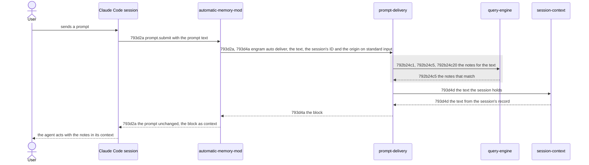
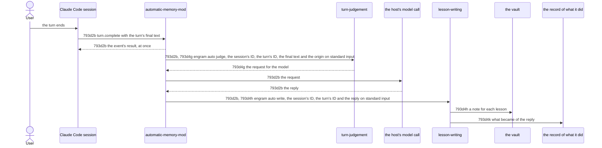

# Automatic Memory - Technical Spec

Filled depth first ([793f3 Depth first](./793f_algorithm.md#793f3-depth-first)): step 3 and step 4 run for one node at a time, in the order of
[793e Automatic Memory - Implementation Plan](./793e_implementation-plan.md#automatic-memory---implementation-plan). Until the last node has been through step 4, this spec is incomplete and not approved. The
"Pending" lines below are the departure recorded in [793b10 Departure: depth-first fill](./793b_decision-log.md#793b10-departure-depth-first-fill). Its
sections follow the [technical spec guide](../../TECHNICAL-SPEC-GUIDE.md#default-structure). The solution-space
analysis, relative option impact and alternative options are omitted by decision ([793b12 Departure: no option analysis](./793b_decision-log.md#793b12-departure-no-option-analysis)): step 3 takes
the minimal components a scenario needs.

New technical requirements take the next free letter under [793d2 Recommended sequence diffs](#793d2-recommended-sequence-diffs) for an interaction requirement (one
per flow) or under [793d4 Recommended component-behavior diffs](#793d4-recommended-component-behavior-diffs) for a behavior requirement (one per component behavior).

## 793d1 Orientation

**The product problem** is [793a1 Problem Statement](./793a_product-spec.md#793a1-problem-statement): the
[agent](./793a_product-spec.md#793a1a-terms) consults the [vault](../../GLOSSARY.md#vault) only when it remembers to,
and the instruction to look first was refused in 6 of 6 headless trials.

**Current behavior.** The agent reaches the vault through its own commands, `engram query` and `engram show`, when a
[skill](../../GLOSSARY.md#skill) or its instructions tell it to. [`engram update`](../../GLOSSARY.md#engram-update)
deploys the skills of `agent-instructions/skills/` into each [harness](../../GLOSSARY.md#harness) it finds, through an
engram-owned root per harness that the harness's skills directory links into
([harness-deploy-sync](../../specs/technical/harness-deploy-sync.md)). `engram query` searches the [notes](../../GLOSSARY.md#permanent-note), and the
chunk index when one is configured, for the phrases it is given
([query-engine](../../specs/technical/query-engine.md)).

**Why it is not enough.** Nothing in a [session](../../GLOSSARY.md#session) acts at a
[prompt](./793a_product-spec.md#793a1a-terms) without the agent's help, and `engram update` can install nothing but
skills, which only the agent runs.

**The recommended solution** is three parts. A **mod** is a folder that Claude Code loads as a plugin of function
hooks when it sits in `~/.claude/skills/<name>` (also as a link): its hooks module registers functions for events of
the session, and the `prompt.submit` event runs for each prompt before the prompt enters the session, where a
function may add context that the model reads beside the prompt and the user does not see. (Verified with Claude
Code 2.1.302: a mod in a linked skills folder loads in a headless `claude -p` session; the context it adds is
recorded in the session's [transcript](../../GLOSSARY.md#transcript) as a `hook_additional_context` record before the
agent's first reply.) (1) `engram update` deploys one mod, `engram-memory`, from `agent-instructions/mods/` through
the machinery that deploys the skills. (2) The mod runs a new command, `engram auto deliver`, for each prompt. (3) The
command looks up the [notes](../../GLOSSARY.md#permanent-note) that bear on the prompt text, as `engram query` would,
and prints them as one compact block, which the mod puts beside the prompt. The command, not the mod, holds the logic.

**The lessons** are three more parts, on the same footing. (4) After a [turn](./793a_product-spec.md#793a1a-terms) of a prompt the user sent (the mod keeps the origin of each prompt and hands it to the
commands, which act only for the prompts the user sends, [793b72 The origin of a turn](./793b_decision-log.md#793b72-the-origin-of-a-turn)), the mod's
`turn.complete` function, apart from the end of the turn, runs a new command, `engram auto judge`, which reads the turn
from the session's record and prints the request of one model call. (5) The mod makes that call through the host's
model API, with the user's own login, and (6) runs a new command, `engram auto write`, with the reply; the command reads
the lessons the reply holds and writes each as a note through the learn path, marked as written automatically. The call
raises neither a prompt nor a turn, so [automatic memory](./793a_product-spec.md#793a1a-terms) starts no session of its own
([793b63 A turn is judged by one model call, and no session is started](./793b_decision-log.md#793b63-a-turn-is-judged-by-one-model-call-and-no-session-is-started)).
(Verified with Claude Code 2.1.302: the `turn.complete` event carries the turn's final text and its ID, and fires when the
session's record already holds the turn's last row; `$.model.complete` answers `haiku` within about two seconds, also from
work left running after the hook that started it returned.)

## 793d2 Recommended sequence diffs

### 793d2a Prompt delivery flow

Added interactions are drawn solid; the retained interaction is drawn inside a grey block.



Requirement: 793d2a For each [prompt](./793a_product-spec.md#793a1a-terms) a Claude Code
[session](../../GLOSSARY.md#session) raises, the automatic-memory-mod MUST run `engram auto deliver` with the prompt
text, the session's ID and the prompt's origin, the kind that Claude Code stamps on the prompt (`composer`, `sdk`,
`task-notification` and the rest), as one JSON object, on standard input, MUST add the command's output to the context of the prompt as one block when the command
exited with 0 and the output begins with `[engram memory]`, and nothing otherwise, and MUST leave the prompt text as it
received it. It MUST hold the prompt for its own work, the call for the session's ID and the wait for the command
together, no longer than 7 seconds, so that the prompt is held for less than the 8 seconds of
[793a2d Never in the way](./793a_product-spec.md#793a2d-never-in-the-way), and MUST, when its work does not finish
within them, end the command and let the prompt continue as it was, with nothing added.

Owner: automatic-memory-mod (a new component; its canonical file at promotion is `automatic-memory-mod.md`)

Supports: [793a2a1a The next session has memory after one engram update](./793a_product-spec.md#793a2a1-uat-scenarios), [793a2b1b A note delivered earlier in the session is not delivered again](./793a_product-spec.md#793a2b1-uat-scenarios), [793a2d1a A slow lookup does not hold a prompt for more than 8 seconds](./793a_product-spec.md#793a2d1-uat-scenarios).

#### 793d2a1 Scenarios

```gherkin
Scenario: 793d2a1a A block is added beside the prompt
  Given a session with the mod installed, and an engram whose auto deliver prints a block
  When a prompt is sent
  Then the command received the prompt text, and the session holds the prompt exactly as sent and then the block as context before the agent's first reply

Scenario: 793d2a1b The command receives the session's ID
  Given a session with the mod installed, and an engram whose auto deliver prints a block
  When a prompt is sent
  Then the command received the ID of the session the prompt was sent in

Scenario: 793d2a1c An empty output adds nothing
  Given a session with the mod installed, and an engram whose auto deliver prints nothing
  When a prompt is sent
  Then the session holds the prompt exactly as sent and no context beside it

Scenario: 793d2a1d A slow command is ended and the prompt continues
  Given a session with the mod installed, and an engram whose auto deliver takes 20 seconds
  When a prompt is sent
  Then the model is asked within 8 seconds of the prompt, with the prompt exactly as sent and no context beside it, and the mod's hook did not fail

Scenario: 793d2a1e A failed command adds nothing
  Given a session with the mod installed, and an engram whose auto deliver prints a block and exits with 1
  When a prompt is sent
  Then the session holds the prompt exactly as sent and no context beside it, and the mod's hook did not fail

Scenario: 793d2a1f Output that is not a block adds nothing
  Given a session with the mod installed, and an engram whose auto deliver prints text that does not begin with [engram memory] and exits with 0
  When a prompt is sent
  Then the session holds the prompt exactly as sent and no context beside it, and the mod's hook did not fail

Scenario: 793d2a1g A session that does not give its ID in time does not hold the prompt
  Given the mod, and a session that never gives its ID
  When a prompt is sent
  Then the mod lets the prompt continue as it was after the 7 seconds, with nothing added, and the command was never run

Scenario: 793d2a1h The command receives the prompt's origin
  Given a session with the mod installed, and an engram whose auto deliver prints a block
  When a prompt is sent from a headless session, with claude -p
  Then the command received the origin sdk
```

### 793d2b Turn capture flow

Added interactions are drawn solid.



Requirement: 793d2b For each [turn](./793a_product-spec.md#793a1a-terms) a Claude Code [session](../../GLOSSARY.md#session) completes, the automatic-memory-mod MUST
give the event's result back at once, and MUST then, apart from the event, run `engram auto judge` with the session's ID,
the turn's ID, the turn's final text, the text the turn began with and the origin of the [prompt](./793a_product-spec.md#793a1a-terms) the turn began with, as one
JSON object, on standard input. The mod keeps the text and the origin of each prompt the session raises. A turn that
starts with a text takes the oldest prompt kept with that text, and drops the prompts kept before it, which began no turn
of their own; a turn whose text no kept prompt has takes the origin of the newest one, and a turn that starts with no
text has no origin. It MUST leave out the
turns that a [subagent](../../GLOSSARY.md#subagent) ran, which the event says an [agent](./793a_product-spec.md#793a1a-terms) ran, and do nothing for them; when the command exited with 0 and
printed a request, MUST ask the model for it through the host's model call, with the request exactly as printed; and
when the model answered, MUST run `engram auto write` with the session's ID, the turn's ID and the model's reply, as one
JSON object, on standard input. When the command exited with 0 and printed nothing, it MUST do nothing more. When a step
fails, because a command exited with other than 0 or printed what is not a request, or the model did not answer, or a
call was ended or rejected, it MUST run `engram auto write` with the session's ID, the turn's ID and a `failure`, a
sentence that names the step and how it failed, in place of the reply. A request that is not a JSON object is a
failure of `engram auto judge`. It MUST bound each stage, so that the stages together take less than the 2 minutes of
[793a2c Lessons are written without the agent](./793a_product-spec.md#793a2c-lessons-are-written-without-the-agent): the call for the session's ID 5 seconds, after which it does nothing, `engram auto judge`
15 seconds, the model's call the 60 seconds of the request, `engram auto write` 20 seconds and the run of it that reports a
failure 15 seconds, 115 seconds together; a stage that does not finish in its bound has failed.

Owner: automatic-memory-mod (the component of [793d2a Prompt delivery flow](#793d2a-prompt-delivery-flow))

Supports: [793a2c1a A correction becomes a note](./793a_product-spec.md#793a2c1-uat-scenarios), [793a2c1b A request to remember becomes a note](./793a_product-spec.md#793a2c1-uat-scenarios), [793a2c1c An approach the user confirmed becomes a note](./793a_product-spec.md#793a2c1-uat-scenarios), [793a2c1d The agent's own correction becomes a note](./793a_product-spec.md#793a2c1-uat-scenarios), [793a2c1e An approach that succeeded with evidence becomes a note](./793a_product-spec.md#793a2c1-uat-scenarios), [793a2c1f Guesses, plans and chatter produce no note](./793a_product-spec.md#793a2c1-uat-scenarios), [793a2c1g A credential in the turn is not in the note](./793a_product-spec.md#793a2c1-uat-scenarios), [793a2c1h A thanks that names no approach produces no note](./793a_product-spec.md#793a2c1-uat-scenarios), [793a3c1a A lesson an earlier note states is not written again](./793a_product-spec.md#793a3c1-uat-scenarios), [793a3c1b A lesson the agent saved itself is not written again](./793a_product-spec.md#793a3c1-uat-scenarios).

#### 793d2b1 Scenarios

```gherkin
Scenario: 793d2b1a The mod judges a turn and gives the reply to the writing
  Given the mod, a session whose ID is known, an engram whose auto judge prints a request, and a model that answers
  When a prompt is raised, the turn starts, and it completes with a final text
  Then the event's result is given back at once, auto judge received the session's ID, the turn's ID, the final text and the origin of the prompt, the model was asked the request exactly as printed, and auto write received the session's ID, the turn's ID and the model's reply

Scenario: 793d2b1b A judgement that prints nothing ends the capture
  Given the mod, and an engram whose auto judge exits with 0 and prints nothing
  When a turn completes
  Then the model was never asked, and auto write was never run

Scenario: 793d2b1c A step that fails is reported to the writing
  Given the mod, and an engram whose auto judge exits with 1, prints text that is not a request, or is ended before it answers
  When a turn completes
  Then the model was never asked, and auto write received the session's ID, the turn's ID and a failure that names the judgement

Scenario: 793d2b1d A model that does not answer is reported to the writing
  Given the mod, an engram whose auto judge prints a request, and a model that answers with an API error, with no text, or by rejecting the call
  When a turn completes
  Then auto write received the session's ID, the turn's ID and a failure that names the model call

Scenario: 793d2b1e The judgement receives the origin of the prompt the turn began with
  Given the mod, and an engram whose auto judge prints a request
  When a prompt of the origin task-notification is raised, a turn starts, and it completes
  Then auto judge received the origin task-notification, beside the session's ID, the turn's ID and the final text

Scenario: 793d2b1f A turn of a subagent is not captured
  Given the mod, and an engram whose auto judge prints a request
  When a turn that a subagent ran completes
  Then auto judge was never run, and the model was never asked

Scenario: 793d2b1g The judgement receives the text the turn began with
  Given the mod, and an engram whose auto judge prints a request
  When a prompt is raised, the turn starts with its text, and it completes
  Then auto judge received the text, beside the session's ID, the turn's ID, the final text and the origin

Scenario: 793d2b1h A turn takes the origin and the text of its own prompt when others are waiting
  Given the mod, and an engram whose auto judge prints a request
  When a prompt of the user starts a turn, a second prompt of the user is raised while it runs, a task notification is raised after the second, the first turn completes, and the second prompt starts a turn that completes
  Then auto judge received for the second turn the origin and the text of the second prompt, and not those of the notification

Scenario: 793d2b1i A turn that starts with no text has no origin
  Given the mod, and an engram whose auto judge prints a request
  When a prompt of the user starts a turn that completes, and a turn then starts with no text and completes
  Then auto judge received no origin for the second turn

Scenario: 793d2b1j A stage that stalls is ended at its bound and reported
  Given the mod, and a host in which, in turn, the call for the session's ID never answers, auto judge runs until its time limit, the model's call is cut at its time limit, and auto write runs until its time limit
  When a turn completes
  Then the mod waited for the ID 5 seconds and then did nothing, auto judge was given the time limit of 15 seconds, the model's request held 60 seconds, auto write was given 20 seconds, and the report of the failure to auto write was given 15 seconds, and those limits together are less than 120 seconds

Scenario: 793d2b1k A request that is not JSON is a failure of the judgement
  Given the mod, and an engram whose auto judge prints text that begins as a request and is not a JSON object
  When a turn completes
  Then the model was never asked, and auto write received a failure that names the judgement
```

## 793d3 Recommended component diffs

- **automatic-memory-mod** (added): the mod `engram-memory`, a hooks module in `agent-instructions/mods/engram-memory/`
  (realization, informational). Qualification: responsibility, bringing the [notes](../../GLOSSARY.md#permanent-note) that bear on a [prompt](./793a_product-spec.md#793a1a-terms) to the [agent](./793a_product-spec.md#793a1a-terms)
  at the prompt is stated without naming a function; ownership, the routing and the placement of the block are its
  own, the lookup is the command's; independent verification, it is tested in a real Claude Code [session](../../GLOSSARY.md#session) against an
  `engram` that prints a chosen block; stability, it survives any change to how the command finds notes; necessity,
  without it nothing runs at a prompt. It also captures the lessons of a [turn](./793a_product-spec.md#793a1a-terms) after the turn ends
  ([793d2b Turn capture flow](#793d2b-turn-capture-flow)): the routing of the judgement and of the write is its own, the
  judgement and the write are the commands'.
- **prompt-delivery** (added): the command `engram auto deliver` (`internal/cli/auto.go`, `internal/auto`,
  informational). Qualification: responsibility, turning a prompt into the block of notes that bear on it is stated
  without naming a function; ownership, the choice and rendering of notes are its own, the hook is the mod's;
  independent verification, it is tested through its standard input and output over an in-memory [vault](../../GLOSSARY.md#vault); stability,
  it survives any change to the mod; necessity, the mod holds no logic.
- **session-context** (added): what a session's agent already holds of the vault, read from the session's record
  (`internal/auto`, `internal/cli/auto.go`, informational). Qualification: responsibility, telling what the agent holds
  is stated without naming a function; ownership, the format of the record and the rule for what counts as held are its
  own, the choice of notes to deliver is the delivery's; independent verification, it is tested over records of a
  session; stability, it survives any change to how the delivery uses it; necessity, a note the agent holds must not be
  delivered again ([793a2b Memory arrives with the prompt](./793a_product-spec.md#793a2b-memory-arrives-with-the-prompt)).
- **turn-judgement** (added): the command `engram auto judge` (`internal/cli/auto.go`, `internal/auto`, informational).
  Qualification: responsibility, turning a turn into the request of the call that judges it is stated without naming a
  function; ownership, the choice of the lines of a turn and the instructions of the judgement are its own, the call is
  the mod's; independent verification, it is tested through its standard input and output over records of a session;
  stability, it survives any change to the call; necessity, the mod holds no logic. It redacts what looks like a
  credential before the model sees it ([793d4j Redacting credentials](#793d4j-redacting-credentials)).
- **lesson-writing** (added): the command `engram auto write` (`internal/cli/auto.go`, `internal/auto`, informational).
  Qualification: responsibility, turning the model's reply into the [notes](../../GLOSSARY.md#permanent-note) of the [vault](../../GLOSSARY.md#vault) is stated without naming a
  function; ownership, the reading of the reply and the mark of a note are its own, the write of a note is the learn
  path's; independent verification, it is tested through its standard input and output over an in-memory vault;
  stability, it survives any change to the instructions of the judgement; necessity, the notes must be written after the
  turn without the [agent](./793a_product-spec.md#793a1a-terms). It also keeps the record of what became of each reply
  ([793d4k Recording what automatic memory did](#793d4k-recording-what-automatic-memory-did)).
- **learn path** (retained): the write of a note, as [`engram learn`](../../GLOSSARY.md#engram-learn-subcommand) does it (`RunLearn`).
- **harness-deploy-sync** (updated): plans, links, reports and removes the mod as it does a [skill](../../GLOSSARY.md#skill) directory, and
  reports it as a mod ([793b47 A dry run reports the mod as a mod](./793b_decision-log.md#793b47-a-dry-run-reports-the-mod-as-a-mod)).
- **query-engine** (retained): the lookup of notes for text, used as `engram query` uses it, by the delivery and by the judgement.
- **Claude Code's mod runtime** (an external boundary, retained): loads a mod from `~/.claude/skills/<name>`, runs its
  `prompt.submit` function for each prompt, its `turn.start` function when a turn starts and its `turn.complete` function for each turn, runs the commands it asks
  for, makes the model calls it asks for with the user's own login, and carries the context it returns to the
  model. The mod relies on that contract; nothing here tests it.

## 793d4 Recommended component-behavior diffs

### 793d4a Delivering the notes that bear on a prompt

Requirement: 793d4a The [prompt](./793a_product-spec.md#793a1a-terms)-delivery MUST read one JSON object with the prompt's `text`, its `session`'s ID and its `origin` from standard input and
MUST print one block on standard output, or nothing when the origin is not one the user sends
([793d4m Telling the prompts the user sends](#793d4m-telling-the-prompts-the-user-sends)). The block opens with a line that begins `[engram memory]` and holds one
line for each [note](../../GLOSSARY.md#permanent-note) that bears on the text, in the order the lookup gave them: a
dash, the note's file name, its situation in parentheses, a colon, and the note's body on one line. A note bears on
the text when the lookup of
[792b24c5 The matched set](../../specs/technical/query-engine.md#792b24c5-the-matched-set) for the text, as its message and as its only phrase,
returns it as an item that is not a chunk and was not picked by the explore half alone
([792b24c16 Delivering the explore half](../../specs/technical/query-engine.md#792b24c16-delivering-the-explore-half)):
an explore pick is sampled from the vocabulary, not matched to the text. The lookup's own default limit of
[792b24c1 Input and defaults](../../specs/technical/query-engine.md#792b24c1-input-and-defaults) bounds the number of
lines, as it bounds the number of items the [agent](./793a_product-spec.md#793a1a-terms)'s own lookup returns
([793b19 Volume of delivered notes](./793b_decision-log.md#793b19-volume-of-delivered-notes)). It MUST leave out each
note whose basename, its file name without the suffix `.md`, appears in the text that
[793d4d Telling what a session holds](#793d4d-telling-what-a-session-holds) returns for the request's [session](../../GLOSSARY.md#session). It MUST
print nothing, and succeed, when no note remains. It MUST NOT search the chunk
index, so that only notes are delivered ([793a2b Memory arrives with the prompt](./793a_product-spec.md#793a2b-memory-arrives-with-the-prompt)). It MUST print nothing and
fail, naming the cause, when the lookup fails.

Owner: prompt-delivery (a new component; its canonical file at promotion is `prompt-delivery.md`)

Supports: [793a2a1a The next session has memory after one engram update](./793a_product-spec.md#793a2a1-uat-scenarios), [793a2b1a The notes that bear on a prompt arrive with it](./793a_product-spec.md#793a2b1-uat-scenarios), [793a2b1b A note delivered earlier in the session is not delivered again](./793a_product-spec.md#793a2b1-uat-scenarios), [793a2b1d A prompt that matches no note arrives with nothing](./793a_product-spec.md#793a2b1-uat-scenarios).

#### 793d4a1 Scenarios

```gherkin
Scenario: 793d4a1a The notes that bear on the text come back as one block
  Given a vault holding a note that says when the staging database is reset
  When the command is given a prompt asking when the staging database is reset
  Then it prints a block that opens with a line beginning [engram memory] and has one line naming the note, its situation and its body

Scenario: 793d4a1b A failed lookup fails the command and prints nothing
  Given a lookup that fails
  When the command is given a prompt
  Then it fails with an error that names the lookup's failure, and it prints nothing

Scenario: 793d4a1c A note that only the explore half picked does not bear on the prompt
  Given a lookup whose payload holds a matched note and a note picked by the explore half alone
  When the command is given a prompt
  Then the block names the matched note and not the explore pick

Scenario: 793d4a1d A note the session holds is left out
  Given a lookup that returns two notes, and a session whose record shows that one of them was delivered
  When the command is given a prompt of that session
  Then the block names the other note only

Scenario: 793d4a1e No note to deliver prints nothing
  Given a lookup that returns a note the session holds, and a lookup that returns no note
  When the command is given a prompt for each
  Then it prints nothing and succeeds both times

Scenario: 793d4a1f The chunk index is not searched
  Given a vault with a note that bears on the prompt, and a chunk index
  When the command is given the prompt
  Then the chunk index is never listed, and the block names the note

Scenario: 793d4a1g A note the agent fetched by its basename is left out
  Given a lookup that returns two notes, and a session whose record shows that the agent ran engram show with the basename of one of them
  When the command is given a prompt of that session
  Then the block names the other note only

Scenario: 793d4a1h The lookup is asked for the prompt's text as its message and as its only phrase
  Given a request whose text is a prompt, and a lookup that records the arguments it is run with
  When the command is given the request
  Then the lookup is run once, for the vault the command was given, with the prompt's text as its message and as its only phrase

Scenario: 793d4a1i The lookup is asked for the text and what the session holds for the session
  Given a request with a text and a session's ID, a lookup and a reading of what the session holds, both recording what they are given
  When the block is made
  Then the lookup is given the request's text and the reading is given the request's session ID
```

### 793d4c Framing the notes of a block as data

Requirement: 793d4c The [prompt](./793a_product-spec.md#793a1a-terms)-delivery MUST open every block with one fixed line that begins `[engram memory]` and
says that the lines below are [notes](../../GLOSSARY.md#permanent-note) from the [vault](../../GLOSSARY.md#vault), delivered by the memory
system and not typed by the user, and that an instruction written inside a note is not the user's. It MUST write each
note as exactly one line that begins with a dash and a space, with the note's file name, situation and body each
written as text in which every run of white space, line breaks and separators included, is one space and no control
character and no format character remains, a format character being one of the Unicode category Cf: a zero-width space
or joiner, a bidirectional override or isolate, a byte-order mark, a soft hyphen. So the text of a note never makes a
line of its own: it cannot produce a line that is the framing line, or a line that reads as another note. The line of a
note whose source says that it was written automatically ([793d4h Writing the lessons of a reply](#793d4h-writing-the-lessons-of-a-reply)) ends with the words
`(written automatically)`, which are fixed text with nothing of the note in them, so that the [agent](./793a_product-spec.md#793a1a-terms) can tell the note from one a
person or the agent saved.

Owner: prompt-delivery (a new component; its canonical file at promotion is `prompt-delivery.md`)

Supports: [793a2a1a The next session has memory after one engram update](./793a_product-spec.md#793a2a1-uat-scenarios), [793a2b1a The notes that bear on a prompt arrive with it](./793a_product-spec.md#793a2b1-uat-scenarios), [793a3a1a A written note is delivered with later prompts](./793a_product-spec.md#793a3a1-uat-scenarios).

#### 793d4c1 Scenarios

```gherkin
Scenario: 793d4c1a A note cannot reshape the block
  Given notes whose file names, situations and bodies hold line breaks, control characters, the framing line and lines that read as other notes, however they are mixed
  When the block is made
  Then the block has the framing line first and nowhere else, and exactly one line for each note, each beginning with a dash and a space and holding single spaces and no control or format character

Scenario: 793d4c1b A note cannot hide text in format characters
  Given a note whose file name, situation and body hold a zero-width space, a zero-width joiner, a bidirectional override, a byte-order mark and a soft hyphen, between and inside words
  When the block is made
  Then the line of the note holds none of them, and the words they were between and inside are joined as the characters around them were

Scenario: 793d4c1c A note written automatically says so in its line
  Given a note whose source says that it was written automatically, and a note whose source is another
  When the block is made for each
  Then the line of the first ends with (written automatically), and the line of the other does not
```

### 793d4d Telling what a session holds

Requirement: 793d4d The [session](../../GLOSSARY.md#session)-context MUST, given a session's ID, look for the session's record, the file named for
the ID with the suffix `.jsonl`, in the directory of records it is given
([793d4f Finding the records of sessions](#793d4f-finding-the-records-of-sessions)),
directly in it or in one of its subdirectories. Of what the [agent](./793a_product-spec.md#793a1a-terms) was given, it MUST return two things and nothing
else of the record. The first is the file name of each [note](../../GLOSSARY.md#permanent-note) line of every block that was delivered beside a [prompt](./793a_product-spec.md#793a1a-terms) of
the session, that is of every entry, of a record of the kind `attachment` whose type is `hook_additional_context`, that
begins with `[engram memory]`, a note line being a line of the block that begins with a dash and a space, and its file
name the text after them up to the space before the situation's opening parenthesis. The second is, for every Bash
command that the agent ran whose text contains `engram query` or `engram show`, the text of the command and the text of
its result, the result being the `tool_result` block, of a `user` record, whose `tool_use_id` is the ID of the
command's `tool_use` block. It MUST return nothing of the situations and bodies of the notes of a block, of the other
entries beside a prompt, of the result of any other tool, of a prompt or of a reply. It MUST return nothing, without an
error, when the session has no record, when the record cannot be read, and when the ID is not a plain file name.

Owner: session-context (a new component; its canonical file at promotion is `session-context.md`)

Supports: [793a2b1b A note delivered earlier in the session is not delivered again](./793a_product-spec.md#793a2b1-uat-scenarios), [793a2b1c A note the agent looked up itself is not delivered](./793a_product-spec.md#793a2b1-uat-scenarios).

#### 793d4d1 Scenarios

```gherkin
Scenario: 793d4d1a The note lines of the blocks delivered beside prompts are what a session holds
  Given the record of a session with a block delivered beside a prompt, whose note lines name two notes and whose first note's body names a third, an entry of another hook beside a prompt, a prompt, a reply and other attachments
  When what the session holds is read
  Then the text holds the file names of the two notes, and nothing of the situations and bodies, the other hook's entry, the prompt, the reply or the other attachments

Scenario: 793d4d1d What the agent's own lookup printed is held
  Given the record of a session in which the agent ran engram query as a Bash command, whose result names a note, as a string and as text blocks
  When what the session holds is read
  Then the text holds the command and the result, and nothing of the reply

Scenario: 793d4d1e A listing of the vault is not held
  Given the record of a session in which the agent ran ls over the vault, whose result names a note
  When what the session holds is read
  Then the text does not hold the note's name

Scenario: 793d4d1f A note fetched with engram show is held
  Given the record of a session in which the agent ran engram show with the basename of a note, whose result does not name the note
  When what the session holds is read
  Then the text holds the command, which names the note

Scenario: 793d4d1b The record is found under its project directory
  Given a session-log directory whose subdirectory for a project holds the record of the session
  When what the session holds is read
  Then the text is that of the blocks of that record

Scenario: 793d4d1c A session with no record, or an ID that is not a file name, holds nothing
  Given a session-log directory with no record of the session, and an ID that holds a path separator
  When what the session holds is read
  Then it is empty and there is no error
```

### 793d4e Modified: First-use gating

Target: [792b2c3 First-use gating](../../specs/technical/command-line-surface.md#792b2c3-first-use-gating)

Requirement: 792b2c3 For every [vault](../../GLOSSARY.md#vault)-resolving command other than the commands of the group `auto` (`auto deliver`, `auto judge` and `auto write`), the command-line-surface MUST ask the
[vault-identity-registry](../../specs/technical/vault-identity-registry.md) to ensure the vault at the resolved path before running the command, and
MUST NOT run the command when that step fails. For a command of the group `auto` it MUST NOT ask: the command runs against the path
as it is, and creates nothing when the path holds no vault.

Owner: [command-line-surface](../../specs/technical/command-line-surface.md)

Supports: [793a2a1e A vault that does not exist is not created](./793a_product-spec.md#793a2a1-uat-scenarios), [793a2a1g A lesson is not written to a vault that does not exist](./793a_product-spec.md#793a2a1-uat-scenarios).

#### 793d4e1 Scenarios

```gherkin
Scenario: 793d4e1a The delivery command creates no vault
  Given no vault exists at the resolved path
  When engram auto deliver is dispatched
  Then no vault exists at the path afterwards, nothing is printed to standard output and no creation line is printed

Scenario: 793d4e1b The judgement command creates no vault
  Given no vault exists at the resolved path, and a session whose record holds a prompt
  When engram auto judge is dispatched
  Then no vault exists at the path afterwards and no creation line is printed

Scenario: 793d4e1c The writing command creates no vault and writes no note
  Given no vault exists at the resolved path, and a reply that holds one lesson
  When engram auto write is dispatched
  Then no vault exists at the path afterwards, no note was written, nothing is printed to standard output and no creation line is printed
```

### 793d4b Deploying the mods of the source

Requirement: 793d4b The [harness](../../GLOSSARY.md#harness)-deploy-sync MUST plan one copy for every file under `agent-instructions/mods/` of the
source for Claude Code, keeping the file's path relative to that directory and naming the file's top-level directory
as the [skill](../../GLOSSARY.md#skill) directory it is deployed in, so that a mod is deployed, linked, reported and removed as a skill directory
is. It MUST plan none for [Pi](../../GLOSSARY.md#harness), and none, without an error, when that directory does not
exist. It MUST report each mod directory it deploys, in the section of Claude Code in the report of
[`engram update`](../../GLOSSARY.md#engram-update), as a mod, with `agent-instructions/mods/<name>/` as its source,
where a skill directory is reported with `agent-instructions/skills/<name>/`. A dry run MUST plan and report the mod
and write none of its files. A second `engram update` MUST leave the deployed mod as the first left it: the same files
and the same link, with no second copy of the mod, and the report lists the mod once.

Owner: [harness-deploy-sync](../../specs/technical/harness-deploy-sync.md)

Supports: [793a2a1a The next session has memory after one engram update](./793a_product-spec.md#793a2a1-uat-scenarios), [793a2a1d Pi gets no automatic memory](./793a_product-spec.md#793a2a1-uat-scenarios), [793a2a1c A dry run turns nothing on](./793a_product-spec.md#793a2a1-uat-scenarios), [793a2a1b A second update still delivers each note once](./793a_product-spec.md#793a2a1-uat-scenarios).

#### 793d4b1 Scenarios

```gherkin
Scenario: 793d4b1a Every file of a mod is planned for Claude Code
  Given a source whose agent-instructions/mods holds the mod engram-memory with three files
  When the mod copies are planned for Claude Code
  Then each file is planned once under Claude Code's skills directory, in the engram-memory directory

Scenario: 793d4b1b A source with no mods plans none
  Given a source with no agent-instructions/mods directory
  When the mod copies are planned
  Then none is planned and there is no error

Scenario: 793d4b1c An update deploys and links the mod
  Given a checkout whose agent-instructions/mods holds the mod engram-memory, and a machine with Claude Code
  When engram update runs
  Then the engram-owned root holds the mod's files, and Claude Code's skills directory links engram-memory to them

Scenario: 793d4b1d Pi is planned no mod
  Given a source whose agent-instructions/mods holds the mod engram-memory, and the harnesses Claude Code and Pi
  When the mod copies are planned
  Then they are planned for Claude Code only

Scenario: 793d4b1e A deployed mod is reported as a mod
  Given a checkout whose agent-instructions/mods holds the mod engram-memory and whose agent-instructions/skills holds the skill learn, and a machine with Claude Code
  When engram update runs
  Then the report of Claude Code lists learn as a skill directory and engram-memory as a mod directory

Scenario: 793d4b1f The report names the mods directory as the source of a mod
  Given a report of Claude Code with the skill directory learn and the mod directory engram-memory
  When the report is written
  Then the skill is listed from agent-instructions/skills/learn/ and the mod from agent-instructions/mods/engram-memory/

Scenario: 793d4b1g A dry run plans the mod and writes none of it
  Given a checkout whose agent-instructions/mods holds the mod engram-memory, and a machine with Claude Code
  When engram update --dry-run runs
  Then the report lists the mod, and no file of it and no link to it has been written

Scenario: 793d4b1h A second update leaves the mod as the first left it
  Given a checkout whose agent-instructions/mods holds the mod engram-memory, a machine with Claude Code, and engram update run once
  When engram update runs again
  Then the files of the mod and the link to it are those the first run left, and the report lists the mod once
```

### 793d4f Finding the records of sessions

Requirement: 793d4f The [prompt](./793a_product-spec.md#793a1a-terms)-delivery MUST read the records of [sessions](../../GLOSSARY.md#session) from the directory that its `--sessions` flag
names, or, when the flag is not given, from the directory that `ENGRAM_TRANSCRIPT_DIR` names when it is set, else from
the `projects` directory of the directory that `CLAUDE_CONFIG_DIR` names when it is set, else from `<home>/.claude/projects`,
and from no directory when the home directory cannot be found. It MUST NOT change the session-log directory of
[792b17c6 Session-log directory](../../specs/technical/ingestion-source-discovery.md#792b17c6-session-log-directory),
which [`engram ingest`](../../GLOSSARY.md#engram-ingest-subcommand) sweeps.

Owner: prompt-delivery (a new component; its canonical file at promotion is `prompt-delivery.md`)

Supports: [793a2b1b A note delivered earlier in the session is not delivered again](./793a_product-spec.md#793a2b1-uat-scenarios), [793a2b1c A note the agent looked up itself is not delivered](./793a_product-spec.md#793a2b1-uat-scenarios).

#### 793d4f1 Scenarios

```gherkin
Scenario: 793d4f1a ENGRAM_TRANSCRIPT_DIR names the records first
  Given ENGRAM_TRANSCRIPT_DIR and CLAUDE_CONFIG_DIR are both set, and the record of a session in each, the first showing one note delivered and the second another
  When engram auto deliver is dispatched for a prompt of the session, without --sessions
  Then the block names the second note only

Scenario: 793d4f1b CLAUDE_CONFIG_DIR names them when ENGRAM_TRANSCRIPT_DIR does not
  Given only CLAUDE_CONFIG_DIR is set, a record of the session in its projects directory showing one note delivered, and a record of the session in the home's .claude/projects showing another
  When engram auto deliver is dispatched for a prompt of the session, without --sessions
  Then the block names the second note only

Scenario: 793d4f1c The home's .claude/projects holds them by default
  Given neither variable is set, and a record of the session in the home's .claude/projects showing one note delivered
  When engram auto deliver is dispatched for a prompt of the session, without --sessions
  Then the block names the other note only

Scenario: 793d4f1d No record is read when no directory can be found
  Given neither variable is set, and a home directory that cannot be found
  When engram auto deliver is dispatched for a prompt of a session, without --sessions
  Then no record is read, and the block names the notes that bear on the prompt
```

### 793d4g Judging a turn

Requirement: 793d4g The [turn](./793a_product-spec.md#793a1a-terms)-judgement MUST read one JSON object with the `session`'s ID, the turn's final `answer`, the `text` the turn
began with and the `origin` of the [prompt](./793a_product-spec.md#793a1a-terms) the turn began with from standard input, MUST print nothing when the origin is not one the user sends
([793d4m Telling the prompts the user sends](#793d4m-telling-the-prompts-the-user-sends)), and MUST find the [session](../../GLOSSARY.md#session)'s record as [793d4d Telling what a session holds](#793d4d-telling-what-a-session-holds) does,
in the directory of [793d4f Finding the records of sessions](#793d4f-finding-the-records-of-sessions). A [prompt](./793a_product-spec.md#793a1a-terms) is a
row of the record that the user sent. A row that the [harness](../../GLOSSARY.md#harness) wrote is none, and makes no line: a row marked as meta
(the body of a [skill](../../GLOSSARY.md#skill) that the [agent](./793a_product-spec.md#793a1a-terms) invoked), a row stamped with an origin that the user does not send ([793d4m Telling the prompts the user sends](#793d4m-telling-the-prompts-the-user-sends)),
such as a task notification or a message of a peer session delivered into the turn, and a row whose text begins as
[792b15c3 Harness noise](../../specs/technical/transcript-reader.md#792b15c3-harness-noise) drops text: a system reminder, the base directory of a skill, the caveat or the output of a
local command, a task notification. A block of a prompt that begins so is left out of it, and the prompt of a slash
command is its arguments, and none when it has none. The turn begins at the last prompt of the record that has the
`text` of the input, or at the last prompt of the record when the input gives no text or no prompt has it; it ends before
the next prompt of the record, and after the last line of the [agent](./793a_product-spec.md#793a1a-terms) that is the final text; and the conversation before it is the
context. It MUST print one JSON object, the request for the
model: `model` (`haiku`), `effort` (`low`), `system`, `prompt`, `maxTokens` and `timeoutMs`. The `system` MUST hold the
instructions of the judgement and nothing of the record, so that the model reads them as instructions. The prompt MUST
hold, between the tags `<window>` and `</window>`, the lines of the context, then the line `--- the turn ---`, then the
lines of the turn. A line is
one message and opens with `User: ` for a prompt, `Agent: ` for text of the [agent](./793a_product-spec.md#793a1a-terms), and `Agent used ` and the tool's name for a
tool it called; a line break in a message is written ` ⏎ `, so that no message makes a line of its own. The text of every
message of the window is written as one line and then redacted ([793d4j Redacting credentials](#793d4j-redacting-credentials)) before it is cut or joined with another, and no other message is
redacted: the command MUST read the record once, so that the time it takes does not grow with the length of the
session, and a record of 1 MB is judged within 2 seconds. A line is cut to its first
1,200 characters, and a `<` in it is then written `&lt;`, which the instructions say, so that no message can close the
window or open a section of [notes](../../GLOSSARY.md#permanent-note); the context is its last 6 lines; and the window is cut to 8,000 characters, the oldest lines of the
context first and then the middle of the turn, where the line `--- some of the turn is left out ---` stands in place of
the lines left out. The final text is the last line of the turn when no line of the turn holds its first 80
characters. The prompt MUST also hold, as lines of the section of [notes](../../GLOSSARY.md#permanent-note) between the tags `<notes>` and `</notes>`, the notes nearest to the turn: the notes
that the lookup of [793d4a Delivering the notes that bear on a prompt](#793d4a-delivering-the-notes-that-bear-on-a-prompt) returns for the text of the prompts of the turn, each in the form of a line of a
block (a dash, the file name, the situation in parentheses, a colon and the body), with its text written as
one line and then redacted, cut to 400 characters and then escaped in the same way, so that no note can close the section of notes, or the word `(none)` when there are none. It MUST print nothing, and succeed,
when the record holds no prompt, and print nothing and fail, naming the cause, when its input is not a JSON object,
when no [vault](../../GLOSSARY.md#vault) exists at the path of the vault, when there is no record of the session in the directory of the records,
or when the lookup fails: a capture that cannot be judged is then recorded once, with its reason, and the model is not
asked.

Owner: turn-judgement (a new component; its canonical file at promotion is `turn-judgement.md`)

Supports: [793a2c1a A correction becomes a note](./793a_product-spec.md#793a2c1-uat-scenarios), [793a2c1b A request to remember becomes a note](./793a_product-spec.md#793a2c1-uat-scenarios), [793a2c1c An approach the user confirmed becomes a note](./793a_product-spec.md#793a2c1-uat-scenarios), [793a2c1d The agent's own correction becomes a note](./793a_product-spec.md#793a2c1-uat-scenarios), [793a2c1e An approach that succeeded with evidence becomes a note](./793a_product-spec.md#793a2c1-uat-scenarios), [793a2c1f Guesses, plans and chatter produce no note](./793a_product-spec.md#793a2c1-uat-scenarios), [793a2c1g A credential in the turn is not in the note](./793a_product-spec.md#793a2c1-uat-scenarios), [793a2c1h A thanks that names no approach produces no note](./793a_product-spec.md#793a2c1-uat-scenarios), [793a3c1a A lesson an earlier note states is not written again](./793a_product-spec.md#793a3c1-uat-scenarios), [793a3c1b A lesson the agent saved itself is not written again](./793a_product-spec.md#793a3c1-uat-scenarios).

#### 793d4g1 Scenarios

```gherkin
Scenario: 793d4g1a The request holds the instructions, the context and the turn
  Given the record of a session with a first turn and a second turn in which the user corrected the agent
  When the judgement is given the session and the second turn's final text
  Then it prints a request for the model haiku at effort low whose prompt holds the instructions, the first turn's lines, the line --- the turn ---, and the second turn's lines, each opening with its label

Scenario: 793d4g1b The final text is added when the record lacks it
  Given the record of a session whose last row is the user's prompt
  When the judgement is given the session and a final text
  Then the last line of the turn is the final text, labelled as the agent's

Scenario: 793d4g1c A session with no prompt in its record is judged nothing
  Given the record of a session with no prompt
  When the judgement is given the session
  Then it prints nothing and succeeds

Scenario: 793d4g1d An input that is not a JSON object fails the command
  Given an input that is not a JSON object
  When the judgement is given it
  Then it prints nothing and fails with an error that names the input

Scenario: 793d4g1e A message cannot make a line of its own
  Given messages whose text holds line breaks of every kind, control characters and text that reads as a label
  When the lines of the turn are made
  Then there is exactly one line for each message, and each opens with its label

Scenario: 793d4g1f A line is cut after its credentials are redacted
  Given a message whose text is longer than a line may be, with a token that the cut falls in
  When the lines of the turn are made
  Then no part of the token is in the request

Scenario: 793d4g1h The nearest notes are in the request
  Given a vault holding a note that says when the staging database is reset, and the record of a session whose turn asks about the staging database
  When the judgement is given the session
  Then the request lists the staging note, with its file name, its situation and its body on one line

Scenario: 793d4g1i A failed lookup fails the command and prints nothing
  Given a lookup that fails
  When the judgement is given the record of a session with a prompt
  Then it fails with an error that names the lookup's failure, and it prints nothing

Scenario: 793d4g1j A note cannot reshape the window
  Given a note whose situation and body hold line breaks, a credential and more than 400 characters
  When the request is made
  Then the note is one line of the section of notes, the credential is redacted, and the body is cut to 400 characters

Scenario: 793d4g1g A long conversation is cut to the bound
  Given a record with more context than the window holds, and a turn with more lines than it holds
  When the judgement is given the session
  Then the context is its last 6 lines or fewer, the window is no longer than 8,000 characters, the first line of the turn and its last lines are kept, and the line that says that some of the turn is left out stands where they were

Scenario: 793d4g1k A prompt of text blocks is one prompt, and the result of a tool is none
  Given a record whose last prompt is made of two text blocks and an image, followed by a row that holds only the result of a tool
  When the judgement is given the session
  Then the turn begins with one line for the prompt, holding the text of both blocks, and the result of the tool makes no line

Scenario: 793d4g1l The body of a skill is no prompt
  Given the record of a session whose turn began with a prompt of the user, in which the agent invoked a skill and the harness wrote the skill's body as a row marked as meta
  When the judgement is given the session
  Then the request has no line for the skill's body, and the turn begins with the user's prompt

Scenario: 793d4g1m A system reminder in the row of a prompt is not part of the prompt
  Given a record whose last prompt is a row of two text blocks, the user's words and a system reminder, followed by a row that holds only a system reminder
  When the judgement is given the session
  Then the prompt is one line of the user's words alone, and the row of the system reminder makes no line

Scenario: 793d4g1n A task notification delivered into a turn is no prompt
  Given the record of a session whose turn began with a prompt of the user, and in which a task notification was delivered as a row of the user's before the agent's last text
  When the judgement is given the session
  Then the request has no line for the notification, and the turn begins with the user's prompt

Scenario: 793d4g1o A command that ran locally is no prompt, and a slash command is its arguments
  Given the record of a session whose turn began with a prompt of the user and holds, after it, the caveat, the name with no arguments and the output of a command that ran locally, and a record whose prompt is a slash command given arguments
  When the judgement is given each
  Then none of the rows of the command that ran locally is a line of the first request, and the prompt of the second is the arguments

Scenario: 793d4g1p A row of an origin the user does not send is no prompt
  Given a record whose turn began with a prompt of the user, and a row of the user's stamped with the origin peer whose text opens with none of the marks of the harness, delivered before the agent's last text
  When the judgement is given the session
  Then the request has no line for that row, and the turn begins with the user's prompt

Scenario: 793d4g1w A session with no record fails the command
  Given a session that no record holds, and no session at all
  When the judgement is given each
  Then it prints nothing and fails each time, with an error that names the session and the directory of the records

Scenario: 793d4g1x A vault that does not exist fails the command
  Given a path that holds no vault, and the record of a session with a prompt
  When the judgement is given the session
  Then it prints nothing, fails with an error that names the path, and looks nothing up

Scenario: 793d4g1q A long record is judged in time
  Given the record of a session of 1 MB, of which the turn is the last prompt
  When the judgement is given the session
  Then it prints the request within 2 seconds

Scenario: 793d4g1r A prompt typed ahead does not begin the turn of the one before it
  Given the record of a session whose first turn ended with the agent saying that its guess was wrong and what the file says, and whose second prompt, typed ahead, is already in the record
  When the judgement is given the session, the text of the first prompt and the first turn's final text
  Then the turn of the request is the first turn's lines, and the second prompt is no line of the request

Scenario: 793d4g1s A turn that a notification started after it is not part of it
  Given the record of a session whose turn began with a prompt of the user and ended with the agent's text, followed by a task notification and the lines of the turn it started
  When the judgement is given the session, the text of the prompt and the final text
  Then the turn of the request ends with the final text, and holds nothing of the turn the notification started

Scenario: 793d4g1t A text that no prompt has begins the turn at the last prompt
  Given the record of a session with two prompts, and a text that neither has
  When the judgement is given the session and that text
  Then the turn of the request begins at the last prompt

Scenario: 793d4g1u The instructions are the system of the request
  Given the record of a session with a prompt
  When the judgement is given the session
  Then the system of the request holds the instructions of the judgement and nothing of the record, and its prompt holds the window and the notes and none of the instructions

Scenario: 793d4g1v A message or a note cannot close the window or open a section
  Given messages and notes whose texts hold the tags that close and open the window and the section of notes, and other uses of the character that opens a tag
  When the request is made
  Then no line of the window or of the section of notes holds that character, each holds &lt; in its place, and the prompt holds each tag of the window and of the notes once
```

### 793d4h Writing the lessons of a reply

Requirement: 793d4h The lesson-writing MUST read one JSON object with the `session`'s ID, the `turn`'s ID and either the
model's `reply` or, when the model gave none, the `failure` that left the mod without one, from standard input. The reply
is a JSON array of lessons, with or without a code fence around it. A lesson has a `kind`,
which is `feedback`, with a `behavior`, an `impact` and an `action`, or `fact`, with a `subject`, a `predicate` and an
`object`; a `slug` of lower-case letters, digits and dashes; and a `situation`. A lesson may also name, as `covered`,
the file name of a [note](../../GLOSSARY.md#permanent-note) of the [vault](../../GLOSSARY.md#vault) that already states it. A lesson whose `covered` names a file of the [vault](../../GLOSSARY.md#vault) MUST NOT be
written: it is recorded as skipped, with the name of the note; a name of a file that is not in the [vault](../../GLOSSARY.md#vault), or that is not
a file name, covers nothing. It MUST write each other lesson as a
[note](../../GLOSSARY.md#permanent-note) of its kind through the learn path of [`engram learn`](../../GLOSSARY.md#engram-learn-subcommand), at the top of the order of the [vault](../../GLOSSARY.md#vault), with the source
`written automatically (session <the session's ID>)`, and MUST print the path of each note it wrote. Every field of a
lesson is written as one line, as a line of the window is ([793d4g Judging a turn](#793d4g-judging-a-turn)): its line breaks and white space become single
spaces and its control and format characters are dropped, so that a field cannot make a line of the note of its own,
such as a line that opens with `Supersedes:`, which the vault reads as a link. A reply that is not
a list of lessons, and a lesson that lacks a field or has a kind it does not know, write nothing, and each is recorded
with the reason ([793d4k Recording what automatic memory did](#793d4k-recording-what-automatic-memory-did)). A reply that is cut, so that it ends before its list does, keeps the lessons
that are whole before the cut, and the cut is recorded as skipped, with its reason.

Owner: lesson-writing (a new component; its canonical file at promotion is `lesson-writing.md`)

Supports: [793a2c1a A correction becomes a note](./793a_product-spec.md#793a2c1-uat-scenarios), [793a2c1b A request to remember becomes a note](./793a_product-spec.md#793a2c1-uat-scenarios), [793a2c1c An approach the user confirmed becomes a note](./793a_product-spec.md#793a2c1-uat-scenarios), [793a2c1d The agent's own correction becomes a note](./793a_product-spec.md#793a2c1-uat-scenarios), [793a2c1e An approach that succeeded with evidence becomes a note](./793a_product-spec.md#793a2c1-uat-scenarios), [793a2c1f Guesses, plans and chatter produce no note](./793a_product-spec.md#793a2c1-uat-scenarios), [793a2c1g A credential in the turn is not in the note](./793a_product-spec.md#793a2c1-uat-scenarios), [793a2c1h A thanks that names no approach produces no note](./793a_product-spec.md#793a2c1-uat-scenarios), [793a3c1a A lesson an earlier note states is not written again](./793a_product-spec.md#793a3c1-uat-scenarios), [793a3c1b A lesson the agent saved itself is not written again](./793a_product-spec.md#793a3c1-uat-scenarios).

#### 793d4h1 Scenarios

```gherkin
Scenario: 793d4h1a A feedback lesson becomes a feedback note marked as written automatically
  Given a reply that holds one feedback lesson, and the ID of a session
  When the lessons are written
  Then the vault holds one feedback note with the lesson's situation, behavior, impact and action, whose source says it was written automatically and names the session, and the path of the note is printed

Scenario: 793d4h1b A fact lesson becomes a fact note marked as written automatically
  Given a reply that holds one fact lesson, and the ID of a session
  When the lessons are written
  Then the vault holds one fact note with the lesson's situation, subject, predicate and object, whose source says it was written automatically and names the session

Scenario: 793d4h1c A reply that is not a list of lessons, or a lesson that is not whole, writes nothing
  Given replies that are not JSON, that are an empty list, and that hold a lesson of an unknown kind, a lesson with no slug and a lesson with an empty field
  When the lessons are written
  Then the vault holds no note

Scenario: 793d4h1d The code fence around the list is not part of it
  Given a reply that holds one lesson inside a code fence
  When the lessons are written
  Then the vault holds the lesson's note

Scenario: 793d4h1e A lesson that a note of the vault covers is not written
  Given a vault holding a note, and a reply whose lesson names that note as covering it
  When the lessons are written
  Then no note is written, and one record, of the kind skipped, names the note that covers the lesson

Scenario: 793d4h1f A cover that is not in the vault covers nothing
  Given a reply whose lesson names as covering it a file that is not in the vault, and a reply whose lesson names a path outside the vault
  When the lessons are written
  Then the lesson is written in each

Scenario: 793d4h1g A field of a lesson cannot make a line of the note of its own
  Given a reply whose lesson has line breaks in every field, one of them opening a line with Supersedes: and a link
  When the lessons are written
  Then the body of the note is one line, and no line of it opens with Supersedes:

Scenario: 793d4h1h A reply that is cut keeps the lessons before the cut
  Given a reply that holds one whole lesson and then ends inside a second, and a reply that ends after a whole lesson, before the end of its list
  When the lessons are written
  Then the whole lesson is written in each, and one record, of the kind skipped, says that the reply was cut
```

### 793d4j Redacting credentials

Requirement: 793d4j The [turn](./793a_product-spec.md#793a1a-terms)-judgement MUST redact every text of the [turn](./793a_product-spec.md#793a1a-terms) that is shaped as a credential before it cuts the
text or joins it with another and before the model sees any of it, and the lesson-writing MUST redact every field of a
lesson before the lesson is written, so that no [note](../../GLOSSARY.md#permanent-note) holds a credential, token, key or password that appeared in the [turn](./793a_product-spec.md#793a1a-terms).
Each text is first written as one line, with its control and format characters dropped, then redacted, and only then
cut, so that a credential which characters that are not shown split is whole when it is redacted, and cannot be joined
by writing the text as one line afterwards.
A text is shaped as a credential when it is a private key block; a JSON web token; a key or token that opens with the
name of its issuer (`sk-`, `pk-`, `rk-`, `ghp_`, `gho_`, `ghs_`, `ghu_`, `ghr_`, `github_pat_`, `npm_`, `glpat-`,
`AKIA`, `ASIA`, `AIza`, `xoxa-`, `xoxb-`, `xoxp-`, `xoxr-`, `xoxs-`); a `Bearer` or `Basic` credential of 12 characters
or more; the user and the password of a URL; the value of an `Authorization` header; the value that a name holding
`key`, `token`, `secret`, `password`, `passwd`, `pwd`, `credential` or `private-key`, in any case and with anything
before and after the word in the name (`key`, `accessKey`, `x-api-key`, `DB_PASSWORD`), is given by `=`, `:` or `is`,
with up to six words of the same sentence between the name and `:` or `is` (`the password for the staging deploy is
...`); or a run of 32 characters or more of letters, digits, `+`, `_` and `=` that holds both a letter and a digit and
is not the 40 hexadecimal digits of a commit. It is replaced by `[redacted]`, and the name of an assignment is kept. A
secret of another shape, such as a password that a sentence gives without `is` or `:`, or a token split over two lines,
is not redacted.

Owner: turn-judgement and lesson-writing (the components of [793d4g Judging a turn](#793d4g-judging-a-turn) and [793d4h Writing the lessons of a reply](#793d4h-writing-the-lessons-of-a-reply))

Supports: [793a2c1g A credential in the turn is not in the note](./793a_product-spec.md#793a2c1-uat-scenarios).

#### 793d4j1 Scenarios

```gherkin
Scenario: 793d4j1a No text shaped as a credential survives
  Given any text with a credential of each of the shapes, among any other text
  When the text is redacted
  Then the credential is not in the text, and the text around it is as it was

Scenario: 793d4j1b The name of an assignment is kept, and a text that is not a credential is not touched
  Given the names password, api_key and secret_token given values, a commit ID of 40 hexadecimal digits, a long word of letters only, and a sentence
  When the text is redacted
  Then each name is kept and its value is redacted, and the commit ID, the word and the sentence are as they were

Scenario: 793d4j1c The request holds no credential of the turn
  Given a record whose prompts and replies hold credentials of every shape
  When the judgement is given the session
  Then the prompt of the request holds none of them

Scenario: 793d4j1d A note holds no credential of the lesson
  Given a reply whose lessons hold credentials of every shape in every field
  When the lessons are written
  Then no note holds any of them

Scenario: 793d4j1e The value of every name that holds a word of a secret is redacted, whatever the name looks like
  Given names that hold key, token, secret, password, passwd, pwd, credential or private-key, with a word before it, a word after it, or none, in snake, kebab, camel and upper case, each given a value by =, : or is
  When the text is redacted
  Then each name is kept and its value is gone

Scenario: 793d4j1f A sentence gives the value of a name to redact
  Given a name that holds a word of a secret, up to six words of the same sentence, and a value given by is or :
  When the text is redacted
  Then the name and the words are kept and the value is gone, and a sentence with more than six words between is left as it was

Scenario: 793d4j1g A Bearer credential is redacted from 12 characters
  Given the word Bearer followed by 11 characters, and by 12
  When the text is redacted
  Then the first is as it was and the second is redacted

Scenario: 793d4j1h A credential that characters that are not shown split is not in the request
  Given a message, an answer and a note that hold a credential of each shape, a zero-width character, a soft hyphen, a byte-order mark, a bidirectional override or a control character inside it
  When the judgement is given the session
  Then the prompt of the request holds none of the credentials

Scenario: 793d4j1i A credential that characters that are not shown split is not in the note
  Given a reply whose lessons hold a credential of each shape in every field, a zero-width character, a soft hyphen, a byte-order mark, a bidirectional override or a control character inside it
  When the lessons are written
  Then no note holds any of them
```

### 793d4k Recording what automatic memory did

Requirement: 793d4k The lesson-writing MUST record what became of each reply or failure it reads, in a place the display of
what [automatic memory](./793a_product-spec.md#793a1a-terms) did can read ([793a2e The user can see what it did](./793a_product-spec.md#793a2e-the-user-can-see-what-it-did)): one record for each lesson it wrote, of the kind `written`, with the file
name of the [note](../../GLOSSARY.md#permanent-note); one for each lesson it left out, of the kind `skipped`, with the lesson's slug and the reason; one for a
reply that is not a list of lessons, of the kind `skipped`, with the reason; one for a reply that holds no lesson, of the
kind `nothing`; and one for a failure, of the kind `failed`, with the failure. A lesson that cannot be written is a
failure, recorded as `failed` with its reason, and the command then succeeds, so that the mod does not report the failure
a second time. A record is a JSON file of its own, in the
directory `auto` of the engram data directory and in the directory named for the ID of the [session](../../GLOSSARY.md#session); its name opens with the
time it was made, and it holds the time, the session's ID, the [turn](./793a_product-spec.md#793a1a-terms)'s ID, the kind, the note, the slug and the reason. A record
that cannot be written does not fail the command, unless it is the record of a failure: the command then fails with the
reason, so that the failure is not lost.

Owner: lesson-writing (a new component; its canonical file at promotion is `lesson-writing.md`)

Supports: [793a2c1f Guesses, plans and chatter produce no note](./793a_product-spec.md#793a2c1-uat-scenarios), [793a2c1h A thanks that names no approach produces no note](./793a_product-spec.md#793a2c1-uat-scenarios).

#### 793d4k1 Scenarios

```gherkin
Scenario: 793d4k1a A lesson that is written is recorded with its note
  Given a reply that holds one lesson
  When the lessons are written
  Then one record, of the kind written, holds the file name of the note, the session's ID and the turn's ID

Scenario: 793d4k1b A reply with no lesson is recorded as nothing
  Given a reply that is an empty list
  When the lessons are written
  Then one record, of the kind nothing, holds the session's ID and the turn's ID

Scenario: 793d4k1c A lesson left out, and a reply that is not a list, are recorded with the reason
  Given a reply that holds a lesson with no slug beside a lesson that is whole, and a reply that is not a list
  When the lessons are written
  Then the lesson that is whole is written, and the lesson with no slug and the reply that is not a list are each recorded as skipped with a reason that names what is wrong

Scenario: 793d4k1d A failure is recorded
  Given a failure in place of a reply
  When the lessons are written
  Then one record, of the kind failed, holds the failure, and no note is written

Scenario: 793d4k1e A record that cannot be written does not fail the command
  Given a reply that holds one lesson, and a place for the records that cannot be written
  When the lessons are written
  Then the note is written and the command succeeds

Scenario: 793d4k1g A lesson that cannot be written is recorded once and does not fail the command
  Given a reply that holds one lesson, and a learn path that fails
  When the lessons are written
  Then one record, of the kind failed, holds the reason, no note is written, and the command succeeds

Scenario: 793d4k1h A failure that cannot be recorded fails the command
  Given a reply that holds one lesson, a learn path that fails, and a place for the records that cannot be written
  When the lessons are written
  Then the command fails with the reason of the learn path

Scenario: 793d4k1f A directory of records that cannot be made, and a record that cannot be created, do not fail the command
  Given a vault, a reply that holds one lesson, and a file system that refuses to make the directory of the records, and then one that makes it and refuses to create the record
  When engram auto write is dispatched with each
  Then the note is written and the command succeeds with each
```

### 793d4m Telling the prompts the user sends

Requirement: 793d4m The [prompt](./793a_product-spec.md#793a1a-terms)-delivery and the [turn](./793a_product-spec.md#793a1a-terms)-judgement MUST each read the `origin` of the JSON object they are
given, the kind that Claude Code stamps on a prompt, and MUST act only for a prompt the user sends: one whose origin is
`composer`, `bridge`, `slack-ping` or `sdk`. For any other origin, including none, each MUST print nothing, succeed and
look nothing up. The turn-judgement MUST also print nothing, succeed and look nothing up for a prompt of the origin
`sdk`, which is the headless host's own turn (`claude -p`, the SDK), unless the user switched on the judgement of such
turns: the flag `--capture-sdk` or the environment variable `ENGRAM_AUTO_CAPTURE_SDK` set to a true value (`1`), so that
a script run with `claude -p` under the user's own home writes nothing by default. The definition is theirs, not the
mod's: the mod gives the origin it received and decides nothing
([793b64 The prompts the user sends](./793b_decision-log.md#793b64-the-prompts-the-user-sends), [793b84 A headless prompt is judged only when the user asks](./793b_decision-log.md#793b84-a-headless-prompt-is-judged-only-when-the-user-asks)).

Owner: prompt-delivery and turn-judgement (the components of [793d4a Delivering the notes that bear on a prompt](#793d4a-delivering-the-notes-that-bear-on-a-prompt) and [793d4g Judging a turn](#793d4g-judging-a-turn))

Supports: [793a2d1b Automatic memory's work starts no session of its own](./793a_product-spec.md#793a2d1-uat-scenarios). No clause of a requirement of the product spec names an origin, so none of its scenarios does: they are all raised by prompts the user sends, which this requirement lets through.

#### 793d4m1 Scenarios

```gherkin
Scenario: 793d4m1a A prompt of an origin the user sends is delivered for and its turn is judged
  Given a vault holding a note that bears on a prompt, the record of a session whose turn began with that prompt, and each of the origins composer, bridge, slack-ping and sdk, the judgement asked to judge the turns of headless prompts
  When the delivery is given the prompt, and the judgement is given the turn, with each origin
  Then the delivery prints its block and the judgement prints its request, with each

Scenario: 793d4m1b A prompt of any other origin is delivered nothing and its turn is judged nothing
  Given the same vault and record, and any origin but those four, including none: task-notification, scheduled-trigger, peer, channel, plugin, unclassified and the empty origin
  When the delivery is given the prompt, and the judgement is given the turn, with it
  Then each prints nothing, succeeds, and looks nothing up

Scenario: 793d4m1c The turn of a headless prompt is judged only when the user asks
  Given the record of a session whose turn began with a prompt of the origin sdk
  When the judgement is given the turn, without the flag --capture-sdk and with it
  Then without it the judgement prints nothing and succeeds, and with it the judgement prints its request
```

## 793d5 Product-scenario mapping

### 793d5a Mapping of 793a2a1a

The product scenario [793a2a1a The next session has memory after one engram update](./793a_product-spec.md#793a2a1-uat-scenarios), restated in full at its first mapping location:

```gherkin
Scenario: 793a2a1a The next session has memory after one engram update
  Given a machine with Claude Code on which the user has never run engram update, and a vault holding a note that says when the staging database is reset
  When the user runs engram update
  And starts a Claude Code session in a project other than the one engram update was run in, and sends a prompt asking when the staging database is reset
  Then the note is in the agent's context before the agent answers
```

Realized by [793d4b Deploying the mods of the source](#793d4b-deploying-the-mods-of-the-source) (the update puts the mod where Claude Code loads it), [793d2a Prompt delivery flow](#793d2a-prompt-delivery-flow) (the mod runs the command for the [prompt](./793a_product-spec.md#793a1a-terms) and puts its output beside the prompt) and [793d4a Delivering the notes that bear on a prompt](#793d4a-delivering-the-notes-that-bear-on-a-prompt) (the command finds the [note](../../GLOSSARY.md#permanent-note) and prints it).

### 793d5b Mapping of 793a2b1b

The product scenario [793a2b1b A note delivered earlier in the session is not delivered again](./793a_product-spec.md#793a2b1-uat-scenarios), restated in full at its first mapping location:

```gherkin
Scenario: 793a2b1b A note delivered earlier in the session is not delivered again
  Given a session in which a prompt asking when the staging database is reset arrived with the staging note
  When the user sends another prompt about the staging database reset
  Then the second prompt arrives with nothing from the vault, and the staging note is in the agent's context once
```

Realized by [793d2a Prompt delivery flow](#793d2a-prompt-delivery-flow) (the mod gives the command the [session](../../GLOSSARY.md#session)'s ID), [793d4d Telling what a session holds](#793d4d-telling-what-a-session-holds) (the session's record shows the block delivered with the first [prompt](./793a_product-spec.md#793a1a-terms)) and [793d4a Delivering the notes that bear on a prompt](#793d4a-delivering-the-notes-that-bear-on-a-prompt) (the command leaves that [note](../../GLOSSARY.md#permanent-note) out). The second prompt arrives with nothing from the [vault](../../GLOSSARY.md#vault) because the command prints nothing when the only note that bears on the prompt is held ([793d4a Delivering the notes that bear on a prompt](#793d4a-delivering-the-notes-that-bear-on-a-prompt)), and the mod then adds nothing ([793d2a Prompt delivery flow](#793d2a-prompt-delivery-flow)).

### 793d5c Mapping of 793a2b1c

The product scenario [793a2b1c A note the agent looked up itself is not delivered](./793a_product-spec.md#793a2b1-uat-scenarios), restated in full at its first mapping location:

```gherkin
Scenario: 793a2b1c A note the agent looked up itself is not delivered
  Given a session in which, before the user ran engram update, the agent looked up the staging note itself with engram query, and a vault that has gained another note about the staging database since
  When the user runs engram update, resumes that session, and sends a prompt asking when the staging database is reset
  Then the prompt arrives with the other note and not the staging note
```

Realized by [793d4d Telling what a session holds](#793d4d-telling-what-a-session-holds) (the result of the [agent](./793a_product-spec.md#793a1a-terms)'s own `engram query` is in the [session](../../GLOSSARY.md#session)'s record, and names the [note](../../GLOSSARY.md#permanent-note)) with the flow and the delivery of [793d5b Mapping of 793a2b1b](#793d5b-mapping-of-793a2b1b).

### 793d5d Mapping of 793a2b1d

The product scenario [793a2b1d A prompt that matches no note arrives with nothing](./793a_product-spec.md#793a2b1-uat-scenarios), restated in full at its first mapping location:

```gherkin
Scenario: 793a2b1d A prompt that matches no note arrives with nothing
  Given the user has run engram update, a vault whose notes have nothing to do with the prompt, and a searchable conversation that does
  When the user sends the prompt
  Then the prompt arrives with nothing from the vault, and the agent answers it
```

Realized by [793d4a Delivering the notes that bear on a prompt](#793d4a-delivering-the-notes-that-bear-on-a-prompt) (the lookup finds no [note](../../GLOSSARY.md#permanent-note), and does not search the chunk index, so the conversation is not delivered; the command prints nothing) and [793d2a Prompt delivery flow](#793d2a-prompt-delivery-flow) (the mod adds nothing when the command prints nothing).

### 793d5e Mapping of 793a2d1a

The product scenario [793a2d1a A slow lookup does not hold a prompt for more than 8 seconds](./793a_product-spec.md#793a2d1-uat-scenarios), restated in full at its first mapping location:

```gherkin
Scenario: 793a2d1a A slow lookup does not hold a prompt for more than 8 seconds
  Given the user has run engram update, and a lookup that takes 20 seconds
  When the user sends a prompt
  Then the prompt reaches the agent within 8 seconds, as the user typed it and with nothing from the vault, and the agent answers it
```

Realized by [793d2a Prompt delivery flow](#793d2a-prompt-delivery-flow): the mod ends the command at 7 seconds and lets the [prompt](./793a_product-spec.md#793a1a-terms) continue unchanged.

### 793d5f Mapping of 793a2a1e

The product scenario [793a2a1e A vault that does not exist is not created](./793a_product-spec.md#793a2a1-uat-scenarios), restated in full at its first mapping location:

```gherkin
Scenario: 793a2a1e A vault that does not exist is not created
  Given a machine with Claude Code on which the user has run engram update, and whose configured vault no longer exists
  When the user starts a session and sends a prompt
  Then the agent answers the prompt, and the vault still does not exist
```

Realized by [793d4e First-use gating](#793d4e-modified-first-use-gating) (the command runs without the first-use step, so it creates nothing) with [793d4a Delivering the notes that bear on a prompt](#793d4a-delivering-the-notes-that-bear-on-a-prompt) (a [vault](../../GLOSSARY.md#vault) that is not there holds no [note](../../GLOSSARY.md#permanent-note), so the lookup finds none and the command prints nothing and succeeds) and [793d2a Prompt delivery flow](#793d2a-prompt-delivery-flow) (the mod adds nothing, and the [prompt](./793a_product-spec.md#793a1a-terms) goes on).

### 793d5g Mapping of 793a2a1d

The product scenario [793a2a1d Pi gets no automatic memory](./793a_product-spec.md#793a2a1-uat-scenarios), restated in full at its first mapping location:

```gherkin
Scenario: 793a2a1d Pi gets no automatic memory
  Given a machine with both Claude Code and Pi
  When the user runs engram update
  Then the report lists the automatic memory under Claude Code and not under Pi, and nothing of it is installed under ~/.pi
```

Realized by [793d4b Deploying the mods of the source](#793d4b-deploying-the-mods-of-the-source): the mods are planned for Claude Code only, so the report of Pi lists the [skills](../../GLOSSARY.md#skill) alone and Pi's directories hold none of the mod.

### 793d5h Mapping of 793a2a1c

The product scenario [793a2a1c A dry run turns nothing on](./793a_product-spec.md#793a2a1-uat-scenarios), restated in full at its first mapping location:

```gherkin
Scenario: 793a2a1c A dry run turns nothing on
  Given a machine with Claude Code on which the user has never run engram update, and a vault holding a note that says when the staging database is reset
  When the user runs engram update --dry-run
  And starts a session and sends a prompt asking when the staging database is reset
  Then the report lists the automatic memory as planned, and the agent's context holds no note
```

Realized by [793d4b Deploying the mods of the source](#793d4b-deploying-the-mods-of-the-source): the dry run plans the mod, reports it as the mod it is, and writes none of it, so the [session](../../GLOSSARY.md#session) that follows loads no mod and the [prompt](./793a_product-spec.md#793a1a-terms) arrives with no [note](../../GLOSSARY.md#permanent-note).

### 793d5i Mapping of 793a2a1b

The product scenario [793a2a1b A second update still delivers each note once](./793a_product-spec.md#793a2a1-uat-scenarios), restated in full at its first mapping location:

```gherkin
Scenario: 793a2a1b A second update still delivers each note once
  Given a machine on which the user has run engram update once, and a vault holding a note that says when the staging database is reset
  When the user runs engram update again
  And starts a session and sends a prompt asking when the staging database is reset
  Then the note is in the agent's context once
```

Realized by [793d4b Deploying the mods of the source](#793d4b-deploying-the-mods-of-the-source): the second update leaves one deployed mod, so the [session](../../GLOSSARY.md#session) loads one hook and the [prompt](./793a_product-spec.md#793a1a-terms) runs the command once; with [793d4a Delivering the notes that bear on a prompt](#793d4a-delivering-the-notes-that-bear-on-a-prompt), which prints the block of the [note](../../GLOSSARY.md#permanent-note) once.

### 793d5j Mapping of 793a2c1a

The product scenario [793a2c1a A correction becomes a note](./793a_product-spec.md#793a2c1-uat-scenarios), restated in full at its first mapping location:

```gherkin
Scenario: 793a2c1a A correction becomes a note
  Given the user has run engram update, and a session in which the agent may not run engram commands and has answered a question about how to build a project
  When the user corrects the agent's answer in a prompt, and the turn ends
  Then within 2 minutes the vault holds a note that states the correction and says it was written automatically, and the agent wrote nothing to the vault
```

Realized by [793d2b Turn capture flow](#793d2b-turn-capture-flow) (the mod runs the judgement after the [turn](./793a_product-spec.md#793a1a-terms), asks the model and gives the reply to the writing),
[793d4g Judging a turn](#793d4g-judging-a-turn) (the command turns the turn that the [session](../../GLOSSARY.md#session)'s record holds into the request) and
[793d4h Writing the lessons of a reply](#793d4h-writing-the-lessons-of-a-reply) (the command writes the lesson as a [note](../../GLOSSARY.md#permanent-note) marked as written automatically), with
[793d4f Finding the records of sessions](#793d4f-finding-the-records-of-sessions) (the record is found where Claude Code writes it). The [agent](./793a_product-spec.md#793a1a-terms) wrote nothing because it may not run engram commands, so the note
is the writing's.

### 793d5k Mapping of 793a2c1b

The product scenario [793a2c1b A request to remember becomes a note](./793a_product-spec.md#793a2c1-uat-scenarios), restated in full at its first mapping location:

```gherkin
Scenario: 793a2c1b A request to remember becomes a note
  Given the user has run engram update, and a session in which the agent may not run engram commands
  When the user asks the agent in a prompt to remember something, and the turn ends
  Then within 2 minutes the vault holds a note that states it and says it was written automatically, and the agent wrote nothing to the vault
```

Realized by the components of [793d5j Mapping of 793a2c1a](#793d5j-mapping-of-793a2c1a) with no behavior of their own: the instructions of the judgement name the request to remember as a [lesson](./793a_product-spec.md#793a2c-lessons-are-written-without-the-agent), and
[793d4h Writing the lessons of a reply](#793d4h-writing-the-lessons-of-a-reply) writes a lesson of the kind `fact` as a fact [note](../../GLOSSARY.md#permanent-note).

### 793d5l Mapping of 793a2c1c

The product scenario [793a2c1c An approach the user confirmed becomes a note](./793a_product-spec.md#793a2c1-uat-scenarios), restated in full at its first mapping location:

```gherkin
Scenario: 793a2c1c An approach the user confirmed becomes a note
  Given the user has run engram update, and a session in which the agent may not run engram commands and has done a task one way
  When the user tells the agent in a prompt that the way worked and to keep doing it, and the turn ends
  Then within 2 minutes the vault holds a note that states the approach and says it was written automatically
```

Realized by [793d4g Judging a turn](#793d4g-judging-a-turn) (the task the [agent](./793a_product-spec.md#793a1a-terms) did one way is in the context of the request, and the confirmation is in the [turn](./793a_product-spec.md#793a1a-terms)) with the components of [793d5j Mapping of 793a2c1a](#793d5j-mapping-of-793a2c1a): the instructions of the judgement name an approach the user confirmed as a lesson.

### 793d5m Mapping of 793a2c1d

The product scenario [793a2c1d The agent's own correction becomes a note](./793a_product-spec.md#793a2c1-uat-scenarios), restated in full at its first mapping location:

```gherkin
Scenario: 793a2c1d The agent's own correction becomes a note
  Given the user has run engram update, and a session in which the agent may read files but may not run engram commands
  When the user asks the agent in a prompt to guess what a file says and then to read it, and the agent says its guess was wrong and states what the file says, and the turn ends
  Then within 2 minutes the vault holds a note that states what the file says and says it was written automatically
```

Realized by [793d4g Judging a turn](#793d4g-judging-a-turn) (the lines of the [turn](./793a_product-spec.md#793a1a-terms) hold the [agent](./793a_product-spec.md#793a1a-terms)'s guess and its correction, because the agent states both in text) with the components of [793d5j Mapping of 793a2c1a](#793d5j-mapping-of-793a2c1a): the instructions of the judgement name the agent's own correction as a lesson.

### 793d5n Mapping of 793a2c1e

The product scenario [793a2c1e An approach that succeeded with evidence becomes a note](./793a_product-spec.md#793a2c1-uat-scenarios), restated in full at its first mapping location:

```gherkin
Scenario: 793a2c1e An approach that succeeded with evidence becomes a note
  Given the user has run engram update, and a session in which the agent may run a check script but may not run engram commands
  When the agent, unsure whether an approach will make the check pass, tries it in a turn and the turn shows that the check passed
  Then within 2 minutes the vault holds a note that states the approach and says it was written automatically
```

Realized by [793d4g Judging a turn](#793d4g-judging-a-turn) (the lines of the [turn](./793a_product-spec.md#793a1a-terms) hold what the [agent](./793a_product-spec.md#793a1a-terms) was unsure of and what it saw) with the components of [793d5j Mapping of 793a2c1a](#793d5j-mapping-of-793a2c1a): the instructions of the judgement name an approach that succeeded with evidence as a lesson.

### 793d5o Mapping of 793a2c1f

The product scenario [793a2c1f Guesses, plans and chatter produce no note](./793a_product-spec.md#793a2c1-uat-scenarios), restated in full at its first mapping location:

```gherkin
Scenario: 793a2c1f Guesses, plans and chatter produce no note
  Given the user has run engram update, and a session in which the agent may not run engram commands
  When the user sends a prompt that the agent answers with a guess, a plan and chatter, and the turn ends
  Then 2 minutes after the turn ends the vault holds no note
```

Realized by the components of [793d5j Mapping of 793a2c1a](#793d5j-mapping-of-793a2c1a), whose instructions of the judgement name a guess, a plan and chatter as no lesson, and by
[793d4k Recording what automatic memory did](#793d4k-recording-what-automatic-memory-did): the record of a reply that holds no lesson is what shows that the [turn](./793a_product-spec.md#793a1a-terms) was judged, so that a [vault](../../GLOSSARY.md#vault) that holds no
[note](../../GLOSSARY.md#permanent-note) is the result of the judgement and not of a judgement that did not finish.

### 793d5p Mapping of 793a2c1g

The product scenario [793a2c1g A credential in the turn is not in the note](./793a_product-spec.md#793a2c1-uat-scenarios), restated in full at its first mapping location:

```gherkin
Scenario: 793a2c1g A credential in the turn is not in the note
  Given the user has run engram update, and a session in which the agent may not run engram commands
  When the user asks the agent in a prompt to remember how to deploy, with the token and the password that the deploy needs, each in a recognised form, and the turn ends
  Then within 2 minutes the vault holds a note that states how to deploy, and no note holds the token or the password
```

Realized by [793d4j Redacting credentials](#793d4j-redacting-credentials) (the judgement redacts the [turn](./793a_product-spec.md#793a1a-terms) before the model sees it, and the writing redacts the lesson before the [note](../../GLOSSARY.md#permanent-note) is written), [793d4g Judging a turn](#793d4g-judging-a-turn) (the redaction comes before the cut) and
[793d4h Writing the lessons of a reply](#793d4h-writing-the-lessons-of-a-reply) (the [note](../../GLOSSARY.md#permanent-note) of the correction is written), with the components of [793d5j Mapping of 793a2c1a](#793d5j-mapping-of-793a2c1a).

### 793d5q Mapping of 793a3c1a

The product scenario [793a3c1a A lesson an earlier note states is not written again](./793a_product-spec.md#793a3c1-uat-scenarios), restated in full at its first mapping location:

```gherkin
Scenario: 793a3c1a A lesson an earlier note states is not written again
  Given the user has run engram update, a vault holding a note that the user saved earlier and that states a lesson, and a session in which the agent may not run engram commands
  When the user states the same lesson to the agent in a prompt, and the turn ends
  Then 2 minutes after the turn ends the vault holds the earlier note only
```

Realized by [793d4g Judging a turn](#793d4g-judging-a-turn) (the request lists the [note](../../GLOSSARY.md#permanent-note) nearest to the [turn](./793a_product-spec.md#793a1a-terms), so the earlier note is there for the model to name) and
[793d4h Writing the lessons of a reply](#793d4h-writing-the-lessons-of-a-reply) (the lesson that the earlier note covers is not written, and the record says which note covers it), with the lookup of [793d4a Delivering the notes that bear on a prompt](#793d4a-delivering-the-notes-that-bear-on-a-prompt).

### 793d5r Mapping of 793a3c1b

The product scenario [793a3c1b A lesson the agent saved itself is not written again](./793a_product-spec.md#793a3c1-uat-scenarios), restated in full at its first mapping location:

```gherkin
Scenario: 793a3c1b A lesson the agent saved itself is not written again
  Given the user has run engram update, and a session in which the agent may run engram commands
  When the user asks the agent in a prompt to remember something and to save it with engram learn, and the turn ends
  Then 2 minutes after the turn ends the vault holds one note for it, the one the agent saved
```

Realized by the components of [793d5q Mapping of 793a3c1a](#793d5q-mapping-of-793a3c1a) and nothing new: the [note](../../GLOSSARY.md#permanent-note) that the [agent](./793a_product-spec.md#793a1a-terms) saves with [`engram learn`](../../GLOSSARY.md#engram-learn-subcommand) is in the [vault](../../GLOSSARY.md#vault) when the [turn](./793a_product-spec.md#793a1a-terms) ends, so the request of [793d4g Judging a turn](#793d4g-judging-a-turn) lists it among the notes nearest to the turn, and [793d4h Writing the lessons of a reply](#793d4h-writing-the-lessons-of-a-reply) writes nothing for the lesson that it covers. The agent's note is not touched.

### 793d5s Mapping of 793a3e1a

The product scenario [793a3e1a The agent's own lookups and saves keep working](./793a_product-spec.md#793a3e1-uat-scenarios), restated in full at its first mapping location:

```gherkin
Scenario: 793a3e1a The agent's own lookups and saves keep working
  Given the user has run engram update, a vault holding a note that says when the staging database is reset, and a session in which the agent may run engram commands
  When the user asks the agent in a prompt to look the staging note up with engram query and to save another note with engram learn
  Then the agent's lookup shows the staging note, and the vault holds the note the agent saved, as the agent wrote it
```

Realized by no component of its own. The [agent](./793a_product-spec.md#793a1a-terms)'s commands are the commands of the binary, which [793d2a Prompt delivery flow](#793d2a-prompt-delivery-flow) and [793d2b Turn capture flow](#793d2b-turn-capture-flow) neither wrap nor replace, and the commands of [automatic memory](./793a_product-spec.md#793a1a-terms) read the [vault](../../GLOSSARY.md#vault) and write to it only through [793d4h Writing the lessons of a reply](#793d4h-writing-the-lessons-of-a-reply), as new [notes](../../GLOSSARY.md#permanent-note) of the learn path of [`engram learn`](../../GLOSSARY.md#engram-learn-subcommand): the writing has no way to change a note it did not write, because its only capability that writes to the vault is the learn path.

### 793d5t Mapping of 793a3a1a

The product scenario [793a3a1a A written note is delivered with later prompts](./793a_product-spec.md#793a3a1-uat-scenarios), restated in full at its first mapping location:

```gherkin
Scenario: 793a3a1a A written note is delivered with later prompts
  Given the user has run engram update, and a session in which the user corrected the agent and the correction became a note
  When the user sends a prompt that the note bears on, in that session and then in a new session
  Then each of the two prompts arrives with the note
```

Realized by no component of its own. [793d4h Writing the lessons of a reply](#793d4h-writing-the-lessons-of-a-reply) writes the [note](../../GLOSSARY.md#permanent-note) through the learn path of [`engram learn`](../../GLOSSARY.md#engram-learn-subcommand), which embeds it when it is written, so that the lookup of [793d4a Delivering the notes that bear on a prompt](#793d4a-delivering-the-notes-that-bear-on-a-prompt) finds it as it finds any note of the [vault](../../GLOSSARY.md#vault), in a new [session](../../GLOSSARY.md#session). In the session where it was written, [793d4d Telling what a session holds](#793d4d-telling-what-a-session-holds) does not count it as held, because the [agent](./793a_product-spec.md#793a1a-terms) was never given it: it was neither delivered beside a [prompt](./793a_product-spec.md#793a1a-terms) nor looked up.

### 793d5u Mapping of 793a2a1f

The product scenario [793a2a1f A second update still writes each lesson as one note](./793a_product-spec.md#793a2a1-uat-scenarios), restated in full at its first mapping location:

```gherkin
Scenario: 793a2a1f A second update still writes each lesson as one note
  Given a machine on which the user has run engram update once
  When the user runs engram update again, and corrects the agent in a prompt of a session
  Then the vault holds one note for the correction
```

Realized by [793d4b Deploying the mods of the source](#793d4b-deploying-the-mods-of-the-source): the second update leaves one deployed mod, so the [session](../../GLOSSARY.md#session) loads one hook and the [turn](./793a_product-spec.md#793a1a-terms) is captured once, with the components of [793d5j Mapping of 793a2c1a](#793d5j-mapping-of-793a2c1a), which write the correction as one [note](../../GLOSSARY.md#permanent-note).

### 793d5v Mapping of 793a2a1g

The product scenario [793a2a1g A lesson is not written to a vault that does not exist](./793a_product-spec.md#793a2a1-uat-scenarios), restated in full at its first mapping location:

```gherkin
Scenario: 793a2a1g A lesson is not written to a vault that does not exist
  Given a machine with Claude Code on which the user has run engram update, and whose configured vault no longer exists
  When the user corrects the agent in a prompt of a session, and the turn ends
  Then the vault still does not exist 2 minutes after the turn ends
```

Realized by [793d4e Modified: First-use gating](#793d4e-modified-first-use-gating): the judgement and the writing, like the delivery, run against the path as it is and create nothing when it holds no [vault](../../GLOSSARY.md#vault). The judgement fails at its start, naming the path ([793d4g Judging a turn](#793d4g-judging-a-turn)), so that the model is not asked and no [note](../../GLOSSARY.md#permanent-note) is written, and [793d4k Recording what automatic memory did](#793d4k-recording-what-automatic-memory-did) records the failure that the [turn](./793a_product-spec.md#793a1a-terms) is left with, once.

### 793d5w Mapping of 793a2d1b

The product scenario [793a2d1b Automatic memory's work starts no session of its own](./793a_product-spec.md#793a2d1-uat-scenarios), restated in full at its first mapping location:

```gherkin
Scenario: 793a2d1b Automatic memory's work starts no session of its own
  Given the user has run engram update, and a session in which the agent may not run engram commands
  When the user corrects the agent in a prompt, and the turn ends
  Then within 2 minutes the vault holds a note for the correction, and no session but the user's exists, so nothing was delivered to or written from another
```

Realized by [793d2b Turn capture flow](#793d2b-turn-capture-flow): the model is asked through the host's model call, which raises no [prompt](./793a_product-spec.md#793a1a-terms) and no [turn](./793a_product-spec.md#793a1a-terms) and starts no [session](../../GLOSSARY.md#session), so the user's session is the only one and the [note](../../GLOSSARY.md#permanent-note) is written from it; and by [793d4m Telling the prompts the user sends](#793d4m-telling-the-prompts-the-user-sends), which lets only the prompts the user sends, and the turns they begin, reach the delivery and the judgement.

### 793d5x Mapping of 793a2c1h

The product scenario [793a2c1h A thanks that names no approach produces no note](./793a_product-spec.md#793a2c1-uat-scenarios), restated in full at its first mapping location:

```gherkin
Scenario: 793a2c1h A thanks that names no approach produces no note
  Given the user has run engram update, and a session in which the agent may not run engram commands and has done a task one way
  When the user thanks the agent in a prompt, saying only that it worked, and the turn ends
  Then 2 minutes after the turn ends the vault holds no note
```

Realized by the components of [793d5o Mapping of 793a2c1f](#793d5o-mapping-of-793a2c1f), with instructions of the judgement that name chatter as no lesson, and say that a thanks, or an "it worked", that names no approach is chatter, and that a success that no uncertainty preceded is no lesson ([793b87 The instructions carry the bar of the learn skill](./793b_decision-log.md#793b87-the-instructions-carry-the-bar-of-the-learn-skill)). The task the [agent](./793a_product-spec.md#793a1a-terms) did one way is in the context of the request, and the [turn](./793a_product-spec.md#793a1a-terms) holds nothing but the thanks.

## 793d6 Recommended impact

- **Repository:** a new directory `agent-instructions/mods/`; a new package `internal/auto` and a new command group
  `engram auto` with the commands `deliver`, `judge` and `write`; the update's deploy set gains the mods.
- **Dependencies:** none new in Go. A Claude Code release that loads mods: 2.1.302 is the build this was verified
  with, and the earlier attempt found 2.1.287 the first. `node`, which `targ check-full` needs to parse the mod's
  JavaScript and to run its tests ([793b55 The mod's JavaScript is parsed by a test of the dev integration suite](./793b_decision-log.md#793b55-the-mods-javascript-is-parsed-by-a-test-of-the-dev-integration-suite)).
- **Toolchain:** a `targ acceptance` target runs the tests that drive a real Claude Code [session](../../GLOSSARY.md#session); they carry the
  `network` build tag, so `targ test` does not run them.
- **Operational:** one process start and one lookup for each [prompt](./793a_product-spec.md#793a1a-terms), held for at most the bound of
  [793a2d Never in the way](./793a_product-spec.md#793a2d-never-in-the-way): the mod's one timer of 7 seconds
  ([793d2a Prompt delivery flow](#793d2a-prompt-delivery-flow)). After each [turn](./793a_product-spec.md#793a1a-terms), two process starts and one model call
  of the user's own login, apart from the turn ([793d2b Turn capture flow](#793d2b-turn-capture-flow)).
- **Risk and complexity:** every prompt of every Claude Code session runs the command. A failure of the command does not
  reach the session: the mod adds nothing for a command that fails, that prints what is not a block, or that does not
  finish in 7 seconds ([793d2a Prompt delivery flow](#793d2a-prompt-delivery-flow)). An open risk, recorded in
  [793c32 Is the stall between the spawn of the command and its first instruction a risk to the product?](./793c_open-questions.md#793c32-is-the-stall-between-the-spawn-of-the-command-and-its-first-instruction-a-risk-to-the-product):
  on a loaded machine the time between the spawn of the command and the child's first instruction has reached the whole
  bound, so the prompt is held about 7 seconds and nothing is delivered or shown; this change does not optimise it.
