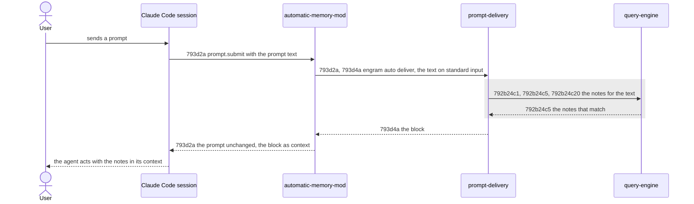

# Automatic Memory - Technical Spec

Filled depth first ([793f3 Depth first](./793f_algorithm.md#793f3-depth-first)): step 3 and step 4 run for one node at a time, in the order of
[793e Automatic Memory - Implementation Plan](./793e_implementation-plan.md#automatic-memory---implementation-plan). Until the last node has been through step 4, this spec is incomplete and not approved. The
"Pending" lines below are the departure recorded in [793b10 Departure: depth-first fill](./793b_decision-log.md#793b10-departure-depth-first-fill). Its
sections follow the [technical spec guide](../../TECHNICAL-SPEC-GUIDE.md#default-structure). The solution-space
analysis, relative option impact and alternative options are omitted by decision ([793b12 Departure: no option analysis](./793b_decision-log.md#793b12-departure-no-option-analysis)): step 3 takes
the minimal components a scenario needs.

New technical requirements take the next free letter under [793d2 Recommended sequence diffs](#793d2-recommended-sequence-diffs) for an interaction requirement (one
per flow) or under [793d4 Recommended component-behavior diffs](#793d4-recommended-component-behavior-diffs) for a behavior requirement (one per component behavior).

## 793d1 Orientation

**The product problem** is [793a1 Problem Statement](./793a_product-spec.md#793a1-problem-statement): the
[agent](./793a_product-spec.md#793a1a-terms) consults the [vault](../../GLOSSARY.md#vault) only when it remembers to,
and the instruction to look first was refused in 6 of 6 headless trials.

**Current behavior.** The agent reaches the vault through its own commands, `engram query` and `engram show`, when a
[skill](../../GLOSSARY.md#skill) or its instructions tell it to. [`engram update`](../../GLOSSARY.md#engram-update)
deploys the skills of `agent-instructions/skills/` into each [harness](../../GLOSSARY.md#harness) it finds, through an
engram-owned root per harness that the harness's skills directory links into
([harness-deploy-sync](../../specs/technical/harness-deploy-sync.md)). `engram query` searches the notes, and the
chunk index when one is configured, for the phrases it is given
([query-engine](../../specs/technical/query-engine.md)).

**Why it is not enough.** Nothing in a [session](../../GLOSSARY.md#session) acts at a
[prompt](./793a_product-spec.md#793a1a-terms) without the agent's help, and `engram update` can install nothing but
skills, which only the agent runs.

**The recommended solution** is three parts. A **mod** is a folder that Claude Code loads as a plugin of function
hooks when it sits in `~/.claude/skills/<name>` (also as a link): its hooks module registers functions for events of
the session, and the `prompt.submit` event runs for each prompt before the prompt enters the session, where a
function may add context that the model reads beside the prompt and the user does not see. (Verified with Claude
Code 2.1.302: a mod in a linked skills folder loads in a headless `claude -p` session; the context it adds is
recorded in the session's [transcript](../../GLOSSARY.md#transcript) as a `hook_additional_context` record before the
agent's first reply.) (1) `engram update` deploys one mod, `engram-memory`, from `agent-instructions/mods/` through
the machinery that deploys the skills. (2) The mod runs a new command, `engram auto deliver`, for each prompt. (3) The
command looks up the [notes](../../GLOSSARY.md#permanent-note) that bear on the prompt text, as `engram query` would,
and prints them as one compact block, which the mod puts beside the prompt. The command, not the mod, holds the logic.

## 793d2 Recommended sequence diffs

### 793d2a Prompt delivery flow

Added interactions are drawn solid; the retained interaction is drawn inside a grey block.



Requirement: 793d2a For each [prompt](./793a_product-spec.md#793a1a-terms) a Claude Code
[session](../../GLOSSARY.md#session) raises, the automatic-memory-mod MUST run `engram auto deliver` with the prompt
text on standard input, MUST add the command's output to the context of the prompt as one block, and MUST leave the
prompt text as it received it.

Owner: automatic-memory-mod (a new component; its canonical file at promotion is `automatic-memory-mod.md`)

Supports: [793a2a1a The next session has memory after one engram update](./793a_product-spec.md#793a2a1-uat-scenarios).

#### 793d2a1 Scenarios

```gherkin
Scenario: 793d2a1a A block is added beside the prompt
  Given a session with the mod installed, and an engram whose auto deliver prints a block
  When a prompt is sent
  Then the command received the prompt text, and the session holds the prompt exactly as sent and then the block as context before the agent's first reply
```

## 793d3 Recommended component diffs

- **automatic-memory-mod** (added): the mod `engram-memory`, a hooks module in `agent-instructions/mods/engram-memory/`
  (realization, informational). Qualification: responsibility, bringing the notes that bear on a prompt to the agent
  at the prompt is stated without naming a function; ownership, the routing and the placement of the block are its
  own, the lookup is the command's; independent verification, it is tested in a real Claude Code session against an
  `engram` that prints a chosen block; stability, it survives any change to how the command finds notes; necessity,
  without it nothing runs at a prompt.
- **prompt-delivery** (added): the command `engram auto deliver` (`internal/cli/auto.go`, `internal/auto`,
  informational). Qualification: responsibility, turning a prompt into the block of notes that bear on it is stated
  without naming a function; ownership, the choice and rendering of notes are its own, the hook is the mod's;
  independent verification, it is tested through its standard input and output over an in-memory vault; stability,
  it survives any change to the mod; necessity, the mod holds no logic.
- **harness-deploy-sync** (updated): plans, links, reports and removes the mod as it does a skill directory.
- **query-engine** (retained): the lookup of notes for text, used as `engram query` uses it.
- **Claude Code's mod runtime** (an external boundary, retained): loads a mod from `~/.claude/skills/<name>`, runs its
  `prompt.submit` function for each prompt, runs the commands it asks for, and carries the context it returns to the
  model. The mod relies on that contract; nothing here tests it.

## 793d4 Recommended component-behavior diffs

### 793d4a Delivering the notes that bear on a prompt

Requirement: 793d4a The prompt-delivery MUST read one JSON object with the prompt's `text` from standard input and
MUST print one block on standard output. The block opens with a line that begins `[engram memory]` and holds one
line for each [note](../../GLOSSARY.md#permanent-note) that bears on the text, in the order the lookup gave them: a
dash, the note's file name, its situation in parentheses, a colon, and the note's body on one line, cut to 400
characters. A note bears on the text when the lookup of
[792b24c5 The matched set](../../specs/technical/query-engine.md#792b24c5-the-matched-set) for the text, as its message and as its only phrase,
returns it as an item that is not a chunk. The lookup's own default limit of
[792b24c1 Input and defaults](../../specs/technical/query-engine.md#792b24c1-input-and-defaults) bounds the number of
lines, as it bounds the number of items the agent's own lookup returns
([793b19 Volume of delivered notes](./793b_decision-log.md#793b19-volume-of-delivered-notes)).

Owner: prompt-delivery (a new component; its canonical file at promotion is `prompt-delivery.md`)

Supports: [793a2a1a The next session has memory after one engram update](./793a_product-spec.md#793a2a1-uat-scenarios).

#### 793d4a1 Scenarios

```gherkin
Scenario: 793d4a1a The notes that bear on the text come back as one block
  Given a vault holding a note that says when the staging database is reset
  When the command is given a prompt asking when the staging database is reset
  Then it prints a block that opens with a line beginning [engram memory] and has one line naming the note, its situation and its body
```

### 793d4b Deploying the mods of the source

Requirement: 793d4b The harness-deploy-sync MUST plan one copy for every file under `agent-instructions/mods/` of the
source for every harness it updates, keeping the file's path relative to that directory and naming the file's
top-level directory as the skill directory it is deployed in, so that a mod is deployed, linked, reported and removed
as a skill directory is. It MUST plan none, without an error, when that directory does not exist.

Owner: [harness-deploy-sync](../../specs/technical/harness-deploy-sync.md)

Supports: [793a2a1a The next session has memory after one engram update](./793a_product-spec.md#793a2a1-uat-scenarios).

#### 793d4b1 Scenarios

```gherkin
Scenario: 793d4b1a Every file of a mod is planned for the harness
  Given a source whose agent-instructions/mods holds the mod engram-memory with three files
  When the mod copies are planned for a harness
  Then each file is planned once under the harness's skills directory, in the engram-memory directory

Scenario: 793d4b1b A source with no mods plans none
  Given a source with no agent-instructions/mods directory
  When the mod copies are planned
  Then none is planned and there is no error
```

## 793d5 Product-scenario mapping

### 793d5a Mapping of 793a2a1a

The product scenario [793a2a1a The next session has memory after one engram update](./793a_product-spec.md#793a2a1-uat-scenarios), restated in full at its first mapping location:

```gherkin
Scenario: 793a2a1a The next session has memory after one engram update
  Given a machine with Claude Code on which the user has never run engram update, and a vault holding a note that says when the staging database is reset
  When the user runs engram update
  And starts a Claude Code session in a project other than the one engram update was run in, and sends a prompt asking when the staging database is reset
  Then the note is in the agent's context before the agent answers
```

Realized by [793d4b Deploying the mods of the source](#793d4b-deploying-the-mods-of-the-source) (the update puts the mod where Claude Code loads it), [793d2a Prompt delivery flow](#793d2a-prompt-delivery-flow) (the mod runs the command for the prompt and puts its output beside the prompt) and [793d4a Delivering the notes that bear on a prompt](#793d4a-delivering-the-notes-that-bear-on-a-prompt) (the command finds the note and prints it).

## 793d6 Recommended impact

- **Repository:** a new directory `agent-instructions/mods/`; a new package `internal/auto` and a new command group
  `engram auto` with the command `deliver`; the update's deploy set gains the mods.
- **Dependencies:** none new in Go. A Claude Code release that loads mods: 2.1.302 is the build this was verified
  with, and the earlier attempt found 2.1.287 the first.
- **Toolchain:** a `targ acceptance` target runs the tests that drive a real Claude Code session; they carry the
  `network` or `integration` build tag, so `targ test` does not run them.
- **Operational:** one process start and one lookup for each prompt, held for at most the bound of
  [793a2d Never in the way](./793a_product-spec.md#793a2d-never-in-the-way) once the hold is built.
- **Risk and complexity:** every prompt of every Claude Code session runs the command; a failure of the command must
  not reach the session ([793a2d Never in the way](./793a_product-spec.md#793a2d-never-in-the-way)), which later nodes build.
