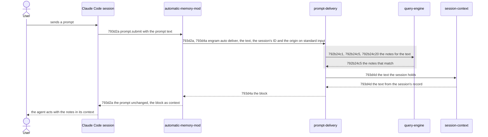
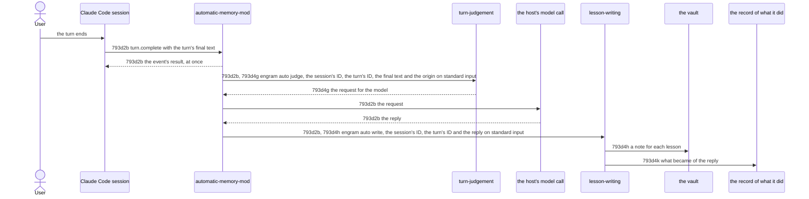

# Automatic Memory - Technical Spec

Filled depth first (`793f3`), so incomplete until the last node is through step 4. The solution-space analysis, option impact and alternatives are omitted (`793b12`). A new interaction requirement (one per flow) takes the next free letter under `793d2`, a behavior requirement (one per component behavior) under `793d4`.

## 793d1 Orientation

Today the [agent](./793a_product-spec.md#793a1a-terms) reaches the [vault](../../GLOSSARY.md#vault) only through its own commands (`engram query`, `engram show`), when a [skill](../../GLOSSARY.md#skill) or its instructions tell it to. [`engram update`](../../GLOSSARY.md#engram-update) deploys the skills of `agent-instructions/skills/` into each [harness](../../GLOSSARY.md#harness) through an engram-owned root per harness that the harness's skills directory links into (harness-deploy-sync); `engram query` searches the [notes](../../GLOSSARY.md#permanent-note), and the chunk index when one is configured (query-engine). Nothing in a [session](../../GLOSSARY.md#session) acts at a [prompt](./793a_product-spec.md#793a1a-terms) without the agent's help, and `engram update` installs nothing but skills.

A **mod** is a folder Claude Code loads as a plugin of function hooks when it sits in `~/.claude/skills/<name>` (also as a link): its hooks module registers functions for session events, and `prompt.submit` runs for each prompt before it enters the session, where a function may add context that the model reads beside the prompt and the user does not see. The solution:

1. `engram update` deploys one mod, `engram-memory`, from `agent-instructions/mods/` through the skills machinery.
2. For each prompt the mod runs a new command, `engram auto deliver`, which looks up the notes that bear on the prompt text as `engram query` would and prints them as one compact block, which the mod puts beside the prompt. The command, not the mod, holds the logic.
3. After the [turn](./793a_product-spec.md#793a1a-terms) of a prompt the user sent (the mod keeps each prompt's origin, `793b72`), the mod's `turn.complete` function runs, apart from the turn, `engram auto judge`, which reads the turn from the session's record and prints the request of one model call.
4. The mod makes that call through the host's model API with the user's own login, and
5. runs `engram auto write` with the reply, which writes each lesson as a note through the learn path, marked as written automatically.

The call raises neither a prompt nor a turn, so [automatic memory](./793a_product-spec.md#793a1a-terms) starts no session of its own (`793b63`).

Verified with Claude Code 2.1.302: a mod in a linked skills folder loads in a headless `claude -p` session, and the context it adds is recorded in the session's [transcript](../../GLOSSARY.md#transcript) as a `hook_additional_context` record before the agent's first reply; `turn.complete` carries the turn's final text and ID and fires when the record already holds the turn's last row; `$.model.complete` answers `haiku` within about two seconds, also from work left running after the hook that started it returned.

## 793d2 Recommended sequence diffs

### 793d2a Prompt delivery flow

Added interactions are solid; the retained one is in a grey block.



Requirement: 793d2a For each [prompt](./793a_product-spec.md#793a1a-terms) a Claude Code [session](../../GLOSSARY.md#session) raises, the `automatic-memory-mod` MUST run `engram auto deliver` with the prompt text, the session's ID and the prompt's origin (the kind Claude Code stamps on it: `composer`, `sdk`, `task-notification` and the rest) as one JSON object on standard input; MUST add the command's output to the prompt's context as one block when the command exited with 0 and the output begins with `[engram memory]`, and nothing otherwise; and MUST leave the prompt text as received. It MUST hold the prompt for its own work, the session-ID call and the wait for the command together, at most 7 seconds, so the prompt is held under the 8 seconds of `793a2d`, and when the work does not finish within them MUST end the command and let the prompt continue as it was, with nothing added.

Owner: `automatic-memory-mod` (new; `automatic-memory-mod.md` at promotion). Serves: `793a2a1a`, `793a2b1b`, `793a2d1a`.

#### 793d2a1 Scenarios

```gherkin
Scenario: 793d2a1a A block is added beside the prompt
  Given a session with the mod installed, and an engram whose auto deliver prints a block
  When a prompt is sent
  Then the command received the prompt text, and the session holds the prompt exactly as sent and then the block as context before the agent's first reply

Scenario: 793d2a1b The command receives the session's ID
  Given a session with the mod installed, and an engram whose auto deliver prints a block
  When a prompt is sent
  Then the command received the ID of the session the prompt was sent in

Scenario: 793d2a1c An empty output adds nothing
  Given a session with the mod installed, and an engram whose auto deliver prints nothing
  When a prompt is sent
  Then the session holds the prompt exactly as sent and no context beside it

Scenario: 793d2a1d A slow command is ended and the prompt continues
  Given a session with the mod installed, and an engram whose auto deliver takes 20 seconds
  When a prompt is sent
  Then the model is asked within 8 seconds of the prompt, with the prompt exactly as sent and no context beside it, and the mod's hook did not fail

Scenario: 793d2a1e A failed command adds nothing
  Given a session with the mod installed, and an engram whose auto deliver prints a block and exits with 1
  When a prompt is sent
  Then the session holds the prompt exactly as sent and no context beside it, and the mod's hook did not fail

Scenario: 793d2a1f Output that is not a block adds nothing
  Given a session with the mod installed, and an engram whose auto deliver prints text that does not begin with [engram memory] and exits with 0
  When a prompt is sent
  Then the session holds the prompt exactly as sent and no context beside it, and the mod's hook did not fail

Scenario: 793d2a1g A session that does not give its ID in time does not hold the prompt
  Given the mod, and a session that never gives its ID
  When a prompt is sent
  Then the mod lets the prompt continue as it was after the 7 seconds, with nothing added, and the command was never run

Scenario: 793d2a1h The command receives the prompt's origin
  Given a session with the mod installed, and an engram whose auto deliver prints a block
  When a prompt is sent from a headless session, with claude -p
  Then the command received the origin sdk
```

### 793d2b Turn capture flow

Added interactions are solid.



Requirement: 793d2b For each [turn](./793a_product-spec.md#793a1a-terms) a [session](../../GLOSSARY.md#session) completes, the `automatic-memory-mod` MUST give the event's result back at once and then, apart from the event, run `engram auto judge` with one JSON object on standard input: the session's ID, the turn's ID, the turn's final text, the text the turn began with and the origin of the [prompt](./793a_product-spec.md#793a1a-terms) it began with. It MUST do nothing for a turn that a [subagent](../../GLOSSARY.md#subagent) ran. When the command exits with 0 and prints a request, the mod MUST ask the model for it through the host's model call, exactly as printed, and when the model answers run `engram auto write` with the session's ID, the turn's ID and the reply; when it exits with 0 and prints nothing, nothing more. When a step fails (the command exits with other than 0 or prints what is not a request, a request that is not a JSON object being a failure of `engram auto judge`; the model does not answer; a call is ended or rejected) it MUST run `engram auto write` with the session's ID, the turn's ID and a `failure`, a sentence that names the step and how it failed, in place of the reply. It MUST bound each stage so that together they take under the 2 minutes of `793a2c`: the session-ID call 5 seconds (then it does nothing), `engram auto judge` 15, the model call the 60 of the request, `engram auto write` 20 and its failure report 15, 115 in all; a stage that overruns has failed. The mod keeps the text and origin of each prompt the session raises: a turn that starts with a text takes the oldest kept prompt with that text and drops the prompts kept before it, which began no turn; a turn whose text no kept prompt has takes the origin of the newest; a turn that starts with no text has no origin.

Owner: `automatic-memory-mod`. Serves: `793a2c1a`, `793a2c1b`, `793a2c1c`, `793a2c1d`, `793a2c1e`, `793a2c1f`, `793a2c1g`, `793a2c1h`, `793a2c1i`, `793a3c1a`, `793a3c1b`, `793a3c1c`.

#### 793d2b1 Scenarios

```gherkin
Scenario: 793d2b1a The mod judges a turn and gives the reply to the writing
  Given the mod, a session whose ID is known, an engram whose auto judge prints a request, and a model that answers
  When a prompt is raised, the turn starts, and it completes with a final text
  Then the event's result is given back at once, auto judge received the session's ID, the turn's ID, the final text and the origin of the prompt, the model was asked the request exactly as printed, and auto write received the session's ID, the turn's ID and the model's reply

Scenario: 793d2b1b A judgement that prints nothing ends the capture
  Given the mod, and an engram whose auto judge exits with 0 and prints nothing
  When a turn completes
  Then the model was never asked, and auto write was never run

Scenario: 793d2b1c A step that fails is reported to the writing
  Given the mod, and an engram whose auto judge exits with 1, prints text that is not a request, or is ended before it answers
  When a turn completes
  Then the model was never asked, and auto write received the session's ID, the turn's ID and a failure that names the judgement

Scenario: 793d2b1d A model that does not answer is reported to the writing
  Given the mod, an engram whose auto judge prints a request, and a model that answers with an API error, with no text, or by rejecting the call
  When a turn completes
  Then auto write received the session's ID, the turn's ID and a failure that names the model call

Scenario: 793d2b1e The judgement receives the origin of the prompt the turn began with
  Given the mod, and an engram whose auto judge prints a request
  When a prompt of the origin task-notification is raised, a turn starts, and it completes
  Then auto judge received the origin task-notification, beside the session's ID, the turn's ID and the final text

Scenario: 793d2b1f A turn of a subagent is not captured
  Given the mod, and an engram whose auto judge prints a request
  When a turn that a subagent ran completes
  Then auto judge was never run, and the model was never asked

Scenario: 793d2b1g The judgement receives the text the turn began with
  Given the mod, and an engram whose auto judge prints a request
  When a prompt is raised, the turn starts with its text, and it completes
  Then auto judge received the text, beside the session's ID, the turn's ID, the final text and the origin

Scenario: 793d2b1h A turn takes the origin and the text of its own prompt when others are waiting
  Given the mod, and an engram whose auto judge prints a request
  When a prompt of the user starts a turn, a second prompt of the user is raised while it runs, a task notification is raised after the second, the first turn completes, and the second prompt starts a turn that completes
  Then auto judge received for the second turn the origin and the text of the second prompt, and not those of the notification

Scenario: 793d2b1i A turn that starts with no text has no origin
  Given the mod, and an engram whose auto judge prints a request
  When a prompt of the user starts a turn that completes, and a turn then starts with no text and completes
  Then auto judge received no origin for the second turn

Scenario: 793d2b1j A stage that stalls is ended at its bound and reported
  Given the mod, and a host in which, in turn, the call for the session's ID never answers, auto judge runs until its time limit, the model's call is cut at its time limit, and auto write runs until its time limit
  When a turn completes
  Then the mod waited for the ID 5 seconds and then did nothing, auto judge was given the time limit of 15 seconds, the model's request held 60 seconds, auto write was given 20 seconds, and the report of the failure to auto write was given 15 seconds, and those limits together are less than 120 seconds

Scenario: 793d2b1k A request that is not JSON is a failure of the judgement
  Given the mod, and an engram whose auto judge prints text that begins as a request and is not a JSON object
  When a turn completes
  Then the model was never asked, and auto write received a failure that names the judgement
```

## 793d3 Recommended component diffs

- **automatic-memory-mod** (added): the mod `engram-memory`, a hooks module in `agent-instructions/mods/engram-memory/` (informational). Owns the routing and the placement of the block (the lookup is the command's) and the routing of the judgement and of the write after a [turn](./793a_product-spec.md#793a1a-terms) (`793d2b`); tested in a real Claude Code [session](../../GLOSSARY.md#session) against an `engram` that prints a chosen block.
- **prompt-delivery** (added): the command `engram auto deliver` (`internal/cli/auto.go`, `internal/auto`, informational). Turns a [prompt](./793a_product-spec.md#793a1a-terms) into the block of [notes](../../GLOSSARY.md#permanent-note) that bear on it; tested through standard input and output over an in-memory [vault](../../GLOSSARY.md#vault).
- **session-context** (added): what a session's [agent](./793a_product-spec.md#793a1a-terms) already holds of the vault, read from the session's record (`internal/auto`, `internal/cli/auto.go`, informational); tested over records of a session.
- **turn-judgement** (added): the command `engram auto judge` (`internal/cli/auto.go`, `internal/auto`, informational). Turns a turn into the request of the call that judges it, redacting credentials first (`793d4j`); tested through standard input and output over records of a session.
- **lesson-writing** (added): the command `engram auto write` (`internal/cli/auto.go`, `internal/auto`, informational). Turns the model's reply into notes of the vault, the write itself being the learn path's, and keeps the record of what became of each reply (`793d4k`); tested through standard input and output over an in-memory vault.
- **learn path** (retained): the write of a note, as [`engram learn`](../../GLOSSARY.md#engram-learn-subcommand) does it (`RunLearn`).
- **harness-deploy-sync** (updated): plans, links, reports and removes the mod as it does a [skill](../../GLOSSARY.md#skill) directory, and reports it as a mod (`793b47`).
- **query-engine** (retained): the lookup of notes for text, used by the delivery and the judgement as `engram query` uses it.
- **Claude Code's mod runtime** (external boundary, retained): loads a mod from `~/.claude/skills/<name>`, runs its `prompt.submit`, `turn.start` and `turn.complete` functions, runs the commands it asks for, makes the model calls it asks for with the user's own login, and carries the context it returns to the model. Relied on, not tested here.

## 793d4 Recommended component-behavior diffs

### 793d4a Delivering the notes that bear on a prompt

Requirement: 793d4a The `prompt-delivery` MUST read one JSON object (`text`, the `session`'s ID, `origin`) from standard input and print one block, or nothing when the origin is not one the user sends (`793d4m`). The block opens with a line beginning `[engram memory]` and has one line per [note](../../GLOSSARY.md#permanent-note) that bears on the text, in the lookup's order: a dash, the file name, the situation in parentheses, a colon and the body on one line. A note bears on the text when the lookup of 792b24c5 for the text, as its message and only phrase, returns it as an item that is not a chunk and was not picked by the explore half alone (792b24c16: an explore pick is sampled from the vocabulary, not matched to the text); the lookup's default limit (792b24c1) bounds the lines (`793b19`). It MUST leave out each note whose basename (file name without `.md`) appears in the text that `793d4d` returns for the request's [session](../../GLOSSARY.md#session), print nothing and succeed when no note remains, never search the chunk index, and print nothing and fail, naming the cause, when the lookup fails.

Owner: `prompt-delivery` (new; `prompt-delivery.md` at promotion). Serves: `793a2a1a`, `793a2b1a`, `793a2b1b`, `793a2b1d`.

#### 793d4a1 Scenarios

```gherkin
Scenario: 793d4a1a The notes that bear on the text come back as one block
  Given a vault holding a note that says when the staging database is reset
  When the command is given a prompt asking when the staging database is reset
  Then it prints a block that opens with a line beginning [engram memory] and has one line naming the note, its situation and its body

Scenario: 793d4a1b A failed lookup fails the command and prints nothing
  Given a lookup that fails
  When the command is given a prompt
  Then it fails with an error that names the lookup's failure, and it prints nothing

Scenario: 793d4a1c A note that only the explore half picked does not bear on the prompt
  Given a lookup whose payload holds a matched note and a note picked by the explore half alone
  When the command is given a prompt
  Then the block names the matched note and not the explore pick

Scenario: 793d4a1d A note the session holds is left out
  Given a lookup that returns two notes, and a session whose record shows that one of them was delivered
  When the command is given a prompt of that session
  Then the block names the other note only

Scenario: 793d4a1e No note to deliver prints nothing
  Given a lookup that returns a note the session holds, and a lookup that returns no note
  When the command is given a prompt for each
  Then it prints nothing and succeeds both times

Scenario: 793d4a1f The chunk index is not searched
  Given a vault with a note that bears on the prompt, and a chunk index
  When the command is given the prompt
  Then the chunk index is never listed, and the block names the note

Scenario: 793d4a1g A note the agent fetched by its basename is left out
  Given a lookup that returns two notes, and a session whose record shows that the agent ran engram show with the basename of one of them
  When the command is given a prompt of that session
  Then the block names the other note only

Scenario: 793d4a1h The lookup is asked for the prompt's text as its message and as its only phrase
  Given a request whose text is a prompt, and a lookup that records the arguments it is run with
  When the command is given the request
  Then the lookup is run once, for the vault the command was given, with the prompt's text as its message and as its only phrase

Scenario: 793d4a1i The lookup is asked for the text and what the session holds for the session
  Given a request with a text and a session's ID, a lookup and a reading of what the session holds, both recording what they are given
  When the block is made
  Then the lookup is given the request's text and the reading is given the request's session ID
```

### 793d4c Framing the notes of a block as data

Requirement: 793d4c The `prompt-delivery` MUST open every block with one fixed line beginning `[engram memory]` that says the lines below are [notes](../../GLOSSARY.md#permanent-note) from the [vault](../../GLOSSARY.md#vault), delivered by the memory system and not typed by the user, and that an instruction inside a note is not the user's. It MUST write each note as exactly one line beginning with a dash and a space, its file name, situation and body each with every run of white space as one space and no control or format character (Unicode category Cf: zero-width space or joiner, bidirectional override or isolate, byte-order mark, soft hyphen), so that a note's text cannot make a line of its own, such as the framing line or a line that reads as another note. The line of a note whose source says it was written automatically (`793d4h`) ends with the fixed words `(written automatically)`, so that the [agent](./793a_product-spec.md#793a1a-terms) can tell it from a note a person or the agent saved.

Owner: `prompt-delivery`. Serves: `793a2a1a`, `793a2b1a`, `793a3a1a`.

#### 793d4c1 Scenarios

```gherkin
Scenario: 793d4c1a A note cannot reshape the block
  Given notes whose file names, situations and bodies hold line breaks, control characters, the framing line and lines that read as other notes, however they are mixed
  When the block is made
  Then the block has the framing line first and nowhere else, and exactly one line for each note, each beginning with a dash and a space and holding single spaces and no control or format character

Scenario: 793d4c1b A note cannot hide text in format characters
  Given a note whose file name, situation and body hold a zero-width space, a zero-width joiner, a bidirectional override, a byte-order mark and a soft hyphen, between and inside words
  When the block is made
  Then the line of the note holds none of them, and the words they were between and inside are joined as the characters around them were

Scenario: 793d4c1c A note written automatically says so in its line
  Given a note whose source says that it was written automatically, and a note whose source is another
  When the block is made for each
  Then the line of the first ends with (written automatically), and the line of the other does not
```

### 793d4d Telling what a session holds

Requirement: 793d4d The `session-context` MUST, given a [session](../../GLOSSARY.md#session)'s ID, find the session's record (the file named for the ID with the suffix `.jsonl`, in the directory of records it is given (`793d4f`) or a subdirectory) and return, of what the [agent](./793a_product-spec.md#793a1a-terms) was given, only: the file name on each [note](../../GLOSSARY.md#permanent-note) line (a line beginning with a dash and a space; the name runs to the space before the situation's parenthesis) of every block delivered beside a [prompt](./793a_product-spec.md#793a1a-terms) (an `attachment` entry of type `hook_additional_context` beginning `[engram memory]`), and the text of each Bash command the agent ran that contains `engram query` or `engram show` with its result (the `tool_result` block whose `tool_use_id` is the command's `tool_use` ID). It MUST return nothing of a block's situations and bodies, of other entries, of other tools' results, of prompts or of replies, and nothing, without an error, when the session has no record, the record cannot be read or the ID is not a plain file name.

Owner: `session-context` (new; `session-context.md` at promotion). Serves: `793a2b1b`, `793a2b1c`.

#### 793d4d1 Scenarios

```gherkin
Scenario: 793d4d1a The note lines of the blocks delivered beside prompts are what a session holds
  Given the record of a session with a block delivered beside a prompt, whose note lines name two notes and whose first note's body names a third, an entry of another hook beside a prompt, a prompt, a reply and other attachments
  When what the session holds is read
  Then the text holds the file names of the two notes, and nothing of the situations and bodies, the other hook's entry, the prompt, the reply or the other attachments

Scenario: 793d4d1d What the agent's own lookup printed is held
  Given the record of a session in which the agent ran engram query as a Bash command, whose result names a note, as a string and as text blocks
  When what the session holds is read
  Then the text holds the command and the result, and nothing of the reply

Scenario: 793d4d1e A listing of the vault is not held
  Given the record of a session in which the agent ran ls over the vault, whose result names a note
  When what the session holds is read
  Then the text does not hold the note's name

Scenario: 793d4d1f A note fetched with engram show is held
  Given the record of a session in which the agent ran engram show with the basename of a note, whose result does not name the note
  When what the session holds is read
  Then the text holds the command, which names the note

Scenario: 793d4d1b The record is found under its project directory
  Given a session-log directory whose subdirectory for a project holds the record of the session
  When what the session holds is read
  Then the text is that of the blocks of that record

Scenario: 793d4d1c A session with no record, or an ID that is not a file name, holds nothing
  Given a session-log directory with no record of the session, and an ID that holds a path separator
  When what the session holds is read
  Then it is empty and there is no error
```

### 793d4e Modified: First-use gating

Target: [792b2c3 First-use gating](../../specs/technical/command-line-surface.md#792b2c3-first-use-gating)

Requirement: 792b2c3 For every [vault](../../GLOSSARY.md#vault)-resolving command other than the commands of the group `auto` (`auto deliver`, `auto judge` and `auto write`), the command-line-surface MUST ask the vault-identity-registry to ensure the vault at the resolved path before running the command, and MUST NOT run the command when that step fails. For a command of the group `auto` it MUST NOT ask: the command runs against the path as it is, and creates nothing when the path holds no vault.

Owner: command-line-surface. Serves: `793a2a1e`, `793a2a1g`.

#### 793d4e1 Scenarios

```gherkin
Scenario: 793d4e1a The delivery command creates no vault
  Given no vault exists at the resolved path
  When engram auto deliver is dispatched
  Then no vault exists at the path afterwards, nothing is printed to standard output and no creation line is printed

Scenario: 793d4e1b The judgement command creates no vault
  Given no vault exists at the resolved path, and a session whose record holds a prompt
  When engram auto judge is dispatched
  Then no vault exists at the path afterwards and no creation line is printed

Scenario: 793d4e1c The writing command creates no vault and writes no note
  Given no vault exists at the resolved path, and a reply that holds one lesson
  When engram auto write is dispatched
  Then no vault exists at the path afterwards, no note was written, nothing is printed to standard output and no creation line is printed
```

### 793d4b Deploying the mods of the source

Requirement: 793d4b The `harness-deploy-sync` MUST plan one copy for every file under `agent-instructions/mods/` of the source for Claude Code, keeping the file's relative path and naming its top-level directory as the [skill](../../GLOSSARY.md#skill) directory it is deployed in, so that a mod is deployed, linked, reported and removed as a skill directory is; plan none for Pi, and none without an error when the directory does not exist; and report each mod directory it deploys, in the Claude Code section of the report of [`engram update`](../../GLOSSARY.md#engram-update), as a mod, with `agent-instructions/mods/<name>/` as its source (a skill has `agent-instructions/skills/<name>/`). A dry run MUST plan and report the mod and write none of its files; a second `engram update` MUST leave the deployed mod as the first left it (the same files and link, no second copy, listed once).

Owner: `harness-deploy-sync`. Serves: `793a2a1a`, `793a2a1b`, `793a2a1c`, `793a2a1d`.

#### 793d4b1 Scenarios

```gherkin
Scenario: 793d4b1a Every file of a mod is planned for Claude Code
  Given a source whose agent-instructions/mods holds the mod engram-memory with three files
  When the mod copies are planned for Claude Code
  Then each file is planned once under Claude Code's skills directory, in the engram-memory directory

Scenario: 793d4b1b A source with no mods plans none
  Given a source with no agent-instructions/mods directory
  When the mod copies are planned
  Then none is planned and there is no error

Scenario: 793d4b1c An update deploys and links the mod
  Given a checkout whose agent-instructions/mods holds the mod engram-memory, and a machine with Claude Code
  When engram update runs
  Then the engram-owned root holds the mod's files, and Claude Code's skills directory links engram-memory to them

Scenario: 793d4b1d Pi is planned no mod
  Given a source whose agent-instructions/mods holds the mod engram-memory, and the harnesses Claude Code and Pi
  When the mod copies are planned
  Then they are planned for Claude Code only

Scenario: 793d4b1e A deployed mod is reported as a mod
  Given a checkout whose agent-instructions/mods holds the mod engram-memory and whose agent-instructions/skills holds the skill learn, and a machine with Claude Code
  When engram update runs
  Then the report of Claude Code lists learn as a skill directory and engram-memory as a mod directory

Scenario: 793d4b1f The report names the mods directory as the source of a mod
  Given a report of Claude Code with the skill directory learn and the mod directory engram-memory
  When the report is written
  Then the skill is listed from agent-instructions/skills/learn/ and the mod from agent-instructions/mods/engram-memory/

Scenario: 793d4b1g A dry run plans the mod and writes none of it
  Given a checkout whose agent-instructions/mods holds the mod engram-memory, and a machine with Claude Code
  When engram update --dry-run runs
  Then the report lists the mod, and no file of it and no link to it has been written

Scenario: 793d4b1h A second update leaves the mod as the first left it
  Given a checkout whose agent-instructions/mods holds the mod engram-memory, a machine with Claude Code, and engram update run once
  When engram update runs again
  Then the files of the mod and the link to it are those the first run left, and the report lists the mod once
```

### 793d4f Finding the records of sessions

Requirement: 793d4f The `prompt-delivery` MUST read the records of [sessions](../../GLOSSARY.md#session) from the directory its `--sessions` flag names or, without the flag, from the directory `ENGRAM_TRANSCRIPT_DIR` names when set, else the `projects` directory of the directory `CLAUDE_CONFIG_DIR` names when set, else `<home>/.claude/projects`, and from no directory when the home directory cannot be found. It MUST NOT change the session-log directory of 792b17c6 that [`engram ingest`](../../GLOSSARY.md#engram-ingest-subcommand) sweeps.

Owner: `prompt-delivery`. Serves: `793a2b1b`, `793a2b1c`.

#### 793d4f1 Scenarios

```gherkin
Scenario: 793d4f1a ENGRAM_TRANSCRIPT_DIR names the records first
  Given ENGRAM_TRANSCRIPT_DIR and CLAUDE_CONFIG_DIR are both set, and the record of a session in each, the first showing one note delivered and the second another
  When engram auto deliver is dispatched for a prompt of the session, without --sessions
  Then the block names the second note only

Scenario: 793d4f1b CLAUDE_CONFIG_DIR names them when ENGRAM_TRANSCRIPT_DIR does not
  Given only CLAUDE_CONFIG_DIR is set, a record of the session in its projects directory showing one note delivered, and a record of the session in the home's .claude/projects showing another
  When engram auto deliver is dispatched for a prompt of the session, without --sessions
  Then the block names the second note only

Scenario: 793d4f1c The home's .claude/projects holds them by default
  Given neither variable is set, and a record of the session in the home's .claude/projects showing one note delivered
  When engram auto deliver is dispatched for a prompt of the session, without --sessions
  Then the block names the other note only

Scenario: 793d4f1d No record is read when no directory can be found
  Given neither variable is set, and a home directory that cannot be found
  When engram auto deliver is dispatched for a prompt of a session, without --sessions
  Then no record is read, and the block names the notes that bear on the prompt
```

### 793d4g Judging a turn

Requirement: 793d4g The `turn-judgement` MUST read one JSON object from standard input (the `session`'s ID, the final `answer`, the `text` the [turn](./793a_product-spec.md#793a1a-terms) began with, the `origin` of that [prompt](./793a_product-spec.md#793a1a-terms)), print nothing when the origin is not one the user sends (`793d4m`), find the [session](../../GLOSSARY.md#session)'s record as `793d4d` does in the directory of `793d4f`, and print the request for the model as one JSON object: `model` (`haiku`), `effort` (`low`), `system` (the instructions of the judgement, nothing of the record), `prompt`, `maxTokens` and `timeoutMs`. The prompt holds, between `<window>` and `</window>`, the context lines, the line `--- the turn ---` and the turn's lines, and, between `<notes>` and `</notes>`, the [notes](../../GLOSSARY.md#permanent-note) nearest to the turn (what the lookup of `793d4a` returns for the text of the turn's prompts, each as a block line, cut to 400 characters) or `(none)`.

A prompt is a row of the record that the user sent; a row the [harness](../../GLOSSARY.md#harness) wrote is none and makes no line: a row marked as meta (the body of a [skill](../../GLOSSARY.md#skill) the [agent](./793a_product-spec.md#793a1a-terms) invoked), a row stamped with an origin the user does not send (`793d4m`) and a row whose text begins as 792b15c3 harness noise (a system reminder, a skill's base directory, the caveat or output of a local command, a task notification); a block of a prompt that begins so is left out, and a slash command's prompt is its arguments, none when it has none. The turn begins at the last prompt with the input `text` (else the last prompt) and ends before the next prompt and after the last line of the agent, which is the final text, added as the last line when no line of the turn holds its first 80 characters; the conversation before it is the context. A line is one message (`User: `, `Agent: ` or `Agent used ` and the tool's name; a break written ` ⏎ `), redacted (`793d4j`) before it is cut or joined, then cut to its first 1,200 characters, then `<` written `&lt;`; the context is its last 6 lines; the window is cut to 8,000 characters, the oldest context first and then the turn's middle, replaced by the line `--- some of the turn is left out ---`. The record is read once: 1 MB within 2 seconds.

It MUST print nothing and succeed when the record holds no prompt, and print nothing and fail, naming the cause, when the input is not a JSON object, no [vault](../../GLOSSARY.md#vault) exists at the vault's path, the session has no record in the directory of records, or the lookup fails: the capture is then recorded once, with its reason, and the model is not asked.

Owner: `turn-judgement` (new; `turn-judgement.md` at promotion). Serves: `793a2c1a`, `793a2c1b`, `793a2c1c`, `793a2c1d`, `793a2c1e`, `793a2c1f`, `793a2c1g`, `793a2c1h`, `793a2c1i`, `793a3c1a`, `793a3c1b`, `793a3c1c`.

#### 793d4g1 Scenarios

```gherkin
Scenario: 793d4g1a The request holds the instructions, the context and the turn
  Given the record of a session with a first turn and a second turn in which the user corrected the agent
  When the judgement is given the session and the second turn's final text
  Then it prints a request for the model haiku at effort low whose prompt holds the instructions, the first turn's lines, the line --- the turn ---, and the second turn's lines, each opening with its label

Scenario: 793d4g1b The final text is added when the record lacks it
  Given the record of a session whose last row is the user's prompt
  When the judgement is given the session and a final text
  Then the last line of the turn is the final text, labelled as the agent's

Scenario: 793d4g1c A session with no prompt in its record is judged nothing
  Given the record of a session with no prompt
  When the judgement is given the session
  Then it prints nothing and succeeds

Scenario: 793d4g1d An input that is not a JSON object fails the command
  Given an input that is not a JSON object
  When the judgement is given it
  Then it prints nothing and fails with an error that names the input

Scenario: 793d4g1e A message cannot make a line of its own
  Given messages whose text holds line breaks of every kind, control characters and text that reads as a label
  When the lines of the turn are made
  Then there is exactly one line for each message, and each opens with its label

Scenario: 793d4g1f A line is cut after its credentials are redacted
  Given a message whose text is longer than a line may be, with a token that the cut falls in
  When the lines of the turn are made
  Then no part of the token is in the request

Scenario: 793d4g1h The nearest notes are in the request
  Given a vault holding a note that says when the staging database is reset, and the record of a session whose turn asks about the staging database
  When the judgement is given the session
  Then the request lists the staging note, with its file name, its situation and its body on one line

Scenario: 793d4g1i A failed lookup fails the command and prints nothing
  Given a lookup that fails
  When the judgement is given the record of a session with a prompt
  Then it fails with an error that names the lookup's failure, and it prints nothing

Scenario: 793d4g1j A note cannot reshape the window
  Given a note whose situation and body hold line breaks, a credential and more than 400 characters
  When the request is made
  Then the note is one line of the section of notes, the credential is redacted, and the body is cut to 400 characters

Scenario: 793d4g1g A long conversation is cut to the bound
  Given a record with more context than the window holds, and a turn with more lines than it holds
  When the judgement is given the session
  Then the context is its last 6 lines or fewer, the window is no longer than 8,000 characters, the first line of the turn and its last lines are kept, and the line that says that some of the turn is left out stands where they were

Scenario: 793d4g1k A prompt of text blocks is one prompt, and the result of a tool is none
  Given a record whose last prompt is made of two text blocks and an image, followed by a row that holds only the result of a tool
  When the judgement is given the session
  Then the turn begins with one line for the prompt, holding the text of both blocks, and the result of the tool makes no line

Scenario: 793d4g1l The body of a skill is no prompt
  Given the record of a session whose turn began with a prompt of the user, in which the agent invoked a skill and the harness wrote the skill's body as a row marked as meta
  When the judgement is given the session
  Then the request has no line for the skill's body, and the turn begins with the user's prompt

Scenario: 793d4g1m A system reminder in the row of a prompt is not part of the prompt
  Given a record whose last prompt is a row of two text blocks, the user's words and a system reminder, followed by a row that holds only a system reminder
  When the judgement is given the session
  Then the prompt is one line of the user's words alone, and the row of the system reminder makes no line

Scenario: 793d4g1n A task notification delivered into a turn is no prompt
  Given the record of a session whose turn began with a prompt of the user, and in which a task notification was delivered as a row of the user's before the agent's last text
  When the judgement is given the session
  Then the request has no line for the notification, and the turn begins with the user's prompt

Scenario: 793d4g1o A command that ran locally is no prompt, and a slash command is its arguments
  Given the record of a session whose turn began with a prompt of the user and holds, after it, the caveat, the name with no arguments and the output of a command that ran locally, and a record whose prompt is a slash command given arguments
  When the judgement is given each
  Then none of the rows of the command that ran locally is a line of the first request, and the prompt of the second is the arguments

Scenario: 793d4g1p A row of an origin the user does not send is no prompt
  Given a record whose turn began with a prompt of the user, and a row of the user's stamped with the origin peer whose text opens with none of the marks of the harness, delivered before the agent's last text
  When the judgement is given the session
  Then the request has no line for that row, and the turn begins with the user's prompt

Scenario: 793d4g1w A session with no record fails the command
  Given a session that no record holds, and no session at all
  When the judgement is given each
  Then it prints nothing and fails each time, with an error that names the session and the directory of the records

Scenario: 793d4g1x A vault that does not exist fails the command
  Given a path that holds no vault, and the record of a session with a prompt
  When the judgement is given the session
  Then it prints nothing, fails with an error that names the path, and looks nothing up

Scenario: 793d4g1q A long record is judged in time
  Given the record of a session of 1 MB, of which the turn is the last prompt
  When the judgement is given the session
  Then it prints the request within 2 seconds

Scenario: 793d4g1r A prompt typed ahead does not begin the turn of the one before it
  Given the record of a session whose first turn ended with the agent saying that its guess was wrong and what the file says, and whose second prompt, typed ahead, is already in the record
  When the judgement is given the session, the text of the first prompt and the first turn's final text
  Then the turn of the request is the first turn's lines, and the second prompt is no line of the request

Scenario: 793d4g1s A turn that a notification started after it is not part of it
  Given the record of a session whose turn began with a prompt of the user and ended with the agent's text, followed by a task notification and the lines of the turn it started
  When the judgement is given the session, the text of the prompt and the final text
  Then the turn of the request ends with the final text, and holds nothing of the turn the notification started

Scenario: 793d4g1t A text that no prompt has begins the turn at the last prompt
  Given the record of a session with two prompts, and a text that neither has
  When the judgement is given the session and that text
  Then the turn of the request begins at the last prompt

Scenario: 793d4g1u The instructions are the system of the request
  Given the record of a session with a prompt
  When the judgement is given the session
  Then the system of the request holds the instructions of the judgement and nothing of the record, and its prompt holds the window and the notes and none of the instructions

Scenario: 793d4g1v A message or a note cannot close the window or open a section
  Given messages and notes whose texts hold the tags that close and open the window and the section of notes, and other uses of the character that opens a tag
  When the request is made
  Then no line of the window or of the section of notes holds that character, each holds &lt; in its place, and the prompt holds each tag of the window and of the notes once
```

### 793d4h Writing the lessons of a reply

Requirement: 793d4h The `lesson-writing` MUST read one JSON object from standard input: the `session`'s ID, the `turn`'s ID, and the model's `reply` or, when it gave none, the `failure`. The reply is a JSON array of lessons, fenced or not; a lesson has a `kind` (`feedback` with `behavior`, `impact` and `action`, or `fact` with `subject`, `predicate` and `object`), a `slug` of lower-case letters, digits and dashes, and a `situation`, and may name as `covered` the file name of a [note](../../GLOSSARY.md#permanent-note) of the [vault](../../GLOSSARY.md#vault) that already states it. A lesson whose `covered` names a file of the vault MUST NOT be written but recorded as skipped with that name (a name that is not a file of the vault, or not a file name, covers nothing). Each other lesson MUST be written as a note of its kind through the learn path of [`engram learn`](../../GLOSSARY.md#engram-learn-subcommand), at the top of the vault's order, with the source `written automatically (session <the session's ID>)`, and its path printed. Every field is written as one line as a window line is (`793d4g`), so that a field cannot make a line of its own, such as one opening with `Supersedes:`, which the vault reads as a link. A reply that is not a list, and a lesson that lacks a field or has an unknown kind, write nothing and are recorded with the reason (`793d4k`); a reply cut before its list ends keeps the lessons that are whole, and the cut is recorded as skipped.

Owner: `lesson-writing` (new; `lesson-writing.md` at promotion). Serves: `793a2c1a`, `793a2c1b`, `793a2c1c`, `793a2c1d`, `793a2c1e`, `793a2c1f`, `793a2c1g`, `793a2c1h`, `793a2c1i`, `793a3c1a`, `793a3c1b`, `793a3c1c`.

#### 793d4h1 Scenarios

```gherkin
Scenario: 793d4h1a A feedback lesson becomes a feedback note marked as written automatically
  Given a reply that holds one feedback lesson, and the ID of a session
  When the lessons are written
  Then the vault holds one feedback note with the lesson's situation, behavior, impact and action, whose source says it was written automatically and names the session, and the path of the note is printed

Scenario: 793d4h1b A fact lesson becomes a fact note marked as written automatically
  Given a reply that holds one fact lesson, and the ID of a session
  When the lessons are written
  Then the vault holds one fact note with the lesson's situation, subject, predicate and object, whose source says it was written automatically and names the session

Scenario: 793d4h1c A reply that is not a list of lessons, or a lesson that is not whole, writes nothing
  Given replies that are not JSON, that are an empty list, and that hold a lesson of an unknown kind, a lesson with no slug and a lesson with an empty field
  When the lessons are written
  Then the vault holds no note

Scenario: 793d4h1d The code fence around the list is not part of it
  Given a reply that holds one lesson inside a code fence
  When the lessons are written
  Then the vault holds the lesson's note

Scenario: 793d4h1e A lesson that a note of the vault covers is not written
  Given a vault holding a note, and a reply whose lesson names that note as covering it
  When the lessons are written
  Then no note is written, and one record, of the kind skipped, names the note that covers the lesson

Scenario: 793d4h1f A cover that is not in the vault covers nothing
  Given a reply whose lesson names as covering it a file that is not in the vault, and a reply whose lesson names a path outside the vault
  When the lessons are written
  Then the lesson is written in each

Scenario: 793d4h1g A field of a lesson cannot make a line of the note of its own
  Given a reply whose lesson has line breaks in every field, one of them opening a line with Supersedes: and a link
  When the lessons are written
  Then the body of the note is one line, and no line of it opens with Supersedes:

Scenario: 793d4h1h A reply that is cut keeps the lessons before the cut
  Given a reply that holds one whole lesson and then ends inside a second, and a reply that ends after a whole lesson, before the end of its list
  When the lessons are written
  Then the whole lesson is written in each, and one record, of the kind skipped, says that the reply was cut
```

### 793d4j Redacting credentials

Requirement: 793d4j The `turn-judgement` MUST redact every text of the [turn](./793a_product-spec.md#793a1a-terms) shaped as a credential before cutting or joining it and before the model sees it, and the `lesson-writing` every field of a lesson before writing it, so that no [note](../../GLOSSARY.md#permanent-note) holds a credential that appeared in the turn. Each text is first written as one line (control and format characters dropped), then redacted, then cut, so that a credential split by characters that are not shown is whole when redacted. The shapes: a private key block; a JSON web token; a key or token that opens with its issuer's prefix (`sk-`, `pk-`, `rk-`, `ghp_`, `gho_`, `ghs_`, `ghu_`, `ghr_`, `github_pat_`, `npm_`, `glpat-`, `AKIA`, `ASIA`, `AIza`, `xoxa-`, `xoxb-`, `xoxp-`, `xoxr-`, `xoxs-`); a `Bearer` or `Basic` credential of 12 characters or more; the user and password of a URL; the value of an `Authorization` header; the value given by `=`, `:` or `is`, with up to six words of the sentence between, to a name holding `key`, `token`, `secret`, `password`, `passwd`, `pwd`, `credential` or `private-key` in any case with anything around the word (`accessKey`, `x-api-key`, `DB_PASSWORD`); a run of 32 or more letters, digits, `+`, `_` and `=` that holds both a letter and a digit and is not a commit's 40 hexadecimal digits. It becomes `[redacted]`, the name of an assignment kept. A secret of another shape (a password a sentence gives without `is` or `:`, a token split over two lines) is not redacted.

Owner: `turn-judgement` and `lesson-writing`. Serves: `793a2c1g`.

#### 793d4j1 Scenarios

```gherkin
Scenario: 793d4j1a No text shaped as a credential survives
  Given any text with a credential of each of the shapes, among any other text
  When the text is redacted
  Then the credential is not in the text, and the text around it is as it was

Scenario: 793d4j1b The name of an assignment is kept, and a text that is not a credential is not touched
  Given the names password, api_key and secret_token given values, a commit ID of 40 hexadecimal digits, a long word of letters only, and a sentence
  When the text is redacted
  Then each name is kept and its value is redacted, and the commit ID, the word and the sentence are as they were

Scenario: 793d4j1c The request holds no credential of the turn
  Given a record whose prompts and replies hold credentials of every shape
  When the judgement is given the session
  Then the prompt of the request holds none of them

Scenario: 793d4j1d A note holds no credential of the lesson
  Given a reply whose lessons hold credentials of every shape in every field
  When the lessons are written
  Then no note holds any of them

Scenario: 793d4j1e The value of every name that holds a word of a secret is redacted, whatever the name looks like
  Given names that hold key, token, secret, password, passwd, pwd, credential or private-key, with a word before it, a word after it, or none, in snake, kebab, camel and upper case, each given a value by =, : or is
  When the text is redacted
  Then each name is kept and its value is gone

Scenario: 793d4j1f A sentence gives the value of a name to redact
  Given a name that holds a word of a secret, up to six words of the same sentence, and a value given by is or :
  When the text is redacted
  Then the name and the words are kept and the value is gone, and a sentence with more than six words between is left as it was

Scenario: 793d4j1g A Bearer credential is redacted from 12 characters
  Given the word Bearer followed by 11 characters, and by 12
  When the text is redacted
  Then the first is as it was and the second is redacted

Scenario: 793d4j1h A credential that characters that are not shown split is not in the request
  Given a message, an answer and a note that hold a credential of each shape, a zero-width character, a soft hyphen, a byte-order mark, a bidirectional override or a control character inside it
  When the judgement is given the session
  Then the prompt of the request holds none of the credentials

Scenario: 793d4j1i A credential that characters that are not shown split is not in the note
  Given a reply whose lessons hold a credential of each shape in every field, a zero-width character, a soft hyphen, a byte-order mark, a bidirectional override or a control character inside it
  When the lessons are written
  Then no note holds any of them
```

### 793d4k Recording what automatic memory did

Requirement: 793d4k The `lesson-writing` MUST record what became of each reply or failure it reads, where the display of `793a2e` can read it: per lesson written, kind `written` with the [note](../../GLOSSARY.md#permanent-note)'s file name; per lesson left out, `skipped` with its slug and the reason; per reply that is not a list, `skipped` with the reason; per reply with no lesson, `nothing`; per failure, `failed` with the failure. A lesson that cannot be written is recorded `failed` and the command then succeeds, so the mod does not report it a second time. A record is a JSON file of its own in a directory named for the [session](../../GLOSSARY.md#session)'s ID under `auto` in the engram data directory, its name opening with the time it was made; it holds the time, the session's ID, the [turn](./793a_product-spec.md#793a1a-terms)'s ID, the kind, the note, the slug and the reason. A record that cannot be written does not fail the command unless it records a failure, when the command fails with the reason.

Owner: `lesson-writing`. Serves: `793a2c1f`, `793a2c1h`.

#### 793d4k1 Scenarios

```gherkin
Scenario: 793d4k1a A lesson that is written is recorded with its note
  Given a reply that holds one lesson
  When the lessons are written
  Then one record, of the kind written, holds the file name of the note, the session's ID and the turn's ID

Scenario: 793d4k1b A reply with no lesson is recorded as nothing
  Given a reply that is an empty list
  When the lessons are written
  Then one record, of the kind nothing, holds the session's ID and the turn's ID

Scenario: 793d4k1c A lesson left out, and a reply that is not a list, are recorded with the reason
  Given a reply that holds a lesson with no slug beside a lesson that is whole, and a reply that is not a list
  When the lessons are written
  Then the lesson that is whole is written, and the lesson with no slug and the reply that is not a list are each recorded as skipped with a reason that names what is wrong

Scenario: 793d4k1d A failure is recorded
  Given a failure in place of a reply
  When the lessons are written
  Then one record, of the kind failed, holds the failure, and no note is written

Scenario: 793d4k1e A record that cannot be written does not fail the command
  Given a reply that holds one lesson, and a place for the records that cannot be written
  When the lessons are written
  Then the note is written and the command succeeds

Scenario: 793d4k1g A lesson that cannot be written is recorded once and does not fail the command
  Given a reply that holds one lesson, and a learn path that fails
  When the lessons are written
  Then one record, of the kind failed, holds the reason, no note is written, and the command succeeds

Scenario: 793d4k1h A failure that cannot be recorded fails the command
  Given a reply that holds one lesson, a learn path that fails, and a place for the records that cannot be written
  When the lessons are written
  Then the command fails with the reason of the learn path

Scenario: 793d4k1f A directory of records that cannot be made, and a record that cannot be created, do not fail the command
  Given a vault, a reply that holds one lesson, and a file system that refuses to make the directory of the records, and then one that makes it and refuses to create the record
  When engram auto write is dispatched with each
  Then the note is written and the command succeeds with each
```

### 793d4m Telling the prompts the user sends

Requirement: 793d4m The `prompt-delivery` and the `turn-judgement` MUST each read the `origin` of the JSON object they are given, the kind Claude Code stamps on a [prompt](./793a_product-spec.md#793a1a-terms), and act only for a prompt the user sends, one whose origin is `composer`, `bridge`, `slack-ping` or `sdk`; for any other origin, including none, each MUST print nothing, succeed and look nothing up. The `turn-judgement` MUST do the same for the origin `sdk`, the headless host's own [turn](./793a_product-spec.md#793a1a-terms) (`claude -p`, the SDK), unless the user switched on judging such turns with the flag `--capture-sdk` or the environment variable `ENGRAM_AUTO_CAPTURE_SDK` set to a true value (`1`), so that a script run with `claude -p` under the user's own home writes nothing by default. The definition is theirs: the mod passes the origin it received and decides nothing (`793b64`, `793b84`).

Owner: `prompt-delivery` and `turn-judgement`. Serves: `793a2d1b`. No clause of a product requirement names an origin, so none of its scenarios does: all are raised by prompts the user sends, which this requirement lets through.

#### 793d4m1 Scenarios

```gherkin
Scenario: 793d4m1a A prompt of an origin the user sends is delivered for and its turn is judged
  Given a vault holding a note that bears on a prompt, the record of a session whose turn began with that prompt, and each of the origins composer, bridge, slack-ping and sdk, the judgement asked to judge the turns of headless prompts
  When the delivery is given the prompt, and the judgement is given the turn, with each origin
  Then the delivery prints its block and the judgement prints its request, with each

Scenario: 793d4m1b A prompt of any other origin is delivered nothing and its turn is judged nothing
  Given the same vault and record, and any origin but those four, including none: task-notification, scheduled-trigger, peer, channel, plugin, unclassified and the empty origin
  When the delivery is given the prompt, and the judgement is given the turn, with it
  Then each prints nothing, succeeds, and looks nothing up

Scenario: 793d4m1c The turn of a headless prompt is judged only when the user asks
  Given the record of a session whose turn began with a prompt of the origin sdk
  When the judgement is given the turn, without the flag --capture-sdk and with it
  Then without it the judgement prints nothing and succeeds, and with it the judgement prints its request

Scenario: 793d4m1d A turn that a background task's notification starts is not judged
  Given the user has run engram update, and a session in which the agent may run a sleep command but may not run engram commands
  When the agent starts a task in the background in a turn the user began, and the task's notification starts a turn of its own that the agent answers
  Then automatic memory has made one record, that of the user's turn, and the vault holds no note
```

## 793d5 Product-scenario mapping

### 793d5a Mapping of 793a2a1a

Realized by `793d4b`, `793d2a` and `793d4a`.

### 793d5b Mapping of 793a2b1b

Realized by `793d2a`, `793d4d` and `793d4a`.

### 793d5c Mapping of 793a2b1c

Realized by `793d4d`, with the flow and the delivery of `793d5b`.

### 793d5d Mapping of 793a2b1d

Realized by `793d4a` and `793d2a`.

### 793d5e Mapping of 793a2d1a

Realized by `793d2a` (the 7-second bound).

### 793d5f Mapping of 793a2a1e

Realized by `793d4e` (the command creates no [vault](../../GLOSSARY.md#vault)), `793d4a` and `793d2a`.

### 793d5g Mapping of 793a2a1d

Realized by `793d4b` (mods are planned for Claude Code only).

### 793d5h Mapping of 793a2a1c

Realized by `793d4b` (a dry run plans and reports the mod and writes none of it).

### 793d5i Mapping of 793a2a1b

Realized by `793d4b` (one deployed mod, so one hook) and `793d4a`.

### 793d5j Mapping of 793a2c1a

Realized by `793d2b`, `793d4g`, `793d4h` and `793d4f`.

### 793d5k Mapping of 793a2c1b

Realized by the components of `793d5j`; the instructions of the judgement name a request to remember as a lesson, and `793d4h` writes the kind `fact`.

### 793d5l Mapping of 793a2c1c

Realized by `793d4g` with the components of `793d5j`; the instructions name an approach the user confirmed as a lesson.

### 793d5m Mapping of 793a2c1d

Realized by `793d4g` with the components of `793d5j`; the instructions name the [agent](./793a_product-spec.md#793a1a-terms)'s own correction as a lesson.

### 793d5n Mapping of 793a2c1e

Realized by `793d4g` with the components of `793d5j`; the instructions name an approach that succeeded with evidence as a lesson.

### 793d5o Mapping of 793a2c1f

Realized by the components of `793d5j`, whose instructions name a guess, a plan and chatter as no lesson, and by `793d4k`: a reply with no lesson is recorded, so an empty result is a finished judgement.

### 793d5p Mapping of 793a2c1g

Realized by `793d4j`, `793d4g` (redaction comes before the cut) and `793d4h`, with the components of `793d5j`.

### 793d5q Mapping of 793a3c1a

Realized by `793d4g` (the request lists the earlier [note](../../GLOSSARY.md#permanent-note) among the notes nearest to the [turn](./793a_product-spec.md#793a1a-terms)) and `793d4h` (a lesson the earlier note covers is not written and the record names that note), with the lookup of `793d4a`.

### 793d5r Mapping of 793a3c1b

Realized by the components of `793d5q` and nothing new.

### 793d5s Mapping of 793a3e1a

Realized by no component of its own: the [agent](./793a_product-spec.md#793a1a-terms)'s commands are the binary's, which `793d2a` and `793d2b` neither wrap nor replace, and the writing changes the [vault](../../GLOSSARY.md#vault) only through the learn path, as new [notes](../../GLOSSARY.md#permanent-note).

### 793d5t Mapping of 793a3a1a

Realized by no component of its own: `793d4h` writes through the learn path, which embeds the [note](../../GLOSSARY.md#permanent-note), so `793d4a` finds it in a new [session](../../GLOSSARY.md#session); in the session where it was written `793d4d` does not count it as held, because it was neither delivered nor looked up.

### 793d5u Mapping of 793a2a1f

Realized by `793d4b` (one deployed mod, so one hook), with the components of `793d5j`.

### 793d5v Mapping of 793a2a1g

Realized by `793d4e`, `793d4g` (the judgement fails at its start, naming the path, so the model is not asked) and `793d4k` (the failure is recorded once).

### 793d5w Mapping of 793a2d1b

Realized by `793d2b` (the model call raises no [prompt](./793a_product-spec.md#793a1a-terms) or [turn](./793a_product-spec.md#793a1a-terms) and starts no [session](../../GLOSSARY.md#session)) and `793d4m`.

### 793d5x Mapping of 793a2c1h

Realized by the components of `793d5o`, with instructions that name chatter, a thanks or "it worked" that names no approach, and a success no uncertainty preceded as no lesson (`793b87`).

### 793d5y Mapping of 793a3c1c

Realized by the components of `793d5q` the other way round: the model names the earlier [note](../../GLOSSARY.md#permanent-note) only for a lesson it states, so `793d4h` writes the lesson it does not name.

### 793d5z Mapping of 793a2c1i

Realized by the components of `793d5k`, with instructions that say a request to remember is a lesson whatever the [agent](./793a_product-spec.md#793a1a-terms) says about saving it, even when it holds a secret (`793b90`).

### 793d5za Mapping of 793a2b1a

Realized by `793d2a` (the block arrives beside the [prompt](./793a_product-spec.md#793a1a-terms), which stays as typed), `793d4a` (the [note](../../GLOSSARY.md#permanent-note) that bears on the prompt and not the other) and `793d4c` (the form of the block).

## 793d6 Recommended impact

- **Repository:** a new directory `agent-instructions/mods/`, a new package `internal/auto` and a new command group `engram auto` (`deliver`, `judge`, `write`); the update's deploy set gains the mods.
- **Dependencies:** none new in Go; a Claude Code release that loads mods (2.1.302 verified, 2.1.287 the first the earlier attempt found); `node`, which `targ check-full` needs to parse the mod's JavaScript and run its tests (`793b55`).
- **Toolchain:** a `targ acceptance` target runs the tests that drive a real Claude Code [session](../../GLOSSARY.md#session); they carry the `network` build tag, so `targ test` does not run them.
- **Operational:** one process start and one lookup per [prompt](./793a_product-spec.md#793a1a-terms), held at most by the mod's one timer of 7 seconds (`793d2a`); after each [turn](./793a_product-spec.md#793a1a-terms), two process starts and one model call of the user's own login, apart from the turn (`793d2b`).
- **Risk:** every prompt of every Claude Code session runs the command; a command that fails, prints what is not a block or does not finish in 7 seconds adds nothing (`793d2a`). Open risk `793c32`: on a loaded machine the time between the spawn of the command and its first instruction has reached the whole bound, so the prompt is held about 7 seconds with nothing delivered or shown; not optimised here.
