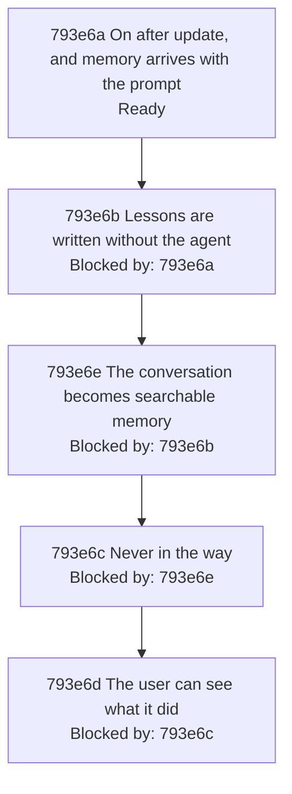

# Automatic Memory - Implementation Plan

Filled depth first ([793f3 Depth first](./793f_algorithm.md#793f3-depth-first)): a node's catalog rows are written when step 3 reaches the node, and the node is worked
through step 5 before the next node starts. Nothing below is final until the last node is. The sections follow
the [implementation plan guide](../../IMPLEMENTATION-PLAN-GUIDE.md#default-structure). Implementation shape is
added with the first node's step 3. The guide's parallel worktree method is omitted because the nodes are
worked in sequence on branch `feat/automatic-memory`.

## 793e1 Purpose

Source specifications: [793a Automatic Memory - Product Spec](./793a_product-spec.md#automatic-memory---product-spec) and [793d Automatic Memory - Technical Spec](./793d_technical-spec.md#automatic-memory---technical-spec). Scope: the six product requirements and three
interactions of the first, taken through the owner's steps 2 to 5 ([793f5 How this change applies it](./793f_algorithm.md#793f5-how-this-change-applies-it)) in the order of
[793e4 Depth-first order and dependency tree](#793e4-depth-first-order-and-dependency-tree).

## 793e2 Test methods

The shared cycle applies once to every test row (the owner's step 5, [793f2 The algorithm](./793f_algorithm.md#793f2-the-algorithm)):

1. Write the test.
2. Red: run it, confirm it fails for the expected reason, and commit.
3. Green: make it pass with the minimum change, keep the whole suite passing, and commit.
4. Refactor: minimize the code the branch introduces without obscuring its function and purpose, and commit.

Classifications are the [plan guide's](../../IMPLEMENTATION-PLAN-GUIDE.md#test-classification): dedicated examples
(the guide lists product acceptance scenarios and real dependency behavior tied to a pinned version among them),
property-based tests (`rapid`), and injected and impure interaction tests (`imptest`). Suites are the
[technical spec guide's](../../TECHNICAL-SPEC-GUIDE.md#test-suite-classification): the default suite is pure and
deterministic, a test that crosses a local impure boundary carries the `integration` build tag, and a test that
needs a live remote service carries the `network` build tag.

Each scenario in [793a Automatic Memory - Product Spec](./793a_product-spec.md#automatic-memory---product-spec) is
executed by one Go test, named with the scenario ID, that drives a real Claude Code
[session](../../GLOSSARY.md#session) in an isolated HOME
([793f7 Test isolation](./793f_algorithm.md#793f7-test-isolation)) and whose steps mirror the scenario's Given,
When and Then lines one to one; its run output is the record
([793b9 Test execution](./793b_decision-log.md#793b9-test-execution)). Each scenario in
[793d Automatic Memory - Technical Spec](./793d_technical-spec.md#automatic-memory---technical-spec) is executed by
one Go test whose name carries the scenario ID. A conformance check asserts that every scenario ID in either spec
has a test. A test that drives a real session needs a live model, so it carries the `network` build tag and skips
with a clear reason when its isolated run has no credential to log in with.

Every test or check that runs `engram` or `claude`, whatever its classification, follows
[793f7 Test isolation](./793f_algorithm.md#793f7-test-isolation).

## 793e3 Test status

`Not started` → `Red` → `Green-all` → `Done` ([793b13 Departure: one refactor pass, and extra catalog columns](./793b_decision-log.md#793b13-departure-one-refactor-pass-and-extra-catalog-columns)).
Each phase's commit sets the row's Status. The Red, Green and Refactor columns hold those commits' hashes, each
filled in by the next commit.

## 793e4 Depth-first order and dependency tree

A node is one product scenario, or a tightly coupled pair, taken through steps 3 to 5 before the next node starts
([793b38 Depth first: two readings, and the one this change takes](./793b_decision-log.md#793b38-depth-first-two-readings-and-the-one-this-change-takes)). The rows below are the groups of nodes in order, with the interactions each takes ([793b28 Depth-first order](./793b_decision-log.md#793b28-depth-first-order)): step 2 writes
a group's scenarios when the group is reached, and each scenario is a node of its group.

| Group | Requirements | Interactions |
| --- | --- | --- |
| [793e6a On after update, and memory arrives with the prompt](#793e6a-on-after-update-and-memory-arrives-with-the-prompt) | [793a2a On after `engram update`](./793a_product-spec.md#793a2a-on-after-engram-update), [793a2b Memory arrives with the prompt](./793a_product-spec.md#793a2b-memory-arrives-with-the-prompt) and the 8-second hold of [793a2d Never in the way](./793a_product-spec.md#793a2d-never-in-the-way) | none |
| [793e6b Lessons are written without the agent](#793e6b-lessons-are-written-without-the-agent) | [793a2c Lessons are written without the agent](./793a_product-spec.md#793a2c-lessons-are-written-without-the-agent) | [793a3a What is written is delivered later](./793a_product-spec.md#793a3a-what-is-written-is-delivered-later), [793a3c Nothing the vault already says is written again](./793a_product-spec.md#793a3c-nothing-the-vault-already-says-is-written-again), [793a3e Explicit memory use keeps working](./793a_product-spec.md#793a3e-explicit-memory-use-keeps-working) |
| [793e6e The conversation becomes searchable memory](#793e6e-the-conversation-becomes-searchable-memory) | [793a2f The conversation becomes searchable memory](./793a_product-spec.md#793a2f-the-conversation-becomes-searchable-memory) | none |
| [793e6c Never in the way](#793e6c-never-in-the-way) | the rest of [793a2d Never in the way](./793a_product-spec.md#793a2d-never-in-the-way) | none |
| [793e6d The user can see what it did](#793e6d-the-user-can-see-what-it-did) | [793a2e The user can see what it did](./793a_product-spec.md#793a2e-the-user-can-see-what-it-did) | none |

The first node is the first scenario of [793a2a On after `engram update`](./793a_product-spec.md#793a2a-on-after-engram-update), which needs the first delivery of [793a2b Memory arrives with the prompt](./793a_product-spec.md#793a2b-memory-arrives-with-the-prompt) to be visible: the
install is only visible to the user when delivery works in a new [session](../../GLOSSARY.md#session). The first
group also takes the 8-second hold, because a delivery must not hold a [prompt](./793a_product-spec.md#793a1a-terms) longer than that from the
first one on. Each later node needs the previous node's committed result, because an interaction joins a
capability to the ones before it.

The graph shows the groups. When step 2 writes a group's scenarios, the group's node is replaced, in the same
place and with the same prerequisites, by one node per scenario, each with a catalog section under its group's.

## 793e5 Node status

As in the [plan guide](../../IMPLEMENTATION-PLAN-GUIDE.md#node-status): `Blocked by`, `Ready`,
`In progress: n/x entries complete`, `Complete` and `Merged`. Every node becomes `Merged` together, when branch
`feat/automatic-memory` is merged to main.

## 793e6 Test catalog

Rows are added when step 3 reaches a node, and are worked top to bottom, one node at a time.

### 793e6a On after update, and memory arrives with the prompt

Takes [793a2a On after `engram update`](./793a_product-spec.md#793a2a-on-after-engram-update), [793a2b Memory arrives with the prompt](./793a_product-spec.md#793a2b-memory-arrives-with-the-prompt) and the 8-second hold of [793a2d Never in the way](./793a_product-spec.md#793a2d-never-in-the-way).

| Gherkin | Classification | Why | Status | Red commit | Green commit | Refactor commit |
| --- | --- | --- | --- | --- | --- | --- |

### 793e6b Lessons are written without the agent

Takes [793a2c Lessons are written without the agent](./793a_product-spec.md#793a2c-lessons-are-written-without-the-agent), [793a3a What is written is delivered later](./793a_product-spec.md#793a3a-what-is-written-is-delivered-later), [793a3c Nothing the vault already says is written again](./793a_product-spec.md#793a3c-nothing-the-vault-already-says-is-written-again) and [793a3e Explicit memory use keeps working](./793a_product-spec.md#793a3e-explicit-memory-use-keeps-working).

| Gherkin | Classification | Why | Status | Red commit | Green commit | Refactor commit |
| --- | --- | --- | --- | --- | --- | --- |

### 793e6e The conversation becomes searchable memory

Takes [793a2f The conversation becomes searchable memory](./793a_product-spec.md#793a2f-the-conversation-becomes-searchable-memory).

| Gherkin | Classification | Why | Status | Red commit | Green commit | Refactor commit |
| --- | --- | --- | --- | --- | --- | --- |

### 793e6c Never in the way

Takes the rest of [793a2d Never in the way](./793a_product-spec.md#793a2d-never-in-the-way): no editing of the [prompt](./793a_product-spec.md#793a1a-terms) or the reply, no breaking or stalling of a [session](../../GLOSSARY.md#session), no delivery to or writing from its own sessions, and stepping aside when it cannot do its work.

| Gherkin | Classification | Why | Status | Red commit | Green commit | Refactor commit |
| --- | --- | --- | --- | --- | --- | --- |

### 793e6d The user can see what it did

Takes [793a2e The user can see what it did](./793a_product-spec.md#793a2e-the-user-can-see-what-it-did).

| Gherkin | Classification | Why | Status | Red commit | Green commit | Refactor commit |
| --- | --- | --- | --- | --- | --- | --- |

## 793e7 Completion gates

- Every scenario in [793a Automatic Memory - Product Spec](./793a_product-spec.md#automatic-memory---product-spec) and [793d Automatic Memory - Technical Spec](./793d_technical-spec.md#automatic-memory---technical-spec) has a row, and every row is `Done`.
- Every product scenario has a Go test named with its ID that drove a real Claude Code
  [session](../../GLOSSARY.md#session) in an isolated HOME ([793f7 Test isolation](./793f_algorithm.md#793f7-test-isolation))
  and passed, with its run output recorded; every technical scenario has a passing Go test named with its ID; and
  the conformance check, which asserts that every scenario ID in either spec has a test, passes.
- No test, check or run touched the owner's real `~/.claude`, `~/.local/share/engram`, `~/.pi` or GOBIN
  ([793f7 Test isolation](./793f_algorithm.md#793f7-test-isolation)).
- Every `rapid` test has a Properties entry in its catalog table that enumerates the guarantees it checks.
- Every injected or impure collaboration has the call, argument, ordering and side-effect evidence from `imptest`
  that its contract needs.
- The required valid-path behavior, and the required invalid-path gating and preservation behavior, are covered by
  passing tests.
- Every `Done` row has its red, green and refactor commits recorded.
- [targ](../../GLOSSARY.md#targ) passes, with `targ test` and `targ check-full`, on the final commit of the branch.
- Every refactor commit message names the code it removed or merged, or states that nothing could be removed.
- The product and technical deltas are promoted to the canonical specifications without changing stable IDs,
  and this change directory is deleted, in the same merge as the implementation.
- Every node is `Merged`.
