# Automatic Memory - Implementation Plan

Filled depth first (`793f3`): a node's rows are written when step 3 reaches it, and the node is worked through step 5 before the next starts; nothing is final until the last node is. The guide's parallel worktree method is omitted: the nodes are worked in sequence on branch `feat/automatic-memory`.

## 793e1 Purpose

Source specifications `793a` and `793d`. Scope: the six product requirements and three interactions, taken through steps 2 to 5 (`793f5`) in the order of `793e4`.

## 793e8 Implementation shape

- `agent-instructions/mods/engram-memory/`: the mod, three files, deployed by [`engram update`](../../GLOSSARY.md#engram-update) to Claude Code's [skills](../../GLOSSARY.md#skill) directory (`793d1`).
- `internal/auto/`: new package, the logic of [automatic memory](./793a_product-spec.md#793a1a-terms); pure, every collaborator injected.
- `internal/cli/auto.go`: the command group `engram auto` and its command `deliver`, and the adapters from the collaborators of `internal/auto` to the query engine and the file system.
- `internal/update/update.go`: the plan of the source's mods, appended to the plan of the skills.
- `dev/acceptance/`: the tests that drive a real Claude Code [session](../../GLOSSARY.md#session), under the `network` build tag; `dev/targs.go`: the `acceptance` target, at most four tests at once (`793b49`). No new Go dependency.
- `dev/conformance.go`: the conformance check's reading of the scenario IDs of the two specs and of the test functions the test files declare; a test of the dev integration suite, so `targ check-full` runs it.
- `dev/mods.go`: the parse of the mod's JavaScript with `node`, and its lookup of `node`, run over the real mods by a test of the dev integration suite (`793b55`).

Added by the second group (`793e6b`):

- `internal/auto/judge.go`, `internal/auto/prompts/judge.txt`: the window of the judgement, the nearest [notes](../../GLOSSARY.md#permanent-note) and the instructions the model is asked (`793b65`).
- `internal/auto/lesson.go`: the reading of the model's reply into lessons, and the records of what became of it (`793b66`, `793b67`).
- `internal/auto/redact.go`: the redaction of credentials (`793b69`); `internal/auto/auto.go`: the origins of the [prompts](./793a_product-spec.md#793a1a-terms) the user sends (`793b64`).
- `internal/cli/auto.go`, `internal/cli/targets.go`: the commands `judge` and `write`, wired outside the first-use step (`793b71`).
- `agent-instructions/mods/engram-memory/hooks/register.js`: the hooks `turn.start` and `turn.complete`, which run the capture apart from the [turn](./793a_product-spec.md#793a1a-terms) and keep each turn's origin (`793b70`, `793b72`).
- `dev/acceptance/lessons_test.go`, `steps_test.go`, `session_test.go`: the group's scenario tests, which run a conversation (one running `claude`) because the capture goes on after the turn (`793b37`); `dev/mods_integration_internal_test.go`: the stand-in host of the mod's tests.

## 793e2 Test methods

Every test row goes through one cycle (the owner's step 5, `793f2`): write the test; red: run it, confirm it fails for the expected reason, commit; green: make it pass with the minimum change, the whole suite passing, commit; refactor: minimize the code the branch introduces without obscuring its function and purpose, commit.

Classifications are the plan guide's: dedicated examples (the guide lists product acceptance scenarios and real dependency behavior tied to a pinned version among them), property-based tests (`rapid`), and injected and impure interaction tests (`imptest`). Suites are the technical guide's: the default suite is pure and deterministic, a test that crosses a local impure boundary carries the `integration` tag, and one that needs a live remote service the `network` tag.

Each scenario in `793a` is run by one Go test named with its ID, driving a real Claude Code [session](../../GLOSSARY.md#session) in an isolated HOME (`793f7`), its steps mirroring the Given, When and Then lines one to one, its run output the record (`793b9`); each scenario in `793d` by one Go test whose name carries its ID. A conformance check asserts that every scenario ID in either spec has a test, a function declared as `Test<ID>_...`. A test that drives a real session needs a live model, so it carries the `network` tag and fails with a clear reason when `claude` or a login is missing (`793b53`); these tests live in `dev/acceptance` and run with `targ acceptance` (optionally `--run <regular expression>`). Every test or check that runs `engram` or `claude` follows `793f7`.

The first row of a node is its product scenario. Its red commit comes first, before the node's code exists; the technical rows below it are then worked in order, each through its own red, green and refactor; its green and refactor commits come last, when the technical rows are `Done` and the scenario passes.

## 793e3 Test status

`Not started` → `Red` → `Green-all` → `Done` (`793b13`). Each phase's commit sets the row's Status; the Red, Green and Refactor columns hold those commits' hashes, each filled in by the next commit.

## 793e4 Depth-first order and dependency tree

A node is one product scenario, or a tightly coupled pair, taken through steps 3 to 5 before the next node starts (`793b38`). The groups, in the order of the catalog (`793b28`): step 2 writes a group's scenarios when the group is reached, and each scenario is a node of its group, replacing the group's node in the same place with the same prerequisites. The first node is the first scenario of `793a2a`, which needs the first delivery of `793a2b` to be visible, and the first group also takes the 8-second hold; each later node needs the previous node's committed result, because an interaction joins a capability to the ones before it.

| Group | Requirements | Interactions | Status |
| --- | --- | --- | --- |
| `793e6a` | `793a2a`, `793a2b` and the 8-second hold of `793a2d` | none | Complete |
| `793e6b` | `793a2c`, and the clause of `793a2d` about its own [sessions](../../GLOSSARY.md#session) (`793b58`) | `793a3a`, `793a3c`, `793a3e` | Complete |
| `793e6g` | the defects the second group's one review round found in `793a2c`, its interactions and its technical requirements | none | Complete |
| `793e6e` | `793a2f` | none | Ready |
| `793e6c` | the rest of `793a2d`, without the clause about its own sessions | none | Blocked by: `793e6e` |
| `793e6d` | `793a2e` | none | Blocked by: `793e6c` |
| `793e6f` | the clause of `793a2b` that the [notes](../../GLOSSARY.md#permanent-note) are those `engram query` returns, for a [vault](../../GLOSSARY.md#vault) that has a parent (`793c34`) | none | Blocked by: `793e6d` |

## 793e9 Dependency graph

The graph is derived from the catalog of `793e6` and the components of `793d`, not from the order of `793e4`: an arrow from A to B means that B reuses what A built (a component, a scenario, the acceptance [harness](../../GLOSSARY.md#harness) or a record format), so B could not be written without A; an arrow that follows from two others is left out.

```mermaid
flowchart TD
    a1[793e6a1 Memory after one update] --> a2[793e6a2 Notes arrive with the prompt]
    a2 --> a3[793e6a3 A delivered note is not repeated]
    a3 --> a4[793e6a4 A note looked up is not delivered]
    a4 --> a5[793e6a5 A prompt that matches no note]
    a1 --> a6[793e6a6 A slow lookup holds 8 seconds at most] & a7[793e6a7 A missing vault is not created] & a8[793e6a8 Pi gets no automatic memory] & a9[793e6a9 A dry run turns nothing on] & a10[793e6a10 A second update delivers once] & a11[793e6a11 Conformance check] & a12[793e6a12 JavaScript parse gate]
    a4 --> b1[793e6b1 A correction becomes a note]
    b1 --> b2[793e6b2 A request to remember] & b3[793e6b3 A confirmed approach] & b4[793e6b4 A self correction] & b5[793e6b5 An approach that succeeded] & b6[793e6b6 Guesses and chatter write nothing] & b7[793e6b7 A credential is not in the note] & b10[793e6b10 Agent commands keep working] & b11[793e6b11 A written note is delivered later] & b12[793e6b12 A second update writes once] & b13[793e6b13 No write to a missing vault] & b14[793e6b14 No session of its own]
    a10 --> b12
    a7 --> b13
    b6 --> b8[793e6b8 A covered lesson is not rewritten] --> b9[793e6b9 A saved lesson is not rewritten]
    b14 --> b15[793e6b15 Branches found by coverage]
    b6 --> b15
    b15 --> g1[793e6g1 Harness rows are no prompt]
    b14 --> g1
    g1 --> g2[793e6g2 Record read once] --> g3[793e6g3 A turn found by its text]
    b7 --> g2
    g2 --> g4[793e6g4 Instructions are the system]
    b8 --> g4
    b7 --> g5[793e6g5 Redaction names and promise] --> g6[793e6g6 Lesson fields are one line]
    b1 --> g7[793e6g7 Automatic mark in the line]
    g6 --> g8[793e6g8 Redact whole after normalizing]
    g2 --> g8
    b13 --> g9[793e6g9 No vault or record fails]
    b6 --> g10[793e6g10 A failure is recorded once]
    b14 --> g11[793e6g11 Headless prompts are opt in]
    b1 --> g12[793e6g12 Bounds for each stage]
    a1 --> g13[793e6g13 Acceptance run takes a count]
    b6 --> g14[793e6g14 A thanks writes nothing]
    g13 --> g14
    b8 --> g15[793e6g15 A different lesson is written]
    g13 --> g15
    g11 --> g16[793e6g16 A notification turn is not judged]
    g13 --> g16
    g13 --> g17[793e6g17 Tally of runs and probe]
    g14 --> g17
    g11 --> g18[793e6g18 Documents and decisions]
    b6 --> g18
    b2 --> g19[793e6g19 A request to remember is always written]
    g14 --> g19
    g17 --> g19
    g12 --> e6[793e6e Searchable conversation]
    a6 --> c6[793e6c Never in the way]
    g12 --> c6
    g10 --> d6[793e6d The user sees what it did]
    a2 --> f6[793e6f Delivery merges the parent vault]
    classDef done fill:#d8f0dc,stroke:#2e7d32,color:#000
    classDef progress fill:#fff3cd,stroke:#b8860b,color:#000
    classDef planned fill:#dde3f7,stroke:#3949ab,color:#000
    classDef deferred fill:#eeeeee,stroke:#757575,color:#000,stroke-dasharray:5 5
    class a1,a2,a3,a4,a5,a6,a7,a8,a9,a10,a11,a12 done
    class b1,b2,b3,b4,b5,b6,b7,b8,b9,b10,b11,b12,b13,b14,b15 done
    class g1,g2,g3,g4,g5,g6,g7,g8,g9,g10,g11,g12,g13,g14,g15,g16,g17,g18,g19 done
    class e6,c6,d6 planned
    class f6 deferred
```

Green is done, with its three commits recorded; blue is planned, with no rows yet; dashed grey is deferred (`793e6f`); yellow, in progress, is not in use now. The order of `793e4` stays authoritative.

## 793e5 Node status

As in the plan guide: `Blocked by`, `Ready`, `In progress: n/x entries complete`, `Complete` and `Merged`. Every node becomes `Merged` together, when branch `feat/automatic-memory` is merged to main.

## 793e6 Test catalog

Rows are added when step 3 reaches a node, and worked top to bottom, one node at a time.

### 793e6a On after update, and memory arrives with the prompt

#### 793e6a1 The next session has memory after one engram update

| Work | Classification | Why | Status |
| --- | --- | --- | --- |
| `targ acceptance`: runs `dev/acceptance` with the `network` tag, at most 4 at once (`793b49`), and `lint-dev` over that package | Non-test action | real Claude Code [sessions](../../GLOSSARY.md#session) are no default target's to run; the timed ones fail when 8 or more run at once | Done |
| The acceptance [harness](../../GLOSSARY.md#harness): an isolated machine (home, [vault](../../GLOSSARY.md#vault), GOBIN, a binary built from a git-less copy of the module), a driver for `claude -p` sessions and a reader of the session's record | Non-test action | every scenario test is written over it; its isolation is `793f7` | Done |

| Gherkin | Classification | Why | Properties | Status | Red commit | Green commit | Refactor commit |
| --- | --- | --- | --- | --- | --- | --- | --- |
| 793a2a1a | Dedicated example, product acceptance (`network`) | a real session after a real [`engram update`](../../GLOSSARY.md#engram-update) holds the [note](../../GLOSSARY.md#permanent-note) before it acts |  | Done | d598e57f | 4079d1d3 | c26a7d1c |
| 793d4a1a | Dedicated example (default suite) | the command's contract over standard input and output, an in-memory vault and a stub embedder |  | Done | a81ad4bb | 1e0a3a11 | 99e1ea5a |
| 793d4a1b | Dedicated example (default suite) | the failure branch the mod relies on to step aside; written with `793d4a1a`'s green, so it passed when written; mutation: a delivery that prints the block when the lookup fails fails it |  | Done | n/a | 04dbc127 | be61a161 |
| 793d4c1a | Property-based (`rapid`) with named examples (default suite) | the guarantee an adversarial note must not break: the block's shape | for any notes with arbitrary text, line breaks, control characters, the framing line and lines that read as notes: the block ends with one line feed and has one line more than notes; its first line is the fixed framing line beginning `[engram memory]`; every other line begins with a dash and a space, never with `[engram memory]`, and holds no control character and no white space but spaces | Done | 93d584e5 | f239e102 | fa641f64 |
| 793d4c1a (amended) | Property-based (`rapid`) with named examples (default suite) | the same with format characters among the hostile text | as above with control and format characters in the text: no line holds a control character, a format character or white space but a space | Done | b4a8ae72 | 10bf851f | 5a774bf5 |
| 793d4c1b | Dedicated example (default suite) | zero-width and bidirectional characters, byte-order mark and soft hyphen are dropped and the words joined |  | Done | b4a8ae72 | 10bf851f | 5a774bf5 |
| 793d4b1a | Dedicated example (default suite) | the mod copies' plan, finite and exact |  | Done | 7f1b9628 | 90db8458 | 30c80c31 |
| 793d4b1b | Dedicated example (default suite) | a source without mods plans none and fails nowhere |  | Done | 5b38f353 | 5dec69a1 | cecf5759 |
| 793d4b1c | Dedicated example (default suite) | the plan wired into `Updater.Run`: the mod reaches the engram-owned root and is linked from the [skills](../../GLOSSARY.md#skill) directory |  | Done | a05fbcdd | 067f61ad | 647dfe7c |
| 793d2a1a | Dedicated example, real dependency (`network`) | the mod's routing and placement in a real session against an `engram` that prints a chosen block |  | Done | 1d4ce5c7 | 4079d1d3 | dc501762 |
| `TestSharedSource_NoFileIsSharedWithTheWorktree` | Dedicated example, real dependency (`network`) | the checkout `engram update` runs in copies the worktree's files, not links them (`793f7`); the first version hard-linked every file |  | Done | c19a15bd | 43446091 | 44d04314 |

#### 793e6a2 The notes that bear on a prompt arrive with it

| Gherkin | Classification | Why | Status | Red commit | Green commit | Refactor commit |
| --- | --- | --- | --- | --- | --- | --- |
| 793a2b1a | Dedicated example, product acceptance (`network`) | the delivery as the user sees it, with a [note](../../GLOSSARY.md#permanent-note) that does not bear on the [prompt](./793a_product-spec.md#793a1a-terms) beside one that does; mutations: a delivery of every payload item does not fail it (the two-note [vault](../../GLOSSARY.md#vault) has no explore pick; `793d4a1c` fails that mutation), a delivery of every vault note does | Done | n/a | b7ff882a | 9f1d0e84 |
| 793d4a1c | Dedicated example (default suite) | a note only the explore half picked is in the payload of any vault with a vocabulary; a small test vault has none | Done | 435d427c | cbbf9ca4 | 9f1d0e84 |

#### 793e6a3 A note delivered earlier in the session is not delivered again

| Gherkin | Classification | Why | Status | Red commit | Green commit | Refactor commit |
| --- | --- | --- | --- | --- | --- | --- |
| 793a2b1b | Dedicated example, product acceptance (`network`) | two [prompts](./793a_product-spec.md#793a1a-terms) in one real [session](../../GLOSSARY.md#session); the second arrives with nothing from the [vault](../../GLOSSARY.md#vault) | Done | 64cf7053 | 2cf56fc9 | ce8101b8 |
| 793a2b1b (one live process) | Dedicated example, product acceptance (`network`) | both prompts through one running `claude`, so the second delivery reads a record written while open; passed when written; mutation: a delivery that ignores what the session holds gives the second prompt the block | Done | n/a | cf672314 | 03ce6777 |
| 793d2a1b | Dedicated example, real dependency (`network`) | the session's ID reaches the command, in a real session against a stand-in engram | Done | ee4404a4 | 7771477f | c0541b31 |
| 793d4a1e | Dedicated example (default suite) | no remaining [note](../../GLOSSARY.md#permanent-note) prints nothing, so a held note's second prompt carries no empty block | Done | f6bea18c | 2cf56fc9 | d38d4777 |
| 793d2a1c | Dedicated example, real dependency (`network`) | an empty output adds nothing: the session's record shows no context | Done | f867c44c | f395ec9e | a32ff6a4 |
| 793d2a1e | Dedicated example, real dependency (`network`) | a failing command adds nothing even when it printed a block | Done | 95dc389d | 5a4bb9dc | 3f1a1ffd |
| 793d2a1f | Dedicated example, real dependency (`network`) | output that is not a block adds nothing even on exit 0 | Done | 95dc389d | 5a4bb9dc | 3f1a1ffd |
| 793d2a1g | Dedicated example, real dependency (`integration`, runs the mod under `node`) | the 7 seconds bound the whole hook; node runs the mod against a stand-in host whose ID call never answers (a live session cannot stall there), and the event passes unchanged after one 7-second timer without running the command | Done | 9d0f9d36 | e86e4625 | efeaa801 |
| 793d4d1a | Dedicated example (default suite) | what counts as held: the blocks delivered beside prompts and nothing else, over records of the real format | Done | 0d78b09e | 9bdc5e9e | a03c7312 |
| 793d4d1b | Dedicated example (default suite) | the record is found in a project's subdirectory of the session-log directory | Done | b9fb12de | 02318295 | 0bfe1688 |
| 793d4d1c | Dedicated example (default suite) | boundaries: no record, an ID that would leave the directory | Done | fce4516a | a460368a | 0bfe1688 |
| 793d4a1d | Dedicated example (default suite) | the delivery leaves out a held note | Done | cf03701a | b9ec02b7 | 0bfe1688 |
| 793d4d1a (amended) | Dedicated example (default suite) | only the note lines of delivered blocks hold a note, by file name; situations, bodies and other hooks' entries hold none | Done | d183d346 | 642adbd6 | 642a4c9a |

#### 793e6a4 A note the agent looked up itself is not delivered

| Gherkin | Classification | Why | Status | Red commit | Green commit | Refactor commit |
| --- | --- | --- | --- | --- | --- | --- |
| 793a2b1c | Dedicated example, product acceptance (`network`) | the other route to a held [note](../../GLOSSARY.md#permanent-note): the [agent](./793a_product-spec.md#793a1a-terms)'s own lookup in a [session](../../GLOSSARY.md#session) begun before the update, then the update and a resumed session | Done | d94dcace | e7e823fd | e68f65f7 |
| 793a2b1c (a second note) | Dedicated example, product acceptance (`network`) | the [vault](../../GLOSSARY.md#vault) gains a second note after the agent's lookup and the [prompt](./793a_product-spec.md#793a1a-terms) arrives with it, so a mod that never loads no longer passes; passed when written; mutation: a mod that does not load | Done | n/a | 49bfdb06 | f9e6cd3f |
| 793d4d1d | Dedicated example (default suite) | what a tool printed counts as held in both result shapes; what the agent wrote does not | Done | 84f83b15 | e7e823fd | 31744d5c |
| 793d4d1d (amended) | Dedicated example (default suite) | only the agent's own `engram query` and `engram show` commands count, paired with their results by tool ID | Done | d183d346 | 642adbd6 | 642a4c9a |
| 793d4d1e | Dedicated example (default suite) | a listing of the vault is not a lookup | Done | d183d346 | 642adbd6 | 642a4c9a |
| 793d4d1f | Dedicated example (default suite) | `engram show` prints a note without its file name, so the command's text holds it | Done | d183d346 | 642adbd6 | 642a4c9a |
| 793d4a1g | Dedicated example (default suite) | a note the agent fetched by its basename without `.md` is left out | Done | d183d346 | 642adbd6 | 642a4c9a |
| 793d4a1h | Injected and impure interaction (`imptest`, default suite) | the lookup runs once, for the vault given, with the prompt's text as message and only phrase (a left-out message passes every test over the real engine); the seam, the lookup as a function, was made first by refactor 8f30df47 | Done | n/a | dcaadbc0 | d18002dd |
| 793d4a1i | Injected and impure interaction (`imptest`, default suite) | `Deliver` gives the lookup the request's text and the session reading the request's session ID; mutation: a `Deliver` that gives either an empty string | Done | n/a | d909ac5d | d18002dd |
| 793d4f1a | Dedicated example (default suite) | `ENGRAM_TRANSCRIPT_DIR` names the records before `CLAUDE_CONFIG_DIR` | Done | n/a | 9ca57f87 | 8fa41f48 |
| 793d4f1b | Dedicated example (default suite) | `CLAUDE_CONFIG_DIR/projects` names them when `ENGRAM_TRANSCRIPT_DIR` does not, and the home's `.claude/projects` is then not read; the place was checked with a real headless session | Done | 9ca57f87 | a2616081 | 8fa41f48 |
| 793d4f1c | Dedicated example (default suite) | the home's `.claude/projects` when neither variable is set, which no test had run | Done | n/a | 9ca57f87 | 8fa41f48 |
| 793d4f1d | Dedicated example (default suite) | with no home directory the records directory is empty and the delivery read `<session>.jsonl` from the working directory | Done | b4358c93 | 9755ff6d | b7451101 |

#### 793e6a5 A prompt that matches no note arrives with nothing

| Gherkin | Classification | Why | Status | Red commit | Green commit | Refactor commit |
| --- | --- | --- | --- | --- | --- | --- |
| 793a2b1d | Dedicated example, product acceptance (`network`) | a conversation the [agent](./793a_product-spec.md#793a1a-terms)'s own lookup finds is not delivered, and a [prompt](./793a_product-spec.md#793a1a-terms) that matches no [note](../../GLOSSARY.md#permanent-note) is answered as without [automatic memory](./793a_product-spec.md#793a1a-terms) | Done | n/a | e6ce415b | 2f90f045 |
| 793d4a1f | Dedicated example (default suite) | the lookup reads notes only; the chunk-index lister fails the test if called | Done | n/a | be188b04 | 615f328c |

#### 793e6a6 A slow lookup does not hold a prompt for more than 8 seconds

| Gherkin | Classification | Why | Status | Red commit | Green commit | Refactor commit |
| --- | --- | --- | --- | --- | --- | --- |
| 793a2d1a | Dedicated example, product acceptance (`network`) | a real [session](../../GLOSSARY.md#session) whose lookup takes 20 seconds is held under 8 and answered | Done | b87d5da6 | 17bcbc48 | 03de5169 |
| 793d2a1d | Dedicated example, real dependency (`network`) | the mod's bound and quiet step aside, in a real session against a stand-in engram that takes 20 seconds | Done | ea20a874 | 17bcbc48 | 2e1e28d2 |

#### 793e6a7 A vault that does not exist is not created

| Gherkin | Classification | Why | Status | Red commit | Green commit | Refactor commit |
| --- | --- | --- | --- | --- | --- | --- |
| 793a2a1e | Dedicated example, product acceptance (`network`) | after the [vault](../../GLOSSARY.md#vault) is removed a [prompt](./793a_product-spec.md#793a1a-terms) is answered and the vault is still not there | Done | d4336a43 | e924dc61 | 151f36ea |
| 793a2a1e (the command ran) | Dedicated example, product acceptance (`network`) | the test asserts the mod ran its command, so a mod that never loads no longer passes; passed when written; mutation: a mod that does not load | Done | n/a | 49bfdb06 | f9e6cd3f |
| 793d4e1a | Dedicated example (default suite) | the first-use step is in the target's wiring, not in the command, so only a dispatch through `cli.Targets` shows whether it runs | Done | c0aa0717 | e924dc61 | 81f8f93b |

#### 793e6a8 Pi gets no automatic memory

| Gherkin | Classification | Why | Status | Red commit | Green commit | Refactor commit |
| --- | --- | --- | --- | --- | --- | --- |
| 793a2a1d | Dedicated example, product acceptance (`network`) | on a machine with both [harnesses](../../GLOSSARY.md#harness) the report and Pi's directories hold none of the mod | Done | 0616adb8 | fdb1d048 | b17b8478 |
| 793d4b1d | Dedicated example (default suite) | the gate between the harnesses over the plan, finite and exact | Done | faac2a60 | fdb1d048 | a39fb137 |

#### 793e6a9 A dry run turns nothing on

| Gherkin | Classification | Why | Status | Red commit | Green commit | Refactor commit |
| --- | --- | --- | --- | --- | --- | --- |
| 793a2a1c | Dedicated example, product acceptance (`network`) | a dry run reports the mod and installs nothing; the next [session](../../GLOSSARY.md#session) has no memory | Done | c8342310 | 6628b251 | c45fb971 |
| 793d4b1e | Dedicated example (default suite) | the report data tells a mod directory from a [skill](../../GLOSSARY.md#skill) directory | Done | e47a17b1 | 3123a3c3 | 49fd7aa0 |
| 793d4b1f | Dedicated example (default suite) | the report's rows: the source printed for a mod | Done | 318651db | 6628b251 | a758cadc |
| 793d4b1g | Dedicated example (default suite) | the dry run's promise for the new input: the mod is planned and reported, none of it written | Done | n/a | 545345f1 | c45fb971 |

#### 793e6a10 A second update still delivers each note once

| Gherkin | Classification | Why | Status | Red commit | Green commit | Refactor commit |
| --- | --- | --- | --- | --- | --- | --- |
| 793a2a1b | Dedicated example, product acceptance (`network`) | two real updates, then one real [prompt](./793a_product-spec.md#793a1a-terms): the [note](../../GLOSSARY.md#permanent-note) arrives once | Done | n/a | 8bf1f893 | d206b5c9 |
| 793d4b1h | Dedicated example (default suite) | idempotence: two runs leave the same files and links, and the second report lists the mod once | Done | n/a | c6df6865 | d206b5c9 |

#### 793e6a11 The conformance check of the first group

Not a scenario of the specs: the rows are named by test.

| Test | Classification | Why | Status | Red commit | Green commit | Refactor commit |
| --- | --- | --- | --- | --- | --- | --- |
| `TestScenarioIDs_ListsEachScenarioOnceInOrder` | Dedicated example (dev suite, `targ` tag) | the pure reading of a spec: which scenario IDs it holds, a restated scenario counted once, prose that merely names an ID left out | Done | e9831720 | 0a7a2596 | 4754603f |
| `TestScenariosWithoutTest_NamesThoseNoTestSourceDeclares` | Dedicated example (dev suite, `targ` tag) | the pure comparison: an ID has a test only when a function is named `Test<ID>_` | Done | 75a83363 | 11bfaf7d | a8841eeb |
| `TestConformance_EveryScenarioOfTheSpecsHasATest` | Dedicated example (dev integration suite, `targ` and `integration` tags) | the real specs against the real test files, `network`-tagged files included | Done | n/a | ad2af52f | 1588e189 |
| `TestScenariosWithoutTest_OnlyADeclaredFunctionIsATest` | Dedicated example (dev suite, `targ` tag) | a test is a function the Go parser finds declared; a string literal, a method, a function literal and a file that does not parse declare none (the first version counted text) | Done | 213ee02c | 14c04a9e | 434d6369 |

#### 793e6a12 The gate that parses the mod's JavaScript

Not a scenario of the specs: the rows are named by test.

| Test | Classification | Why | Status | Red commit | Green commit | Refactor commit |
| --- | --- | --- | --- | --- | --- | --- |
| `TestModuleSyntax_FailsWhenNodeIsNotFound` | Injected and impure interaction (`imptest`, dev suite, `targ` tag) | a check that cannot run does not pass; a missing node is an error naming node | Done | 44d04314 | 7cd56a6f | 3af177ac |
| `TestModuleSyntax_NamesEachFileThatDoesNotParse` | Injected and impure interaction (`imptest`, dev suite, `targ` tag) | each file is parsed by node on standard input; files that do not parse are named with what node said | Done | 44d04314 | 7cd56a6f | 3af177ac |
| `TestMods_EveryJavaScriptModuleParses` | Dedicated example, real dependency (dev integration suite, `targ` and `integration` tags) | the real mods parse under the real node and a broken module is rejected by it, which the stand-in cannot show | Done | 44d04314 | 7cd56a6f | 3af177ac |

### 793e6b Lessons are written without the agent

One node for each of the fourteen scenarios of `793b62`, in the order of the graph; this group also takes the own-[sessions](../../GLOSSARY.md#session) clause of `793a2d` with its scenario and the origin filter (`793b58`).

#### 793e6b1 A correction becomes a note

Builds the pipeline the other nodes of the group extend: the mod's capture of a [turn](./793a_product-spec.md#793a1a-terms), the judgement of the turn and the write of the lesson.

| Gherkin | Classification | Why | Properties | Runs | Status | Red commit | Green commit | Refactor commit |
| --- | --- | --- | --- | --- | --- | --- | --- | --- |
| 793a2c1a | Dedicated example, product acceptance (`network`) | a real [session](../../GLOSSARY.md#session) whose [agent](./793a_product-spec.md#793a1a-terms) may not run engram commands, a correction, and a [note](../../GLOSSARY.md#permanent-note) that says it was written automatically within the bound; the time from the turn's end to the note is measured |  | 10 of 10 | Done | c67dd902 | f43f21a6 | 28c04070 |
| 793d4g1a | Dedicated example (default suite) | the request over a record of the real format: instructions, context, divider, the turn's lines |  |  | Done | 6dde6226 | 507d4c77 | a8bbc16f |
| 793d4g1b | Dedicated example (default suite) | the final text fills in a record whose last row is not yet written |  |  | Done | 6dde6226 | 507d4c77 | a8bbc16f |
| 793d4g1c | Dedicated example (default suite) | boundaries: no record, a record with no [prompt](./793a_product-spec.md#793a1a-terms) |  |  | Done | 6dde6226 | 507d4c77 | a8bbc16f |
| 793d4g1d | Dedicated example (default suite) | the failure branch: an input that is not a JSON object |  |  | Done | 6dde6226 | 507d4c77 | a8bbc16f |
| 793d4g1e | Property-based (`rapid`) with named examples (default suite) | the guarantee a message must not break: a message is one line | for any messages with line breaks of every kind, control and format characters and text that reads as a label: the lines of the turn are one per message, each opens with its label, and none holds a line break |  | Done | 6dde6226 | 507d4c77 | a8bbc16f |
| 793d4h1a | Dedicated example (default suite) | a feedback lesson becomes a feedback note with the mark |  |  | Done | 14576dd7 | c9b440cf | 2c6daae6 |
| 793d4h1b | Dedicated example (default suite) | a fact lesson becomes a fact note with the mark |  |  | Done | 14576dd7 | c9b440cf | 2c6daae6 |
| 793d4h1c | Dedicated example (default suite) | the replies and lessons that write nothing |  |  | Done | 14576dd7 | c9b440cf | 2c6daae6 |
| 793d4h1d | Dedicated example (default suite) | the code fence a model may put around the list |  |  | Done | 14576dd7 | c9b440cf | 2c6daae6 |
| 793d2b1a | Dedicated example, real dependency (`integration`, runs the mod under `node`) | the mod's routing of a turn against a stand-in host: the order of the three steps and what each is given; a live session cannot show what a stand-in records |  |  | Done | 2f2b6012 | f43f21a6 | 28c04070 |

#### 793e6b2 A request to remember becomes a note

| Gherkin | Classification | Why | Runs | Status | Red commit | Green commit | Refactor commit |
| --- | --- | --- | --- | --- | --- | --- | --- |
| 793a2c1b | Dedicated example, product acceptance (`network`) | a request to remember, written as a fact; the first node's pipeline already writes it, so it passed when written; mutations on scratch copies: instructions without the request fail it (3 of 3 runs), and so does a write that writes no [note](../../GLOSSARY.md#permanent-note) | 9 of 10; the miss: an attempt to save the note by hand that was denied, which the check that no engram command ran counted, though the note was written automatically 1.7 seconds after the end | Done | n/a | d01d5c35 | 9cdc03f4 |

#### 793e6b3 An approach the user confirmed becomes a note

| Gherkin | Classification | Why | Runs | Status | Red commit | Green commit | Refactor commit |
| --- | --- | --- | --- | --- | --- | --- | --- |
| 793a2c1c | Dedicated example, product acceptance (`network`) | the user says the [agent](./793a_product-spec.md#793a1a-terms)'s way of doing a task worked; mutations on scratch copies: a write that writes no [note](../../GLOSSARY.md#permanent-note) fails it, instructions without the confirmed approach do not (3 of 3 passed; the judgement gave a lesson in 10 of 20 probes against 20 of 20), because "keep doing it" is a rule of its own | 10 of 10 | Done | n/a | d01d5c35 | 9cdc03f4 |

#### 793e6b4 The agent's own correction becomes a note

| Gherkin | Classification | Why | Runs | Status | Red commit | Green commit | Refactor commit |
| --- | --- | --- | --- | --- | --- | --- | --- |
| 793a2c1d | Dedicated example, product acceptance (`network`) | the [agent](./793a_product-spec.md#793a1a-terms) states a guess, reads a file and says its guess was wrong, in one [turn](./793a_product-spec.md#793a1a-terms); mutation on a scratch copy: instructions without the agent's own correction fail it (3 of 3 runs) | 10 of 10 | Done | n/a | d01d5c35 | 9cdc03f4 |

#### 793e6b5 An approach that succeeded with evidence becomes a note

| Gherkin | Classification | Why | Runs | Status | Red commit | Green commit | Refactor commit |
| --- | --- | --- | --- | --- | --- | --- | --- |
| 793a2c1e | Dedicated example, product acceptance (`network`) | the [agent](./793a_product-spec.md#793a1a-terms) is unsure of an approach, tries it, and the [turn](./793a_product-spec.md#793a1a-terms) shows the check passed (the staging names the one command to run: the agent had added an echo the permission denied); the first node's instructions passed 17 of 20 runs (11 of 20 probes gave a lesson), and 10 of 10 runs (20 of 20 probes) once they said an approach the agent was unsure of, tried and saw succeed is a lesson | 10 of 10 | Done | 4a70996b | 6e918969 | 9cdc03f4 |

#### 793e6b6 Guesses, plans and chatter produce no note

Adds the record of what became of a reply, which a test of an absence waits for, and the report of a failed step to it. The message of commit `37b0e9a9` (the green of `793d4k1a`) says the records directory is "by default /engram/auto": the shell expanded `$XDG_DATA_HOME` to nothing. It is `$XDG_DATA_HOME/engram/auto`, the default of `--records` of `engram auto write`; the commit is not amended.

| Gherkin | Classification | Why | Properties | Runs | Status | Red commit | Green commit | Refactor commit |
| --- | --- | --- | --- | --- | --- | --- | --- | --- |
| 793a2c1f | Dedicated example, product acceptance (`network`) | a [turn](./793a_product-spec.md#793a1a-terms) of a guess, a plan and chatter leaves no [note](../../GLOSSARY.md#permanent-note); the test waits for the reply's record, so an empty [vault](../../GLOSSARY.md#vault) is the judgement's result and not an unfinished judgement |  | 10 of 10 | Done | d9bd5a42 | 37b0e9a9 | 807da19e |
| 793d4k1a | Dedicated example (default suite) | the record of a lesson that is written |  |  | Done | 14a513a9 | 37b0e9a9 | 53c07dbc |
| 793d4k1b | Dedicated example (default suite) | the record of a reply with no lesson |  |  | Done | 14a513a9 | 37b0e9a9 | 53c07dbc |
| 793d4k1c | Dedicated example (default suite) | the records of a lesson left out and of a reply that is not a list, with the reasons |  |  | Done | 14a513a9 | 37b0e9a9 | 53c07dbc |
| 793d4k1d | Dedicated example (default suite) | the record of a failure, with no note written |  |  | Done | 14a513a9 | 37b0e9a9 | 53c07dbc |
| 793d4k1e | Dedicated example (default suite) | a place for the records that cannot be written leaves the note's write as it was |  |  | Done | 14a513a9 | 37b0e9a9 | 53c07dbc |
| 793d4h1c (amended) | Dedicated example (default suite) | the parsing returns the reasons it leaves a lesson out for |  |  | Done | 14a513a9 | 37b0e9a9 | 53c07dbc |
| 793d2b1a (amended) | Dedicated example, real dependency (`integration`, runs the mod under `node`) | the turn's ID reaches both commands |  |  | Done | 1cbaa962 | 87b703a7 | 807da19e |
| 793d2b1b | Dedicated example, real dependency (`integration`, runs the mod under `node`) | a judgement that prints nothing ends the capture: no model call, no write; passed when written; mutation: a mod that asks the model although the judgement printed nothing |  |  | Done | n/a | 1cbaa962 | 807da19e |
| 793d2b1c | Dedicated example, real dependency (`integration`, runs the mod under `node`) | a failing step is reported to the writing as a failure naming the judgement: exit 1, output that is not a request, a command that is ended |  |  | Done | 1cbaa962 | 87b703a7 | 807da19e |
| 793d2b1d | Dedicated example, real dependency (`integration`, runs the mod under `node`) | a model that does not answer is reported as a failure naming the model call: an API error, no text, a rejection |  |  | Done | 1cbaa962 | 87b703a7 | 807da19e |

#### 793e6b7 A credential in the turn is not in the note

Adds the redaction, and the cut of the window that the redaction precedes.

| Gherkin | Classification | Why | Properties | Runs | Status | Red commit | Green commit | Refactor commit |
| --- | --- | --- | --- | --- | --- | --- | --- | --- |
| 793a2c1g | Dedicated example, product acceptance (`network`) | a request to remember how to deploy, with the token and password the deploy needs, becomes a [note](../../GLOSSARY.md#permanent-note) that holds neither, the note awaited so that the credentials' absence is not the note's. The model leaves a credential out unprompted (4 of 4 runs before the redaction existed, 6 of 6 with that instruction sentence removed), so no mutation of the live run fails it and the properties are the proof |  | 10 of 10; 8 of 10 before the last change of the instructions, where both misses wrote a rule against keeping credentials and no note of the deploy | Done | n/a | d19d7f1d | f8487c99 |
| 793d4j1a | Property-based (`rapid`) with named examples (default suite) | the guarantee the whole promise rests on: no text of the shapes survives | for any filler text and any credential of the requirement's shapes, placed anywhere: the redacted text holds neither the credential nor the assignment's value, and holds the filler as it was |  | Done | 39a32553 | 18f731af | f8487c99 |
| 793d4j1b | Dedicated example (default suite) | what redaction leaves alone: an assignment's name, a commit ID, a word, a sentence |  |  | Done | 39a32553 | 18f731af | f8487c99 |
| 793d4j1c | Property-based (`rapid`) with named examples (default suite) | the redaction comes before the model, whatever the messages hold | for any messages holding a credential of the shapes, among any text: the request's [prompt](./793a_product-spec.md#793a1a-terms) holds none |  | Done | 39a32553 | 18f731af | f8487c99 |
| 793d4j1d | Property-based (`rapid`) with named examples (default suite) | the writing's redaction, whatever the lessons hold | for any lessons whose fields hold a credential of the shapes: no note written holds one |  | Done | 39a32553 | 18f731af | f8487c99 |
| 793d4g1f | Dedicated example (default suite) | the order of redaction and cut, on a token the cut falls in |  |  | Done | 39a32553 | 18f731af | f8487c99 |
| 793d4g1g | Dedicated example (default suite) | the window's bounds: the context, the whole, and the line saying some of the [turn](./793a_product-spec.md#793a1a-terms) is left out |  |  | Done | 39a32553 | 18f731af | f8487c99 |

#### 793e6b8 A lesson an earlier note states is not written again

Gives the judgement the [notes](../../GLOSSARY.md#permanent-note) nearest to the [turn](./793a_product-spec.md#793a1a-terms), and the writing the cover a lesson may name.

| Gherkin | Classification | Why | Runs | Status | Red commit | Green commit | Refactor commit |
| --- | --- | --- | --- | --- | --- | --- | --- |
| 793a3c1a | Dedicated example, product acceptance (`network`) | the user saves a lesson and states it again; the [vault](../../GLOSSARY.md#vault) holds the earlier note only (the test waits for the reply's record, so the absence is the judgement's result) | 10 of 10 | Done | 94373096 | 8c7c58ae | fea2480a |
| 793d4g1h | Dedicated example (default suite) | the nearest notes in the request |  | Done | 54179dc0 | 8c7c58ae | fea2480a |
| 793d4g1i | Dedicated example (default suite) | the lookup's failure branch, as the delivery has it |  | Done | 54179dc0 | 8c7c58ae | fea2480a |
| 793d4g1j | Dedicated example (default suite) | what a note may not do to the window: a line break, a credential, a body of any length |  | Done | 54179dc0 | 8c7c58ae | fea2480a |
| 793d4h1e | Dedicated example (default suite) | the cover: no write, and a record naming the note |  | Done | 54179dc0 | 8c7c58ae | fea2480a |
| 793d4h1f | Dedicated example (default suite) | what is no cover: a file not in the vault, a path outside it |  | Done | 54179dc0 | 8c7c58ae | fea2480a |

#### 793e6b9 A lesson the agent saved itself is not written again

Adds no component: the [note](../../GLOSSARY.md#permanent-note) the [agent](./793a_product-spec.md#793a1a-terms) saves with [`engram learn`](../../GLOSSARY.md#engram-learn-subcommand) is among the nearest notes when the [turn](./793a_product-spec.md#793a1a-terms) ends, and the cover of the eighth node applies to it.

| Gherkin | Classification | Why | Runs | Status | Red commit | Green commit | Refactor commit |
| --- | --- | --- | --- | --- | --- | --- | --- |
| 793a3c1b | Dedicated example, product acceptance (`network`) | the user asks the agent to remember and save with `engram learn`, and the [vault](../../GLOSSARY.md#vault) holds that one note, not marked automatic (the test waits for the reply's record); passed when written, as the judgement already lists the nearest notes; mutation: a judgement shown no notes | 10 of 10 | Done | n/a | 819f717b | 7e2468d9 |

#### 793e6b10 The agent's own lookups and saves keep working

Adds no component: the [agent](./793a_product-spec.md#793a1a-terms)'s commands are the binary's, and [automatic memory](./793a_product-spec.md#793a1a-terms) writes to the [vault](../../GLOSSARY.md#vault) only through the learn path.

| Gherkin | Classification | Why | Runs | Status | Red commit | Green commit | Refactor commit |
| --- | --- | --- | --- | --- | --- | --- | --- |
| 793a3e1a | Dedicated example, product acceptance (`network`) | the agent's `engram query` and [`engram learn`](../../GLOSSARY.md#engram-learn-subcommand) work as without automatic memory, and the [note](../../GLOSSARY.md#permanent-note) it saved is unchanged after the judgement; passed when written; mutation: a write that changes notes of the vault it did not write | 10 of 10 | Done | n/a | 484efae2 | 1a9baaac |

#### 793e6b11 A written note is delivered with later prompts

Adds no component: a written [note](../../GLOSSARY.md#permanent-note) is a note like any other, which the delivery finds and the [session](../../GLOSSARY.md#session) that wrote it does not hold.

| Gherkin | Classification | Why | Runs | Status | Red commit | Green commit | Refactor commit |
| --- | --- | --- | --- | --- | --- | --- | --- |
| 793a3a1a | Dedicated example, product acceptance (`network`) | a correction becomes a note and a later [prompt](./793a_product-spec.md#793a1a-terms) it bears on arrives with it, in the same session and in a new one; passed when written; mutation: a delivery that leaves out notes written automatically | 10 of 10 | Done | n/a | 5d63aa30 | 5b695a5a |

#### 793e6b12 A second update still writes each lesson as one note

Adds no component: the second update leaves one deployed mod.

| Gherkin | Classification | Why | Runs | Status | Red commit | Green commit | Refactor commit |
| --- | --- | --- | --- | --- | --- | --- | --- |
| 793a2a1f | Dedicated example, product acceptance (`network`) | two real updates, then a correction: the [vault](../../GLOSSARY.md#vault) holds one [note](../../GLOSSARY.md#permanent-note) for it (the test waits for the write's end and a settling time); passed when written; mutation: a mod that registers its [turn](./793a_product-spec.md#793a1a-terms) capture twice | 10 of 10 | Done | n/a | 164a85e8 | 4ed50702 |

#### 793e6b13 A lesson is not written to a vault that does not exist

Extends the delivery's exemption from the [vault](../../GLOSSARY.md#vault)'s first-use step (`793d4e`) to the judgement and the writing, which are wired outside it.

| Gherkin | Classification | Why | Runs | Status | Red commit | Green commit | Refactor commit |
| --- | --- | --- | --- | --- | --- | --- | --- |
| 793a2a1g | Dedicated example, product acceptance (`network`) | after a correction in a [session](../../GLOSSARY.md#session) of a machine whose vault was removed, the vault is still not there once the capture has ended (the test waits for both [turns](./793a_product-spec.md#793a1a-terms)' records and a settling time); passed when written, as the learn path fails at the missing vault's lock; mutation: a writing wired inside the first-use step | 10 of 10 | Done | n/a | 415a79ab | d156945f |
| 793d4e1b | Dedicated example (default suite) | the judgement command over a path with no vault: no vault afterwards, no creation line |  | Done | n/a | 415a79ab | d156945f |
| 793d4e1c | Dedicated example (default suite) | the writing command over a path with no vault, with a lesson in the reply: no vault, no [note](../../GLOSSARY.md#permanent-note), nothing printed, no creation line |  | Done | n/a | 415a79ab | d156945f |

#### 793e6b14 Automatic memory's work starts no session of its own

Takes the scenario of the own-[sessions](../../GLOSSARY.md#session) clause of `793a2d` and the origin filter that `793b58` moved here: the mod gives the delivery and the judgement the [prompt](./793a_product-spec.md#793a1a-terms)'s origin, they act only for prompts the user sends (`793b64`), and the mod leaves out [subagent](../../GLOSSARY.md#subagent) [turns](./793a_product-spec.md#793a1a-terms).

| Gherkin | Classification | Why | Runs | Status | Red commit | Green commit | Refactor commit |
| --- | --- | --- | --- | --- | --- | --- | --- |
| 793a2d1b | Dedicated example, product acceptance (`network`) | after a correction the [vault](../../GLOSSARY.md#vault) holds a [note](../../GLOSSARY.md#permanent-note) written from the user's session and the record of sessions holds that one session only; passed when written, as the judgement raises no session; mutation: a judgement run in a headless `claude -p` of its own | 10 of 10 | Done | n/a | cdbbad8f | ac6b3288 |
| 793d4m1a | Dedicated example (default suite) | each of the four origins the user sends gets the block and the request; passed when written, as the commands ignored the origin; mutation: a filter that leaves out one of the four (with `bridge` left out its case fails) |  | Done | n/a | c7dfbc01 | ac6b3288 |
| 793d4m1b | Property-based (`rapid`) with named examples (default suite) | the filter itself: any other origin, and the kinds Claude Code names besides the four, prints nothing, succeeds and never asks the lookup |  | Done | c7dfbc01 | dced50df | ac6b3288 |
| 793d2a1h | Dedicated example, real dependency (`network`, a real Claude Code against a stand-in `engram`) | the origin a real host stamps on a headless prompt, `sdk`, reaches the command |  | Done | c7dfbc01 | dced50df | ac6b3288 |
| 793d2b1e | Dedicated example, real dependency (`integration`, runs the mod under `node`) | the origin of the prompt a turn began with, as the mod learns it from the events, reaches the judgement |  | Done | c7dfbc01 | dced50df | ac6b3288 |
| 793d2b1f | Dedicated example, real dependency (`integration`, runs the mod under `node`) | a turn a subagent ran is not captured: no judgement, no model call |  | Done | c7dfbc01 | dced50df | ac6b3288 |
| 793d2b1a (amended) | Dedicated example, real dependency (`integration`, runs the mod under `node`) | the stand-in host raises the prompt and starts the turn before completing it; the judgement receives the origin |  | Done | c7dfbc01 | dced50df | ac6b3288 |
| 793d4a, 793d4e, 793d4f, 793d4g (amended) | Dedicated examples (default suite) | the earlier dispatching tests send the origin of a prompt the user sends, since a request with none is now answered with nothing |  | Done | n/a | dced50df | ac6b3288 |

#### 793e6b15 The branches of the group that the gate of coverage found

Rows of nodes already complete, for two functions of the group that the coverage gate of `targ check-full` found under 80%: the reading of a [prompt](./793a_product-spec.md#793a1a-terms) made of blocks, which only a live [session](../../GLOSSARY.md#session) had run, and the records adapter, whose two refusals no test made.

| Gherkin | Classification | Why | Status | Red commit | Green commit | Refactor commit |
| --- | --- | --- | --- | --- | --- | --- |
| 793d4g1k | Dedicated example (default suite) | the shape of a prompt a live session writes: text blocks and an image are one prompt, a tool's result is none; passed when written; mutation: a reading that takes only a string prompt | Done | n/a | ff86e468 | ae900c02 |
| 793d4k1f | Dedicated example (default suite) | the records adapter over a file system that refuses, first the directory and then the record; passed when written; mutation: an adapter that returns the refusal to the command | Done | n/a | ff86e468 | ae900c02 |

### 793e6g The fixes of the review round of the second group

The second group's one review round (`793b33`) found a blocker, six major defects, and minor defects and nits in `793e6b`. Each fix that changes behavior goes through the cycle of `793e2` again, with a scenario ID in the family of the requirement it changes; a row with no red commit says why in its text.

#### 793e6g1 The rows the harness wrote are no prompt

Review finding 1, the blocker (`793b74`). The tests' rows are rows of a real record written by Claude Code 2.1.302, except a system reminder in a [prompt](./793a_product-spec.md#793a1a-terms)'s row, which no record of that release holds.

| Gherkin | Classification | Why | Status | Red commit | Green commit | Refactor commit |
| --- | --- | --- | --- | --- | --- | --- |
| 793d4g1l | Dedicated example (default suite) | a [skill](../../GLOSSARY.md#skill)'s body, a row marked meta, was the last user row and so the prompt | Done | 9f1dbc38 | 7aae5d32 | 34fd01b0 |
| 793d4g1m | Dedicated example (default suite) | a system reminder in a prompt's row, and a row of one only: the shape 792b15c3 drops, built from the rule since no record of the release holds it | Done | 9f1dbc38 | 7aae5d32 | 34fd01b0 |
| 793d4g1n | Dedicated example (default suite) | a task notification, a user row stamped with an origin the user does not send | Done | 9f1dbc38 | 7aae5d32 | 34fd01b0 |
| 793d4g1o | Dedicated example (default suite) | a locally run command's caveat, name and output, and a slash command given arguments | Done | 9f1dbc38 | 7aae5d32 | 34fd01b0 |
| 793d4g1p | Dedicated example (default suite) | a row of origin peer with none of the [harness](../../GLOSSARY.md#harness)'s marks: the origin alone keeps it out | Done | 9f1dbc38 | 7aae5d32 | 34fd01b0 |

#### 793e6g2 The record is read once, and only the window is redacted

Review finding 19 (`793b75`).

| Gherkin | Classification | Why | Status | Red commit | Green commit | Refactor commit |
| --- | --- | --- | --- | --- | --- | --- |
| 793d4g1q | Dedicated example (default suite) | a record of 1 MB: the request within 2 seconds; the old reading took 42 seconds under the race detector `targ test` runs with, the new 0.3 | Done | 959735b2, 333ae1d2 | 004adfb0 | 74cec1a1 |

#### 793e6g3 A turn is found by the text it began with

Review findings 2 and 8 (`793b76`).

| Gherkin | Classification | Why | Status | Red commit | Green commit | Refactor commit |
| --- | --- | --- | --- | --- | --- | --- |
| 793d4g1r | Dedicated example (default suite) | a [prompt](./793a_product-spec.md#793a1a-terms) typed ahead (review probe C): the first [turn](./793a_product-spec.md#793a1a-terms) is the turn and the second prompt is no line | Done | edd0c2b9 | caa6b4e6 | 61516b38 |
| 793d4g1s | Dedicated example (default suite) | a task notification that started a turn after the one judged: the turn ends with the final text | Done | edd0c2b9 | caa6b4e6 | 61516b38 |
| 793d4g1t | Dedicated example (default suite) | a text no prompt has, which a slash command has: the turn begins at the last prompt; passed when written; mutation (scratch copy): a judgement that finds no turn when no prompt has the text fails this test and leaves 793d4g1r and 793d4g1s passing | Done | n/a | caa6b4e6 | 61516b38 |
| 793d2b1g | Dedicated example, real dependency (`integration`, runs the mod under `node`) | the text of the turn's start reaches the judgement | Done | edd0c2b9 | caa6b4e6 | 61516b38 |
| 793d2b1h | Dedicated example, real dependency (`integration`, runs the mod under `node`) | two user prompts and a notification raised while a turn runs: the second turn has the second prompt's origin and text | Done | edd0c2b9 | caa6b4e6 | 61516b38 |
| 793d2b1i | Dedicated example, real dependency (`integration`, runs the mod under `node`) | a turn that starts with no text, after a user prompt, has no origin | Done | edd0c2b9 | caa6b4e6 | 61516b38 |
| 793d2b1a (amended) | Dedicated example, real dependency (`integration`, runs the mod under `node`) | the judgement's input holds the text the turn began with | Done | edd0c2b9 | caa6b4e6 | 61516b38 |
| 793d2b1e (amended) | Dedicated example, real dependency (`integration`, runs the mod under `node`) | the same input, for the origin task-notification | Done | edd0c2b9 | caa6b4e6 | 61516b38 |

#### 793e6g4 The instructions are the system of the request, and a message cannot close the window

Review finding 5 (`793b77`).

| Gherkin | Classification | Why | Properties | Status | Red commit | Green commit | Refactor commit |
| --- | --- | --- | --- | --- | --- | --- | --- |
| 793d4g1u | Dedicated example (default suite) | the instructions are the request's `system` and none is in its `prompt` |  | Done | c86783df | 38991e20 | 89430e60 |
| 793d4g1v | Property-based (`rapid`) with named examples (default suite) | the guarantee a message or [note](../../GLOSSARY.md#permanent-note) must not break: the [prompt](./793a_product-spec.md#793a1a-terms)'s sections are its own, probe B's forged tags the named example | for any messages and notes whose texts hold the tags that close and open the window and the notes section, and other uses of `<`: no line of the window or notes holds `<`, and the prompt holds each of the four tags once | Done | c86783df | 38991e20 | 89430e60 |
| 793d4g1j (amended) | Dedicated example (default suite) | a note with the section's closing tag in its body: written `&lt;/notes>` |  | Done | c86783df | 38991e20 | 89430e60 |
| 793d2b1a (amended) | Dedicated example, real dependency (`integration`, runs the mod under `node`) | the printed request has a `system` and the model is asked it whole; passed when written, as the mod hands the request over as it is; mutation (scratch copy): a mod that asks for the fields it knows by name leaves the system out and fails it |  | Done | n/a | 38991e20 | 89430e60 |

#### 793e6g5 Every name that holds a word of a secret is redacted, and the promise names the forms

Review findings 3, 4 and 25 (`793b78`).

| Gherkin | Classification | Why | Properties | Status | Red commit | Green commit | Refactor commit |
| --- | --- | --- | --- | --- | --- | --- | --- |
| 793d4j1e | Property-based (`rapid`) with named examples (default suite) | the names the old pattern missed (`key`, `accessKey`, `signingKey`, `x-api-key`), built from every word of the requirement with a word before, after or none, in snake, kebab, camel and upper case | for any such name and any value given by `=`, `:` or `is`: the value is not in the redacted text and the name is | Done | 0fe2ba24 | cbd114bb | 5519b94e |
| 793d4j1f | Property-based (`rapid`) with named examples (default suite) | the sentence form: up to six words between the name and `is` or `:`; seven words left as it was | for any name of the requirement and up to six words of the same sentence before `is` or `:`: the value is gone and the name and words are kept; with seven words the text is as it was | Done | 0fe2ba24 | cbd114bb | 5519b94e |
| 793d4j1g | Dedicated example (default suite) | `Bearer` and 11 characters is as it was, and 12 is redacted |  | Done | 0fe2ba24 | cbd114bb | 5519b94e |
| 793d4j1a (amended) | Property-based (`rapid`) with named examples (default suite) | a `Bearer` credential is of 12 characters or more | the properties of 793d4j1a with a `Bearer` credential of 12 to 30 characters | Done | 0fe2ba24 | cbd114bb | 5519b94e |

#### 793e6g6 A field of a lesson is one line, and a reply that is cut keeps its whole lessons

Review findings 11 and 26 (`793b79`).

| Gherkin | Classification | Why | Status | Red commit | Green commit | Refactor commit |
| --- | --- | --- | --- | --- | --- | --- |
| 793d4h1g | Dedicated example (default suite) | a lesson whose fields hold line breaks and a line opening with `Supersedes:`, through the learn path's real renderers | Done | 8ca175c0 | 63ab40ac | f85f0b2e |
| 793d4h1h | Dedicated example (default suite) | a reply cut inside a second lesson and one cut after a whole lesson: the whole lesson is written and the cut recorded | Done | 8ca175c0 | 63ab40ac | f85f0b2e |
| 793d4h1c (amended) | Dedicated example (default suite) | a list holding a whole lesson followed by text is not a list; passed when written; mutation (scratch copy): a reading that stops at the list's end writes the lesson and fails the case (the red's case held no lesson before the text, so the green strengthened it) | Done | 8ca175c0 | 63ab40ac | f85f0b2e |

#### 793e6g7 A note written automatically says so in its line

Review finding 15 (`793b80`).

| Gherkin | Classification | Why | Properties | Status | Red commit | Green commit | Refactor commit |
| --- | --- | --- | --- | --- | --- | --- | --- |
| 793d4c1c | Dedicated example (default suite) | a [note](../../GLOSSARY.md#permanent-note) whose source is `written automatically` and one whose source is another, through the delivery |  | Done | a031bf5c | a285e030 | b0591175 |
| 793d4c1a (amended) | Property-based (`rapid`) with named examples (default suite) | notes with a source of arbitrary text, among it the words that mark a note written automatically; needs the source field, so written with the green; mutations (scratch copies): the words on every note, the source written into the line | the properties of 793d4c1a, and `(written automatically)` ends a line only when the source opens with `written automatically`, with nothing of the source in the line | Done | n/a | a285e030 | b0591175 |

#### 793e6g8 A credential that characters that are not shown split is redacted whole

A finding of the automated security review of the commit of `793e6g6` (`793b81`).

| Gherkin | Classification | Why | Properties | Status | Red commit | Green commit | Refactor commit |
| --- | --- | --- | --- | --- | --- | --- | --- |
| 793d4j1h | Property-based (`rapid`) with named examples (default suite) | the [turn](./793a_product-spec.md#793a1a-terms) text, final text and [notes](../../GLOSSARY.md#permanent-note) of the request with a credential of every shape split by a character not shown, and the review's named examples (the AWS example key split by a zero-width space, a name split so it is not one, a token split by a soft hyphen, a key split by a stray tab) | for any credential of the shapes and any character not shown or white space put inside its secret, in a user message, an [agent](./793a_product-spec.md#793a1a-terms) text, the final text and a note: the request's [prompt](./793a_product-spec.md#793a1a-terms) does not hold the secret | Done | 29c28bf2 | 2409b8ee | 9aed1e2f |
| 793d4j1i | Property-based (`rapid`) with named examples (default suite) | the fields of a lesson, through the learn path's real renderers, with the same split credentials | for any credential of the shapes and any such character inside its secret, in any field of a lesson: no note written holds the secret | Done | 29c28bf2 | 2409b8ee | 9aed1e2f |

#### 793e6g9 A judgement without a vault or a record fails, and the model is not asked

Review findings 9 and 13 (`793b82`).

| Gherkin | Classification | Why | Status | Red commit | Green commit | Refactor commit |
| --- | --- | --- | --- | --- | --- | --- |
| 793d4g1w | Dedicated example (default suite) | a [session](../../GLOSSARY.md#session) no record holds, and no session at all: the command fails naming the session and the directory | Done | 4f85c7b3 | f0fdbe00 | ccb03b61 |
| 793d4g1x | Dedicated example (default suite) | a path with no [vault](../../GLOSSARY.md#vault): the command fails naming the path, prints nothing and never runs the lookup (its stand-in fails the test if called) | Done | 4f85c7b3 | f0fdbe00 | ccb03b61 |
| 793d4g1c (amended) | Dedicated example (default suite) | only a record with no [prompt](./793a_product-spec.md#793a1a-terms) is judged nothing now; passed when written, as the cases it keeps already succeeded; mutation (scratch copy): a judgement that fails when the record holds no prompt | Done | n/a | f0fdbe00 | ccb03b61 |
| 793d4e1b (amended) | Dedicated example (default suite) | the judgement over a path with no vault creates none, as before, and now fails and prints no request | Done | 4f85c7b3 | f0fdbe00 | ccb03b61 |

#### 793e6g10 A failure that is recorded is recorded once

Review finding 10 (`793b83`); its refactor commit carries finding 23: the check of the records directory, which does not change with the record, is made once before the loop that writes them.

| Gherkin | Classification | Why | Status | Red commit | Green commit | Refactor commit |
| --- | --- | --- | --- | --- | --- | --- |
| 793d4k1g | Dedicated example (default suite) | a failing learn path: one record of the kind `failed` with the reason, and the command succeeds | Done | 19c9a58f | 8d224a2d | ac7a5bf2 |
| 793d4k1h | Dedicated example (default suite) | the same failure with a place for the records that cannot be written: the command fails with the reason, so it is not lost; passed when written, as every failure failed the command before; mutation (scratch copy): a writing that succeeds whenever a lesson failed | Done | n/a | 8d224a2d | ac7a5bf2 |

#### 793e6g11 A headless prompt is judged only when the user asks

Review finding 6 (`793b84`, `793c39`). The acceptance machine sets the variable, since every acceptance scenario is driven by a headless run.

| Gherkin | Classification | Why | Status | Red commit | Green commit | Refactor commit |
| --- | --- | --- | --- | --- | --- | --- |
| 793d4m1c | Dedicated example (default suite) | the judgement for a [prompt](./793a_product-spec.md#793a1a-terms) of origin `sdk`, without the flag and with it | Done | 3310dd57 | f48a9910 | f7e18ddb |
| 793d4m1a (amended) | Dedicated example (default suite) | the four user origins, with the judgement asked to judge headless [turns](./793a_product-spec.md#793a1a-terms) | Done | 3310dd57 | f48a9910 | f7e18ddb |

#### 793e6g12 Each stage of the capture has a bound of its own

Review findings 12 and 24 (`793b85`).

| Gherkin | Classification | Why | Status | Red commit | Green commit | Refactor commit |
| --- | --- | --- | --- | --- | --- | --- |
| 793d2b1j | Dedicated example, real dependency (`integration`, runs the mod under `node`) | a stand-in host in which each stage stalls in [turn](./793a_product-spec.md#793a1a-terms), the mod's timers fired at once: the limits asked for are 5, 15, 60, 20 and 15 seconds, and each stalled stage is reported | Done | 3349fc79 | dda4891f | 8b71e45e |
| 793d2b1k | Dedicated example, real dependency (`integration`, runs the mod under `node`) | a request that is not JSON is a failure of the judgement | Done | 3349fc79 | dda4891f | 8b71e45e |

#### 793e6g13 The acceptance run can repeat a scenario

The tooling part of review finding 7 (`793b86`); not a scenario of the specs, so the row is named by test.

| Test | Classification | Why | Status | Red commit | Green commit | Refactor commit |
| --- | --- | --- | --- | --- | --- | --- |
| `TestAcceptanceTestArgs_TagsPackageAndFilter` (amended) | Dedicated example (dev suite, `targ` tag) | the run's arguments: the count is one by default and the given count is passed on, with a 30-minute limit for each run of the whole set | Done | def7a027 | 2f679d66 | 50f6a615 |

#### 793e6g14 A thanks that names no approach produces no note, and the instructions carry the bar of the learn skill

Review findings 14 and 22 (`793b87`, `793b65`): the instructions carry the learn [skill](../../GLOSSARY.md#skill)'s bar. A judgement row: run 10 times before the change and 10 times after, the bar 9 passes in 10 (`793b86`).

| Gherkin | Classification | Why | Runs | Status | Red commit | Green commit | Refactor commit |
| --- | --- | --- | --- | --- | --- | --- | --- |
| 793a2c1h | Dedicated example, product acceptance (`network`) | after a task the [agent](./793a_product-spec.md#793a1a-terms) did one way, a [prompt](./793a_product-spec.md#793a1a-terms) that only thanks the agent and says it worked leaves no [note](../../GLOSSARY.md#permanent-note) | 10 of 10; 5 of 10 before the instructions carried the bar of the learn skill | Done | db1f61f6 | aca8f0a1 | 4611d8a8 |

#### 793e6g15 A lesson no earlier note states is written

Review finding 18: only one side of `793a3c` was run live. A judgement row, run 10 times.

| Gherkin | Classification | Why | Runs | Status | Red commit | Green commit | Refactor commit |
| --- | --- | --- | --- | --- | --- | --- | --- |
| 793a3c1c | Dedicated example, product acceptance (`network`) | the other side of the cover: a [vault](../../GLOSSARY.md#vault) with a [note](../../GLOSSARY.md#permanent-note) on one lesson about a database, a request to remember another lesson about the same database, and a new note saying it was written automatically, the earlier note unchanged; passed when written; mutation (scratch copy): an instruction that a nearest note on the same subject covers the lesson (the row passed 1 of 6 runs) | 10 of 10 | Done | n/a | 228d02b4 | f5f9a637 |

#### 793e6g16 A turn that a background task's notification starts is not judged

Review finding 21: of the origins `793d4m` tells apart, the live rows observed only `sdk`. The row first shows that the [session](../../GLOSSARY.md#session)'s record holds the notification, so that an absence is not a [turn](./793a_product-spec.md#793a1a-terms) that never happened.

| Gherkin | Classification | Why | Runs | Status | Red commit | Green commit | Refactor commit |
| --- | --- | --- | --- | --- | --- | --- | --- |
| 793d4m1d | Dedicated example, real dependency (`network`) | the [agent](./793a_product-spec.md#793a1a-terms) starts a background task with `sleep`, its notification starts a turn the agent answers, and [automatic memory](./793a_product-spec.md#793a1a-terms) has made the one record of the user's turn and no more, and no [note](../../GLOSSARY.md#permanent-note); passed when written; mutation (scratch copy): a mod that gives the judgement the origin `composer` for every [prompt](./793a_product-spec.md#793a1a-terms) (0 of 3 runs, each finding two records where one is expected) | 10 of 10 | Done | n/a | 36c4017c | 44d399f8 |

#### 793e6g17 The runs of the judgement rows are tallied, and the probe behind the instructions is kept

The rest of review finding 7: every table of the 14 nodes and of the new live rows has a column `Runs` that holds the passes in 10 runs and the cause of each red, against the bar of 9 in 10 (`793b86`), filled when every row had been run; the probe behind the instructions is kept (`793b88`).

| Test | Classification | Why | Status | Red commit | Green commit | Refactor commit |
| --- | --- | --- | --- | --- | --- | --- |
| `test_record_of_writes_a_line_for_each_row_and_a_result_for_a_tool` | Dedicated example (`pytest`) | the record a fixture becomes, in Claude Code's form: a [prompt](./793a_product-spec.md#793a1a-terms), the [agent](./793a_product-spec.md#793a1a-terms)'s text, and a tool with its result | Done | 8cd3818f | 1a60466f | 79f0c77f |
| `test_record_of_refuses_a_row_that_is_none_of_the_three` | Dedicated example (`pytest`) | a fixture row of none of the three fails the probe and is not skipped | Done | 8cd3818f | 1a60466f | 79f0c77f |
| `test_verdict_names_what_a_reply_holds` | Table of examples (`pytest`) | what a reply is counted as, against what a fixture expects: none, a lesson with the words, a lesson without them, a [note](../../GLOSSARY.md#permanent-note) covered, a note written where one is covered, a code fence, what is no list | Done | 8cd3818f | 1a60466f | 79f0c77f |
| `test_the_fixtures_hold_no_secret_whole_and_no_placeholder_once_loaded` | Dedicated example (`pytest`) | the fixtures' secrets are built in the code and never written whole in the file, and no placeholder is left once the fixtures are loaded | Done | 8cd3818f | 1a60466f | 79f0c77f |
| `test_every_fixture_has_rows_a_turn_and_an_expectation` | Dedicated example (`pytest`) | every fixture can be judged: its rows end with the agent's text and it names the expected result | Done | 8cd3818f | 1a60466f | 79f0c77f |
| `test_drop_once_removes_one_occurrence_and_refuses_any_other_count` | Dedicated example (`pytest`) | the variant without a sentence removes exactly one occurrence, whatever white space the instructions break their lines with, and fails when the sentence is absent or occurs twice | Done | 8cd3818f | 1a60466f | 79f0c77f |

#### 793e6g18 The documents say what the group does

Review findings 16, 17, 20, 27 and 28 change no behavior and have no test: a document has no red, and its refactor is the reading of the diff for what could be cut. The rows are named by finding and share the commit that makes the change.

| Finding | Classification | Why | Status | Red commit | Green commit | Refactor commit |
| --- | --- | --- | --- | --- | --- | --- |
| 16 | Documentation | `README.md` and `AGENTS.md` name the commands `engram auto judge` and `engram auto write`, the flag `--records`, the request's `origin` field (a delivery without it prints nothing), the capture of lessons, and the opt-in for headless [prompts](./793a_product-spec.md#793a1a-terms) (`ENGRAM_AUTO_CAPTURE_SDK`, `--capture-sdk`) | Done | n/a | 87688f5f | n/a |
| 17 | Documentation | `793a2c` and `793a2f` promise their work only while the [session](../../GLOSSARY.md#session) stays open for the 2 minutes (`793b37`) | Done | n/a | 87688f5f | n/a |
| 20 | Documentation | `793b89` and `793c59`; nothing is built | Done | n/a | 87688f5f | n/a |
| 27 | Documentation | eight links whose label was not the heading they point to: three labels cut short, three that named a lesson with a word that is not a defined term, three that kept the word Modified of a heading | Done | n/a | 87688f5f | n/a |
| 28 | Documentation | the correction of the message of commit `37b0e9a9`, in the intro of `793e6b6`, without an amend | Done | n/a | 87688f5f | n/a |

#### 793e6g19 A request to remember is written, whatever the agent says about saving it

What the last tally of the live rows found (`793b90`), not a finding of the review. A judgement row.

| Gherkin | Classification | Why | Runs | Status | Red commit | Green commit | Refactor commit |
| --- | --- | --- | --- | --- | --- | --- | --- |
| 793a2c1i | Dedicated example, product acceptance (`network`) | a real [session](../../GLOSSARY.md#session) in which the [agent](./793a_product-spec.md#793a1a-terms) is asked to remember a fact and not to save it, says it did not, and a [note](../../GLOSSARY.md#permanent-note) of the fact is in the [vault](../../GLOSSARY.md#vault) within the bound, marked as written automatically | 10 of 10; 0 of 10 before the last change of the instructions | Done | 22f3ac26 | f010be6f | 15b9b340 |

### 793e6e The conversation becomes searchable memory

| Gherkin | Classification | Why | Status | Red commit | Green commit | Refactor commit |
| --- | --- | --- | --- | --- | --- | --- |

### 793e6c Never in the way

The rest of `793a2d`: no editing of the [prompt](./793a_product-spec.md#793a1a-terms) or the reply, no breaking or stalling of a [session](../../GLOSSARY.md#session), stepping aside when it cannot do its work. Its own-sessions clause is taken by `793e6b`.

| Gherkin | Classification | Why | Status | Red commit | Green commit | Refactor commit |
| --- | --- | --- | --- | --- | --- | --- |

### 793e6d The user can see what it did

| Gherkin | Classification | Why | Status | Red commit | Green commit | Refactor commit |
| --- | --- | --- | --- | --- | --- | --- |

### 793e6f The delivery merges the parent vault

Deferred, not built (`793b57`, `793c34`): `engram query` merges the parent [vault](../../GLOSSARY.md#vault)'s [notes](../../GLOSSARY.md#permanent-note), and the first group's delivery looks up the local vault only.

| Gherkin | Classification | Why | Status | Red commit | Green commit | Refactor commit |
| --- | --- | --- | --- | --- | --- | --- |

## 793e7 Completion gates

- Every scenario in `793a` and `793d` has a row, and every row is `Done`.
- Every product scenario has a Go test named with its ID that drove a real Claude Code [session](../../GLOSSARY.md#session) in an isolated HOME (`793f7`) and passed, its run output recorded; every technical scenario has a passing Go test named with its ID; the conformance check, which asserts that every scenario ID in either spec has a test, passes.
- No test, check or run touched the owner's real `~/.claude`, `~/.local/share/engram`, `~/.pi` or GOBIN (`793f7`), except the one run qualified in `793b59`.
- Every `rapid` test has a Properties entry in its catalog table that enumerates the guarantees it checks.
- Every injected or impure collaboration has the call, argument, ordering and side-effect evidence from `imptest` that its contract needs.
- The required valid-path behavior, and the required invalid-path gating and preservation behavior, are covered by passing tests.
- Every `Done` row has its red, green and refactor commits recorded.
- `targ test` and `targ check-full` pass on the final commit of the branch.
- Every refactor commit message names the code it removed or merged, or states that nothing could be removed.
- The product and technical deltas are promoted to the canonical specifications without changing stable IDs, and this change directory is deleted, in the same merge as the implementation.
- Every node is `Merged`.
