# Automatic Memory - Implementation Plan

Filled depth first ([793f3 Depth first](./793f_algorithm.md#793f3-depth-first)): a node's catalog rows are written when step 3 reaches the node, and the node is worked
through step 5 before the next node starts. Nothing below is final until the last node is. The sections follow
the [implementation plan guide](../../IMPLEMENTATION-PLAN-GUIDE.md#default-structure). Implementation shape
([793e8 Implementation shape](#793e8-implementation-shape)) was added with the first node's step 3. The guide's parallel worktree method is omitted because the nodes are
worked in sequence on branch `feat/automatic-memory`.

## 793e1 Purpose

Source specifications: [793a Automatic Memory - Product Spec](./793a_product-spec.md#automatic-memory---product-spec) and [793d Automatic Memory - Technical Spec](./793d_technical-spec.md#automatic-memory---technical-spec). Scope: the six product requirements and three
interactions of the first, taken through the owner's steps 2 to 5 ([793f5 How this change applies it](./793f_algorithm.md#793f5-how-this-change-applies-it)) in the order of
[793e4 Depth-first order and dependency tree](#793e4-depth-first-order-and-dependency-tree).

## 793e8 Implementation shape

The shape the first node's step 3 added, which later nodes extend:

- `agent-instructions/mods/engram-memory/`: the mod, three files, deployed by [`engram update`](../../GLOSSARY.md#engram-update) to Claude Code's [skills](../../GLOSSARY.md#skill)
  directory ([793d1 Orientation](./793d_technical-spec.md#793d1-orientation)).
- `internal/auto/`: a new package, the logic of [automatic memory](./793a_product-spec.md#793a1a-terms) (the block of the [notes](../../GLOSSARY.md#permanent-note) that bear on a [prompt](./793a_product-spec.md#793a1a-terms)). Pure:
  every collaborator is injected.
- `internal/cli/auto.go`: the command group `engram auto` and its command `deliver`, and the adapters from the
  collaborators of `internal/auto` to the query engine and the file system.
- `internal/update/update.go`: the plan of the mods of the source, appended to the plan of the skills.
- `dev/acceptance/`: the tests that drive a real Claude Code [session](../../GLOSSARY.md#session), under the `network` build tag; `dev/targs.go`:
  the `acceptance` target, which runs at most four of them at once
  ([793b49 The acceptance run is capped at four tests at once](./793b_decision-log.md#793b49-the-acceptance-run-is-capped-at-four-tests-at-once)). No new Go dependency.
- `dev/conformance.go`: the conformance check's reading of the scenario IDs of the two specs and of the test functions
  that the test files declare; the check itself is a test of the dev integration suite, so `targ check-full` runs it.
- `dev/mods.go`: the parse of the mod's JavaScript with `node`, and its lookup of `node`; a test of the dev integration suite
  runs them over the real mods, so `targ check-full` fails on a mod that does not parse
  ([793b55 The mod's JavaScript is parsed by a test of the dev integration suite](./793b_decision-log.md#793b55-the-mods-javascript-is-parsed-by-a-test-of-the-dev-integration-suite)).

What the second group ([793e6b Lessons are written without the agent](#793e6b-lessons-are-written-without-the-agent)) added:

- `internal/auto/judge.go`, `internal/auto/prompts/judge.txt`: the window of the judgement, the notes nearest to the
  [turn](./793a_product-spec.md#793a1a-terms) and the instructions the model is asked ([793b65 What the judgement reads, and what it is asked](./793b_decision-log.md#793b65-what-the-judgement-reads-and-what-it-is-asked)).
- `internal/auto/lesson.go`: the reading of the model's reply into lessons, and the records of what became of it
  ([793b66 What a lesson becomes](./793b_decision-log.md#793b66-what-a-lesson-becomes), [793b67 What automatic memory records](./793b_decision-log.md#793b67-what-automatic-memory-records)).
- `internal/auto/redact.go`: the redaction of credentials ([793b69 Credentials are redacted by shape, and the rest is a known risk](./793b_decision-log.md#793b69-credentials-are-redacted-by-shape-and-the-rest-is-a-known-risk)),
  and `internal/auto/auto.go`: the origins of the prompts the user sends ([793b64 The prompts the user sends](./793b_decision-log.md#793b64-the-prompts-the-user-sends)).
- `internal/cli/auto.go`, `internal/cli/targets.go`: the commands `judge` and `write`, wired outside the first-use step
  ([793b71 The commands of the group auto take no first-use step](./793b_decision-log.md#793b71-the-commands-of-the-group-auto-take-no-first-use-step)).
- `agent-instructions/mods/engram-memory/hooks/register.js`: the hooks `turn.start` and `turn.complete`, which run the
  capture of a turn apart from the turn and keep the origin of each turn ([793b70 The capture reports its own failures, and nothing times it as a whole](./793b_decision-log.md#793b70-the-capture-reports-its-own-failures-and-nothing-times-it-as-a-whole),
  [793b72 The origin of a turn](./793b_decision-log.md#793b72-the-origin-of-a-turn)).
- `dev/acceptance/lessons_test.go`, `dev/acceptance/steps_test.go`, `dev/acceptance/session_test.go`: the tests of the
  scenarios of the group, which run a conversation (one running `claude`) because the capture goes on after the turn
  and a process that ends with the turn would end it ([793b37 A turn followed by the end of the session is not covered](./793b_decision-log.md#793b37-a-turn-followed-by-the-end-of-the-session-is-not-covered)), and the stand-in host of
  the mod's tests in `dev/mods_integration_internal_test.go`.

## 793e2 Test methods

The shared cycle applies once to every test row (the owner's step 5, [793f2 The algorithm](./793f_algorithm.md#793f2-the-algorithm)):

1. Write the test.
2. Red: run it, confirm it fails for the expected reason, and commit.
3. Green: make it pass with the minimum change, keep the whole suite passing, and commit.
4. Refactor: minimize the code the branch introduces without obscuring its function and purpose, and commit.

Classifications are the [plan guide's](../../IMPLEMENTATION-PLAN-GUIDE.md#test-classification): dedicated examples
(the guide lists product acceptance scenarios and real dependency behavior tied to a pinned version among them),
property-based tests (`rapid`), and injected and impure interaction tests (`imptest`). Suites are the
[technical spec guide's](../../TECHNICAL-SPEC-GUIDE.md#test-suite-classification): the default suite is pure and
deterministic, a test that crosses a local impure boundary carries the `integration` build tag, and a test that
needs a live remote service carries the `network` build tag.

Each scenario in [793a Automatic Memory - Product Spec](./793a_product-spec.md#automatic-memory---product-spec) is
executed by one Go test, named with the scenario ID, that drives a real Claude Code
[session](../../GLOSSARY.md#session) in an isolated HOME
([793f7 Test isolation](./793f_algorithm.md#793f7-test-isolation)) and whose steps mirror the scenario's Given,
When and Then lines one to one; its run output is the record
([793b9 Test execution](./793b_decision-log.md#793b9-test-execution)). Each scenario in
[793d Automatic Memory - Technical Spec](./793d_technical-spec.md#automatic-memory---technical-spec) is executed by
one Go test whose name carries the scenario ID. A conformance check asserts that every scenario ID in either spec
has a test. A test that drives a real session needs a live model, so it carries the `network` build tag and fails
with a clear reason when its isolated run has no credential to log in with
([793b53 A missing login or Claude Code fails an acceptance test](./793b_decision-log.md#793b53-a-missing-login-or-claude-code-fails-an-acceptance-test)).

Every test or check that runs `engram` or `claude`, whatever its classification, follows
[793f7 Test isolation](./793f_algorithm.md#793f7-test-isolation).

The first row of a node is its product scenario. Its red commit comes first, before the code of the node exists; the
technical rows below it are then worked in order, each through its own red, green and refactor; and its green and
refactor commits come last, when the technical rows are `Done` and the scenario passes. The tests that drive a real
Claude Code session live in `dev/acceptance` under the `network` build tag, run with `targ acceptance` (optionally
`--run <regular expression>`), and fail with a clear reason when `claude` or a login is missing.

## 793e3 Test status

`Not started` → `Red` → `Green-all` → `Done` ([793b13 Departure: one refactor pass, and extra catalog columns](./793b_decision-log.md#793b13-departure-one-refactor-pass-and-extra-catalog-columns)).
Each phase's commit sets the row's Status. The Red, Green and Refactor columns hold those commits' hashes, each
filled in by the next commit.

## 793e4 Depth-first order and dependency tree

A node is one product scenario, or a tightly coupled pair, taken through steps 3 to 5 before the next node starts
([793b38 Depth first: two readings, and the one this change takes](./793b_decision-log.md#793b38-depth-first-two-readings-and-the-one-this-change-takes)). The rows below are the groups of nodes in order, with the interactions each takes ([793b28 Depth-first order](./793b_decision-log.md#793b28-depth-first-order)): step 2 writes
a group's scenarios when the group is reached, and each scenario is a node of its group.

| Group | Requirements | Interactions |
| --- | --- | --- |
| [793e6a On after update, and memory arrives with the prompt](#793e6a-on-after-update-and-memory-arrives-with-the-prompt) | [793a2a On after `engram update`](./793a_product-spec.md#793a2a-on-after-engram-update), [793a2b Memory arrives with the prompt](./793a_product-spec.md#793a2b-memory-arrives-with-the-prompt) and the 8-second hold of [793a2d Never in the way](./793a_product-spec.md#793a2d-never-in-the-way) | none |
| [793e6b Lessons are written without the agent](#793e6b-lessons-are-written-without-the-agent) | [793a2c Lessons are written without the agent](./793a_product-spec.md#793a2c-lessons-are-written-without-the-agent), and the clause of [793a2d Never in the way](./793a_product-spec.md#793a2d-never-in-the-way) about its own [sessions](../../GLOSSARY.md#session) ([793b58 The first group delivers for every origin of a prompt](./793b_decision-log.md#793b58-the-first-group-delivers-for-every-origin-of-a-prompt)) | [793a3a What is written is delivered later](./793a_product-spec.md#793a3a-what-is-written-is-delivered-later), [793a3c Nothing the vault already says is written again](./793a_product-spec.md#793a3c-nothing-the-vault-already-says-is-written-again), [793a3e Explicit memory use keeps working](./793a_product-spec.md#793a3e-explicit-memory-use-keeps-working) |
| [793e6g The fixes of the review round of the second group](#793e6g-the-fixes-of-the-review-round-of-the-second-group) | the defects that the one review round of the second group found in [793a2c Lessons are written without the agent](./793a_product-spec.md#793a2c-lessons-are-written-without-the-agent), its interactions and its technical requirements | none |
| [793e6e The conversation becomes searchable memory](#793e6e-the-conversation-becomes-searchable-memory) | [793a2f The conversation becomes searchable memory](./793a_product-spec.md#793a2f-the-conversation-becomes-searchable-memory) | none |
| [793e6c Never in the way](#793e6c-never-in-the-way) | the rest of [793a2d Never in the way](./793a_product-spec.md#793a2d-never-in-the-way), without the clause about its own sessions | none |
| [793e6d The user can see what it did](#793e6d-the-user-can-see-what-it-did) | [793a2e The user can see what it did](./793a_product-spec.md#793a2e-the-user-can-see-what-it-did) | none |
| [793e6f The delivery merges the parent vault](#793e6f-the-delivery-merges-the-parent-vault) | the clause of [793a2b Memory arrives with the prompt](./793a_product-spec.md#793a2b-memory-arrives-with-the-prompt) that the [notes](../../GLOSSARY.md#permanent-note) are those `engram query` returns, for a [vault](../../GLOSSARY.md#vault) that has a parent ([793c34 Does the delivery merge the parent vault, as `engram query` does?](./793c_open-questions.md#793c34-does-the-delivery-merge-the-parent-vault-as-engram-query-does)) | none |

The first node is the first scenario of [793a2a On after `engram update`](./793a_product-spec.md#793a2a-on-after-engram-update), which needs the first delivery of [793a2b Memory arrives with the prompt](./793a_product-spec.md#793a2b-memory-arrives-with-the-prompt) to be visible: the
install is only visible to the user when delivery works in a new [session](../../GLOSSARY.md#session). The first
group also takes the 8-second hold, because a delivery must not hold a [prompt](./793a_product-spec.md#793a1a-terms) longer than that from the
first one on. Each later node needs the previous node's committed result, because an interaction joins a
capability to the ones before it.

```mermaid
graph TD
    n793e6a1["793e6a1 The next session has memory after one engram update<br/>Complete"]
    n793e6a2["793e6a2 The notes that bear on a prompt arrive with it<br/>Complete"]
    n793e6a3["793e6a3 A note delivered earlier in the session is not delivered again<br/>Complete"]
    n793e6a4["793e6a4 A note the agent looked up itself is not delivered<br/>Complete"]
    n793e6a5["793e6a5 A prompt that matches no note arrives with nothing<br/>Complete"]
    n793e6a6["793e6a6 A slow lookup does not hold a prompt for more than 8 seconds<br/>Complete"]
    n793e6a7["793e6a7 A vault that does not exist is not created<br/>Complete"]
    n793e6a8["793e6a8 Pi gets no automatic memory<br/>Complete"]
    n793e6a9["793e6a9 A dry run turns nothing on<br/>Complete"]
    n793e6a10["793e6a10 A second update still delivers each note once<br/>Complete"]
    n793e6b1["793e6b1 A correction becomes a note<br/>Complete"]
    n793e6b2["793e6b2 A request to remember becomes a note<br/>Complete"]
    n793e6b3["793e6b3 An approach the user confirmed becomes a note<br/>Complete"]
    n793e6b4["793e6b4 The agent's own correction becomes a note<br/>Complete"]
    n793e6b5["793e6b5 An approach that succeeded with evidence becomes a note<br/>Complete"]
    n793e6b6["793e6b6 Guesses, plans and chatter produce no note<br/>Complete"]
    n793e6b7["793e6b7 A credential in the turn is not in the note<br/>Complete"]
    n793e6b8["793e6b8 A lesson an earlier note states is not written again<br/>Complete"]
    n793e6b9["793e6b9 A lesson the agent saved itself is not written again<br/>Complete"]
    n793e6b10["793e6b10 The agent's own lookups and saves keep working<br/>Complete"]
    n793e6b11["793e6b11 A written note is delivered with later prompts<br/>Complete"]
    n793e6b12["793e6b12 A second update still writes each lesson as one note<br/>Complete"]
    n793e6b13["793e6b13 A lesson is not written to a vault that does not exist<br/>Complete"]
    n793e6b14["793e6b14 Automatic memory's work starts no session of its own<br/>Complete"]
    n793e6a1 --> n793e6a2
    n793e6a2 --> n793e6a3
    n793e6a3 --> n793e6a4
    n793e6a4 --> n793e6a5
    n793e6a5 --> n793e6a6
    n793e6a6 --> n793e6a7
    n793e6a7 --> n793e6a8
    n793e6a8 --> n793e6a9
    n793e6a9 --> n793e6a10
    n793e6a10 --> n793e6b1
    n793e6b1 --> n793e6b2
    n793e6b2 --> n793e6b3
    n793e6b3 --> n793e6b4
    n793e6b4 --> n793e6b5
    n793e6b5 --> n793e6b6
    n793e6b6 --> n793e6b7
    n793e6b7 --> n793e6b8
    n793e6b8 --> n793e6b9
    n793e6b9 --> n793e6b10
    n793e6b10 --> n793e6b11
    n793e6b11 --> n793e6b12
    n793e6b12 --> n793e6b13
    n793e6b13 --> n793e6b14
    n793e6g1["793e6g1 The rows the harness wrote are no prompt<br/>Complete"]
    n793e6b14 --> n793e6g1
    n793e6g2["793e6g2 The record is read once, and only the window is redacted<br/>Complete"]
    n793e6g1 --> n793e6g2
    n793e6g3["793e6g3 A turn is found by the text it began with<br/>Complete"]
    n793e6g2 --> n793e6g3
    n793e6g4["793e6g4 The instructions are the system of the request<br/>Complete"]
    n793e6g3 --> n793e6g4
    n793e6g5["793e6g5 Every name that holds a word of a secret is redacted<br/>Complete"]
    n793e6g4 --> n793e6g5
    n793e6g6["793e6g6 A field of a lesson is one line and a cut reply keeps its lessons<br/>Complete"]
    n793e6g5 --> n793e6g6
    n793e6g7["793e6g7 A note written automatically says so in its line<br/>Complete"]
    n793e6g6 --> n793e6g7
    n793e6g8["793e6g8 A credential split by characters not shown is redacted whole<br/>Complete"]
    n793e6g7 --> n793e6g8
    n793e6g9["793e6g9 A judgement without a vault or a record fails<br/>Complete"]
    n793e6g8 --> n793e6g9
    n793e6g10["793e6g10 A failure that is recorded is recorded once<br/>Complete"]
    n793e6g9 --> n793e6g10
    n793e6g11["793e6g11 A headless prompt is judged only when asked<br/>Complete"]
    n793e6g10 --> n793e6g11
    n793e6g12["793e6g12 Each stage of the capture has a bound of its own<br/>Complete"]
    n793e6g11 --> n793e6g12
    n793e6g13["793e6g13 The acceptance run can repeat a scenario<br/>Ready"]
    n793e6g12 --> n793e6g13
    n793e6g13 --> n793e6e["793e6e The conversation becomes searchable memory<br/>Ready"]
    n793e6e --> n793e6c["793e6c Never in the way<br/>Blocked by: 793e6e"]
    n793e6c --> n793e6d["793e6d The user can see what it did<br/>Blocked by: 793e6c"]
    n793e6d --> n793e6f["793e6f The delivery merges the parent vault<br/>Blocked by: 793e6d"]
```

The graph shows the nodes of the first two groups, whose scenarios step 2 has written, and the other groups as they
stand. When step 2 writes a group's scenarios, the group's node is replaced, in the same place and with the same
prerequisites, by one node per scenario, each with a catalog section under its group's.

## 793e5 Node status

As in the [plan guide](../../IMPLEMENTATION-PLAN-GUIDE.md#node-status): `Blocked by`, `Ready`,
`In progress: n/x entries complete`, `Complete` and `Merged`. Every node becomes `Merged` together, when branch
`feat/automatic-memory` is merged to main.

## 793e6 Test catalog

Rows are added when step 3 reaches a node, and are worked top to bottom, one node at a time.

### 793e6a On after update, and memory arrives with the prompt

Takes [793a2a On after `engram update`](./793a_product-spec.md#793a2a-on-after-engram-update), [793a2b Memory arrives with the prompt](./793a_product-spec.md#793a2b-memory-arrives-with-the-prompt) and the 8-second hold of [793a2d Never in the way](./793a_product-spec.md#793a2d-never-in-the-way), one node per scenario, in the order of the graph above.

#### 793e6a1 The next session has memory after one engram update

Takes [793a2a1a The next session has memory after one engram update](./793a_product-spec.md#793a2a1-uat-scenarios).

| Work | Classification | Why | Status |
| --- | --- | --- | --- |
| `targ acceptance`, which runs the tests of `dev/acceptance` with the `network` build tag, at most 4 at once ([793b49 The acceptance run is capped at four tests at once](./793b_decision-log.md#793b49-the-acceptance-run-is-capped-at-four-tests-at-once)), and `lint-dev` over that package | Non-test action | the scenario tests start real Claude Code [sessions](../../GLOSSARY.md#session), which no default target may run, and the lint gate must still see them; the timed ones fail when 8 or more run at once | Done |
| The acceptance [harness](../../GLOSSARY.md#harness): an isolated machine (home, [vault](../../GLOSSARY.md#vault), GOBIN, a binary built from a git-less copy of the module), a driver for `claude -p` sessions and a reader of the session's record | Non-test action | every scenario test is written over it, and its isolation is the rule of [793f7 Test isolation](./793f_algorithm.md#793f7-test-isolation) | Done |

| Gherkin | Classification | Why | Properties | Status | Red commit | Green commit | Refactor commit |
| --- | --- | --- | --- | --- | --- | --- | --- |
| 793a2a1a | Dedicated example, product acceptance (`network`) | the promise as the user sees it: a real session, started after a real [`engram update`](../../GLOSSARY.md#engram-update), holds the [note](../../GLOSSARY.md#permanent-note) before it acts | | Done | d598e57f | 4079d1d3 | c26a7d1c |
| 793d4a1a | Dedicated example (default suite) | the command's contract through its standard input and output over an in-memory vault and a stub embedder: the lookup of notes for the text, and the shape of the block | | Done | a81ad4bb | 1e0a3a11 | 99e1ea5a |
| 793d4a1b | Dedicated example (default suite) | the failure branch the mod relies on to step aside: the command fails and prints nothing when it cannot look the notes up. Written after the code: the error branch is required by errcheck and was written with the green of [793d4a1a The notes that bear on the text come back as one block](./793d_technical-spec.md#793d4a1-scenarios), so the test passed when written. Mutation check, run in the fix pass on a scratch copy of the branch: a delivery that prints the block when the lookup fails makes it fail (the output is not empty) | | Done | n/a | 04dbc127 | be61a161 |
| 793d4c1a | Property-based (`rapid`) with named examples (default suite) | the one guarantee an adversarial note must not break: the shape of the block, for any text a note can hold | for any notes whose fields hold arbitrary text, line breaks, control characters, the framing line and lines that read as notes: the block ends with one line feed and has one line more than notes; its first line is the same fixed framing line for every input and begins `[engram memory]`; every other line begins with a dash and a space, never with `[engram memory]`, and holds no control character and no white space but spaces | Done | 93d584e5 | f239e102 | fa641f64 |
| 793d4c1a (amended) | Property-based (`rapid`) with named examples (default suite) | review fix: the same property with format characters among the hostile text, and no format character in any line | for any notes whose fields hold arbitrary text, line breaks, control and format characters, the framing line and lines that read as notes: the block has the shape above and no line holds a control character, a format character or a white space but a space | Done | b4a8ae72 | 10bf851f | 5a774bf5 |
| 793d4c1b | Dedicated example (default suite) | review fix: a zero-width space or joiner, a bidirectional override, a byte-order mark and a soft hyphen, between and inside words, are dropped from the file name, situation and body, and the words are joined | | Done | b4a8ae72 | 10bf851f | 5a774bf5 |
| 793d4b1a | Dedicated example (default suite) | the plan of the mod copies over an in-memory file system: finite and exact | | Done | 7f1b9628 | 90db8458 | 30c80c31 |
| 793d4b1b | Dedicated example (default suite) | a source without mods plans none and fails nowhere: the existing sources and tests have no mods directory | | Done | 5b38f353 | 5dec69a1 | cecf5759 |
| 793d4b1c | Dedicated example (default suite) | the wiring of the plan into the update, run through `Updater.Run` over an in-memory file system: the mod reaches the engram-owned root and is linked from the [skills](../../GLOSSARY.md#skill) directory | | Done | a05fbcdd | 067f61ad | 647dfe7c |
| 793d2a1a | Dedicated example, real dependency (`network`) | the mod's routing and placement in a real Claude Code session against an `engram` that prints a chosen block; the session is never answered | | Done | 1d4ce5c7 | 4079d1d3 | dc501762 |
| `TestSharedSource_NoFileIsSharedWithTheWorktree` | Dedicated example, real dependency (`network`) | review fix: the checkout that `engram update` runs in is a copy of the worktree's files and not links to them, so nothing a run writes in it can change the worktree ([793f7 Test isolation](./793f_algorithm.md#793f7-test-isolation)); the first version hard-linked every file | | Done | c19a15bd | 43446091 | 44d04314 |

#### 793e6a2 The notes that bear on a prompt arrive with it

Takes [793a2b1a The notes that bear on a prompt arrive with it](./793a_product-spec.md#793a2b1-uat-scenarios).

| Gherkin | Classification | Why | Status | Red commit | Green commit | Refactor commit |
| --- | --- | --- | --- | --- | --- | --- |
| 793a2b1a | Dedicated example, product acceptance (`network`) | the delivery as the user sees it, with a [note](../../GLOSSARY.md#permanent-note) that does not bear on the [prompt](./793a_product-spec.md#793a1a-terms) beside one that does: the [session](../../GLOSSARY.md#session) holds only the one, before it acts, and the prompt as typed. Mutation checks, run in the fix pass on a scratch copy of the branch: a delivery that renders every item of the payload does not make it fail, because the payload of its two-note [vault](../../GLOSSARY.md#vault) holds the one matched item and no explore pick ([793d4a1c A note that only the explore half picked does not bear on the prompt](./793d_technical-spec.md#793d4a1-scenarios) fails that mutation); a delivery of every note of the vault makes it fail, the formatting note arriving beside the staging note | Done | n/a | b7ff882a | 9f1d0e84 |
| 793d4a1c | Dedicated example (default suite) | the lookup's payload over a crafted payload: a note only the explore half picked is in the payload of any vault with a vocabulary, and a small test vault has none | Done | 435d427c | cbbf9ca4 | 9f1d0e84 |

#### 793e6a3 A note delivered earlier in the session is not delivered again

Takes [793a2b1b A note delivered earlier in the session is not delivered again](./793a_product-spec.md#793a2b1-uat-scenarios).

| Gherkin | Classification | Why | Status | Red commit | Green commit | Refactor commit |
| --- | --- | --- | --- | --- | --- | --- |
| 793a2b1b | Dedicated example, product acceptance (`network`) | the second promise of the delivery as the user sees it: two [prompts](./793a_product-spec.md#793a1a-terms) in one real [session](../../GLOSSARY.md#session), the second arriving with nothing from the [vault](../../GLOSSARY.md#vault) | Done | 64cf7053 | 2cf56fc9 | ce8101b8 |
| 793a2b1b (one live process) | Dedicated example, product acceptance (`network`) | review fix: the two prompts go through one running `claude` process, with stream-json messages on standard input, so the second prompt's delivery reads a record that the session wrote while it was open; the resumed form read a record the first process had closed. Passes when written; the mutation that makes it fail is a delivery that ignores what the session holds, which gave the second prompt the staging block | Done | n/a | cf672314 | 03ce6777 |
| 793d2a1b | Dedicated example, real dependency (`network`) | the session's ID reaches the command: the mod's value propagation, in a real Claude Code session against a stand-in engram | Done | ee4404a4 | 7771477f | c0541b31 |
| 793d4a1e | Dedicated example (default suite) | no remaining [note](../../GLOSSARY.md#permanent-note) prints nothing, so a held note's second prompt carries no empty block, through `RunAutoDeliver` | Done | f6bea18c | 2cf56fc9 | d38d4777 |
| 793d2a1c | Dedicated example, real dependency (`network`) | an empty output adds nothing: a context entry may not be empty, and the session's record must show no context, in a real Claude Code session against a stand-in engram | Done | f867c44c | f395ec9e | a32ff6a4 |
| 793d2a1e | Dedicated example, real dependency (`network`) | review fix: a command that fails adds nothing, even when it printed a block; the stand-in exits with 1, as the `engram` of main does for a command it does not know, and the session's record must show no context | Done | 95dc389d | 5a4bb9dc | 3f1a1ffd |
| 793d2a1f | Dedicated example, real dependency (`network`) | review fix: output that is not a block adds nothing, even when the command succeeded; the stand-in exits with 0 and prints text that does not begin with the framing marker | Done | 95dc389d | 5a4bb9dc | 3f1a1ffd |
| 793d2a1g | Dedicated example, real dependency (`integration`, runs the mod under `node`) | review fix: the 7 seconds bound the whole hook, so a host that never gives the session's ID does not hold the prompt: the mod is run by node against a stand-in host whose ID call never answers and whose timer fires at once, and must let the event through unchanged after asking for exactly one timer of 7 seconds, without running the command; a live session cannot be made to stall in that call | Done | 9d0f9d36 | e86e4625 | efeaa801 |
| 793d4d1a | Dedicated example (default suite) | what counts as held: the blocks delivered beside prompts and nothing else of a record, over records of the real format | Done | 0d78b09e | 9bdc5e9e | a03c7312 |
| 793d4d1b | Dedicated example (default suite) | the record is found in a project's subdirectory of the session-log directory, over a real temporary directory | Done | b9fb12de | 02318295 | 0bfe1688 |
| 793d4d1c | Dedicated example (default suite) | the boundary cases: no record, and an ID that would leave the directory | Done | fce4516a | a460368a | 0bfe1688 |
| 793d4a1d | Dedicated example (default suite) | the delivery leaves out a held note, through `RunAutoDeliver` over an in-memory vault and a real temporary session-log directory | Done | cf03701a | b9ec02b7 | 0bfe1688 |
| 793d4d1a (amended) | Dedicated example (default suite) | review fix: only the note lines of the blocks delivered beside prompts hold a note, by file name, over records of the real format: the situation and body of a line, and the entries of other hooks, hold none | Done | d183d346 | 642adbd6 | 642a4c9a |

#### 793e6a4 A note the agent looked up itself is not delivered

Takes [793a2b1c A note the agent looked up itself is not delivered](./793a_product-spec.md#793a2b1-uat-scenarios).

| Gherkin | Classification | Why | Status | Red commit | Green commit | Refactor commit |
| --- | --- | --- | --- | --- | --- | --- |
| 793a2b1c | Dedicated example, product acceptance (`network`) | the other route to a held [note](../../GLOSSARY.md#permanent-note) as the user sees it: the [agent](./793a_product-spec.md#793a1a-terms)'s own lookup, in a [session](../../GLOSSARY.md#session) that began before the update, then the update and a resumed session | Done | d94dcace | e7e823fd | e68f65f7 |
| 793a2b1c (a second note) | Dedicated example, product acceptance (`network`) | review fix: the [vault](../../GLOSSARY.md#vault) gains a second note that bears on the [prompt](./793a_product-spec.md#793a1a-terms) after the agent's lookup, and the prompt arrives with it and not with the first, so a mod that never loads no longer passes. Passes when written; the mutation that makes it fail is a mod that does not load, which the test before passed | Done | n/a | 49bfdb06 | f9e6cd3f |
| 793d4d1d | Dedicated example (default suite) | what a tool printed counts as held, in both shapes a result is recorded in (a string and text blocks), and what the agent wrote does not | Done | 84f83b15 | e7e823fd | 31744d5c |
| 793d4d1d (amended) | Dedicated example (default suite) | review fix: only the agent's own lookups count, the Bash commands that run `engram query` or `engram show`, paired with their results by the tool's ID, in both shapes a result is recorded in; the command's text counts with its result | Done | d183d346 | 642adbd6 | 642a4c9a |
| 793d4d1e | Dedicated example (default suite) | review fix: a listing of the vault is not a lookup, so a note it names is not held | Done | d183d346 | 642adbd6 | 642a4c9a |
| 793d4d1f | Dedicated example (default suite) | review fix: `engram show` prints a note without its file name, so the text of the command, which names the note by its basename, is what holds it | Done | d183d346 | 642adbd6 | 642a4c9a |
| 793d4a1g | Dedicated example (default suite) | review fix: the delivery leaves out a note the agent fetched by its basename, without `.md`, through `RunAutoDeliver` over an in-memory vault and a real temporary session-log directory | Done | d183d346 | 642adbd6 | 642a4c9a |
| 793d4a1h | Injected and impure interaction (`imptest`, default suite) | review fix: the delivery's lookup is run once, for the vault it was given, with the prompt's text as its message and as its only phrase; a message left out passes every test over the real engine, which matches it against runbook triggers only. The seam it needed, the lookup as a function, was made first, by refactor 8f30df47 | Done | n/a | dcaadbc0 | d18002dd |
| 793d4a1i | Injected and impure interaction (`imptest`, default suite) | review fix: `Deliver` gives the lookup the request's text and what the session holds the request's session ID; the mutation that makes it fail is a `Deliver` that gives either an empty string | Done | n/a | d909ac5d | d18002dd |
| 793d4f1a | Dedicated example (default suite) | review fix: `ENGRAM_TRANSCRIPT_DIR` names the records of sessions before `CLAUDE_CONFIG_DIR` does, through the dispatch of `engram auto deliver` with the environment stubbed and real temporary directories | Done | n/a | 9ca57f87 | 8fa41f48 |
| 793d4f1b | Dedicated example (default suite) | review fix: `CLAUDE_CONFIG_DIR/projects` names them when `ENGRAM_TRANSCRIPT_DIR` does not, and the home's `.claude/projects` is then not read; the record's place was checked with a real headless session | Done | 9ca57f87 | a2616081 | 8fa41f48 |
| 793d4f1c | Dedicated example (default suite) | review fix: the home's `.claude/projects` holds them when neither variable is set, which no test of the delivery had run | Done | n/a | 9ca57f87 | 8fa41f48 |
| 793d4f1d | Dedicated example (default suite) | review fix, found on the way: with no home directory the directory of records is empty, and the delivery read `<session>.jsonl` from the working directory; the dispatch is run with a home that cannot be found and the reads of `.jsonl` files recorded | Done | b4358c93 | 9755ff6d | b7451101 |

#### 793e6a5 A prompt that matches no note arrives with nothing

Takes [793a2b1d A prompt that matches no note arrives with nothing](./793a_product-spec.md#793a2b1-uat-scenarios).

| Gherkin | Classification | Why | Status | Red commit | Green commit | Refactor commit |
| --- | --- | --- | --- | --- | --- | --- |
| 793a2b1d | Dedicated example, product acceptance (`network`) | the scope of the delivery as the user sees it: a conversation the [agent](./793a_product-spec.md#793a1a-terms)'s own lookup finds is not delivered, and a [prompt](./793a_product-spec.md#793a1a-terms) that matches no [note](../../GLOSSARY.md#permanent-note) is answered as it would be without [automatic memory](./793a_product-spec.md#793a1a-terms) | Done | n/a | e6ce415b | 2f90f045 |
| 793d4a1f | Dedicated example (default suite) | the chunk index is never listed: the lookup reads notes only, over a chunk-index lister that fails the test when it is called | Done | n/a | be188b04 | 615f328c |

#### 793e6a6 A slow lookup does not hold a prompt for more than 8 seconds

Takes [793a2d1a A slow lookup does not hold a prompt for more than 8 seconds](./793a_product-spec.md#793a2d1-uat-scenarios).

| Gherkin | Classification | Why | Status | Red commit | Green commit | Refactor commit |
| --- | --- | --- | --- | --- | --- | --- |
| 793a2d1a | Dedicated example, product acceptance (`network`) | the bound as the user sees it: a real [session](../../GLOSSARY.md#session) whose lookup takes 20 seconds is held for under 8 and answered | Done | b87d5da6 | 17bcbc48 | 03de5169 |
| 793d2a1d | Dedicated example, real dependency (`network`) | the mod's bound and its quiet step aside, in a real Claude Code session against a stand-in engram that takes 20 seconds, read from the session's record and debug log | Done | ea20a874 | 17bcbc48 | 2e1e28d2 |

#### 793e6a7 A vault that does not exist is not created

Takes [793a2a1e A vault that does not exist is not created](./793a_product-spec.md#793a2a1-uat-scenarios), and the Modified operation [793a5a 792a2e First-use vault creation](./793a_product-spec.md#793a5a-modified-792a2e-first-use-vault-creation).

| Gherkin | Classification | Why | Status | Red commit | Green commit | Refactor commit |
| --- | --- | --- | --- | --- | --- | --- |
| 793a2a1e | Dedicated example, product acceptance (`network`) | the promise as the user sees it: after the [vault](../../GLOSSARY.md#vault) is removed a [prompt](./793a_product-spec.md#793a1a-terms) is answered and the vault is still not there | Done | d4336a43 | e924dc61 | 151f36ea |
| 793a2a1e (the command ran) | Dedicated example, product acceptance (`network`) | review fix: the test asserts that the mod ran its command for the prompt, by a marker the machine's `engram` writes, so a mod that never loads no longer passes. Passes when written; the mutation that makes it fail is a mod that does not load, which the test before passed | Done | n/a | 49bfdb06 | f9e6cd3f |
| 793d4e1a | Dedicated example (default suite) | the dispatch of the command through `cli.Targets` over a real temporary path: the first-use step is in the target's wiring, not in the command, so only a dispatch can show whether it runs | Done | c0aa0717 | e924dc61 | 81f8f93b |

#### 793e6a8 Pi gets no automatic memory

Takes [793a2a1d Pi gets no automatic memory](./793a_product-spec.md#793a2a1-uat-scenarios).

| Gherkin | Classification | Why | Status | Red commit | Green commit | Refactor commit |
| --- | --- | --- | --- | --- | --- | --- |
| 793a2a1d | Dedicated example, product acceptance (`network`) | the install as the user sees it on a machine with both [harnesses](../../GLOSSARY.md#harness): the report and the directories of Pi hold none of the mod (a real [`engram update`](../../GLOSSARY.md#engram-update), no model call) | Done | 0616adb8 | fdb1d048 | b17b8478 |
| 793d4b1d | Dedicated example (default suite) | the gate between the harnesses over the plan: finite and exact | Done | faac2a60 | fdb1d048 | a39fb137 |

#### 793e6a9 A dry run turns nothing on

Takes [793a2a1c A dry run turns nothing on](./793a_product-spec.md#793a2a1-uat-scenarios).

| Gherkin | Classification | Why | Status | Red commit | Green commit | Refactor commit |
| --- | --- | --- | --- | --- | --- | --- |
| 793a2a1c | Dedicated example, product acceptance (`network`) | the preview as the user sees it: a dry run reports the mod and installs nothing, and the next [session](../../GLOSSARY.md#session) has no memory | Done | c8342310 | 6628b251 | c45fb971 |
| 793d4b1e | Dedicated example (default suite) | the report data: a mod directory is told from a [skill](../../GLOSSARY.md#skill) directory, through `Updater.Run` over an in-memory file system | Done | e47a17b1 | 3123a3c3 | 49fd7aa0 |
| 793d4b1f | Dedicated example (default suite) | the report's rows: the source printed for a mod, through the report writer over a constructed report | Done | 318651db | 6628b251 | a758cadc |
| 793d4b1g | Dedicated example (default suite) | the dry run's promise for the new input: the mod is planned and reported and none of it is written, through `Updater.Run` over an in-memory file system | Done | n/a | 545345f1 | c45fb971 |

#### 793e6a10 A second update still delivers each note once

Takes [793a2a1b A second update still delivers each note once](./793a_product-spec.md#793a2a1-uat-scenarios).

| Gherkin | Classification | Why | Status | Red commit | Green commit | Refactor commit |
| --- | --- | --- | --- | --- | --- | --- |
| 793a2a1b | Dedicated example, product acceptance (`network`) | the repeat as the user sees it: two real updates, then one real [prompt](./793a_product-spec.md#793a1a-terms), and the [note](../../GLOSSARY.md#permanent-note) arrives once | Done | n/a | 8bf1f893 | d206b5c9 |
| 793d4b1h | Dedicated example (default suite) | the idempotence for the new input: two runs of `Updater.Run` over an in-memory file system leave the same files and links, and the second report lists the mod once | Done | n/a | c6df6865 | d206b5c9 |

#### 793e6a11 The conformance check of the first group

Takes the rule of [793e2 Test methods](#793e2-test-methods) that a conformance check asserts that every scenario ID in
either spec has a test. It is not a scenario of the specs, so its tests carry no scenario ID; the rows are named by
test. The check reads the specs of this change directory, which is deleted at promotion: at promotion it is moved to
read the promoted specs, or deleted with the change, and until then it fails loudly when the specs are missing.

| Test | Classification | Why | Status | Red commit | Green commit | Refactor commit |
| --- | --- | --- | --- | --- | --- | --- |
| `TestScenarioIDs_ListsEachScenarioOnceInOrder` | Dedicated example (dev suite, `targ` tag) | the pure reading of a spec: which scenario IDs it holds, with a scenario restated in a mapping counted once, and prose that merely names an ID left out | Done | e9831720 | 0a7a2596 | 4754603f |
| `TestScenariosWithoutTest_NamesThoseNoTestSourceDeclares` | Dedicated example (dev suite, `targ` tag) | the pure comparison: an ID has a test only when a test function is named `Test<ID>_`, not when a comment or the longer name of another test mentions it | Done | 75a83363 | 11bfaf7d | a8841eeb |
| `TestConformance_EveryScenarioOfTheSpecsHasATest` | Dedicated example (dev integration suite, `targ` and `integration` tags) | the real specs of this change against the real test files of the repository, `network`-tagged files included | Done | n/a | ad2af52f | 1588e189 |
| `TestScenariosWithoutTest_OnlyADeclaredFunctionIsATest` | Dedicated example (dev suite, `targ` tag) | review fix: a test is a function the Go parser finds declared, so the text of a declaration in a string literal, a method named like a test, a function literal and a file that does not parse declare none; the first version counted the text and stayed green when the real tests were renamed | Done | 213ee02c | 14c04a9e | 434d6369 |

#### 793e6a12 The gate that parses the mod's JavaScript

Takes review finding 14: no default gate parsed the mod's JavaScript ([793b55 The mod's JavaScript is parsed by a test of the dev integration suite](./793b_decision-log.md#793b55-the-mods-javascript-is-parsed-by-a-test-of-the-dev-integration-suite)). It is not a scenario of the specs, so its tests carry no scenario ID; the rows are named by test.

| Test | Classification | Why | Status | Red commit | Green commit | Refactor commit |
| --- | --- | --- | --- | --- | --- | --- |
| `TestModuleSyntax_FailsWhenNodeIsNotFound` | Injected and impure interaction (`imptest`, dev suite, `targ` tag) | review fix: a check that cannot run does not pass, so the missing runtime is an error that names node; the lookup of node is injected | Done | 44d04314 | 7cd56a6f | 3af177ac |
| `TestModuleSyntax_NamesEachFileThatDoesNotParse` | Injected and impure interaction (`imptest`, dev suite, `targ` tag) | review fix: the parse of each file goes through node with the file read on standard input, and the files that do not parse are named with what node said, the others not; the process is injected | Done | 44d04314 | 7cd56a6f | 3af177ac |
| `TestMods_EveryJavaScriptModuleParses` | Dedicated example, real dependency (dev integration suite, `targ` and `integration` tags) | review fix: the real mods under `agent-instructions/mods/` parse under the real node, and a broken module is rejected by the real node, which the stand-in cannot show | Done | 44d04314 | 7cd56a6f | 3af177ac |

### 793e6b Lessons are written without the agent

Takes [793a2c Lessons are written without the agent](./793a_product-spec.md#793a2c-lessons-are-written-without-the-agent), [793a3a What is written is delivered later](./793a_product-spec.md#793a3a-what-is-written-is-delivered-later), [793a3c Nothing the vault already says is written again](./793a_product-spec.md#793a3c-nothing-the-vault-already-says-is-written-again) and [793a3e Explicit memory use keeps working](./793a_product-spec.md#793a3e-explicit-memory-use-keeps-working). It also takes the clause of [793a2d Never in the way](./793a_product-spec.md#793a2d-never-in-the-way) that [automatic memory](./793a_product-spec.md#793a1a-terms) MUST NOT deliver to or write from its own [sessions](../../GLOSSARY.md#session), with its scenario and the filter by the origin of a [prompt](./793a_product-spec.md#793a1a-terms): this is the first group that does work after a [turn](./793a_product-spec.md#793a1a-terms), and until it is done the mod delivers for every origin ([793b58 The first group delivers for every origin of a prompt](./793b_decision-log.md#793b58-the-first-group-delivers-for-every-origin-of-a-prompt)). [Automatic memory](./793a_product-spec.md#793a1a-terms) starts no [session](../../GLOSSARY.md#session) of its own ([793b63 A turn is judged by one model call, and no session is started](./793b_decision-log.md#793b63-a-turn-is-judged-by-one-model-call-and-no-session-is-started)), so the clause holds by construction, its scenario observes it, and the filter is built with the last node of the group ([793b64 The prompts the user sends](./793b_decision-log.md#793b64-the-prompts-the-user-sends)).

One node for each of the fourteen scenarios of [793b62 The scenarios of the second group](./793b_decision-log.md#793b62-the-scenarios-of-the-second-group), in the order of the graph above; the rows of a node are added when step 3 reaches it.

#### 793e6b1 A correction becomes a note

Takes [793a2c1a A correction becomes a note](./793a_product-spec.md#793a2c1-uat-scenarios). It builds the pipeline the other nodes of the group extend: the mod's capture of a [turn](./793a_product-spec.md#793a1a-terms), the judgement of the turn and the write of the lesson.

| Gherkin | Classification | Why | Properties | Status | Red commit | Green commit | Refactor commit |
| --- | --- | --- | --- | --- | --- | --- | --- |
| 793a2c1a | Dedicated example, product acceptance (`network`) | the promise as the user sees it: a real [session](../../GLOSSARY.md#session) in which the [agent](./793a_product-spec.md#793a1a-terms) may not run engram commands, a correction, and a [note](../../GLOSSARY.md#permanent-note) in the [vault](../../GLOSSARY.md#vault) that says it was written automatically within the bound; the time from the end of the turn to the note is measured | | Done | c67dd902 | f43f21a6 | 28c04070 |
| 793d4g1a | Dedicated example (default suite) | the request over a record of the real format: the instructions, the context, the divider and the lines of the turn | | Done | 6dde6226 | 507d4c77 | a8bbc16f |
| 793d4g1b | Dedicated example (default suite) | the final text fills in a record whose last row is not yet written | | Done | 6dde6226 | 507d4c77 | a8bbc16f |
| 793d4g1c | Dedicated example (default suite) | the boundary cases: no record, and a record with no [prompt](./793a_product-spec.md#793a1a-terms) | | Done | 6dde6226 | 507d4c77 | a8bbc16f |
| 793d4g1d | Dedicated example (default suite) | the failure branch of the command: an input that is not a JSON object, through `RunAutoJudge` | | Done | 6dde6226 | 507d4c77 | a8bbc16f |
| 793d4g1e | Property-based (`rapid`) with named examples (default suite) | the one guarantee a message must not break: a message is one line | for any messages whose text holds line breaks of every kind, control and format characters and text that reads as a label: the lines of the turn are one for each message, each opens with its label, and no line holds a line break | Done | 6dde6226 | 507d4c77 | a8bbc16f |
| 793d4h1a | Dedicated example (default suite) | a feedback lesson becomes a feedback note with the mark, through `RunAutoWrite` over an in-memory vault | | Done | 14576dd7 | c9b440cf | 2c6daae6 |
| 793d4h1b | Dedicated example (default suite) | a fact lesson becomes a fact note with the mark | | Done | 14576dd7 | c9b440cf | 2c6daae6 |
| 793d4h1c | Dedicated example (default suite) | the replies and lessons that write nothing | | Done | 14576dd7 | c9b440cf | 2c6daae6 |
| 793d4h1d | Dedicated example (default suite) | the code fence a model may put around the list | | Done | 14576dd7 | c9b440cf | 2c6daae6 |
| 793d2b1a | Dedicated example, real dependency (`integration`, runs the mod under `node`) | the mod's routing of a turn against a stand-in host: the order of the three steps and what each is given; a live session cannot show what a stand-in records | | Done | 2f2b6012 | f43f21a6 | 28c04070 |

#### 793e6b2 A request to remember becomes a note

Takes [793a2c1b A request to remember becomes a note](./793a_product-spec.md#793a2c1-uat-scenarios).

| Gherkin | Classification | Why | Status | Red commit | Green commit | Refactor commit |
| --- | --- | --- | --- | --- | --- | --- |
| 793a2c1b | Dedicated example, product acceptance (`network`) | the second kind of lesson as the user sees it: a request to remember, written as a fact; the pipeline of the first node already writes it, so the test passes when written, and mutation checks, run on scratch copies of the branch: instructions of the judgement without the request to remember make it fail (3 of 3 runs), and so does a write that writes no [note](../../GLOSSARY.md#permanent-note) | Done | n/a | d01d5c35 | 9cdc03f4 |

#### 793e6b3 An approach the user confirmed becomes a note

Takes [793a2c1c An approach the user confirmed becomes a note](./793a_product-spec.md#793a2c1-uat-scenarios).

| Gherkin | Classification | Why | Status | Red commit | Green commit | Refactor commit |
| --- | --- | --- | --- | --- | --- | --- |
| 793a2c1c | Dedicated example, product acceptance (`network`) | the third kind: a [turn](./793a_product-spec.md#793a1a-terms) in which the user says that the way the [agent](./793a_product-spec.md#793a1a-terms) did a task worked, with the task in the turn before; mutation checks, run on scratch copies of the branch: a write that writes no [note](../../GLOSSARY.md#permanent-note) makes it fail; instructions without the confirmed approach do not (3 of 3 runs passed, and the judgement of the same turn gave a lesson in 10 of 20 probes against 20 of 20), because the user's "keep doing it" is a rule of its own | Done | n/a | d01d5c35 | 9cdc03f4 |

#### 793e6b4 The agent's own correction becomes a note

Takes [793a2c1d The agent's own correction becomes a note](./793a_product-spec.md#793a2c1-uat-scenarios).

| Gherkin | Classification | Why | Status | Red commit | Green commit | Refactor commit |
| --- | --- | --- | --- | --- | --- | --- |
| 793a2c1d | Dedicated example, product acceptance (`network`) | the fourth kind: the [agent](./793a_product-spec.md#793a1a-terms) states a guess, reads a file and says its guess was wrong, in one [turn](./793a_product-spec.md#793a1a-terms); mutation check, run on a scratch copy of the branch: instructions of the judgement without the agent's own correction make it fail (3 of 3 runs) | Done | n/a | d01d5c35 | 9cdc03f4 |

#### 793e6b5 An approach that succeeded with evidence becomes a note

Takes [793a2c1e An approach that succeeded with evidence becomes a note](./793a_product-spec.md#793a2c1-uat-scenarios).

| Gherkin | Classification | Why | Status | Red commit | Green commit | Refactor commit |
| --- | --- | --- | --- | --- | --- | --- |
| 793a2c1e | Dedicated example, product acceptance (`network`) | the fifth kind: the [agent](./793a_product-spec.md#793a1a-terms) is unsure of an approach, tries it, and the [turn](./793a_product-spec.md#793a1a-terms) shows that the check passed. The staging names the one command to run, because the first version let the agent add an echo that the permission denied. With the instructions of the first node it passed 17 of 20 runs, under the bar of 9 in 10: in the three failed runs the judgement answered that the turn held no lesson, for a turn that says "I do not know whether the flag makes the check pass" and then "the check passed" (the same window gave a lesson in 11 of 20 probes, and in 20 of 20 once the instructions said that an approach the agent was unsure of, tried and saw succeed is a lesson even when the user asked for the try; the test then passed 10 of 10 runs) | Done | 4a70996b | 6e918969 | 9cdc03f4 |

#### 793e6b6 Guesses, plans and chatter produce no note

Takes [793a2c1f Guesses, plans and chatter produce no note](./793a_product-spec.md#793a2c1-uat-scenarios). It adds the record of what became of a reply, which is what a test of an absence waits for, and the report of a failed step to it.

| Gherkin | Classification | Why | Properties | Status | Red commit | Green commit | Refactor commit |
| --- | --- | --- | --- | --- | --- | --- | --- |
| 793a2c1f | Dedicated example, product acceptance (`network`) | the prohibition as the user sees it: a [turn](./793a_product-spec.md#793a1a-terms) of a guess, a plan and chatter leaves no [note](../../GLOSSARY.md#permanent-note); the test waits for the record of the reply, so that an empty [vault](../../GLOSSARY.md#vault) is the judgement's result and not a judgement that did not finish | | Done | d9bd5a42 | 37b0e9a9 | 807da19e |
| 793d4k1a | Dedicated example (default suite) | the record of a lesson that is written, through `RunAutoWrite` with a stand-in for the place of the records | | Done | 14a513a9 | 37b0e9a9 | 53c07dbc |
| 793d4k1b | Dedicated example (default suite) | the record of a reply with no lesson | | Done | 14a513a9 | 37b0e9a9 | 53c07dbc |
| 793d4k1c | Dedicated example (default suite) | the records of a lesson left out and of a reply that is not a list, with the reasons | | Done | 14a513a9 | 37b0e9a9 | 53c07dbc |
| 793d4k1d | Dedicated example (default suite) | the record of a failure, with no note written | | Done | 14a513a9 | 37b0e9a9 | 53c07dbc |
| 793d4k1e | Dedicated example (default suite) | a place for the records that cannot be written leaves the write of the note as it was | | Done | 14a513a9 | 37b0e9a9 | 53c07dbc |
| 793d4h1c (amended) | Dedicated example (default suite) | the parsing returns the reasons it leaves a lesson out for, which the records hold; the earlier tests take the new return | | Done | 14a513a9 | 37b0e9a9 | 53c07dbc |
| 793d2b1a (amended) | Dedicated example, real dependency (`integration`, runs the mod under `node`) | the [turn](./793a_product-spec.md#793a1a-terms)'s ID reaches both commands | | Done | 1cbaa962 | 87b703a7 | 807da19e |
| 793d2b1b | Dedicated example, real dependency (`integration`, runs the mod under `node`) | a judgement that prints nothing ends the capture: no model call and no write | ; passes when written, and the mutation that makes it fail is a mod that asks the model although the judgement printed nothing | Done | n/a | 1cbaa962 | 807da19e |
| 793d2b1c | Dedicated example, real dependency (`integration`, runs the mod under `node`) | a step that fails is reported to the writing, as a failure that names the judgement: a command that exits with 1, one that prints what is not a request, and one that is ended | | Done | 1cbaa962 | 87b703a7 | 807da19e |
| 793d2b1d | Dedicated example, real dependency (`integration`, runs the mod under `node`) | a model that does not answer is reported to the writing, as a failure that names the model call: an API error, no text, a call that rejects | | Done | 1cbaa962 | 87b703a7 | 807da19e |

#### 793e6b7 A credential in the turn is not in the note

Takes [793a2c1g A credential in the turn is not in the note](./793a_product-spec.md#793a2c1-uat-scenarios). It adds the redaction, and the cut of the window that the redaction comes before.

| Gherkin | Classification | Why | Properties | Status | Red commit | Green commit | Refactor commit |
| --- | --- | --- | --- | --- | --- | --- | --- |
| 793a2c1g | Dedicated example, product acceptance (`network`) | the prohibition as the user sees it: a request to remember how to deploy, with the token and the password the deploy needs, becomes a [note](../../GLOSSARY.md#permanent-note) that holds neither; the note is awaited, so that the absence of the credentials is not the absence of the note. The model is asked not to write a credential and leaves it out unprompted: the test passed 4 of 4 runs before the redaction existed, and 6 of 6 runs with that sentence of the instructions removed too, so no mutation of the live run makes it fail, and the properties below are the proof | | Done | n/a | d19d7f1d | f8487c99 |
| 793d4j1a | Property-based (`rapid`) with named examples (default suite) | the one guarantee the whole promise rests on: no text of the shapes survives | for any filler text and any credential of the shapes of the requirement, placed anywhere in the text: the redacted text does not hold the credential, or the value of the assignment, and holds the filler as it was | Done | 39a32553 | 18f731af | f8487c99 |
| 793d4j1b | Dedicated example (default suite) | what redaction leaves alone: the name of an assignment, a commit ID, a word, a sentence | | Done | 39a32553 | 18f731af | f8487c99 |
| 793d4j1c | Property-based (`rapid`) with named examples (default suite) | the redaction comes before the model: whatever the messages of a record hold | for any messages that hold a credential of the shapes, among any text: the [prompt](./793a_product-spec.md#793a1a-terms) of the request holds none of the credentials | Done | 39a32553 | 18f731af | f8487c99 |
| 793d4j1d | Property-based (`rapid`) with named examples (default suite) | the redaction of the writing: whatever the lessons of a reply hold | for any lessons whose fields hold a credential of the shapes: no [note](../../GLOSSARY.md#permanent-note) written holds one | Done | 39a32553 | 18f731af | f8487c99 |
| 793d4g1f | Dedicated example (default suite) | the order of redaction and cut, on a token that the cut falls in | | Done | 39a32553 | 18f731af | f8487c99 |
| 793d4g1g | Dedicated example (default suite) | the bounds of the window: the context, the whole, and the line that says some of the [turn](./793a_product-spec.md#793a1a-terms) is left out | | Done | 39a32553 | 18f731af | f8487c99 |

#### 793e6b8 A lesson an earlier note states is not written again

Takes [793a3c1a A lesson an earlier note states is not written again](./793a_product-spec.md#793a3c1-uat-scenarios). It gives the judgement the [notes](../../GLOSSARY.md#permanent-note) nearest to the [turn](./793a_product-spec.md#793a1a-terms), and the writing the cover a lesson may name.

| Gherkin | Classification | Why | Status | Red commit | Green commit | Refactor commit |
| --- | --- | --- | --- | --- | --- | --- |
| 793a3c1a | Dedicated example, product acceptance (`network`) | the interaction as the user sees it: the user saves a lesson, states it again in a [session](../../GLOSSARY.md#session), and the [vault](../../GLOSSARY.md#vault) holds the earlier [note](../../GLOSSARY.md#permanent-note) only; the test waits for the record of the reply, so that the absence of a second note is the result of the judgement | Done | 94373096 | 8c7c58ae | fea2480a |
| 793d4g1h | Dedicated example (default suite) | the nearest notes in the request, through `RunAutoJudge` over an in-memory [vault](../../GLOSSARY.md#vault) | Done | 54179dc0 | 8c7c58ae | fea2480a |
| 793d4g1i | Dedicated example (default suite) | the failure branch of the lookup, as the delivery has it | Done | 54179dc0 | 8c7c58ae | fea2480a |
| 793d4g1j | Dedicated example (default suite) | what a note may not do to the window: a line break, a credential, a body of any length | Done | 54179dc0 | 8c7c58ae | fea2480a |
| 793d4h1e | Dedicated example (default suite) | the cover: no write and a record that names the note | Done | 54179dc0 | 8c7c58ae | fea2480a |
| 793d4h1f | Dedicated example (default suite) | what is no cover: a file that is not in the [vault](../../GLOSSARY.md#vault), and a path outside it | Done | 54179dc0 | 8c7c58ae | fea2480a |

#### 793e6b9 A lesson the agent saved itself is not written again

Takes [793a3c1b A lesson the agent saved itself is not written again](./793a_product-spec.md#793a3c1-uat-scenarios). It adds no component: the [note](../../GLOSSARY.md#permanent-note) that the [agent](./793a_product-spec.md#793a1a-terms) saves with [`engram learn`](../../GLOSSARY.md#engram-learn-subcommand) is one of the notes nearest to the [turn](./793a_product-spec.md#793a1a-terms) when the turn ends, and the cover of the eighth node applies to it.

| Gherkin | Classification | Why | Status | Red commit | Green commit | Refactor commit |
| --- | --- | --- | --- | --- | --- | --- |
| 793a3c1b | Dedicated example, product acceptance (`network`) | the interaction as the user sees it: the user asks the agent to remember something and to save it with `engram learn`, the agent runs the command, and the [vault](../../GLOSSARY.md#vault) holds that one note, not marked as written automatically; the test waits for the record of the reply, so that the absence of a second note is the result of the judgement. The test passes when written, because the judgement of the eighth node already lists the notes nearest to the turn; the mutation that makes it fail is a judgement that is shown no notes | Done | n/a | 819f717b | 7e2468d9 |

#### 793e6b10 The agent's own lookups and saves keep working

Takes [793a3e1a The agent's own lookups and saves keep working](./793a_product-spec.md#793a3e1-uat-scenarios). It adds no component: the commands of the [agent](./793a_product-spec.md#793a1a-terms) are the commands of the binary, and the commands of [automatic memory](./793a_product-spec.md#793a1a-terms) write to the [vault](../../GLOSSARY.md#vault) only through the learn path.

| Gherkin | Classification | Why | Status | Red commit | Green commit | Refactor commit |
| --- | --- | --- | --- | --- | --- | --- |
| 793a3e1a | Dedicated example, product acceptance (`network`) | the interaction as the user sees it: the agent runs `engram query` and [`engram learn`](../../GLOSSARY.md#engram-learn-subcommand) as it would without automatic memory, its lookup prints the staging [note](../../GLOSSARY.md#permanent-note), and the note it saved is in the vault, as the agent wrote it: its text when the [turn](./793a_product-spec.md#793a1a-terms) ends is its text after the judgement of the turn has finished. The test passes when written, because nothing in automatic memory touches the agent's commands or a note it did not write; the mutation that makes it fail is a write that changes the notes of the vault that it did not write | Done | n/a | 484efae2 | 1a9baaac |

#### 793e6b11 A written note is delivered with later prompts

Takes [793a3a1a A written note is delivered with later prompts](./793a_product-spec.md#793a3a1-uat-scenarios). It adds no component: a [note](../../GLOSSARY.md#permanent-note) that the writing makes is a note of the [vault](../../GLOSSARY.md#vault) like any other, which the delivery finds, and which the [session](../../GLOSSARY.md#session) that wrote it does not hold.

| Gherkin | Classification | Why | Status | Red commit | Green commit | Refactor commit |
| --- | --- | --- | --- | --- | --- | --- |
| 793a3a1a | Dedicated example, product acceptance (`network`) | the interaction as the user sees it: the user corrects the [agent](./793a_product-spec.md#793a1a-terms), the correction becomes a note, and a later [prompt](./793a_product-spec.md#793a1a-terms) that the note bears on arrives with it, both in the session of the correction and in a new one; the blocks the test reads are the ones delivered beside each prompt. The test passes when written, because the delivery finds every note of the vault; the mutation that makes it fail is a delivery that leaves out the notes written automatically | Done | n/a | 5d63aa30 | 5b695a5a |

#### 793e6b12 A second update still writes each lesson as one note

Takes [793a2a1f A second update still writes each lesson as one note](./793a_product-spec.md#793a2a1-uat-scenarios). It adds no component: the second update leaves one deployed mod, as it does for the delivery of the first group.

| Gherkin | Classification | Why | Status | Red commit | Green commit | Refactor commit |
| --- | --- | --- | --- | --- | --- | --- |
| 793a2a1f | Dedicated example, product acceptance (`network`) | the repeat as the user sees it: two real updates, then a correction in a [session](../../GLOSSARY.md#session), and the [vault](../../GLOSSARY.md#vault) holds one [note](../../GLOSSARY.md#permanent-note) for it; the test waits for the end of the write and then for a settling time, so that a second note written beside the first would be seen. The test passes when written, because the update is idempotent over the [skills](../../GLOSSARY.md#skill) already; the mutation that makes it fail is a mod that registers its capture of the [turn](./793a_product-spec.md#793a1a-terms) twice | Done | n/a | 164a85e8 | 4ed50702 |

#### 793e6b13 A lesson is not written to a vault that does not exist

Takes [793a2a1g A lesson is not written to a vault that does not exist](./793a_product-spec.md#793a2a1-uat-scenarios). It extends the exemption of the delivery from the first-use step of the [vault](../../GLOSSARY.md#vault) ([793d4e Modified: First-use gating](./793d_technical-spec.md#793d4e-modified-first-use-gating)) to the judgement and the writing, which are wired outside it.

| Gherkin | Classification | Why | Status | Red commit | Green commit | Refactor commit |
| --- | --- | --- | --- | --- | --- | --- |
| 793a2a1g | Dedicated example, product acceptance (`network`) | the prohibition as the user sees it: after a correction in a [session](../../GLOSSARY.md#session) of a machine whose vault was removed, the vault is still not there once the capture has ended; the test waits for the records of both [turns](./793a_product-spec.md#793a1a-terms) and a settling time, so that the absence is the result of the capture and not of a capture that did not finish. The test passes when written: the learn path takes the lock of the vault before it writes, and fails when the vault is not there, so nothing creates it; the mutation that makes it fail is a writing wired inside the first-use step | Done | n/a | 415a79ab | d156945f |
| 793d4e1b | Dedicated example (default suite) | the judgement command dispatched through the targets over a path that holds no vault: no vault afterwards, no creation line | Done | n/a | 415a79ab | d156945f |
| 793d4e1c | Dedicated example (default suite) | the writing command dispatched through the targets over a path that holds no vault, with a reply that holds a lesson: no vault, no [note](../../GLOSSARY.md#permanent-note), nothing printed, no creation line | Done | n/a | 415a79ab | d156945f |

#### 793e6b14 Automatic memory's work starts no session of its own

Takes [793a2d1b Automatic memory's work starts no session of its own](./793a_product-spec.md#793a2d1-uat-scenarios), the scenario of the clause of [793a2d Never in the way](./793a_product-spec.md#793a2d-never-in-the-way) about its own [sessions](../../GLOSSARY.md#session), and the filter by the origin of a [prompt](./793a_product-spec.md#793a1a-terms) that [793b58 The first group delivers for every origin of a prompt](./793b_decision-log.md#793b58-the-first-group-delivers-for-every-origin-of-a-prompt) moved here: the mod gives the delivery and the judgement the origin of the prompt, and they act only for the prompts the user sends ([793b64 The prompts the user sends](./793b_decision-log.md#793b64-the-prompts-the-user-sends)). The mod also leaves out the [turns](./793a_product-spec.md#793a1a-terms) of a [subagent](../../GLOSSARY.md#subagent).

| Gherkin | Classification | Why | Status | Red commit | Green commit | Refactor commit |
| --- | --- | --- | --- | --- | --- | --- |
| 793a2d1b | Dedicated example, product acceptance (`network`) | the observation as the user could make it: after a correction the [vault](../../GLOSSARY.md#vault) holds a [note](../../GLOSSARY.md#permanent-note) written from the user's session, and the record of sessions holds that one session only. The test passes when written, because the judgement is one call of the host's model call, which raises no session; the mutation that makes it fail is a judgement run in a headless `claude -p` of its own | Done | n/a | cdbbad8f | ac6b3288 |
| 793d4m1a | Dedicated example (default suite) | each of the four origins the user sends, through `RunAutoDeliver` and `RunAutoJudge` over an in-memory vault and a record: the block and the request are printed. It passes when written, because the commands ignore the origin; the mutation that makes it fail is a filter that leaves out one of the four, and with `bridge` left out the case of `bridge` fails | Done | n/a | c7dfbc01 | ac6b3288 |
| 793d4m1b | Property-based (`rapid`) with named examples (default suite) | the filter itself: for any origin that is not one of the four, and for the kinds of origin that Claude Code names besides them, nothing is printed, the command succeeds and the lookup is never asked | Done | c7dfbc01 | dced50df | ac6b3288 |
| 793d2a1h | Dedicated example, real dependency (`network`, a real Claude Code against a stand-in `engram`) | the origin a real host stamps on a headless prompt, `sdk`, reaches the command | Done | c7dfbc01 | dced50df | ac6b3288 |
| 793d2b1e | Dedicated example, real dependency (`integration`, runs the mod under `node`) | the origin of the prompt a turn began with, as the mod learns it from the events of the prompt and of the start of the turn, reaches the judgement | Done | c7dfbc01 | dced50df | ac6b3288 |
| 793d2b1f | Dedicated example, real dependency (`integration`, runs the mod under `node`) | a turn that a subagent ran is not captured: no judgement, no model call | Done | c7dfbc01 | dced50df | ac6b3288 |
| 793d2b1a (amended) | Dedicated example, real dependency (`integration`, runs the mod under `node`) | the stand-in host raises the prompt and starts the turn before it completes it, and the judgement receives the origin beside the rest | Done | c7dfbc01 | dced50df | ac6b3288 |
| 793d4a, 793d4e, 793d4f, 793d4g (amended) | Dedicated examples (default suite) | the earlier tests that dispatch the delivery or the judgement send the origin of a prompt the user sends, because a request with none is now answered with nothing | Done | n/a | dced50df | ac6b3288 |

#### 793e6b15 The branches of the group that the gate of coverage found

The gate of coverage of `targ check-full` found two functions of the group under 80%: the reading of a [prompt](./793a_product-spec.md#793a1a-terms) that is
made of blocks, which only a live [session](../../GLOSSARY.md#session) had run, and the adapter that writes a record, whose two refusals no test
made. They are rows of nodes already complete, added here with the commits that add them.

| Gherkin | Classification | Why | Status | Red commit | Green commit | Refactor commit |
| --- | --- | --- | --- | --- | --- | --- |
| 793d4g1k | Dedicated example (default suite) | the shape of a prompt in the record of a session that a live session writes, and that no earlier row built: text blocks and an image are one prompt, and the result of a tool is none. It passes when written; the mutation that makes it fail is a reading that takes only a prompt that is a string | Done | n/a | ff86e468 | ae900c02 |
| 793d4k1f | Dedicated example (default suite) | the adapter of the records of the writing, dispatched through the targets over a file system that refuses, first to make the directory and then to create the record. It passes when written; the mutation that makes it fail is an adapter that returns the refusal to the command | Done | n/a | ff86e468 | ae900c02 |

### 793e6g The fixes of the review round of the second group

The second group had one review round ([793b33 One agent review round per phase](./793b_decision-log.md#793b33-one-agent-review-round-per-phase)), which found a blocker, six major defects, and minor defects and nits in the nodes of [793e6b Lessons are written without the agent](#793e6b-lessons-are-written-without-the-agent). Each fix that changes behaviour goes through the cycle of [793e2 Test methods](#793e2-test-methods) again, with a scenario ID in the family of the requirement it changes, and the nodes below are worked in order. A row that has no red commit says why in its text.

#### 793e6g1 The rows the harness wrote are no prompt

Takes review finding 1, the blocker: every row of the record that had text of the user's became a `User:` line, and the last such row began the [turn](./793a_product-spec.md#793a1a-terms), whatever wrote it. The body of a [skill](../../GLOSSARY.md#skill) that the [agent](./793a_product-spec.md#793a1a-terms) invoked, a task notification, the caveat of a command that ran locally and the name of that command were each the [prompt](./793a_product-spec.md#793a1a-terms) of a turn of the user's when they were the last row. The rows of the tests are the rows of a real [session](../../GLOSSARY.md#session) record written by Claude Code 2.1.302, except the row of a system reminder in the row of a prompt, which no record of that release holds ([793b74 A row the harness wrote is no prompt](./793b_decision-log.md#793b74-a-row-the-harness-wrote-is-no-prompt)).

| Gherkin | Classification | Why | Status | Red commit | Green commit | Refactor commit |
| --- | --- | --- | --- | --- | --- | --- |
| 793d4g1l | Dedicated example (default suite) | the body of a skill, a row marked as meta, over the rows of a real record: it was the last row of the user's, so it was the prompt | Done | 9f1dbc38 | 7aae5d32 | 34fd01b0 |
| 793d4g1m | Dedicated example (default suite) | a system reminder in the row of a prompt, and a row that holds one only: the shape that [792b15c3 Harness noise](../../specs/technical/transcript-reader.md#792b15c3-harness-noise) drops, built from the rule since no record of the release holds it | Done | 9f1dbc38 | 7aae5d32 | 34fd01b0 |
| 793d4g1n | Dedicated example (default suite) | a task notification, a row of the user's stamped with an origin the user does not send, over the rows of a real record | Done | 9f1dbc38 | 7aae5d32 | 34fd01b0 |
| 793d4g1o | Dedicated example (default suite) | the caveat, the name and the output of a command that ran locally, over the rows of a real record, and a slash command given arguments | Done | 9f1dbc38 | 7aae5d32 | 34fd01b0 |
| 793d4g1p | Dedicated example (default suite) | a row of the origin peer whose text has none of the marks of the harness: the origin alone keeps it out | Done | 9f1dbc38 | 7aae5d32 | 34fd01b0 |

#### 793e6g2 The record is read once, and only the window is redacted

Takes review finding 19: the judgement parsed the whole record and redacted every message of it twice for each [turn](./793a_product-spec.md#793a1a-terms), once to find the text that the [notes](../../GLOSSARY.md#permanent-note) are looked up for and once to build the request. Measured on a scratch copy of the branch before this node, a record of 2 MB (1,000 messages of 3,000 characters) took 2.2 seconds for each of the two readings and a record of 11 MB 8.4 seconds, before the model was asked, and a record of 1 MB 42 seconds under the race detector that `targ test` runs with; the redaction is the cost, the parse about a hundredth of it ([793b75 The record is read once, and the lines of the window are the only ones redacted](./793b_decision-log.md#793b75-the-record-is-read-once-and-the-lines-of-the-window-are-the-only-ones-redacted)).

| Gherkin | Classification | Why | Status | Red commit | Green commit | Refactor commit |
| --- | --- | --- | --- | --- | --- | --- |
| 793d4g1q | Dedicated example (default suite) | a record of 1 MB through `RunAutoJudge` over a real temporary directory: the request is printed within 2 seconds; the old reading took 42 seconds under the race detector that `targ test` runs with, so the bound fails it by a factor of twenty, and the new one takes 0.3 seconds under it, a tenth of the bound or less | Done | 959735b2, 333ae1d2 | 004adfb0 | 74cec1a1 |

#### 793e6g3 A turn is found by the text it began with

Takes review findings 2 and 8. The [turn](./793a_product-spec.md#793a1a-terms) that was judged was the last [prompt](./793a_product-spec.md#793a1a-terms) of the record and everything after it, so a prompt typed ahead, which the record already holds when the turn before it is judged, became the turn, and the correction of the turn that had ended was context ([793b76 A turn is found by the text it began with](./793b_decision-log.md#793b76-a-turn-is-found-by-the-text-it-began-with)). The mod kept one variable for the origin of the last prompt, never cleared, which a turn that started with no text inherited and which the next prompt submitted overwrote, whatever it was.

| Gherkin | Classification | Why | Status | Red commit | Green commit | Refactor commit |
| --- | --- | --- | --- | --- | --- | --- |
| 793d4g1r | Dedicated example (default suite) | the prompt typed ahead of review probe C, through `RunAutoJudge` with the text of the first prompt in its input: the first turn is the turn, and the second prompt is no line | Done | edd0c2b9 | caa6b4e6 | 61516b38 |
| 793d4g1s | Dedicated example (default suite) | the rows of a real record in which a task notification started a turn after the one that is judged: the turn ends with the final text | Done | edd0c2b9 | caa6b4e6 | 61516b38 |
| 793d4g1t | Dedicated example (default suite) | a text that no prompt has, which a slash command has: the turn begins at the last prompt, as it did. It passes when written; the mutation that makes it fail is a judgement that finds no turn when no prompt has the text, run on a scratch copy of the branch, where it fails this test and leaves 793d4g1r and 793d4g1s passing | Done | n/a | caa6b4e6 | 61516b38 |
| 793d2b1g | Dedicated example, real dependency (`integration`, runs the mod under `node`) | the text of the start of the turn reaches the judgement | Done | edd0c2b9 | caa6b4e6 | 61516b38 |
| 793d2b1h | Dedicated example, real dependency (`integration`, runs the mod under `node`) | two prompts of the user and a notification raised while a turn runs: the second turn has the second prompt's origin and text | Done | edd0c2b9 | caa6b4e6 | 61516b38 |
| 793d2b1i | Dedicated example, real dependency (`integration`, runs the mod under `node`) | a turn that starts with no text, after a prompt of the user: it has no origin | Done | edd0c2b9 | caa6b4e6 | 61516b38 |
| 793d2b1a (amended) | Dedicated example, real dependency (`integration`, runs the mod under `node`) | the input of the judgement holds the text the turn began with | Done | edd0c2b9 | caa6b4e6 | 61516b38 |
| 793d2b1e (amended) | Dedicated example, real dependency (`integration`, runs the mod under `node`) | the same input, for the origin task-notification | Done | edd0c2b9 | caa6b4e6 | 61516b38 |

#### 793e6g4 The instructions are the system of the request, and a message cannot close the window

Takes review finding 5. The instructions and the conversation they are about were one string, the [prompt](./793a_product-spec.md#793a1a-terms) of the request, although the host's model call takes a `system` that was unused, and a message that held `</window> <notes> ... </notes> <window>` reached the model as a window and a section of [notes](../../GLOSSARY.md#permanent-note) of its own (review probe B). The request now has a `system` that holds the instructions, and the window and the section of notes cannot be closed or opened from inside ([793b77 The instructions are the system of the request, and a < is written &lt;](./793b_decision-log.md#793b77-the-instructions-are-the-system-of-the-request-and-a--is-written-lt)).

| Gherkin | Classification | Why | Properties | Status | Red commit | Green commit | Refactor commit |
| --- | --- | --- | --- | --- | --- | --- | --- |
| 793d4g1u | Dedicated example (default suite) | the instructions are the `system` of the request and none of them is in its `prompt` | | Done | c86783df | 38991e20 | 89430e60 |
| 793d4g1v | Property-based (`rapid`) with named examples (default suite) | the one guarantee a message or a note must not break: the sections of the prompt are its own, with the forged tags of probe B as the named example | for any messages of the record and any notes whose texts hold the tags that close and open the window and the section of notes, and other uses of `<`: no line of the window or of the notes holds `<`, and the prompt holds each of the four tags once | Done | c86783df | 38991e20 | 89430e60 |
| 793d4g1j (amended) | Dedicated example (default suite) | a note with the closing tag of the section in its body: the tag is written `&lt;/notes>` | | Done | c86783df | 38991e20 | 89430e60 |
| 793d2b1a (amended) | Dedicated example, real dependency (`integration`, runs the mod under `node`) | the request the judgement prints has a `system`, and the model is asked the request whole. It passes when written, since the mod hands the request over as it is; the mutation that makes it fail is a mod that asks for the fields it knows by name, run on a scratch copy of the branch, where the system is left out and the test fails | | Done | n/a | 38991e20 | 89430e60 |

#### 793e6g5 Every name that holds a word of a secret is redacted, and the promise names the forms

Takes review findings 3, 4 and 25. The pattern for a name that holds `key` needed a `_` or a `-` before the word, so `key=...`, `accessKey: ...` and `signingKey=...` kept their values though [793d4j Redacting credentials](./793d_technical-spec.md#793d4j-redacting-credentials) says that a name holding `key` has its value redacted, and the sentence "the password for the staging deploy is ..." kept its value; the property drew its names from a fixed list and could not find either. The promise of [793a2c Lessons are written without the agent](./793a_product-spec.md#793a2c-lessons-are-written-without-the-agent) that no [note](../../GLOSSARY.md#permanent-note) holds a credential was absolute, and proven for the listed forms only: the scenario [793a2c1g A credential in the turn is not in the note](./793a_product-spec.md#793a2c1-uat-scenarios) passes without the redaction, because the model leaves the secrets out unprompted. The promise now names the forms it covers, in the user's terms, and the scenario says "each in a recognised form"; its test is the same ([793b78 The promise names the forms of credential that are redacted](./793b_decision-log.md#793b78-the-promise-names-the-forms-of-credential-that-are-redacted)). A `Bearer` credential is redacted from 12 characters, as a `Basic` one is.

| Gherkin | Classification | Why | Properties | Status | Red commit | Green commit | Refactor commit |
| --- | --- | --- | --- | --- | --- | --- | --- |
| 793d4j1e | Property-based (`rapid`) with named examples (default suite) | the names the old pattern missed, `key`, `accessKey`, `signingKey`, `x-api-key`, built from every word of the requirement with a word before it, after it, or none, in snake, kebab, camel and upper case | for any name built so and any value given by `=`, `: ` or ` is `: the value is not in the redacted text, and the name is | Done | 0fe2ba24 | cbd114bb | 5519b94e |
| 793d4j1f | Property-based (`rapid`) with named examples (default suite) | the sentence form: up to six words between the name and `is` or `:`, and the sentence of seven words left as it was | for any name of the requirement and up to six words of the same sentence before `is` or `:`: the value is gone and the name and the words are kept; with seven words the text is as it was | Done | 0fe2ba24 | cbd114bb | 5519b94e |
| 793d4j1g | Dedicated example (default suite) | `Bearer` and 11 characters is as it was, `Bearer` and 12 is redacted | | Done | 0fe2ba24 | cbd114bb | 5519b94e |
| 793d4j1a (amended) | Property-based (`rapid`) with named examples (default suite) | the shapes of a `Bearer` credential are of 12 characters or more | the properties of 793d4j1a, with a `Bearer` credential of 12 to 30 characters | Done | 0fe2ba24 | cbd114bb | 5519b94e |

#### 793e6g6 A field of a lesson is one line, and a reply that is cut keeps its whole lessons

Takes review findings 11 and 26. The fields of a lesson were written to the [note](../../GLOSSARY.md#permanent-note) as the model gave them, so an `action` with line breaks wrote a line of the body that opened with `Supersedes: [[...]]`, which the hash of a note and the vocabulary read as written by the machine, and a link of the [vault](../../GLOSSARY.md#vault) with it. A reply that the model's cap of 1,500 tokens cut lost every lesson it held, because the list was no longer valid JSON ([793b79 A field of a lesson is one line, and a reply that is cut keeps its whole lessons](./793b_decision-log.md#793b79-a-field-of-a-lesson-is-one-line-and-a-reply-that-is-cut-keeps-its-whole-lessons)).

| Gherkin | Classification | Why | Status | Red commit | Green commit | Refactor commit |
| --- | --- | --- | --- | --- | --- | --- |
| 793d4h1g | Dedicated example (default suite) | a lesson whose fields hold line breaks and a line that opens with `Supersedes:`, written through `RunAutoWrite` and the real renderers of the learn path | Done | 8ca175c0 | 63ab40ac | f85f0b2e |
| 793d4h1h | Dedicated example (default suite) | a reply cut inside a second lesson and a reply cut after a whole one: the whole lesson is written and the cut is recorded | Done | 8ca175c0 | 63ab40ac | f85f0b2e |
| 793d4h1c (amended) | Dedicated example (default suite) | a list that holds a whole lesson and is followed by text is not a list: it passes when written; the mutation that makes it fail is a reading of the list that stops at its end and takes the text after it for nothing, run on a scratch copy of the branch, where the lesson is written and the case fails (the case of the red held no lesson before the text, so the mutation did not fail it, and the green strengthened it) | Done | 8ca175c0 | 63ab40ac | f85f0b2e |

#### 793e6g7 A note written automatically says so in its line

Takes review finding 15: the line of a [note](../../GLOSSARY.md#permanent-note) that the delivery put in the context of the [agent](./793a_product-spec.md#793a1a-terms) did not show whether the note was written automatically, though the [vault](../../GLOSSARY.md#vault) marks it in the source ([793b80 The delivered line shows the mark of a note written automatically](./793b_decision-log.md#793b80-the-delivered-line-shows-the-mark-of-a-note-written-automatically)).

| Gherkin | Classification | Why | Properties | Status | Red commit | Green commit | Refactor commit |
| --- | --- | --- | --- | --- | --- | --- | --- |
| 793d4c1c | Dedicated example (default suite) | the delivery over an in-memory [vault](../../GLOSSARY.md#vault) with a note whose source is `written automatically` and one whose source is another, through `RunAutoDeliver` | | Done | a031bf5c | a285e030 | b0591175 |
| 793d4c1a (amended) | Property-based (`rapid`) with named examples (default suite) | the notes drawn have a source of arbitrary text, among it the words that mark a note written automatically | the properties of 793d4c1a, and the words `(written automatically)` end a line only when the source opens with `written automatically`, with nothing of the source in the line. It needs the field of the source, so it was written with the green; the mutations that make it fail were run on scratch copies of the branch: the words on every note, and the source written into the line | Done | n/a | a285e030 | b0591175 |

#### 793e6g8 A credential that characters that are not shown split is redacted whole

Takes a finding of the automated security review of the commit of [793e6g6 A field of a lesson is one line, and a reply that is cut keeps its whole lessons](#793e6g6-a-field-of-a-lesson-is-one-line-and-a-reply-that-is-cut-keeps-its-whole-lessons), confirmed by construction. Writing a text as one line drops its control and format characters, so a credential split by a zero-width character, a soft hyphen, a byte-order mark or a control character is not matched by the redaction when the redaction comes first, and the writing as one line then joins its pieces into a whole credential that reaches the [note](../../GLOSSARY.md#permanent-note) or the model. The lines of the window and of the notes of the judgement had the redaction first since the first group, and the fields of a lesson had it since 793e6g6. The order is the text written as one line, then redacted, then cut ([793b81 A text is written as one line before it is redacted, and cut last](./793b_decision-log.md#793b81-a-text-is-written-as-one-line-before-it-is-redacted-and-cut-last)).

| Gherkin | Classification | Why | Properties | Status | Red commit | Green commit | Refactor commit |
| --- | --- | --- | --- | --- | --- | --- | --- |
| 793d4j1h | Property-based (`rapid`) with named examples (default suite) | the [turn](./793a_product-spec.md#793a1a-terms) text, the final text and the notes of the request, with a credential of every shape split by a character that is not shown, and the named examples of the review: a key of the AWS example split by a zero-width space, a name split so that it is not one, a token split by a soft hyphen, and a key split by a stray tab | for any credential of the shapes of the requirement and any character that is not shown or white space put inside its secret, in a message of the user, a text of the [agent](./793a_product-spec.md#793a1a-terms), the final text and a note: the [prompt](./793a_product-spec.md#793a1a-terms) of the request does not hold the secret | Done | 29c28bf2 | 2409b8ee | 9aed1e2f |
| 793d4j1i | Property-based (`rapid`) with named examples (default suite) | the fields of a lesson, written through `RunAutoWrite` and the real renderers of the learn path, with the same split credentials | for any credential of the shapes and any such character put inside its secret, in any field of a lesson: no note written holds the secret | Done | 29c28bf2 | 2409b8ee | 9aed1e2f |

#### 793e6g9 A judgement without a vault or a record fails, and the model is not asked

Takes review findings 9 and 13. With no [vault](../../GLOSSARY.md#vault) at the path the judgement printed a request all the same, so each [turn](./793a_product-spec.md#793a1a-terms) cost a call of the model and left two records of a failure that named the lock of the vault; and when no record of the [session](../../GLOSSARY.md#session) was found it succeeded and left no record, so that the capture was lost without a trace ([793b82 A judgement without a vault or a record fails, and the model is not asked](./793b_decision-log.md#793b82-a-judgement-without-a-vault-or-a-record-fails-and-the-model-is-not-asked)).

| Gherkin | Classification | Why | Status | Red commit | Green commit | Refactor commit |
| --- | --- | --- | --- | --- | --- | --- |
| 793d4g1w | Dedicated example (default suite) | a session no record holds and no session at all, through `RunAutoJudge` over a real temporary directory: the command fails and names the session and the directory | Done | 4f85c7b3 | f0fdbe00 | ccb03b61 |
| 793d4g1x | Dedicated example (default suite) | a path that holds no vault: the command fails naming the path, prints nothing, and the lookup is never run (the stand-in of the lookup fails the test when it is called) | Done | 4f85c7b3 | f0fdbe00 | ccb03b61 |
| 793d4g1c (amended) | Dedicated example (default suite) | only the record of a session with no [prompt](./793a_product-spec.md#793a1a-terms) is judged nothing now. It passes when written, since the cases it keeps are those that already succeeded; the mutation that makes it fail is a judgement that fails when the record holds no prompt, run on a scratch copy of the branch | Done | n/a | f0fdbe00 | ccb03b61 |
| 793d4e1b (amended) | Dedicated example (default suite) | the judgement dispatched through the targets over a path that holds no vault creates none, as before, and now fails and prints no request | Done | 4f85c7b3 | f0fdbe00 | ccb03b61 |

#### 793e6g10 A failure that is recorded is recorded once

Takes review finding 10. A lesson that the learn path could not write was recorded as `failed` by the writing, and the writing then failed the command, so that the mod reported the failure of its step to the writing, which recorded it again: two records of one failure ([793b83 A failure that is recorded does not fail the command](./793b_decision-log.md#793b83-a-failure-that-is-recorded-does-not-fail-the-command)). The refactor commit of the node carries review finding 23: the check of the directory of the records, which does not change with the record, is made once before the loop that writes them.

| Gherkin | Classification | Why | Status | Red commit | Green commit | Refactor commit |
| --- | --- | --- | --- | --- | --- | --- |
| 793d4k1g | Dedicated example (default suite) | a learn path that fails, through `RunAutoWrite`: one record of the kind `failed` with the reason, and the command succeeds | Done | 19c9a58f | 8d224a2d | ac7a5bf2 |
| 793d4k1h | Dedicated example (default suite) | the same failure with a place for the records that cannot be written: the command fails with the reason, so that the failure is not lost. It passes when written, since every failure failed the command before; the mutation that makes it fail is a writing that succeeds whenever a lesson failed, run on a scratch copy of the branch | Done | n/a | 8d224a2d | ac7a5bf2 |

#### 793e6g11 A headless prompt is judged only when the user asks

Takes review finding 6. The origin `sdk` is the headless host's own [turn](./793a_product-spec.md#793a1a-terms) (`claude -p`, the SDK), so every headless run under the real home of the user, such as the user's own evaluations with fictional fixtures, wrote [notes](../../GLOSSARY.md#permanent-note) from its turns into the real [vault](../../GLOSSARY.md#vault) ([793b84 A headless prompt is judged only when the user asks](./793b_decision-log.md#793b84-a-headless-prompt-is-judged-only-when-the-user-asks), [793c39 Which origins count as the prompts the user sends?](./793c_open-questions.md#793c39-which-origins-count-as-the-prompts-the-user-sends)). The delivery for such a [prompt](./793a_product-spec.md#793a1a-terms) is unchanged. The acceptance machine sets the variable, since every acceptance scenario is driven by a headless run.

| Gherkin | Classification | Why | Status | Red commit | Green commit | Refactor commit |
| --- | --- | --- | --- | --- | --- | --- |
| 793d4m1c | Dedicated example (default suite) | the judgement dispatched through the targets for a prompt of the origin `sdk`, without the flag and with it | Done | 3310dd57 | f48a9910 | f7e18ddb |
| 793d4m1a (amended) | Dedicated example (default suite) | the four origins of the user, with the judgement asked to judge headless turns | Done | 3310dd57 | f48a9910 | f7e18ddb |

#### 793e6g12 Each stage of the capture has a bound of its own

Takes review findings 12 and 24. The capture of a [turn](./793a_product-spec.md#793a1a-terms) had no bound for the call for the [session](../../GLOSSARY.md#session)'s ID and the 30 seconds that the host gives a process call by default for the commands, so the chain of 30 + 60 + 30 seconds left no margin under the 2 minutes of [793a2c Lessons are written without the agent](./793a_product-spec.md#793a2c-lessons-are-written-without-the-agent), and a call for the ID that never answered left the capture waiting for good; a request that was not JSON was reported as a failure of the model's call ([793b85 Each stage of the capture has a bound of its own](./793b_decision-log.md#793b85-each-stage-of-the-capture-has-a-bound-of-its-own)).

| Gherkin | Classification | Why | Status | Red commit | Green commit | Refactor commit |
| --- | --- | --- | --- | --- | --- | --- |
| 793d2b1j | Dedicated example, real dependency (`integration`, runs the mod under `node`) | a stand-in host in which each stage stalls in turn, with the timers of the mod fired at once: the limits the mod asks for are 5, 15, 60, 20 and 15 seconds, and each stalled stage is reported | Done | 3349fc79 | dda4891f | 8b71e45e |
| 793d2b1k | Dedicated example, real dependency (`integration`, runs the mod under `node`) | a request that is not JSON is reported as a failure of the judgement | Done | 3349fc79 | dda4891f | 8b71e45e |

#### 793e6g13 The acceptance run can repeat a scenario

Takes the part of review finding 7 about the tooling: the judgement of a [turn](./793a_product-spec.md#793a1a-terms) is a call of a model, so a scenario of it passes or fails by chance, and the bar of 9 passes in 10 runs ([793b86 The acceptance run takes a count](./793b_decision-log.md#793b86-the-acceptance-run-takes-a-count)) could be shown for only 8 of the 14 rows of the second group, because `targ acceptance` ran each test once. The rest of the finding, the `Runs` column of the rows and the probe behind the instructions, is worked at the end of the fixes, when every row is run. It is not a scenario of the specs, so its test carries no scenario ID; the row is named by test.

| Test | Classification | Why | Status | Red commit | Green commit | Refactor commit |
| --- | --- | --- | --- | --- | --- | --- |
| `TestAcceptanceTestArgs_TagsPackageAndFilter` (amended) | Dedicated example (dev suite, `targ` tag) | the arguments of the run: the count is one by default, and the count given is passed on, with a time limit of 30 minutes for each run of the whole set | Not started | | | |

### 793e6e The conversation becomes searchable memory

Takes [793a2f The conversation becomes searchable memory](./793a_product-spec.md#793a2f-the-conversation-becomes-searchable-memory).

| Gherkin | Classification | Why | Status | Red commit | Green commit | Refactor commit |
| --- | --- | --- | --- | --- | --- | --- |

### 793e6c Never in the way

Takes the rest of [793a2d Never in the way](./793a_product-spec.md#793a2d-never-in-the-way): no editing of the [prompt](./793a_product-spec.md#793a1a-terms) or the reply, no breaking or stalling of a [session](../../GLOSSARY.md#session), and stepping aside when it cannot do its work. The clause about delivery to and writing from its own sessions is taken by [793e6b Lessons are written without the agent](#793e6b-lessons-are-written-without-the-agent), the first node that starts such sessions ([793b58 The first group delivers for every origin of a prompt](./793b_decision-log.md#793b58-the-first-group-delivers-for-every-origin-of-a-prompt)).

| Gherkin | Classification | Why | Status | Red commit | Green commit | Refactor commit |
| --- | --- | --- | --- | --- | --- | --- |

### 793e6d The user can see what it did

Takes [793a2e The user can see what it did](./793a_product-spec.md#793a2e-the-user-can-see-what-it-did).

| Gherkin | Classification | Why | Status | Red commit | Green commit | Refactor commit |
| --- | --- | --- | --- | --- | --- | --- |

### 793e6f The delivery merges the parent vault

Takes the clause of [793a2b Memory arrives with the prompt](./793a_product-spec.md#793a2b-memory-arrives-with-the-prompt) that the [notes](../../GLOSSARY.md#permanent-note) delivered are those `engram query` returns, for a [vault](../../GLOSSARY.md#vault) that has a parent: `engram query` merges the notes of the parent vault ([parent-sync](../../specs/product/parent-sync.md)), and the delivery of the first group looks up the local vault only. Deferred and not built ([793b57 The delivery looks up the local vault only, until a later node](./793b_decision-log.md#793b57-the-delivery-looks-up-the-local-vault-only-until-a-later-node), [793c34 Does the delivery merge the parent vault, as `engram query` does?](./793c_open-questions.md#793c34-does-the-delivery-merge-the-parent-vault-as-engram-query-does)).

| Gherkin | Classification | Why | Status | Red commit | Green commit | Refactor commit |
| --- | --- | --- | --- | --- | --- | --- |

## 793e7 Completion gates

- Every scenario in [793a Automatic Memory - Product Spec](./793a_product-spec.md#automatic-memory---product-spec) and [793d Automatic Memory - Technical Spec](./793d_technical-spec.md#automatic-memory---technical-spec) has a row, and every row is `Done`.
- Every product scenario has a Go test named with its ID that drove a real Claude Code
  [session](../../GLOSSARY.md#session) in an isolated HOME ([793f7 Test isolation](./793f_algorithm.md#793f7-test-isolation))
  and passed, with its run output recorded; every technical scenario has a passing Go test named with its ID; and
  the conformance check, which asserts that every scenario ID in either spec has a test, passes.
- No test, check or run touched the owner's real `~/.claude`, `~/.local/share/engram`, `~/.pi` or GOBIN
  ([793f7 Test isolation](./793f_algorithm.md#793f7-test-isolation)), except the one run recorded in
  [793b59 The builder ran the tests once with the real home](./793b_decision-log.md#793b59-the-builder-ran-the-tests-once-with-the-real-home):
  `targ test-for-fail` with the real home in the build window 2026-10-17 00:10:49 to 03:41:40 EDT, after which nothing
  under `~/.claude`, `~/.pi`, GOBIN or the [vault](../../GLOSSARY.md#vault)'s top level had changed, and the only vault files in the window were
  [notes](../../GLOSSARY.md#permanent-note) 1205 to 1208 and their sidecars, which the parent session wrote.
- Every `rapid` test has a Properties entry in its catalog table that enumerates the guarantees it checks.
- Every injected or impure collaboration has the call, argument, ordering and side-effect evidence from `imptest`
  that its contract needs.
- The required valid-path behavior, and the required invalid-path gating and preservation behavior, are covered by
  passing tests.
- Every `Done` row has its red, green and refactor commits recorded.
- [targ](../../GLOSSARY.md#targ) passes, with `targ test` and `targ check-full`, on the final commit of the branch.
- Every refactor commit message names the code it removed or merged, or states that nothing could be removed.
- The product and technical deltas are promoted to the canonical specifications without changing stable IDs,
  and this change directory is deleted, in the same merge as the implementation.
- Every node is `Merged`.
