# Automatic Memory - Implementation Plan

Filled depth first ([793f3 Depth first](./793f_algorithm.md#793f3-depth-first)): a node's catalog rows are written when step 3 reaches the node, and the node is worked
through step 5 before the next node starts. Nothing below is final until the last node is. The sections follow
the [implementation plan guide](../../IMPLEMENTATION-PLAN-GUIDE.md#default-structure). Implementation shape
([793e8 Implementation shape](#793e8-implementation-shape)) was added with the first node's step 3. The guide's parallel worktree method is omitted because the nodes are
worked in sequence on branch `feat/automatic-memory`.

## 793e1 Purpose

Source specifications: [793a Automatic Memory - Product Spec](./793a_product-spec.md#automatic-memory---product-spec) and [793d Automatic Memory - Technical Spec](./793d_technical-spec.md#automatic-memory---technical-spec). Scope: the six product requirements and three
interactions of the first, taken through the owner's steps 2 to 5 ([793f5 How this change applies it](./793f_algorithm.md#793f5-how-this-change-applies-it)) in the order of
[793e4 Depth-first order and dependency tree](#793e4-depth-first-order-and-dependency-tree).

## 793e8 Implementation shape

The shape the first node's step 3 added, which later nodes extend:

- `agent-instructions/mods/engram-memory/`: the mod, three files, deployed by `engram update` to Claude Code's skills
  directory ([793d1 Orientation](./793d_technical-spec.md#793d1-orientation)).
- `internal/auto/`: a new package, the logic of automatic memory (the block of the notes that bear on a prompt). Pure:
  every collaborator is injected.
- `internal/cli/auto.go`: the command group `engram auto` and its command `deliver`, and the adapters from the
  collaborators of `internal/auto` to the query engine and the file system.
- `internal/update/update.go`: the plan of the mods of the source, appended to the plan of the skills.
- `dev/acceptance/`: the tests that drive a real Claude Code session, under the `network` build tag; `dev/targs.go`:
  the `acceptance` target, which runs at most four of them at once
  ([793b49](./793b_decision-log.md#793b49-the-acceptance-run-is-capped-at-four-tests-at-once)). No new Go dependency.
- `dev/conformance.go`: the conformance check's reading of the scenario IDs of the two specs and of the test functions
  that the test files declare; the check itself is a test of the dev integration suite, so `targ check-full` runs it.

## 793e2 Test methods

The shared cycle applies once to every test row (the owner's step 5, [793f2 The algorithm](./793f_algorithm.md#793f2-the-algorithm)):

1. Write the test.
2. Red: run it, confirm it fails for the expected reason, and commit.
3. Green: make it pass with the minimum change, keep the whole suite passing, and commit.
4. Refactor: minimize the code the branch introduces without obscuring its function and purpose, and commit.

Classifications are the [plan guide's](../../IMPLEMENTATION-PLAN-GUIDE.md#test-classification): dedicated examples
(the guide lists product acceptance scenarios and real dependency behavior tied to a pinned version among them),
property-based tests (`rapid`), and injected and impure interaction tests (`imptest`). Suites are the
[technical spec guide's](../../TECHNICAL-SPEC-GUIDE.md#test-suite-classification): the default suite is pure and
deterministic, a test that crosses a local impure boundary carries the `integration` build tag, and a test that
needs a live remote service carries the `network` build tag.

Each scenario in [793a Automatic Memory - Product Spec](./793a_product-spec.md#automatic-memory---product-spec) is
executed by one Go test, named with the scenario ID, that drives a real Claude Code
[session](../../GLOSSARY.md#session) in an isolated HOME
([793f7 Test isolation](./793f_algorithm.md#793f7-test-isolation)) and whose steps mirror the scenario's Given,
When and Then lines one to one; its run output is the record
([793b9 Test execution](./793b_decision-log.md#793b9-test-execution)). Each scenario in
[793d Automatic Memory - Technical Spec](./793d_technical-spec.md#automatic-memory---technical-spec) is executed by
one Go test whose name carries the scenario ID. A conformance check asserts that every scenario ID in either spec
has a test. A test that drives a real session needs a live model, so it carries the `network` build tag and skips
with a clear reason when its isolated run has no credential to log in with.

Every test or check that runs `engram` or `claude`, whatever its classification, follows
[793f7 Test isolation](./793f_algorithm.md#793f7-test-isolation).

The first row of a node is its product scenario. Its red commit comes first, before the code of the node exists; the
technical rows below it are then worked in order, each through its own red, green and refactor; and its green and
refactor commits come last, when the technical rows are `Done` and the scenario passes. The tests that drive a real
Claude Code session live in `dev/acceptance` under the `network` build tag, run with `targ acceptance` (optionally
`--run <regular expression>`), and skip with a clear reason when `claude` or a login is missing.

## 793e3 Test status

`Not started` → `Red` → `Green-all` → `Done` ([793b13 Departure: one refactor pass, and extra catalog columns](./793b_decision-log.md#793b13-departure-one-refactor-pass-and-extra-catalog-columns)).
Each phase's commit sets the row's Status. The Red, Green and Refactor columns hold those commits' hashes, each
filled in by the next commit.

## 793e4 Depth-first order and dependency tree

A node is one product scenario, or a tightly coupled pair, taken through steps 3 to 5 before the next node starts
([793b38 Depth first: two readings, and the one this change takes](./793b_decision-log.md#793b38-depth-first-two-readings-and-the-one-this-change-takes)). The rows below are the groups of nodes in order, with the interactions each takes ([793b28 Depth-first order](./793b_decision-log.md#793b28-depth-first-order)): step 2 writes
a group's scenarios when the group is reached, and each scenario is a node of its group.

| Group | Requirements | Interactions |
| --- | --- | --- |
| [793e6a On after update, and memory arrives with the prompt](#793e6a-on-after-update-and-memory-arrives-with-the-prompt) | [793a2a On after `engram update`](./793a_product-spec.md#793a2a-on-after-engram-update), [793a2b Memory arrives with the prompt](./793a_product-spec.md#793a2b-memory-arrives-with-the-prompt) and the 8-second hold of [793a2d Never in the way](./793a_product-spec.md#793a2d-never-in-the-way) | none |
| [793e6b Lessons are written without the agent](#793e6b-lessons-are-written-without-the-agent) | [793a2c Lessons are written without the agent](./793a_product-spec.md#793a2c-lessons-are-written-without-the-agent) | [793a3a What is written is delivered later](./793a_product-spec.md#793a3a-what-is-written-is-delivered-later), [793a3c Nothing the vault already says is written again](./793a_product-spec.md#793a3c-nothing-the-vault-already-says-is-written-again), [793a3e Explicit memory use keeps working](./793a_product-spec.md#793a3e-explicit-memory-use-keeps-working) |
| [793e6e The conversation becomes searchable memory](#793e6e-the-conversation-becomes-searchable-memory) | [793a2f The conversation becomes searchable memory](./793a_product-spec.md#793a2f-the-conversation-becomes-searchable-memory) | none |
| [793e6c Never in the way](#793e6c-never-in-the-way) | the rest of [793a2d Never in the way](./793a_product-spec.md#793a2d-never-in-the-way) | none |
| [793e6d The user can see what it did](#793e6d-the-user-can-see-what-it-did) | [793a2e The user can see what it did](./793a_product-spec.md#793a2e-the-user-can-see-what-it-did) | none |

The first node is the first scenario of [793a2a On after `engram update`](./793a_product-spec.md#793a2a-on-after-engram-update), which needs the first delivery of [793a2b Memory arrives with the prompt](./793a_product-spec.md#793a2b-memory-arrives-with-the-prompt) to be visible: the
install is only visible to the user when delivery works in a new [session](../../GLOSSARY.md#session). The first
group also takes the 8-second hold, because a delivery must not hold a [prompt](./793a_product-spec.md#793a1a-terms) longer than that from the
first one on. Each later node needs the previous node's committed result, because an interaction joins a
capability to the ones before it.

```mermaid
graph TD
    n793e6a1["793e6a1 The next session has memory after one engram update<br/>Complete"]
    n793e6a2["793e6a2 The notes that bear on a prompt arrive with it<br/>Complete"]
    n793e6a3["793e6a3 A note delivered earlier in the session is not delivered again<br/>Complete"]
    n793e6a4["793e6a4 A note the agent looked up itself is not delivered<br/>Complete"]
    n793e6a5["793e6a5 A prompt that matches no note arrives with nothing<br/>Complete"]
    n793e6a6["793e6a6 A slow lookup does not hold a prompt for more than 8 seconds<br/>Complete"]
    n793e6a7["793e6a7 A vault that does not exist is not created<br/>Complete"]
    n793e6a8["793e6a8 Pi gets no automatic memory<br/>Complete"]
    n793e6a9["793e6a9 A dry run turns nothing on<br/>Complete"]
    n793e6a10["793e6a10 A second update still delivers each note once<br/>Complete"]
    n793e6a1 --> n793e6a2
    n793e6a2 --> n793e6a3
    n793e6a3 --> n793e6a4
    n793e6a4 --> n793e6a5
    n793e6a5 --> n793e6a6
    n793e6a6 --> n793e6a7
    n793e6a7 --> n793e6a8
    n793e6a8 --> n793e6a9
    n793e6a9 --> n793e6a10
    n793e6a10 --> n793e6b["793e6b Lessons are written without the agent<br/>Ready"]
    n793e6b --> n793e6e["793e6e The conversation becomes searchable memory<br/>Blocked by: 793e6b"]
    n793e6e --> n793e6c["793e6c Never in the way<br/>Blocked by: 793e6e"]
    n793e6c --> n793e6d["793e6d The user can see what it did<br/>Blocked by: 793e6c"]
```

The graph shows the nodes of the first group, whose scenarios step 2 has written, and the other groups as they
stand. When step 2 writes a group's scenarios, the group's node is replaced, in the same place and with the same
prerequisites, by one node per scenario, each with a catalog section under its group's.

## 793e5 Node status

As in the [plan guide](../../IMPLEMENTATION-PLAN-GUIDE.md#node-status): `Blocked by`, `Ready`,
`In progress: n/x entries complete`, `Complete` and `Merged`. Every node becomes `Merged` together, when branch
`feat/automatic-memory` is merged to main.

## 793e6 Test catalog

Rows are added when step 3 reaches a node, and are worked top to bottom, one node at a time.

### 793e6a On after update, and memory arrives with the prompt

Takes [793a2a On after `engram update`](./793a_product-spec.md#793a2a-on-after-engram-update), [793a2b Memory arrives with the prompt](./793a_product-spec.md#793a2b-memory-arrives-with-the-prompt) and the 8-second hold of [793a2d Never in the way](./793a_product-spec.md#793a2d-never-in-the-way), one node per scenario, in the order of the graph above.

#### 793e6a1 The next session has memory after one engram update

Takes [793a2a1a The next session has memory after one engram update](./793a_product-spec.md#793a2a1-uat-scenarios).

| Work | Classification | Why | Status |
| --- | --- | --- | --- |
| `targ acceptance`, which runs the tests of `dev/acceptance` with the `network` build tag, at most 4 at once ([793b49](./793b_decision-log.md#793b49-the-acceptance-run-is-capped-at-four-tests-at-once)), and `lint-dev` over that package | Non-test action | the scenario tests start real Claude Code sessions, which no default target may run, and the lint gate must still see them; the timed ones fail when 8 or more run at once | Done |
| The acceptance harness: an isolated machine (home, vault, GOBIN, a binary built from a git-less copy of the module), a driver for `claude -p` sessions and a reader of the session's record | Non-test action | every scenario test is written over it, and its isolation is the rule of [793f7 Test isolation](./793f_algorithm.md#793f7-test-isolation) | Done |

| Gherkin | Classification | Why | Properties | Status | Red commit | Green commit | Refactor commit |
| --- | --- | --- | --- | --- | --- | --- | --- |
| 793a2a1a | Dedicated example, product acceptance (`network`) | the promise as the user sees it: a real session, started after a real `engram update`, holds the note before it acts | | Done | d598e57f | 4079d1d3 | c26a7d1c |
| 793d4a1a | Dedicated example (default suite) | the command's contract through its standard input and output over an in-memory vault and a stub embedder: the lookup of notes for the text, and the shape of the block | | Done | a81ad4bb | 1e0a3a11 | 99e1ea5a |
| 793d4a1b | Dedicated example (default suite) | the failure branch the mod relies on to step aside: the command fails and prints nothing when it cannot look the notes up. Written after the code: the error branch is required by errcheck and was written with the green of 793d4a1a, so the test passed when written | | Done | n/a | 04dbc127 | be61a161 |
| 793d4c1a | Property-based (`rapid`) with named examples (default suite) | the one guarantee an adversarial note must not break: the shape of the block, for any text a note can hold | for any notes whose fields hold arbitrary text, line breaks, control characters, the framing line and lines that read as notes: the block ends with one line feed and has one line more than notes; its first line is the same fixed framing line for every input and begins `[engram memory]`; every other line begins with a dash and a space, never with `[engram memory]`, and holds no control character and no white space but spaces | Done | 93d584e5 | f239e102 | fa641f64 |
| 793d4c1a (amended) | Property-based (`rapid`) with named examples (default suite) | review fix: the same property with format characters among the hostile text, and no format character in any line | for any notes whose fields hold arbitrary text, line breaks, control and format characters, the framing line and lines that read as notes: the block has the shape above and no line holds a control character, a format character or a white space but a space | Green-all | b4a8ae72 | | |
| 793d4c1b | Dedicated example (default suite) | review fix: a zero-width space or joiner, a bidirectional override, a byte-order mark and a soft hyphen, between and inside words, are dropped from the file name, situation and body, and the words are joined | | Green-all | b4a8ae72 | | |
| 793d4b1a | Dedicated example (default suite) | the plan of the mod copies over an in-memory file system: finite and exact | | Done | 7f1b9628 | 90db8458 | 30c80c31 |
| 793d4b1b | Dedicated example (default suite) | a source without mods plans none and fails nowhere: the existing sources and tests have no mods directory | | Done | 5b38f353 | 5dec69a1 | cecf5759 |
| 793d4b1c | Dedicated example (default suite) | the wiring of the plan into the update, run through `Updater.Run` over an in-memory file system: the mod reaches the engram-owned root and is linked from the skills directory | | Done | a05fbcdd | 067f61ad | 647dfe7c |
| 793d2a1a | Dedicated example, real dependency (`network`) | the mod's routing and placement in a real Claude Code session against an `engram` that prints a chosen block; the session is never answered | | Done | 1d4ce5c7 | 4079d1d3 | dc501762 |

#### 793e6a2 The notes that bear on a prompt arrive with it

Takes [793a2b1a The notes that bear on a prompt arrive with it](./793a_product-spec.md#793a2b1-uat-scenarios).

| Gherkin | Classification | Why | Status | Red commit | Green commit | Refactor commit |
| --- | --- | --- | --- | --- | --- | --- |
| 793a2b1a | Dedicated example, product acceptance (`network`) | the delivery as the user sees it, with a note that does not bear on the prompt beside one that does: the session holds only the one, before it acts, and the prompt as typed | Done | n/a | b7ff882a | 9f1d0e84 |
| 793d4a1c | Dedicated example (default suite) | the lookup's payload over a crafted payload: a note only the explore half picked is in the payload of any vault with a vocabulary, and a small test vault has none | Done | 435d427c | cbbf9ca4 | 9f1d0e84 |

#### 793e6a3 A note delivered earlier in the session is not delivered again

Takes [793a2b1b A note delivered earlier in the session is not delivered again](./793a_product-spec.md#793a2b1-uat-scenarios).

| Gherkin | Classification | Why | Status | Red commit | Green commit | Refactor commit |
| --- | --- | --- | --- | --- | --- | --- |
| 793a2b1b | Dedicated example, product acceptance (`network`) | the second promise of the delivery as the user sees it: two prompts in one real session, the second arriving with nothing from the vault | Done | 64cf7053 | 2cf56fc9 | ce8101b8 |
| 793a2b1b (one live process) | Dedicated example, product acceptance (`network`) | review fix: the two prompts go through one running `claude` process, with stream-json messages on standard input, so the second prompt's delivery reads a record that the session wrote while it was open; the resumed form read a record the first process had closed. Passes when written; the mutation that makes it fail is a delivery that ignores what the session holds, which gave the second prompt the staging block | Done | n/a | cf672314 | 03ce6777 |
| 793d2a1b | Dedicated example, real dependency (`network`) | the session's ID reaches the command: the mod's value propagation, in a real Claude Code session against a stand-in engram | Done | ee4404a4 | 7771477f | c0541b31 |
| 793d4a1e | Dedicated example (default suite) | no remaining note prints nothing, so a held note's second prompt carries no empty block, through `RunAutoDeliver` | Done | f6bea18c | 2cf56fc9 | d38d4777 |
| 793d2a1c | Dedicated example, real dependency (`network`) | an empty output adds nothing: a context entry may not be empty, and the session's record must show no context, in a real Claude Code session against a stand-in engram | Done | f867c44c | f395ec9e | a32ff6a4 |
| 793d2a1e | Dedicated example, real dependency (`network`) | review fix: a command that fails adds nothing, even when it printed a block; the stand-in exits with 1, as the `engram` of main does for a command it does not know, and the session's record must show no context | Done | 95dc389d | 5a4bb9dc | 3f1a1ffd |
| 793d2a1f | Dedicated example, real dependency (`network`) | review fix: output that is not a block adds nothing, even when the command succeeded; the stand-in exits with 0 and prints text that does not begin with the framing marker | Done | 95dc389d | 5a4bb9dc | 3f1a1ffd |
| 793d4d1a | Dedicated example (default suite) | what counts as held: the blocks delivered beside prompts and nothing else of a record, over records of the real format | Done | 0d78b09e | 9bdc5e9e | a03c7312 |
| 793d4d1b | Dedicated example (default suite) | the record is found in a project's subdirectory of the session-log directory, over a real temporary directory | Done | b9fb12de | 02318295 | 0bfe1688 |
| 793d4d1c | Dedicated example (default suite) | the boundary cases: no record, and an ID that would leave the directory | Done | fce4516a | a460368a | 0bfe1688 |
| 793d4a1d | Dedicated example (default suite) | the delivery leaves out a held note, through `RunAutoDeliver` over an in-memory vault and a real temporary session-log directory | Done | cf03701a | b9ec02b7 | 0bfe1688 |
| 793d4d1a (amended) | Dedicated example (default suite) | review fix: only the note lines of the blocks delivered beside prompts hold a note, by file name, over records of the real format: the situation and body of a line, and the entries of other hooks, hold none | Done | d183d346 | 642adbd6 | 642a4c9a |

#### 793e6a4 A note the agent looked up itself is not delivered

Takes [793a2b1c A note the agent looked up itself is not delivered](./793a_product-spec.md#793a2b1-uat-scenarios).

| Gherkin | Classification | Why | Status | Red commit | Green commit | Refactor commit |
| --- | --- | --- | --- | --- | --- | --- |
| 793a2b1c | Dedicated example, product acceptance (`network`) | the other route to a held note as the user sees it: the agent's own lookup, in a session that began before the update, then the update and a resumed session | Done | d94dcace | e7e823fd | e68f65f7 |
| 793d4d1d | Dedicated example (default suite) | what a tool printed counts as held, in both shapes a result is recorded in (a string and text blocks), and what the agent wrote does not | Done | 84f83b15 | e7e823fd | 31744d5c |
| 793d4d1d (amended) | Dedicated example (default suite) | review fix: only the agent's own lookups count, the Bash commands that run `engram query` or `engram show`, paired with their results by the tool's ID, in both shapes a result is recorded in; the command's text counts with its result | Done | d183d346 | 642adbd6 | 642a4c9a |
| 793d4d1e | Dedicated example (default suite) | review fix: a listing of the vault is not a lookup, so a note it names is not held | Done | d183d346 | 642adbd6 | 642a4c9a |
| 793d4d1f | Dedicated example (default suite) | review fix: `engram show` prints a note without its file name, so the text of the command, which names the note by its basename, is what holds it | Done | d183d346 | 642adbd6 | 642a4c9a |
| 793d4a1g | Dedicated example (default suite) | review fix: the delivery leaves out a note the agent fetched by its basename, without `.md`, through `RunAutoDeliver` over an in-memory vault and a real temporary session-log directory | Done | d183d346 | 642adbd6 | 642a4c9a |
| 793d4f1a | Dedicated example (default suite) | review fix: `ENGRAM_TRANSCRIPT_DIR` names the records of sessions before `CLAUDE_CONFIG_DIR` does, through the dispatch of `engram auto deliver` with the environment stubbed and real temporary directories | Done | n/a | 9ca57f87 | 8fa41f48 |
| 793d4f1b | Dedicated example (default suite) | review fix: `CLAUDE_CONFIG_DIR/projects` names them when `ENGRAM_TRANSCRIPT_DIR` does not, and the home's `.claude/projects` is then not read; the record's place was checked with a real headless session | Done | 9ca57f87 | a2616081 | 8fa41f48 |
| 793d4f1c | Dedicated example (default suite) | review fix: the home's `.claude/projects` holds them when neither variable is set, which no test of the delivery had run | Done | n/a | 9ca57f87 | 8fa41f48 |

#### 793e6a5 A prompt that matches no note arrives with nothing

Takes [793a2b1d A prompt that matches no note arrives with nothing](./793a_product-spec.md#793a2b1-uat-scenarios).

| Gherkin | Classification | Why | Status | Red commit | Green commit | Refactor commit |
| --- | --- | --- | --- | --- | --- | --- |
| 793a2b1d | Dedicated example, product acceptance (`network`) | the scope of the delivery as the user sees it: a conversation the agent's own lookup finds is not delivered, and a prompt that matches no note is answered as it would be without automatic memory | Done | n/a | - | 2f90f045 |
| 793d4a1f | Dedicated example (default suite) | the chunk index is never listed: the lookup reads notes only, over a chunk-index lister that fails the test when it is called | Done | n/a | be188b04 | 615f328c |

#### 793e6a6 A slow lookup does not hold a prompt for more than 8 seconds

Takes [793a2d1a A slow lookup does not hold a prompt for more than 8 seconds](./793a_product-spec.md#793a2d1-uat-scenarios).

| Gherkin | Classification | Why | Status | Red commit | Green commit | Refactor commit |
| --- | --- | --- | --- | --- | --- | --- |
| 793a2d1a | Dedicated example, product acceptance (`network`) | the bound as the user sees it: a real session whose lookup takes 20 seconds is held for under 8 and answered | Done | b87d5da6 | 17bcbc48 | 03de5169 |
| 793d2a1d | Dedicated example, real dependency (`network`) | the mod's bound and its quiet step aside, in a real Claude Code session against a stand-in engram that takes 20 seconds, read from the session's record and debug log | Done | ea20a874 | 17bcbc48 | 2e1e28d2 |

#### 793e6a7 A vault that does not exist is not created

Takes [793a2a1e A vault that does not exist is not created](./793a_product-spec.md#793a2a1-uat-scenarios), and the Modified operation [793a5a Modified: 792a2e First-use vault creation](./793a_product-spec.md#793a5a-modified-792a2e-first-use-vault-creation).

| Gherkin | Classification | Why | Status | Red commit | Green commit | Refactor commit |
| --- | --- | --- | --- | --- | --- | --- |
| 793a2a1e | Dedicated example, product acceptance (`network`) | the promise as the user sees it: after the vault is removed a prompt is answered and the vault is still not there | Done | d4336a43 | e924dc61 | 151f36ea |
| 793d4e1a | Dedicated example (default suite) | the dispatch of the command through `cli.Targets` over a real temporary path: the first-use step is in the target's wiring, not in the command, so only a dispatch can show whether it runs | Done | c0aa0717 | e924dc61 | 81f8f93b |

#### 793e6a8 Pi gets no automatic memory

Takes [793a2a1d Pi gets no automatic memory](./793a_product-spec.md#793a2a1-uat-scenarios).

| Gherkin | Classification | Why | Status | Red commit | Green commit | Refactor commit |
| --- | --- | --- | --- | --- | --- | --- |
| 793a2a1d | Dedicated example, product acceptance (`network`) | the install as the user sees it on a machine with both harnesses: the report and the directories of Pi hold none of the mod (a real `engram update`, no model call) | Done | 0616adb8 | fdb1d048 | b17b8478 |
| 793d4b1d | Dedicated example (default suite) | the gate between the harnesses over the plan: finite and exact | Done | faac2a60 | fdb1d048 | a39fb137 |

#### 793e6a9 A dry run turns nothing on

Takes [793a2a1c A dry run turns nothing on](./793a_product-spec.md#793a2a1-uat-scenarios).

| Gherkin | Classification | Why | Status | Red commit | Green commit | Refactor commit |
| --- | --- | --- | --- | --- | --- | --- |
| 793a2a1c | Dedicated example, product acceptance (`network`) | the preview as the user sees it: a dry run reports the mod and installs nothing, and the next session has no memory | Done | c8342310 | 6628b251 | c45fb971 |
| 793d4b1e | Dedicated example (default suite) | the report data: a mod directory is told from a skill directory, through `Updater.Run` over an in-memory file system | Done | e47a17b1 | 3123a3c3 | 49fd7aa0 |
| 793d4b1f | Dedicated example (default suite) | the report's rows: the source printed for a mod, through the report writer over a constructed report | Done | 318651db | 6628b251 | a758cadc |
| 793d4b1g | Dedicated example (default suite) | the dry run's promise for the new input: the mod is planned and reported and none of it is written, through `Updater.Run` over an in-memory file system | Done | n/a | - | c45fb971 |

#### 793e6a10 A second update still delivers each note once

Takes [793a2a1b A second update still delivers each note once](./793a_product-spec.md#793a2a1-uat-scenarios).

| Gherkin | Classification | Why | Status | Red commit | Green commit | Refactor commit |
| --- | --- | --- | --- | --- | --- | --- |
| 793a2a1b | Dedicated example, product acceptance (`network`) | the repeat as the user sees it: two real updates, then one real prompt, and the note arrives once | Done | n/a | - | d206b5c9 |
| 793d4b1h | Dedicated example (default suite) | the idempotence for the new input: two runs of `Updater.Run` over an in-memory file system leave the same files and links, and the second report lists the mod once | Done | n/a | - | d206b5c9 |

#### The conformance check of the first group

Takes the rule of [793e2 Test methods](#793e2-test-methods) that a conformance check asserts that every scenario ID in
either spec has a test. It is not a scenario of the specs, so its tests carry no scenario ID; the rows are named by
test. The check reads the specs of this change directory, which is deleted at promotion: at promotion it is moved to
read the promoted specs, or deleted with the change, and until then it fails loudly when the specs are missing.

| Test | Classification | Why | Status | Red commit | Green commit | Refactor commit |
| --- | --- | --- | --- | --- | --- | --- |
| `TestScenarioIDs_ListsEachScenarioOnceInOrder` | Dedicated example (dev suite, `targ` tag) | the pure reading of a spec: which scenario IDs it holds, with a scenario restated in a mapping counted once, and prose that merely names an ID left out | Done | e9831720 | 0a7a2596 | 4754603f |
| `TestScenariosWithoutTest_NamesThoseNoTestSourceDeclares` | Dedicated example (dev suite, `targ` tag) | the pure comparison: an ID has a test only when a test function is named `Test<ID>_`, not when a comment or the longer name of another test mentions it | Done | 75a83363 | 11bfaf7d | a8841eeb |
| `TestConformance_EveryScenarioOfTheSpecsHasATest` | Dedicated example (dev integration suite, `targ` and `integration` tags) | the real specs of this change against the real test files of the repository, `network`-tagged files included | Done | n/a | - | 1588e189 |
| `TestScenariosWithoutTest_OnlyADeclaredFunctionIsATest` | Dedicated example (dev suite, `targ` tag) | review fix: a test is a function the Go parser finds declared, so the text of a declaration in a string literal, a method named like a test, a function literal and a file that does not parse declare none; the first version counted the text and stayed green when the real tests were renamed | Done | 213ee02c | 14c04a9e | 434d6369 |

### 793e6b Lessons are written without the agent

Takes [793a2c Lessons are written without the agent](./793a_product-spec.md#793a2c-lessons-are-written-without-the-agent), [793a3a What is written is delivered later](./793a_product-spec.md#793a3a-what-is-written-is-delivered-later), [793a3c Nothing the vault already says is written again](./793a_product-spec.md#793a3c-nothing-the-vault-already-says-is-written-again) and [793a3e Explicit memory use keeps working](./793a_product-spec.md#793a3e-explicit-memory-use-keeps-working).

| Gherkin | Classification | Why | Status | Red commit | Green commit | Refactor commit |
| --- | --- | --- | --- | --- | --- | --- |

### 793e6e The conversation becomes searchable memory

Takes [793a2f The conversation becomes searchable memory](./793a_product-spec.md#793a2f-the-conversation-becomes-searchable-memory).

| Gherkin | Classification | Why | Status | Red commit | Green commit | Refactor commit |
| --- | --- | --- | --- | --- | --- | --- |

### 793e6c Never in the way

Takes the rest of [793a2d Never in the way](./793a_product-spec.md#793a2d-never-in-the-way): no editing of the [prompt](./793a_product-spec.md#793a1a-terms) or the reply, no breaking or stalling of a [session](../../GLOSSARY.md#session), no delivery to or writing from its own sessions, and stepping aside when it cannot do its work.

| Gherkin | Classification | Why | Status | Red commit | Green commit | Refactor commit |
| --- | --- | --- | --- | --- | --- | --- |

### 793e6d The user can see what it did

Takes [793a2e The user can see what it did](./793a_product-spec.md#793a2e-the-user-can-see-what-it-did).

| Gherkin | Classification | Why | Status | Red commit | Green commit | Refactor commit |
| --- | --- | --- | --- | --- | --- | --- |

## 793e7 Completion gates

- Every scenario in [793a Automatic Memory - Product Spec](./793a_product-spec.md#automatic-memory---product-spec) and [793d Automatic Memory - Technical Spec](./793d_technical-spec.md#automatic-memory---technical-spec) has a row, and every row is `Done`.
- Every product scenario has a Go test named with its ID that drove a real Claude Code
  [session](../../GLOSSARY.md#session) in an isolated HOME ([793f7 Test isolation](./793f_algorithm.md#793f7-test-isolation))
  and passed, with its run output recorded; every technical scenario has a passing Go test named with its ID; and
  the conformance check, which asserts that every scenario ID in either spec has a test, passes.
- No test, check or run touched the owner's real `~/.claude`, `~/.local/share/engram`, `~/.pi` or GOBIN
  ([793f7 Test isolation](./793f_algorithm.md#793f7-test-isolation)).
- Every `rapid` test has a Properties entry in its catalog table that enumerates the guarantees it checks.
- Every injected or impure collaboration has the call, argument, ordering and side-effect evidence from `imptest`
  that its contract needs.
- The required valid-path behavior, and the required invalid-path gating and preservation behavior, are covered by
  passing tests.
- Every `Done` row has its red, green and refactor commits recorded.
- [targ](../../GLOSSARY.md#targ) passes, with `targ test` and `targ check-full`, on the final commit of the branch.
- Every refactor commit message names the code it removed or merged, or states that nothing could be removed.
- The product and technical deltas are promoted to the canonical specifications without changing stable IDs,
  and this change directory is deleted, in the same merge as the implementation.
- Every node is `Merged`.
