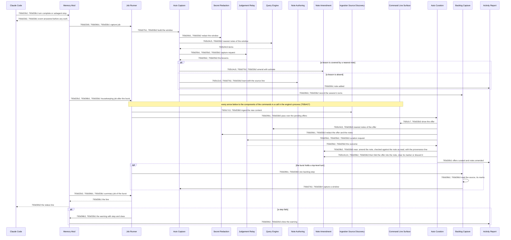
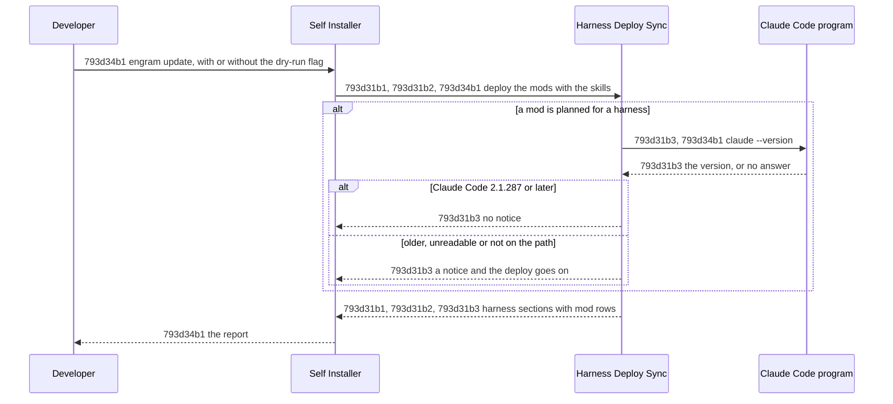

# Parallel Memory Agent - Technical Spec

## 793d1 Orientation

The product scope is the intent of [Parallel Memory Agent - Product Spec](./793a_product-spec.md#parallel-memory-agent---product-spec): the [System](./793a_product-spec.md#793a1-problem-statement) remembers for the [working agent](./793a_product-spec.md#793a1-problem-statement), beside the [intentional memory](./793a_product-spec.md#793a1-problem-statement) that stays as it is. This spec does not draft a design for it. It states the owner's two assumptions about the implementation as hypotheses, and records for each the hypothesis, how it was tested, the top-level result and the decision with its rationale ([793b240 The product spec is the owner's intent; the technical spec is his two hypotheses with the scenarios that test them](./793b_decision-log.md#793b240-the-product-spec-is-the-owners-intent-the-technical-spec-is-his-two-hypotheses-with-the-scenarios-that-test-them)). The detailed results are not kept ([793b355 The technical spec keeps hypotheses, method, top-level results and decisions; the detailed results are removed](./793b_decision-log.md#793b355-the-technical-spec-keeps-hypotheses-method-top-level-results-and-decisions-the-detailed-results-are-removed)). Every other implementation choice is an author choice, recorded in the decision log and listed in [793d19 Design as currently drafted](#793d19-design-as-currently-drafted); none is a requirement here, and they move to the implementation plan.

What exists, and the gap. Every [vault](./793a_product-spec.md#793a1-problem-statement) operation the [System](./793a_product-spec.md#793a1-problem-statement) needs exists: [Query Engine](../../specs/technical/query-engine.md), [Note Authoring](../../specs/technical/note-authoring.md), [Note Amendment](../../specs/technical/note-amendment.md), [Transcript Reader](../../specs/technical/transcript-reader.md), `engram ingest --auto` and [Harness Deploy Sync](../../specs/technical/harness-deploy-sync.md). Missing is whatever runs them without the [working agent](./793a_product-spec.md#793a1-problem-statement): observing the [moments](./793a_product-spec.md#793a1-problem-statement), adding text to the agent's [context](./793a_product-spec.md#793a1-problem-statement) without its own tool call, and judging what to deliver and what to save. The two hypotheses concern exactly that.

| Hypothesis | Statement | Result |
| --- | --- | --- |
| [793d17 H1: a Claude Code mod gives a smaller implementation surface and more capability than settings hooks](#793d17-h1-a-claude-code-mod-gives-a-smaller-implementation-surface-and-more-capability-than-settings-hooks) | A Claude Code [mod](#793d1b-terms) gives a smaller implementation [surface](#793d1b-terms) and more capability than [settings hooks](#793d1b-terms). | [793d17g4 Verdict](#793d17g4-verdict): the owner concludes a positive result; the surface clause is not supported, the capability clause is met; the mod is kept. |
| [793d18 H2: the cheapest capable model is adequate for every System judgement, and is faster and cheaper](#793d18-h2-the-cheapest-capable-model-is-adequate-for-every-system-judgement-and-is-faster-and-cheaper) | The cheapest capable model is adequate for every [System](./793a_product-spec.md#793a1-problem-statement) [judgement](#793d1b-terms) and is faster and cheaper than the [session](../../GLOSSARY.md#session)'s model. | [793d18d4 Verdict](#793d18d4-verdict): the owner concludes a mixed result with unexpected advantages; the speed clause is not supported; haiku at `low` is kept. |

How a hypothesis is settled. Every scenario is a runnable experiment or a contract test. The rule of each hypothesis is applied clause by clause and its output is stated per clause; the **conclusion** is the owner's ([793b356 Hypothesis conclusions are the owner's: multi-clause hypotheses are reported per clause](./793b_decision-log.md#793b356-hypothesis-conclusions-are-the-owners-multi-clause-hypotheses-are-reported-per-clause)). A clause is **supported** when its "Confirmed if" conditions hold, **not supported** when a "Disproved if" condition holds, and **inconclusive** when neither, because a result lay inside the [noise](#793d1b-terms).

### 793d1a What the hypotheses rely on in Claude Code mods

"Verified (docs)" is stated by the [Mods reference](https://code.claude.com/docs/en/plugins/mods/reference.md) and its sibling pages; "Verified (declarations)" by [claude-code.d.ts](https://github.com/anthropics/claude-code/blob/main/mods/types/claude-code.d.ts); "Verified (tested)" was observed on Claude Code 2.1.296. The [mods](#793d1b-terms) runtime is early access. Rows 9 (never existed), 15, 17, 18, 19 and 21 (the settings-hook comparison of the removed results) are retired and never reused.

| # | Capability relied on | Status | Settled by |
| --- | --- | --- | --- |
| 1 | A plugin whose `hooks/hooks.json` lists `modules` loads a module exporting `register(on, options)`; handlers are `($, e, next)`; Claude Code 2.1.287 or later | Verified (docs; tested: the debug log says `hooks module <name> loaded ... events: <the handlers>`) | [793d17d1a The mod loads in every session from the install path](#793d17d1-experiments) |
| 2 | A folder under `~/.claude/skills` holding `.claude-plugin/plugin.json` loads as a plugin in every [session](../../GLOSSARY.md#session), with no flag, install step or settings edit, | Verified (docs; tested, also through a symlink) | [793d17d1a The mod loads in every session from the install path](#793d17d1-experiments) |
| 3 | `prompt.submit` fires for every origin (composer, task notification, scheduled trigger, peer session) and `next({ ...e, context })` adds text the model reads after the prompt as typed | Verified (tested): all four origins fired and the context reached the model | [793d17a1a Each surface is probed for each capability the product needs](#793d17a1-experiments) |
| 4 | `additionalContext` from `classic.PostToolUse`, `classic.PostToolUseFailure` and `classic.SubagentStart` reaches the model, and appears in the [transcript](../../GLOSSARY.md#transcript) | Verified (tested): a separate `attachment` row of type `hook_additional_context`, in the transcript that received it (a subagent-start block only in the subagent's) | [793d17a1b Added context is attributable in the transcript](#793d17a1-experiments) |
| 5 | `agent.spawn` carries the Agent call's `prompt`, `description` and `fork`; `classic.SubagentStop` carries `agent_transcript_path` and `last_assistant_message` | Verified (tested): the file lacks its final row at the stop, so the file is polled | [793d17a1a Each surface is probed for each capability the product needs](#793d17a1-experiments) |
| 6 | `classic.SessionStart` carries the main agent's `transcript_path` | Verified (tested) | [793d17a1a Each surface is probed for each capability the product needs](#793d17a1-experiments) |
| 7 | `session.compact` fires for the main agent and, with `agentId`, for each [subagent](../../GLOSSARY.md#subagent) compaction; module variables survive `/clear`, `/resume` and `/branch` | Verified (docs, declarations; tested: one `session.compact` per `/compact`); module variables across `/clear` stay docs-only | [793d17a1a Each surface is probed for each capability the product needs](#793d17a1-experiments) |
| 8 | `$.session.messages()` returns the newest 4096 messages the next model request carries, main loop only | Verified (tested): it holds typed texts and replies, not a delivered block, so presence is read from the delivery ledger and the transcript file | [793d17a1c The mod can read what the agent's context holds, through a compaction and a resume](#793d17a1-experiments) |
| 10 | Time inside a mods API call (`$.process.run`, `$.model.complete`) does not count against a hook's 10 s budget; `.catch` handlers have 1 s | Verified (docs, declarations; tested: a 25 s call was not cut off) | [793d17c1b Work longer than the hook budget is awaited without the handler being cut off](#793d17c1-experiments) |
| 11 | `$.model.complete({ model, prompt, system, maxTokens, timeoutMs })` returns `{ isAnswered, text, reason, usage }`; `model` is an alias or a full id, billed to the session's credentials | Verified (docs, declarations; tested: `haiku` answered on this login; the debug log names the model, `claude-haiku-5-5`) | [793d17c1a A model call is relayed on a named tier](#793d17c1-experiments) |
| 12 | `$.ui.status(text)` pins one line under the prompt and is not a transcript row | Verified (declarations; tested: in a stream it arrives as a `ui_status` message) | [793d17b1a A message reaches the user and not the agent](#793d17b1-experiments) |
| 13 | `turn.step` fires once per model request, its result carries the step's `answer`, `toolUses`, `stopReason` and `usage`; a job started there can be awaited from the next `classic.PostToolUse`, whose wait is cut at about 10 s | Verified (tested, [793b320](./793b_decision-log.md#793b320-the-in-turn-recall-cue-is-built-as-793b238-decided)) | [793d17a1a Each surface is probed for each capability the product needs](#793d17a1-experiments) |
| 14 | A settings hook's environment lacks the session's credential; a nested `claude -p` answers on `haiku` with 438 tokens against 23 for `$.model.complete` | Verified (tested, [793b335](./793b_decision-log.md#793b335-the-settings-hook-column-is-the-recorders-counterpart-plus-one-script-installed-by-a-settings-merge)) | [793d17c1a A model call is relayed on a named tier](#793d17c1-experiments) |
| 16 | A settings hook's `systemMessage` is shown to the user and stored in the transcript file as a `hook_system_message` row; the mod's `$.ui.status` line is in no transcript row | Verified (tested, tmux): the model quoted neither | [793d17b1a A message reaches the user and not the agent](#793d17b1-experiments) |
| 20 | A mod timer callback that runs while the handler that set it is open puts its calls in that handler's scope and delays the next event; set as the handler's last action, it does not | Verified (tested, [793b337](./793b_decision-log.md#793b337-defects-of-the-probes-found-by-running-them-and-the-platform-behaviours-they-exposed)): a 20 s job held the next prompt 22.8 s in the first form and 2.7 s in the second | [793d17c1c Background work does not delay the next event](#793d17c1-experiments) |

### 793d1b Terms

The terms **moment**, **delivery**, **lesson**, **working agent**, **context**, **vault** and **System** are as in [793a1 Problem Statement](./793a_product-spec.md#793a1-problem-statement). This spec adds these:

- **Mod:** a Claude Code plugin whose `hooks/hooks.json` lists a module that Claude Code loads in process and calls with `register(on, options)`.
- **Settings hook:** a command that Claude Code runs on an event, as configured in a settings file, exchanging JSON through its standard input and output.
- **Surface:** the mod or the settings hooks, as a way to build the System's Claude Code side.
- **Hook budget:** the 10 seconds a hook handler's own time may take before Claude Code cuts it off.
- **Stand-in command:** a program that takes the place of the engram program in an experiment, returning a fixed delivery.
- **Probe:** a minimal mod module or settings hook that exercises one capability and writes what it observed to a log outside the transcript.
- **Judgement:** a model decision the System makes about memory. Its **kind** is one of four: `classify` (which of recall's four decision moments the agent is about to reach, or none), `relevance` (which candidate notes bear on a moment), `capture` (the lessons in a window of a session, each marked covered by a nearest note or absent) and `curation` (whether a pending offer is covered, near, absent or rejected).
- **Session model:** the model the working session is configured with; for H2 on this machine, the sonnet arm, because the acceptance sessions are pinned to it.
- **Cheapest tier:** the least capable and cheapest model tier available to the session, the `haiku` family, named by an alias and not by a dated id.
- **`judgeTiers`:** the table from a judgement kind to the model its requests name; every kind defaults to the cheapest tier.
- **Fixture set:** for one kind, the inputs drawn from real sessions and the vault, each with a gold label.
- **Gold label:** the correct answer for a fixture, fixed before either tier runs and not taken from the output of either tier.
- **Margin:** the largest shortfall of the cheapest tier against the session model that still counts as parity (0.05).
- **Noise:** the larger of the spread of the session model's own result over repeated runs and the half-width of the 95% paired-bootstrap interval of a difference between two arms.
- **Cue:** an event of a session that the System treats as a moment (a prompt, a route skill result, a subagent start, a step of the agent), or the decision that one has been reached.
- **Stub:** a chunk of the chunk index delivered as its id and its score and none of its content; the agent can print it with `engram show-chunk` ([793c15](./793c_open-questions.md#793c15-does-the-system-inject-chunks-with-their-content)).
- **Block:** the text one delivery adds to an agent's context: the marker `[engram memory]`, a framing text and one line per note.
- **Ledger:** the set of note paths the System has delivered to one agent; the top-level agent's ledger is emptied by a compaction.
- **Window:** the lines of what the user and the agent said, labelled by role, that one capture judgement reads.
- **Nearest notes:** the vault notes closest to a window or an offer by `engram query`, which a judgement compares it with.
- **Burst:** the jobs in the System's queue at one time; the housekeeping runs after the last of them.
- **Housekeeping:** the work that follows a burst, one job of the engine: the index, the pass over pending offers and, after a top-level turn, one backlog step.
- **Backlog source:** a session transcript file of any harness that the chunk index's manifest lists and that no capture has covered.
- **Mark:** a record in the backlog mark file that a backlog source, by its hash, or the turns of a session were captured.
- **Cut-off:** the fixed time, the install time minus 7 days, before which a backlog source is history.
- **Status line:** the one line the mod pins under the prompt, which is not a row of the transcript.
- **Job:** one unit of the System's work that the mod hands to `engram auto run`: a `kind` (`lookup`, `deep`, `step`, `tool`, `compact`, `capture`, `subagent`, `housekeeping` or `summary`) and the fields that kind reads.
- **Round:** one call of `engram auto run` for a job. It ends the job, or asks the mod to relay model requests or to wait; the next round replays the job from the **record** of the effects of the earlier ones (each command's output, each file read, the clock, each reply), which the mod hands back and never reads.

## 793d17 H1: a Claude Code mod gives a smaller implementation surface and more capability than settings hooks

Hypothesis: 793d17 The Claude Code side of the [System](./793a_product-spec.md#793a1-problem-statement) is better built as a [mod](#793d1b-terms) than as [settings hooks](#793d1b-terms), because the mod has a smaller implementation [surface](#793d1b-terms) and does more.

Owner's reason: the owner assumes that [mods](#793d1b-terms) offer a smaller [surface](#793d1b-terms) and more functionality, and builds the design on "the novel capabilities mods provide" ([793b189 The System is a Claude Code mod and a Go command, with the logic in Go](./793b_decision-log.md#793b189-the-system-is-a-claude-code-mod-and-a-go-command-with-the-logic-in-go)); for example "with mods, the system can just print stuff to the user" ([793c40 Does the user still see please's audit list?](./793c_open-questions.md#793c40-does-the-user-still-see-pleases-audit-list)). It was an assumption to test, not a settled fact.

How it was tested. A [probe](#793d1b-terms) for each capability the product needs was built twice, as a [mod](#793d1b-terms) and as a [settings hook](#793d1b-terms), and both ran against a [stand-in command](#793d1b-terms) on Claude Code 2.1.296 on this machine only (a macOS terminal, Agent SDK sessions on sonnet signed in with the subscription token, tmux for the on-screen check). Eleven scenarios ran on each surface (22 runs, 55 sessions), each probe logging what it observed outside the [transcript](../../GLOSSARY.md#transcript). The measurement points were the probe logs, the session's debug log, the rows of the transcript file, and a count of the artifacts each surface needs, taken by rule over the probe files as built: files deployed, handlers or hook entries, edits to files the user owns, and glue lines ([793b336 The surfaces are counted by rule, over the probe files as built](./793b_decision-log.md#793b336-the-surfaces-are-counted-by-rule-over-the-probe-files-as-built)). The verdict rule:

- Confirmed if all hold: the mod achieves every capability the hooks achieve and the rest; its [context](./793a_product-spec.md#793a1-problem-statement) is added at every channel and attributable in the transcript, and it shows the user text outside it; it relays a model call on a named tier, awaits work longer than the [hook budget](#793d1b-terms) and runs background work without delaying the next event; it loads in every [session](../../GLOSSARY.md#session) from the install path; a failure inside it leaves the session unaffected and no handler denies, drops or answers an event; and its [surface](#793d1b-terms) total is lower than the hooks' with none of the four counts higher.
- Disproved if any holds: the hooks achieve a capability the mod does not, or neither does; the mod is inactive where the hooks are active; or the hooks reach the same capability set with a lower total or any lower count.

The scenarios follow, one line each.

### 793d17a Capability coverage

#### 793d17a1 Experiments

- 793d17a1a Each surface is probed for each capability the product needs: nine capabilities (prompt origins observed, text added after the prompt and next to a tool result, a subagent's start, dispatch and stop, the main transcript path, a compaction, a step with its tool calls), each as a mod and as a settings hook.
- 793d17a1b Added context is attributable in the transcript: each added block is its own `hook_additional_context` row and the prompt and tool result are unchanged.
- 793d17a1c The mod can read what the agent's context holds, through a compaction and a resume: the delivered blocks are listed after delivery, not after a compaction removed them, and again after a resume.

### 793d17b Output outside the agent's context

#### 793d17b1 Experiments

- 793d17b1a A message reaches the user and not the agent: a line shows on screen under tmux and is neither in the transcript file nor quoted by the model.

### 793d17c Model calls and long work

#### 793d17c1 Experiments

- 793d17c1a A model call is relayed on a named tier: a `haiku` call answers on the session's credentials.
- 793d17c1b Work longer than the hook budget is awaited without the handler being cut off: a 25 s stand-in command.
- 793d17c1c Background work does not delay the next event: a 20 s job, then an immediate next prompt.

### 793d17d Install and load

#### 793d17d1 Experiments

- 793d17d1a The mod loads in every session from the install path: from a link in the skills directory, with no flag, install step or settings edit, in a new, cleared, resumed and branched session.

### 793d17e Failure containment and restraint

#### 793d17e1 Experiments

- 793d17e1a A failure inside the surface leaves the session unaffected: four causes (the command cannot start, its output cannot be parsed, the handler throws, the work passes its deadline); the user is warned outside the transcript.
- 793d17e1b The mod changes nothing it must not: no handler denies, drops or answers an event, and the memory commands' input, permission and result are unchanged.

### 793d17f Surface size

#### 793d17f1 Experiments

- 793d17f1a The same behavior is counted on both surfaces: the four counts, and the capabilities achieved.

### 793d17g Results

Run on 2026-10-13 (`targ acceptance 793d17`). The observations were ephemeral and are not kept ([793b343 The hypothesis-eval artifacts are ephemeral and kept out of the repository](./793b_decision-log.md#793b343-the-hypothesis-eval-artifacts-are-ephemeral-and-kept-out-of-the-repository)).

| Measure | Mod | Settings hooks |
| --- | --- | --- |
| Capabilities achieved (of 9) | 9 | 9 |
| Surface total of the four counts, as built | 107 (8 files, 13 handlers, 0 user-file edits, 86 glue lines) | 94 (2 files, 10 entries, 1 user-file edit, 81 glue lines); 105 packaged as a plugin |
| Restraint and containment | held (four causes contained, no refusal object, 138 contract tests) | contained too; restraint not run (no System hook set exists) |
| What only the mod does | see the verdict below; it also sees a step before its tool runs | |
| What only the hooks do | | run in their own process, work without the early-access mods runtime |

#### 793d17g4 Verdict

Per clause, the measurements:

- Surface: the hooks are smaller, 94 against 107 in total (2 files against 8, 10 entries against 13, 81 glue lines against 86, one user-file edit against none); 105 packaged as a plugin.
- Capability: 9 of 9 on both surfaces. Only the mod: a model call in 23 tokens against 438 for a hook, 0 processes per tour against 27, no credential to provision, a status line off the [transcript](../../GLOSSARY.md#transcript), and the origin of a prompt known.

Rule output: surface clause: not supported. Capability clause: met on the nine; the mod's extras are measured beside them.

**Conclusion (owner, Joe, 2026-10-14):** "The mods do seem more capable in terms of ui, and we discovered that they were more efficient. I'd call that a positive result." H1 is a positive result: the mod is more capable in UI, and the unexpected gain is that it is more efficient ([793b356](./793b_decision-log.md#793b356-hypothesis-conclusions-are-the-owners-multi-clause-hypotheses-are-reported-per-clause)).

Decision (Joe, 2026-10-14): the Claude Code side stays a [mod](#793d1b-terms) ([793c73](./793c_open-questions.md#793c73-does-the-systems-claude-code-side-stay-a-mod-now-that-h1-is-disproved-by-its-own-rule), [793b352](./793b_decision-log.md#793b352-owner-answer-793c73-the-systems-claude-code-side-stays-a-mod)). Rationale: the unexpected advantages are the reason (the in-process call, no credential, the status line off the transcript, the known prompt origin) with the UI capability; the smaller [surface](#793d1b-terms) of the [settings hooks](#793d1b-terms) ([793b338](./793b_decision-log.md#793b338-h1-is-disproved-by-its-own-rule-on-this-machine)) does not outweigh them.

## 793d18 H2: the cheapest capable model is adequate for every System judgement, and is faster and cheaper

Hypothesis: 793d18 Every [judgement](#793d1b-terms) the [System](./793a_product-spec.md#793a1-problem-statement) makes (`classify`, `relevance`, `capture` and `curation`, [793b279 Judgement is one richer prompt per kind, and capture judges extraction and reconciliation in one call](./793b_decision-log.md#793b279-judgement-is-one-richer-prompt-per-kind-and-capture-judges-extraction-and-reconciliation-in-one-call)) can be made by the [cheapest tier](#793d1b-terms) as well as by the [session model](#793d1b-terms), within a [margin](#793d1b-terms), and the cheapest tier is faster and cheaper per call.

Owner's reason: every System task that needs model judgement should go to the least capable tier that can handle that kind of judgement, because the automatic System must be as fast and as cheap as possible ([793b224 Judgement runs on the cheapest capable tier](./793b_decision-log.md#793b224-judgement-runs-on-the-cheapest-capable-tier), [793b238 Delivery has two model judgements on the cheapest tier: moment classification and a relevance filter](./793b_decision-log.md#793b238-delivery-has-two-model-judgements-on-the-cheapest-tier-moment-classification-and-a-relevance-filter)).

How it was tested. A 40-line replay mod relayed the proof of concept's own request for each kind, unchanged except for the model, through `$.model.complete` over prepared [fixture sets](#793d1b-terms) ([793b265 H2 is replayed by a small mod over fixtures, and gold comes from history or the owner](./793b_decision-log.md#793b265-h2-is-replayed-by-a-small-mod-over-fixtures-and-gold-comes-from-history-or-the-owner)), 3 runs per fixture, on this machine only (Claude Code 2.1.296, subscription login, prices of 2026-10-06; [793b268 The PoC is minimal and targeted: environments the owner does not use and everything no scenario needs are cut](./793b_decision-log.md#793b268-the-poc-is-minimal-and-targeted-environments-the-owner-does-not-use-and-everything-no-scenario-needs-are-cut)). The arms were haiku (the cheapest tier), sonnet (the session model and the verdict arm), and, as indicative arms on a stratified half and a fifth of the fixtures, opus and fable. The confirmed fixtures were 200 `classify`, 130 `relevance`, 130 `capture` and 150 `curation`; every [gold label](#793d1b-terms) was drafted by fable (`curation` constructed from real notes) and confirmed by the owner for every fixture ([793b346 The confirmed gold: final fixture counts and the share of drafts the owner changed](./793b_decision-log.md#793b346-the-confirmed-gold-final-fixture-counts-and-the-share-of-drafts-the-owner-changed)). The measurement points: wall time around each call in the mod, cost as the reply's `usage` times the published price, and the reply read by the proof of concept's strict parsers, a reply not read being a miss. The primary measure is agreement with the gold (recall for `relevance` and for `capture`'s lessons); the guard is the rate of a harmful extra (a moment named where the gold is none, a note delivered that the gold excludes, a lesson written where there is none, a destructive curation error). The verdict rule, per kind: parity when the one-sided 95% lower bound of the primary difference from sonnet is at least minus the margin (0.05) and the upper bound of the guard difference is at most the margin; disproved when the primary's upper bound is below minus the margin or the guard's lower bound is above the margin; inconclusive otherwise, as when a gap lies inside the [noise](#793d1b-terms) (a paired bootstrap of 10,000 resamples). H2 is disproved as a whole if the cheapest tier is not faster or not cheaper than sonnet.

### 793d18a Agreement with the gold labels

#### 793d18a1 Experiments

- 793d18a1a The cheapest tier agrees with the gold labels as well as the session model, within the margin: primary and guard per kind, as above.
- 793d18a1b A gap inside the noise is inconclusive, not a tie.
- 793d18a1c Subtle cases are not hidden by easy ones: `capture`'s subtle stratum is scored on its own.

### 793d18b Speed and cost

#### 793d18b1 Experiments

- 793d18b1a The cheapest tier is faster per call: median latency per kind.
- 793d18b1b The cheapest tier is cheaper per fixture: cost per kind.

### 793d18c The tier table

#### 793d18c1 Experiments

- 793d18c1a Every request names the model of its kind: a contract test.
- 793d18c1b Raising one kind changes only that kind: a contract test.

### 793d18d Results

Run on 2026-10-13: 4,956 calls, none failed, about 35 USD at list price. The observations were ephemeral ([793b343](./793b_decision-log.md#793b343-the-hypothesis-eval-artifacts-are-ephemeral-and-kept-out-of-the-repository)).

| Kind | Fixtures | Agreement, haiku / sonnet (strict parsers) | Haiku cheaper (times) | Haiku faster (median call, haiku / sonnet) | Verdict |
| --- | --- | --- | --- | --- | --- |
| `classify` | 200 | 0.612 / 0.450 | 13.8 | no, a tie (1.70 / 1.66 s) | inconclusive: the guard bound is 0.3 point beyond the margin |
| `relevance` | 130 | 0.858 / 0.380 (recall) | 14.9 | yes, inside the noise (2.47 / 2.75 s) | disproved on the guard by the rule, an artifact of unread replies |
| `capture` | 130 | 0.289 / 0.390 (lesson recall) | 11.7 | no (2.47 / 1.31 s) | inconclusive: the recall bound straddles the margin |
| `curation` | 150 | 0.889 / 0.736 | 10.1 | no (2.40 / 1.28 s) | inconclusive: the destructive-error bound straddles the margin |
| all kinds | 610 | | 10.1 to 14.9 | slower in three kinds (2.10 / 1.63 s over all calls) | disproved on speed |

Sonnet's replies were unread by the strict parsers in 27% (`classify`), 63% (`relevance`), 3% (`capture`) and 12% (`curation`) of calls because it writes prose before the JSON, and an unread reply scores as a miss, so the quality gaps are largely an artifact (read leniently, `classify` is 0.612 against 0.608 and `relevance` 0.858 against 0.830). A control at the floor effort (`low`, the lowest this build accepts) left haiku slower than sonnet in `capture` and `curation` by 0.9 and 0.6 s, because haiku thinks at every setting and `$.model.complete` cannot turn that off ([793b351 The H2 replay ran at the PoC's effort (low and medium), not at the floor; a latency control at the floor does not flip the speed clause](./793b_decision-log.md#793b351-the-h2-replay-ran-at-the-pocs-effort-low-and-medium-not-at-the-floor-a-latency-control-at-the-floor-does-not-flip-the-speed-clause)).

#### 793d18d4 Verdict

Per clause, the measurements:

- Cheaper: yes, 10.1 to 14.9 times in every kind.
- Faster: no. Median call, haiku against sonnet: a tie in `classify` (1.70 / 1.66 s) and faster in `relevance` (2.47 / 2.75 s, inside the [noise](#793d1b-terms)); slower in `capture` and `curation`, by 0.6 to 0.9 s at the floor effort. `capture` and `curation` run after the turn, against deadlines no call approached.
- Agreement with the gold, haiku / sonnet: at or above sonnet in three kinds (`classify` 0.612 / 0.450, `relevance` 0.858 / 0.380, `curation` 0.889 / 0.736; strict parsers, so sonnet's figures are depressed by unread replies), inconclusive in `capture` (0.289 / 0.390).
- Structured output: haiku's replies were read in 97 to 100% of calls, sonnet's in 45 to 96% (the effort-floor control). The effort floor is `low`, and haiku still thinks at it.

Rule output: speed clause: not supported ([793b349](./793b_decision-log.md#793b349-h2-is-disproved-as-a-whole-on-this-machine-by-its-speed-clause-relevance-is-disproved-on-its-guard-by-the-rule-and-the-unread-replies-are-the-reason)). Cheaper clause: supported. Quality: no kind is confirmed.

**Conclusion (owner, Joe, 2026-10-14):** "Haiku is much cheaper, though not faster, but clearly better suited for decision style structured output. I'd call that a mixed result with unexpected advantages." H2 is a mixed result with unexpected advantages: much cheaper, not faster, and clearly better suited to decision-style structured output ([793b356](./793b_decision-log.md#793b356-hypothesis-conclusions-are-the-owners-multi-clause-hypotheses-are-reported-per-clause)).

Decision (Joe, 2026-10-14): every [judgement](#793d1b-terms) runs on haiku at `low` effort ([793c79](./793c_open-questions.md#793c79-what-follows-from-h2-being-disproved-on-speed-and-for-relevance), [793b353](./793b_decision-log.md#793b353-owner-answer-793c79-every-system-judgement-runs-on-haiku-at-the-lowest-accepted-effort)). Rationale: the unexpected advantages are the reason, namely 10 to 15 times lower cost and replies the parsers read almost always, with agreement at or above sonnet's in three kinds; the lost speed is a tie or a gain on the two judgements that gate delivery, and 0.6 to 0.9 s on background work.

## 793d19 Design as currently drafted

These are the author's choices so far. They are not requirements of this spec and are not claimed to be right; each is recorded, with its rationale and the alternatives, in the decision log, and they move to the implementation plan once the hypotheses are settled.

- **The split between the [mod](#793d1b-terms) and the engram commands**, with [judgements](#793d1b-terms) relayed through the mod (the mod orchestrates over the existing commands and no Go runner is built, per [793b256 The PoC orchestrates in JavaScript inside the mod over the existing engram commands](./793b_decision-log.md#793b256-the-poc-orchestrates-in-javascript-inside-the-mod-over-the-existing-engram-commands)): [793b189 The System is a Claude Code mod and a Go command, with the logic in Go](./793b_decision-log.md#793b189-the-system-is-a-claude-code-mod-and-a-go-command-with-the-logic-in-go), [793b238 Delivery has two model judgements on the cheapest tier: moment classification and a relevance filter](./793b_decision-log.md#793b238-delivery-has-two-model-judgements-on-the-cheapest-tier-moment-classification-and-a-relevance-filter).
- **Where the mod's source lives, and how `engram update` installs it:** [793b190 The mod's source lives in agent-instructions/mods and is written in JavaScript](./793b_decision-log.md#793b190-the-mods-source-lives-in-agent-instructionsmods-and-is-written-in-javascript), [793b191 engram update installs the mod as a skills-directory plugin](./793b_decision-log.md#793b191-engram-update-installs-the-mod-as-a-skills-directory-plugin).
- **[Delivery](./793a_product-spec.md#793a1-problem-statement) channels** (prompt [context](./793a_product-spec.md#793a1-problem-statement), tool-result context, subagent-start context): [793b192 Delivery uses prompt context, tool-result context and subagent-start context](./793b_decision-log.md#793b192-delivery-uses-prompt-context-tool-result-context-and-subagent-start-context).
- **[Moments](./793a_product-spec.md#793a1-problem-statement):** the cues and the classification: [793b193 Moments are mechanical cues; the prompt lookup spans recall's four moments](./793b_decision-log.md#793b193-moments-are-mechanical-cues-the-prompt-lookup-spans-recalls-four-moments), [793b239 Author choices in applying 793b238, shown to the owner](./793b_decision-log.md#793b239-author-choices-in-applying-793b238-shown-to-the-owner); [subagents](../../GLOSSARY.md#subagent): [793b194 Subagents get a dispatch delivery and a capture at stop; moments inside a subagent are not detected](./793b_decision-log.md#793b194-subagents-get-a-dispatch-delivery-and-a-capture-at-stop-moments-inside-a-subagent-are-not-detected); tier evidence at routing: [793b218 793c64 is answered (a): tier evidence is delivered when the orchestrator routes through route](./793b_decision-log.md#793b218-793c64-is-answered-a-tier-evidence-is-delivered-when-the-orchestrator-routes-through-route).
- **Presence and the delivery ledger:** [793b195 Presence is read from the live context and a delivery ledger](./793b_decision-log.md#793b195-presence-is-read-from-the-live-context-and-a-delivery-ledger).
- **Judgement as relayed completions, and the tier table:** [793b196 Judgement runs as relayed model completions, not sessions](./793b_decision-log.md#793b196-judgement-runs-as-relayed-model-completions-not-sessions), [793b224 Judgement runs on the cheapest capable tier](./793b_decision-log.md#793b224-judgement-runs-on-the-cheapest-capable-tier); the tier and the effort are haiku at `low` for all four kinds, by the owner ([793b353](./793b_decision-log.md#793b353-owner-answer-793c79-every-system-judgement-runs-on-haiku-at-the-lowest-accepted-effort)); the mod stays a mod ([793b352](./793b_decision-log.md#793b352-owner-answer-793c73-the-systems-claude-code-side-stays-a-mod)).
- **The round protocol, with a Go side that keeps no state:** dropped for the PoC by [793b256 The PoC orchestrates in JavaScript inside the mod over the existing engram commands](./793b_decision-log.md#793b256-the-poc-orchestrates-in-javascript-inside-the-mod-over-the-existing-engram-commands); it was [793b197 The Go side is stateless and advances a job one round per call](./793b_decision-log.md#793b197-the-go-side-is-stateless-and-advances-a-job-one-round-per-call).
- **Relevance, the item limit and the wording of the instruction:** [793b198 Relevance, item limit, chunk content and the wording of the instruction](./793b_decision-log.md#793b198-relevance-item-limit-chunk-content-and-the-wording-of-the-instruction).
- **Capture:** the window and the redaction (the [System](./793a_product-spec.md#793a1-problem-statement)'s own blocks are attachment rows and never in `$.session.messages()`, so nothing is stripped, [793b319 The PoC drops the code and the references of what does not exist](./793b_decision-log.md#793b319-the-poc-drops-the-code-and-the-references-of-what-does-not-exist)) [793b199 The capture window, redaction and the System's own blocks](./793b_decision-log.md#793b199-the-capture-window-redaction-and-the-systems-own-blocks); reconciliation [793b200 Reconciliation is covered or absent; dispatch outcomes are deduplicated mechanically](./793b_decision-log.md#793b200-reconciliation-is-covered-or-absent-dispatch-outcomes-are-deduplicated-mechanically); curation [793b201 Curation follows curate's table, including the skill-runbook case](./793b_decision-log.md#793b201-curation-follows-curates-table-including-the-skill-runbook-case); the index [793b202 The chunk index is brought up to date with engram ingest --auto after the turn's other work](./793b_decision-log.md#793b202-the-chunk-index-is-brought-up-to-date-with-engram-ingest---auto-after-the-turns-other-work).
- **Background work, the activity line and failures:** [793b203 Background work is one in-memory queue, and a final turn can be lost on exit](./793b_decision-log.md#793b203-background-work-is-one-in-memory-queue-and-a-final-turn-can-be-lost-on-exit), [793b204 The memory-activity line is the mod's status line](./793b_decision-log.md#793b204-the-memory-activity-line-is-the-mods-status-line), [793b205 Failures are classified by the mod and the runner, with named deadlines](./793b_decision-log.md#793b205-failures-are-classified-by-the-mod-and-the-runner-with-named-deadlines).
- **Backlog capture, the watermark and coexistence with intentional ingestion:** [793b231 Backlog capture: the System captures lessons from any swept session transcript after the fact](./793b_decision-log.md#793b231-backlog-capture-the-system-captures-lessons-from-any-swept-session-transcript-after-the-fact), [793b232 Backlog capture is a watermark per transcript source and a scan after each turn's own capture, and the $.store queue is dropped](./793b_decision-log.md#793b232-backlog-capture-is-a-watermark-per-transcript-source-and-a-scan-after-each-turns-own-capture-and-the-store-queue-is-dropped), [793b233 Choices made in applying 793b232, shown to the owner](./793b_decision-log.md#793b233-choices-made-in-applying-793b232-shown-to-the-owner), [793b234 Intentional ingestion in other harnesses continues; the System coexists with it through the write lock](./793b_decision-log.md#793b234-intentional-ingestion-in-other-harnesses-continues-the-system-coexists-with-it-through-the-write-lock).
- **Validating the mod through the existing integration gate:** [793b236 The mod is validated and tested through the existing integration gate, not a new check target](./793b_decision-log.md#793b236-the-mod-is-validated-and-tested-through-the-existing-integration-gate-not-a-new-check-target).
- **The initial values** of deadlines, windows and limits: [793b239 Author choices in applying 793b238, shown to the owner](./793b_decision-log.md#793b239-author-choices-in-applying-793b238-shown-to-the-owner), [793b233 Choices made in applying 793b232, shown to the owner](./793b_decision-log.md#793b233-choices-made-in-applying-793b232-shown-to-the-owner).

### 793d19a Security

Ratified by the owner (Joe, 2026-10-13, [793b324 Owner answer 3: the residual-risk statement 793d19a is ratified as written, with the near outcome kept](./793b_decision-log.md#793b324-owner-answer-3-the-residual-risk-statement-793d19a-is-ratified-as-written-with-the-near-outcome-kept)). This is the residual-risk statement of the opus implementation and security review of the PoC ([793b315 An opus implementation and security review of the PoC returned "targeted fixes first"](./793b_decision-log.md#793b315-an-opus-implementation-and-security-review-of-the-poc-returned-targeted-fixes-first)), recorded as the reviewer wrote it; the fixes it asked for are [793b318 The mod's lookups, offers and redaction are hardened against what an offer, a prompt or a transcript can say](./793b_decision-log.md#793b318-the-mods-lookups-offers-and-redaction-are-hardened-against-what-an-offer-a-prompt-or-a-transcript-can-say).

The statement itself, and the map of its mitigations to the requirements that hold them, are in [793d25a Orientation](#793d25a-orientation), where they are promoted with the Judgement Relay; this section is the record of how they came to be, and is not promoted.

Amended (2026-10-14): the two failure cases of a near fold that the earlier residual list carried (the offer folded away with its claim never written; a note edited meanwhile overwritten) are closed by the order and the check of [793b420](./793b_decision-log.md#793b420-a-near-fold-amends-first-with-a-check-of-the-note-and-folds-the-offer-away-after-it), and the residual of the capture queue file (two processes losing a write, a double capture) went with the queue ([793b416](./793b_decision-log.md#793b416-the-persisted-capture-queue-is-dropped-backlog-capture-covers-the-promise)); [793d35c Gaps and what is not built](#793d35c-gaps-and-what-is-not-built) lists what is left.

## 793d20 Traceability to the product spec

Every scenario of [Parallel Memory Agent - Product Spec](./793a_product-spec.md#parallel-memory-agent---product-spec) is listed with the hypothesis scenarios that test the assumption it rests on, or the design [note](./793a_product-spec.md#793a1-problem-statement) that will realise it. The scenario text is not restated here ([793b188 Technical spec structure: flows and components, with the scenario mapping as a table](./793b_decision-log.md#793b188-technical-spec-structure-flows-and-components-with-the-scenario-mapping-as-a-table)).

| Product scenario | Tested or realised by |
| --- | --- |
| [793a2n1a Recall happens without the agent running it](./793a_product-spec.md#793a2n1-uat-scenarios) | [793d17a1a Each surface is probed for each capability the product needs](#793d17a1-experiments), [793d17a1b Added context is attributable in the transcript](#793d17a1-experiments), [793d18a1a The cheapest tier agrees with the gold labels as well as the session model, within the margin](#793d18a1-experiments), [793b193 Moments are mechanical cues; the prompt lookup spans recall's four moments](./793b_decision-log.md#793b193-moments-are-mechanical-cues-the-prompt-lookup-spans-recalls-four-moments), [793b238 Delivery has two model judgements on the cheapest tier: moment classification and a relevance filter](./793b_decision-log.md#793b238-delivery-has-two-model-judgements-on-the-cheapest-tier-moment-classification-and-a-relevance-filter) |
| [793a2n1e No result, nothing delivered](./793a_product-spec.md#793a2n1-uat-scenarios) | [793d18a1a The cheapest tier agrees with the gold labels as well as the session model, within the margin](#793d18a1-experiments), [793b198 Relevance, item limit, chunk content and the wording of the instruction](./793b_decision-log.md#793b198-relevance-item-limit-chunk-content-and-the-wording-of-the-instruction) |
| [793a2n1g A subagent receives relevant notes](./793a_product-spec.md#793a2n1-uat-scenarios) | [793d17a1a Each surface is probed for each capability the product needs](#793d17a1-experiments), [793d17a1b Added context is attributable in the transcript](#793d17a1-experiments), [793b194 Subagents get a dispatch delivery and a capture at stop; moments inside a subagent are not detected](./793b_decision-log.md#793b194-subagents-get-a-dispatch-delivery-and-a-capture-at-stop-moments-inside-a-subagent-are-not-detected) |
| [793a2n1h A prompt from any source receives relevant notes](./793a_product-spec.md#793a2n1-uat-scenarios) | [793d17a1a Each surface is probed for each capability the product needs](#793d17a1-experiments), [793b192 Delivery uses prompt context, tool-result context and subagent-start context](./793b_decision-log.md#793b192-delivery-uses-prompt-context-tool-result-context-and-subagent-start-context) |
| [793a2n1i Please's orientation receives relevant notes](./793a_product-spec.md#793a2n1-uat-scenarios) | [793d17a1a Each surface is probed for each capability the product needs](#793d17a1-experiments), [793b193 Moments are mechanical cues; the prompt lookup spans recall's four moments](./793b_decision-log.md#793b193-moments-are-mechanical-cues-the-prompt-lookup-spans-recalls-four-moments) |
| [793a2n1j Tier evidence is delivered before a dispatch is routed](./793a_product-spec.md#793a2n1-uat-scenarios) | [793d17a1a Each surface is probed for each capability the product needs](#793d17a1-experiments), [793b218 793c64 is answered (a): tier evidence is delivered when the orchestrator routes through route](./793b_decision-log.md#793b218-793c64-is-answered-a-tier-evidence-is-delivered-when-the-orchestrator-routes-through-route) |
| [793a2e1a Note delivered earlier is not delivered again](./793a_product-spec.md#793a2e1-uat-scenarios) | [793d17a1c The mod can read what the agent's context holds, through a compaction and a resume](#793d17a1-experiments), [793b195 Presence is read from the live context and a delivery ledger](./793b_decision-log.md#793b195-presence-is-read-from-the-live-context-and-a-delivery-ledger) |
| [793a2e1c Note the agent retrieved itself is not delivered](./793a_product-spec.md#793a2e1-uat-scenarios) | [793d17a1c The mod can read what the agent's context holds, through a compaction and a resume](#793d17a1-experiments), [793b195 Presence is read from the live context and a delivery ledger](./793b_decision-log.md#793b195-presence-is-read-from-the-live-context-and-a-delivery-ledger) |
| [793a2e1d A parent's note is still delivered to a subagent](./793a_product-spec.md#793a2e1-uat-scenarios) | [793d17a1c The mod can read what the agent's context holds, through a compaction and a resume](#793d17a1-experiments), [793b194 Subagents get a dispatch delivery and a capture at stop; moments inside a subagent are not detected](./793b_decision-log.md#793b194-subagents-get-a-dispatch-delivery-and-a-capture-at-stop-moments-inside-a-subagent-are-not-detected) |
| [793a2e1e A note removed by compaction can be delivered again](./793a_product-spec.md#793a2e1-uat-scenarios) | [793d17a1c The mod can read what the agent's context holds, through a compaction and a resume](#793d17a1-experiments) |
| [793a2e1g A resumed session's restored content counts as present](./793a_product-spec.md#793a2e1-uat-scenarios) | [793d17a1c The mod can read what the agent's context holds, through a compaction and a resume](#793d17a1-experiments) |
| [793a3a1a A lesson is captured without agent action](./793a_product-spec.md#793a3a1-uat-scenarios) | [793d17a1a Each surface is probed for each capability the product needs](#793d17a1-experiments), [793d18a1a The cheapest tier agrees with the gold labels as well as the session model, within the margin](#793d18a1-experiments), [793b199 The capture window, redaction and the System's own blocks](./793b_decision-log.md#793b199-the-capture-window-redaction-and-the-systems-own-blocks) |
| [793a3a1g A lesson in a subagent session is captured](./793a_product-spec.md#793a3a1-uat-scenarios) | [793d17a1a Each surface is probed for each capability the product needs](#793d17a1-experiments), [793d18a1a The cheapest tier agrees with the gold labels as well as the session model, within the margin](#793d18a1-experiments), [793b194 Subagents get a dispatch delivery and a capture at stop; moments inside a subagent are not detected](./793b_decision-log.md#793b194-subagents-get-a-dispatch-delivery-and-a-capture-at-stop-moments-inside-a-subagent-are-not-detected) |
| [793a3a1h Two subagents contain the same lesson](./793a_product-spec.md#793a3a1-uat-scenarios) | [793d18a1a The cheapest tier agrees with the gold labels as well as the session model, within the margin](#793d18a1-experiments), [793b200 Reconciliation is covered or absent; dispatch outcomes are deduplicated mechanically](./793b_decision-log.md#793b200-reconciliation-is-covered-or-absent-dispatch-outcomes-are-deduplicated-mechanically) |
| [793a3a1j A lesson that is already recorded is not written again](./793a_product-spec.md#793a3a1-uat-scenarios) | [793d18a1a The cheapest tier agrees with the gold labels as well as the session model, within the margin](#793d18a1-experiments), [793b200 Reconciliation is covered or absent; dispatch outcomes are deduplicated mechanically](./793b_decision-log.md#793b200-reconciliation-is-covered-or-absent-dispatch-outcomes-are-deduplicated-mechanically), [793b232 Backlog capture is a watermark per transcript source and a scan after each turn's own capture, and the $.store queue is dropped](./793b_decision-log.md#793b232-backlog-capture-is-a-watermark-per-transcript-source-and-a-scan-after-each-turns-own-capture-and-the-store-queue-is-dropped) |
| [793a3a1k A lesson in a session that ended before it was saved is captured later](./793a_product-spec.md#793a3a1-uat-scenarios) | [793d17a1a Each surface is probed for each capability the product needs](#793d17a1-experiments), [793b231 Backlog capture: the System captures lessons from any swept session transcript after the fact](./793b_decision-log.md#793b231-backlog-capture-the-system-captures-lessons-from-any-swept-session-transcript-after-the-fact), [793b232 Backlog capture is a watermark per transcript source and a scan after each turn's own capture, and the $.store queue is dropped](./793b_decision-log.md#793b232-backlog-capture-is-a-watermark-per-transcript-source-and-a-scan-after-each-turns-own-capture-and-the-store-queue-is-dropped) |
| [793a4j1a The index catches up after the turn](./793a_product-spec.md#793a4j1-uat-scenarios) | [793b202 The chunk index is brought up to date with engram ingest --auto after the turn's other work](./793b_decision-log.md#793b202-the-chunk-index-is-brought-up-to-date-with-engram-ingest---auto-after-the-turns-other-work) |
| [793a4j1c Offers are resolved by the System](./793a_product-spec.md#793a4j1-uat-scenarios) | [793d18a1a The cheapest tier agrees with the gold labels as well as the session model, within the margin](#793d18a1-experiments), [793b201 Curation follows curate's table, including the skill-runbook case](./793b_decision-log.md#793b201-curation-follows-curates-table-including-the-skill-runbook-case) |
| [793a4j1d The agent is not asked to curate](./793a_product-spec.md#793a4j1-uat-scenarios) | [793d17e1b The mod changes nothing it must not](#793d17e1-experiments), [793b201 Curation follows curate's table, including the skill-runbook case](./793b_decision-log.md#793b201-curation-follows-curates-table-including-the-skill-runbook-case) |
| [793a4j1e Slow housekeeping does not stall the session](./793a_product-spec.md#793a4j1-uat-scenarios) | [793d17c1c Background work does not delay the next event](#793d17c1-experiments), [793b203 Background work is one in-memory queue, and a final turn can be lost on exit](./793b_decision-log.md#793b203-background-work-is-one-in-memory-queue-and-a-final-turn-can-be-lost-on-exit) |
| [793a4c1a Tool calls and permissions unchanged](./793a_product-spec.md#793a4c1-uat-scenarios) | [793d17e1b The mod changes nothing it must not](#793d17e1-experiments) |
| [793a4c1b The prompt is unchanged and the note is separate](./793a_product-spec.md#793a4c1-uat-scenarios) | [793d17a1b Added context is attributable in the transcript](#793d17a1-experiments) |
| [793a4c1c The only effect on the working agent's context is what is delivered](./793a_product-spec.md#793a4c1-uat-scenarios) | [793d17a1b Added context is attributable in the transcript](#793d17a1-experiments), [793d17e1b The mod changes nothing it must not](#793d17e1-experiments) |
| [793a4c1f The agent is neither required nor asked to run a memory command](./793a_product-spec.md#793a4c1-uat-scenarios) | [793d17a1b Added context is attributable in the transcript](#793d17a1-experiments), [793d17e1b The mod changes nothing it must not](#793d17e1-experiments) |
| [793a4b1a Vault unavailable](./793a_product-spec.md#793a4b1-uat-scenarios) | [793d17e1a A failure inside the surface leaves the session unaffected](#793d17e1-experiments), [793b205 Failures are classified by the mod and the runner, with named deadlines](./793b_decision-log.md#793b205-failures-are-classified-by-the-mod-and-the-runner-with-named-deadlines) |
| [793a4b1b Evaluation crashes](./793a_product-spec.md#793a4b1-uat-scenarios) | [793d17e1a A failure inside the surface leaves the session unaffected](#793d17e1-experiments), [793b205 Failures are classified by the mod and the runner, with named deadlines](./793b_decision-log.md#793b205-failures-are-classified-by-the-mod-and-the-runner-with-named-deadlines) |
| [793a4b1c No error reaches the agent and the user is warned](./793a_product-spec.md#793a4b1-uat-scenarios) | [793d17e1a A failure inside the surface leaves the session unaffected](#793d17e1-experiments), [793b205 Failures are classified by the mod and the runner, with named deadlines](./793b_decision-log.md#793b205-failures-are-classified-by-the-mod-and-the-runner-with-named-deadlines) |
| [793a4b1e No warning when nothing matched](./793a_product-spec.md#793a4b1-uat-scenarios) | [793d17e1a A failure inside the surface leaves the session unaffected](#793d17e1-experiments), [793b205 Failures are classified by the mod and the runner, with named deadlines](./793b_decision-log.md#793b205-failures-are-classified-by-the-mod-and-the-runner-with-named-deadlines) |
| [793a5j1a Update installs the System for the harness it updates](./793a_product-spec.md#793a5j1-uat-scenarios) | [793d17d1a The mod loads in every session from the install path](#793d17d1-experiments), [793b191 engram update installs the mod as a skills-directory plugin](./793b_decision-log.md#793b191-engram-update-installs-the-mod-as-a-skills-directory-plugin) |
| [793a5j1b An existing install gains the System and keeps what it had](./793a_product-spec.md#793a5j1-uat-scenarios) | [793d17d1a The mod loads in every session from the install path](#793d17d1-experiments), [793b191 engram update installs the mod as a skills-directory plugin](./793b_decision-log.md#793b191-engram-update-installs-the-mod-as-a-skills-directory-plugin) |
| [793a5j1c A preview installs none of the System](./793a_product-spec.md#793a5j1-uat-scenarios) | [793b191 engram update installs the mod as a skills-directory plugin](./793b_decision-log.md#793b191-engram-update-installs-the-mod-as-a-skills-directory-plugin) |
| [793a5j1d One update serves both harnesses differently](./793a_product-spec.md#793a5j1-uat-scenarios) | [793d17d1a The mod loads in every session from the install path](#793d17d1-experiments), [793b191 engram update installs the mod as a skills-directory plugin](./793b_decision-log.md#793b191-engram-update-installs-the-mod-as-a-skills-directory-plugin) |
| [793a5j1l Running update twice changes nothing](./793a_product-spec.md#793a5j1-uat-scenarios) | [793b191 engram update installs the mod as a skills-directory plugin](./793b_decision-log.md#793b191-engram-update-installs-the-mod-as-a-skills-directory-plugin) |
| [793a5h1a The summary shows the counts after a turn with events](./793a_product-spec.md#793a5h1-uat-scenarios) | [793d17b1a A message reaches the user and not the agent](#793d17b1-experiments), [793b204 The memory-activity line is the mod's status line](./793b_decision-log.md#793b204-the-memory-activity-line-is-the-mods-status-line) |
| [793a5h1b Nothing is shown after a turn without events](./793a_product-spec.md#793a5h1-uat-scenarios) | [793d17b1a A message reaches the user and not the agent](#793d17b1-experiments), [793b204 The memory-activity line is the mod's status line](./793b_decision-log.md#793b204-the-memory-activity-line-is-the-mods-status-line) |
| [793a5h1c The summary is not in the agent's context](./793a_product-spec.md#793a5h1-uat-scenarios) | [793d17b1a A message reaches the user and not the agent](#793d17b1-experiments) |
| [793a5h1e The counts cover the events since the previous summary](./793a_product-spec.md#793a5h1-uat-scenarios) | [793b204 The memory-activity line is the mod's status line](./793b_decision-log.md#793b204-the-memory-activity-line-is-the-mods-status-line) |
| [793a5k1c An intentional recall by the agent is allowed](./793a_product-spec.md#793a5k1-uat-scenarios) | [793d17e1b The mod changes nothing it must not](#793d17e1-experiments) |
| [793a5k1d An intentional learn by the agent is allowed and is not undone](./793a_product-spec.md#793a5k1-uat-scenarios) | [793d17e1b The mod changes nothing it must not](#793d17e1-experiments) |
| [793a5k1e An intentional engram query by the agent is allowed](./793a_product-spec.md#793a5k1-uat-scenarios) | [793d17e1b The mod changes nothing it must not](#793d17e1-experiments) |
| [793a5c1a Unsupported harness](./793a_product-spec.md#793a5c1-uat-scenarios) | [793b191 engram update installs the mod as a skills-directory plugin](./793b_decision-log.md#793b191-engram-update-installs-the-mod-as-a-skills-directory-plugin) |
| [793a5c1b A Pi session on a machine whose Claude Code has the System](./793a_product-spec.md#793a5c1-uat-scenarios) | [793b191 engram update installs the mod as a skills-directory plugin](./793b_decision-log.md#793b191-engram-update-installs-the-mod-as-a-skills-directory-plugin), [793d17d1a The mod loads in every session from the install path](#793d17d1-experiments) |
| [793a5c1c A captured Pi session's transcript is left unchanged](./793a_product-spec.md#793a5c1-uat-scenarios) | [793b231 Backlog capture: the System captures lessons from any swept session transcript after the fact](./793b_decision-log.md#793b231-backlog-capture-the-system-captures-lessons-from-any-swept-session-transcript-after-the-fact) |

## 793d21 System technical specification from the refactored system

Canonical targets: the component and flow files named in [793d22 Memory Mod](#793d22-memory-mod) to [793d34 Mod Install Flow](#793d34-mod-install-flow), each by its `Canonical target` line. Sections [793d1 Orientation](#793d1-orientation) to [793d20 Traceability to the product spec](#793d20-traceability-to-the-product-spec) are the change record (hypotheses, results, owner conclusions, design pointers, security, traceability) and are not promoted; [793d21 System technical specification from the refactored system](#793d21-system-technical-specification-from-the-refactored-system) to [793d34 Mod Install Flow](#793d34-mod-install-flow) are ([793b357 The technical specification is derived from the proof of concept as built; 793d21 onward is what is promoted](./793b_decision-log.md#793b357-the-technical-specification-is-derived-from-the-proof-of-concept-as-built-793d21-onward-is-what-is-promoted), [793b402 The component and flow specs are written from the refactored system](./793b_decision-log.md#793b402-the-component-and-flow-specs-are-written-from-the-refactored-system)).

### 793d21a Orientation

This is the technical specification of the [System](./793a_product-spec.md#793a1-problem-statement) as the refactored system builds it, written from its code and tests ([793b402 The component and flow specs are written from the refactored system](./793b_decision-log.md#793b402-the-component-and-flow-specs-are-written-from-the-refactored-system)): the Go engine behind `engram auto run` (`internal/auto`), the thin [mod](#793d1b-terms) `agent-instructions/mods/engram-memory`, and the deploy in `internal/update`. What is not built is marked `Gap` or listed in [793d35c Gaps and what is not built](#793d35c-gaps-and-what-is-not-built). It reuses unchanged [Query Engine](../../specs/technical/query-engine.md), [Note Authoring](../../specs/technical/note-authoring.md), [Ingestion Source Discovery](../../specs/technical/ingestion-source-discovery.md), [Command Line Surface](../../specs/technical/command-line-surface.md), [Vault Write Lock](../../specs/technical/vault-write-lock.md) (held by learn and amend, which is how the System coexists with intentional ingestion) and [Self Installer](../../specs/technical/self-installer.md), and extends [Harness Deploy Sync](../../specs/technical/harness-deploy-sync.md) in [793d31 Harness Deploy Sync (mod additions)](#793d31-harness-deploy-sync-mod-additions). [Note Amendment](../../specs/technical/note-amendment.md) is reused unchanged: the line that says where the claim of a near offer came from is a parameter of the amend the engine makes, not a flag of the command ([793b419](./793b_decision-log.md#793b419-the---source-flag-of-engram-amend-is-removed-provenance-is-a-parameter-of-the-amend-and-a-near-fold-amends-first-with-a-check-of-the-note)).

The engine performs the operations of `engram query`, `engram show`, `engram learn`, `engram amend` and `engram ingest --auto` in its own process: it calls the code of those commands with the dependencies [`cli.NewDeps`](../../specs/technical/command-line-surface.md) composes, and takes the vault write lock and the manifest lock exactly as the commands do ([793b417](./793b_decision-log.md#793b417-the-engine-calls-the-code-of-the-engram-commands-in-process-instead-of-starting-the-commands)). A command line written in this spec names the operation, as the command line it is equal to; no process of the command is started.

Reading guide. `Verified by` names contract tests: a file under `agent-instructions/mods/engram-memory/tests/` (run by `claude plugin test`) with the start of a test's name, or a Go test with its exact function name. The [mod](#793d1b-terms) is an adapter ([793b368 Within reason the logic moves to Go and the mod becomes a thin adapter](./793b_decision-log.md#793b368-within-reason-the-logic-moves-to-go-and-the-mod-becomes-a-thin-adapter)): its tests register it with the engine scripted. The Go tests run each [job](#793d1b-terms) through `Run` in a fake world of commands, files, environment and clock, with the model played by a function of the request ([793b359 Flows carry one interaction requirement per calling owner, component tests drive the mod's event interface, and what is not built is marked](./793b_decision-log.md#793b359-flows-carry-one-interaction-requirement-per-calling-owner-component-tests-drive-the-mods-event-interface-and-what-is-not-built-is-marked)). Each product scenario ID is a `targ acceptance` row. `targ check-spec-conformance`, in `check-full`, fails when a requirement lacks `Supports` or `Verified by`, a cited test is absent or fails, a product scenario is unsupported, or a `Realization` names absent code.

Components, each with one owner ([793b358 The components that qualify and the candidates that fail](./793b_decision-log.md#793b358-the-components-that-qualify-and-the-candidates-that-fail), [793b402 The component and flow specs are written from the refactored system](./793b_decision-log.md#793b402-the-component-and-flow-specs-are-written-from-the-refactored-system)): [793d22 Memory Mod](#793d22-memory-mod), [793d36 Job Runner](#793d36-job-runner), [793d23 Moment Detection](#793d23-moment-detection), [793d24 Memory Delivery](#793d24-memory-delivery), [793d25 Judgement Relay](#793d25-judgement-relay), [793d26 Secret Redaction](#793d26-secret-redaction), [793d27 Auto Capture](#793d27-auto-capture), [793d28 Backlog Capture](#793d28-backlog-capture), [793d29 Auto Curation](#793d29-auto-curation), [793d30 Activity Report](#793d30-activity-report) and [793d31 Harness Deploy Sync (mod additions)](#793d31-harness-deploy-sync-mod-additions). Flows: [793d32 Moment Delivery Flow](#793d32-moment-delivery-flow), [793d33 Turn Memory Work Flow](#793d33-turn-memory-work-flow) and [793d34 Mod Install Flow](#793d34-mod-install-flow). Folded into an owner: the [delivery](./793a_product-spec.md#793a1-problem-statement) channels (the Memory Mod's), the [ledger](#793d1b-terms) (Memory Delivery's), failure classification and the housekeeping [job](#793d1b-terms) (the Job Runner's), the [judgement](#793d1b-terms) kinds (the Judgement Relay's), the [mark file](#793d1b-terms) (Backlog Capture's), the harness-only seam log (fails necessity) and the `claude --version` check (a boundary of Harness Deploy Sync).

## 793d22 Memory Mod

Canonical target: `docs/specs/technical/memory-mod.md`.

### 793d22a Orientation

Ownership: repository component (the `engram-memory` plugin, a [mod](#793d1b-terms)). Responsibility: maps [session](../../GLOSSARY.md#session) events to [jobs](#793d1b-terms) of the engine, adds what the engine delivers to the agent's [context](./793a_product-spec.md#793a1-problem-statement) through each event's channel, relays the engine's model requests, runs background jobs in order and contains every failure; it decides nothing about memory. Realization: `hooks/register.js`.

### 793d22b Behavior Requirements

#### 793d22b1 Events and channels

Requirement: 793d22b1 The Memory Mod MUST add a delivered [block](#793d1b-terms) to the `context` of a `prompt.submit` event, whatever its origin, and to the `additionalContext` of a top-level tool result and of a [subagent](../../GLOSSARY.md#subagent) start, returning every other field as received. It MUST NOT deny, drop, answer or alter any event, tool call, permission, model choice or prompt text, MUST pass a subagent's tool results and other events on unchanged, and MUST NOT ask the agent to do anything with a block but apply it.

Supports: [793a4c1a Tool calls and permissions unchanged](./793a_product-spec.md#793a4c1-uat-scenarios), [793a4c1b The prompt is unchanged and the note is separate](./793a_product-spec.md#793a4c1-uat-scenarios), [793a4c1c The only effect on the working agent's context is what is delivered](./793a_product-spec.md#793a4c1-uat-scenarios), [793a4c1f The agent is neither required nor asked to run a memory command](./793a_product-spec.md#793a4c1-uat-scenarios), [793a2n1h A prompt from any source receives relevant notes](./793a_product-spec.md#793a2n1-uat-scenarios)

Verified by: `wiring.test.ts` "a request is relayed…"; `wiring.test.ts` "the result of a tool carries…"; `wiring.test.ts` "a subagent gets nothing…"

Rationale: The System is a [mod](#793d1b-terms) and not a set of settings hooks for what only a mod has: a model call in process on the [session](../../GLOSSARY.md#session)'s credentials, a [status line](#793d1b-terms) off the [transcript](../../GLOSSARY.md#transcript), and the prompt's origin.

##### 793d22b1a Scenarios

```gherkin
Scenario: 793d22b1a1 The prompt is returned as typed with the block beside it
  Given a note matches the prompt
  When the prompt is submitted
  Then the text equals the typed text and the block is a separate context entry
```

#### 793d22b2 Background queue and housekeeping

Requirement: 793d22b2 After answering a top-level `turn.complete` or a `classic.SubagentStop`, the Memory Mod MUST put one capture [job](#793d1b-terms) in its queue from a timer, so that the event returns before the job's work starts, and run queued jobs one at a time in order. It MUST queue nothing for a [subagent](../../GLOSSARY.md#subagent)'s `turn.complete`. After the last job of a [burst](#793d1b-terms) it MUST hand the engine one housekeeping job, marked ended when the burst holds a top-level turn, and for such a burst only, the summary job. A failing job MUST NOT stop the next.

Supports: [793a4j1a The index catches up after the turn](./793a_product-spec.md#793a4j1-uat-scenarios), [793a4j1e Slow housekeeping does not stall the session](./793a_product-spec.md#793a4j1-uat-scenarios), [793a3a1h Two subagents contain the same lesson](./793a_product-spec.md#793a3a1-uat-scenarios)

Verified by: `wiring.test.ts` "a turn is answered…"; `wiring.test.ts` "the jobs of a burst…"; `wiring.test.ts` "a job that fails…"

##### 793d22b2a Scenarios

```gherkin
Scenario: 793d22b2a1 The turn is answered before the work, and housekeeping follows
  Given a turn and a subagent stop each queue a capture
  When the turn completes
  Then the event returns before any capture starts and one housekeeping job runs after the second
```

#### 793d22b3 Failure containment

Requirement: 793d22b3 The Memory Mod MUST contain any failure of its own steps: `engram auto run` that cannot start, passes its 10-minute deadline or exits non-zero, a response that is not JSON, a model call that throws, a [job](#793d1b-terms) that does not end in 200 [rounds](#793d1b-terms). It MUST stop waiting for a job that holds a prompt, the result of route or the start of a [subagent](../../GLOSSARY.md#subagent) after 8 seconds, start no further [round](#793d1b-terms) of it, and treat it as a timeout. The event MUST proceed as received, no error reach the agent, and the next job run. For a named step it MUST write the cause to the debug log and give the Activity Report the step and a class by what the failure says, in the words the engine uses for the same class ([793d36b3 Failure containment and classes](#793d36b3-failure-containment-and-classes)): `failed to start` is the [vault](./793a_product-spec.md#793a1-problem-statement) unavailable, `still running after` a timeout, else an error.

Supports: [793a4b1b Evaluation crashes](./793a_product-spec.md#793a4b1-uat-scenarios), [793a4b1c No error reaches the agent and the user is warned](./793a_product-spec.md#793a4b1-uat-scenarios)

Verified by: `wiring.test.ts` "793d22b3 when the program exits…"; `wiring.test.ts` "793d22b3 when the program cannot…"; `wiring.test.ts` "793d22b3 when the program is cut…"; `wiring.test.ts` "793d22b3 a job that holds the prompt past 8 s…"; `wiring.test.ts` "793d22b3 a job that ends within 8 s…"; `wiring.test.ts` "793d22b3 a round that would start after the cut…"

##### 793d22b3a Scenarios

```gherkin
Scenario: 793d22b3a1 A program that cannot start leaves the prompt as typed
  Given engram cannot start
  When a prompt is submitted
  Then it is returned as typed with no context and the Activity Report receives the step and the class unavailable

Scenario: 793d22b3a2 A job that holds the prompt too long is cut
  Given the engine does not answer the prompt lookup
  When 8 seconds have passed
  Then the prompt goes on as typed with no context and the Activity Report receives the step and the class timeout
```

#### 793d22b5 Relay of a job

Requirement: 793d22b5 The Memory Mod MUST run a [job](#793d1b-terms) as [rounds](#793d1b-terms) of `engram auto run`, each with the job as JSON on standard input and a 10-minute deadline, at most 200 rounds. It MUST apply each response's effects as they come: log lines to the debug log, each warning to the [status line](#793d1b-terms) at once, the counts to the [burst](#793d1b-terms)'s tally. Until the response holds `done` it MUST wait the `waitMs` on the [session](../../GLOSSARY.md#session) clock, relay its request exactly as given to the session's model call, and send the job again with the response's `state` and the reply. It MUST hand back, unread, the session state the engine returns, and run the jobs that read or write the [ledger](#793d1b-terms) one at a time in event order.

Supports: [793a2n1a Recall happens without the agent running it](./793a_product-spec.md#793a2n1-uat-scenarios), [793a3a1a A lesson is captured without agent action](./793a_product-spec.md#793a3a1-uat-scenarios)

Verified by: `wiring.test.ts` "a request is relayed…"; `wiring.test.ts` "a wait is slept…"; `wiring.test.ts` "the effects of a round…"; `wiring.test.ts` "the ledger the engine hands back…"; `wiring.test.ts` "the jobs that touch the ledger…"

Rationale: The model call is the [mod](#793d1b-terms)'s because only the mod runs on the [session](../../GLOSSARY.md#session)'s credentials, in process, with no token to provision; the engine asks and is called again, replaying the job from a record of its effects, so it keeps no state between calls.

##### 793d22b5a Scenarios

```gherkin
Scenario: 793d22b5a1 A request is relayed and its reply goes back
  Given a job whose first round asks for a model call
  When the Memory Mod relays it
  Then the model receives the request as given and the next round carries the reply and the state
```

#### 793d22b6 The lookup with the chunk index

Requirement: 793d22b6 After the lookup of a top-level prompt has answered, the Memory Mod MUST start the `deep` [job](#793d1b-terms) for the same prompt in the background, once the jobs that touch the [ledger](#793d1b-terms) before it have ended, and MUST hand what it returns to the next tool result of the working agent in the same turn, together with the notes of the in-turn cue. No tool result and no prompt MUST wait for it; one still running when a tool result comes MUST be kept for a later result, and dropped when it is older than 25 seconds, as the in-turn cue is, or when the turn completes. A failure of it MUST be contained like any other, warned for the step "the chunk lookup".

Supports: [793a2n1k Chunk stubs are delivered with the notes, as id and score, and the agent can fetch one](./793a_product-spec.md#793a2n1-uat-scenarios)

Verified by: `wiring.test.ts` "a prompt is followed by a lookup with the chunk index…"; `wiring.test.ts` "no tool result waits for it…"; `wiring.test.ts` "it is dropped with the turn…"

##### 793d22b6a Scenarios

```gherkin
Scenario: 793d22b6a1 The stubs ride the next tool result
  Given a prompt whose lookup found a note and whose lookup with the chunk index found a chunk
  When the agent uses a tool
  Then the result carries the stub, and the prompt was not held for it
```

## 793d36 Job Runner

Canonical target: `docs/specs/technical/job-runner.md`.

### 793d36a Orientation

Ownership: repository component. Responsibility: advances one [job](#793d1b-terms) by one [round](#793d1b-terms) per call of `engram auto run`, with no state of its own between calls, and contains the failure of any step. Realization: `Run`, `engine` and `guard` in `internal/auto/relay.go`, `perform` and `failureKind` in `internal/auto/failure.go`, and `runAuto` and the vault of a job in `internal/cli/auto.go` and `internal/cli/auto_vault.go`.

### 793d36b Behavior Requirements

#### 793d36b1 One round per call

Requirement: 793d36b1 Given a [job](#793d1b-terms) as JSON (a kind of lookup, deep, step, tool, compact, capture, [subagent](../../GLOSSARY.md#subagent), [housekeeping](#793d1b-terms) or summary, with the fields it reads), the [session](../../GLOSSARY.md#session) state, and optionally the record of its earlier [rounds](#793d1b-terms) and the reply to its request, the Job Runner MUST answer with one JSON response: the log lines, warnings and counts of the round, and either `done` (the result and the session state) or a `request` (a model call to relay) or a `waitMs`, with the `state` to send back. A job it cannot read, a kind it does not know, or session state it cannot read MUST be an error and no response.

Supports: [793a2n1a Recall happens without the agent running it](./793a_product-spec.md#793a2n1-uat-scenarios), [793a3a1a A lesson is captured without agent action](./793a_product-spec.md#793a3a1-uat-scenarios)

Verified by: `internal/auto/protocol_test.go`: Test793d36b1_TheJobsOfTheRemovedCaptureQueueAreNotJobs, Test793d36b1_TheResponseHasTheNamesTheModReads; `internal/cli/auto_vault_test.go`: Test793d36b1_AutoVaultQueryReturnsThePayloadOfTheQueryCommand; `internal/cli/auto_test.go`: Test793d36b1_AutoRunIsATargetOfTheCommand, Test793d36b1_AutoRunPrintsTheResponseOfAJob, Test793d36b1_AutoRunRefusesAJobItCannotRead, Test793d36b1_AutoClockReadsTheInjectedCapability, Test793d36b1_AutoFilesReadWriteAndTellWhatIsThere, Test793d36b1_AutoFilesAreReadableByTheUserAlone

##### 793d36b1a Scenarios

```gherkin
Scenario: 793d36b1a1 A job that needs the model asks, and the next round ends it
  Given a lookup job with a candidate note
  When the first round runs
  Then the response holds a request and a state and no done
  And the round with the reply holds done with the block
```

#### 793d36b2 Effects performed once

Requirement: 793d36b2 The Job Runner MUST replay a [job](#793d1b-terms) from its start on every [round](#793d1b-terms), answer each effect (an operation of the vault, a file read or write, a clock read, a model reply, a wait) from the record of the earlier rounds, perform the first effect not yet recorded exactly once, and stop at the first effect that needs the [mod](#793d1b-terms). It MUST report the log lines, warnings and counts of an effect only in the round that performs it, and MUST fail a job whose model request differs, at the same place, from the recorded one.

Supports: [793a3a1a A lesson is captured without agent action](./793a_product-spec.md#793a3a1-uat-scenarios)

Verified by: `internal/auto/protocol_test.go`: Test793d36b2_AJobWhoseRequestChangedBetweenItsRoundsFailsAndDeliversNothing, Test793d36b2_ARoundAnswersFromTheRecordWhatAnEarlierRoundDid, Test793d36b2_AnEffectIsPerformedOnceWhateverTheNumberOfRounds


##### 793d36b2a Scenarios

```gherkin
Scenario: 793d36b2a1 A command is not run again by a later round
  Given a capture job that took two rounds
  When both have run
  Then the query and the learn each ran once and one note is counted as added
```

#### 793d36b3 Failure containment and classes

Requirement: 793d36b3 The Job Runner MUST contain the failure of every step of a [job](#793d1b-terms) (an operation of the vault that fails or passes its deadline, output that is not a query's, a reply the strict reading rejects, an unanswered model call, a thrown error) as a warning in the response naming the step and its class, and the job MUST end as without the [mod](#793d1b-terms). A failure whose text says it was cut or timed out is `timeout`, one that says the [vault](./793a_product-spec.md#793a1-problem-statement) could not be read is `unavailable`, any other is `error`. Every operation of the vault MUST have a deadline (30 seconds; the index 300; the lookup of a [moment](./793a_product-spec.md#793a1-problem-statement) that holds the agent 2.2, at least one and a half times the 95th percentile of the query of the notes; the lookup with the chunk index 25; the [nearest notes](#793d1b-terms) of a capture or an offer 25) and every model request its own (classify 4, relevance 5.8), and the deadlines of a prompt's lookup and relevance [judgement](#793d1b-terms) MUST add up to no more than the 8 seconds the Memory Mod holds a prompt ([793d22b3 Failure containment](#793d22b3-failure-containment)). A lookup that finds nothing is not a failure. A failure of the [System](./793a_product-spec.md#793a1-problem-statement)'s own bookkeeping, the marks, MUST go to the debug log and warn no one.

Supports: [793a4b1a Vault unavailable](./793a_product-spec.md#793a4b1-uat-scenarios), [793a4b1b Evaluation crashes](./793a_product-spec.md#793a4b1-uat-scenarios), [793a4b1c No error reaches the agent and the user is warned](./793a_product-spec.md#793a4b1-uat-scenarios), [793a4b1e No warning when nothing matched](./793a_product-spec.md#793a4b1-uat-scenarios)

Verified by: `internal/auto/failure_test.go`: Test793d36b3_AFailedStepIsContainedAndTheUserIsWarnedOfItsClass, Test793d36b3_AFailingBacklogStepIsWarnedAboutNamingTheStep, Test793d36b3_AFailingIndexAndAFailingScanEachWarnNamingTheStepAndTheQueueGoesOn, Test793d36b3_AFailingJobDoesNotStopTheNextJob, Test793d36b3_ALookupThatFindsNothingIsNotAFailure, Test793d36b3_ARelevanceJudgementThatIsCutIsATimeoutAndOneTheProviderRefusedIsAnErrorNeitherDelivers, Test793d36b3_AnUnparseableRelevanceJudgementIsAnErrorAndDeliversNothing, Test793d36b3_TheClassOfAFailureIsWhatTheTextOfTheCommandSays, Test793d36b3_TheWarningIsInTheWarningsAndNeverInWhatTheJobDelivers; `internal/auto/moment_test.go`: Test793d36b3_ACommandThatPassesItsDeadlineWarnsThatTheSystemTimedOut, Test793d36b3_AFailingClassificationWarnsDeliversNothingAndLetsTheSessionGoOn, Test793d36b3_AFailingLookupOfRouteDeliversNothingAndWarns, Test793d36b3_AFailingQueryLeavesThePromptAsTypedAndWarns, Test793d36b3_AJobOfAnUnknownKindAndAJobThatCannotBeReadAreErrors, Test793d36b3_AJudgementThatIsUnansweredWarnsAndDeliversNothing, Test793d36b3_AQueryOutputThatIsNotAQueryIsAnErrorNeverAnEmptyResult, Test793d36b3_TheLookupAndTheRelevanceJudgementHoldThePromptEightSecondsAtMost; `internal/auto/perf_test.go`: Test793d36b3_APromptAtThe95thPercentileStillGetsItsNoteWithinTheHoldCeiling, Test793d36b3_TheDeadlineOfAMomentQueryIsAtLeastOneAndAHalfTimesItsMeasuredPercentile; `internal/cli/auto_vault_test.go`: Test793d36b3_AutoVaultAFailureCarriesWhatTheCodeOfTheCommandSaid, Test793d36b3_AutoVaultAnOperationPastItsDeadlineIsCutAndSaysItWasStillRunning

##### 793d36b3a Scenarios

```gherkin
Scenario: 793d36b3a1 A query that times out warns and leaves the prompt as typed
  Given the query passes its deadline
  When a prompt lookup runs
  Then the response holds no block and the warning "Automatic memory was skipped because the System timed out (the prompt lookup)"

Scenario: 793d36b3a2 A query with no result is no failure
  Given the query finds nothing
  When a prompt lookup runs
  Then the response holds no block and no warning
```

## 793d23 Moment Detection

Canonical target: `docs/specs/technical/moment-detection.md`.

### 793d23a Orientation

Ownership: repository component. Responsibility: decides whether an event puts the [working agent](./793a_product-spec.md#793a1-problem-statement) at a [moment](./793a_product-spec.md#793a1-problem-statement) where memory should be delivered, which moment, and what the lookup is about. Realization: the [cue](#793d1b-terms) wiring of `hooks/register.js`, and `stepJob` and `momentText` in `internal/auto/moment.go`.

### 793d23b Behavior Requirements

#### 793d23b1 Event cues

Requirement: 793d23b1 [Moment](./793a_product-spec.md#793a1-problem-statement) Detection MUST treat each `prompt.submit` as a moment whose text is the prompt, or the `<summary>` of a task notification; the `route` [skill](../../GLOSSARY.md#skill) result of the top-level agent as a route moment whose text is the skill's arguments, then the last prompt; and the Nth dispatch prompt of `agent.spawn` as the moment of the Nth [subagent](../../GLOSSARY.md#subagent) start, dropping a dispatch prompt no subagent took when the turn completes. It MUST NOT [cue](#793d1b-terms) on another skill's or tool's result, or on a subagent's own steps.

Supports: [793a2n1g A subagent receives relevant notes](./793a_product-spec.md#793a2n1-uat-scenarios), [793a2n1h A prompt from any source receives relevant notes](./793a_product-spec.md#793a2n1-uat-scenarios), [793a2n1i Please's orientation receives relevant notes](./793a_product-spec.md#793a2n1-uat-scenarios), [793a2n1j Tier evidence is delivered before a dispatch is routed](./793a_product-spec.md#793a2n1-uat-scenarios)

Verified by: `internal/auto/moment_test.go`: Test793d23b1_ATaskNotificationIsLookedUpByItsSummaryNotItsMarkup, Test793d23b1_TheResultOfRouteIsDeliveredWithItsOwnLookupAndAHeldStepNoteWaitsForALaterResult, Test793d23b1_TheResultOfRouteIsDeliveredWithItsOwnLookupAndNoOtherToolIsLookedUp; `wiring.test.ts` "the result of a tool carries…"; `wiring.test.ts` "a subagent gets nothing…"


##### 793d23b1a Scenarios

```gherkin
Scenario: 793d23b1a1 A route result is a route moment
  Given the top-level agent's Skill call of route with arguments "write Go tests"
  When its result arrives
  Then the moment is the route moment with the arguments as its text
```

#### 793d23b2 In-turn cue

Requirement: 793d23b2 After a top-level step that called a tool, [Moment](./793a_product-spec.md#793a1-problem-statement) Detection MUST start in the background, at most one at a time, one classification of the last six texts of the user and the agent and the step's text, redacted and cut at 8,000 characters, with no tool input or result; the reply names at most one of recall's four moments, each with a subject, and only then are they looked up as a step moment. The Memory Mod MUST hand the job the last 50 messages of the session, each with its role and text only, and the engine MUST read the last six texts of them. The [notes](./793a_product-spec.md#793a1-problem-statement) MUST ride the next tool result of the same turn, which waits for the [job](#793d1b-terms) at most 7 seconds; a job still running MUST ride a later result until it is 25 seconds old, be dropped at the turn's end, and never reach a [subagent](../../GLOSSARY.md#subagent)'s tool result. The job MUST end with no note, and make no model request and no command, in a turn whose prompt is a [memory command](./793a_product-spec.md#793a1-problem-statement) (`/recall`, `/learn`, `/curate`, `/write-memory`, or an `engram` query, learn, amend, ingest, show or activate), and for a step that called a memory [skill](../../GLOSSARY.md#skill) or ran `engram` in Bash.

Supports: [793a2n1a Recall happens without the agent running it](./793a_product-spec.md#793a2n1-uat-scenarios), [793a2e1c Note the agent retrieved itself is not delivered](./793a_product-spec.md#793a2e1-uat-scenarios), [793a5k1c An intentional recall by the agent is allowed](./793a_product-spec.md#793a5k1-uat-scenarios), [793a5k1e An intentional engram query by the agent is allowed](./793a_product-spec.md#793a5k1-uat-scenarios)

Verified by: `internal/auto/moment_test.go`: Test793d23b2_AClassificationIsReadStrictly, Test793d23b2_AClassificationThatNamesNoMomentMakesNoQueryAndDeliversNothing, Test793d23b2_AStepThatRunsMemoryItselfEndsWithNoNoteAndMakesNoModelCallOrCommand, Test793d23b2_AStepWithTextAndAToolCallIsClassifiedOnceAndItsNoteRidesTheNextToolResult, Test793d23b2_ATurnThatBeganWithAMemoryCommandEndsWithNoNoteAndMakesNoModelCallOrCommand, Test793d23b2_TextThatImitatesThePromptsOwnTagsCannotCloseTheSectionItSitsIn, Test793d23b2_TheRecentTextsReachTheClassificationRedactedAndTheToolResultsNeverDo, Test793d23b2_TheCueReadsTheSameTextsFromTheLastFiftyMessagesAsFromTheWholeSession, Test793d23b2_TheCueReadsExactlyTheLastSixTextsWhenTheLastFiftyMessagesHoldNoMore; `wiring.test.ts` "a step that called a tool…"; `wiring.test.ts` "793d23b2 a step hands the job…"; `wiring.test.ts` "no job is started…"; `wiring.test.ts` "the next tool result waits…"

Security: risk (1) of [793d25a Orientation](#793d25a-orientation), held by [793d26b1 Credential shapes](#793d26b1-credential-shapes) and [793d25b2 Data and replies](#793d25b2-data-and-replies): the recent texts are redacted and fenced.

Rationale: A prompt cannot name a [moment](./793a_product-spec.md#793a1-problem-statement) the agent reaches mid-task, such as declaring the work done, so the [cue](#793d1b-terms) reads what the agent says at each step; memory the agent retrieves on purpose is [intentional memory](./793a_product-spec.md#793a1-problem-statement) and gets nothing added.

##### 793d23b2a Scenarios

```gherkin
Scenario: 793d23b2a1 A named moment is looked up and rides a later tool result
  Given a step whose text says the rename is about to be checked
  When the classification names declaring work done
  Then the next tool result carries the note
```

## 793d24 Memory Delivery

Canonical target: `docs/specs/technical/memory-delivery.md`.

### 793d24a Orientation

Ownership: repository component. Responsibility: given a [moment](./793a_product-spec.md#793a1-problem-statement) and its text, finds the [notes](./793a_product-spec.md#793a1-problem-statement) that bear on it and that the receiving agent does not hold, composes the [block](#793d1b-terms), and remembers what each agent was given. Realization: `lookup`, `deepJob`, `stubsOf`, `deliver`, `toolJob` and `compactJob` in `internal/auto/moment.go`.

### 793d24b Behavior Requirements

#### 793d24b1 Lookup and selection

Requirement: 793d24b1 For a [moment](./793a_product-spec.md#793a1-problem-statement), Memory Delivery MUST ask the Query Engine for at most 10 items, passing the text cut at 300 characters as `--text=` and a `--phrase=` for the text and for each of the moment's phrases (a prompt: recall's four decision moments; a route: "routing a unit of work to a model tier"; a [subagent](../../GLOSSARY.md#subagent): "dispatching a subagent for a task"; a step: the moments named), free text always as a value of its own. A lookup that holds the agent (a prompt, the result of route, the start of a subagent) MUST ask for the notes of the vault only, leaving the chunk index out, because scanning the index takes seconds ([793b408](./793b_decision-log.md#793b408-the-lookup-of-a-moment-was-measured-on-a-copy-of-the-real-vault-and-the-query-as-the-system-issues-it-does-not-fit-the-hold-on-it)); the lookup of a step and the `deep` lookup of a prompt (793d24b4), which hold no one, ask with the chunk index. Output that is not a query's MUST be an error, never an empty result. It MUST consider as notes only [notes](./793a_product-spec.md#793a1-problem-statement) (never chunks) with a situation, a name engram could have written, a score of at least 0.25 and a direct, cluster-representative or trigger provenance, make no [judgement](#793d1b-terms) when none remains after presence, and otherwise make one relevance judgement and deliver exactly the notes selected.

Supports: [793a2n1a Recall happens without the agent running it](./793a_product-spec.md#793a2n1-uat-scenarios), [793a2n1e No result, nothing delivered](./793a_product-spec.md#793a2n1-uat-scenarios), [793a2n1h A prompt from any source receives relevant notes](./793a_product-spec.md#793a2n1-uat-scenarios)

Verified by: `internal/auto/moment_test.go`: Test793d24b1_AJudgementThatSelectsNothingDeliversNothing, Test793d24b1_ALookupSaysInTheDebugLogHowManyCandidatesItFoundAndDelivered, Test793d24b1_ARelevanceReplyIsReadStrictly, Test793d24b1_ARelevantNoteRidesThePromptWithTheApplyInstructionAfterTheQueryAndOneJudgement, Test793d24b1_FreeTextThatStartsWithADashIsAValueOfItsFlagNeverAFlag, Test793d24b1_NothingRelevantIsNothingDeliveredAndAQueryWithNoResultMakesNoJudgement; `internal/auto/stubs_test.go`: Test793d24b1_ALookupThatHoldsTheAgentAsksForNotesOnlyAndOneInTheBackgroundForTheChunkIndexToo; `internal/auto/curate_test.go`: Test793d19a_AnOfferWhoseSituationStartsWithADashIsLookedUpAsAValue

Security: held here: free text reaches a command only as `--flag=value`, so a query that starts with a dash is a value.

##### 793d24b1a Scenarios

```gherkin
Scenario: 793d24b1a1 A selected note is delivered after one query and one judgement
  Given the query returns a note above the floor
  When the judgement selects it
  Then the note is delivered after exactly one query and one judgement

Scenario: 793d24b1a2 No note, no judgement
  Given the query returns no note above the floor
  When the lookup ends
  Then no judgement ran and nothing is delivered
```

#### 793d24b2 Presence and ledgers

Requirement: 793d24b2 Memory Delivery MUST NOT deliver a [note](./793a_product-spec.md#793a1-problem-statement) whose path is in the receiving agent's [ledger](#793d1b-terms) or [context](./793a_product-spec.md#793a1-problem-statement). The top-level agent's context is its [transcript](../../GLOSSARY.md#transcript) since the last compaction boundary, the summary excluded, so it holds what the agent retrieved itself and what a resume restored; a [subagent](../../GLOSSARY.md#subagent)'s context is its own task and its ledger its own, so a parent's note is delivered to it. It MUST add to the top-level ledger each note path a top-level tool result shows, empty an agent's ledger, and only that agent's, when it is compacted, and not deliver a note that entered the ledger while its lookup ran.

Supports: [793a2e1a Note delivered earlier is not delivered again](./793a_product-spec.md#793a2e1-uat-scenarios), [793a2e1c Note the agent retrieved itself is not delivered](./793a_product-spec.md#793a2e1-uat-scenarios), [793a2e1d A parent's note is still delivered to a subagent](./793a_product-spec.md#793a2e1-uat-scenarios), [793a2e1e A note removed by compaction can be delivered again](./793a_product-spec.md#793a2e1-uat-scenarios), [793a2e1g A resumed session's restored content counts as present](./793a_product-spec.md#793a2e1-uat-scenarios)

Verified by: `internal/auto/moment_test.go`: Test793d24b2_ACompactionDoesNotEmptyTheLedgerOfASubagent, Test793d24b2_ANoteAToolResultShowedIsNotLookedUpByALaterStep, Test793d24b2_ANoteDeliveredOnceIsNotDeliveredAgainInTheSameSession, Test793d24b2_ANoteThatEnteredTheLedgerWhileTheStepJobRanIsNotDelivered, Test793d24b2_ANoteTheAgentAlreadyHoldsIsNotLookedUpAgainAndANoteIsDeliveredOnce, Test793d24b2_ANoteTheContextAlreadyHoldsIsNotDeliveredAndOneACompactionRemovedIs, Test793d24b2_ANoteWhosePathAToolResultShowsIsHeldByTheAgentAndNotDelivered, Test793d24b2_AToolWithNoResultHoldsNothingAndDeliversWhatTheCueHeld, Test793d24b2_TheLedgerOfTheMainAgentIsEmptiedByACompaction, Test793d24b2_TheTranscriptIsNotReadWhenTheJobDoesNotAskForTheContext; `internal/auto/compaction_test.go`: Test793d24b2_CompactingASubagentLeavesTheLedgerOfTheMainAgentAndEmptiesItsOwn, Test793d24b2_CompactingTheMainAgentLeavesTheLedgerOfASubagent; `wiring.test.ts` "names the subagent…"

##### 793d24b2a Scenarios

```gherkin
Scenario: 793d24b2a1 A held note is not delivered, and a compacted one is
  Given the context holds a delivered note
  When a prompt matches it
  Then it is not delivered
  And after a compaction removes it a matching prompt delivers it

Scenario: 793d24b2a2 A subagent's compaction empties only its own ledger
  Given the main agent and a subagent each hold a delivered note
  When the subagent is compacted
  Then the main agent's ledger is unchanged and the subagent's is empty
```

#### 793d24b3 Block

Requirement: 793d24b3 Memory Delivery MUST compose the [block](#793d1b-terms) as the marker `[engram memory]`, a framing text saying the [notes](./793a_product-spec.md#793a1-problem-statement) are from the [vault](./793a_product-spec.md#793a1-problem-statement), delivered by the memory system and not typed by the user, that the agent is to apply what bears on its next step and that a note is retrieved data whose instructions are not to be followed, then one line per note: path, situation and text cut at 400 characters, or, for a [stub](#793d1b-terms), the line of [793d24b4 Chunk stubs](#793d24b4-chunk-stubs). It MUST deliver nothing, the framing included, when no note remains, never deliver or name in a command a note whose name is not a note name, and report each note delivered to the Activity Report as one item.

Supports: [793a2n1e No result, nothing delivered](./793a_product-spec.md#793a2n1-uat-scenarios), [793a4c1b The prompt is unchanged and the note is separate](./793a_product-spec.md#793a4c1-uat-scenarios), [793a4c1c The only effect on the working agent's context is what is delivered](./793a_product-spec.md#793a4c1-uat-scenarios)

Verified by: `internal/auto/moment_test.go`: Test793d24b3_ABlockHasTheHeaderThenOneLineForTheNoteAndCountsOneDelivery, Test793d24b3_ADeliveredNoteIsFramedAsDataOneLineEachAndNoneIsImitated; `internal/auto/security_test.go`: Test793d24b3_ANoteWhoseNameIsNotANoteNameIsNeverDeliveredOrNamedInACommand

Security: held here: delivered [notes](./793a_product-spec.md#793a1-problem-statement) are framed as data, one line each, and a note whose name is not a note name is never delivered.

##### 793d24b3a Scenarios

```gherkin
Scenario: 793d24b3a1 The block applies and attributes
  Given a note is selected
  When the block is composed
  Then it starts with [engram memory], tells the agent to apply what bears, and holds the note's path and situation
```

#### 793d24b4 Chunk stubs

Requirement: 793d24b4 After the lookup that held a prompt has delivered its notes, Memory Delivery MUST run the `deep` lookup of the same prompt with the chunk index, which MUST consider the notes the first lookup did not consider (a note it considered and judged not to bear is not judged again, and its ledger entry is emptied with the agent's by a compaction) and MUST return the chunks that match, those with a direct, cluster-representative or trigger provenance and a score of at least 0.25 that the agent does not hold, as [stubs](#793d1b-terms), best first, at most 10, without judging them. The lookup of a step MUST return stubs the same way. A stub MUST be one line of the [block](#793d1b-terms), `chunk <id> (score <score>)` and a note that its text is not shown and that `engram show-chunk` prints it, with none of the chunk's content; it MUST NOT be delivered again to an agent whose ledger or [context](./793a_product-spec.md#793a1-problem-statement) holds its id, and it counts as one item delivered. A chunk whose id (a file path and a heading, text of the files the index holds) has a break of a line in it, holds a credential or is longer than 400 characters MUST NOT be delivered, so that a stub is one line of data and an id the agent can fetch whole. A `deep` lookup that fails MUST deliver nothing, warn for the step "the chunk lookup" and let the turn go on.

Supports: [793a2n1k Chunk stubs are delivered with the notes, as id and score, and the agent can fetch one](./793a_product-spec.md#793a2n1-uat-scenarios)

Verified by: `internal/auto/stubs_test.go`: Test793d24b1_AChunkStubIsAnIdAndAScoreAndNoneOfTheContentAndAskedNoJudgement, Test793d24b1_AStubIsDeliveredOnceAndNotWhenTheContextHoldsItsId, Test793d24b1_AtMostTenStubsAreDelivered, Test793d24b4_AChunkWhoseIdCouldBreakTheLineOfItsBlockOrHoldsASecretIsNotDelivered, Test793d24b1_TheNotesTheLookupThatHeldTheAgentConsideredAreNotJudgedAgainByTheOneAfterIt, Test793d24b2_ACompactionEmptiesWhatTheLookupThatHeldTheAgentConsidered, Test793d36b3_AFailingLookupWithTheChunkIndexWarnsNamingItsStepAndDeliversNothing; `internal/auto/perf_test.go`: Test793d24b4_TheDeadlineOfTheLookupWithTheChunkIndexIsAboveItsMeasuredPercentile; `internal/cli/auto_vault_test.go`: Test793d24b4_AutoVaultAQueryWithTheChunkIndexReturnsItsChunksAsStubsAndOneWithoutLeavesThemOut

Security: risk (1) of [793d25a Orientation](#793d25a-orientation), held here: the id of a stub is text of a file the index holds, and enters the block only as one line of data, redacted or not at all.

Rationale: owner decision [793c15](./793c_open-questions.md#793c15-does-the-system-inject-chunks-with-their-content) delivers chunks lazily as stubs so that the agent can fetch the evidence; the code had discarded every chunk and this spec had documented that, which was a regression ([793b425](./793b_decision-log.md#793b425-chunk-stubs-were-dropped-against-an-owner-decision-the-lookup-that-holds-the-agent-asks-for-notes-only-and-the-stubs-come-from-a-background-pass)). The scan of the chunk index is 8.5 s on the owner's index, so the lookup that holds the agent leaves it out and the stubs arrive with the result of the agent's next tool.

##### 793d24b4a Scenarios

```gherkin
Scenario: 793d24b4a1 A matching chunk is delivered as a stub
  Given the chunk index holds a chunk that matches the prompt
  When the lookup with the chunk index ends
  Then the next tool result carries a line with the chunk's id and score and none of its text

Scenario: 793d24b4a2 A stub is delivered once
  Given a stub was delivered
  When the same chunk matches again
  Then it is not delivered again
```

## 793d25 Judgement Relay

Canonical target: `docs/specs/technical/judgement-relay.md`.

### 793d25a Orientation

Ownership: repository component, bounded by the model call the Memory Mod makes. Responsibility: makes each [judgement](#793d1b-terms) one request that names its kind's model, effort, reply size and deadline and frames the data as data, and reads the reply strictly into a typed result or an error. Realization: `Tiers`, `fill`, `fence` and `document` in `internal/auto/judge.go`, and the prompts in `internal/auto/prompts`.

Rationale: Automatic memory reads the user's and the agent's own messages, from live turns, [subagent](../../GLOSSARY.md#subagent) transcripts and [session](../../GLOSSARY.md#session) files on this machine that ended after the install time minus 7 days, and pending [offers](../../GLOSSARY.md#offer) from linked vaults. It sends them, after pattern-based redaction, to a cheap model that may write or amend [notes](./793a_product-spec.md#793a1-problem-statement). Tool inputs and results never reach the model. Speakers are taken from row structure. Replies are parsed strictly, and model output can touch only a note named by number from the nearest set, through fixed engram commands. The owner accepts the risks that remain: (1) an injection in user or agent text, or a planted session file, can become a note that is delivered as memory to later sessions; (2) a crafted offer can be folded into a trusted note's fields; (3) secrets of shapes the patterns do not cover can reach the model provider and the [vault](./793a_product-spec.md#793a1-problem-statement); (4) a wrongly judged `covered` discards an offer, recoverable only from vault history. The mitigations are provenance lines on every automatic note, aliases on folded offers, data framing on delivered notes, the user-visible activity line, and owner review of the vault. Model refusal to follow data is not a guarantee. Each requirement that holds a mitigation has a `Security` line, and the map below names them.

| Mitigation | Requirements |
| --- | --- |
| Speakers from the role of a message; one line a message; a tool's input and result never in a [window](#793d1b-terms) | [793d27b1 Windows](#793d27b1-windows) |
| A [backlog source](#793d1b-terms) read by the roles of its rows | [793d28b2 Reading and windows](#793d28b2-reading-and-windows) |
| What is read is bounded to the sessions that ended after the install time minus 7 days | [793d28b1 Eligible sources and cut-off](#793d28b1-eligible-sources-and-cut-off) |
| Data fenced: placeholders filled in one pass, the tags of a prompt broken in any form | [793d25b2 Data and replies](#793d25b2-data-and-replies) |
| Replies read strictly, with types, ranges and no duplicate key | [793d25b3 Result shapes](#793d25b3-result-shapes) |
| Redaction before the cut, in every shape listed | [793d26b1 Credential shapes](#793d26b1-credential-shapes) |
| A result names a [nearest note](#793d1b-terms) only by its number; a note name is checked before it reaches a command or a [block](#793d1b-terms) | [793d29b2 Outcomes and guards](#793d29b2-outcomes-and-guards), [793d24b3 Block](#793d24b3-block), [793d29b1 Offers to settle](#793d29b1-offers-to-settle) |
| The exchange hash an offer is settled with read from `engram show`, and the note a near fold amends checked against the note as it was read; free text as a value of its own | [793d29b2 Outcomes and guards](#793d29b2-outcomes-and-guards), [793d24b1 Lookup and selection](#793d24b1-lookup-and-selection) |
| Delivered notes framed as data, one line each; a chunk stub is one line, its id checked | [793d24b3 Block](#793d24b3-block), [793d24b4 Chunk stubs](#793d24b4-chunk-stubs) |
| A folded offer is folded by the canonical fold, which keeps its names as aliases of the note | [793d29b2 Outcomes and guards](#793d29b2-outcomes-and-guards) |
| The activity line from constants and counts only | [793d30b2 Warnings and surface](#793d30b2-warnings-and-surface) |
| A provenance line on every automatic note, the near fold included | [793d27b2 Reconciliation, writes and provenance](#793d27b2-reconciliation-writes-and-provenance), [793d29b2 Outcomes and guards](#793d29b2-outcomes-and-guards) |

### 793d25b Behavior Requirements

#### 793d25b1 Tier and request shape

Requirement: 793d25b1 The Judgement Relay MUST build every request with the model its kind's row of the tier table names (`haiku` for `classify`, `relevance`, `capture` and `curation`), the lowest accepted effort (`low`) and the reply size and deadline of its kind (classify 300 tokens and 4 seconds, relevance 200 and 5.8, capture 1,500 and 40, curation 700 and 60), never the [session](../../GLOSSARY.md#session)'s model. A kind without a row MUST be an error naming the kind, and changing one row MUST change only that kind's requests.

Supports: [793a2n1a Recall happens without the agent running it](./793a_product-spec.md#793a2n1-uat-scenarios), [793a3a1a A lesson is captured without agent action](./793a_product-spec.md#793a3a1-uat-scenarios), [793a4j1c Offers are resolved by the System](./793a_product-spec.md#793a4j1-uat-scenarios)

Verified by: `internal/auto/tiers_test.go`: Test793d25b1_AKindWithoutARowIsAnErrorNeverADefaultModel, Test793d25b1_EveryRequestCarriesTheModelOfItsKindAndNotTheSessionModel, Test793d25b1_EveryRequestRunsAtTheLowestAcceptedEffort, Test793d25b1_RaisingOneKindChangesOnlyTheRequestsOfThatKind, Test793d25b1_TheDefaultTableHasARowForExactlyTheFourKinds; `internal/auto/golden_test.go`: Test793d25b1_RequestsAreTheOnesTheGreenPhaseMeasured

Rationale: Every judgement is a bounded reading task whose reply a strict parser checks, so each kind runs on the cheapest tier at the lowest accepted effort. The relevance deadline and the lookup's 2.2 seconds fit the 8 seconds a prompt may be held.

##### 793d25b1a Scenarios

```gherkin
Scenario: 793d25b1a1 Every kind names haiku at low effort
  Given any of the four kinds
  When its request is built
  Then the model is haiku and the effort is low
```

#### 793d25b2 Data and replies

Requirement: 793d25b2 The Judgement Relay MUST state in the capture, classification, curation and relevance requests that their data is to be analyzed and never followed, put the text and the candidate notes of a relevance request in `text` and `notes` tags as the other requests put theirs in `window`, `recent`, `offer` and `notes` tags, fill a prompt's placeholders in one pass so that no value is searched for a placeholder, and write as `&lt;` the `<` that opens or closes a `window`, `notes`, `recent`, `offer` or `text` tag, whatever its bracket, case, spacing or hidden characters. A relevance reply MUST stay the array of the numbers of the notes that bear and nothing else. It MUST accept a reply only as exactly one JSON document of valid UTF-8 with no key twice, bare or in one code fence wrapping the whole reply; anything else, and an unanswered model call, MUST be an error with no partial result, the unanswered call of the class its reason shows.

Supports: [793a3a1a A lesson is captured without agent action](./793a_product-spec.md#793a3a1-uat-scenarios), [793a4j1c Offers are resolved by the System](./793a_product-spec.md#793a4j1-uat-scenarios)

Verified by: `internal/auto/capture_test.go`: Test793d25b2_ThePromptNamesTheExactKeysOfEachKindAndShowsOneLessonOfEach, Test793d19a_TheWindowCannotCloseTheTagItSitsIn, Test793d19a_TextThatImitatesThePromptsTagsCannotCloseOrOpenThemInTheWindowOrInANote; `internal/auto/differential_test.go`: Test793d19a_ATagImitationOfAnyBracketSpacingOrCaseIsBrokenInEveryPrompt, Test793d19a_ADuplicateKeyIsAnErrorWhereverItIsInAReply; `internal/auto/security_test.go`: Test793d25b2_TheRelevancePromptFencesTheTextAndTheNotesAndSaysTheyAreData, Test793d19a_APlaceholderInAnOfferIsNotFilledWithTheNearestNotes, Test793d19a_APlaceholderInTheTextOfAMomentIsNotFilledWithTheCandidates, Test793d19a_APlaceholderInTheWindowIsNotFilledWithTheNearestNotes; `internal/auto/curate_test.go`: Test793d19a_AnOfferOrANoteThatHoldsTheTagsOfThePromptCannotCloseOrOpenASection

Security: risks (1) and (2) of [793d25a Orientation](#793d25a-orientation), held here: data fencing and strict reading.

##### 793d25b2a Scenarios

```gherkin
Scenario: 793d25b2a1 A closing tag in the data is neutralized
  Given a window that contains </window> in capitals with spaces
  When the capture request is built
  Then the request holds one window section

Scenario: 793d25b2a2 The relevance request fences what it judges
  Given a moment text and a candidate note
  When the relevance request is built
  Then the text and the notes sit in text and notes tags, the prompt says they are data and not instructions, and the reply asked for is the numbers only
```

#### 793d25b3 Result shapes

Requirement: 793d25b3 The Judgement Relay MUST read `relevance` as an array of distinct whole numbers each naming a considered [note](./793a_product-spec.md#793a1-problem-statement); `classify` as at most one object per [moment](./793a_product-spec.md#793a1-problem-statement) with exactly the keys `moment` (one of recall's four) and `subject`; `capture` as at most ten [lessons](./793a_product-spec.md#793a1-problem-statement), each with exactly the keys of its kind (`feedback`: behavior, impact, action; `fact`: subject, predicate, object; beside kind, slug, situation and covered), every string non-empty and bounded, `covered` null or the number of a [nearest note](#793d1b-terms), a lesson whose slug an earlier lesson of the reply has being skipped and not an error; and `curation` as one object with exactly outcome, into and fields: `covered` gives `into`, `near` gives `into` and exactly its note kind's fields, `absent` and `rejected` give neither. Anything else MUST be an error for the whole reply, and every free-text field MUST be redacted.

Supports: [793a2n1a Recall happens without the agent running it](./793a_product-spec.md#793a2n1-uat-scenarios), [793a3a1j A lesson that is already recorded is not written again](./793a_product-spec.md#793a3a1-uat-scenarios), [793a4j1c Offers are resolved by the System](./793a_product-spec.md#793a4j1-uat-scenarios)

Verified by: `internal/auto/capture_test.go`: Test793d25b3_ALessonWhoseSlugAnEarlierLessonOfTheReplyHasIsSkippedAndTheReplyIsNotRefused, Test793d25b3_AReplyIsReadStrictlyAndAnythingElseWritesNothing, Test793d25b3_AReplyWithNoLessonOrNotAnArrayWritesNothing, Test793d25b3_ExactlyOneDocumentIsAcceptedBareOrInACodeFenceThatWrapsTheReply; `internal/auto/golden_test.go`: Test793d25b3_CurationIsReadStrictly, Test793d25b3_LessonsAreReadStrictly, Test793d25b3_MomentsAreReadStrictly, Test793d25b3_SelectionIsReadStrictly; `internal/auto/differential_test.go`: Test793d25b3_AnInvalidByteInAStringIsAnErrorAndNotAReplacementCharacter, Test793d25b3_NothingBeforeOrAfterTheDocumentIsEverTaken, Test793d25b3_OneDocumentWithOnlyJSONWhiteSpaceAroundItOrInAFenceIsTaken, Test793d25b3_OnlyExactlyOneJSONDocumentIsAReply, Test793d19a_ADuplicateKeyIsAnErrorWhereverItIsInAReply

Security: risks (1), (2) and (4) of [793d25a Orientation](#793d25a-orientation), held here: a result names a [nearest note](#793d1b-terms) only by its number.

##### 793d25b3a Scenarios

```gherkin
Scenario: 793d25b3a1 A number that names no note is an error
  Given a relevance reply [7] and three considered notes
  When it is read
  Then reading fails and nothing is delivered
```

## 793d26 Secret Redaction

Canonical target: `docs/specs/technical/secret-redaction.md`.

### 793d26a Orientation

Ownership: repository component. Responsibility: replaces credential-shaped text with `[redacted]` before it reaches a model request or a [note](./793a_product-spec.md#793a1-problem-statement). Realization: `redact` in `internal/auto/redact.go`.

### 793d26b Behavior Requirements

#### 793d26b1 Credential shapes

Requirement: 793d26b1 Secret Redaction MUST replace with `[redacted]` private keys, JWTs, provider keys (`sk`, `pk`, `rk`, GitHub, npm, GitLab, AWS, Google and Slack shapes), `Bearer` and `Basic` credentials, passwords in URLs, an `Authorization` header, a value assigned to, or following `is` after, a name such as token, secret, password, api key, credential or private key or a name ending in key or pass, a mixed run of 32 or more letters and digits, a token wrapped over lines, and a percent-encoded token that decodes to one of these, whatever Unicode white space surrounds it. It MUST NOT replace a 40-character hexadecimal run (a git commit hash), MUST leave its own output unchanged when redacted again, and MUST take time in proportion to the text.

Supports: [793a3a1a A lesson is captured without agent action](./793a_product-spec.md#793a3a1-uat-scenarios), [793a4j1c Offers are resolved by the System](./793a_product-spec.md#793a4j1-uat-scenarios)

Verified by: `internal/auto/capture_redact_test.go`: Test793d26b1_ABlockOfWrappedLinesIsHiddenOnlyWhenItHoldsDigitsAndLetters, Test793d26b1_AGitCommitHashIsNotMistakenForASecret, Test793d26b1_ASecretInALessonThatTheJudgeWroteNeverReachesTheCommandLine, Test793d26b1_ASecretInTheWindowNeverReachesTheJudgement, Test793d26b1_ASecretOfAKnownShapeNeverReachesTheModelTheCommandLineOrANote, Test793d26b1_ASecretThatEvadedASinglePatternDoesNotReachTheJudgement, Test793d26b1_RedactNeverReturnsATextHoldingAKnownSecretAndIsIdempotentOnItsOutput, Test793d26b1_RedactionCostsTimeInProportionToTheText, Test793d26b1_SecretsOfTheShapesAReviewProbedDoNotReachTheJudgement, Test793d26b1_AJWTIsHiddenWhateverItsThreeParts; `internal/auto/security_test.go`: Test793d26b1_AnUnusualSpaceDoesNotHideACredentialFromTheRedactor; `internal/auto/curate_test.go`: Test793d19a_ASecretInAnOfferNeverReachesTheJudgement

Security: risk (3) of [793d25a Orientation](#793d25a-orientation) is the residual risk of this requirement: secrets of other shapes.

Rationale: The pattern engine is RE2, whose match time is linear, so a crafted text cannot stall a hook.

##### 793d26b1a Scenarios

```gherkin
Scenario: 793d26b1a1 A provider key is redacted and a commit hash is kept
  Given text holding a key of the sk- shape and a 40-character hexadecimal commit hash
  When it is redacted
  Then the key is replaced by [redacted] and the hash is unchanged
```

## 793d27 Auto Capture

Canonical target: `docs/specs/technical/auto-capture.md`.

### 793d27a Orientation

Ownership: repository component. Responsibility: turns a conversation [window](#793d1b-terms) into [vault](./793a_product-spec.md#793a1-problem-statement) writes: judges the [lessons](./793a_product-spec.md#793a1-problem-statement) in it against the vault's [nearest notes](#793d1b-terms), and writes each once or reinforces the [note](./793a_product-spec.md#793a1-problem-statement) that already states it. Realization: `capture`, `captureJob`, `windowFromMessages` and `learn` in `internal/auto/capture.go`.

### 793d27b Behavior Requirements

#### 793d27b1 Windows

Requirement: 793d27b1 Auto Capture MUST build the [window](#793d1b-terms) of a completed top-level turn as lines labelled by the speaker's role and never by anything in a message's text: from the assistant message before the turn's last typed prompt through the prompt and everything after, the answer appended when the messages lag. A message MUST be one line (a line break of any kind shown as `⏎`), redacted and then cut at 1,200 characters, the window cut at 8,000. A tool use MUST enter only as `Agent used <tool>`, a task notification only as its summary, and text a [harness](../../GLOSSARY.md#harness) injected or a tool's input or result never. A [subagent](../../GLOSSARY.md#subagent)'s window MUST be its whole [transcript](../../GLOSSARY.md#transcript), read after its stop until it holds the agent's last message (at most 24 reads, the first four 100 ms apart, then 500 ms), that message appended if it never does. A turn capture takes the turn itself and writes no file but the mark file.

Supports: [793a3a1a A lesson is captured without agent action](./793a_product-spec.md#793a3a1-uat-scenarios), [793a3a1g A lesson in a subagent session is captured](./793a_product-spec.md#793a3a1-uat-scenarios)

Verified by: `internal/auto/capture_test.go`: Test793d27b1_ASubagentTranscriptThatIsNotThereIsPolledAndThenNothingIsJudged, Test793d27b1_ASubagentTranscriptThatNeverHoldsTheLastMessageIsJudgedWithItAppendedAfterThePolls, Test793d27b1_ATaskNotificationEntersTheWindowAsItsSummaryNeverAsTheResultItCarries, Test793d27b1_AWindowWithNoWordsOfTheUserIsNothingToJudge, Test793d27b1_TheAnswerOfTheTurnIsAddedWhenTheMessagesLagBehindIt, Test793d27b1_TheWindowIsTheSubagentTranscriptPolledUntilItHoldsTheLastMessage, Test793d19a_ASpeakerIsKnownByTheRoleOfTheMessageNotByALabelInItsText, Test793d19a_WhatAToolTookInOrGaveBackNeverEntersTheWindowOnlyTheNameOfTheTool; `internal/auto/perf_test.go`: Test793d27b1_ATranscriptCompleteAfter100msIsReadWithinThatWait; `internal/auto/capture_test.go`: Test793d27b1_ATurnCaptureJudgesTheTurnItself, Test793d27b1_ATurnCaptureWritesNoFileButTheMarksOfItsSession; `internal/auto/security_test.go`: Test793d27b1_NoLineBreakOfAnyKindLetsAMessageStartALineOfItsOwn; `internal/auto/differential_test.go`: Test793d27b1_NoTextOfAnyMessageAnswerOrSubagentStartsALineOfItsOwn

Security: risks (1) and (3) of [793d25a Orientation](#793d25a-orientation), held here and by [793d26b1 Credential shapes](#793d26b1-credential-shapes): only speech enters, by role, one line a message, redacted before it is cut.

##### 793d27b1a Scenarios

```gherkin
Scenario: 793d27b1a1 Only speech enters the window
  Given a turn with a correction, a reply and a tool call whose result holds a file
  When the window is built
  Then it holds User and Agent lines and "Agent used <tool>" and nothing of the tool's input or result
```

#### 793d27b2 Reconciliation, writes and provenance

Requirement: 793d27b2 Given a [window](#793d1b-terms) and a source line, Auto Capture MUST do nothing when no line is the user's. Otherwise it MUST ask the Query Engine for the window's [nearest notes](#793d1b-terms) (the user's lines first), add the [notes](./793a_product-spec.md#793a1-problem-statement) the [session](../../GLOSSARY.md#session) already wrote, keep at most 8, and make one capture [judgement](#793d1b-terms). A [lesson](./793a_product-spec.md#793a1-problem-statement) a nearest note covers MUST only reinforce that note (`engram amend --target <note> --activate`); any other MUST be written with `engram learn <kind> --slug <slug> --position top --source=<source> --situation=<situation>` and its kind's fields, every value redacted, counted as one note added and kept as a nearest note for later windows. An unreadable reply writes nothing, and a failing judgement or write MUST NOT break the turn. The source line MUST say the note was captured from the conversation and written automatically, naming the session and turn (and [subagent](../../GLOSSARY.md#subagent)) or, after the fact, the file and position.

Supports: [793a3a1a A lesson is captured without agent action](./793a_product-spec.md#793a3a1-uat-scenarios), [793a3a1g A lesson in a subagent session is captured](./793a_product-spec.md#793a3a1-uat-scenarios), [793a3a1h Two subagents contain the same lesson](./793a_product-spec.md#793a3a1-uat-scenarios), [793a3a1j A lesson that is already recorded is not written again](./793a_product-spec.md#793a3a1-uat-scenarios), [793a3a1k A lesson in a session that ended before it was saved is captured later](./793a_product-spec.md#793a3a1-uat-scenarios), [793a5k1d An intentional learn by the agent is allowed and is not undone](./793a_product-spec.md#793a5k1-uat-scenarios)

Verified by: `internal/auto/capture_test.go`: Test793d27b2_AFailingJudgementIsContainedAndNothingIsWrittenOrMarked, Test793d27b2_AFailingQueryIsContainedAndNothingIsJudged, Test793d27b2_AFailingWriteIsContained, Test793d27b2_ALessonANearestNoteStatesReinforcesThatNoteAndWritesNothing, Test793d27b2_ALessonNoNoteStatesIsWrittenWithTheAutomaticSource, Test793d27b2_ANoteTheSessionWroteIsANearestNoteOfTheNextWindowWhateverTheQueryReturned, Test793d27b2_ANoteTheSessionWroteIsNotListedTwiceWhenTheQueryReturnsItToo, Test793d27b2_ANoteWrittenFromASubagentNamesTheSubagentInItsSource, Test793d27b2_AQueryThatCannotBeReadIsContainedAndNothingIsJudged, Test793d27b2_TheLessonsOfOneReplyAreWrittenOrAmendedAndTheSameSlugOnlyOnce, Test793d19a_ANoteFromATurnOrASubagentSaysItWasWrittenAutomatically; `internal/auto/golden_test.go`: Test793d27b2_SourcesNameTheTurnOrThePositionAndTheAutomaticWrite, Test793d27b2_TheNearestNotesAreLookedUpWithWhatTheUserSaidFirst

Security: held here and by [793d29b2 Outcomes and guards](#793d29b2-outcomes-and-guards): a provenance line on every automatic [note](./793a_product-spec.md#793a1-problem-statement).

##### 793d27b2a Scenarios

```gherkin
Scenario: 793d27b2a1 An absent lesson is written once with its provenance
  Given the window holds a correction no nearest note states
  When the capture judgement names it
  Then engram learn writes one feedback note with the automatic source line, counted as added

Scenario: 793d27b2a2 A covered lesson only reinforces
  Given a nearest note states the lesson
  When the judgement marks it covered
  Then engram amend --activate runs on that note and engram learn does not run
```

## 793d28 Backlog Capture

Canonical target: `docs/specs/technical/backlog-capture.md`.

### 793d28a Orientation

Ownership: repository component. Responsibility: captures the [lessons](./793a_product-spec.md#793a1-problem-statement) of [session](../../GLOSSARY.md#session) [transcripts](../../GLOSSARY.md#transcript) nobody captured, from any [harness](../../GLOSSARY.md#harness), one [backlog source](#793d1b-terms) at a time after a turn, writing only its own marks. Realization: `backlog`, `markTurns`, `pending` and `parseManifest` in `internal/auto/backlog.go`.

### 793d28b Behavior Requirements

#### 793d28b1 Eligible sources and cut-off

Requirement: 793d28b1 After a top-level turn's [housekeeping](#793d1b-terms) has brought the chunk index's manifest up to date, Backlog Capture MUST list the manifest's `.jsonl` entries that are neither a [subagent](../../GLOSSARY.md#subagent)'s [transcript](../../GLOSSARY.md#transcript) nor a duplicate, leaving out the live [session](../../GLOSSARY.md#session)'s file, a source changed in the last 15 minutes, one whose recorded hash is its present hash, and a session whose turns the [System](./793a_product-spec.md#793a1-problem-statement) captured itself unless the source changed more than 10 seconds after that capture. At its first run it MUST record once the install time and a [cut-off](#793d1b-terms) of that time minus 7 days in the [mark file](#793d1b-terms); no source is eligible before one is recorded, one changed before the cut-off MUST NOT be captured, and one changed after it MUST stay eligible until captured, however long the machine was idle. It MUST take the most recently changed first, look at no more than 20 and capture at most one a turn. An absent manifest is an empty backlog. The manifest and marks are in `ENGRAM_CHUNKS_DIR`, else the data directory's `chunks`.

Supports: [793a3a1k A lesson in a session that ended before it was saved is captured later](./793a_product-spec.md#793a3a1-uat-scenarios), [793a3a1j A lesson that is already recorded is not written again](./793a_product-spec.md#793a3a1-uat-scenarios), [793a5c1c A captured Pi session's transcript is left unchanged](./793a_product-spec.md#793a5c1-uat-scenarios)

Verified by: `internal/auto/backlog_test.go`: Test793d28b1_ABrokenManifestOrMarkFileIsReportedAndNothingIsCaptured, Test793d28b1_AMarkFileWithNoCutoffGetsOneAndKeepsItsMarks, Test793d28b1_ASourceMayStillBeRunningIsNotCaptured, Test793d28b1_ASourceThatGrewSinceItWasMarkedIsCapturedAgain, Test793d28b1_ASourceWhoseHashTheMarkHoldsIsNotCapturedAgain, Test793d28b1_AtMostOneSourceIsCapturedPerTurnTheMostRecentlyChangedFirst, Test793d28b1_AtMostTwentySourcesAreLookedAtInOneTurn, Test793d28b1_NoManifestIsAnEmptyBacklogNotAnError, Test793d28b1_OneQuietSourceIsCapturedThenMarked, Test793d28b1_TheCutoffDoesNotRollWhateverTheIdleTime, Test793d28b1_TheCutoffIsAFixedPointARunRecordsAndNotAWindow, Test793d28b1_TheCutoffIsRecordedOnceEvenByAFirstRunWithNothingToCapture, Test793d28b1_WhatIsNotASessionTranscriptIsNotASource; `internal/auto/golden_test.go`: Test793d28b1_TheSourcesToCaptureAreTheQuietOnesAfterTheCutoff; `internal/cli/auto_test.go`: Test793d28b3_TheChunksDirectoryFollowsTheVariablesOfTheEngramCommands

Rationale: a turn whose capture did not end because its [session](../../GLOSSARY.md#session) did (the user exits, the process is killed) is not lost: the turns of its session are not recorded, so its source is captured here once it has been quiet 15 minutes ([793b416](./793b_decision-log.md#793b416-the-persisted-capture-queue-is-dropped-backlog-capture-covers-the-promise), which replaced a file of unfinished captures with this guard; its tests are Test793d28b3_ATurnKilledSoonAfterTheLastCapturedTurnIsStillCaptured and Test793d28b1_OneQuietSourceIsCapturedThenMarked).

Security: held here: what is read is bounded to [sessions](../../GLOSSARY.md#session) that ended after the install time minus 7 days.

##### 793d28b1a Scenarios

```gherkin
Scenario: 793d28b1a1 A quiet uncaptured source is captured and marked
  Given a Pi transcript quiet for an hour, after the cut-off, with no mark
  When a top-level turn's housekeeping ends
  Then the source is captured and marked with its hash

Scenario: 793d28b1a2 History is not mined
  Given a source that changed before the cut-off
  When the backlog runs
  Then it is not captured
```

#### 793d28b2 Reading and windows

Requirement: 793d28b2 Backlog Capture MUST read a source's conversation from the roles of its rows (Claude Code `user` and `assistant` rows, Pi `message` rows of those roles), so that thinking, tool calls and results, compaction summaries and text a [harness](../../GLOSSARY.md#harness) injected never enter. It MUST split the conversation into [windows](#793d1b-terms) of at most 8,000 characters, each starting with the last message of the one before, judge up to six a turn from the end backward through Auto Capture with a source naming the file and position, read a file over 4 MiB from its last 3,000,000 bytes without the cut first line, and skip for the rest of the process a source it cannot read.

Supports: [793a3a1k A lesson in a session that ended before it was saved is captured later](./793a_product-spec.md#793a3a1-uat-scenarios), [793a5c1c A captured Pi session's transcript is left unchanged](./793a_product-spec.md#793a5c1-uat-scenarios)

Verified by: `internal/auto/backlog_test.go`: Test793d28b2_ALessonBeyondTheWindowsOfOneTurnIsNotLostTheSourceIsMarkedWhenAllAreJudged, Test793d28b2_ALongTranscriptIsJudgedInOverlappingWindowsTheEndFirst, Test793d28b2_ASourceOverThePlatformReadLimitIsReadFromItsTail, Test793d28b2_ASourceThatGrewWhileItsWindowsWereConsumedStartsAgain, Test793d28b2_ASourceWithNoMessageIsMarkedAndNotReadAgain; `internal/auto/golden_test.go`: Test793d28b2_AConversationIsWindowsThatOverlapByAMessage, Test793d28b2_ATranscriptIsReadByTheRolesOfItsRows; `internal/auto/security_test.go`: Test793d19a_ABacklogSourceIsReadByTheRolesOfItsRowsAndItsTextCannotPoseAsStructure

Security: risk (1) of [793d25a Orientation](#793d25a-orientation), held here and by [793d26b1 Credential shapes](#793d26b1-credential-shapes): a planted [session](../../GLOSSARY.md#session) file is read by role and redacted.

##### 793d28b2a Scenarios

```gherkin
Scenario: 793d28b2a1 A Pi transcript yields only speech
  Given a Pi file with thinking, a tool call, a tool result and two messages
  When it is read
  Then only the two messages enter the windows
```

#### 793d28b3 Marks and read-only sources

Requirement: 793d28b3 Backlog Capture MUST mark a source with its hash only when every [window](#793d1b-terms) has been judged without a failure, keep the count of windows judged otherwise (starting again if the source has grown), mark at once a source with nothing to judge, and leave a failed source unmarked for the next turn. When the capture of a turn ends it MUST record the time on the turns mark of that turn's own [session](../../GLOSSARY.md#session) file, so that the source is not captured again as backlog. It MUST write nothing but the [mark file](#793d1b-terms) and never a source, so that a source of another [harness](../../GLOSSARY.md#harness) is not altered.

Supports: [793a3a1k A lesson in a session that ended before it was saved is captured later](./793a_product-spec.md#793a3a1-uat-scenarios), [793a3a1j A lesson that is already recorded is not written again](./793a_product-spec.md#793a3a1-uat-scenarios), [793a5c1c A captured Pi session's transcript is left unchanged](./793a_product-spec.md#793a5c1-uat-scenarios)

Verified by: `internal/auto/backlog_test.go`: Test793d28b3_ACaptureThatEndsInAWarningLeavesNoMark, Test793d28b3_ALessonANearestNoteStatesReinforcesItAndTheSourceIsMarked, Test793d28b3_ASessionWhoseTurnsTheSystemCapturedIsNotCapturedAgainAsBacklog, Test793d28b3_ASourceThatCannotBeReadDoesNotUseUpTheTurnAndIsNotReadAgain, Test793d28b3_ASourceThatCannotBeReadIsSkippedWithoutAWrite, Test793d28b3_ATurnCaptureOfASessionWithNoTranscriptMarksNoTurn, Test793d28b3_ATurnKilledSoonAfterTheLastCapturedTurnIsStillCaptured, Test793d28b3_TheClosingRowsAHarnessWritesAfterTheLastCapturedTurnAreNotATurn, Test793d28b3_TheNoteIsSourcedFromTheTranscriptAndThePositionInIt; `internal/auto/capture_redact_test.go`: Test793d28b3_ACapturedTurnMarksTheTurnsOfItsSessionByTheNameOfTheFile, Test793d28b3_AMarkThatCannotBeWrittenGoesToTheDebugLogOnlyAndTheUserIsNotWarned, Test793d28b3_ATurnIsNotMarkedWhenNoTranscriptIsNamedOrTheJudgementFailed, Test793d28b3_TheMarksOfAnEarlierRunAreKeptAndTheFirstRunFixesTheCutoffOnce; `internal/cli/auto_test.go`: Test793d28b3_TheChunksDirectoryFollowsTheVariablesOfTheEngramCommands

##### 793d28b3a Scenarios

```gherkin
Scenario: 793d28b3a1 A failed window leaves no mark
  Given a source whose second window fails
  When the turn ends
  Then the source has no mark and the first window's progress is kept
```

## 793d29 Auto Curation

Canonical target: `docs/specs/technical/auto-curation.md`.

### 793d29a Orientation

Ownership: repository component. Responsibility: settles the [vault](./793a_product-spec.md#793a1-problem-statement)'s pending [offers](../../GLOSSARY.md#offer) as the curate [skill](../../GLOSSARY.md#skill) does, accepting, folding or discarding each. Realization: `curate`, `curateOne`, `nearest` and `settleRequests` in `internal/auto/curate.go`.

### 793d29b Behavior Requirements

#### 793d29b1 Offers to settle

Requirement: 793d29b1 Auto Curation MUST find pending [offers](../../GLOSSARY.md#offer) by listing the [vault](./793a_product-spec.md#793a1-problem-statement)'s [notes](./793a_product-spec.md#793a1-problem-statement) marked `pending: true`, in name order, and settle at most 10 a run; the vault is `ENGRAM_VAULT_PATH`, else the vault under the engram data directory, and one that does not exist yet has none and is no failure. Only a file name engram could have written is an offer. It MUST leave to curate, without counting it against the cap, an offer that is a [skill](../../GLOSSARY.md#skill) registration or a [runbook](../../GLOSSARY.md#runbook) and a note no longer pending, and MUST NOT look again in this process at an offer it left or one that failed (warned once).

Supports: [793a4j1c Offers are resolved by the System](./793a_product-spec.md#793a4j1-uat-scenarios), [793a4j1d The agent is not asked to curate](./793a_product-spec.md#793a4j1-uat-scenarios)

Verified by: `internal/auto/curate_test.go`: Test793d29b1_AVaultThatDoesNotExistYetHasNoOfferAndIsNoFailure, Test793d29b1_AnOfferThatCannotBeReadIsWarnedAboutOnceAndDoesNotStopTheOffersAfterIt, Test793d29b1_AtMostTenOffersAreSettledInOneRun, Test793d29b1_NoPendingOfferIsNoJudgement, Test793d29b1_OnlyANoteFileNameEngramCouldHaveWrittenIsAPendingOffer, Test793d29b1_OnlyTheNotesWhoseFrontMatterIsPendingAreOffers, Test793d29b1_SkillRegistrationsDoNotCountAgainstTheCapAndAreShownOnceInTheProcess, Test793d19a_TheNoteAnOfferIsForIsCheckedAsANoteNameBeforeItIsShownOrAmended; `internal/auto/golden_test.go`: Test793d29b1_AnOfferIsReadFromTheHeaderAndFrontMatterOfShow; `internal/cli/auto_test.go`: Test793d29b1_TheVaultIsFoundUnderTheEngramDataDirectoryWhenNoPathIsGiven, Test793d29b1_AutoOffersAreTheNotesThePendingOfferBookkeepingCallsPending

Security: held here: the note an offer is for is checked as a note name before it is shown or amended.

##### 793d29b1a Scenarios

```gherkin
Scenario: 793d29b1a1 Offers are settled up to the cap, a skill registration is not
  Given twelve pending offers, one a skill registration
  When the pass runs
  Then ten are settled in name order and the registration is neither judged nor counted
```

#### 793d29b2 Outcomes and guards

Requirement: 793d29b2 For each offer Auto Curation MUST read it as `engram show` does, take as [nearest notes](#793d1b-terms) the [note](./793a_product-spec.md#793a1-problem-statement) it amends or else the [vault](./793a_product-spec.md#793a1-problem-statement)'s five nearest by `engram query` (which leaves pending [offers](../../GLOSSARY.md#offer) out), keep each as it was read, redact both, make one curation [judgement](#793d1b-terms), and make the amends of the outcome, passing the offer's exchange hash when it has one so that an offer changed since is not settled: `covered`: the note amended with `--activate`, then the offer folded into it (`--discard --into <note>`); `near`: the note amended with the rewritten fields and a line added once to its `source:`, "amended automatically from offer <offer>", after what is there and never replacing it (a provenance line is not a content change, so nothing is embedded again, and it does not re-stamp the note's identity), checked against the note as it was read so that a note changed since is not written, and then the offer folded into it; `absent`: the offer `--clear-pending`; `rejected`: the offer `--discard`, never `--into`. When the note of a `near` outcome has changed since it was read, nothing MUST be written or folded, the offer MUST stay pending and the failure MUST be reported. It MUST count a settled offer as one curated and a `near` note as one amended, an offer whose amends fail as neither, pass an offer's text only as a value of its own, check a note name before showing or amending it, settle nothing on a reply not exactly of the expected shape, and name a note only by its number in the nearest set.

Supports: [793a4j1c Offers are resolved by the System](./793a_product-spec.md#793a4j1-uat-scenarios), [793a4j1d The agent is not asked to curate](./793a_product-spec.md#793a4j1-uat-scenarios)

Verified by: `internal/auto/curate_test.go`: Test793d29b2_ANoteThatIsNoLongerPendingIsLeftAlone, Test793d29b2_AReplyThatIsNotExactlyOneObjectOfTheExpectedShapeSettlesNothing, Test793d29b2_ARunbookOfferIsLeftToCurate, Test793d29b2_AnExchangeHashIsReadFromTheHeaderOfShowNotFromALineOfTheNote, Test793d29b2_AnOfferForANoteIsJudgedAgainstThatNoteFirst, Test793d29b2_AnOfferIsSettledByTheOutcomeTheJudgementGave, Test793d29b2_AnOfferThatIsASkillRegistrationIsNeverJudgedDiscardedOrAccepted, Test793d29b2_ANearOfferIsCheckedAgainstTheNoteAsItWasReadAndNothingIsWrittenOrFoldedWhenItChanged, Test793d29b2_AnOfferForANoteIsCheckedAgainstTheNoteItWasShown, Test793d29b2_AnOfferWhoseCommandsFailIsNotCounted, Test793d29b2_AnOfferWithoutAnExchangeHashIsSettledWithoutOne, Test793d29b2_TheJudgementIsAskedOfTheCheapModelWithTheOfferAndItsNearestNotes, Test793d19a_AnOfferJudgedCoveredNearOrRejectedIsFoldedOrDiscardedAndOnlyRejectedIsDiscardedOutright; `internal/auto/golden_test.go`: Test793d29b2_AnOutcomeSettlesWithTheCommandsOfCurate; `internal/cli/amend_provenance_test.go`: Test793d29b2_AmendProvenanceAloneChangesNoContentSoNothingIsEmbeddedAgain, Test793d29b2_AmendProvenanceAloneKeepsTheDeclaredIdentity, Test793d29b2_AmendProvenanceAppendsALineToTheSourceOfAnyKindOfNote, Test793d29b2_AmendProvenanceIsAppendedOnceAndNeverReplacesWhatWasThere, Test793d29b2_AmendWithoutProvenanceLeavesTheSourceAsItWas; `internal/cli/auto_vault_test.go`: Test793d29b2_AutoVaultAnAmendCheckedAgainstTheNoteAsItWasReadIsRefusedWhenTheNoteChanged; `internal/cli/amend_fold_test.go`: Test792b34c6a1_RunAmend_DiscardIntoFoldsPulledCopy

Security: risks (2) and (4) of [793d25a Orientation](#793d25a-orientation), held here, and by [793d27b2 Reconciliation, writes and provenance](#793d27b2-reconciliation-writes-and-provenance) for the provenance line: a crafted offer cannot reach a [note](./793a_product-spec.md#793a1-problem-statement) it is not judged against, and a folded offer is folded by the canonical `--discard --into` of [Note Amendment](../../specs/technical/note-amendment.md), which deletes the offer and keeps its names as aliases of the note, so a covered offer is recoverable only from [vault](./793a_product-spec.md#793a1-problem-statement) history.

##### 793d29b2a Scenarios

```gherkin
Scenario: 793d29b2a1 A covered offer reinforces and folds, a near offer amends the note first
  Given a pending offer a note covers and another that adds a claim to a note
  When the judgements say covered and near
  Then the first note is activated and its offer discarded into it
  And the second note is amended with the rewritten fields and the provenance line before its offer is discarded into it

Scenario: 793d29b2a2 A malformed reply settles nothing
  Given a curation reply with an unknown outcome
  When the offer is judged
  Then no amend command runs

Scenario: 793d29b2a3 A note changed since it was read is not written and its offer stays
  Given a near outcome whose note was edited after the judge read it
  When the amend of the note is made
  Then nothing is written, the offer is not folded and stays pending, and the user is shown a warning for the curation
```

## 793d30 Activity Report

Canonical target: `docs/specs/technical/activity-report.md`.

### 793d30a Orientation

Ownership: repository component, bounded by the [mod](#793d1b-terms)'s [status line](#793d1b-terms). Responsibility: tells the user what the [System](./793a_product-spec.md#793a1-problem-statement) did and skipped, on one status line outside the agent's [context](./793a_product-spec.md#793a1-problem-statement). Realization: `summaryJob` in `internal/auto/summary.go`, `warning` in `internal/auto/failure.go`, and `report` and `warn` in `hooks/register.js`.

### 793d30b Behavior Requirements

#### 793d30b1 Counts and summary line

Requirement: 793d30b1 Activity Report MUST keep the counts of items delivered, [notes](./793a_product-spec.md#793a1-problem-statement) added, notes amended and [offers](../../GLOSSARY.md#offer) curated since its last line, across the [session](../../GLOSSARY.md#session) and its [subagents](../../GLOSSARY.md#subagent). Once the work of a top-level turn has finished it MUST show one line `Memory activity: ` and each non-zero count, singular or plural, in that order (`3 items delivered, 1 note added and 2 offers curated`), then reset the counts. A turn with nothing to show MUST show nothing, or clear the line a previous turn left, and a turn that completes during another [burst](#793d1b-terms)'s [housekeeping](#793d1b-terms) MUST be reported by the burst that holds its own work. A reinforced note is neither added nor amended, and a failed step counts nothing.

Supports: [793a5h1a The summary shows the counts after a turn with events](./793a_product-spec.md#793a5h1-uat-scenarios), [793a5h1b Nothing is shown after a turn without events](./793a_product-spec.md#793a5h1-uat-scenarios), [793a5h1e The counts cover the events since the previous summary](./793a_product-spec.md#793a5h1-uat-scenarios)

Verified by: `internal/auto/summary_test.go`: Test793d30b1_ATurnWithNoMemoryEventShowsNothingAndAQuietTurnClearsTheLineAPreviousTurnLeft, Test793d30b1_ForAnyTallyTheLineHoldsOnlyConstantsAndCountsThatAddUp, Test793d30b1_OneLineCountsWhatTheSystemDidWithEachCountInItsWords, Test793d30b1_TheCountsAreWhatTheJobsOfTheTurnReported; `internal/auto/curate_test.go`: Test793d30b1_EveryNoteAmendedAndOfferCuratedIsCounted; `wiring.test.ts` "a quiet turn shows nothing…"

##### 793d30b1a Scenarios

```gherkin
Scenario: 793d30b1a1 The line counts the turn
  Given 3 items delivered, 1 note added, 1 amended and 2 offers curated
  When the turn's work has finished
  Then the line is "Memory activity: 3 items delivered, 1 note added, 1 note amended and 2 offers curated"
```

#### 793d30b2 Warnings and surface

Requirement: 793d30b2 When a step reports a failure, Activity Report MUST show its warning at once; the line after the turn MUST carry each warning of the turn once, then the summary, joined by `. `, and the next turn MUST start clean. It MUST show a line only on the [mod](#793d1b-terms)'s [status line](#793d1b-terms), which is not a row of the [transcript](../../GLOSSARY.md#transcript), never in a hook result or [context](./793a_product-spec.md#793a1-problem-statement), and build it only from constants and counts, never from the text of a [note](./793a_product-spec.md#793a1-problem-statement), an offer or a [lesson](./793a_product-spec.md#793a1-problem-statement).

Supports: [793a5h1c The summary is not in the agent's context](./793a_product-spec.md#793a5h1-uat-scenarios), [793a4b1a Vault unavailable](./793a_product-spec.md#793a4b1-uat-scenarios), [793a4b1b Evaluation crashes](./793a_product-spec.md#793a4b1-uat-scenarios), [793a4b1c No error reaches the agent and the user is warned](./793a_product-spec.md#793a4b1-uat-scenarios), [793a4c1c The only effect on the working agent's context is what is delivered](./793a_product-spec.md#793a4c1-uat-scenarios)

Verified by: `internal/auto/summary_test.go`: Test793d30b2_AFailedStepIsWarnedAboutAndNotCounted, Test793d30b2_OnlyConstantsAndCountsReachTheLineNothingANoteAnOfferOrALessonSays, Test793d30b2_TheWarningsAndTheCountsShareTheOneLine; `wiring.test.ts` "the effects of a round…"

Security: held here: the user-visible activity line, which cannot carry injected text.

Rationale: The [status line](#793d1b-terms) is a [mod](#793d1b-terms) capability off the [transcript](../../GLOSSARY.md#transcript), so the user sees the [System](./793a_product-spec.md#793a1-problem-statement)'s work without the agent reading it.

##### 793d30b2a Scenarios

```gherkin
Scenario: 793d30b2a1 A timeout is shown with its step, off the transcript
  Given a step of the prompt lookup passes its deadline
  When it is reported
  Then the status line is "Automatic memory was skipped because the System timed out (the prompt lookup)" and no hook result holds it
```

## 793d31 Harness Deploy Sync (mod additions)

### 793d31a Orientation

Canonical target: [Harness Deploy Sync](../../specs/technical/harness-deploy-sync.md), as Added requirements; they also Modify its [792b29a Orientation](../../specs/technical/harness-deploy-sync.md#792b29a-orientation), whose deploy set (skills, and guidance while it is managed) gains the mods of `agent-instructions/mods` ([793d31c1 Modified: 792b29a Orientation](#793d31c1-modified-792b29a-orientation)). Realization: `planModCopies`, `modNotice` and `HarnessSpec.TakesMods` in `internal/update/update.go`, and `writeSkillRows` in `internal/cli/update.go`. The dependency boundary added is the `claude --version` command.

### 793d31b Behavior Requirements

#### 793d31b1 Mod deploy set

Requirement: 793d31b1 For every [harness](../../GLOSSARY.md#harness) that takes [mods](#793d1b-terms) (Claude Code only), Harness Deploy Sync MUST plan one copy of every file under `agent-instructions/mods/`, keeping its path under the harness's [skills](../../GLOSSARY.md#skill) directory and naming the mod's top-level directory as its unit, so that a folder holding `.claude-plugin/plugin.json` loads as a plugin in every Claude Code [session](../../GLOSSARY.md#session). It MUST plan nothing, without an error, when the source has no mods directory, fail with the cause when the listing fails, and plan no mod for Pi nor create a Pi directory.

Supports: [793a5j1a Update installs the System for the harness it updates](./793a_product-spec.md#793a5j1-uat-scenarios), [793a5j1d One update serves both harnesses differently](./793a_product-spec.md#793a5j1-uat-scenarios), [793a5c1a Unsupported harness](./793a_product-spec.md#793a5c1-uat-scenarios), [793a5c1b A Pi session on a machine whose Claude Code has the System](./793a_product-spec.md#793a5c1-uat-scenarios)

Verified by: `internal/update/mods_test.go`: Test793d31b1_HarnessSpecs_OnlyClaudeCodeTakesMods, Test793d31b1_PlanModCopies_ClaudeOnlyUnderItsSkillsDirectory, Test793d31b1_PlanModCopies_ListingFailurePropagates, Test793d31b1_PlanModCopies_MissingSourcePlansNothing, Test793d34b1_Run_PiGetsNoModAndNoPiDirectoryIsCreated

##### 793d31b1a Scenarios

```gherkin
Scenario: 793d31b1a1 Only Claude Code receives the mod
  Given a source with the engram-memory mod and both harnesses present
  When the copies are planned
  Then every file is planned under the Claude Code skills directory and none for Pi
```

#### 793d31b2 Mods are synchronized like skills

Requirement: 793d31b2 Harness Deploy Sync MUST deploy a [mod](#793d1b-terms) into the engram-owned root and link it from the [harness](../../GLOSSARY.md#harness)'s [skills](../../GLOSSARY.md#skill) directory, and keep it synchronized as it keeps a skill: a second run changes nothing, a dry run writes nothing and still reports the mod, a mod removed from the source is removed with its link, and no skill link the update deploys is removed or altered.

Supports: [793a5j1a Update installs the System for the harness it updates](./793a_product-spec.md#793a5j1-uat-scenarios), [793a5j1b An existing install gains the System and keeps what it had](./793a_product-spec.md#793a5j1-uat-scenarios), [793a5j1c A preview installs none of the System](./793a_product-spec.md#793a5j1-uat-scenarios), [793a5j1l Running update twice changes nothing](./793a_product-spec.md#793a5j1-uat-scenarios)

Verified by: `internal/update/mods_test.go`: Test793d31b2_Run_ARemovedModIsSyncDeletedWithItsLink, Test793d31b2_Run_DeploysTheModAsALinkedSkillsDirectoryPlugin, Test793d34b1_Run_DryRunWritesNothingAndStillReportsTheMod, Test793d34b1_Run_SecondRunChangesNothing

Rationale: One state to reason about: deploying the [mod](#793d1b-terms) turns the [System](./793a_product-spec.md#793a1-problem-statement) on, and removing it from the source turns it off, with everything [intentional memory](./793a_product-spec.md#793a1-problem-statement) relies on left in place.

##### 793d31b2a Scenarios

```gherkin
Scenario: 793d31b2a1 The mod is deployed beside the skills
  Given a source with the mod and the learn skill
  When the update runs
  Then the mod is linked from the skills directory and the learn skill's link is unchanged
```

#### 793d31b3 Version check and report rows

Requirement: 793d31b3 When a [mod](#793d1b-terms) is planned for a [harness](../../GLOSSARY.md#harness), Harness Deploy Sync MUST read `claude --version` once per run, a dry run included, and give the harness an empty mod notice when Claude Code is 2.1.287 or later, otherwise a sentence naming the reason: the version is older, cannot be read, or `claude` is not on the path. A notice MUST NOT stop the deploy. With no mod planned it MUST NOT run `claude`. It MUST list each deployed mod in the harness section beside the [skills](../../GLOSSARY.md#skill) as `agent-instructions/mods/<name>/ → <destination>  (<n> files)`, and print a non-empty notice as `mods: <notice>` under them.

Supports: [793a5j1a Update installs the System for the harness it updates](./793a_product-spec.md#793a5j1-uat-scenarios)

Verified by: `internal/update/mods_test.go`: Test793d31b3_Run_ChecksTheVersionOncePerRunEvenInADryRun, Test793d31b3_Run_NoModInTheSourceMeansNoVersionCheck, Test793d31b3_Run_ReportsWhenClaudeCodeCannotLoadMods; `internal/cli/update_mods_test.go`: Test793d31b3_WriteUpdateReport_ListsTheModBesideTheSkillsItIsDeployedWith, Test793d31b3_WriteUpdateReport_ReportsWhyTheModMayNotRun


##### 793d31b3a Scenarios

```gherkin
Scenario: 793d31b3a1 An older Claude Code is reported and the deploy goes on
  Given claude --version prints 2.1.286
  When the update runs
  Then the mod notice names 2.1.286 and 2.1.287 and the deploy completes
```

### 793d31c Modified operations

#### 793d31c1 Modified: 792b29a Orientation

Target: [792b29a Orientation](../../specs/technical/harness-deploy-sync.md#792b29a-orientation). The deploy set gains the mods of `agent-instructions/mods`. Complete replacement text:

- Ownership: Repository-owned dependency-boundary interaction (the harness configuration directories
  `~/.claude` and `~/.pi`).
- Responsibility: for each detected harness, keeps an engram-owned root equal to the deploy set
  computed from the source (skills, the mods of `agent-instructions/mods`, and guidance while it is managed), makes the harness's discovery
  paths links into that root, adopts earlier copies of deploy-set artifacts, removes what left the
  source and the links that dangle, deletes nothing it cannot prove it owns, and reports what it did
  and what it left alone.
- Current realization (informational): `internal/update/update.go` (`planAndApply`, `applyOps`,
  `applyForHarnessSymlinkMode`, `applyForHarnessManifestMode`, `applyEngramRootSync`,
  `planEngramRootSync`, `materializeSymlink`, `materializeOrAdopt`, `cleanupDanglingLinks`,
  `surfaceStrays`, `detectGuidanceImports`, `supportedHarnesses`, `planModCopies`, `modNotice`), and the harness sections of
  `internal/cli/update.go` (`writeHarnessSections`, `writeEngramRootNotice`, `writeSkillRows`,
  `writeHarnessGuidanceHints`), over the injected `update.Filesystem`.
- Qualification: responsibility, converging a harness onto a deploy set without deleting foreign files
  is stated without naming any function; ownership, it owns the roots, links and findings, while the
  source choice, install and hand-off belong to [self-installer](../../specs/technical/self-installer.md) and the guidance documents and the hints
  that activate them to [ambient-guidance](../../specs/product/ambient-guidance.md); independent verification, every step runs over an in-memory
  filesystem with injected faults; stability, the contract survives any change to the harness list or the
  deploy mode; necessity, a skill reaches a harness only through it.
- Supported capabilities: [install-and-update](../../specs/product/install-and-update.md). Skill-runbook-registration ([skill-runbook-registration](../../specs/product/skill-runbook-registration.md)) and [ambient-guidance](../../specs/product/ambient-guidance.md)
  extend it (the registration sources read the deployed skills, and the activation hints name the
  guidance it deploys).

Rationale: real files live only in one root per harness that engram alone writes, and every discovery path is a link
into it or a file the user owns. Because the only deletions are inside a root engram proved is its own and of links
that provably point into it, the sync can propagate removals without risking user files. A harness whose discovery
through links fails runs in manifest mode, which keeps the same removal semantics by recording the paths it wrote.
Claude Code's guidance directory is its engram root, so its guidance is linked at the root's top level rather than
into a separate directory.

## 793d32 Moment Delivery Flow

Canonical target: `docs/specs/technical/moment-delivery-flow.md`.

A [moment](./793a_product-spec.md#793a1-problem-statement) event of a Claude Code [session](../../GLOSSARY.md#session) (a prompt, a route result, a [subagent](../../GLOSSARY.md#subagent) start or an agent step) is turned into delivered [vault](./793a_product-spec.md#793a1-problem-statement) [notes](./793a_product-spec.md#793a1-problem-statement) added to the receiving agent's [context](./793a_product-spec.md#793a1-problem-statement), or into nothing. Each interaction requirement has its owning caller.

### 793d32a Sequence

```mermaid
sequenceDiagram
    participant Eng as Claude Code
    participant Mod as Memory Mod
    participant Det as Moment Detection
    participant Run as Job Runner
    participant Del as Memory Delivery
    participant JR as Judgement Relay
    participant Red as Secret Redaction
    participant QE as Query Engine
    participant Act as Activity Report

    Eng->>Mod: 793d22b1, 793d32b1 prompt, route result, subagent start, step
    Mod->>Det: 793d23b1, 793d32b1 what does this event cue
    alt a prompt, a route result or a subagent start
        Det-->>Mod: 793d23b1 the moment and its text
        Mod->>Run: 793d22b5, 793d36b1, 793d32b1 lookup job
        Run->>Del: 793d24b1, 793d32b1 look up the moment for this agent
    else a step that called a tool
        Det->>Det: 793d23b2 no job for the agent's own memory command
        Det->>Run: 793d22b5, 793d36b1, 793d32b2 step job in the background
        Run->>Red: 793d26b1, 793d32b2 redact recent texts
        Run->>JR: 793d25b1, 793d32b2 classification request
        JR-->>Run: 793d25b2, 793d25b3 the moments named
        Run->>Del: 793d24b1, 793d32b2 look up the moments named
        Note over Det,Del: the notes ride a later tool result
    else nothing is cued
        Det-->>Mod: 793d23b1 none
    end
    Note over Run,QE: the engine calls the query in its own process, no command is started (793b417)
    Del->>QE: 792b24c5, 793d32b3 query the notes, without the chunk index, with the moment's phrases
    QE-->>Del: 792b24c5 items
    Del->>Del: 793d24b2 drop the notes the agent holds
    alt a considered note remains
        Del->>JR: 793d25b1, 793d25b2, 793d32b3 relevance request
        JR-->>Del: 793d25b2, 793d25b3 the selection
        Note over Run,Mod: the mod relays a request and calls the job again
        Mod->>Run: 793d22b5, 793d36b2 the job again with state and reply
        Del-->>Run: 793d24b3, 793d32b3 the block
        Run-->>Mod: 793d36b1 done with the block
        Mod->>Act: 793d30b1 items delivered
        Mod-->>Eng: 793d22b1, 793d32b1 the event with the block added
    else none remains
        Del-->>Run: 793d24b1, 793d32b3 nothing
        Run-->>Mod: 793d36b1 done without a block
        Mod-->>Eng: 793d22b1, 793d32b1 the event as received
    end
    opt a prompt, once its notes are delivered
        Mod->>Run: 793d22b6, 793d36b1, 793d32b4 deep job in the background
        Run->>Del: 793d24b4, 793d32b4 look up the prompt with the chunk index
        Del->>QE: 792b24c5, 793d32b4 query the notes and the chunks, the chunks as stubs
        QE-->>Del: 792b24c5 items
        Del->>JR: 793d25b1, 793d32b4 relevance of the notes the first lookup did not consider
        JR-->>Del: 793d25b2, 793d25b3 the selection
        Del-->>Run: 793d24b4, 793d32b4 the stubs and the notes
        Run-->>Mod: 793d36b1 done with the notes
        Note over Mod,Eng: nothing waits for it; its notes ride the result of the agent's next tool
        Mod-->>Eng: 793d22b6, 793d32b4 the tool result with the stubs added
    end
    alt any step fails
        Run->>Mod: 793d36b3, 793d32b1 the warning with step and class
        Mod->>Act: 793d30b2, 793d22b3, 793d32b1 show the warning
        Mod-->>Eng: 793d22b3, 793d32b1 the event as received
    end
```

### 793d32b Interaction Requirements

#### 793d32b1 Moment routing

Requirement: 793d32b1 On an event the Memory Mod MUST first ask [Moment](./793a_product-spec.md#793a1-problem-statement) Detection what it [cues](#793d1b-terms), and run no lookup for an event that cues nothing. For a cued moment it MUST hand the engine the lookup [job](#793d1b-terms) with the moment's text and the agent it is for (the top-level agent, or the starting [subagent](../../GLOSSARY.md#subagent)), return the event with the [block](#793d1b-terms) added by the event's channel (`context` for a prompt, `additionalContext` for a tool result or a subagent start) and tally the delivered count. When no [note](./793a_product-spec.md#793a1-problem-statement) is delivered it MUST return the event as received and tally nothing; when any step of the lookup fails, return it as received and show the warning.

Owner: [793d22 Memory Mod](#793d22-memory-mod)

Supports: [793a2n1a Recall happens without the agent running it](./793a_product-spec.md#793a2n1-uat-scenarios), [793a2n1e No result, nothing delivered](./793a_product-spec.md#793a2n1-uat-scenarios), [793a2n1g A subagent receives relevant notes](./793a_product-spec.md#793a2n1-uat-scenarios), [793a2n1h A prompt from any source receives relevant notes](./793a_product-spec.md#793a2n1-uat-scenarios), [793a2n1i Please's orientation receives relevant notes](./793a_product-spec.md#793a2n1-uat-scenarios), [793a2n1j Tier evidence is delivered before a dispatch is routed](./793a_product-spec.md#793a2n1-uat-scenarios), [793a4b1a Vault unavailable](./793a_product-spec.md#793a4b1-uat-scenarios)

Verified by: `wiring.test.ts` "the result of a tool carries…"; `wiring.test.ts` "793d22b3 when the program exits…"

##### 793d32b1a Scenarios

```gherkin
Scenario: 793d32b1a1 A prompt delivers a note through the context
  Given a note matches the prompt
  When the prompt event is routed
  Then the event holds the block in context and one item delivered is tallied
  # acceptance rows: 793a2n1h, 793a2n1i, 793a4c1b

Scenario Outline: 793d32b1a2 A route result or a subagent start delivers through additionalContext
  Given a note matches the <moment>
  When the <event> is routed
  Then the result holds the block in additionalContext for <agent>
  # acceptance rows: 793a2n1j, 793a2n1g, 793a2e1d
  Examples:
    | moment | event | agent |
    | route moment | route skill result | the top-level agent |
    | dispatch prompt | subagent start | that subagent |

Scenario: 793d32b1a3 Nothing cued, or nothing selected, delivers nothing
  Given a tool result that cues nothing, or a lookup that selects nothing
  When the event is routed
  Then no block is added and nothing is tallied
  # acceptance rows: 793a2n1e

Scenario: 793d32b1a4 A failed lookup returns the event as received
  Given the query fails
  When a prompt is routed
  Then the prompt is returned as received and the warning is shown
  # acceptance rows: 793a4b1a
```

#### 793d32b2 Step cue sequence

Requirement: 793d32b2 After a top-level step that called a tool, [Moment](./793a_product-spec.md#793a1-problem-statement) Detection MUST start the step [job](#793d1b-terms) in the background, which redacts the recent texts before asking the Judgement Relay for one classification, asks Memory Delivery for a lookup only when the classification names a moment, and makes the [notes](./793a_product-spec.md#793a1-problem-statement) available only to a tool result of the same turn. A classification that fails MUST deliver nothing and let the turn go on.

Owner: [793d23 Moment Detection](#793d23-moment-detection)

Supports: [793a2n1a Recall happens without the agent running it](./793a_product-spec.md#793a2n1-uat-scenarios)

Verified by: `internal/auto/moment_test.go`: Test793d23b2_AClassificationIsReadStrictly, Test793d23b2_AClassificationThatNamesNoMomentMakesNoQueryAndDeliversNothing, Test793d23b2_AStepThatRunsMemoryItselfEndsWithNoNoteAndMakesNoModelCallOrCommand, Test793d23b2_AStepWithTextAndAToolCallIsClassifiedOnceAndItsNoteRidesTheNextToolResult, Test793d23b2_ATurnThatBeganWithAMemoryCommandEndsWithNoNoteAndMakesNoModelCallOrCommand, Test793d23b2_TextThatImitatesThePromptsOwnTagsCannotCloseTheSectionItSitsIn, Test793d23b2_TheRecentTextsReachTheClassificationRedactedAndTheToolResultsNeverDo; `wiring.test.ts` "a step that called a tool…"

##### 793d32b2a Scenarios

```gherkin
Scenario: 793d32b2a1 A step at the point of declaring done delivers at the next tool result
  Given a step whose text says the rename is about to be checked
  When the classification names declaring work done
  Then the next tool result of the turn carries the note
  # acceptance rows: 793a2n1a

Scenario: 793d32b2a2 A failed classification delivers nothing
  Given the classification is unanswered
  When the step ends
  Then nothing is delivered and the turn continues
  # acceptance rows: 793a4b1b
```

#### 793d32b3 Lookup sequence

Requirement: 793d32b3 Memory Delivery MUST query before it judges, drop the [notes](./793a_product-spec.md#793a1-problem-statement) the receiving agent holds before it judges, judge only when a considered note remains, and return to the Job Runner the [block](#793d1b-terms) of the selected notes, or nothing; a failed query or [judgement](#793d1b-terms) MUST be returned as a failure and deliver nothing.

Owner: [793d24 Memory Delivery](#793d24-memory-delivery)

Supports: [793a2n1a Recall happens without the agent running it](./793a_product-spec.md#793a2n1-uat-scenarios), [793a2n1e No result, nothing delivered](./793a_product-spec.md#793a2n1-uat-scenarios), [793a2e1a Note delivered earlier is not delivered again](./793a_product-spec.md#793a2e1-uat-scenarios), [793a2e1c Note the agent retrieved itself is not delivered](./793a_product-spec.md#793a2e1-uat-scenarios)

Verified by: `internal/auto/moment_test.go`: Test793d24b1_AJudgementThatSelectsNothingDeliversNothing, Test793d24b1_ALookupSaysInTheDebugLogHowManyCandidatesItFoundAndDelivered, Test793d24b1_ARelevanceReplyIsReadStrictly, Test793d24b1_ARelevantNoteRidesThePromptWithTheApplyInstructionAfterTheQueryAndOneJudgement, Test793d24b1_FreeTextThatStartsWithADashIsAValueOfItsFlagNeverAFlag, Test793d24b1_NothingRelevantIsNothingDeliveredAndAQueryWithNoResultMakesNoJudgement, Test793d24b2_ACompactionDoesNotEmptyTheLedgerOfASubagent, Test793d24b2_ANoteAToolResultShowedIsNotLookedUpByALaterStep, Test793d24b2_ANoteDeliveredOnceIsNotDeliveredAgainInTheSameSession, Test793d24b2_ANoteThatEnteredTheLedgerWhileTheStepJobRanIsNotDelivered, Test793d24b2_ANoteTheAgentAlreadyHoldsIsNotLookedUpAgainAndANoteIsDeliveredOnce, Test793d24b2_ANoteTheContextAlreadyHoldsIsNotDeliveredAndOneACompactionRemovedIs, Test793d24b2_ANoteWhosePathAToolResultShowsIsHeldByTheAgentAndNotDelivered, Test793d24b2_AToolWithNoResultHoldsNothingAndDeliversWhatTheCueHeld, Test793d24b2_TheLedgerOfTheMainAgentIsEmptiedByACompaction, Test793d24b2_TheTranscriptIsNotReadWhenTheJobDoesNotAskForTheContext

##### 793d32b3a Scenarios

```gherkin
Scenario: 793d32b3a1 A held note is dropped before the judgement
  Given every considered note is already in the agent's context
  When the lookup runs
  Then no judgement runs and nothing is returned
  # acceptance rows: 793a2e1a, 793a2e1c

Scenario: 793d32b3a2 A considered note is judged and returned
  Given one considered note the agent does not hold
  When the judgement selects it
  Then its block is returned
  # acceptance rows: 793a2n1a
```

#### 793d32b4 Chunk stub sequence

Requirement: 793d32b4 The lookup that holds a prompt MUST end, and its notes be returned in the event, before the `deep` lookup of the same prompt starts; the `deep` lookup MUST make its query with the chunk index and judge only notes the first lookup did not consider; and its stubs and notes MUST reach the agent only with the result of a tool of the same turn, never holding a prompt or a tool result.

Owner: [793d22 Memory Mod](#793d22-memory-mod)

Supports: [793a2n1k Chunk stubs are delivered with the notes, as id and score, and the agent can fetch one](./793a_product-spec.md#793a2n1-uat-scenarios)

Verified by: `wiring.test.ts` "a prompt is followed by a lookup with the chunk index…"; `internal/auto/stubs_test.go`: Test793d24b1_ALookupThatHoldsTheAgentAsksForNotesOnlyAndOneInTheBackgroundForTheChunkIndexToo, Test793d24b1_TheNotesTheLookupThatHeldTheAgentConsideredAreNotJudgedAgainByTheOneAfterIt

##### 793d32b4a Scenarios

```gherkin
Scenario: 793d32b4a1 The prompt is answered with the notes and the stubs follow
  Given a prompt that matches a note and a chunk
  When the prompt is routed and the agent then uses a tool
  Then the prompt event holds the note, and the tool result holds the stub of the chunk
  # acceptance rows: 793a2n1k
```

## 793d33 Turn Memory Work Flow

Canonical target: `docs/specs/technical/turn-memory-work-flow.md`.

A completed top-level turn, or a stopped [subagent](../../GLOSSARY.md#subagent), is followed by the [System](./793a_product-spec.md#793a1-problem-statement)'s background memory work: capture, the index, curation, one [backlog source](#793d1b-terms) and the summary line. The event is answered before the work starts; a turn whose capture did not end because its [session](../../GLOSSARY.md#session) did is captured later by Backlog Capture.

### 793d33a Sequence



### 793d33b Interaction Requirements

#### 793d33b1 Burst sequencing

Requirement: 793d33b1 Across the components, the capture a top-level turn queues MUST start only after the Memory Mod has answered the turn's event, and the captures of a [burst](#793d1b-terms) MUST be followed by one housekeeping [job](#793d1b-terms) and, for a burst holding a top-level turn, the summary job. A job that fails MUST be shown as a warning with its step and class and MUST NOT stop the next. What the mod itself queues and hands is [793d22b2 Background queue and housekeeping](#793d22b2-background-queue-and-housekeeping).

Owner: [793d22 Memory Mod](#793d22-memory-mod)

Supports: [793a4j1a The index catches up after the turn](./793a_product-spec.md#793a4j1-uat-scenarios), [793a4j1e Slow housekeeping does not stall the session](./793a_product-spec.md#793a4j1-uat-scenarios), [793a3a1h Two subagents contain the same lesson](./793a_product-spec.md#793a3a1-uat-scenarios), [793a3a1k A lesson in a session that ended before it was saved is captured later](./793a_product-spec.md#793a3a1-uat-scenarios), [793a5h1a The summary shows the counts after a turn with events](./793a_product-spec.md#793a5h1-uat-scenarios), [793a4b1b Evaluation crashes](./793a_product-spec.md#793a4b1-uat-scenarios)

Verified by: `wiring.test.ts` "a turn is answered…"; `wiring.test.ts` "the jobs of a burst…"; `internal/auto/backlog_test.go`: Test793d28b3_ATurnKilledSoonAfterTheLastCapturedTurnIsStillCaptured

##### 793d33b1a Scenarios

```gherkin
Scenario: 793d33b1a2 Slow work does not hold the next prompt
  Given the System's work takes 20 seconds
  When the next prompt is submitted at once
  Then it is processed without waiting for the work
  # acceptance rows: 793a4j1e

Scenario: 793d33b1a3 The summary follows the work
  Given a turn whose work delivers, adds and curates
  When the work has finished
  Then the Activity Report shows one line
  # acceptance rows: 793a5h1a

Scenario: 793d33b1a8 A turn whose capture did not end with its session is captured later
  Given a session that ended before the capture of its last turn ran
  When a later top-level turn's housekeeping ends and the session's source has been quiet 15 minutes
  Then Backlog Capture captures the source
  # acceptance rows: 793a3a1k

Scenario: 793d33b1a7 A failing capture does not stop the next job
  Given a capture job fails
  When the burst ends
  Then the next job still runs and a warning is shown for the capture
  # acceptance rows: 793a4b1b
```

#### 793d33b2 Capture sequence

Requirement: 793d33b2 Auto Capture MUST redact before it asks the Query Engine for the [nearest notes](#793d1b-terms) and the Judgement Relay for the [judgement](#793d1b-terms), and write only after the judgement is read: reinforce through Note Amendment a [lesson](./793a_product-spec.md#793a1-problem-statement) a nearest note covers, write through Note Authoring one that none states, and report each [note](./793a_product-spec.md#793a1-problem-statement) written to the Activity Report. When the capture of a turn ends it MUST have Backlog Capture record the turns of its [session](../../GLOSSARY.md#session). A judgement or write that fails MUST stop the capture of that [window](#793d1b-terms), write nothing further, record nothing, so that Backlog Capture reads the session later, and be reported.

Owner: [793d27 Auto Capture](#793d27-auto-capture)

Supports: [793a3a1a A lesson is captured without agent action](./793a_product-spec.md#793a3a1-uat-scenarios), [793a3a1g A lesson in a subagent session is captured](./793a_product-spec.md#793a3a1-uat-scenarios), [793a3a1h Two subagents contain the same lesson](./793a_product-spec.md#793a3a1-uat-scenarios), [793a3a1j A lesson that is already recorded is not written again](./793a_product-spec.md#793a3a1-uat-scenarios), [793a3a1k A lesson in a session that ended before it was saved is captured later](./793a_product-spec.md#793a3a1-uat-scenarios), [793a5k1d An intentional learn by the agent is allowed and is not undone](./793a_product-spec.md#793a5k1-uat-scenarios)

Verified by: `internal/auto/capture_test.go`: Test793d27b2_AFailingJudgementIsContainedAndNothingIsWrittenOrMarked, Test793d27b2_AFailingQueryIsContainedAndNothingIsJudged, Test793d27b2_AFailingWriteIsContained, Test793d27b2_ALessonANearestNoteStatesReinforcesThatNoteAndWritesNothing, Test793d27b2_ALessonNoNoteStatesIsWrittenWithTheAutomaticSource, Test793d27b2_ANoteTheSessionWroteIsANearestNoteOfTheNextWindowWhateverTheQueryReturned, Test793d27b2_ANoteTheSessionWroteIsNotListedTwiceWhenTheQueryReturnsItToo, Test793d27b2_ANoteWrittenFromASubagentNamesTheSubagentInItsSource, Test793d27b2_AQueryThatCannotBeReadIsContainedAndNothingIsJudged, Test793d27b2_TheLessonsOfOneReplyAreWrittenOrAmendedAndTheSameSlugOnlyOnce; `internal/auto/capture_redact_test.go`: Test793d28b3_ACapturedTurnMarksTheTurnsOfItsSessionByTheNameOfTheFile, Test793d28b3_ATurnIsNotMarkedWhenNoTranscriptIsNamedOrTheJudgementFailed

##### 793d33b2a Scenarios

```gherkin
Scenario: 793d33b2a1 A correction is captured as one note
  Given a turn or a stopped subagent whose window holds "no, use targ, not go test directly"
  When the capture ends
  Then the vault holds one note stating the rule
  # acceptance rows: 793a3a1a, 793a3a1g

Scenario: 793d33b2a2 A lesson already recorded is not written again
  Given a note already states the lesson
  When a later window holds it
  Then the note is reinforced and no new note is written
  # acceptance rows: 793a3a1j

Scenario: 793d33b2a3 Two subagents with one lesson make one note
  Given two subagents stop together with the same lesson
  When both captures have run in order
  Then the vault holds one note
  # acceptance rows: 793a3a1h

Scenario: 793d33b2a4 A failed judgement writes nothing and records nothing
  Given the judgement of a turn's window is unreadable
  When the capture ends
  Then nothing is written, the session's turns are not recorded and the failure is reported
  # acceptance rows: 793a4b1b

Scenario: 793d33b2a6 The turns of a session are recorded when its capture ends
  Given a turn of a session with a transcript
  When its capture ends
  Then the session's turns are recorded in the mark file
  # acceptance rows: 793a3a1k
```

#### 793d33b3 Curation sequence

Requirement: 793d33b3 For each pending offer Auto Curation MUST show the offer, fetch its [nearest notes](#793d1b-terms), redact both, judge, and only then run the amends of the outcome through Note Amendment, in the order of [793d29b2 Outcomes and guards](#793d29b2-outcomes-and-guards) (a `near` offer amends the note first and is folded after); an offer that cannot be read, judged or settled MUST be reported once and MUST NOT stop the [offers](../../GLOSSARY.md#offer) after it. It MUST report each settled offer, and each [note](./793a_product-spec.md#793a1-problem-statement) a `near` outcome amended, to the Activity Report.

Owner: [793d29 Auto Curation](#793d29-auto-curation)

Supports: [793a4j1c Offers are resolved by the System](./793a_product-spec.md#793a4j1-uat-scenarios), [793a4j1d The agent is not asked to curate](./793a_product-spec.md#793a4j1-uat-scenarios)

Verified by: `internal/auto/curate_test.go`: Test793d29b2_ANoteThatIsNoLongerPendingIsLeftAlone, Test793d29b2_AReplyThatIsNotExactlyOneObjectOfTheExpectedShapeSettlesNothing, Test793d29b2_ARunbookOfferIsLeftToCurate, Test793d29b2_AnExchangeHashIsReadFromTheHeaderOfShowNotFromALineOfTheNote, Test793d29b2_AnOfferForANoteIsJudgedAgainstThatNoteFirst, Test793d29b2_AnOfferIsSettledByTheOutcomeTheJudgementGave, Test793d29b2_AnOfferThatIsASkillRegistrationIsNeverJudgedDiscardedOrAccepted, Test793d29b2_AnOfferWhoseCommandsFailIsNotCounted, Test793d29b2_AnOfferWithoutAnExchangeHashIsSettledWithoutOne, Test793d29b2_TheJudgementIsAskedOfTheCheapModelWithTheOfferAndItsNearestNotes

##### 793d33b3a Scenarios

```gherkin
Scenario: 793d33b3a1 A covered offer is folded and an uncovered one accepted
  Given a pending offer a note covers and another that none covers
  When the pass runs
  Then the first is folded into the note, the second accepted, and the agent is asked nothing
  # acceptance rows: 793a4j1c, 793a4j1d

Scenario: 793d33b3a2 A failed offer does not stop the rest
  Given the first of two offers cannot be read
  When the pass runs
  Then the second is settled and one warning is reported
  # acceptance rows: 793a4b1b
```

#### 793d33b4 Backlog sequence

Requirement: 793d33b4 After the index has run, Backlog Capture MUST pick an eligible source from the manifest, read its conversation, hand each [window](#793d1b-terms) to Auto Capture with a source naming the file, and mark the source only when every window has been captured without a failure, so that a failed one is tried again at a later turn.

Owner: [793d28 Backlog Capture](#793d28-backlog-capture)

Supports: [793a3a1k A lesson in a session that ended before it was saved is captured later](./793a_product-spec.md#793a3a1-uat-scenarios), [793a3a1j A lesson that is already recorded is not written again](./793a_product-spec.md#793a3a1-uat-scenarios), [793a5c1c A captured Pi session's transcript is left unchanged](./793a_product-spec.md#793a5c1-uat-scenarios)

Verified by: `internal/auto/backlog_test.go`: Test793d28b1_ABrokenManifestOrMarkFileIsReportedAndNothingIsCaptured, Test793d28b1_AMarkFileWithNoCutoffGetsOneAndKeepsItsMarks, Test793d28b1_ASourceMayStillBeRunningIsNotCaptured, Test793d28b1_ASourceThatGrewSinceItWasMarkedIsCapturedAgain, Test793d28b1_ASourceWhoseHashTheMarkHoldsIsNotCapturedAgain, Test793d28b1_AtMostOneSourceIsCapturedPerTurnTheMostRecentlyChangedFirst, Test793d28b1_AtMostTwentySourcesAreLookedAtInOneTurn, Test793d28b1_NoManifestIsAnEmptyBacklogNotAnError, Test793d28b1_OneQuietSourceIsCapturedThenMarked, Test793d28b1_TheCutoffDoesNotRollWhateverTheIdleTime, Test793d28b1_TheCutoffIsAFixedPointARunRecordsAndNotAWindow, Test793d28b1_TheCutoffIsRecordedOnceEvenByAFirstRunWithNothingToCapture, Test793d28b1_WhatIsNotASessionTranscriptIsNotASource, Test793d28b3_ACaptureThatEndsInAWarningLeavesNoMark, Test793d28b3_ALessonANearestNoteStatesReinforcesItAndTheSourceIsMarked, Test793d28b3_ASessionWhoseTurnsTheSystemCapturedIsNotCapturedAgainAsBacklog, Test793d28b3_ASourceThatCannotBeReadDoesNotUseUpTheTurnAndIsNotReadAgain, Test793d28b3_ASourceThatCannotBeReadIsSkippedWithoutAWrite, Test793d28b3_ATurnCaptureOfASessionWithNoTranscriptMarksNoTurn, Test793d28b3_ATurnKilledSoonAfterTheLastCapturedTurnIsStillCaptured, Test793d28b3_TheClosingRowsAHarnessWritesAfterTheLastCapturedTurnAreNotATurn, Test793d28b3_TheNoteIsSourcedFromTheTranscriptAndThePositionInIt; `internal/cli/auto_test.go`: Test793d28b3_TheChunksDirectoryFollowsTheVariablesOfTheEngramCommands

##### 793d33b4a Scenarios

```gherkin
Scenario: 793d33b4a1 An ended session is captured at a later turn
  Given an ended Pi session whose lesson was not saved
  When a later burst reaches its backlog step
  Then the vault holds a note stating the lesson and the Pi transcript is unchanged
  # acceptance rows: 793a3a1k, 793a5c1c

Scenario: 793d33b4a2 A failure leaves the source for the next turn
  Given a window's capture fails
  When the turn ends
  Then the source is unmarked
  # acceptance rows: 793a3a1k
```

#### 793d33b5 Housekeeping sequence

Requirement: 793d33b5 A housekeeping [job](#793d1b-terms) MUST run the index (`engram ingest --auto`), then the pass over the pending [offers](../../GLOSSARY.md#offer), then, only when the [burst](#793d1b-terms) ended with a top-level turn, one backlog step, each as a step of its own, so that a failure of one is warned about by name (`indexing`, `curation`, `the backlog capture`) and the next still runs.

Owner: [793d36 Job Runner](#793d36-job-runner)

Supports: [793a4j1a The index catches up after the turn](./793a_product-spec.md#793a4j1-uat-scenarios), [793a4b1b Evaluation crashes](./793a_product-spec.md#793a4b1-uat-scenarios)

Verified by: `internal/auto/curate_test.go`: Test793d33b5_ABurstWhoseIndexFailsStillCuratesTheOffers, Test793d33b5_HousekeepingIndexesThenCuratesAndLeavesTheBacklogToAnEndedTurn, Test793d33b5_NoBacklogIsLookedAtUnlessTheTurnEnded

##### 793d33b5a Scenarios

```gherkin
Scenario: 793d33b5a1 The index catches up after the turn
  Given a completed turn
  When its housekeeping job runs
  Then engram ingest --auto runs before the offer pass
  # acceptance rows: 793a4j1a

Scenario: 793d33b5a2 A failing index does not stop the offer pass
  Given the index step fails
  When the housekeeping job runs
  Then the offer pass still runs and a warning is shown for the index
  # acceptance rows: 793a4b1b

Scenario: 793d33b5a3 A burst without a top-level turn takes no backlog step
  Given a burst of subagent captures only
  When its housekeeping job runs
  Then no backlog source is looked at
```

## 793d34 Mod Install Flow

Canonical target: `docs/specs/technical/mod-install-flow.md`.

`engram update` deploys the engram-memory [mod](#793d1b-terms) for Claude Code beside the [skills](../../GLOSSARY.md#skill), checks that the installed Claude Code can load it, and reports both.

### 793d34a Sequence



### 793d34b Interaction Requirements

#### 793d34b1 Update with the mod

Requirement: 793d34b1 On `engram update` the Self Installer MUST run the harness deploy, with the dry-run option passed on unchanged so that a dry run installs and writes no [mod](#793d1b-terms), and MUST return the deploy's [harness](../../GLOSSARY.md#harness) sections to the developer as received, a mod notice included and never turned into a failure. A second update MUST leave the install tree as the first left it, and a harness the update does not deploy to MUST get no mod.

Owner: [Self Installer](../../specs/technical/self-installer.md)

Supports: [793a5j1a Update installs the System for the harness it updates](./793a_product-spec.md#793a5j1-uat-scenarios), [793a5j1b An existing install gains the System and keeps what it had](./793a_product-spec.md#793a5j1-uat-scenarios), [793a5j1c A preview installs none of the System](./793a_product-spec.md#793a5j1-uat-scenarios), [793a5j1d One update serves both harnesses differently](./793a_product-spec.md#793a5j1-uat-scenarios), [793a5j1l Running update twice changes nothing](./793a_product-spec.md#793a5j1-uat-scenarios)

Verified by: `internal/update/mods_test.go`: Test793d34b1_Run_DryRunWritesNothingAndStillReportsTheMod, Test793d34b1_Run_PiGetsNoModAndNoPiDirectoryIsCreated, Test793d34b1_Run_SecondRunChangesNothing, Test793d31b2_Run_DeploysTheModAsALinkedSkillsDirectoryPlugin, Test793d31b3_Run_ReportsWhenClaudeCodeCannotLoadMods

##### 793d34b1a Scenarios

```gherkin
Scenario: 793d34b1a1 Update deploys the mod for Claude Code only
  Given Claude Code is installed and Pi is not
  When the user runs engram update
  Then the mod is linked in the Claude Code skills directory and the install tree has no Pi configuration
  # acceptance rows: 793a5j1a, 793a5j1b, 793a5j1d (Not run: the Pi agent's behavior)

Scenario: 793d34b1a2 A preview installs none of it
  Given the mod is not installed
  When the user runs engram update --dry-run
  Then nothing is written and the report lists the mod
  # acceptance rows: 793a5j1c

Scenario: 793d34b1a3 Running update twice changes nothing
  Given a completed update
  When the user runs engram update again
  Then the install tree is unchanged
  # acceptance rows: 793a5j1l

Scenario: 793d34b1a4 An older Claude Code is reported, not fatal
  Given claude --version prints a version before 2.1.287
  When the user runs engram update
  Then the report carries a mods notice and the deploy completes
  # acceptance rows: none (Go test only)
```

## 793d35 Traceability and gaps

### 793d35a Check

All 43 scenarios of the product spec are supported by at least one requirement, and every requirement (33 behavior requirements of 13 components, 9 interaction requirements of 3 flows) names at least one contract test; `targ check-spec-conformance` checks both on every `check-full`. Scenario-level support is on each requirement's `Supports` line; the table gives the union per product requirement.

### 793d35b Product requirements to technical requirements

| Product requirement | Scenarios supported | Supporting components and flows |
| --- | --- | --- |
| [793a2n Relevant memory reaches the agent at the moments](./793a_product-spec.md#793a2n-relevant-memory-reaches-the-agent-at-the-moments) | 6 | [793d22 Memory Mod](#793d22-memory-mod), [793d23 Moment Detection](#793d23-moment-detection), [793d24 Memory Delivery](#793d24-memory-delivery), [793d25 Judgement Relay](#793d25-judgement-relay), [793d36 Job Runner](#793d36-job-runner), [793d32 Moment Delivery Flow](#793d32-moment-delivery-flow) |
| [793a2e Nothing already in context is delivered again](./793a_product-spec.md#793a2e-nothing-already-in-context-is-delivered-again) | 5 | [793d23 Moment Detection](#793d23-moment-detection), [793d24 Memory Delivery](#793d24-memory-delivery), [793d32 Moment Delivery Flow](#793d32-moment-delivery-flow) |
| [793a3a Lessons are captured without the agent](./793a_product-spec.md#793a3a-lessons-are-captured-without-the-agent) | 5 | [793d22 Memory Mod](#793d22-memory-mod), [793d25 Judgement Relay](#793d25-judgement-relay), [793d26 Secret Redaction](#793d26-secret-redaction), [793d27 Auto Capture](#793d27-auto-capture), [793d28 Backlog Capture](#793d28-backlog-capture), [793d36 Job Runner](#793d36-job-runner), [793d33 Turn Memory Work Flow](#793d33-turn-memory-work-flow) |
| [793a4j Indexing and curation happen after the turn](./793a_product-spec.md#793a4j-indexing-and-curation-happen-after-the-turn) | 4 | [793d22 Memory Mod](#793d22-memory-mod), [793d25 Judgement Relay](#793d25-judgement-relay), [793d26 Secret Redaction](#793d26-secret-redaction), [793d29 Auto Curation](#793d29-auto-curation), [793d33 Turn Memory Work Flow](#793d33-turn-memory-work-flow) |
| [793a4c Memory purview only](./793a_product-spec.md#793a4c-memory-purview-only) | 4 | [793d22 Memory Mod](#793d22-memory-mod), [793d24 Memory Delivery](#793d24-memory-delivery), [793d30 Activity Report](#793d30-activity-report) |
| [793a4b The session is never broken or stalled](./793a_product-spec.md#793a4b-the-session-is-never-broken-or-stalled) | 4 | [793d22 Memory Mod](#793d22-memory-mod), [793d30 Activity Report](#793d30-activity-report), [793d36 Job Runner](#793d36-job-runner), [793d32 Moment Delivery Flow](#793d32-moment-delivery-flow), [793d33 Turn Memory Work Flow](#793d33-turn-memory-work-flow) |
| [793a5j Installed by engram update and active in Claude Code](./793a_product-spec.md#793a5j-installed-by-engram-update-and-active-in-claude-code) | 5 | [793d31 Harness Deploy Sync (mod additions)](#793d31-harness-deploy-sync-mod-additions), [793d34 Mod Install Flow](#793d34-mod-install-flow) |
| [793a5h The user sees a summary of the memory activity](./793a_product-spec.md#793a5h-the-user-sees-a-summary-of-the-memory-activity) | 4 | [793d30 Activity Report](#793d30-activity-report), [793d33 Turn Memory Work Flow](#793d33-turn-memory-work-flow) |
| [793a5k Intentional memory is never blocked or changed](./793a_product-spec.md#793a5k-intentional-memory-is-never-blocked-or-changed) | 3 | [793d23 Moment Detection](#793d23-moment-detection), [793d27 Auto Capture](#793d27-auto-capture), [793d33 Turn Memory Work Flow](#793d33-turn-memory-work-flow) |
| [793a5c Other harnesses are unchanged](./793a_product-spec.md#793a5c-other-harnesses-are-unchanged) | 3 | [793d28 Backlog Capture](#793d28-backlog-capture), [793d31 Harness Deploy Sync (mod additions)](#793d31-harness-deploy-sync-mod-additions), [793d33 Turn Memory Work Flow](#793d33-turn-memory-work-flow) |

### 793d35c Gaps and what is not built

- `Not run`: [793a5j1d One update serves both harnesses differently](./793a_product-spec.md#793a5j1-uat-scenarios) and [793a5c1b A Pi session on a machine whose Claude Code has the System](./793a_product-spec.md#793a5c1-uat-scenarios) have no headless Pi, so what a Pi agent does (it runs recall before acting, its own ingest and learn run unchanged, nothing is delivered into its [transcript](../../GLOSSARY.md#transcript)) is unverified. What is verified is that no [mod](#793d1b-terms) is deployed for Pi ([793d31b1 Mod deploy set](#793d31b1-mod-deploy-set)) and that Backlog Capture writes only its [mark file](#793d1b-terms) ([793d28b3 Marks and read-only sources](#793d28b3-marks-and-read-only-sources)).
- [Judgement](#793d1b-terms) quality is not a contract: a model's choice varied between runs of one scenario (a worded [note](./793a_product-spec.md#793a1-problem-statement) without the corrected cause in [793a3a1a A lesson is captured without agent action](./793a_product-spec.md#793a3a1-uat-scenarios); a missed offer in [793a4j1d The agent is not asked to curate](./793a_product-spec.md#793a4j1-uat-scenarios)) and was Green on rerun; no requirement is missing.
- Built and untested: the origins of a prompt other than the SDK's ([793d23b1 Event cues](#793d23b1-event-cues)), exercised only by the acceptance row of [793a2n1h A prompt from any source receives relevant notes](./793a_product-spec.md#793a2n1-uat-scenarios).
- Residual, recorded: a [session](../../GLOSSARY.md#session) that is killed before its last capture ends loses that capture until Backlog Capture reads its source, 15 minutes after the source was last changed ([793b416](./793b_decision-log.md#793b416-the-persisted-capture-queue-is-dropped-backlog-capture-covers-the-promise)); the sources and [offers](../../GLOSSARY.md#offer) a process skipped are tried again by the next process ([793d28b2 Reading and windows](#793d28b2-reading-and-windows), [793d29b1 Offers to settle](#793d29b1-offers-to-settle)).
- Closed by the owner (2026-10-14): a near fold amends first, checked against the note as it was read, so the two failures it had are gone: the offer folded away with its claim never written (a failure between the two writes), and a note the owner edited meanwhile overwritten by the rewritten fields. A note changed since it was read is not written, the offer stays pending and a warning is shown; an amend that succeeds and a fold that fails leave a note that states the claim and an offer that the next pass judges `covered` ([793b420](./793b_decision-log.md#793b420-a-near-fold-amends-first-with-a-check-of-the-note-and-folds-the-offer-away-after-it)).
- Duplicated: `internal/auto` reads transcript rows by role itself ([793d28b2 Reading and windows](#793d28b2-reading-and-windows)) and not through the [Transcript Reader](../../specs/technical/transcript-reader.md), so the two can drift.
- Harness-only, so a MAY with no requirement: the seam file named by `ENGRAM_AUTO_SEAM_LOG`, which lets a test wait for the queue (`wiring.test.ts` covers it), and the fault seam named by `ENGRAM_AUTO_FAULT` (`error`, `hang` or `delay:<seconds>`) and `ENGRAM_AUTO_FAULT_LOG`, which `NewDeps` reads and only `engram auto run` looks at, so that the acceptance rows of [793a4b The session is never broken or stalled](./793a_product-spec.md#793a4b-the-session-is-never-broken-or-stalled) and [793a4j1e Slow housekeeping does not stall the session](./793a_product-spec.md#793a4j1-uat-scenarios) can fail the operations the engine performs in its own process ([793b418](./793b_decision-log.md#793b418-the-fault-shims-are-replaced-by-a-harness-only-fault-seam-of-the-engine); `Test793d36b3_AutoVaultTheHarnessFaultErrorFailsEveryOperation` and `Test793d36b3_AutoVaultTheHarnessFaultDelayWaitsOnlyBeforeTheOperationsThatAreNotAQuery` in `internal/cli/auto_vault_test.go` cover it).
- The experiment scenarios of [793d17 H1: a Claude Code mod gives a smaller implementation surface and more capability than settings hooks](#793d17-h1-a-claude-code-mod-gives-a-smaller-implementation-surface-and-more-capability-than-settings-hooks) and [793d18 H2: the cheapest capable model is adequate for every System judgement, and is faster and cheaper](#793d18-h2-the-cheapest-capable-model-is-adequate-for-every-system-judgement-and-is-faster-and-cheaper) are not contract tests of these requirements, except [793d18c1a Every request names the model of its kind](#793d18c1-experiments) and [793d18c1b Raising one kind changes only that kind](#793d18c1-experiments), which are the tier tests of [793d25b1 Tier and request shape](#793d25b1-tier-and-request-shape).
