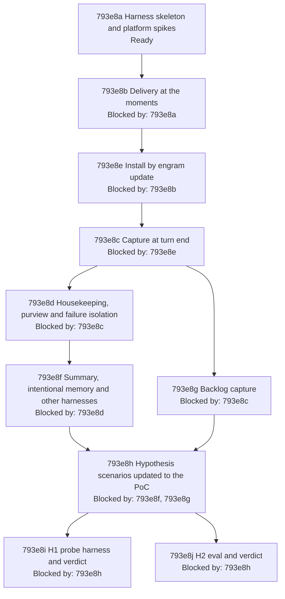

# Parallel Memory Agent - Implementation Plan

## 793e1 Purpose

This plan turns [Parallel Memory Agent - Product Spec](./793a_product-spec.md#parallel-memory-agent---product-spec) and [Parallel Memory Agent - Technical Spec](./793d_technical-spec.md#parallel-memory-agent---technical-spec) into test-driven work in three stages, as the owner directed on 2026-10-12 ([793b243 The harness is godog over scenarios extracted from the product spec at run time](./793b_decision-log.md#793b243-the-harness-is-godog-over-scenarios-extracted-from-the-product-spec-at-run-time), [793b253 The hypothesis scenarios are updated to the PoC before they are run; unrealised kinds are recorded, not built](./793b_decision-log.md#793b253-the-hypothesis-scenarios-are-updated-to-the-poc-before-they-are-run-unrealised-kinds-are-recorded-not-built)). The build is minimal and targeted: it covers what the 43 product scenarios and the two hypotheses need on this machine, and nothing else ([793b268 The PoC is minimal and targeted: environments the owner does not use and everything no scenario needs are cut](./793b_decision-log.md#793b268-the-poc-is-minimal-and-targeted-environments-the-owner-does-not-use-and-everything-no-scenario-needs-are-cut)).

1. A harness that executes the 43 scenarios of the product spec, and the 11 H1 scenarios of the technical spec, against real Claude Code [sessions](../../GLOSSARY.md#session).
2. A proof of concept ([System](./793a_product-spec.md#793a1-problem-statement)) that makes the product scenarios pass: the design drafted in [793d19 Design as currently drafted](./793d_technical-spec.md#793d19-design-as-currently-drafted), cut to what those scenarios need ([793b250 The PoC is the drafted design cut to what the 43 scenarios need](./793b_decision-log.md#793b250-the-poc-is-the-drafted-design-cut-to-what-the-43-scenarios-need)) and orchestrated in JavaScript inside the [mod](./793d_technical-spec.md#793d1b-terms) over the existing engram commands ([793b256 The PoC orchestrates in JavaScript inside the mod over the existing engram commands](./793b_decision-log.md#793b256-the-poc-orchestrates-in-javascript-inside-the-mod-over-the-existing-engram-commands)).
3. The two hypotheses of the technical spec: update their scenarios to what the PoC does, run them, and record a verdict (confirmed, disproved or inconclusive) for each, on this machine.

Out of scope: promoting the specs to `docs/specs/` and deleting this change directory (done at integration, per the lifecycle guide), [delivery](./793a_product-spec.md#793a1-problem-statement) into other harnesses, environments other than this machine's macOS terminal and `claude -p` on a subscription login, and [#795](https://github.com/toejough/engram/issues/795).

The design choices of this plan are in the decision log, [793b243 The harness is godog over scenarios extracted from the product spec at run time](./793b_decision-log.md#793b243-the-harness-is-godog-over-scenarios-extracted-from-the-product-spec-at-run-time) to [793b274 ID map for 793b255 to 793b273](./793b_decision-log.md#793b274-id-map-for-793b255-to-793b273). The owner answered the review's three questions on 2026-10-12: [793c70 May the H2 gold be mined read-only from the real transcripts and vault?](./793c_open-questions.md#793c70-may-the-h2-gold-be-mined-read-only-from-the-real-transcripts-and-vault), [793c71 Who labels the relevance and extraction gold?](./793c_open-questions.md#793c71-who-labels-the-relevance-and-extraction-gold) and [793c72 Which model do the acceptance sessions run on, and which are H2's comparison arms?](./793c_open-questions.md#793c72-which-model-do-the-acceptance-sessions-run-on-and-which-are-h2s-comparison-arms) ([793b269 793c70 is answered: the gold is mined read-only from the real transcripts and vault](./793b_decision-log.md#793b269-793c70-is-answered-the-gold-is-mined-read-only-from-the-real-transcripts-and-vault), [793b270 793c71 is answered: a third model drafts the gold, fable here, and the owner confirms every label](./793b_decision-log.md#793b270-793c71-is-answered-a-third-model-drafts-the-gold-fable-here-and-the-owner-confirms-every-label), [793b271 793c72 is answered: acceptance sessions on sonnet, and H2 compares three cost-scaled arms](./793b_decision-log.md#793b271-793c72-is-answered-acceptance-sessions-on-sonnet-and-h2-compares-three-cost-scaled-arms)).

## 793e2 Implementation shape

### 793e2a Toolchain

| Concern | Choice | Record |
| --- | --- | --- |
| Scenario runner | godog (Cucumber for Go) in strict mode, failing on an ambiguous step; scenarios extracted from the product spec (and the H1 section of the technical spec) at run time | [793b243 The harness is godog over scenarios extracted from the product spec at run time](./793b_decision-log.md#793b243-the-harness-is-godog-over-scenarios-extracted-from-the-product-spec-at-run-time), [793b263 godog runs strict with anchored steps, and the scenario data holds inputs only](./793b_decision-log.md#793b263-godog-runs-strict-with-anchored-steps-and-the-scenario-data-holds-inputs-only) |
| Where it lives, how it runs | `dev/acceptance`, build tag `acceptance`, `TestAcceptance`, `targ acceptance [filter]` running `go test -tags=targ,acceptance -timeout=<explicit>`; the cheap checks are `TestIntegration...` under the `integration` tag and run in `check-full`; the live suite never does | [793b244 Acceptance runs are TestAcceptance under the integration tag, run by targ acceptance, not by check-full](./793b_decision-log.md#793b244-acceptance-runs-are-testacceptance-under-the-integration-tag-run-by-targ-acceptance-not-by-check-full), [793b260 The live suite has its own build tag, acceptance, and check-full never runs it](./793b_decision-log.md#793b260-the-live-suite-has-its-own-build-tag-acceptance-and-check-full-never-runs-it) |
| [Sessions](../../GLOSSARY.md#session) | real `claude -p` (streaming input) in an isolated home, `--model sonnet`, permissions by `settings.json` allow rules in that home; credentials from `CLAUDE_CODE_OAUTH_TOKEN` (the environment, else the owner's token file when the variable is unset, never printed) or `ANTHROPIC_API_KEY` | [793b245 Scenarios run real claude sessions in an isolated home with credentials from the environment](./793b_decision-log.md#793b245-scenarios-run-real-claude-sessions-in-an-isolated-home-with-credentials-from-the-environment), [793b248 The session driver streams input and waits for the System's idle marker](./793b_decision-log.md#793b248-the-session-driver-streams-input-and-waits-for-the-systems-idle-marker), [793b267 The OAuth token comes from a file the harness reads only when the variable is unset](./793b_decision-log.md#793b267-the-oauth-token-comes-from-a-file-the-harness-reads-only-when-the-variable-is-unset), [793b271 793c72 is answered: acceptance sessions on sonnet, and H2 compares three cost-scaled arms](./793b_decision-log.md#793b271-793c72-is-answered-acceptance-sessions-on-sonnet-and-h2-compares-three-cost-scaled-arms) |
| Observables | [transcript](../../GLOSSARY.md#transcript) JSONL, [vault](./793a_product-spec.md#793a1-problem-statement), install tree, harness-only seam log; only preconditions are retried, inside the When step | [793b246 Assertions read the transcript, the vault and a harness-only seam log; only preconditions are retried](./793b_decision-log.md#793b246-assertions-read-the-transcript-the-vault-and-a-harness-only-seam-log-only-preconditions-are-retried) |
| Scenario data | one `scenarios.yaml` keyed by scenario ID, inputs only (seeds, prompts, keywords); 60 to 90 anchored step definitions hold every expected outcome | [793b263 godog runs strict with anchored steps, and the scenario data holds inputs only](./793b_decision-log.md#793b263-godog-runs-strict-with-anchored-steps-and-the-scenario-data-holds-inputs-only) |
| Origins `-p` cannot produce, Pi behaviour | live driver first, else the result `Substituted: product promise unverified`; no fixture stands in for a Pi agent's behaviour | [793b249 Scenarios whose prompt origin cannot be produced in -p get a contract-test substitute](./793b_decision-log.md#793b249-scenarios-whose-prompt-origin-cannot-be-produced-in--p-get-a-contract-test-substitute), [793b264 Results include Substituted, and Pi-agent behaviour is not faked with fixtures](./793b_decision-log.md#793b264-results-include-substituted-and-pi-agent-behaviour-is-not-faked-with-fixtures) |
| PoC | `agent-instructions/mods/engram-memory/` (JavaScript) running the existing engram commands through `$.process.run` and judging through `$.model.complete`; one small Go command, `engram backlog` | [793b256 The PoC orchestrates in JavaScript inside the mod over the existing engram commands](./793b_decision-log.md#793b256-the-poc-orchestrates-in-javascript-inside-the-mod-over-the-existing-engram-commands) |
| Deploy | skills subtree and link, Claude Code only | [793b251 The mod deploys through the skills subtree and links, for Claude Code only](./793b_decision-log.md#793b251-the-mod-deploys-through-the-skills-subtree-and-links-for-claude-code-only) |
| CLI absent / credentials absent | skip / fail | [793b254 The CLI absent skips, anything else missing fails](./793b_decision-log.md#793b254-the-cli-absent-skips-anything-else-missing-fails) |
| H1 | the same godog harness over the H1 Gherkin; the spike [mods](./793d_technical-spec.md#793d1b-terms) of [793e8a Harness skeleton and platform spikes](#793e8a-harness-skeleton-and-platform-spikes) are the mod column, reused unchanged | [793b258 H1's verdict stays after the PoC, and the platform spikes are H1's mod-column probes](./793b_decision-log.md#793b258-h1s-verdict-stays-after-the-poc-and-the-platform-spikes-are-h1s-mod-column-probes), [793b268 The PoC is minimal and targeted: environments the owner does not use and everything no scenario needs are cut](./793b_decision-log.md#793b268-the-poc-is-minimal-and-targeted-environments-the-owner-does-not-use-and-everything-no-scenario-needs-are-cut) |
| H2 | a small replay [mod](./793d_technical-spec.md#793d1b-terms) looping `$.model.complete` over the fixtures against haiku and sonnet (full set), opus and fable (cost-scaled samples) | [793b265 H2 is replayed by a small mod over fixtures, and gold comes from history or the owner](./793b_decision-log.md#793b265-h2-is-replayed-by-a-small-mod-over-fixtures-and-gold-comes-from-history-or-the-owner), [793b272 H2 arm sample sizes are inversely proportional to per-token price, anchored at the full set for sonnet](./793b_decision-log.md#793b272-h2-arm-sample-sizes-are-inversely-proportional-to-per-token-price-anchored-at-the-full-set-for-sonnet) |

The harness is example-based: no property tests, no new lint gate (vault note 556), and it adds one module dependency (godog and its Gherkin parser). The only product Go code is `engram backlog` and the `engram update` mod copies; they follow the repository rules: logic in `internal/`, I/O only through the existing injected capabilities, tests with imptest and gomega, coverage by the existing gate.

### 793e2b Harness architecture

- **Extractor.** Reads the `gherkin` blocks of the product spec and of [793d17 H1: a Claude Code mod gives a smaller implementation surface and more capability than settings hooks](./793d_technical-spec.md#793d17-h1-a-claude-code-mod-gives-a-smaller-implementation-surface-and-more-capability-than-settings-hooks), adds one `Feature:` line per `UAT Scenarios` or `Experiments` heading, and passes them to godog as contents. An outline's examples run as separate subtests named by godog's example numbering; the extractor test lists those names and shows the ID filter selecting them.
- **World (one per scenario).** Temporary HOME, XDG directories, GOBIN, TMPDIR, [vault](./793a_product-spec.md#793a1-problem-statement) and workspace; a shared read-only embedder cache pre-warmed once per run; the engram binary built once per run with `go build -o <tmp>/bin/engram ./cmd/engram` (never `go install`). `engram update` runs with the worktree as its working directory (local mode) and `ENGRAM_UPDATE_REEXEC=1`, which skips the `go install` leg; GOMODCACHE and GOCACHE point at the real Go caches only if the build or the update needs them. TMPDIR is per scenario so the update's clone directory is never shared. The `go install` leg is therefore not exercised by acceptance; it is verified by the unit tests of `internal/update` (`reexec_test.go`, `downgrade_test.go`, `runner_test.go`) and `internal/cli` (`reexec_test.go`, `update_test.go`). `TestMain` removes the run's temporary directories on exit, the pattern of `internal/cli/testbinary_test.go`.
- **[Session](../../GLOSSARY.md#session) driver.** Starts `claude -p` with streaming input in the workspace, sends the scripted turns, optionally compaction or resume, waits for the seam log's `idle` line, then closes. It fails fast when the [mod](./793d_technical-spec.md#793d1b-terms) did not load (stderr `hooks module not loaded`). `--max-budget-usd` is a generous per-session guard, never a cap on a run. Fault injection uses real mechanisms: an unreadable vault directory, an `engram` shim earlier on PATH that exits, prints output that cannot be parsed, or sleeps past a deadline.
- **Readers.** [Transcript](../../GLOSSARY.md#transcript) (rows by kind, the System's blocks identified by their fixed marker lines, tool calls, [subagent](../../GLOSSARY.md#subagent) transcripts), [vault](./793a_product-spec.md#793a1-problem-statement) ([notes](./793a_product-spec.md#793a1-problem-statement) by keyword, count), install tree, seam log. The seam is the `$.ui.status` call site: the strings the [mod](./793d_technical-spec.md#793d1b-terms) passes there are appended to the seam log.
- **Step definitions (60 to 90, about ten helpers).** One anchored definition per distinct assertion meaning: seeding notes and [offers](../../GLOSSARY.md#offer); install state; driving a prompt, a dispatch, a skill run, a subagent task; "the transcript shows ... delivered / only once / no request"; "a note stating ... exists / exactly one"; "the user is shown ..." (seam); tool-call and permission equality; install-tree assertions. A step that matches two definitions fails the run.
- **Documented substitutes.** The seam log stands for the status line in `-p`; [793d17b1a A message reaches the user and not the agent](./793d_technical-spec.md#793d17b1-experiments), the only tmux use of the plan, confirms that the seam text is what the screen draws. Origin rows without a live driver end `Substituted: product promise unverified`.

### 793e2c PoC architecture

- **[Mod](./793d_technical-spec.md#793d1b-terms)** (`agent-instructions/mods/engram-memory/`: `.claude-plugin/plugin.json`, `hooks/hooks.json`, `hooks/register.js`, `tests/*.test.ts`). It maps events to jobs and does all the memory logic itself: it runs the existing commands `engram query`, `learn`, `amend`, `activate`, `ingest --auto`, `show` and the commands of curate through `$.process.run`; judges through `$.model.complete` on the model its `judgeTiers` table names for the kind (`relevance`, `extraction`, `reconcile`, `curation`, all defaulting to `haiku`); filters by presence, builds the [delivery](./793a_product-spec.md#793a1-problem-statement) text, builds the capture window, reconciles, settles [offers](../../GLOSSARY.md#offer); keeps one in-memory first-in-first-out queue, the delivery ledger and the activity counters; applies results ([context](./793a_product-spec.md#793a1-problem-statement), status line); and contains every failure with a user-only warning. There is no round protocol and no Go runner ([793b256 The PoC orchestrates in JavaScript inside the mod over the existing engram commands](./793b_decision-log.md#793b256-the-poc-orchestrates-in-javascript-inside-the-mod-over-the-existing-engram-commands)).
- **Go.** One small command, `engram backlog`, kept because the backlog scan genuinely needs it: the stripped transcript text and the default source roots exist only in Go (`internal/context` strip and `ingest --auto`'s roots; about 800 lines a JavaScript copy would duplicate). It prints the stripped text of a given transcript, and, in scan mode, names the newest non-live transcript source (Claude Code or Pi) with content beyond its watermark and advances the watermark when told the capture finished. Its flags are fixed in [793e8g Backlog capture](#793e8g-backlog-capture); no new `cli.Primitives` field is expected, and the node confirms it.
- **Update.** Mod copies planned for Claude Code only ([793b251 The mod deploys through the skills subtree and links, for Claude Code only](./793b_decision-log.md#793b251-the-mod-deploys-through-the-skills-subtree-and-links-for-claude-code-only)), plus the report when the installed Claude Code is older than 2.1.287 ([793b220 793c66 is answered (a): the product promise covers the sessions in which mods run](./793b_decision-log.md#793b220-793c66-is-answered-a-the-product-promise-covers-the-sessions-in-which-mods-run)).
- **Cut** ([793b250 The PoC is the drafted design cut to what the 43 scenarios need](./793b_decision-log.md#793b250-the-poc-is-the-drafted-design-cut-to-what-the-43-scenarios-need), [793b256 The PoC orchestrates in JavaScript inside the mod over the existing engram commands](./793b_decision-log.md#793b256-the-poc-orchestrates-in-javascript-inside-the-mod-over-the-existing-engram-commands), [793b268 The PoC is minimal and targeted: environments the owner does not use and everything no scenario needs are cut](./793b_decision-log.md#793b268-the-poc-is-minimal-and-targeted-environments-the-owner-does-not-use-and-everything-no-scenario-needs-are-cut)): `classify` and judged cues, `turn.step`, held delivery, redaction, `$.store`, outcome recorder, late delivery at stop, the tool-result channel for anything but the route cue, the `internal/auto` runner and its `need`/`done` rounds.

### 793e2d Environment the suites need

| Need | Used by | If missing |
| --- | --- | --- |
| `claude` on PATH, version 2.1.287 or later (verified on 2.1.296) | everything | skip with reason when absent; fail when too old |
| `CLAUDE_CODE_OAUTH_TOKEN` (environment, else `~/.config/claude-key.env`, mode 0600, read only when the variable is unset) or `ANTHROPIC_API_KEY` | live [sessions](../../GLOSSARY.md#session) (acceptance, H1 live, H2) | fail naming the variable and the file |
| `go`, `git`, `git-lfs` (the bundled embedder model is an LFS asset) | build and `engram update` | fail |
| network access to the model API | live sessions | fail |
| `pi` and its own credentials | Pi rows that exercise a Pi agent | those rows are `Not run` |
| `tmux` | [793d17b1a A message reaches the user and not the agent](./793d_technical-spec.md#793d17b1-experiments) | that row `Not run` |

### 793e2e Platform claims to verify first

The rows of [793d1a What the hypotheses rely on in Claude Code mods](./793d_technical-spec.md#793d1a-what-the-hypotheses-rely-on-in-claude-code-mods) marked "To verify", and the facts this plan found while drafting, are the first work of node [793e8a Harness skeleton and platform spikes](#793e8a-harness-skeleton-and-platform-spikes). Each spike's [mod](./793d_technical-spec.md#793d1b-terms) is built once under `dev/acceptance/probes/<SP>/` and is the mod column of H1, run again unchanged by [793e8i H1 probe harness and verdict](#793e8i-h1-probe-harness-and-verdict) ([793b258 H1's verdict stays after the PoC, and the platform spikes are H1's mod-column probes](./793b_decision-log.md#793b258-h1s-verdict-stays-after-the-poc-and-the-platform-spikes-are-h1s-mod-column-probes)). Each outcome is recorded in the decision log; the third column says what it unblocks and the fourth what happens if the claim is false.

| Spike | Claim | Unblocks | If false |
| --- | --- | --- | --- |
| SP1 | A [session](../../GLOSSARY.md#session) in an isolated HOME authenticates from `CLAUDE_CODE_OAUTH_TOKEN` (environment, or the owner's token file when unset) or `ANTHROPIC_API_KEY`, and a [mod](./793d_technical-spec.md#793d1b-terms)'s `$.model.complete` then uses it (without credentials the session answers "Not logged in", seen on 2.1.296) | every live scenario | stop and ask the owner; copying stored credentials is not allowed |
| SP2 | A folder under `~/.claude/skills` with `.claude-plugin/plugin.json`, reached through a link, loads its hooks module under `claude -p` in an isolated HOME and an arbitrary workspace (row 2); the driver's fail-fast on `hooks module not loaded` works | all PoC nodes, [793a5j Installed by engram update and active in Claude Code](./793a_product-spec.md#793a5j-installed-by-engram-update-and-active-in-claude-code) | stop and ask the owner |
| SP3 | `prompt.submit` fires for typed prompts and slash-command prompts (`/recall`, `/please`) and `context` reaches the model (row 3) | [793a2n Relevant memory reaches the agent at the moments](./793a_product-spec.md#793a2n-relevant-memory-reaches-the-agent-at-the-moments) | stop and ask the owner: cueing on the first tool result instead is a design change |
| SP4 | Added [context](./793a_product-spec.md#793a1-problem-statement) appears in the [transcript](../../GLOSSARY.md#transcript) as a separate, attributable row for `prompt.submit` `context` and for `classic.PostToolUse` and `classic.SubagentStart` `additionalContext` (row 4) | [793a2n Relevant memory reaches the agent at the moments](./793a_product-spec.md#793a2n-relevant-memory-reaches-the-agent-at-the-moments), [793a4c1b The prompt is unchanged and the note is separate](./793a_product-spec.md#793a4c1-uat-scenarios), [793a4c1c The only effect on the working agent's context is what is delivered](./793a_product-spec.md#793a4c1-uat-scenarios) | assert on the model's use of a sentinel instead of a row, and record [793a4c1b The prompt is unchanged and the note is separate](./793a_product-spec.md#793a4c1-uat-scenarios) as partly unverified |
| SP5 | `classic.SubagentStart` context reaches only that [subagent](../../GLOSSARY.md#subagent); `agent.spawn` carries the task prompt; the subagent transcript path is known and complete at `classic.SubagentStop` (row 5) | [793a2n1g A subagent receives relevant notes](./793a_product-spec.md#793a2n1-uat-scenarios), [793a2e1d A parent's note is still delivered to a subagent](./793a_product-spec.md#793a2e1-uat-scenarios), [793a3a1g A lesson in a subagent session is captured](./793a_product-spec.md#793a3a1-uat-scenarios) | read the transcript after a short wait; the last message is also given |
| SP6 | `classic.SessionStart` carries the main transcript path (row 6) | [793e8g Backlog capture](#793e8g-backlog-capture) | the scan identifies the live session by its session id |
| SP7 | `$.session.messages()` contains a delivered block, drops it after compaction and shows it again after a resume (row 8); `/compact` in the stream and `--resume` drive both | [793a2e Nothing already in context is delivered again](./793a_product-spec.md#793a2e-nothing-already-in-context-is-delivered-again) | the ledger alone, which would fail [793a2e1g A resumed session's restored content counts as present](./793a_product-spec.md#793a2e1-uat-scenarios) (record it) |
| SP8 | The non-human prompt origins (task notification, scheduled trigger, peer message) can be produced in `-p` (a background command's completion notice through streaming input is the first driver tried) and fire the hook the mod uses (row 3) | [793a2n1h A prompt from any source receives relevant notes](./793a_product-spec.md#793a2n1-uat-scenarios) | the row ends `Substituted: product promise unverified` ([793b249 Scenarios whose prompt origin cannot be produced in -p get a contract-test substitute](./793b_decision-log.md#793b249-scenarios-whose-prompt-origin-cannot-be-produced-in--p-get-a-contract-test-substitute), [793b264 Results include Substituted, and Pi-agent behaviour is not faked with fixtures](./793b_decision-log.md#793b264-results-include-substituted-and-pi-agent-behaviour-is-not-faked-with-fixtures)) |
| SP9 | `$.ui.status`, `$.env.get`, `$.fs.write` work in `-p` handlers; a gating hook needs a `.catch` handler (`claude plugin validate` warned about it) | [793a5h The user sees a summary of the memory activity](./793a_product-spec.md#793a5h-the-user-sees-a-summary-of-the-memory-activity), [793a4b The session is never broken or stalled](./793a_product-spec.md#793a4b-the-session-is-never-broken-or-stalled) | no seam; assert on the debug log |
| SP10 | A pending [offer](../../GLOSSARY.md#offer) can be seeded in an isolated [vault](./793a_product-spec.md#793a1-problem-statement) through a real path (the registration offers of `engram update`, or the serve write path) | [793a4j1c Offers are resolved by the System](./793a_product-spec.md#793a4j1-uat-scenarios), [793a4j1d The agent is not asked to curate](./793a_product-spec.md#793a4j1-uat-scenarios) | hand-written offer notes, recorded as a deviation |
| SP11 | A fresh session costs how long and how many tokens; the effect of the pre-warmed embedder cache | the cost estimate and the suite's runtime | none: sessions run one at a time |
| SP12 | Handler time inside `$.process.run` and `$.model.complete` does not count against the 10 s hook budget for a 25 s job (row 10); confirmed in passing, with the documentation quote in the log | [793a2n Relevant memory reaches the agent at the moments](./793a_product-spec.md#793a2n-relevant-memory-reaches-the-agent-at-the-moments), [793a4j1e Slow housekeeping does not stall the session](./793a_product-spec.md#793a4j1-uat-scenarios) | stop and ask the owner |
| SP13 | With streaming input the module keeps running its queue after `turn.complete` and until the session closes ([793b248 The session driver streams input and waits for the System's idle marker](./793b_decision-log.md#793b248-the-session-driver-streams-input-and-waits-for-the-systems-idle-marker)) | [793a3a Lessons are captured without the agent](./793a_product-spec.md#793a3a-lessons-are-captured-without-the-agent), [793a4j Indexing and curation happen after the turn](./793a_product-spec.md#793a4j-indexing-and-curation-happen-after-the-turn) | stop and ask the owner |
| SP14 | `pi` runs headless in an isolated home and writes a session file that the Transcript Reader parses | [793a5c1b A Pi session on a machine whose Claude Code has the System](./793a_product-spec.md#793a5c1-uat-scenarios), [793a5j1d One update serves both harnesses differently](./793a_product-spec.md#793a5j1-uat-scenarios) | those two rows are `Not run`; the Pi transcripts of [793a3a1j A lesson that is already recorded is not written again](./793a_product-spec.md#793a3a1-uat-scenarios), [793a3a1k A lesson in a session that ended before it was saved is captured later](./793a_product-spec.md#793a3a1-uat-scenarios) and [793a5c1c A captured Pi session's transcript is left unchanged](./793a_product-spec.md#793a5c1-uat-scenarios) stay fixture inputs |

### 793e2f Estimated owned code

Lines are rounded and include tests; data is counted separately. Against the previous draft, production falls from about 1,800 to about 1,450 lines (the Go runner and its protocol are gone); tests and harness rise from 2,400 to 2,800 lines to about 2,600 to 3,150 because the step definitions are now explicit ([793b263 godog runs strict with anchored steps, and the scenario data holds inputs only](./793b_decision-log.md#793b263-godog-runs-strict-with-anchored-steps-and-the-scenario-data-holds-inputs-only)) while the Go runner's imptest suite becomes a TypeScript contract suite.

| Area | Production | Tests and harness | Data |
| --- | --- | --- | --- |
| Harness core (`dev/acceptance`: extractor, World, driver, readers, target, TestMain) | 0 | 600 to 800 Go | 0 |
| Step definitions (60 to 90 anchored, about ten helpers; product and H1 steps) | 0 | 900 to 1,200 Go | `scenarios.yaml` 200 to 300 |
| [Mod](./793d_technical-spec.md#793d1b-terms) (`register.js`, manifests) | 450 to 600 JS | 400 to 500 TS (`claude plugin test`) | 0 |
| `engram backlog` | 150 Go | 250 Go (imptest, gomega) | 0 |
| `engram update` mod copies and the old-Claude report | 70 Go | 150 Go | 0 |
| Spike probes (the H1 mod column, written once in [793e8a Harness skeleton and platform spikes](#793e8a-harness-skeleton-and-platform-spikes)) and H1 hook-column probes and report | 100 JS, 100 shell, 150 Go | 100 Go | 0 |
| H2 (replay mod, aggregate, report) | 120 JS, 250 Go | 150 Go | 160 to 800 labelled fixtures ([793e8h Hypothesis scenarios updated to the PoC](#793e8h-hypothesis-scenarios-updated-to-the-poc) sizes them) |
| Total | about 1,450 | about 2,600 to 3,150 | about 200 to 300 lines, plus the fixtures |

### 793e2g Risks

- **Credentials and cost.** The live suites need a token and make about fifty [sessions](../../GLOSSARY.md#session) plus [judgement](./793d_technical-spec.md#793d1b-terms) calls; the estimate after SP11 is presented to the owner before the PoC is built ([793b259 A whole-plan cost estimate is presented to the owner before the PoC is built](./793b_decision-log.md#793b259-a-whole-plan-cost-estimate-is-presented-to-the-owner-before-the-poc-is-built)).
- **Agent nondeterminism.** Fixed prompts and retried preconditions ([793b246 Assertions read the transcript, the vault and a harness-only seam log; only preconditions are retried](./793b_decision-log.md#793b246-assertions-read-the-transcript-the-vault-and-a-harness-only-seam-log-only-preconditions-are-retried)) bound it; a scenario that still needs more than three attempts is reported, not hidden.
- **Early-access runtime.** The [mods](./793d_technical-spec.md#793d1b-terms) runtime changes between releases; the plan pins the verified version.
- **Work after the turn.** If SP13 fails, the delivery-after-turn design stops for the owner.
- **Registration scanning.** The mod directory sits where skills are scanned; [793e8e Install by engram update](#793e8e-install-by-engram-update) proves it is not offered or deleted.
- **Judgement quality.** Scenario results depend on `haiku` judging relevance, [lessons](./793a_product-spec.md#793a1-problem-statement), coverage and curation; a red scenario may be a judgement failure, which is H2's subject; the first reading of a red result separates the two.
- **Hypothesis inputs.** Gold labels are drafted by fable and become gold only when the owner confirms each one ([793b270 793c71 is answered: a third model drafts the gold, fable here, and the owner confirms every label](./793b_decision-log.md#793b270-793c71-is-answered-a-third-model-drafts-the-gold-fable-here-and-the-owner-confirms-every-label)); the opus and fable arms are cost-scaled samples and indicative only ([793b272 H2 arm sample sizes are inversely proportional to per-token price, anchored at the full set for sonnet](./793b_decision-log.md#793b272-h2-arm-sample-sizes-are-inversely-proportional-to-per-token-price-anchored-at-the-full-set-for-sonnet)).

### 793e2h Results

A scenario run ends in exactly one result:

| Result | Meaning |
| --- | --- |
| Green | every Then held; the product promise is verified |
| Red | a Then failed |
| Not run (reason) | the environment lacks what the row needs (no headless Pi, no tmux); the product promise is unverified |
| Substituted: product promise unverified | a contract-test stand-in ran in place of the live origin; the promise is not verified by it |

A precondition retried up to three times ([793b246 Assertions read the transcript, the vault and a harness-only seam log; only preconditions are retried](./793b_decision-log.md#793b246-assertions-read-the-transcript-the-vault-and-a-harness-only-seam-log-only-preconditions-are-retried)) is reported beside a Green result and never turns a Red into a Green. "Identical behaviour" in a Then means the same install tree, the mod loaded or not loaded as before, and no System-attributed row in the transcript ([793b266 Non-blocking review fixes in the plan](./793b_decision-log.md#793b266-non-blocking-review-fixes-in-the-plan)).

## 793e3 Test methods

- **Dedicated examples (product acceptance).** Every product scenario is an acceptance example: the scenario text runs through godog against a real [session](../../GLOSSARY.md#session). The scenario is a finite, exact, user-observable contract; sessions, the [vault](./793a_product-spec.md#793a1-problem-statement) and the install are real, so no mock stands in for them.
- **Dedicated examples ([mod](./793d_technical-spec.md#793d1b-terms) contract).** `claude plugin validate` and `claude plugin test` of the mod, run under a temporary HOME, with the model call, the store and the process stubbed by the test kit. The stubs record each call, its arguments and its order, which is the evidence the repository's rules ask imptest for on a Go boundary: it is JavaScript, so imptest does not apply. Used for hook wiring, the orchestration the mod performs, containment and request building that a live session cannot reach deterministically.
- **imptest.** The Go code crosses impure boundaries only in `engram backlog` (transcript listing and read, watermark file) and the `engram update` mod copies (file-system plan and apply); call counts, arguments and ordering are the contract, so each boundary is an imptest mock. The harness needs none.
- **Live experiments.** Hypothesis scenarios are run experiments with a recorded result, not pass/fail unit tests ([793b253 The hypothesis scenarios are updated to the PoC before they are run; unrealised kinds are recorded, not built](./793b_decision-log.md#793b253-the-hypothesis-scenarios-are-updated-to-the-poc-before-they-are-run-unrealised-kinds-are-recorded-not-built)). H1 runs through the harness; H2 through the replay mod.
- **No `rapid` entries.** The inputs are fixed texts and structured documents without a meaningful generated domain, and the harness is example-based ([793b243 The harness is godog over scenarios extracted from the product spec at run time](./793b_decision-log.md#793b243-the-harness-is-godog-over-scenarios-extracted-from-the-product-spec-at-run-time)).

The shared cycle applies to every row: write the test; run it and see it fail for the expected reason; implement the minimum to pass it; fix whatever the full suite then needs; refactor with the suite green (complexity, consistency, boundaries, performance). For an acceptance row, "fail for the expected reason" means the Then step fails because the [System](./793a_product-spec.md#793a1-problem-statement) does not yet do the thing, not because a step is undefined or ambiguous or the session did not start; strict mode makes undefined steps a harness error, so an undefined scenario is never Red evidence.

## 793e4 Test status

A test row has one of `Not started`, `Red`, `Green-single`, `Green-all`, `Refactor-complexity`, `Refactor-consistency`, `Refactor-boundaries`, `Refactor-performance`, `Done`, as the implementation plan guide defines them. A work row has `Not started`, `In progress` or `Done`. A status changes in the commit that establishes it. For an acceptance row, `Green-all` means the row's scenario and every scenario already green in its node pass live, with `targ test` and `targ check-full`; the whole live suite runs once when the node completes and at each convergence point ([793e6 Parallel worktree method](#793e6-parallel-worktree-method)), and a refactor checkpoint is `targ check-full` plus the node's scenarios ([793b262 Green-all for an acceptance row is the row plus the scenarios already green in its node](./793b_decision-log.md#793b262-green-all-for-an-acceptance-row-is-the-row-plus-the-scenarios-already-green-in-its-node)). A row marked "precondition retried" counts as green on its retried precondition, never on a retried Then. A spike row is `Done` when its outcome is in the decision log.

## 793e5 Dependency tree

The owner's nodes map as (1) [793e8a Harness skeleton and platform spikes](#793e8a-harness-skeleton-and-platform-spikes), (2) [793e8b Delivery at the moments](#793e8b-delivery-at-the-moments), (3) [793e8c Capture at turn end](#793e8c-capture-at-turn-end), (4) [793e8d Housekeeping, purview and failure isolation](#793e8d-housekeeping-purview-and-failure-isolation), (5) [793e8e Install by engram update](#793e8e-install-by-engram-update) and [793e8f Summary, intentional memory and other harnesses](#793e8f-summary-intentional-memory-and-other-harnesses), (6) [793e8g Backlog capture](#793e8g-backlog-capture), (7) [793e8h Hypothesis scenarios updated to the PoC](#793e8h-hypothesis-scenarios-updated-to-the-poc), (8) [793e8i H1 probe harness and verdict](#793e8i-h1-probe-harness-and-verdict) and [793e8j H2 eval and verdict](#793e8j-h2-eval-and-verdict) ([793b252 The owner's node 5 is two nodes, the backlog node follows capture, and the hypothesis nodes follow the PoC](./793b_decision-log.md#793b252-the-owners-node-5-is-two-nodes-the-backlog-node-follows-capture-and-the-hypothesis-nodes-follow-the-poc)). Install moved to follow delivery, because every acceptance row after the first says the [System](./793a_product-spec.md#793a1-problem-statement) is installed ([793b266 Non-blocking review fixes in the plan](./793b_decision-log.md#793b266-non-blocking-review-fixes-in-the-plan)). After [793e8c Capture at turn end](#793e8c-capture-at-turn-end), two nodes are ready at once ([793e8d Housekeeping, purview and failure isolation](#793e8d-housekeeping-purview-and-failure-isolation) and [793e8g Backlog capture](#793e8g-backlog-capture)).

## 793e6 Parallel worktree method

The method of the [implementation plan guide](../../IMPLEMENTATION-PLAN-GUIDE.md#parallel-worktree-method) applies unchanged, with the repository's rules from `AGENTS.md`: merges are `--ff-only`, a branch is rebased on the development branch and re-tested before it merges, review precedes every merge, and nothing is pushed. The chain [793e8a Harness skeleton and platform spikes](#793e8a-harness-skeleton-and-platform-spikes), [793e8b Delivery at the moments](#793e8b-delivery-at-the-moments), [793e8e Install by engram update](#793e8e-install-by-engram-update), [793e8c Capture at turn end](#793e8c-capture-at-turn-end) continues in one branch; the fan-out is after [793e8c Capture at turn end](#793e8c-capture-at-turn-end) ([793e8d Housekeeping, purview and failure isolation](#793e8d-housekeeping-purview-and-failure-isolation) with [793e8f Summary, intentional memory and other harnesses](#793e8f-summary-intentional-memory-and-other-harnesses) continuing in its branch, and [793e8g Backlog capture](#793e8g-backlog-capture)); the convergence points are [793e8h Hypothesis scenarios updated to the PoC](#793e8h-hypothesis-scenarios-updated-to-the-poc) ([793e8f Summary, intentional memory and other harnesses](#793e8f-summary-intentional-memory-and-other-harnesses) and [793e8g Backlog capture](#793e8g-backlog-capture)) and the end ([793e8i H1 probe harness and verdict](#793e8i-h1-probe-harness-and-verdict) and [793e8j H2 eval and verdict](#793e8j-h2-eval-and-verdict)). The full live suite runs at every convergence point. `scenarios.yaml` and `register.js` are single files, and merge conflicts in them are resolved at the rebase. No worktree touches the real `~/.claude`, `~/.pi`, [vault](./793a_product-spec.md#793a1-problem-statement) or GOBIN; every experiment uses temporary homes.

## 793e7 Node status

The statuses are those of the guide: `Blocked by: <node IDs>`, `Ready`, `In progress: n/x entries complete`, `Complete`, `Merged`. The graph above carries each node's current status and changes in the commit that changes it.

## 793e8 Test Catalog

Every executable test name begins with its row's Gherkin ID; the acceptance suite's subtests are named `<ID> <title>` by the scenario line itself. Acceptance rows are verified with `targ acceptance <ID>`.

### 793e8a Harness skeleton and platform spikes

Verification: `targ acceptance 793a5k1e` green; `targ acceptance` lists the other 42 product scenarios as undefined (a harness check, not Red evidence); `targ test`; `targ check-full` unchanged by the new package.

| Work | Classification | Why | Status |
| --- | --- | --- | --- |
| godog dependency; `dev/acceptance` package (every file under the `acceptance` tag except an untagged `doc.go`, so wildcard builds stay quiet); strict mode failing on ambiguous steps; the `acceptance` target in `dev/targs.go` (`go test -tags=targ,acceptance -timeout=<explicit>`, the filter an ID prefix, product scenarios by default); `TestMain` removing the run's temporary directories | Setup | [793b243 The harness is godog over scenarios extracted from the product spec at run time](./793b_decision-log.md#793b243-the-harness-is-godog-over-scenarios-extracted-from-the-product-spec-at-run-time), [793b260 The live suite has its own build tag, acceptance, and check-full never runs it](./793b_decision-log.md#793b260-the-live-suite-has-its-own-build-tag-acceptance-and-check-full-never-runs-it), [793b263 godog runs strict with anchored steps, and the scenario data holds inputs only](./793b_decision-log.md#793b263-godog-runs-strict-with-anchored-steps-and-the-scenario-data-holds-inputs-only) | Not started |
| Read what the lint, coverage and nil gates and `testDevIntegration` do to `dev/acceptance` and `dev/targs.go` under the new tag, and record it; add the tag to a lint tag list only if lint would otherwise skip the code | Work | The previous draft assumed the `integration` tag's behaviour without reading it; `testDevIntegration` selects by tag with no `-run` filter, which is why the live suite needs its own tag | Not started |
| Extractor test: the product spec yields exactly its 43 scenario IDs and [793d17 H1: a Claude Code mod gives a smaller implementation surface and more capability than settings hooks](./793d_technical-spec.md#793d17-h1-a-claude-code-mod-gives-a-smaller-implementation-surface-and-more-capability-than-settings-hooks) its 11, outlines as one scenario each; the outline example names and the filter's selection are listed; named `TestIntegrationExtract...` | Dedicated example | Guards the claim that the specs are the test source; cheap, so it runs in `check-full` | Not started |
| World: build once, pre-warm the embedder cache once, `engram update` in local mode with the worktree as working directory and `ENGRAM_UPDATE_REEXEC=1`, per-scenario TMPDIR, Go caches only if needed | Setup | [793b261 The World installs by running engram update in local mode, without the go install leg](./793b_decision-log.md#793b261-the-world-installs-by-running-engram-update-in-local-mode-without-the-go-install-leg): the real install path without the `go install` leg, which GOBIN would receive | Not started |
| Credentials and session settings: token from the environment, else sourced from `~/.config/claude-key.env` only when the variable is unset, never printed or logged; `--model sonnet`; permissions by allow rules in the temporary HOME; `--max-budget-usd` guard | Setup | [793b267 The OAuth token comes from a file the harness reads only when the variable is unset](./793b_decision-log.md#793b267-the-oauth-token-comes-from-a-file-the-harness-reads-only-when-the-variable-is-unset), [793b271 793c72 is answered: acceptance sessions on sonnet, and H2 compares three cost-scaled arms](./793b_decision-log.md#793b271-793c72-is-answered-acceptance-sessions-on-sonnet-and-h2-compares-three-cost-scaled-arms): the owner pinned sonnet | Not started |
| SP1 isolated-home authentication | Spike | Blocks every live row; outcome decides whether the plan can proceed | Not started |
| SP2 skills-directory plugin loads under `-p`, and the fail-fast on `hooks module not loaded` | Spike | Install path for all PoC nodes | Not started |
| SP3 `prompt.submit` for typed and slash-command prompts | Spike | [Delivery](./793a_product-spec.md#793a1-problem-statement) at the prompt | Not started |
| SP4 attribution of added [context](./793a_product-spec.md#793a1-problem-statement) in the [transcript](../../GLOSSARY.md#transcript) | Spike | Fixes the row shape every delivery assertion reads | Not started |
| SP5 [subagent](../../GLOSSARY.md#subagent) start context, dispatch prompt, transcript at stop | Spike | Subagent delivery and capture | Not started |
| SP6 main transcript path at [session](../../GLOSSARY.md#session) start | Spike | Backlog exclusion of the live session | Not started |
| SP7 `$.session.messages()` through compaction and resume; how to drive both | Spike | Presence rows of [793a2e Nothing already in context is delivered again](./793a_product-spec.md#793a2e-nothing-already-in-context-is-delivered-again) | Not started |
| SP8 non-human prompt origins in `-p` | Spike | Decides live driver or `Substituted` for [793a2n1h A prompt from any source receives relevant notes](./793a_product-spec.md#793a2n1-uat-scenarios) | Not started |
| SP9 `$.ui.status`, `$.env.get`, `$.fs.write` and the `.catch` rule in `-p` | Spike | The seam log ([793b246 Assertions read the transcript, the vault and a harness-only seam log; only preconditions are retried](./793b_decision-log.md#793b246-assertions-read-the-transcript-the-vault-and-a-harness-only-seam-log-only-preconditions-are-retried)) | Not started |
| SP10 seeding a pending [offer](../../GLOSSARY.md#offer) through a real path | Spike | Curation fixtures | Not started |
| SP11 session time and tokens, effect of the pre-warmed embedder cache | Spike | Input to the cost estimate | Not started |
| SP12 long handler work against the hook budget (confirm in passing, with the documentation quote) | Spike | Delivery deadline | Not started |
| SP13 module keeps running between streamed turns | Spike | Work after the turn ([793b248 The session driver streams input and waits for the System's idle marker](./793b_decision-log.md#793b248-the-session-driver-streams-input-and-waits-for-the-systems-idle-marker)) | Not started |
| SP14 headless Pi in an isolated home | Spike | Whether the two Pi-behaviour rows can run | Not started |
| Baseline check: strict mode reports the other 42 scenarios undefined; one in-memory test feature with every step defined and a Then that fails shows a failing Then is reported red with its ID | Work | Undefined is not Red evidence; this proves the Red path | Not started |
| Whole-plan cost estimate: planned full-suite runs times the per-session cost of SP11, plus the H2 calls of the four models (haiku and sonnet on the full set, opus and fable on cost-scaled samples) times usage times published price, as one table; presented to the owner, and the node is complete only when he has it | Work | [793b259 A whole-plan cost estimate is presented to the owner before the PoC is built](./793b_decision-log.md#793b259-a-whole-plan-cost-estimate-is-presented-to-the-owner-before-the-poc-is-built): no cap interrupts a run; the owner sees the cost before [793e8b Delivery at the moments](#793e8b-delivery-at-the-moments) starts | Not started |

| Gherkin | Classification | Why | Status |
| --- | --- | --- | --- |
| [793a5k1e An intentional engram query by the agent is allowed](./793a_product-spec.md#793a5k1-uat-scenarios) | Dedicated example (acceptance) | Already true of today's system, so it is green before the PoC exists and proves the whole harness end to end: isolated home, build and update, seeding through `engram learn`, a streamed session, the transcript read. Its "[System](./793a_product-spec.md#793a1-problem-statement) is installed" step runs `engram update` and is tightened in [793e8e Install by engram update](#793e8e-install-by-engram-update) to assert the [mod](./793d_technical-spec.md#793d1b-terms)'s link; the row stays as a regression | Not started |

### 793e8b Delivery at the moments

Verification: `targ acceptance 793a2n` and `targ acceptance 793a2e`; `claude plugin validate` and `claude plugin test` in `agent-instructions/mods/engram-memory`; `targ test`; `targ check-full`.

| Work | Classification | Why | Status |
| --- | --- | --- | --- |
| [Mod](./793d_technical-spec.md#793d1b-terms) skeleton: manifest, `hooks.json`, `register.js` with the `prompt.submit` hook (with its `.catch`), the `$.process.run` helper that runs engram commands, the `$.model.complete` relay and the `judgeTiers` table; contract tests, including that every request names its model of kind (the base of [793d18c1a Every request names the model of its kind](./793d_technical-spec.md#793d18c1-experiments)) | Dedicated example (mod contract) | Hook wiring and request building are reachable without a [session](../../GLOSSARY.md#session) | Not started |
| The moment job in the mod: `engram query` with the four recall phrases beside the prompt, the presence filter, the `relevance` request, the [delivery](./793a_product-spec.md#793a1-problem-statement) text with the apply instruction, nothing when nothing remains | Dedicated example (mod contract) | The stubbed process and model record the query arguments, the request and the call order; nothing delivered is the contract for an empty result | Not started |
| Presence: ledger plus live messages, emptied for the main agent at `session.compact`, refilled from the messages after a resume | Dedicated example (mod contract) | Boundary between the mod's memory and the filter | Not started |
| Cues: the Skill call of route (`classic.PostToolUse`), `classic.SubagentStart` with the dispatch prompt | Dedicated example (mod contract) | Event shapes, per SP4 and SP5 | Not started |
| The harness's "installed" step puts the mod where Claude Code loads it, by the link `engram update` will make; [793e8e Install by engram update](#793e8e-install-by-engram-update) replaces it with the real update | Setup | Lets these rows run before the install node exists | Not started |

| Gherkin | Classification | Why | Status |
| --- | --- | --- | --- |
| [793a2n1a Recall happens without the agent running it](./793a_product-spec.md#793a2n1-uat-scenarios) (flaky by nature: the agent must reach the declaration; precondition retried) | Dedicated example (acceptance) | The central promise: the done-shaped phrase finds the [note](./793a_product-spec.md#793a1-problem-statement) at the prompt | Not started |
| [793a2n1e No result, nothing delivered](./793a_product-spec.md#793a2n1-uat-scenarios) | Dedicated example (acceptance) | Absence: no delivered row and no instruction | Not started |
| [793a2n1g A subagent receives relevant notes](./793a_product-spec.md#793a2n1-uat-scenarios) (precondition retried: the agent must dispatch) | Dedicated example (acceptance) | [Subagent](../../GLOSSARY.md#subagent) [transcript](../../GLOSSARY.md#transcript) is a separate file; the dispatch text must not mention the note | Not started |
| [793a2n1h A prompt from any source receives relevant notes](./793a_product-spec.md#793a2n1-uat-scenarios) (human row live; the other three live if SP8 allows, else `Substituted: product promise unverified`) | Dedicated example (acceptance, outline) | One flow for four origins; a substituted row is a mod contract test | Not started |
| [793a2n1i Please's orientation receives relevant notes](./793a_product-spec.md#793a2n1-uat-scenarios) (precondition retried) | Dedicated example (acceptance) | The please prompt is a slash-command prompt (SP3) | Not started |
| [793a2n1j Tier evidence is delivered before a dispatch is routed](./793a_product-spec.md#793a2n1-uat-scenarios) (precondition retried: the agent must route through route) | Dedicated example (acceptance) | The route cue delivers before the unit is routed | Not started |
| [793a2e1a Note delivered earlier is not delivered again](./793a_product-spec.md#793a2e1-uat-scenarios) | Dedicated example (acceptance) | Ledger and live messages; no session event is needed beyond tool results | Not started |
| [793a2e1c Note the agent retrieved itself is not delivered](./793a_product-spec.md#793a2e1-uat-scenarios) | Dedicated example (acceptance) | Presence read from what the agent's own runs left in the transcript | Not started |
| [793a2e1d A parent's note is still delivered to a subagent](./793a_product-spec.md#793a2e1-uat-scenarios) | Dedicated example (acceptance) | A parent's note is not present for the subagent | Not started |
| [793a2e1e A note removed by compaction can be delivered again](./793a_product-spec.md#793a2e1-uat-scenarios) | Dedicated example (acceptance) | Compaction driven per SP7 | Not started |
| [793a2e1g A resumed session's restored content counts as present](./793a_product-spec.md#793a2e1-uat-scenarios) | Dedicated example (acceptance) | Resume driven per SP7 | Not started |

### 793e8e Install by engram update

Verification: `targ acceptance 793a5j`; the first Green-all re-runs `targ acceptance 793a2n` and `793a2e` with the real update in place of the stand-in link; `targ test`; `targ check-full`.

| Work | Classification | Why | Status |
| --- | --- | --- | --- |
| [Mod](./793d_technical-spec.md#793d1b-terms) copy planning for harnesses flagged to take mods, destination under the skills directory; the flag set for Claude Code only; the report lists the mod; registration scanning leaves the directory alone ([793b251 The mod deploys through the skills subtree and links, for Claude Code only](./793b_decision-log.md#793b251-the-mod-deploys-through-the-skills-subtree-and-links-for-claude-code-only)) | imptest | File-system plan and apply are the boundary; dry run writes nothing; a second run changes nothing | Not started |
| `engram update` reports, with the mod's row, when the installed Claude Code is older than 2.1.287 ([793b220 793c66 is answered (a): the product promise covers the sessions in which mods run](./793b_decision-log.md#793b220-793c66-is-answered-a-the-product-promise-covers-the-sessions-in-which-mods-run)) | imptest | The owner keeps this one update-side report; a fake `claude --version` is the boundary. No product scenario names it | Not started |
| `agent-instructions/mods/` is the source tree; the "[System](./793a_product-spec.md#793a1-problem-statement) is installed" step of the harness runs the real `engram update` and asserts the mod's link | Setup | Replaces the stand-in link of [793e8b Delivery at the moments](#793e8b-delivery-at-the-moments) | Not started |

| Gherkin | Classification | Why | Status |
| --- | --- | --- | --- |
| [793a5j1a Update installs the System for the harness it updates](./793a_product-spec.md#793a5j1-uat-scenarios) | Dedicated example (acceptance) | Claude Code present, Pi absent: a [session](../../GLOSSARY.md#session) runs with the System; no Pi directory | Not started |
| [793a5j1b An existing install gains the System and keeps what it had](./793a_product-spec.md#793a5j1-uat-scenarios) | Dedicated example (acceptance) | Starts from a pre-System install tree; the memory skills, guidance and shim remain | Not started |
| [793a5j1c A preview installs none of the System](./793a_product-spec.md#793a5j1-uat-scenarios) | Dedicated example (acceptance) | `--dry-run` then a session: nothing delivered | Not started |
| [793a5j1d One update serves both harnesses differently](./793a_product-spec.md#793a5j1-uat-scenarios) (`Not run` unless SP14 shows a headless Pi: its Then is about a Pi agent's behaviour and no fixture stands in) | Dedicated example (acceptance) | Claude Code part as [793a5j1a Update installs the System for the harness it updates](./793a_product-spec.md#793a5j1-uat-scenarios); the Pi session shows no delivered content and the Pi agent runs recall itself | Not started |
| [793a5j1l Running update twice changes nothing](./793a_product-spec.md#793a5j1-uat-scenarios) | Dedicated example (acceptance) | Tree identical after the second update; behaviour identical in the sense of [793e2h Results](#793e2h-results) | Not started |

### 793e8c Capture at turn end

Verification: `targ acceptance 793a3a1a`, `793a3a1g`, `793a3a1h` and the first example of `793a3a1j`; `claude plugin test`; `targ test`; `targ check-full`.

| Work | Classification | Why | Status |
| --- | --- | --- | --- |
| In-memory first-in-first-out queue, one job at a time; `turn.complete` and `classic.SubagentStop` capture jobs in the [mod](./793d_technical-spec.md#793d1b-terms) | Dedicated example (mod contract) | Ordering is what makes two simultaneous captures see each other's [note](./793a_product-spec.md#793a1-problem-statement) | Not started |
| The capture job in the mod: window from the messages (or the [subagent](../../GLOSSARY.md#subagent) [transcript](../../GLOSSARY.md#transcript) text from `engram backlog`), the [System](./793a_product-spec.md#793a1-problem-statement)'s own blocks removed, the `extraction` request, per candidate an `engram query` of the nearest notes and a `reconcile` request, `engram learn` for an absent [lesson](./793a_product-spec.md#793a1-problem-statement), a covered one reinforced by `engram activate` | Dedicated example (mod contract) | The stubbed process and model record the order; no `learn` for a covered lesson is the contract | Not started |

| Gherkin | Classification | Why | Status |
| --- | --- | --- | --- |
| [793a3a1a A lesson is captured without agent action](./793a_product-spec.md#793a3a1-uat-scenarios) (outline of three; the third row retries its precondition) | Dedicated example (acceptance, outline) | Same flow for a correction, a save request and a self-corrected cause | Not started |
| [793a3a1g A lesson in a subagent session is captured](./793a_product-spec.md#793a3a1-uat-scenarios) (precondition retried: the agent must dispatch) | Dedicated example (acceptance) | The note comes from the subagent's own transcript | Not started |
| [793a3a1h Two subagents contain the same lesson](./793a_product-spec.md#793a3a1-uat-scenarios) (precondition retried: the agent must dispatch both) | Dedicated example (acceptance) | Two subagents finish together; exactly one note | Not started |
| [793a3a1j A lesson that is already recorded is not written again](./793a_product-spec.md#793a3a1-uat-scenarios) (first example only: the agent ran the learn skill in this turn; the other two are in [793e8g Backlog capture](#793e8g-backlog-capture)) | Dedicated example (acceptance, outline example) | Reconcile finds the agent's own note and writes nothing | Not started |

### 793e8d Housekeeping, purview and failure isolation

Verification: `targ acceptance 793a4j`, `793a4c`, `793a4b`; `claude plugin test`; `targ test`; `targ check-full`.

| Work | Classification | Why | Status |
| --- | --- | --- | --- |
| After capture the [mod](./793d_technical-spec.md#793d1b-terms) runs `engram ingest --auto` through `$.process.run`, then settles each pending [offer](../../GLOSSARY.md#offer) by the four outcomes of curate (covered, near, absent, rejected) with a `curation` request, through the commands curate uses | Dedicated example (mod contract) | The stubbed process records listing, amend, discard and learn; no destructive action without the outcome is the contract | Not started |
| Failure classification (unavailable, timeout, error), named deadlines, `.catch` handlers, warning through the status line and the seam log | Dedicated example (mod contract) | The three causes and the deadlines are reachable with the test kit's stubs | Not started |
| Fault shims for the harness: unreadable vault, `engram` that cannot start, prints output that cannot be parsed, or sleeps past the deadline | Setup | Real mechanisms instead of a product-side fault switch | Not started |

| Gherkin | Classification | Why | Status |
| --- | --- | --- | --- |
| [793a4j1a The index catches up after the turn](./793a_product-spec.md#793a4j1-uat-scenarios) | Dedicated example (acceptance) | Waits for `idle`, then queries | Not started |
| [793a4j1c Offers are resolved by the System](./793a_product-spec.md#793a4j1-uat-scenarios) | Dedicated example (acceptance) | One offer folded, one accepted; needs SP10 | Not started |
| [793a4j1d The agent is not asked to curate](./793a_product-spec.md#793a4j1-uat-scenarios) | Dedicated example (acceptance) | Absence of any curate instruction in the [transcript](../../GLOSSARY.md#transcript) | Not started |
| [793a4j1e Slow housekeeping does not stall the session](./793a_product-spec.md#793a4j1-uat-scenarios) (a shim makes the System's work take 20 seconds) | Dedicated example (acceptance) | Second prompt streamed at once; timing read from the transcript | Not started |
| [793a4c1a Tool calls and permissions unchanged](./793a_product-spec.md#793a4c1-uat-scenarios) | Dedicated example (acceptance) | Tool-call and permission rows compared with the agent's own | Not started |
| [793a4c1b The prompt is unchanged and the note is separate](./793a_product-spec.md#793a4c1-uat-scenarios) | Dedicated example (acceptance) | Depends on the row shape found in SP4 | Not started |
| [793a4c1c The only effect on the working agent's context is what is delivered](./793a_product-spec.md#793a4c1-uat-scenarios) | Dedicated example (acceptance) | Every System-added row is a [delivery](./793a_product-spec.md#793a1-problem-statement) or its instruction | Not started |
| [793a4c1f The agent is neither required nor asked to run a memory command](./793a_product-spec.md#793a4c1-uat-scenarios) (precondition retried) | Dedicated example (acceptance) | Delivery and capture in the same turn, nothing asked of the agent | Not started |
| [793a4b1a Vault unavailable](./793a_product-spec.md#793a4b1-uat-scenarios) (warning read from the seam log) | Dedicated example (acceptance) | Vault made unreadable | Not started |
| [793a4b1b Evaluation crashes](./793a_product-spec.md#793a4b1-uat-scenarios) (warning read from the seam log) | Dedicated example (acceptance) | The shim makes the System's work throw | Not started |
| [793a4b1c No error reaches the agent and the user is warned](./793a_product-spec.md#793a4b1-uat-scenarios) (warning read from the seam log) | Dedicated example (acceptance) | The shim sleeps past the deadline | Not started |
| [793a4b1e No warning when nothing matched](./793a_product-spec.md#793a4b1-uat-scenarios) | Dedicated example (acceptance) | Seam log holds no warning line | Not started |

### 793e8f Summary, intentional memory and other harnesses

Verification: `targ acceptance 793a5h`, `793a5k`, `793a5c1a`, `793a5c1b`; `targ test`; `targ check-full`.

| Work | Classification | Why | Status |
| --- | --- | --- | --- |
| Activity counters in the [mod](./793d_technical-spec.md#793d1b-terms) (delivered, added, amended, curated across the [session](../../GLOSSARY.md#session) and its [subagents](../../GLOSSARY.md#subagent)), one line after the System's work for a turn, nothing for an empty turn, counts since the previous line | Dedicated example (mod contract) | Counting and reset are reachable with stubbed job results | Not started |

| Gherkin | Classification | Why | Status |
| --- | --- | --- | --- |
| [793a5h1a The summary shows the counts after a turn with events](./793a_product-spec.md#793a5h1-uat-scenarios) (read from the seam log) | Dedicated example (acceptance) | Counts across a subagent session | Not started |
| [793a5h1b Nothing is shown after a turn without events](./793a_product-spec.md#793a5h1-uat-scenarios) (read from the seam log) | Dedicated example (acceptance) | No line | Not started |
| [793a5h1c The summary is not in the agent's context](./793a_product-spec.md#793a5h1-uat-scenarios) | Dedicated example (acceptance) | The summary text is absent from the transcript and from the next reply | Not started |
| [793a5h1e The counts cover the events since the previous summary](./793a_product-spec.md#793a5h1-uat-scenarios) (read from the seam log) | Dedicated example (acceptance) | Counts reset between summaries | Not started |
| [793a5k1c An intentional recall by the agent is allowed](./793a_product-spec.md#793a5k1-uat-scenarios) | Dedicated example (acceptance) | The System does not undo what a recall wrote | Not started |
| [793a5k1d An intentional learn by the agent is allowed and is not undone](./793a_product-spec.md#793a5k1-uat-scenarios) | Dedicated example (acceptance) | One note after the turn and still there after the System's work | Not started |
| [793a5c1a Unsupported harness](./793a_product-spec.md#793a5c1-uat-scenarios) (the unmodified Claude Code home variant; "identical" as in [793e2h Results](#793e2h-results)) | Dedicated example (acceptance) | Same install tree, mod not loaded, no System-attributed row | Not started |
| [793a5c1b A Pi session on a machine whose Claude Code has the System](./793a_product-spec.md#793a5c1-uat-scenarios) (`Not run` unless SP14 shows a headless Pi: its Thens are about a Pi agent's behaviour and no fixture stands in) | Dedicated example (acceptance) | No delivery in the Pi transcript; the Pi agent's own ingest and learn unchanged | Not started |

### 793e8g Backlog capture

Verification: `targ acceptance 793a3a1j`, `793a3a1k`, `793a5c1c`; `targ test`; `targ check-full`.

| Work | Classification | Why | Status |
| --- | --- | --- | --- |
| `engram backlog`: scan mode (sources with content beyond their watermark, not live, newest first) and text mode (the stripped text of a given transcript); the watermark advanced only when told the capture finished without a warning; flags fixed here; composition in `internal/cli`; confirm no new `cli.Primitives` field is needed | imptest | [Transcript](../../GLOSSARY.md#transcript) listing, transcript read and the watermark file are boundaries; a source never changes, and a captured one is not captured again | Not started |
| The mod queues the backlog capture after a turn's own capture, at most one per turn, and tells `engram backlog` when it finished | Dedicated example (mod contract) | Order and the single-source limit are reachable with stubs | Not started |
| Fixture builders: a Pi [session](../../GLOSSARY.md#session) transcript with an uncaptured [lesson](./793a_product-spec.md#793a1-problem-statement), a killed Claude Code session transcript | Setup | These are inputs: a real Pi run if SP14 allows, else the Transcript Reader's documented format | Not started |

| Gherkin | Classification | Why | Status |
| --- | --- | --- | --- |
| [793a3a1j A lesson that is already recorded is not written again](./793a_product-spec.md#793a3a1-uat-scenarios) (second and third examples: Pi session already learned; lesson captured by an earlier Claude Code turn) | Dedicated example (acceptance, outline examples) | Reconcile and the watermark prevent a second [note](./793a_product-spec.md#793a1-problem-statement) | Not started |
| [793a3a1k A lesson in a session that ended before it was saved is captured later](./793a_product-spec.md#793a3a1-uat-scenarios) (outline of two: a Pi session never learned; a Claude Code session killed mid-turn) | Dedicated example (acceptance, outline) | Same flow: a later turn captures what the ended session left | Not started |
| [793a5c1c A captured Pi session's transcript is left unchanged](./793a_product-spec.md#793a5c1-uat-scenarios) | Dedicated example (acceptance) | Byte comparison of the Pi transcript with its copy | Not started |

### 793e8h Hypothesis scenarios updated to the PoC

Verification: the changes are in the decision log and in [793d17 H1: a Claude Code mod gives a smaller implementation surface and more capability than settings hooks](./793d_technical-spec.md#793d17-h1-a-claude-code-mod-gives-a-smaller-implementation-surface-and-more-capability-than-settings-hooks) and [793d18 H2: the cheapest capable model is adequate for every System judgement, and is faster and cheaper](./793d_technical-spec.md#793d18-h2-the-cheapest-capable-model-is-adequate-for-every-system-judgement-and-is-faster-and-cheaper) with every scenario ID unchanged; the specification checklist of `docs/AGENTS.md` passes.

| Work | Classification | Why | Status |
| --- | --- | --- | --- |
| Review [793d17a Capability coverage](./793d_technical-spec.md#793d17a-capability-coverage) against the spike outcomes and the PoC; fix wording that no longer matches the platform | Review | Rows 3 to 8 were settled partly by SP3 to SP7 | Not started |
| Review [793d17b Output outside the agent's context](./793d_technical-spec.md#793d17b-output-outside-the-agents-context) and [793d17c Model calls and long work](./793d_technical-spec.md#793d17c-model-calls-and-long-work) against SP9 and SP12 | Review | [793b268 The PoC is minimal and targeted: environments the owner does not use and everything no scenario needs are cut](./793b_decision-log.md#793b268-the-poc-is-minimal-and-targeted-environments-the-owner-does-not-use-and-everything-no-scenario-needs-are-cut) already removed the rows for environments this machine does not use | Not started |
| Review [793d17d Install and load](./793d_technical-spec.md#793d17d-install-and-load), [793d17e Failure containment and restraint](./793d_technical-spec.md#793d17e-failure-containment-and-restraint) and [793d17f Surface size](./793d_technical-spec.md#793d17f-surface-size) against the PoC's install and failure handling; the surface counts are taken over the probe pairs, not over a separate reference build | Review | The mod column is the spike probes ([793b258 H1's verdict stays after the PoC, and the platform spikes are H1's mod-column probes](./793b_decision-log.md#793b258-h1s-verdict-stays-after-the-poc-and-the-platform-spikes-are-h1s-mod-column-probes)), so what [793d17f1a The same behavior is counted on both surfaces](./793d_technical-spec.md#793d17f1-experiments) counts is on disk | Not started |
| Review [793d18a Agreement with the gold labels](./793d_technical-spec.md#793d18a-agreement-with-the-gold-labels), [793d18b Speed and cost](./793d_technical-spec.md#793d18b-speed-and-cost) and [793d18c The tier table](./793d_technical-spec.md#793d18c-the-tier-table): kinds the PoC has, measurement points, fixture counts, margin | Review | The `classify` kind is not built; latency and cost are measured by replay ([793b253 The hypothesis scenarios are updated to the PoC before they are run; unrealised kinds are recorded, not built](./793b_decision-log.md#793b253-the-hypothesis-scenarios-are-updated-to-the-poc-before-they-are-run-unrealised-kinds-are-recorded-not-built), [793b265 H2 is replayed by a small mod over fixtures, and gold comes from history or the owner](./793b_decision-log.md#793b265-h2-is-replayed-by-a-small-mod-over-fixtures-and-gold-comes-from-history-or-the-owner)) | Not started |
| Size each kind and each arm: a paired bootstrap over fixtures plus the run-to-run spread; at 40 fixtures the standard error is about 0.063, above the 0.05 margin, so haiku and sonnet take the full set of about 200 per kind (standard error about 0.028). Opus and fable take samples inversely proportional to per-token price, anchored at the full set for sonnet: price ratio sonnet:opus:fable = 2:4:10 US dollars per million input tokens (output 10:20:50, the same ratio), so opus takes 100 per kind (supports a margin of about 0.066) and fable 40 per kind (about 0.10), each costing as much as the sonnet arm; recompute from the sizes chosen here and the prices on the day. Update [793d18 H2: the cheapest capable model is adequate for every System judgement, and is faster and cheaper](./793d_technical-spec.md#793d18-h2-the-cheapest-capable-model-is-adequate-for-every-system-judgement-and-is-faster-and-cheaper) (the comparison arms, the verdict on the sonnet arm, the indicative arms' reading, the constants) and record the choice | Work | The previous bounds could not separate a real 0.05 gap from noise ([793b272 H2 arm sample sizes are inversely proportional to per-token price, anchored at the full set for sonnet](./793b_decision-log.md#793b272-h2-arm-sample-sizes-are-inversely-proportional-to-per-token-price-anchored-at-the-full-set-for-sonnet)) | Not started |
| Record every change in the decision log and mark the ledger rows of [793d1a What the hypotheses rely on in Claude Code mods](./793d_technical-spec.md#793d1a-what-the-hypotheses-rely-on-in-claude-code-mods) settled by the spikes | Work | Keeps IDs, history and the evidence ledger consistent | Not started |

### 793e8i H1 probe harness and verdict

Verification: `targ acceptance 793d17` runs the 11 H1 scenarios through the harness and writes the observations; `targ h1-report` writes the capability table ([mod](./793d_technical-spec.md#793d1b-terms) column, hook column), the surface counts and the evidence ledger as a labelled table, and the verdict; the verdict and the table are recorded in the decision log and in [793d17 H1: a Claude Code mod gives a smaller implementation surface and more capability than settings hooks](./793d_technical-spec.md#793d17-h1-a-claude-code-mod-gives-a-smaller-implementation-surface-and-more-capability-than-settings-hooks), with the scope of this machine.

| Work | Classification | Why | Status |
| --- | --- | --- | --- |
| Settings-hook [probes](./793d_technical-spec.md#793d1b-terms) for the capabilities of [793d17a1a Each surface is probed for each capability the product needs](./793d_technical-spec.md#793d17a1-experiments), [793d17c1a A model call is relayed on a named tier](./793d_technical-spec.md#793d17c1-experiments) to [793d17c1c Background work does not delay the next event](./793d_technical-spec.md#793d17c1-experiments) and [793d17e1a A failure inside the surface leaves the session unaffected](./793d_technical-spec.md#793d17e1-experiments), each logging outside the [transcript](../../GLOSSARY.md#transcript), and a [stand-in command](./793d_technical-spec.md#793d1b-terms) that returns a fixed [delivery](./793a_product-spec.md#793a1-problem-statement) after a set delay; the mod column is the spike probes of [793e8a Harness skeleton and platform spikes](#793e8a-harness-skeleton-and-platform-spikes), unchanged | Setup | The surfaces are compared with the memory logic held constant | Not started |
| Step definitions for the H1 scenarios in the harness (probe, log and tmux steps) | Setup | One harness runs both sets of Gherkin ([793b268 The PoC is minimal and targeted: environments the owner does not use and everything no scenario needs are cut](./793b_decision-log.md#793b268-the-poc-is-minimal-and-targeted-environments-the-owner-does-not-use-and-everything-no-scenario-needs-are-cut)) | Not started |
| `targ h1-report`: the table, the counts of [793d17f1a The same behavior is counted on both surfaces](./793d_technical-spec.md#793d17f1-experiments) over the probe pairs, the verdict rule of [793d17 H1: a Claude Code mod gives a smaller implementation surface and more capability than settings hooks](./793d_technical-spec.md#793d17-h1-a-claude-code-mod-gives-a-smaller-implementation-surface-and-more-capability-than-settings-hooks) (confirmed, disproved, inconclusive) | Setup | One command re-reads the experiment's results | Not started |

| Gherkin | Classification | Why | Status |
| --- | --- | --- | --- |
| [793d17a1a Each surface is probed for each capability the product needs](./793d_technical-spec.md#793d17a1-experiments) | Dedicated example (live experiment, outline of eight) | Capability coverage, both surfaces | Not started |
| [793d17a1b Added context is attributable in the transcript](./793d_technical-spec.md#793d17a1-experiments) | Dedicated example (live experiment) | Attribution rows, one per channel | Not started |
| [793d17a1c The mod can read what the agent's context holds, through a compaction and a resume](./793d_technical-spec.md#793d17a1-experiments) | Dedicated example (live experiment) | Compaction and resume | Not started |
| [793d17b1a A message reaches the user and not the agent](./793d_technical-spec.md#793d17b1-experiments) | Dedicated example (live experiment under tmux) | The only check that needs a drawn screen; it also confirms the seam text is what the screen draws | Not started |
| [793d17c1a A model call is relayed on a named tier](./793d_technical-spec.md#793d17c1-experiments) | Dedicated example (live experiment) | The first-party call on this login | Not started |
| [793d17c1b Work longer than the hook budget is awaited without the handler being cut off](./793d_technical-spec.md#793d17c1-experiments) | Dedicated example (live experiment) | A 25 s stand-in command | Not started |
| [793d17c1c Background work does not delay the next event](./793d_technical-spec.md#793d17c1-experiments) | Dedicated example (live experiment) | A 20 s background job | Not started |
| [793d17d1a The mod loads in every session from the install path](./793d_technical-spec.md#793d17d1-experiments) | Dedicated example (live experiment) | New, cleared, resumed and branched sessions, both surfaces | Not started |
| [793d17e1a A failure inside the surface leaves the session unaffected](./793d_technical-spec.md#793d17e1-experiments) | Dedicated example (outline of four; mod by contract test, hook script live) | Same four causes on both surfaces | Not started |
| [793d17e1b The mod changes nothing it must not](./793d_technical-spec.md#793d17e1-experiments) | Dedicated example (contract test) | `claude plugin validate` lists the handlers; none denies, drops or answers | Not started |
| [793d17f1a The same behavior is counted on both surfaces](./793d_technical-spec.md#793d17f1-experiments) | Dedicated example (count) | The four counts per surface over the probe pairs | Not started |

### 793e8j H2 eval and verdict

Verification: `targ h2-eval [kind] [runs]` writes, per kind, a criteria table with columns labelled with units (agreement or recall, guard rate, median latency in seconds, cost in US dollars per fixture, spread over runs, fixtures n, the margin the sample supports in score points) with the cheapest tier (haiku, full set) and the three arms (sonnet on the full set; opus on a sample of half the size and fable on a sample of a fifth, marked indicative) side by side with the differences; the verdict per kind and for H2, with the scope of this machine, is recorded in the decision log and in [793d18 H2: the cheapest capable model is adequate for every System judgement, and is faster and cheaper](./793d_technical-spec.md#793d18-h2-the-cheapest-capable-model-is-adequate-for-every-system-judgement-and-is-faster-and-cheaper).

| Work | Classification | Why | Status |
| --- | --- | --- | --- |
| Fixture sets for `relevance`, `extraction`, `reconcile` and `curation`, sized by [793e8h Hypothesis scenarios updated to the PoC](#793e8h-hypothesis-scenarios-updated-to-the-poc), at least 10 per kind with gold none or absent and, for opus and fable, stratified samples (subtle stratum and none/absent fixtures included) of one half and one fifth of the full set, which are 100 and 40 per kind at 200 ([793b272 H2 arm sample sizes are inversely proportional to per-token price, anchored at the full set for sonnet](./793b_decision-log.md#793b272-h2-arm-sample-sizes-are-inversely-proportional-to-per-token-price-anchored-at-the-full-set-for-sonnet)). Gold for `reconcile` and `curation` is read mechanically from the vault's history; gold for `relevance` and `extraction` is drafted by fable and becomes gold only when the owner confirms every label; the share of drafts he changed is reported. Mined read-only from the real transcripts and vault, and copied in only after he confirms | Setup | Gold is fixed before any arm runs ([793b253 The hypothesis scenarios are updated to the PoC before they are run; unrealised kinds are recorded, not built](./793b_decision-log.md#793b253-the-hypothesis-scenarios-are-updated-to-the-poc-before-they-are-run-unrealised-kinds-are-recorded-not-built), [793b265 H2 is replayed by a small mod over fixtures, and gold comes from history or the owner](./793b_decision-log.md#793b265-h2-is-replayed-by-a-small-mod-over-fixtures-and-gold-comes-from-history-or-the-owner), [793b269 793c70 is answered: the gold is mined read-only from the real transcripts and vault](./793b_decision-log.md#793b269-793c70-is-answered-the-gold-is-mined-read-only-from-the-real-transcripts-and-vault), [793b270 793c71 is answered: a third model drafts the gold, fable here, and the owner confirms every label](./793b_decision-log.md#793b270-793c71-is-answered-a-third-model-drafts-the-gold-fable-here-and-the-owner-confirms-every-label)); the owner's confirmation pass is part of this row | Not started |
| The replay [mod](./793d_technical-spec.md#793d1b-terms): loops `$.model.complete` over the fixtures for haiku and sonnet (full set) and opus and fable (their cost-scaled samples), three runs each, with the same request text as the PoC (it imports the PoC's request builders), logging `usage` and wall time per call to JSONL; it fails loudly when an alias does not resolve on this login | Setup | Same request text for every arm, the relayed call the PoC makes | Not started |
| `targ h2-eval`: runs `claude -p` with the replay mod, aggregates the JSONL: means, stratum split, the spread of the sonnet arm's own runs, a paired bootstrap over fixtures, inconclusive when the gap is inside the noise, cost as usage times the published price of each model, the ratio table, each arm's supported margin | Setup | Implements the verdict rule of [793d18 H2: the cheapest capable model is adequate for every System judgement, and is faster and cheaper](./793d_technical-spec.md#793d18-h2-the-cheapest-capable-model-is-adequate-for-every-system-judgement-and-is-faster-and-cheaper) and the reading of the indicative arms ([793b272 H2 arm sample sizes are inversely proportional to per-token price, anchored at the full set for sonnet](./793b_decision-log.md#793b272-h2-arm-sample-sizes-are-inversely-proportional-to-per-token-price-anchored-at-the-full-set-for-sonnet)) | Not started |

| Gherkin | Classification | Why | Status |
| --- | --- | --- | --- |
| [793d18a1a The cheapest tier agrees with the gold labels as well as the session model, within the margin](./793d_technical-spec.md#793d18a1-experiments) | Dedicated example (live experiment, outline of five; four kinds run) | Parity within the margin on primary and guard against sonnet; opus and fable indicative | Not started |
| [793d18a1b A gap inside the noise is inconclusive, not a tie](./793d_technical-spec.md#793d18a1-experiments) | Dedicated example (live experiment) | A gap inside the noise is inconclusive | Not started |
| [793d18a1c Subtle cases are not hidden by easy ones](./793d_technical-spec.md#793d18a1-experiments) | Dedicated example (live experiment) | Extraction scored by stratum | Not started |
| [793d18b1a The cheapest tier is faster per call](./793d_technical-spec.md#793d18b1-experiments) | Dedicated example (live experiment, outline of five; four kinds run) | Median latency, every arm | Not started |
| [793d18b1b The cheapest tier is cheaper per fixture](./793d_technical-spec.md#793d18b1-experiments) | Dedicated example (live experiment) | Cost per fixture, every arm | Not started |
| [793d18c1a Every request names the model of its kind](./793d_technical-spec.md#793d18c1-experiments) | Dedicated example (contract test) | Request builders; the base is written in [793e8b Delivery at the moments](#793e8b-delivery-at-the-moments) | Not started |
| [793d18c1b Raising one kind changes only that kind](./793d_technical-spec.md#793d18c1-experiments) | Dedicated example (contract test) | Raising one kind changes only that kind | Not started |

## 793e9 Completion gates

- **Product coverage.** `targ acceptance` runs all 43 scenarios of the product spec (51 runs counting outline examples) and each ends Green, `Not run (reason)` or `Substituted: product promise unverified` ([793e2h Results](#793e2h-results)); none is Red, undefined or ambiguous. The report lists every retried precondition, every `Not run` row and every `Substituted` row, and the product promise counts as verified only for the Green rows. The only reason for a skip is the absence of the `claude` CLI.
- **Technical coverage.** Every scenario of [793d17 H1: a Claude Code mod gives a smaller implementation surface and more capability than settings hooks](./793d_technical-spec.md#793d17-h1-a-claude-code-mod-gives-a-smaller-implementation-surface-and-more-capability-than-settings-hooks) and [793d18 H2: the cheapest capable model is adequate for every System judgement, and is faster and cheaper](./793d_technical-spec.md#793d18-h2-the-cheapest-capable-model-is-adequate-for-every-system-judgement-and-is-faster-and-cheaper) has a recorded result or a recorded reason it did not run, and each hypothesis has a verdict (confirmed, disproved or inconclusive) in the decision log and the technical spec, with its scope of this machine, shown as a labelled criteria table.
- **Dedicated examples.** Every catalog row of a finite or acceptance contract is a dedicated example; the plan has no `rapid` entry and states why ([793b243 The harness is godog over scenarios extracted from the product spec at run time](./793b_decision-log.md#793b243-the-harness-is-godog-over-scenarios-extracted-from-the-product-spec-at-run-time)).
- **Interaction evidence.** The mod contract tests of [793e8b Delivery at the moments](#793e8b-delivery-at-the-moments) to [793e8g Backlog capture](#793e8g-backlog-capture) show the call, argument and ordering evidence listed in their Work rows, including that a covered [lesson](./793a_product-spec.md#793a1-problem-statement) is not written and that no destructive curation happens without its outcome; the imptest mocks of `engram backlog` and the `engram update` mod copies show theirs.
- **Real dependency coverage.** The mod runs under `claude plugin validate` and `claude plugin test`; the update runs against a real temporary home; [sessions](../../GLOSSARY.md#session) are real. The update's `go install` leg is covered by the existing unit tests named in [793e2b Harness architecture](#793e2b-harness-architecture), not by acceptance.
- **Full suite.** `targ check-full` passes, including the cheap `TestIntegration...` checks, and `targ test` passes; the full live suite is green at the completion of each node and at each convergence point; `go build -o <tmp>/bin/engram ./cmd/engram` builds; nothing was installed with `go install` or written outside temporary homes, and the token was never printed.
- **Valid and invalid paths.** The failure scenarios show the session unchanged and a warning on the seam log; the install scenarios show a preview that writes nothing and a second update that changes nothing.
- **Status.** Every catalog entry is `Done` and every graph node is `Merged`.
- **Specification promotion.** The product and technical deltas are applied to their canonical specifications without changing a stable ID, every canonical technical requirement keeps valid product-scenario references, and the change directory is deleted in the same merge as the implementation, per the lifecycle guide.
