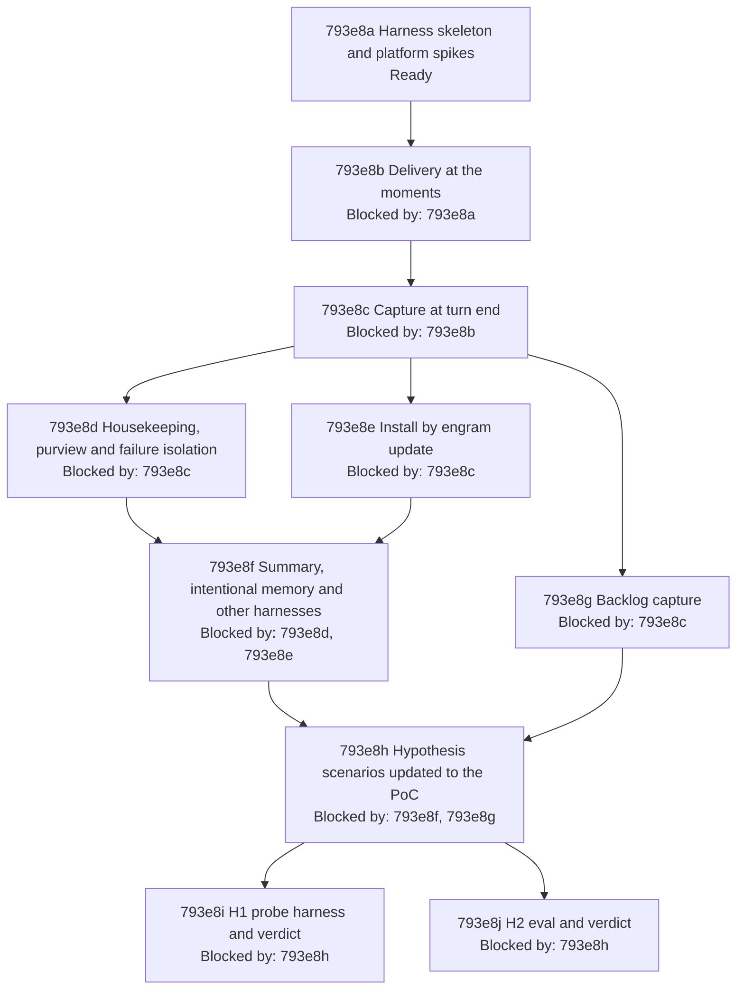

# Parallel Memory Agent - Implementation Plan

## 793e1 Purpose

This plan turns [Parallel Memory Agent - Product Spec](./793a_product-spec.md#parallel-memory-agent---product-spec) and [Parallel Memory Agent - Technical Spec](./793d_technical-spec.md#parallel-memory-agent---technical-spec) into test-driven work in three stages, as the owner directed on 2026-10-12 ([793b243 The harness is godog over scenarios extracted from the product spec at run time](./793b_decision-log.md#793b243-the-harness-is-godog-over-scenarios-extracted-from-the-product-spec-at-run-time), [793b253 The hypothesis scenarios are updated to the PoC before they are run; unrealised kinds are recorded, not built](./793b_decision-log.md#793b253-the-hypothesis-scenarios-are-updated-to-the-poc-before-they-are-run-unrealised-kinds-are-recorded-not-built)):

1. A harness that executes the 43 scenarios of the product spec against real Claude Code [sessions](../../GLOSSARY.md#session).
2. A proof of concept ([System](./793a_product-spec.md#793a1-problem-statement)) that makes them pass, built as the design drafted in [793d19 Design as currently drafted](./793d_technical-spec.md#793d19-design-as-currently-drafted), cut to what those scenarios need ([793b250 The PoC is the drafted design cut to what the 43 scenarios need](./793b_decision-log.md#793b250-the-poc-is-the-drafted-design-cut-to-what-the-43-scenarios-need)).
3. The two hypotheses of the technical spec: update their scenarios to what the PoC does, run them, and record a verdict (confirmed, disproved or inconclusive) for each.

Out of scope: promoting the specs to `docs/specs/` and deleting this change directory (done at integration, per the lifecycle guide), [delivery](./793a_product-spec.md#793a1-problem-statement) into other harnesses, and [#795](https://github.com/toejough/engram/issues/795).

The design choices of this plan are in the decision log, [793b243 The harness is godog over scenarios extracted from the product spec at run time](./793b_decision-log.md#793b243-the-harness-is-godog-over-scenarios-extracted-from-the-product-spec-at-run-time) to [793b254 The CLI absent skips, anything else missing fails](./793b_decision-log.md#793b254-the-cli-absent-skips-anything-else-missing-fails); none needs an owner answer to proceed, so [793c Open Questions](./793c_open-questions.md) has no new entry.

## 793e2 Implementation shape

### 793e2a Toolchain

| Concern | Choice | Record |
| --- | --- | --- |
| Scenario runner | godog (Cucumber for Go), scenarios extracted from the product spec at run time | [793b243 The harness is godog over scenarios extracted from the product spec at run time](./793b_decision-log.md#793b243-the-harness-is-godog-over-scenarios-extracted-from-the-product-spec-at-run-time) |
| Where it lives, how it runs | `dev/acceptance`, tag `integration`, `TestAcceptance`, `targ acceptance [filter]`; cheap checks are `TestIntegration...` and run in `check-full` | [793b244 Acceptance runs are TestAcceptance under the integration tag, run by targ acceptance, not by check-full](./793b_decision-log.md#793b244-acceptance-runs-are-testacceptance-under-the-integration-tag-run-by-targ-acceptance-not-by-check-full) |
| [Sessions](../../GLOSSARY.md#session) | real `claude -p` (streaming input) in an isolated home, credentials from the environment | [793b245 Scenarios run real claude sessions in an isolated home with credentials from the environment](./793b_decision-log.md#793b245-scenarios-run-real-claude-sessions-in-an-isolated-home-with-credentials-from-the-environment), [793b248 The session driver streams input and waits for the System's idle marker](./793b_decision-log.md#793b248-the-session-driver-streams-input-and-waits-for-the-systems-idle-marker) |
| Observables | [transcript](../../GLOSSARY.md#transcript) JSONL, [vault](./793a_product-spec.md#793a1-problem-statement), install tree, harness-only seam log; only preconditions are retried | [793b246 Assertions read the transcript, the vault and a harness-only seam log; only preconditions are retried](./793b_decision-log.md#793b246-assertions-read-the-transcript-the-vault-and-a-harness-only-seam-log-only-preconditions-are-retried) |
| Scenario data | one `scenarios.yaml` keyed by scenario ID; about thirty generic steps | [793b247 Scenario data lives in one fixtures file keyed by scenario ID, so step definitions stay generic](./793b_decision-log.md#793b247-scenario-data-lives-in-one-fixtures-file-keyed-by-scenario-id-so-step-definitions-stay-generic) |
| Origins `-p` cannot produce | live driver first, else a `claude plugin test` substitute | [793b249 Scenarios whose prompt origin cannot be produced in -p get a contract-test substitute](./793b_decision-log.md#793b249-scenarios-whose-prompt-origin-cannot-be-produced-in--p-get-a-contract-test-substitute) |
| PoC | `agent-instructions/mods/engram-memory/` (JavaScript) plus `engram auto run` (Go) | [793b250 The PoC is the drafted design cut to what the 43 scenarios need](./793b_decision-log.md#793b250-the-poc-is-the-drafted-design-cut-to-what-the-43-scenarios-need) |
| Deploy | skills subtree and link, Claude Code only | [793b251 The mod deploys through the skills subtree and links, for Claude Code only](./793b_decision-log.md#793b251-the-mod-deploys-through-the-skills-subtree-and-links-for-claude-code-only) |
| CLI absent / credentials absent | skip / fail | [793b254 The CLI absent skips, anything else missing fails](./793b_decision-log.md#793b254-the-cli-absent-skips-anything-else-missing-fails) |

The harness is example-based: no property tests, no new lint gate (vault [note](./793a_product-spec.md#793a1-problem-statement) 556), and it adds one module dependency (godog and its Gherkin parser). The product Go code follows the repository rules: logic in `internal/auto`, I/O only through the existing injected capabilities, tests with imptest and gomega, coverage by the existing gate.

### 793e2b Harness architecture

- **Extractor.** Reads the `gherkin` blocks of the product spec, adds one `Feature:` line per `UAT Scenarios` heading, and passes them to godog as contents. An outline's examples run as separate subtests of one scenario.
- **World (one per scenario).** Temporary HOME, XDG directories, GOBIN, [vault](./793a_product-spec.md#793a1-problem-statement), workspace and shared read-only embedder cache; the engram binary built once per run with `go build -o <tmp>/bin/engram ./cmd/engram` (never `go install`); `engram update` run in local-clone mode against the temporary HOME for every scenario that says the [System](./793a_product-spec.md#793a1-problem-statement) is installed.
- **[Session](../../GLOSSARY.md#session) driver.** Starts `claude -p` with streaming input in the workspace, sends the scripted turns, optionally compaction or resume, waits for the seam log's `idle` line, then closes. Fault injection uses real mechanisms: an unreadable vault directory, an `engram` shim earlier on PATH that exits, prints non-JSON, or sleeps past a deadline.
- **Readers.** [Transcript](../../GLOSSARY.md#transcript) (rows by kind, the System's blocks identified by their fixed marker lines, tool calls, [subagent](../../GLOSSARY.md#subagent) transcripts), vault ([notes](./793a_product-spec.md#793a1-problem-statement) by keyword, count), install tree, seam log.
- **Step families (about thirty).** Seed notes and [offers](../../GLOSSARY.md#offer); install state (installed, preview, absent, Pi present); drive a prompt, a dispatch, a skill run, a subagent task; "the transcript shows ... delivered / only once / no request"; "a note stating ... exists / exactly one"; "the user is shown ..." (seam); tool-call and permission equality; install-tree assertions. The scenario IDs name the data each family reads ([793b247 Scenario data lives in one fixtures file keyed by scenario ID, so step definitions stay generic](./793b_decision-log.md#793b247-scenario-data-lives-in-one-fixtures-file-keyed-by-scenario-id-so-step-definitions-stay-generic)).
- **Documented substitutes.** The seam log stands for the status line in `-p`; origin rows without a live driver and Pi runs without a headless Pi use the substitutes of [793b249 Scenarios whose prompt origin cannot be produced in -p get a contract-test substitute](./793b_decision-log.md#793b249-scenarios-whose-prompt-origin-cannot-be-produced-in--p-get-a-contract-test-substitute). Each is marked in its catalog row.

### 793e2c PoC architecture

- **[Mod](./793d_technical-spec.md#793d1b-terms)** (`agent-instructions/mods/engram-memory/`: `.claude-plugin/plugin.json`, `hooks/hooks.json`, `hooks/register.js`, `tests/*.test.ts`). Maps events to jobs, runs `engram auto run` through `$.process.run`, relays the model requests it returns through `$.model.complete` on the model its request names, applies results ([context](./793a_product-spec.md#793a1-problem-statement), status line), keeps one in-memory queue, the [delivery](./793a_product-spec.md#793a1-problem-statement) ledger and the activity counters, and contains every failure with a user-only warning.
- **Go** (`internal/auto`, command in `internal/cli`). One JSON job on standard input, one JSON result on standard output: `need` (requests to relay, opaque state) or `done` (delivery, counts, warnings). Job kinds: `moment`, `capture`, `curate`, `scan`. [Judgement](./793d_technical-spec.md#793d1b-terms) kinds and their table: `relevance`, `extraction`, `reconcile`, `curation`, all defaulting to `haiku`.
- **Update.** Mod copies planned for Claude Code only ([793b251 The mod deploys through the skills subtree and links, for Claude Code only](./793b_decision-log.md#793b251-the-mod-deploys-through-the-skills-subtree-and-links-for-claude-code-only)).
- **Cut** ([793b250 The PoC is the drafted design cut to what the 43 scenarios need](./793b_decision-log.md#793b250-the-poc-is-the-drafted-design-cut-to-what-the-43-scenarios-need)): `classify` and judged cues, `turn.step`, held delivery, redaction, `$.store`, outcome recorder, late delivery at stop.

### 793e2d Environment the suites need

| Need | Used by | If missing |
| --- | --- | --- |
| `claude` on PATH, version 2.1.287 or later (verified on 2.1.296) | everything | skip with reason when absent; fail when too old |
| `CLAUDE_CODE_OAUTH_TOKEN` or `ANTHROPIC_API_KEY` | live [sessions](../../GLOSSARY.md#session) (acceptance, H1 live, H2) | fail naming both variables |
| `go`, `git`, `git-lfs` (the bundled embedder model is an LFS asset) | build and `engram update` | fail |
| network access to the model API | live sessions | fail |
| `pi` and its own credentials | Pi rows | substitute fixture ([793b249 Scenarios whose prompt origin cannot be produced in -p get a contract-test substitute](./793b_decision-log.md#793b249-scenarios-whose-prompt-origin-cannot-be-produced-in--p-get-a-contract-test-substitute)) |
| `tmux` | H1 screen check | that row not run |

### 793e2e Platform claims to verify first

The rows of [793d1a What the hypotheses rely on in Claude Code mods](./793d_technical-spec.md#793d1a-what-the-hypotheses-rely-on-in-claude-code-mods) marked "To verify", and the facts this plan found while drafting, are the first work of node [793e8a Harness skeleton and platform spikes](#793e8a-harness-skeleton-and-platform-spikes). Each outcome is recorded in the decision log; the third column says what it unblocks and the fourth what happens if the claim is false.

| Spike | Claim | Unblocks | If false |
| --- | --- | --- | --- |
| SP1 | A [session](../../GLOSSARY.md#session) in an isolated HOME authenticates from `CLAUDE_CODE_OAUTH_TOKEN` or `ANTHROPIC_API_KEY`, and a [mod](./793d_technical-spec.md#793d1b-terms)'s `$.model.complete` then uses it (without credentials the session answers "Not logged in", seen on 2.1.296) | every live scenario | stop and ask the owner; copying stored credentials is not allowed |
| SP2 | A folder under `~/.claude/skills` with `.claude-plugin/plugin.json`, reached through a link, loads its hooks module under `claude -p` in an isolated HOME and an arbitrary workspace (row 2, 13) | all PoC nodes, [793a5j Installed by engram update and active in Claude Code](./793a_product-spec.md#793a5j-installed-by-engram-update-and-active-in-claude-code) | load with `--plugin-dir` in the harness for non-install scenarios; [793a5j Installed by engram update and active in Claude Code](./793a_product-spec.md#793a5j-installed-by-engram-update-and-active-in-claude-code) then needs an interactive run |
| SP3 | `prompt.submit` fires for typed prompts and slash-command prompts (`/recall`, `/please`) and `context` reaches the model (row 3) | [793a2n Relevant memory reaches the agent at the moments](./793a_product-spec.md#793a2n-relevant-memory-reaches-the-agent-at-the-moments) | cue on the first tool result instead |
| SP4 | Added [context](./793a_product-spec.md#793a1-problem-statement) appears in the [transcript](../../GLOSSARY.md#transcript) as a separate, attributable row for `prompt.submit` `context` and for `classic.PostToolUse` and `classic.SubagentStart` `additionalContext` (row 4) | [793a2n Relevant memory reaches the agent at the moments](./793a_product-spec.md#793a2n-relevant-memory-reaches-the-agent-at-the-moments), [793a4c1b The prompt is unchanged and the note is separate](./793a_product-spec.md#793a4c1-uat-scenarios), [793a4c1c The only effect on the working agent's context is what is delivered](./793a_product-spec.md#793a4c1-uat-scenarios) | assert on the model's use of a sentinel instead of a row, and record [793a4c1b The prompt is unchanged and the note is separate](./793a_product-spec.md#793a4c1-uat-scenarios) as partly unverified |
| SP5 | `classic.SubagentStart` context reaches only that [subagent](../../GLOSSARY.md#subagent); `agent.spawn` carries the task prompt; the subagent transcript path is known and complete at `classic.SubagentStop` (row 5) | [793a2n1g A subagent receives relevant notes](./793a_product-spec.md#793a2n1-uat-scenarios), [793a2e1d A parent's note is still delivered to a subagent](./793a_product-spec.md#793a2e1-uat-scenarios), [793a3a1g A lesson in a subagent session is captured](./793a_product-spec.md#793a3a1-uat-scenarios) | read the transcript after a short wait; the last message is also given |
| SP6 | `classic.SessionStart` carries the main transcript path (row 6) | [793e8g Backlog capture](#793e8g-backlog-capture) | the scan identifies the live session by its session id |
| SP7 | `$.session.messages()` contains a delivered block, drops it after compaction and shows it again after a resume (row 8); how to compact and resume a streaming session | [793a2e Nothing already in context is delivered again](./793a_product-spec.md#793a2e-nothing-already-in-context-is-delivered-again) | the ledger alone, which would fail [793a2e1g A resumed session's restored content counts as present](./793a_product-spec.md#793a2e1-uat-scenarios) (record it) |
| SP8 | The non-human prompt origins (task notification, scheduled trigger, peer message) can be produced in `-p` and fire the hook the mod uses (row 3) | [793a2n1h A prompt from any source receives relevant notes](./793a_product-spec.md#793a2n1-uat-scenarios) | substitute ([793b249 Scenarios whose prompt origin cannot be produced in -p get a contract-test substitute](./793b_decision-log.md#793b249-scenarios-whose-prompt-origin-cannot-be-produced-in--p-get-a-contract-test-substitute)) |
| SP9 | `$.ui.status`, `$.env.get`, `$.fs.write` work in `-p` handlers; a gating hook needs a `.catch` handler (`claude plugin validate` warned about it) | [793a5h The user sees a summary of the memory activity](./793a_product-spec.md#793a5h-the-user-sees-a-summary-of-the-memory-activity), [793a4b The session is never broken or stalled](./793a_product-spec.md#793a4b-the-session-is-never-broken-or-stalled) | no seam; assert on the debug log |
| SP10 | A pending [offer](../../GLOSSARY.md#offer) can be seeded in an isolated [vault](./793a_product-spec.md#793a1-problem-statement) through a real path (the registration offers of `engram update`, or the serve write path) | [793a4j1c Offers are resolved by the System](./793a_product-spec.md#793a4j1-uat-scenarios), [793a4j1d The agent is not asked to curate](./793a_product-spec.md#793a4j1-uat-scenarios) | hand-written offer [notes](./793a_product-spec.md#793a1-problem-statement), recorded as a deviation |
| SP11 | A fresh session costs how long and how many tokens; how many sessions can run in parallel without rate limits; the effect of the shared embedder cache | suite size and parallelism | lower parallelism |
| SP12 | Handler time inside `$.process.run` and `$.model.complete` does not count against the 10 s hook budget for a 25 s job (row 10) | [793a2n Relevant memory reaches the agent at the moments](./793a_product-spec.md#793a2n-relevant-memory-reaches-the-agent-at-the-moments), [793a4j1e Slow housekeeping does not stall the session](./793a_product-spec.md#793a4j1-uat-scenarios) | detach and deliver at the next event |
| SP13 | With streaming input the module keeps running its queue after `turn.complete` and until the session closes ([793b248 The session driver streams input and waits for the System's idle marker](./793b_decision-log.md#793b248-the-session-driver-streams-input-and-waits-for-the-systems-idle-marker)) | [793a3a Lessons are captured without the agent](./793a_product-spec.md#793a3a-lessons-are-captured-without-the-agent), [793a4j Indexing and curation happen after the turn](./793a_product-spec.md#793a4j-indexing-and-curation-happen-after-the-turn) | tmux interactive sessions for those scenarios |
| SP14 | `pi` runs headless in an isolated home and writes a session file that the Transcript Reader parses | [793a5c Other harnesses are unchanged](./793a_product-spec.md#793a5c-other-harnesses-are-unchanged), [793a3a1j A lesson that is already recorded is not written again](./793a_product-spec.md#793a3a1-uat-scenarios), [793a3a1k A lesson in a session that ended before it was saved is captured later](./793a_product-spec.md#793a3a1-uat-scenarios) | fixture file ([793b249 Scenarios whose prompt origin cannot be produced in -p get a contract-test substitute](./793b_decision-log.md#793b249-scenarios-whose-prompt-origin-cannot-be-produced-in--p-get-a-contract-test-substitute)) |

### 793e2f Estimated owned code

Lines are rounded and include tests; data is counted separately.

| Area | Production | Tests and harness | Data |
| --- | --- | --- | --- |
| Harness (`dev/acceptance`: extractor, world, driver, readers, steps, target) | 0 | 1,000 to 1,300 Go | `scenarios.yaml` 250 |
| [Mod](./793d_technical-spec.md#793d1b-terms) (`register.js`, manifests) | 250 JS | 150 TS (`claude plugin test`) | 0 |
| `internal/auto` and `engram auto run` | 650 to 800 Go | 900 to 1,100 Go (imptest, gomega) | 0 |
| `engram update` mod copies | 50 Go | 120 Go | 0 |
| H1 probes and report (mod and settings-hook probes, runner, count report) | 100 JS, 100 shell, 250 Go | 100 Go | 0 |
| H2 eval (replay, aggregate, report on `dev/eval` patterns) | 350 Go | 150 Go | 160 to 200 labelled fixtures |
| Total | about 1,800 | about 2,400 to 2,800 | about 450 lines of data and fixtures |

### 793e2g Risks

- **Credentials and cost.** The live suites need a token and make about fifty [sessions](../../GLOSSARY.md#session) plus [judgement](./793d_technical-spec.md#793d1b-terms) calls; SP11 measures the cost before the suite is sized.
- **Agent nondeterminism.** Fixed prompts and retried preconditions ([793b246 Assertions read the transcript, the vault and a harness-only seam log; only preconditions are retried](./793b_decision-log.md#793b246-assertions-read-the-transcript-the-vault-and-a-harness-only-seam-log-only-preconditions-are-retried)) bound it; a scenario that still needs more than three attempts is reported, not hidden.
- **Early-access runtime.** The [mods](./793d_technical-spec.md#793d1b-terms) runtime changes between releases; the plan pins the verified version and records the result of [793d17d1d The mod's contract tests pass on the newest release](./793d_technical-spec.md#793d17d1-experiments).
- **Work after the turn.** If SP13 fails, the whole delivery-after-turn design needs an interactive driver.
- **Registration scanning.** The mod directory sits where skills are scanned; node [793e8e Install by engram update](#793e8e-install-by-engram-update) proves it is not offered or deleted.
- **Judgement quality.** Scenario results depend on `haiku` judging relevance, [lessons](./793a_product-spec.md#793a1-problem-statement), coverage and curation; a red scenario may be a judgement failure, which is H2's subject; the first reading of a red result separates the two.
- **Hypothesis inputs.** Gold labels need the owner's approval, and some H1 and H2 conditions cannot run on this machine ([793b253 The hypothesis scenarios are updated to the PoC before they are run; unrealised kinds are recorded, not built](./793b_decision-log.md#793b253-the-hypothesis-scenarios-are-updated-to-the-poc-before-they-are-run-unrealised-kinds-are-recorded-not-built)), which leaves those conditions inconclusive.

## 793e3 Test methods

- **Dedicated examples (product acceptance).** Every product scenario is an acceptance example: the scenario text runs through godog against a real [session](../../GLOSSARY.md#session). The scenario is a finite, exact, user-observable contract; sessions, the [vault](./793a_product-spec.md#793a1-problem-statement) and the install are real, so no mock stands in for them.
- **Dedicated examples ([mod](./793d_technical-spec.md#793d1b-terms) contract).** `claude plugin validate` and `claude plugin test` of the mod, with the model call, the store and the process stubbed by the test kit, for hook wiring, containment and request building that a live session cannot reach deterministically.
- **imptest.** The Go runner crosses impure boundaries (vault query, [note](./793a_product-spec.md#793a1-problem-statement) write, amend, [transcript](../../GLOSSARY.md#transcript) read, clock, process); call counts, arguments and ordering are the contract, so each boundary is an imptest mock. The harness itself needs none.
- **Live experiments.** Hypothesis scenarios are run experiments with a recorded result, not pass/fail unit tests ([793b253 The hypothesis scenarios are updated to the PoC before they are run; unrealised kinds are recorded, not built](./793b_decision-log.md#793b253-the-hypothesis-scenarios-are-updated-to-the-poc-before-they-are-run-unrealised-kinds-are-recorded-not-built)).
- **No `rapid` entries.** The inputs of the Go runner are structured job documents and fixed texts without a meaningful generated domain, and the harness is example-based ([793b243 The harness is godog over scenarios extracted from the product spec at run time](./793b_decision-log.md#793b243-the-harness-is-godog-over-scenarios-extracted-from-the-product-spec-at-run-time)).

The shared cycle applies to every row: write the test; run it and see it fail for the expected reason; implement the minimum to pass it; fix whatever the full suite then needs; refactor with the suite green (complexity, consistency, boundaries, performance). For an acceptance row, "fail for the expected reason" means the Then step fails because the [System](./793a_product-spec.md#793a1-problem-statement) does not yet do the thing, not because a step is undefined or the session did not start.

## 793e4 Test status

A test row has one of `Not started`, `Red`, `Green-single`, `Green-all`, `Refactor-complexity`, `Refactor-consistency`, `Refactor-boundaries`, `Refactor-performance`, `Done`, as the implementation plan guide defines them. A work row has `Not started`, `In progress` or `Done`. A status changes in the commit that establishes it. For an acceptance row, `Green-all` means the whole acceptance suite and `targ check-full` pass (flaky-by-nature rows count as green on their retried precondition, never on a retried Then). A spike row is `Done` when its outcome is in the decision log.

## 793e5 Dependency tree

The owner's nodes map as (1) [793e8a Harness skeleton and platform spikes](#793e8a-harness-skeleton-and-platform-spikes), (2) [793e8b Delivery at the moments](#793e8b-delivery-at-the-moments), (3) [793e8c Capture at turn end](#793e8c-capture-at-turn-end), (4) [793e8d Housekeeping, purview and failure isolation](#793e8d-housekeeping-purview-and-failure-isolation), (5) [793e8e Install by engram update](#793e8e-install-by-engram-update) and [793e8f Summary, intentional memory and other harnesses](#793e8f-summary-intentional-memory-and-other-harnesses), (6) [793e8g Backlog capture](#793e8g-backlog-capture), (7) [793e8h Hypothesis scenarios updated to the PoC](#793e8h-hypothesis-scenarios-updated-to-the-poc), (8) [793e8i H1 probe harness and verdict](#793e8i-h1-probe-harness-and-verdict) and [793e8j H2 eval and verdict](#793e8j-h2-eval-and-verdict) ([793b252 The owner's node 5 is two nodes, the backlog node follows capture, and the hypothesis nodes follow the PoC](./793b_decision-log.md#793b252-the-owners-node-5-is-two-nodes-the-backlog-node-follows-capture-and-the-hypothesis-nodes-follow-the-poc)). After [793e8c Capture at turn end](#793e8c-capture-at-turn-end), three nodes are ready at once ([793e8d Housekeeping, purview and failure isolation](#793e8d-housekeeping-purview-and-failure-isolation), [793e8e Install by engram update](#793e8e-install-by-engram-update), [793e8g Backlog capture](#793e8g-backlog-capture)).

## 793e6 Parallel worktree method

The method of the [implementation plan guide](../../IMPLEMENTATION-PLAN-GUIDE.md#parallel-worktree-method) applies unchanged, with the repository's rules from `AGENTS.md`: merges are `--ff-only`, a branch is rebased on the development branch and re-tested before it merges, review precedes every merge, and nothing is pushed. The fan-out is after [793e8c Capture at turn end](#793e8c-capture-at-turn-end); the convergence points are [793e8f Summary, intentional memory and other harnesses](#793e8f-summary-intentional-memory-and-other-harnesses) ([793e8d Housekeeping, purview and failure isolation](#793e8d-housekeeping-purview-and-failure-isolation) and [793e8e Install by engram update](#793e8e-install-by-engram-update)), [793e8h Hypothesis scenarios updated to the PoC](#793e8h-hypothesis-scenarios-updated-to-the-poc) ([793e8f Summary, intentional memory and other harnesses](#793e8f-summary-intentional-memory-and-other-harnesses) and [793e8g Backlog capture](#793e8g-backlog-capture)) and the end ([793e8i H1 probe harness and verdict](#793e8i-h1-probe-harness-and-verdict) and [793e8j H2 eval and verdict](#793e8j-h2-eval-and-verdict)). No worktree touches the real `~/.claude`, `~/.pi`, [vault](./793a_product-spec.md#793a1-problem-statement) or GOBIN; every experiment uses temporary homes.

## 793e7 Node status

The statuses are those of the guide: `Blocked by: <node IDs>`, `Ready`, `In progress: n/x entries complete`, `Complete`, `Merged`. The graph above carries each node's current status and changes in the commit that changes it.

## 793e8 Test Catalog

Every executable test name begins with its row's Gherkin ID; the acceptance suite's subtests are named `<ID> <title>` by the scenario line itself. Acceptance rows are verified with `targ acceptance <ID>`.

### 793e8a Harness skeleton and platform spikes

Verification: `targ acceptance 793a5k1e` green; `targ acceptance` lists the other 42 scenarios as undefined; `targ test`; `targ check-full` unchanged by the new package.

| Work | Classification | Why | Status |
| --- | --- | --- | --- |
| godog dependency; `dev/acceptance` package (with an untagged `doc.go` so wildcard builds stay quiet); the `acceptance` target in `dev/targs.go` | Setup | [793b243 The harness is godog over scenarios extracted from the product spec at run time](./793b_decision-log.md#793b243-the-harness-is-godog-over-scenarios-extracted-from-the-product-spec-at-run-time), [793b244 Acceptance runs are TestAcceptance under the integration tag, run by targ acceptance, not by check-full](./793b_decision-log.md#793b244-acceptance-runs-are-testacceptance-under-the-integration-tag-run-by-targ-acceptance-not-by-check-full) | Not started |
| Extractor test: the product spec yields exactly its 43 scenario IDs, outlines as one scenario each; named `TestIntegrationExtract...` | Dedicated example | Guards the claim that the spec is the test source; cheap, so it runs in `check-full` | Not started |
| SP1 isolated-home authentication | Spike | Blocks every live row; outcome decides whether the plan can proceed | Not started |
| SP2 skills-directory plugin loads under `-p` | Spike | Install path for all PoC nodes | Not started |
| SP3 `prompt.submit` for typed and slash-command prompts | Spike | [Delivery](./793a_product-spec.md#793a1-problem-statement) at the prompt | Not started |
| SP4 attribution of added [context](./793a_product-spec.md#793a1-problem-statement) in the [transcript](../../GLOSSARY.md#transcript) | Spike | Fixes the row shape every delivery assertion reads | Not started |
| SP5 [subagent](../../GLOSSARY.md#subagent) start context, dispatch prompt, transcript at stop | Spike | Subagent delivery and capture | Not started |
| SP6 main transcript path at [session](../../GLOSSARY.md#session) start | Spike | Backlog exclusion of the live session | Not started |
| SP7 `$.session.messages()` through compaction and resume; how to drive both | Spike | Presence rows of [793a2e Nothing already in context is delivered again](./793a_product-spec.md#793a2e-nothing-already-in-context-is-delivered-again) | Not started |
| SP8 non-human prompt origins in `-p` | Spike | Decides live driver or substitute ([793b249 Scenarios whose prompt origin cannot be produced in -p get a contract-test substitute](./793b_decision-log.md#793b249-scenarios-whose-prompt-origin-cannot-be-produced-in--p-get-a-contract-test-substitute)) | Not started |
| SP9 `$.ui.status`, `$.env.get`, `$.fs.write` and the `.catch` rule in `-p` | Spike | The seam log ([793b246 Assertions read the transcript, the vault and a harness-only seam log; only preconditions are retried](./793b_decision-log.md#793b246-assertions-read-the-transcript-the-vault-and-a-harness-only-seam-log-only-preconditions-are-retried)) | Not started |
| SP10 seeding a pending [offer](../../GLOSSARY.md#offer) through a real path | Spike | Curation fixtures | Not started |
| SP11 session cost, time, parallelism, embedder cache | Spike | Sizes the suite and its parallelism | Not started |
| SP12 long handler work against the hook budget | Spike | Delivery deadline | Not started |
| SP13 module keeps running between streamed turns | Spike | Work after the turn ([793b248 The session driver streams input and waits for the System's idle marker](./793b_decision-log.md#793b248-the-session-driver-streams-input-and-waits-for-the-systems-idle-marker)) | Not started |
| SP14 headless Pi in an isolated home | Spike | Pi rows ([793b249 Scenarios whose prompt origin cannot be produced in -p get a contract-test substitute](./793b_decision-log.md#793b249-scenarios-whose-prompt-origin-cannot-be-produced-in--p-get-a-contract-test-substitute)) | Not started |
| Baseline sweep: run the whole suite once and record, per scenario, that it is undefined or red for the expected reason | Work | Gives every later Red its evidence | Not started |

| Gherkin | Classification | Why | Status |
| --- | --- | --- | --- |
| [793a5k1e An intentional engram query by the agent is allowed](./793a_product-spec.md#793a5k1-uat-scenarios) | Dedicated example (acceptance) | Already true of today's system, so it is green before the PoC exists and proves the whole harness end to end: isolated home, build and update, seeding through `engram learn`, a streamed session, the transcript read. Its "[System](./793a_product-spec.md#793a1-problem-statement) is installed" step runs `engram update` and is tightened to assert the [mod](./793d_technical-spec.md#793d1b-terms)'s link in [793e8e Install by engram update](#793e8e-install-by-engram-update); the row stays as a regression | Not started |

### 793e8b Delivery at the moments

Verification: `targ acceptance 793a2n` and `targ acceptance 793a2e`; `claude plugin validate` and `claude plugin test` in `agent-instructions/mods/engram-memory`; `targ test`; `targ check-full`.

| Work | Classification | Why | Status |
| --- | --- | --- | --- |
| [Mod](./793d_technical-spec.md#793d1b-terms) skeleton: manifest, `hooks.json`, `register.js` with the `prompt.submit` hook (with its `.catch`), the relay loop and the `judgeTiers` table; contract tests, including that every request names its model of kind (the base of [793d18c1a Every request names the model of its kind](./793d_technical-spec.md#793d18c1-experiments)) | Dedicated example (mod contract) | Hook wiring and request building are reachable without a [session](../../GLOSSARY.md#session) | Not started |
| `engram auto run` and `internal/auto`: job envelope, `need`/`done` rounds, the `moment` job (query with the four recall phrases beside the prompt, presence filter, `relevance` request, [delivery](./793a_product-spec.md#793a1-problem-statement) text with the apply instruction, nothing when nothing remains); composition in `internal/cli`; confirm no new `cli.Primitives` field is needed | imptest | Query, clock and file reads are impure boundaries; arguments and call order are the contract | Not started |
| Presence: ledger plus live messages, emptied for the main agent at `session.compact`, refilled from the messages after a resume | imptest and mod contract | Boundary between the mod's memory and Go's filter | Not started |
| Cues: the Skill call of route (`classic.PostToolUse`), `classic.SubagentStart` with the dispatch prompt | Dedicated example (mod contract) | Event shapes, per SP4 and SP5 | Not started |

| Gherkin | Classification | Why | Status |
| --- | --- | --- | --- |
| [793a2n1a Recall happens without the agent running it](./793a_product-spec.md#793a2n1-uat-scenarios) (flaky by nature: the agent must reach the declaration; precondition retried) | Dedicated example (acceptance) | The central promise: the done-shaped phrase finds the [note](./793a_product-spec.md#793a1-problem-statement) at the prompt | Not started |
| [793a2n1e No result, nothing delivered](./793a_product-spec.md#793a2n1-uat-scenarios) | Dedicated example (acceptance) | Absence: no delivered row and no instruction | Not started |
| [793a2n1g A subagent receives relevant notes](./793a_product-spec.md#793a2n1-uat-scenarios) (precondition retried: the agent must dispatch) | Dedicated example (acceptance) | [Subagent](../../GLOSSARY.md#subagent) [transcript](../../GLOSSARY.md#transcript) is a separate file; the dispatch text must not mention the note | Not started |
| [793a2n1h A prompt from any source receives relevant notes](./793a_product-spec.md#793a2n1-uat-scenarios) (human row live; the other three live if SP8 allows, else Substitute) | Dedicated example (acceptance, outline) | One flow for four origins; the substitute row is a mod contract test | Not started |
| [793a2n1i Please's orientation receives relevant notes](./793a_product-spec.md#793a2n1-uat-scenarios) (precondition retried) | Dedicated example (acceptance) | The please prompt is a slash-command prompt (SP3) | Not started |
| [793a2n1j Tier evidence is delivered before a dispatch is routed](./793a_product-spec.md#793a2n1-uat-scenarios) (precondition retried: the agent must route through route) | Dedicated example (acceptance) | The route cue delivers before the unit is routed | Not started |
| [793a2e1a Note delivered earlier is not delivered again](./793a_product-spec.md#793a2e1-uat-scenarios) | Dedicated example (acceptance) | Ledger and live messages; no session event is needed beyond tool results | Not started |
| [793a2e1c Note the agent retrieved itself is not delivered](./793a_product-spec.md#793a2e1-uat-scenarios) | Dedicated example (acceptance) | Presence read from what the agent's own runs left in the transcript | Not started |
| [793a2e1d A parent's note is still delivered to a subagent](./793a_product-spec.md#793a2e1-uat-scenarios) | Dedicated example (acceptance) | A parent's note is not present for the subagent | Not started |
| [793a2e1e A note removed by compaction can be delivered again](./793a_product-spec.md#793a2e1-uat-scenarios) | Dedicated example (acceptance) | Compaction driven per SP7 | Not started |
| [793a2e1g A resumed session's restored content counts as present](./793a_product-spec.md#793a2e1-uat-scenarios) | Dedicated example (acceptance) | Resume driven per SP7 | Not started |

### 793e8c Capture at turn end

Verification: `targ acceptance 793a3a1a`, `793a3a1g`, `793a3a1h` and the first example of `793a3a1j`; `claude plugin test`; `targ test`; `targ check-full`.

| Work | Classification | Why | Status |
| --- | --- | --- | --- |
| In-memory first-in-first-out queue, one job at a time; `turn.complete` and `classic.SubagentStop` capture jobs in the [mod](./793d_technical-spec.md#793d1b-terms) | Dedicated example (mod contract) | Ordering is what makes two simultaneous captures see each other's [note](./793a_product-spec.md#793a1-problem-statement) | Not started |
| `capture` job in `internal/auto`: window from the messages (or the [subagent](../../GLOSSARY.md#subagent) [transcript](../../GLOSSARY.md#transcript)), the [System](./793a_product-spec.md#793a1-problem-statement)'s own blocks removed, `extraction` request, per candidate a nearest-notes query and a `reconcile` request, `engram learn` for an absent [lesson](./793a_product-spec.md#793a1-problem-statement), a covered one reinforced by activation | imptest | [Vault](./793a_product-spec.md#793a1-problem-statement) query, note write, amend and transcript read are the boundaries; no write for a covered lesson is the contract | Not started |

| Gherkin | Classification | Why | Status |
| --- | --- | --- | --- |
| [793a3a1a A lesson is captured without agent action](./793a_product-spec.md#793a3a1-uat-scenarios) (outline of three; the third row retries its precondition) | Dedicated example (acceptance, outline) | Same flow for a correction, a save request and a self-corrected cause | Not started |
| [793a3a1g A lesson in a subagent session is captured](./793a_product-spec.md#793a3a1-uat-scenarios) | Dedicated example (acceptance) | The note comes from the subagent's own transcript | Not started |
| [793a3a1h Two subagents contain the same lesson](./793a_product-spec.md#793a3a1-uat-scenarios) | Dedicated example (acceptance) | Two subagents finish together; exactly one note | Not started |
| [793a3a1j A lesson that is already recorded is not written again](./793a_product-spec.md#793a3a1-uat-scenarios) (first example only: the agent ran the learn skill in this turn; the other two are in [793e8g Backlog capture](#793e8g-backlog-capture)) | Dedicated example (acceptance, outline example) | Reconcile finds the agent's own note and writes nothing | Not started |

### 793e8d Housekeeping, purview and failure isolation

Verification: `targ acceptance 793a4j`, `793a4c`, `793a4b`; `claude plugin test`; `targ test`; `targ check-full`.

| Work | Classification | Why | Status |
| --- | --- | --- | --- |
| After capture the [mod](./793d_technical-spec.md#793d1b-terms) runs `engram ingest --auto` through `$.process.run`, then a `curate` job; the `curate` job in `internal/auto` settles each pending [offer](../../GLOSSARY.md#offer) by the four outcomes of curate (covered, near, absent, rejected) with a `curation` request | imptest | [Vault](./793a_product-spec.md#793a1-problem-statement) listing, amend, discard and learn are boundaries; no destructive action without the outcome is the contract | Not started |
| Failure classification (unavailable, timeout, error), named deadlines, `.catch` handlers, warning through the status line and the seam log | Dedicated example (mod contract) | The three causes and the deadlines are reachable with the test kit's stubs | Not started |
| Fault shims for the harness: unreadable vault, `engram` that cannot start, prints non-JSON, or sleeps past the deadline | Setup | Real mechanisms instead of a product-side fault switch | Not started |

| Gherkin | Classification | Why | Status |
| --- | --- | --- | --- |
| [793a4j1a The index catches up after the turn](./793a_product-spec.md#793a4j1-uat-scenarios) | Dedicated example (acceptance) | Waits for `idle`, then queries | Not started |
| [793a4j1c Offers are resolved by the System](./793a_product-spec.md#793a4j1-uat-scenarios) | Dedicated example (acceptance) | One offer folded, one accepted; needs SP10 | Not started |
| [793a4j1d The agent is not asked to curate](./793a_product-spec.md#793a4j1-uat-scenarios) | Dedicated example (acceptance) | Absence of any curate instruction in the [transcript](../../GLOSSARY.md#transcript) | Not started |
| [793a4j1e Slow housekeeping does not stall the session](./793a_product-spec.md#793a4j1-uat-scenarios) (a shim makes the System's work take 20 seconds) | Dedicated example (acceptance) | Second prompt streamed at once; timing read from the transcript | Not started |
| [793a4c1a Tool calls and permissions unchanged](./793a_product-spec.md#793a4c1-uat-scenarios) | Dedicated example (acceptance) | Tool-call and permission rows compared with the agent's own | Not started |
| [793a4c1b The prompt is unchanged and the note is separate](./793a_product-spec.md#793a4c1-uat-scenarios) | Dedicated example (acceptance) | Depends on the row shape found in SP4 | Not started |
| [793a4c1c The only effect on the working agent's context is what is delivered](./793a_product-spec.md#793a4c1-uat-scenarios) | Dedicated example (acceptance) | Every System-added row is a [delivery](./793a_product-spec.md#793a1-problem-statement) or its instruction | Not started |
| [793a4c1f The agent is neither required nor asked to run a memory command](./793a_product-spec.md#793a4c1-uat-scenarios) (precondition retried) | Dedicated example (acceptance) | Delivery and capture in the same turn, nothing asked of the agent | Not started |
| [793a4b1a Vault unavailable](./793a_product-spec.md#793a4b1-uat-scenarios) (warning read from the seam log) | Dedicated example (acceptance) | Vault made unreadable | Not started |
| [793a4b1b Evaluation crashes](./793a_product-spec.md#793a4b1-uat-scenarios) (warning read from the seam log) | Dedicated example (acceptance) | The shim makes the [System](./793a_product-spec.md#793a1-problem-statement)'s work throw | Not started |
| [793a4b1c No error reaches the agent and the user is warned](./793a_product-spec.md#793a4b1-uat-scenarios) (warning read from the seam log) | Dedicated example (acceptance) | The shim sleeps past the deadline | Not started |
| [793a4b1e No warning when nothing matched](./793a_product-spec.md#793a4b1-uat-scenarios) | Dedicated example (acceptance) | Seam log holds no warning line | Not started |

### 793e8e Install by engram update

Verification: `targ acceptance 793a5j`; `targ test`; `targ check-full`.

| Work | Classification | Why | Status |
| --- | --- | --- | --- |
| [Mod](./793d_technical-spec.md#793d1b-terms) copy planning for harnesses flagged to take mods, destination under the skills directory; the flag set for Claude Code only; the report lists the mod; registration scanning leaves the directory alone ([793b251 The mod deploys through the skills subtree and links, for Claude Code only](./793b_decision-log.md#793b251-the-mod-deploys-through-the-skills-subtree-and-links-for-claude-code-only)) | imptest | File-system plan and apply are the boundary; dry run writes nothing; a second run changes nothing | Not started |
| `agent-instructions/mods/` is the source tree; the "[System](./793a_product-spec.md#793a1-problem-statement) is installed" step of the harness asserts the mod's link | Setup | Tightens the earlier steps | Not started |

| Gherkin | Classification | Why | Status |
| --- | --- | --- | --- |
| [793a5j1a Update installs the System for the harness it updates](./793a_product-spec.md#793a5j1-uat-scenarios) | Dedicated example (acceptance) | Claude Code present, Pi absent: a [session](../../GLOSSARY.md#session) runs with the System; no Pi directory | Not started |
| [793a5j1b An existing install gains the System and keeps what it had](./793a_product-spec.md#793a5j1-uat-scenarios) | Dedicated example (acceptance) | Starts from a pre-System install tree; the memory skills, guidance and shim remain | Not started |
| [793a5j1c A preview installs none of the System](./793a_product-spec.md#793a5j1-uat-scenarios) | Dedicated example (acceptance) | `--dry-run` then a session: nothing delivered | Not started |
| [793a5j1d One update serves both harnesses differently](./793a_product-spec.md#793a5j1-uat-scenarios) | Dedicated example (acceptance) | Pi part per SP14 (real run or fixture, marked) | Not started |
| [793a5j1l Running update twice changes nothing](./793a_product-spec.md#793a5j1-uat-scenarios) | Dedicated example (acceptance) | Tree identical after the second update; behaviour identical | Not started |

### 793e8f Summary, intentional memory and other harnesses

Verification: `targ acceptance 793a5h`, `793a5k`, `793a5c1a`, `793a5c1b`; `targ test`; `targ check-full`.

| Work | Classification | Why | Status |
| --- | --- | --- | --- |
| Activity counters in the [mod](./793d_technical-spec.md#793d1b-terms) (delivered, added, amended, curated across the [session](../../GLOSSARY.md#session) and its [subagents](../../GLOSSARY.md#subagent)), one line after the [System](./793a_product-spec.md#793a1-problem-statement)'s work for a turn, nothing for an empty turn, counts since the previous line | Dedicated example (mod contract) | Counting and reset are reachable with stubbed job results | Not started |

| Gherkin | Classification | Why | Status |
| --- | --- | --- | --- |
| [793a5h1a The summary shows the counts after a turn with events](./793a_product-spec.md#793a5h1-uat-scenarios) (read from the seam log) | Dedicated example (acceptance) | Counts across a subagent session | Not started |
| [793a5h1b Nothing is shown after a turn without events](./793a_product-spec.md#793a5h1-uat-scenarios) (read from the seam log) | Dedicated example (acceptance) | No line | Not started |
| [793a5h1c The summary is not in the agent's context](./793a_product-spec.md#793a5h1-uat-scenarios) | Dedicated example (acceptance) | The summary text is absent from the [transcript](../../GLOSSARY.md#transcript) and from the next reply | Not started |
| [793a5h1e The counts cover the events since the previous summary](./793a_product-spec.md#793a5h1-uat-scenarios) (read from the seam log) | Dedicated example (acceptance) | Counts reset between summaries | Not started |
| [793a5k1c An intentional recall by the agent is allowed](./793a_product-spec.md#793a5k1-uat-scenarios) | Dedicated example (acceptance) | The System does not undo what a recall wrote | Not started |
| [793a5k1d An intentional learn by the agent is allowed and is not undone](./793a_product-spec.md#793a5k1-uat-scenarios) | Dedicated example (acceptance) | One [note](./793a_product-spec.md#793a1-problem-statement) after the turn and still there after the System's work | Not started |
| [793a5c1a Unsupported harness](./793a_product-spec.md#793a5c1-uat-scenarios) (a harness without the System is a Pi session or an unmodified Claude Code home) | Dedicated example (acceptance) | Behaviour equal to the run without the System | Not started |
| [793a5c1b A Pi session on a machine whose Claude Code has the System](./793a_product-spec.md#793a5c1-uat-scenarios) (Pi run or fixture per SP14) | Dedicated example (acceptance) | No [delivery](./793a_product-spec.md#793a1-problem-statement) in the Pi transcript; the Pi agent's own ingest and learn unchanged | Not started |

### 793e8g Backlog capture

Verification: `targ acceptance 793a3a1j`, `793a3a1k`, `793a5c1c`; `targ test`; `targ check-full`.

| Work | Classification | Why | Status |
| --- | --- | --- | --- |
| `scan` job and watermark in `internal/auto`: sources with content beyond their watermark, not live, newest first, at most one per turn, the watermark advanced when the capture finishes without a warning; the [mod](./793d_technical-spec.md#793d1b-terms) queues the backlog capture after a turn's own capture | imptest | [Transcript](../../GLOSSARY.md#transcript) listing, transcript read and the watermark file are boundaries; a source never changes, and a captured one is not captured again | Not started |
| Fixture builders: a Pi [session](../../GLOSSARY.md#session) transcript with an uncaptured [lesson](./793a_product-spec.md#793a1-problem-statement), a killed Claude Code session transcript | Setup | Real Pi run if SP14 allows, else the Transcript Reader's documented format | Not started |

| Gherkin | Classification | Why | Status |
| --- | --- | --- | --- |
| [793a3a1j A lesson that is already recorded is not written again](./793a_product-spec.md#793a3a1-uat-scenarios) (second and third examples: Pi session already learned; lesson captured by an earlier Claude Code turn) | Dedicated example (acceptance, outline examples) | Reconcile and the watermark prevent a second [note](./793a_product-spec.md#793a1-problem-statement) | Not started |
| [793a3a1k A lesson in a session that ended before it was saved is captured later](./793a_product-spec.md#793a3a1-uat-scenarios) (outline of two: a Pi session never learned; a Claude Code session killed mid-turn) | Dedicated example (acceptance, outline) | Same flow: a later turn captures what the ended session left | Not started |
| [793a5c1c A captured Pi session's transcript is left unchanged](./793a_product-spec.md#793a5c1-uat-scenarios) | Dedicated example (acceptance) | Byte comparison of the Pi transcript with its copy | Not started |

### 793e8h Hypothesis scenarios updated to the PoC

Verification: the changes are in the decision log and in [793d17](./793d_technical-spec.md#793d17-h1-a-claude-code-mod-gives-a-smaller-implementation-surface-and-more-capability-than-settings-hooks) and [793d18](./793d_technical-spec.md#793d18-h2-the-cheapest-capable-model-is-adequate-for-every-system-judgement-and-is-faster-and-cheaper) with every scenario ID unchanged; the specification checklist of `docs/AGENTS.md` passes.

| Work | Classification | Why | Status |
| --- | --- | --- | --- |
| Review [793d17a Capability coverage](./793d_technical-spec.md#793d17a-capability-coverage) against the spike outcomes and the PoC; fix wording that no longer matches the platform | Review | Row 3 to 9 were settled partly by SP3 to SP7 | Not started |
| Review [793d17b Output outside the agent's context](./793d_technical-spec.md#793d17b-output-outside-the-agents-context) and [793d17c Model calls and long work](./793d_technical-spec.md#793d17c-model-calls-and-long-work); record the rows that need an environment this machine lacks | Review | [793b253 The hypothesis scenarios are updated to the PoC before they are run; unrealised kinds are recorded, not built](./793b_decision-log.md#793b253-the-hypothesis-scenarios-are-updated-to-the-poc-before-they-are-run-unrealised-kinds-are-recorded-not-built) | Not started |
| Review [793d17d Install and load](./793d_technical-spec.md#793d17d-install-and-load), [793d17e Failure containment and restraint](./793d_technical-spec.md#793d17e-failure-containment-and-restraint) and [793d17f Surface size](./793d_technical-spec.md#793d17f-surface-size) against the PoC's install and failure handling | Review | The PoC's actual files, handlers and glue are what [793d17f1a The same behavior is counted on both surfaces](./793d_technical-spec.md#793d17f1-experiments) counts | Not started |
| Review [793d18a Agreement with the gold labels](./793d_technical-spec.md#793d18a-agreement-with-the-gold-labels), [793d18b Speed and cost](./793d_technical-spec.md#793d18b-speed-and-cost) and [793d18c The tier table](./793d_technical-spec.md#793d18c-the-tier-table): kinds the PoC has, measurement points, fixture counts, margin | Review | The `classify` kind is not built; latency and cost are measured by replay ([793b253 The hypothesis scenarios are updated to the PoC before they are run; unrealised kinds are recorded, not built](./793b_decision-log.md#793b253-the-hypothesis-scenarios-are-updated-to-the-poc-before-they-are-run-unrealised-kinds-are-recorded-not-built)) | Not started |
| Record every change in the decision log and mark the ledger rows of [793d1a What the hypotheses rely on in Claude Code mods](./793d_technical-spec.md#793d1a-what-the-hypotheses-rely-on-in-claude-code-mods) settled by the spikes | Work | Keeps IDs, history and the evidence ledger consistent | Not started |

### 793e8i H1 probe harness and verdict

Verification: `targ h1-probes` writes the capability table ([mod](./793d_technical-spec.md#793d1b-terms) column, hook column), the surface counts and the evidence ledger as a labelled table, and the verdict; the verdict and the table are recorded in the decision log and in [793d17](./793d_technical-spec.md#793d17-h1-a-claude-code-mod-gives-a-smaller-implementation-surface-and-more-capability-than-settings-hooks).

| Work | Classification | Why | Status |
| --- | --- | --- | --- |
| Probe pairs (mod module and [settings hook](./793d_technical-spec.md#793d1b-terms), each logging outside the [transcript](../../GLOSSARY.md#transcript)) for the capabilities of [793d17a1a Each surface is probed for each capability the product needs](./793d_technical-spec.md#793d17a1-experiments); a stand-in command that returns a fixed [delivery](./793a_product-spec.md#793a1-problem-statement) after a set delay | Setup | The surfaces are compared with the memory logic held constant | Not started |
| Runner and report: `targ h1-probes`, result per scenario, the counts of [793d17f1a The same behavior is counted on both surfaces](./793d_technical-spec.md#793d17f1-experiments), the verdict rule of [793d17](./793d_technical-spec.md#793d17-h1-a-claude-code-mod-gives-a-smaller-implementation-surface-and-more-capability-than-settings-hooks) (confirmed, disproved, inconclusive) | Setup | One command re-runs the experiment | Not started |

| Gherkin | Classification | Why | Status |
| --- | --- | --- | --- |
| [793d17a1a Each surface is probed for each capability the product needs](./793d_technical-spec.md#793d17a1-experiments) | Dedicated example (live experiment, outline of ten) | Capability coverage, both surfaces | Not started |
| [793d17a1b Added context is attributable in the transcript](./793d_technical-spec.md#793d17a1-experiments) | Dedicated example (live experiment) | Attribution rows, one per channel | Not started |
| [793d17a1c The mod can read what the agent's context holds, through a compaction and a resume](./793d_technical-spec.md#793d17a1-experiments) | Dedicated example (live experiment) | Compaction and resume | Not started |
| [793d17a1d A response step is observed without being delayed](./793d_technical-spec.md#793d17a1-experiments) | Dedicated example (live experiment) | 20 steps with and without the mod; median added delay against 50 ms | Not started |
| [793d17b1a A message reaches the user and not the agent](./793d_technical-spec.md#793d17b1-experiments) | Dedicated example (live experiment under tmux) | The only check that needs a drawn screen | Not started |
| [793d17c1a A model call is relayed on a named tier](./793d_technical-spec.md#793d17c1-experiments) (first-party row only on this machine; the other rows are recorded as not run) | Dedicated example (live experiment, outline of three) | Providers need their own credentials | Not started |
| [793d17c1b Work longer than the hook budget is awaited without the handler being cut off](./793d_technical-spec.md#793d17c1-experiments) | Dedicated example (live experiment) | A 25 s stand-in command | Not started |
| [793d17c1c Background work does not delay the next event](./793d_technical-spec.md#793d17c1-experiments) | Dedicated example (live experiment) | A 20 s background job | Not started |
| [793d17d1a The mod loads in every session from the install path](./793d_technical-spec.md#793d17d1-experiments) | Dedicated example (live experiment) | New, cleared, resumed and branched [sessions](../../GLOSSARY.md#session) | Not started |
| [793d17d1b The mod loads only on a Claude Code version that supports it](./793d_technical-spec.md#793d17d1-experiments) (only the installed version can run; the others are recorded as not run unless obtainable) | Dedicated example (live experiment, outline of three) | Version floor | Not started |
| [793d17d1c The sessions in which each surface is inactive are known](./793d_technical-spec.md#793d17d1-experiments) (rows that need managed policy, WSL or the VS Code panel are recorded as not run) | Dedicated example (live experiment, outline of nine) | Inactive sessions | Not started |
| [793d17d1d The mod's contract tests pass on the newest release](./793d_technical-spec.md#793d17d1-experiments) | Dedicated example (contract test) | `claude plugin test` on the verified version and the newest release | Not started |
| [793d17e1a A failure inside the surface leaves the session unaffected](./793d_technical-spec.md#793d17e1-experiments) | Dedicated example (outline of four; mod by contract test, hook script live) | Same four causes on both surfaces | Not started |
| [793d17e1b The mod changes nothing it must not](./793d_technical-spec.md#793d17e1-experiments) | Dedicated example (contract test) | `claude plugin validate` lists the handlers; none denies, drops or answers | Not started |
| [793d17f1a The same behavior is counted on both surfaces](./793d_technical-spec.md#793d17f1-experiments) | Dedicated example (build and count) | The four counts per surface from the reference-behavior table | Not started |

### 793e8j H2 eval and verdict

Verification: `targ h2-eval [kind] [runs]` writes, per kind, a table with columns labelled with units (agreement or recall, guard rate, median latency in seconds, 95th-percentile latency in seconds, cost in US dollars per fixture, session-model spread over runs, fixtures n) for the cheapest tier and the [session](../../GLOSSARY.md#session) model side by side with the difference; the verdict per kind and for H2 is recorded in the decision log and in [793d18](./793d_technical-spec.md#793d18-h2-the-cheapest-capable-model-is-adequate-for-every-system-judgement-and-is-faster-and-cheaper).

| Work | Classification | Why | Status |
| --- | --- | --- | --- |
| Fixture sets for `relevance`, `extraction`, `reconcile` and `curation` (at least 40 each, at least 10 with gold none or absent, at most 200) with gold labels from [transcripts](../../GLOSSARY.md#transcript) and [vault](./793a_product-spec.md#793a1-problem-statement) history; the owner approves a sample before they are committed | Setup | Gold is fixed before either tier runs ([793b253 The hypothesis scenarios are updated to the PoC before they are run; unrealised kinds are recorded, not built](./793b_decision-log.md#793b253-the-hypothesis-scenarios-are-updated-to-the-poc-before-they-are-run-unrealised-kinds-are-recorded-not-built)) | Not started |
| Replay runner on the `dev/eval` patterns: the request text built by the PoC's own request builders, both tiers, three runs each, `duration_api_ms` and `total_cost_usd` per call; JSONL results | Setup | Same request text for both tiers; reuse of the run loop, writer and aggregation | Not started |
| Aggregation and report: means, stratum split, noise from the session model's own spread, inconclusive when the gap is inside the noise (fixtures added up to 200), the ratio table | Setup | Implements the verdict rule of [793d18](./793d_technical-spec.md#793d18-h2-the-cheapest-capable-model-is-adequate-for-every-system-judgement-and-is-faster-and-cheaper) | Not started |

| Gherkin | Classification | Why | Status |
| --- | --- | --- | --- |
| [793d18a1a The cheapest tier agrees with the gold labels as well as the session model, within the margin](./793d_technical-spec.md#793d18a1-experiments) | Dedicated example (live experiment, outline of five; four kinds run) | Parity within 0.05 on primary and guard | Not started |
| [793d18a1b A gap inside the noise is inconclusive, not a tie](./793d_technical-spec.md#793d18a1-experiments) | Dedicated example (live experiment) | A gap inside the noise is inconclusive | Not started |
| [793d18a1c Subtle cases are not hidden by easy ones](./793d_technical-spec.md#793d18a1-experiments) | Dedicated example (live experiment) | Extraction scored by stratum | Not started |
| [793d18b1a The cheapest tier is faster per call](./793d_technical-spec.md#793d18b1-experiments) | Dedicated example (live experiment, outline of five; four kinds run) | Median latency and the 5 s bound | Not started |
| [793d18b1b The cheapest tier is cheaper per fixture and per session](./793d_technical-spec.md#793d18b1-experiments) | Dedicated example (live experiment) | Cost per fixture and per replayed 50-turn session | Not started |
| [793d18c1a Every request names the model of its kind](./793d_technical-spec.md#793d18c1-experiments) | Dedicated example (contract test) | Request builders; the base is written in [793e8b Delivery at the moments](#793e8b-delivery-at-the-moments) | Not started |
| [793d18c1b Raising one kind changes only that kind](./793d_technical-spec.md#793d18c1-experiments) | Dedicated example (contract test) | Raising one kind changes only that kind | Not started |
| [793d18c1c An unavailable cheapest tier fails loudly and does not fall back upward](./793d_technical-spec.md#793d18c1-experiments) | Dedicated example (live check) | Unavailable alias fails loudly and does not fall back upward | Not started |

## 793e9 Completion gates

- **Product coverage.** `targ acceptance` runs all 43 scenarios of the product spec (51 runs counting outline examples) and every one is green, with the retried preconditions and the substitutes listed in the report; no scenario is undefined or skipped except by the absence of the `claude` CLI.
- **Technical coverage.** Every scenario of [793d17](./793d_technical-spec.md#793d17-h1-a-claude-code-mod-gives-a-smaller-implementation-surface-and-more-capability-than-settings-hooks) and [793d18](./793d_technical-spec.md#793d18-h2-the-cheapest-capable-model-is-adequate-for-every-system-judgement-and-is-faster-and-cheaper) has a recorded result or a recorded reason it did not run, and each hypothesis has a verdict (confirmed, disproved or inconclusive) in the decision log and the technical spec, shown as a labelled criteria table.
- **Dedicated examples.** Every catalog row of a finite or acceptance contract is a dedicated example; the plan has no `rapid` entry and states why ([793b243 The harness is godog over scenarios extracted from the product spec at run time](./793b_decision-log.md#793b243-the-harness-is-godog-over-scenarios-extracted-from-the-product-spec-at-run-time)).
- **Interaction evidence.** The imptest mocks of node [793e8b Delivery at the moments](#793e8b-delivery-at-the-moments) to [793e8g Backlog capture](#793e8g-backlog-capture) show the call, argument and ordering evidence listed in their Work rows, including that a covered [lesson](./793a_product-spec.md#793a1-problem-statement) is not written and that no destructive curation happens without its outcome.
- **Real dependency coverage.** The [mod](./793d_technical-spec.md#793d1b-terms) runs under `claude plugin validate` and `claude plugin test`; the update runs against a real temporary home; [sessions](../../GLOSSARY.md#session) are real.
- **Full suite.** `targ check-full` passes, including the cheap `TestIntegration...` checks, and `targ test` passes; `go build -o <tmp>/bin/engram ./cmd/engram` builds; nothing was installed with `go install` or written outside temporary homes.
- **Valid and invalid paths.** The failure scenarios show the session unchanged and a warning on the seam log; the install scenarios show a preview that writes nothing and a second update that changes nothing.
- **Status.** Every catalog entry is `Done` and every graph node is `Merged`.
- **Specification promotion.** The product and technical deltas are applied to their canonical specifications without changing a stable ID, every canonical technical requirement keeps valid product-scenario references, and the change directory is deleted in the same merge as the implementation, per the lifecycle guide.
