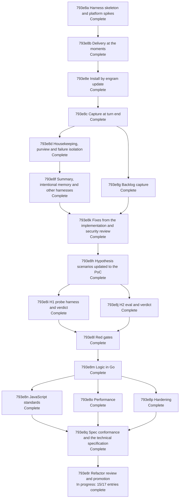

# Parallel Memory Agent - Implementation Plan

## 793e1 Purpose

This plan turns [Parallel Memory Agent - Product Spec](./793a_product-spec.md#parallel-memory-agent---product-spec) and [Parallel Memory Agent - Technical Spec](./793d_technical-spec.md#parallel-memory-agent---technical-spec) into test-driven work in three stages, as the owner directed on 2026-10-12 ([793b275 The harness and the PoC are JavaScript; only the update's mod copies stay Go](./793b_decision-log.md#793b275-the-harness-and-the-poc-are-javascript-only-the-updates-mod-copies-stay-go), [793b253 The hypothesis scenarios are updated to the PoC before they are run; unrealised kinds are recorded, not built](./793b_decision-log.md#793b253-the-hypothesis-scenarios-are-updated-to-the-poc-before-they-are-run-unrealised-kinds-are-recorded-not-built)). The harness, the spike probes and the PoC are JavaScript; only the mod copies of `engram update` are Go. The build is minimal and targeted: it covers what the 43 product scenarios and the two hypotheses need on this machine, and nothing else ([793b268 The PoC is minimal and targeted: environments the owner does not use and everything no scenario needs are cut](./793b_decision-log.md#793b268-the-poc-is-minimal-and-targeted-environments-the-owner-does-not-use-and-everything-no-scenario-needs-are-cut)).

1. A harness that executes the 43 scenarios of the product spec, and the 11 H1 scenarios of the technical spec, against real Claude Code [sessions](../../GLOSSARY.md#session).
2. A proof of concept ([System](./793a_product-spec.md#793a1-problem-statement)) that makes the product scenarios pass: the design drafted in [793d19 Design as currently drafted](./793d_technical-spec.md#793d19-design-as-currently-drafted), cut to what those scenarios need ([793b250 The PoC is the drafted design cut to what the 43 scenarios need](./793b_decision-log.md#793b250-the-poc-is-the-drafted-design-cut-to-what-the-43-scenarios-need)) and orchestrated in JavaScript inside the [mod](./793d_technical-spec.md#793d1b-terms) over the existing engram commands ([793b256 The PoC orchestrates in JavaScript inside the mod over the existing engram commands](./793b_decision-log.md#793b256-the-poc-orchestrates-in-javascript-inside-the-mod-over-the-existing-engram-commands)).
3. The two hypotheses of the technical spec: update their scenarios to what the PoC does, run them, and record a verdict (confirmed, disproved or inconclusive) for each, on this machine.

Part 2 of the plan is the refactor of the proof of concept ([793b360 The refactor is red gates first, then green, with the acceptance suite green throughout](./793b_decision-log.md#793b360-the-refactor-is-red-gates-first-then-green-with-the-acceptance-suite-green-throughout)): nodes [793e8l Red gates](#793e8l-red-gates) to [793e8r Refactor review and promotion](#793e8r-refactor-review-and-promotion). Behavior is fixed and the acceptance suite stays green throughout; each standard or technical goal is first made red by a test, an enabled linter or a measured budget, and then worked to green; the technical component and flow specs are rewritten from the refactored system at the end.

Out of scope: promoting the specs to `docs/specs/` and deleting this change directory (done at integration, per the lifecycle guide), [delivery](./793a_product-spec.md#793a1-problem-statement) into other harnesses, environments other than this machine's macOS terminal and Claude Code [sessions](../../GLOSSARY.md#session) on a subscription login, and [#795](https://github.com/toejough/engram/issues/795).

The design choices of this plan are in the decision log, [793b243 The harness is godog over scenarios extracted from the product spec at run time](./793b_decision-log.md#793b243-the-harness-is-godog-over-scenarios-extracted-from-the-product-spec-at-run-time) to [793b283 ID map for 793b281 to 793b282](./793b_decision-log.md#793b283-id-map-for-793b281-to-793b282). The owner answered the review's three questions on 2026-10-12: [793c70 May the H2 gold be mined read-only from the real transcripts and vault?](./793c_open-questions.md#793c70-may-the-h2-gold-be-mined-read-only-from-the-real-transcripts-and-vault), [793c71 Who labels the relevance and extraction gold?](./793c_open-questions.md#793c71-who-labels-the-relevance-and-extraction-gold) and [793c72 Which model do the acceptance sessions run on, and which are H2's comparison arms?](./793c_open-questions.md#793c72-which-model-do-the-acceptance-sessions-run-on-and-which-are-h2s-comparison-arms) ([793b269 793c70 is answered: the gold is mined read-only from the real transcripts and vault](./793b_decision-log.md#793b269-793c70-is-answered-the-gold-is-mined-read-only-from-the-real-transcripts-and-vault), [793b270 793c71 is answered: a third model drafts the gold, fable here, and the owner confirms every label](./793b_decision-log.md#793b270-793c71-is-answered-a-third-model-drafts-the-gold-fable-here-and-the-owner-confirms-every-label), [793b271 793c72 is answered: acceptance sessions on sonnet, and H2 compares three cost-scaled arms](./793b_decision-log.md#793b271-793c72-is-answered-acceptance-sessions-on-sonnet-and-h2-compares-three-cost-scaled-arms)).

## 793e2 Implementation shape

### 793e2a Toolchain

| Concern | Choice | Record |
| --- | --- | --- |
| Scenario runner | cucumber-js (`@cucumber/cucumber`) in plain JavaScript (ES modules, no build step), strict: undefined, pending and ambiguous steps fail; scenarios extracted from the product spec (and the H1 section of the technical spec) at run time and written to a temporary directory the run removes | [793b275 The harness and the PoC are JavaScript; only the update's mod copies stay Go](./793b_decision-log.md#793b275-the-harness-and-the-poc-are-javascript-only-the-updates-mod-copies-stay-go), [793b276 The harness is cucumber-js in plain JavaScript over the Agent SDK, run by targ acceptance](./793b_decision-log.md#793b276-the-harness-is-cucumber-js-in-plain-javascript-over-the-agent-sdk-run-by-targ-acceptance) |
| Where it lives, how it runs | `dev/acceptance/`, a node package (`package.json`, committed lockfile, `node_modules` ignored); `targ acceptance [filter]` checks for `node`, `npm` and `claude`, installs the dependencies when `node_modules` is missing, runs `node dev/acceptance/run.js`, which first runs the vocabulary check in a process of its own (`--dry-run` stops there; `--check` runs the harness self-tests and that check, nothing else, and takes neither a filter nor `--dry-run`); a missing program fails with a message naming it; a run exits non-zero on a Red or a harness error, reports the Pending rows as INCOMPLETE without failing, and bounds every step by 10 minutes (cucumber's 5 seconds is shorter than a turn with its retries); the extractor's `node:test` suite runs in `check-full` through one `dev` integration test, the live suite never | [793b276 The harness is cucumber-js in plain JavaScript over the Agent SDK, run by targ acceptance](./793b_decision-log.md#793b276-the-harness-is-cucumber-js-in-plain-javascript-over-the-agent-sdk-run-by-targ-acceptance), [793b260 The live suite has its own build tag, acceptance, and check-full never runs it](./793b_decision-log.md#793b260-the-live-suite-has-its-own-build-tag-acceptance-and-check-full-never-runs-it) |
| [Sessions](../../GLOSSARY.md#session) | Agent SDK (`@anthropic-ai/claude-agent-sdk`) `query()` with streaming input, in an isolated home, `env` replaced by an explicit list, `--model sonnet`, permissions by `settings.json` allow rules in that home; credentials from `CLAUDE_CODE_OAUTH_TOKEN` (the environment, else the owner's token file when the variable is unset, never printed) or `ANTHROPIC_API_KEY` | [793b245 Scenarios run real claude sessions in an isolated home with credentials from the environment](./793b_decision-log.md#793b245-scenarios-run-real-claude-sessions-in-an-isolated-home-with-credentials-from-the-environment), [793b248 The session driver streams input and waits for the System's idle marker](./793b_decision-log.md#793b248-the-session-driver-streams-input-and-waits-for-the-systems-idle-marker), [793b267 The OAuth token comes from a file the harness reads only when the variable is unset](./793b_decision-log.md#793b267-the-oauth-token-comes-from-a-file-the-harness-reads-only-when-the-variable-is-unset), [793b271 793c72 is answered: acceptance sessions on sonnet, and H2 compares three cost-scaled arms](./793b_decision-log.md#793b271-793c72-is-answered-acceptance-sessions-on-sonnet-and-h2-compares-three-cost-scaled-arms) |
| Observables | the typed SDK message stream, the [transcript](../../GLOSSARY.md#transcript) JSONL, the [vault](./793a_product-spec.md#793a1-problem-statement), the install tree, and the `ui_status` system messages of the stream (what the mod shows the user); only preconditions are retried, inside the When step | [793b246 Assertions read the transcript, the vault and a harness-only seam log; only preconditions are retried](./793b_decision-log.md#793b246-assertions-read-the-transcript-the-vault-and-a-harness-only-seam-log-only-preconditions-are-retried) |
| Scenario data | one `scenarios.js` keyed by scenario ID, inputs only (scripts for the turns, seeds, keywords); the outcomes are in the 27 anchored step definitions of the [793e2i Step catalog](#793e2i-step-catalog) | [793b276 The harness is cucumber-js in plain JavaScript over the Agent SDK, run by targ acceptance](./793b_decision-log.md#793b276-the-harness-is-cucumber-js-in-plain-javascript-over-the-agent-sdk-run-by-targ-acceptance), [793b277 The Gherkin step lines of the 43 product scenarios use a fixed vocabulary of 27 steps](./793b_decision-log.md#793b277-the-gherkin-step-lines-of-the-43-product-scenarios-use-a-fixed-vocabulary-of-27-steps) |
| Origins a stream cannot produce, Pi behaviour | live driver first, else the result `Substituted: product promise unverified`; no fixture stands in for a Pi agent's behaviour | [793b249 Scenarios whose prompt origin cannot be produced in -p get a contract-test substitute](./793b_decision-log.md#793b249-scenarios-whose-prompt-origin-cannot-be-produced-in--p-get-a-contract-test-substitute), [793b264 Results include Substituted, and Pi-agent behaviour is not faked with fixtures](./793b_decision-log.md#793b264-results-include-substituted-and-pi-agent-behaviour-is-not-faked-with-fixtures) |
| PoC | `agent-instructions/mods/engram-memory/` (plain JavaScript) running the existing engram commands through `$.process.run` and judging through `$.model.complete`; no Go command (SP15: the backlog needs none) | [793b256 The PoC orchestrates in JavaScript inside the mod over the existing engram commands](./793b_decision-log.md#793b256-the-poc-orchestrates-in-javascript-inside-the-mod-over-the-existing-engram-commands), [793b278 The backlog scan reads the ingest manifest if SP15 shows it suffices; engram backlog stays only if it does not](./793b_decision-log.md#793b278-the-backlog-scan-reads-the-ingest-manifest-if-sp15-shows-it-suffices-engram-backlog-stays-only-if-it-does-not) |
| Deploy | skills subtree and link, Claude Code only; the only product Go code | [793b251 The mod deploys through the skills subtree and links, for Claude Code only](./793b_decision-log.md#793b251-the-mod-deploys-through-the-skills-subtree-and-links-for-claude-code-only), [793b275 The harness and the PoC are JavaScript; only the update's mod copies stay Go](./793b_decision-log.md#793b275-the-harness-and-the-poc-are-javascript-only-the-updates-mod-copies-stay-go) |
| `claude` or `node` absent / credentials absent | `targ acceptance` fails naming the program or the variable and the file; the mod's contract test and the extractor test skip when their program is absent | [793b254 The CLI absent skips, anything else missing fails](./793b_decision-log.md#793b254-the-cli-absent-skips-anything-else-missing-fails), [793b267 The OAuth token comes from a file the harness reads only when the variable is unset](./793b_decision-log.md#793b267-the-oauth-token-comes-from-a-file-the-harness-reads-only-when-the-variable-is-unset) |
| H1 | the same cucumber-js harness over the H1 Gherkin; the spike [probes](./793d_technical-spec.md#793d1b-terms) of [793e8a Harness skeleton and platform spikes](#793e8a-harness-skeleton-and-platform-spikes) are the mod column, reused unchanged | [793b258 H1's verdict stays after the PoC, and the platform spikes are H1's mod-column probes](./793b_decision-log.md#793b258-h1s-verdict-stays-after-the-poc-and-the-platform-spikes-are-h1s-mod-column-probes), [793b268 The PoC is minimal and targeted: environments the owner does not use and everything no scenario needs are cut](./793b_decision-log.md#793b268-the-poc-is-minimal-and-targeted-environments-the-owner-does-not-use-and-everything-no-scenario-needs-are-cut) |
| H2 | a small replay [mod](./793d_technical-spec.md#793d1b-terms) looping `$.model.complete` over the fixtures against haiku and sonnet (full set), opus and fable (cost-scaled samples) | [793b265 H2 is replayed by a small mod over fixtures, and gold comes from history or the owner](./793b_decision-log.md#793b265-h2-is-replayed-by-a-small-mod-over-fixtures-and-gold-comes-from-history-or-the-owner), [793b272 H2 arm sample sizes are inversely proportional to per-token price, anchored at the full set for sonnet](./793b_decision-log.md#793b272-h2-arm-sample-sizes-are-inversely-proportional-to-per-token-price-anchored-at-the-full-set-for-sonnet) |

The harness is example-based: no property tests, no new lint gate (vault note 556: the JavaScript package is outside the Go gates), and it adds two dev dependencies, cucumber-js and the Agent SDK, pinned in the lockfile. The only product Go code is the `engram update` mod copies, with the small `targ acceptance` target; both follow the repository rules: logic in `internal/`, I/O only through the existing injected capabilities, tests with imptest and gomega, coverage by the existing gate.

### 793e2b Harness architecture

- **Extractor** (`lib/extract.js`). Reads the `gherkin` blocks of the product spec and of [793d17 H1: a Claude Code mod gives a smaller implementation surface and more capability than settings hooks](./793d_technical-spec.md#793d17-h1-a-claude-code-mod-gives-a-smaller-implementation-surface-and-more-capability-than-settings-hooks), adds one `Feature:` line per `UAT Scenarios` or `Experiments` heading, and writes them to a per-run temporary directory for cucumber-js. An outline's examples run as separate scenarios named by cucumber-js; the extractor test lists those names and shows the ID filter selecting them.
- **World (one per scenario)** (`lib/world.js`). Temporary HOME with no `statusLine` configured (the System's lines are transcript lines, shown with or without one, [793b443](./793b_decision-log.md#793b443-the-acceptance-world-configures-no-statusline)), XDG directories, TMPDIR, [vault](./793a_product-spec.md#793a1-problem-statement) and workspace (the workspace under the home, with a `.engram/sweep.json` that lifts the throwaway-root rule of `engram ingest --auto`, SP15); a shared read-only embedder cache pre-warmed once per run; the engram binary built once per run with `go build -o <tmp>/bin/engram ./cmd/engram` (never `go install`). `engram update` runs with the worktree as its working directory (local mode) and `ENGRAM_UPDATE_REEXEC=1`, which skips the `go install` leg; GOMODCACHE and GOCACHE point at the real Go caches only if the build or the update needs them. TMPDIR is per scenario so the update's clone directory is never shared. The `go install` leg is therefore not exercised by acceptance; it is verified by the unit tests of `internal/update` (`reexec_test.go`, `downgrade_test.go`, `runner_test.go`) and `internal/cli` (`reexec_test.go`, `update_test.go`). The run's temporary directories are removed on exit (the pattern of `internal/cli/testbinary_test.go`).
- **[Session](../../GLOSSARY.md#session) driver** (`lib/session.js`). One Agent SDK `query()` per session with an async-iterable prompt, so that the scripted turns, compaction and resume reach the same session; it fails fast when the [mod](./793d_technical-spec.md#793d1b-terms) did not load (a `hooks module ... not loaded` line in the debug log the session writes with `--debug-file`; a stream prints nothing to `stderr`, SP2). A turn ends at the SDK `result` message; the readers close the session before they read what the [System](./793a_product-spec.md#793a1-problem-statement) did, because a close drains its pending work (SP13); a wait in the middle of a scenario uses the `idle` line of the harness-only seam file, the one line of seam the mod keeps ([793b281 The spikes SP1 to SP15 are settled](./793b_decision-log.md#793b281-the-spikes-sp1-to-sp15-are-settled)). `maxBudgetUsd` is a generous per-session guard, never a cap on a run. Fault injection uses real mechanisms: an unreadable vault directory, an `engram` shim earlier on PATH that exits, prints output that cannot be parsed, or sleeps past a deadline.
- **Readers** (`lib/transcript.js`, the vault and the install tree through the `Scenario`). [transcript](../../GLOSSARY.md#transcript) (rows by kind, the System's blocks identified by their fixed marker lines, tool calls, [subagent](../../GLOSSARY.md#subagent) transcripts), [vault](./793a_product-spec.md#793a1-problem-statement) ([note](./793a_product-spec.md#793a1-problem-statement) by keyword, count), install tree, and the status lines: the strings the [mod](./793d_technical-spec.md#793d1b-terms) passes to `$.ui.status` arrive in the stream as `system` messages of subtype `ui_status`, so the product needs no seam for them (SP9).
- **Step definitions** (`steps/*.js`, 27 anchored, about ten helpers). The phrasings are the catalog [793e2i Step catalog](#793e2i-step-catalog); each definition holds the outcome it names. A turn step runs the script that `scenarios.js` holds for the quoted event, and retries its precondition (the agent must reach the declaration, dispatch, run the skill) up to three times inside the step; an ambiguous or undefined phrase fails the run.
- **Documented substitutes.** The `ui_log` message (the surface the rows read, [793b442](./793b_decision-log.md#793b442-the-systems-lines-are-transcript-lines-above-the-prompt-and-may-reach-the-agent)) stands for the System's transcript line in a stream with no interface; [793d17b1a A message reaches the user and not the agent](./793d_technical-spec.md#793d17b1-experiments), the only tmux use of the plan, confirms that the message text is what the screen draws. Origin rows without a live driver end `Substituted: product promise unverified`.

### 793e2c PoC architecture

- **[Mod](./793d_technical-spec.md#793d1b-terms)** (`agent-instructions/mods/engram-memory/`: `.claude-plugin/plugin.json`, `hooks/hooks.json`, `hooks/register.js`, `tests/*.test.ts`). It maps events to jobs and does all the memory logic itself: it runs the existing commands `engram query`, `learn`, `amend`, `activate`, `ingest --auto`, `show` and the commands of curate through `$.process.run`; judges through `$.model.complete` on the model its `judgeTiers` table names for the kind (`classify`, `relevance`, `capture`, `curation`, all defaulting to `haiku`; [793b279 Judgement is one richer prompt per kind, and capture judges extraction and reconciliation in one call](./793b_decision-log.md#793b279-judgement-is-one-richer-prompt-per-kind-and-capture-judges-extraction-and-reconciliation-in-one-call)); filters by presence, builds the [delivery](./793a_product-spec.md#793a1-problem-statement) text, builds the capture window, judges what the window adds and what the nearest notes already cover, settles [offers](../../GLOSSARY.md#offer); keeps one in-memory first-in-first-out queue, the delivery ledger and the activity counters; applies results ([context](./793a_product-spec.md#793a1-problem-statement), status line); and contains every failure with a user-only warning. There is no round protocol and no Go runner, and the mod's tests are TypeScript run by `claude plugin test` ([793b256 The PoC orchestrates in JavaScript inside the mod over the existing engram commands](./793b_decision-log.md#793b256-the-poc-orchestrates-in-javascript-inside-the-mod-over-the-existing-engram-commands)).
- **Go.** None for the logic and none for the backlog: spike SP15 shows that the ingest manifest, the chunk files and a capture mark the mod writes suffice, so `engram backlog` is not built ([793b278 The backlog scan reads the ingest manifest if SP15 shows it suffices; engram backlog stays only if it does not](./793b_decision-log.md#793b278-the-backlog-scan-reads-the-ingest-manifest-if-sp15-shows-it-suffices-engram-backlog-stays-only-if-it-does-not), [793b281 The spikes SP1 to SP15 are settled](./793b_decision-log.md#793b281-the-spikes-sp1-to-sp15-are-settled)).
- **Update.** Mod copies planned for Claude Code only ([793b251 The mod deploys through the skills subtree and links, for Claude Code only](./793b_decision-log.md#793b251-the-mod-deploys-through-the-skills-subtree-and-links-for-claude-code-only)), plus the report when the installed Claude Code is older than 2.1.287 ([793b220 793c66 is answered (a): the product promise covers the sessions in which mods run](./793b_decision-log.md#793b220-793c66-is-answered-a-the-product-promise-covers-the-sessions-in-which-mods-run)).
- **Cut** ([793b250 The PoC is the drafted design cut to what the 43 scenarios need](./793b_decision-log.md#793b250-the-poc-is-the-drafted-design-cut-to-what-the-43-scenarios-need), [793b256 The PoC orchestrates in JavaScript inside the mod over the existing engram commands](./793b_decision-log.md#793b256-the-poc-orchestrates-in-javascript-inside-the-mod-over-the-existing-engram-commands), [793b268 The PoC is minimal and targeted: environments the owner does not use and everything no scenario needs are cut](./793b_decision-log.md#793b268-the-poc-is-minimal-and-targeted-environments-the-owner-does-not-use-and-everything-no-scenario-needs-are-cut)); `classify` and `turn.step` were cut and then built by [793b320 The in-turn recall cue is built as 793b238 decided](./793b_decision-log.md#793b320-the-in-turn-recall-cue-is-built-as-793b238-decided), so what stays cut is: judged cues other than the step cue, held delivery, redaction, `$.store`, outcome recorder, late delivery at stop, the tool-result channel for anything but the route cue, the `internal/auto` runner and its `need`/`done` rounds.

### 793e2d Environment the suites need

| Need | Used by | If missing |
| --- | --- | --- |
| `node` 22 or later and `npm` (the harness's dev dependency; the first run installs the lockfile, which needs network access) | the live suites, the vocabulary check | `targ acceptance` fails naming the program |
| `claude` on PATH, version 2.1.287 or later (verified on 2.1.296) | everything | `targ acceptance` fails naming it; fail when too old; the mod's contract test skips with a reason when it is absent |
| `CLAUDE_CODE_OAUTH_TOKEN` (environment, else `~/.config/claude-key.env`, mode 0600, read only when the variable is unset) or `ANTHROPIC_API_KEY` | live [sessions](../../GLOSSARY.md#session) (acceptance, H1 live, H2) | fail naming the variable and the file |
| `go`, `git`, `git-lfs` (the bundled embedder model is an LFS asset) | build and `engram update` | fail |
| network access to the model API | live sessions | fail |
| `pi` and its own credentials | Pi rows that exercise a Pi agent | those rows are `Not run` |
| `tmux` | [793d17b1a A message reaches the user and not the agent](./793d_technical-spec.md#793d17b1-experiments) | that row `Not run` |

### 793e2e Platform claims to verify first

The rows of [793d1a What the hypotheses rely on in Claude Code mods](./793d_technical-spec.md#793d1a-what-the-hypotheses-rely-on-in-claude-code-mods) marked "To verify", and the facts this plan found while drafting, are the first work of node [793e8a Harness skeleton and platform spikes](#793e8a-harness-skeleton-and-platform-spikes). The spikes share one recorder [mod](./793d_technical-spec.md#793d1b-terms) (`dev/acceptance/probes/recorder/`, configured by an environment variable) and each has a driver `dev/acceptance/probes/SPn.js` that runs it in real sessions; the recorder is the mod column of H1, run again unchanged by [793e8i H1 probe harness and verdict](#793e8i-h1-probe-harness-and-verdict) ([793b258 H1's verdict stays after the PoC, and the platform spikes are H1's mod-column probes](./793b_decision-log.md#793b258-h1s-verdict-stays-after-the-poc-and-the-platform-spikes-are-h1s-mod-column-probes)). Each outcome is recorded in the decision log; the third column says what it unblocks and the fourth what happens if the claim is false.

| Spike | Claim | Unblocks | If false | Outcome (2026-10-12, Claude Code 2.1.296) |
| --- | --- | --- | --- | --- |
| SP1 | An Agent SDK [session](../../GLOSSARY.md#session) in an isolated HOME (`env` replaced) authenticates from `CLAUDE_CODE_OAUTH_TOKEN` (environment, or the owner's token file when unset) or `ANTHROPIC_API_KEY`, and a [mod](./793d_technical-spec.md#793d1b-terms)'s `$.model.complete` then uses it (without credentials the session answers "Not logged in", seen on 2.1.296) | every live scenario | stop and ask the owner; copying stored credentials is not allowed | Holds. Isolated HOME with `env` replaced and the OAuth token: reply `pong`, `apiKeySource` `none`, Claude Code 2.1.296; without it the result is an error, `Not logged in · Please run /login`; a mod's `$.model.complete({ model: 'haiku' })` answered `PONG` (`isAnswered` true, 18 input and 5 output tokens). `probes/SP1.js` |
| SP2 | A folder under `~/.claude/skills` with `.claude-plugin/plugin.json`, reached through a link, loads its hooks module in an Agent SDK session in an isolated HOME and an arbitrary workspace (row 2), and so does the SDK's `plugins` option; the driver's fail-fast on `hooks module not loaded` (the `stderr` callback) works | all PoC nodes, [793a5j Installed by engram update and active in Claude Code](./793a_product-spec.md#793a5j-installed-by-engram-update-and-active-in-claude-code) | stop and ask the owner | Holds, with one change. The skills-directory link and the SDK `plugins` option both load the module (events `classic.SessionStart`, `session.start`, `prompt.submit`, `turn.complete`; the plugin is in the init message's `plugins`). A refused module (`disableAllHooks`) prints nothing to `stderr` in a stream, so the fail-fast reads the debug log (`--debug-file`): `hooks module probe-recorder@skills-dir not loaded: only managed plugins and built-in plugins run` was caught 0.95 s after the start. `probes/SP2.js` |
| SP3 | `prompt.submit` fires for typed prompts and slash-command prompts (`/recall`, `/please`) and `context` reaches the model (row 3) | [793a2n Relevant memory reaches the agent at the moments](./793a_product-spec.md#793a2n-relevant-memory-reaches-the-agent-at-the-moments) | stop and ask the owner: cueing on the first tool result instead is a design change | Holds. `prompt.submit` fired for the typed prompt and for `/recall ...` (the text starts `/recall`; origin `sdk`); the added context reached the model (typed: the reply was exactly the secret code; slash: an assistant row of the turn cites it). `probes/SP3.js` |
| SP4 | Added [context](./793a_product-spec.md#793a1-problem-statement) appears in the [transcript](../../GLOSSARY.md#transcript) as a separate, attributable row for `prompt.submit` `context` and for `classic.PostToolUse` and `classic.SubagentStart` `additionalContext` (row 4) | [793a2n Relevant memory reaches the agent at the moments](./793a_product-spec.md#793a2n-relevant-memory-reaches-the-agent-at-the-moments), [793a4c1b The prompt is unchanged and the note is separate](./793a_product-spec.md#793a4c1-uat-scenarios), [793a4c1c The only effects on the working agent's context are what is delivered and the System's own lines](./793a_product-spec.md#793a4c1-uat-scenarios) | assert on the model's use of a sentinel instead of a row, and record [793a4c1b The prompt is unchanged and the note is separate](./793a_product-spec.md#793a4c1-uat-scenarios) as partly unverified | Holds, as an attachment row. Each added context is its own transcript row of type `attachment`, `attachment.type` `hook_additional_context`: `prompt.submit` and `classic.PostToolUse` context in the main transcript, `classic.SubagentStart` context only in the subagent's own transcript, never in the parent's. `probes/SP4.js` |
| SP5 | `classic.SubagentStart` context reaches only that [subagent](../../GLOSSARY.md#subagent); `agent.spawn` carries the task prompt; the subagent transcript path is known and complete at `classic.SubagentStop` (row 5) | [793a2n1g A subagent receives relevant notes](./793a_product-spec.md#793a2n1-uat-scenarios), [793a2e1d A parent's note is still delivered to a subagent](./793a_product-spec.md#793a2e1-uat-scenarios), [793a3a1g A lesson in a subagent session is captured](./793a_product-spec.md#793a3a1-uat-scenarios) | read the transcript after a short wait; the last message is also given | Holds, except one point. `agent.spawn.prompt` carries the Agent call's task; `classic.SubagentStart` carries `agent_id` and `agent_type` and no prompt; `classic.SubagentStop` carries `agent_transcript_path` (the file under `<session>/subagents/`) and `last_assistant_message`. The file is not complete at the stop (10 rows, none of them an assistant row; the final assistant row and one attachment row follow, 12 rows at the end), so capture uses `last_assistant_message` and polls the file for the rest. `probes/SP4.js` (the same session) |
| SP6 | `classic.SessionStart` carries the main transcript path (row 6) | [793e8g Backlog capture](#793e8g-backlog-capture) | the scan identifies the live session by its session id | Holds. `classic.SessionStart` `transcript_path` is the session's transcript file (`source` `startup`; `resume` on a resume). `probes/SP4.js`, `probes/SP7.js` |
| SP7 | `$.session.messages()` contains a delivered block, drops it after compaction and shows it again after a resume (row 8); `/compact` in the stream and the SDK's `resume` option drive both | [793a2e Nothing already in context is delivered again](./793a_product-spec.md#793a2e-nothing-already-in-context-is-delivered-again) | the ledger alone, which would fail [793a2e1g A resumed session's restored content counts as present](./793a_product-spec.md#793a2e1-uat-scenarios) (record it) | Partly. `/compact` sent in the stream compacts (one `session.compact` event) and a resume by session id restores the conversation (`classic.SessionStart` with `source` `resume`, the same session id and transcript file). But `$.session.messages()` holds typed texts and replies only: a delivered block is in none of its 2 to 8 messages, and after the compact it still lists 8, so it cannot tell presence. Presence is therefore the mod's ledger plus the `hook_additional_context` rows of the transcript file (its path is known from SP6) after the last compaction, which a resume also covers; [793e8b Delivery at the moments](#793e8b-delivery-at-the-moments) settles it. `probes/SP7.js` |
| SP8 | The non-human prompt origins (task notification, scheduled trigger, peer message) can be produced in an SDK session (a background command's completion notice through streaming input is the first driver tried) and fire the hook the mod uses (row 3) | [793a2n1h A prompt from any source receives relevant notes](./793a_product-spec.md#793a2n1-uat-scenarios) | the row ends `Substituted: product promise unverified` ([793b249 Scenarios whose prompt origin cannot be produced in -p get a contract-test substitute](./793b_decision-log.md#793b249-scenarios-whose-prompt-origin-cannot-be-produced-in--p-get-a-contract-test-substitute), [793b264 Results include Substituted, and Pi-agent behaviour is not faked with fixtures](./793b_decision-log.md#793b264-results-include-substituted-and-pi-agent-behaviour-is-not-faked-with-fixtures)) | Holds for three origins. A background Bash task's completion arrived as `prompt.submit` with origin `task-notification`; a `CronCreate` one-shot fired about 60 s later with origin `scheduled-trigger`; a message sent by another session's mod (`$.session.send({ to: { sessionId } })`) arrived with origin `peer`, also as `session.receive`. The human row's origin is `sdk` under the driver. The peer path uses a unix socket under `/tmp/cc-socks`, outside the home. `probes/SP8.js` |
| SP9 | `$.ui.status`, `$.env.get`, `$.fs.write` work in handlers of a stream with no interface; a gating hook needs a `.catch` handler (`claude plugin validate` warned about it) | [793a5h The user sees a summary of the memory activity](./793a_product-spec.md#793a5h-the-user-sees-a-summary-of-the-memory-activity), [793a4b The session is never broken or stalled](./793a_product-spec.md#793a4b-the-session-is-never-broken-or-stalled) | no seam; assert on the debug log | Holds. `$.env.get` and `$.fs.write` worked in every handler and `$.ui.status` raised no error; in a stream it arrives as a `system` message of subtype `ui_status` (`plugin`, `text`) and is not a transcript row (0 rows). `claude plugin validate` prints `gating hook without .catch: tool.call{tool=Bash}` without a handler and `gating hook with .catch` with one. `probes/SP9.js` |
| SP10 | A pending [offer](../../GLOSSARY.md#offer) can be seeded in an isolated [vault](./793a_product-spec.md#793a1-problem-statement) through a real path (the registration offers of `engram update`, or the serve write path) | [793a4j1c Offers are resolved by the System](./793a_product-spec.md#793a4j1-uat-scenarios), [793a4j1d The agent is not asked to curate](./793a_product-spec.md#793a4j1-uat-scenarios) | hand-written offer notes, recorded as a deviation | Holds, by two real paths. `engram register-skills --accept claude:recall` after the update writes a note with `pending: true`, and the query payload then shows `pending_offers: true`; `engram serve` with a child vault's `engram learn` (`ENGRAM_PARENT`) lands the child's content as a second pending note. `probes/SP10.js` |
| SP11 | A fresh session costs how long and how many tokens; the effect of the pre-warmed embedder cache | the cost estimate and the suite's runtime | none: sessions run one at a time | Measured on Sonnet 5.5 with a warm prompt cache, three sessions per pattern: a trivial turn 2.3 s and 0.015 USD (the SDK's estimate), one tool call 3.8 s and 0.019, two tool calls 4.2 s and 0.020; the first session of a cold cache cost 0.058. `engram query` takes 0.56 s with an empty embedder cache and 0.17 s with the pre-warmed one (not the 11 s assumed); the update 0.2 s; a seeded note 0.33 s. `probes/SP11.js` |
| SP12 | Handler time inside `$.process.run` and `$.model.complete` does not count against the 10 s hook budget for a 25 s job (row 10); confirmed in passing, with the documentation quote in the log | [793a2n Relevant memory reaches the agent at the moments](./793a_product-spec.md#793a2n-relevant-memory-reaches-the-agent-at-the-moments), [793a4j1e Slow housekeeping does not stall the session](./793a_product-spec.md#793a4j1-uat-scenarios) | stop and ask the owner | Holds. A `prompt.submit` hook waited 25.0 s in `$.process.run`, raised no error, and its context was still added; the turn took 27.8 s, so long work belongs after the turn, not in the delivery hook. `probes/SP12.js` |
| SP13 | With streaming input the module keeps running its queue after `turn.complete` and until the session closes ([793b248 The session driver streams input and waits for the System's idle marker](./793b_decision-log.md#793b248-the-session-driver-streams-input-and-waits-for-the-systems-idle-marker)) | [793a3a Lessons are captured without the agent](./793a_product-spec.md#793a3a-lessons-are-captured-without-the-agent), [793a4j Indexing and curation happen after the turn](./793a_product-spec.md#793a4j-indexing-and-curation-happen-after-the-turn) | stop and ask the owner | Holds. A 2 s timer and a 6 s process job started in `turn.complete` finished 2 s and 6 s after it while the stream stayed open, and also when the driver closed the input 0.3 s after the result: the close waited 6.2 s for the work. So closing a session drains the System's work. `probes/SP13.js` |
| SP14 | `pi` runs headless in an isolated home and writes a session file that the Transcript Reader parses | [793a5c1b A Pi session on a machine whose Claude Code has the System](./793a_product-spec.md#793a5c1-uat-scenarios), [793a5j1d One update serves both harnesses differently](./793a_product-spec.md#793a5j1-uat-scenarios) | those two rows are `Not run`; the Pi transcripts of [793a3a1j A lesson that is already recorded is not written again](./793a_product-spec.md#793a3a1-uat-scenarios), [793a3a1k A lesson in a session that ended before it was saved is captured later](./793a_product-spec.md#793a3a1-uat-scenarios) and [793a5c1c A captured Pi session's transcript is left unchanged](./793a_product-spec.md#793a5c1-uat-scenarios) stay fixture inputs | Does not hold for a Pi agent. `pi` 0.83.0 runs headless (`-p`, `--session-dir`) in an isolated home but needs its own credentials: with none it answers `No API key found`; the subscription token is accepted but the model call is refused (`You're out of extra usage`). A session file is written and `engram ingest --transcript` reads it (0 chunks: no completed turn). The two Pi-behaviour rows are `Not run`; Pi transcripts stay fixture inputs. `probes/SP14.js` |
| SP15 | The transcript sources with content not yet captured, and their stripped text, can be derived by the [mod](./793d_technical-spec.md#793d1b-terms) from what `engram ingest --auto` leaves on disk: the manifest of the chunks directory (source path to modification time, size and file hash), the chunk files, and the `source` of the notes capture writes | [793e8g Backlog capture](#793e8g-backlog-capture), and whether `engram backlog` exists ([793b278 The backlog scan reads the ingest manifest if SP15 shows it suffices; engram backlog stays only if it does not](./793b_decision-log.md#793b278-the-backlog-scan-reads-the-ingest-manifest-if-sp15-shows-it-suffices-engram-backlog-stays-only-if-it-does-not)) | keep the minimal command `engram backlog` of [793b256 The PoC orchestrates in JavaScript inside the mod over the existing engram commands](./793b_decision-log.md#793b256-the-poc-orchestrates-in-javascript-inside-the-mod-over-the-existing-engram-commands) | Holds. After `engram ingest --auto` the manifest lists each transcript source with `mtime_unix_nano`, `size` and `file_hash`, and the source's chunk file holds the stripped text per `turn-N` anchor, for Claude Code and Pi sessions alike. A mod-written mark `source → file_hash` leaves 2 sources uncaptured at first, 0 after marking, and the grown session again after one more turn: `engram backlog` is not needed. Two conditions: `--auto` skips sessions under a throwaway root, so the World writes `.engram/sweep.json` in the workspace; and the workspace sits under the home, so the ancestor `.claude` and `.pi` directories are the scenario's own. `probes/SP15.js` |
| SP16 | `turn.step` gives the in-turn cue what it needs: the step's own text and tool calls in its result, the main agent told from a subagent, a background job started in the step hook that a later `classic.PostToolUse` can await and deliver from, with a hold of a few seconds | [793e8k Fixes from the implementation and security review](#793e8k-fixes-from-the-implementation-and-security-review), [793a2n1a Recall happens without the agent running it](./793a_product-spec.md#793a2n1-uat-scenarios) | the delivery rides `classic.PostToolUse` alone, one tool later | Holds, with limits ([793b320](./793b_decision-log.md#793b320-the-in-turn-recall-cue-is-built-as-793b238-decided), a throwaway probe of 23 sessions, recordings not kept): the input has no text, the result has `answer`, `toolUses`, `stopReason` and `usage`, `agentId` marks a subagent's steps, the step's messages are in `$.session.messages()` when the step returns, a job started with `$.clock.after(0, …)` was awaited from `PostToolUse` and its context reached the model before the next assistant row (6 of 6), a wait there is cut at about 10 s (8.8 s delivered, 14 s lost), and a pass-through step hook changes nothing visible. A step has text only when the agent narrates (1 of 1 without a request, 3 of 3 with one) |
| SP17 | With a `statusLine` command configured in `settings.json`, which user-facing surface of a [mod](./793d_technical-spec.md#793d1b-terms) (`$.ui.status`, `$.ui.toast`, `$.ui.log`, the `AbovePrompt` band through `ui.render`, a `turn.complete` hook returning `{ text }`) is drawn on an interactive screen, and which of them stays out of the [transcript](../../GLOSSARY.md#transcript) and the model's [context](./793a_product-spec.md#793a1-problem-statement) (rows 21 and 22 of [793d1a](./793d_technical-spec.md#793d1a-what-the-hypotheses-rely-on-in-claude-code-mods)) | [793a5h The user sees a summary of the memory activity](./793a_product-spec.md#793a5h-the-user-sees-a-summary-of-the-memory-activity), [793a4b The session is never broken or stalled](./793a_product-spec.md#793a4b-the-session-is-never-broken-or-stalled) | keep `$.ui.status` and also raise a toast (superseded: the owner chose `$.ui.log`, [793b442](./793b_decision-log.md#793b442-the-systems-lines-are-transcript-lines-above-the-prompt-and-may-reach-the-agent)) | Holds for the toast and the band; the status line was also drawn here, which the owner's machine did not show. `dev/acceptance/probes/SP17.js` (tmux, Claude Code 2.1.300, the mod loaded with `--plugin-dir`, because a skills-directory link did not load in an interactive session of the probe's home, [793b440](./793b_decision-log.md#793b440-the-systems-lines-are-shown-on-a-toast-as-well-as-the-status-line)): four layouts, in each the screen was captured after a turn and after a second turn that asked the model to quote every `PROBE-` text it could see, and the transcript files were searched for each marker. `$.ui.status`: drawn in all four (`⚠ surfaces: …` above the `statusLine`), in no transcript row, not quoted. `$.ui.toast` (60 s): drawn in all four (a box at the top right; a column of the 120x24 screen), in no transcript row, not quoted; in a stream a `ui_toast` message. `AbovePrompt` band: drawn in all four (with a `[-]` control), in no transcript row, not quoted; it needs a tree and a `$.state` contract to show and hide. `turn.complete` `{ text }`: drawn, **and in two transcript rows** (`system/informational`), so excluded by [793a5h](./793a_product-spec.md#793a5h-the-user-sees-a-summary-of-the-memory-activity); the model did not quote it. Second run (2026-10-15, two layouts: one-line 220x60 and three-line 120x24): `$.ui.log` with a 300-character marker line: drawn above the prompt, wrapped at the width and still on screen after the second turn; written to the session file as two `system/informational` rows; absent from `$.session.messages({ as: "api" })` at the next turn end; not quoted (the model answered `NONE-SEEN`) |
| SP18 | `$.process.run` resolves the whole standard output of a program, whatever its size (the documentation states no limit; row 23 of [793d1a](./793d_technical-spec.md#793d1a-what-the-hypotheses-rely-on-in-claude-code-mods)) | [793d36b1 One round per call](./793d_technical-spec.md#793d36b1-one-round-per-call): the largest reply the engine may print | a reply over the limit is a document cut short | **False above 4 MiB.** `dev/acceptance/probes/SP18.js` (a real session, Claude Code, the recorder mod asking `$.process.run` for 64 KiB, 128 KiB, 256 KiB, 512 KiB, 1, 2, 4, 8, 16, 32 and 64 MiB of output): the whole output up to 4,194,304 characters; asked for more, 4,194,304 characters, exit code 0 and no exception ([793b467](./793b_decision-log.md#793b467-dogfooding-the-housekeeping-reply-was-48-megabytes-and-the-mod-parsed-the-first-4-mib-of-it)) |

### 793e2f Estimated owned code

Lines are rounded and include tests; data is counted separately. Against the previous draft (Go harness, about 1,450 production lines and 2,600 to 3,150 test and harness lines), the harness and the PoC are JavaScript ([793b275 The harness and the PoC are JavaScript; only the update's mod copies stay Go](./793b_decision-log.md#793b275-the-harness-and-the-poc-are-javascript-only-the-updates-mod-copies-stay-go)): the dependency-injection plumbing is gone, the step definitions fall from 60 to 90 to 27 ([793b277 The Gherkin step lines of the 43 product scenarios use a fixed vocabulary of 27 steps](./793b_decision-log.md#793b277-the-gherkin-step-lines-of-the-43-product-scenarios-use-a-fixed-vocabulary-of-27-steps)), and `engram backlog` is dropped by SP15 ([793b281 The spikes SP1 to SP15 are settled](./793b_decision-log.md#793b281-the-spikes-sp1-to-sp15-are-settled)).

| Area | Production | Tests and harness | Data |
| --- | --- | --- | --- |
| Harness core (`dev/acceptance`: `run.js`, `lib/` extractor, World, driver, readers, credentials, report) | 0 | 450 to 650 JS | 0 |
| Step definitions (27 anchored, about ten helpers; product and H1 steps) | 0 | 500 to 750 JS | `scenarios.js` 250 to 400 |
| Harness self-tests (extractor, vocabulary, red path) | 0 | 150 to 250 JS | 0 |
| `targ acceptance` target and its test | 40 Go | 80 Go | 0 |
| [mod](./793d_technical-spec.md#793d1b-terms) (`register.js`, manifests) | 350 to 500 JS | 400 to 500 TS (`claude plugin test`) | 0 |
| `engram update` mod copies and the old-Claude report | 70 Go | 150 Go | 0 |
| Spike probes (the H1 mod column, written once in [793e8a Harness skeleton and platform spikes](#793e8a-harness-skeleton-and-platform-spikes)) and H1 hook-column probes and report | 250 JS, 100 shell | 100 JS | 0 |
| H2 (replay mod, aggregate, report) | 120 JS, 250 JS | 150 JS | 160 to 800 labelled fixtures ([793e8h Hypothesis scenarios updated to the PoC](#793e8h-hypothesis-scenarios-updated-to-the-poc) sizes them) |
| `engram backlog` (dropped: SP15 shows the manifest suffices) | 0 | 0 | 0 |
| Total | about 780 to 1,050 JS and 110 Go (plus 150 Go if SP15 fails) | about 1,830 to 2,650 JS and TS and 230 Go (plus 250 Go if SP15 fails) | about 250 to 400 lines, plus the fixtures |

### 793e2g Risks

- **Credentials and cost.** The live suites need a token and make about fifty [sessions](../../GLOSSARY.md#session) plus [judgement](./793d_technical-spec.md#793d1b-terms) calls; the estimate after SP11 is presented to the owner before the PoC is built ([793b259 A whole-plan cost estimate is presented to the owner before the PoC is built](./793b_decision-log.md#793b259-a-whole-plan-cost-estimate-is-presented-to-the-owner-before-the-poc-is-built)).
- **Agent nondeterminism.** Fixed prompts and retried preconditions ([793b246 Assertions read the transcript, the vault and a harness-only seam log; only preconditions are retried](./793b_decision-log.md#793b246-assertions-read-the-transcript-the-vault-and-a-harness-only-seam-log-only-preconditions-are-retried)) bound it; a scenario that still needs more than three attempts is reported, not hidden.
- **Shared peer socket.** SP8 found that a message between sessions travels over a unix socket under `/tmp/cc-socks`, outside the per-scenario home and shared with the owner's real sessions. Only the H1 and SP8 experiments send such a message, each addressed to its own session id.
- **Early-access runtime.** The [mods](./793d_technical-spec.md#793d1b-terms) runtime changes between releases; the plan pins the verified version.
- **Work after the turn.** If SP13 fails, the delivery-after-turn design stops for the owner.
- **Registration scanning.** The mod directory sits where skills are scanned; [793e8e Install by engram update](#793e8e-install-by-engram-update) proves it is not offered or deleted.
- **Judgement quality.** Scenario results depend on `haiku` judging relevance, [lessons](./793a_product-spec.md#793a1-problem-statement), coverage and curation; a red scenario may be a judgement failure, which is H2's subject; the first reading of a red result separates the two.
- **Hypothesis inputs.** Gold labels are drafted by fable and become gold only when the owner confirms each one ([793b270 793c71 is answered: a third model drafts the gold, fable here, and the owner confirms every label](./793b_decision-log.md#793b270-793c71-is-answered-a-third-model-drafts-the-gold-fable-here-and-the-owner-confirms-every-label)); the opus and fable arms are cost-scaled samples and indicative only ([793b272 H2 arm sample sizes are inversely proportional to per-token price, anchored at the full set for sonnet](./793b_decision-log.md#793b272-h2-arm-sample-sizes-are-inversely-proportional-to-per-token-price-anchored-at-the-full-set-for-sonnet)).

### 793e2h Results

A scenario run ends in exactly one result:

| Result | Meaning |
| --- | --- |
| Green | every Then held; the product promise is verified |
| Red | a Then failed |
| Not run (reason) | the environment lacks what the row needs (no headless Pi, no tmux); the product promise is unverified |
| Substituted: product promise unverified | a contract-test stand-in ran in place of the live origin; the promise is not verified by it |
| Pending (not built) | the scenario has no entry in `scenarios.js` yet: its steps are defined and its node has not started; it ends before any session and is neither Green nor Red; no completed node has one |
| Harness error (reason) | the harness could not evaluate the scenario: an exception that is not a failed assertion, an undefined or ambiguous step, a precondition not observed in three attempts, an errored turn; it is never Red evidence and no completed node has one |

**The rate bar ([793b421](./793b_decision-log.md#793b421-a-row-that-depends-on-a-models-judgement-passes-at-9-of-10-runs-with-every-red-attributed-from-the-activity-line)).** A row that depends on a model's judgement (the delivery rows whose note is chosen by a model, the capture rows whose lesson a model words) is not Green or Red once; it is Green at a rate. It passes the bar when at least 9 of 10 of its runs are Green, no run is a harness error, and every Red is attributed from the activity line the System showed in that run: a warning on the line ("Automatic memory was skipped because …") says the System failed (the lookup was cut, a program crashed), no warning says the judgement missed. A Red whose activity line was not kept is unattributed and the row does not meet the bar. `targ acceptance --runs N [ID-PREFIX]` runs the selected rows N times, each run a process of its own, and prints the table of the rates (runs, Green, Red, harness errors, not run, rate, bar met) and, for each Red, its run, its attribution and its first line; it exits non-zero when a row does not meet the bar. A row that is deterministic is not run for a rate: a Red of one is a defect, as before.

A precondition retried up to three times ([793b246 Assertions read the transcript, the vault and a harness-only seam log; only preconditions are retried](./793b_decision-log.md#793b246-assertions-read-the-transcript-the-vault-and-a-harness-only-seam-log-only-preconditions-are-retried)) is reported beside a Green result and never turns a Red into a Green. "Identical behaviour" in a Then means the same install tree, the mod loaded or not loaded as before, and no System-attributed row in the transcript ([793b266 Non-blocking review fixes in the plan](./793b_decision-log.md#793b266-non-blocking-review-fixes-in-the-plan)).

### 793e2i Step catalog

The 32 step definitions that every scenario of the product spec is written in ([793b277 The Gherkin step lines of the 43 product scenarios use a fixed vocabulary of 27 steps](./793b_decision-log.md#793b277-the-gherkin-step-lines-of-the-43-product-scenarios-use-a-fixed-vocabulary-of-27-steps)). A phrasing is anchored: it matches exactly one definition, and a line that matches none or two fails the vocabulary check before any session starts. Notation: text in double quotes is a quoted string (a double quote never occurs inside; an inner quotation uses single quotes); `N` is an integer; `(a | b)` is a choice; `[x]` is optional. A quoted label (`"N"`, `"X"`, `"O"`) names a note or offer for later steps; a quoted event or script (`"E"`) is a key into `scenarios.js`, whose entry holds the prompts and the observation that confirms the precondition; the step never branches on its text.

| # | Kind | Phrasing | What the definition does |
| --- | --- | --- | --- |
| 1 | Given | `the System is (installed \| not installed)` | installed: runs `engram update` (local mode) into the temporary HOME and records the install tree; not installed: the same HOME without the mod |
| 2 | Given | `(Claude Code \| Pi) is (installed \| installed with the memory skills, guidance and shim \| not installed)` | the forms in use are `Claude Code is installed` (the `claude` on PATH, version 2.1.287 or later), `Pi is installed with the memory skills, guidance and shim` and `Pi is not installed` |
| 3 | Given | `an engram install made before the System existed` | an update of the pre-System tree: skills, guidance and shim, no mod |
| 4 | Given | `the vault holds (a note "N" whose situation is "S"[ and which says "T"] \| no matching note)` | seeds the note through `engram learn` with a unique sentinel in its body (or the stated text) |
| 5 | Given | `the vault holds a pending offer "O" that (note "N" covers \| no note covers)` | seeds an offer through the path SP10 finds |
| 6 | Given | `(the vault cannot be read \| the System's work for a turn (raises an error \| times out \| takes N seconds))` | fault injection: an unreadable vault directory, or the fault seam of the System's work (`ENGRAM_AUTO_FAULT`: the operations of the engine fail, the lookups hang, or the work other than lookups sleeps; [793b418](./793b_decision-log.md#793b418-the-fault-shims-are-replaced-by-a-harness-only-fault-seam-of-the-engine)) |
| 7 | Given | `(the user has not asked for any memory command \| the agent runs no memory command itself)` | a constraint the turn steps enforce: a precondition about the agent that fails retries the turn (three tries, then a harness error); one about the System fails the row at the first try |
| 8 | Given | `an ended (Pi \| Claude Code) session in which the user said "S" and (its lesson was not saved \| its agent saved the lesson by running the learn skill \| its lesson was captured by an earlier Claude Code turn)` | writes the ended session's transcript and its copy, and the note or the earlier turn that the third clause names; asserts that no note states the lesson in the first clause |
| 9 | When | `a turn completes in which "E"` | runs the script of `E` in the session and returns at the SDK result; the readers wait for the System's idle marker |
| 10 | When | `(the human \| an automated task notification \| a scheduled trigger \| a message from another session \| a Pi user) delivers a prompt matching note "N"[ that says "C"]` | builds the prompt from the note's situation (and the correction `C`) and delivers it by the origin's driver |
| 11 | When | `the user submits the prompt "P" immediately` | sends `P` at once, without waiting for the System's work |
| 12 | When | `the session is (compacted \| ended and resumed)` | `/compact` in the stream, or ends the session and resumes it by session id |
| 13 | When | `the user runs engram update[ --dry-run]` | the update of the World |
| 14 | Then | `the [subagent's ]transcript shows note "N" delivered with the instruction to apply it before the agent's next response or tool call`; `the [subagent's \| Pi ]transcript shows no content delivered, the instruction to apply it included`; `the transcript shows note "N" delivered N time[s] and retrieved by the agent N time[s]`; `the transcript shows note "N" retrieved by the agent and not delivered by the System`; `the working agent's dispatch text does not mention note "N"`; `the transcript shows note "N" delivered with the instruction to apply it before (the declaration \| please's first response or tool call \| the orchestrator routes the unit)` | what the transcript shows of deliveries; the fourth form holds when the agent retrieved the note at least once and no System block holds it ([793b293](./793b_decision-log.md#793b293-793a2e1cs-then-states-the-promise-not-a-count)); the last form is the stronger "before" of 793a2n1a, 793a2n1i and 793a2n1j, each block holding the note sitting before the agent's last statement of the turn (the declaration), before any assistant row at all (please's first response or tool call), or before the dispatch (else the declaration) that follows the `route` call's result ([793b322](./793b_decision-log.md#793b322-owner-answer-1-the-three-weakened-thens-are-restored-to-the-original-wording-the-step-catalog-gains-one-form)) |
| 15 | Then | `the [subagent's ]transcript shows no request from the System to the agent to run a memory command, or to evaluate, approve, write or curate a note` | no System-attributed row asks anything but to apply a delivery |
| 16 | Then | `the vault holds (a \| exactly one) note stating "L"`; `the offer "O" was (folded into note "N" \| accepted) and is no longer pending`; `a later engram query returns a chunk from that turn`; `every note written by the agent's own memory command is still in the vault` | the vault, after the System's work |
| 17 | Then | `the user is shown a warning that names the skipped operation, gives the reason (the vault is unavailable \| the error's own text \| the System timed out \| another session was already indexing), says what happens next and points to the log`; `the user is shown a one-line summary with COUNTS`; `the user is shown no (warning \| memory-activity summary)`; `the (warning \| summary) appears in the transcript as a line of the System's that asks nothing of the agent`; `the summary is shown to the user as a transcript line and the agent's next prompt context carries it` (the sentence shown is one of the lines under the header `Memory activity last turn:` of a block, [793b470](./793b_decision-log.md#793b470-the-systems-lines-of-the-previous-turn-ride-the-next-prompt-to-the-agent)) | the stream's `ui_status` messages and their absence from the transcript: a warning is one message that starts `Automatic memory skipped: `, holds one of the operations (`indexing`, `curation`, `backlog capture`, a `lookup`, `capture`, `summary`) and the words of the reason, one of the consequences of [793d36b3](./793d_technical-spec.md#793d36b3-failure-containment-and-classes), and ends `(details: ` and a path to `auto.log`, and never names the housekeeping; `COUNTS` is `3 items delivered, 1 note added, 1 note amended and 2 offers curated` or `1 note added and no other count` |
| 18 | Then | `the session proceeds normally, with no error from the System and no user input missing` | the next prompt is processed and the transcript holds every input and no System error |
| 19 | Then | `the System changed none of the session's tool calls, permission decisions or model` | tool calls, permission decisions and model of the transcript against the agent's, the settings' and the configured ones |
| 20 | Then | `the user's prompt text is exactly as typed, and note "N" is separate content attributed to its source` | the prompt row against the typed text; the note's row and its attribution |
| 21 | Then | `the only content the System added to the working agent's context is the delivered items, the instruction to apply them and its own lines of the previous turn` | every System-attributed row is a delivery with its instruction, or carries only the System's own fixed sentences under their header |
| 22 | Then | `(the next prompt was processed \| the response to the completed turn appeared) without waiting for the System's work` | timing read from the transcript and the stream |
| 23 | Then | `a Claude Code session runs with the System active and no other configuration` | a session in the HOME loads the mod and delivers or answers with no setting added |
| 24 | Then | `the install tree (is unchanged \| has no Pi configuration \| still holds the memory skills, guidance and shim it held before)` | the install tree against its earlier snapshot, or the absence of the Pi directory |
| 25 | Then | `the (Claude Code \| Pi) session behaves identically to (its behavior before the System existed \| a session run after the first update)` | "identical" as in [793e2h Results](#793e2h-results) |
| 26 | Then | `the Pi (agent runs recall before acting \| agent's own ingest and learn run and write as they would without the System \| transcript is identical to its copy)` | the Pi session's own transcript and writes |
| 27 | Then | `the transcript shows the results of the agent's own memory command[, the agent's reply to the user] and no error` | the tool result of the agent's own run, and no error row |
| 28 | Given | `the chunk index holds a chunk "C" that says "T"` | writes a markdown source named with a unique sentinel with one heading and the words `T`, and ingests it through `engram ingest --markdown` ([793b425](./793b_decision-log.md#793b425-chunk-stubs-were-dropped-against-an-owner-decision-the-lookup-that-holds-the-agent-asks-for-notes-only-and-the-stubs-come-from-a-background-pass)) |
| 29 | Then | `the transcript shows chunk "C" delivered as a stub, with its id and score and none of its content` | a System block names the id of the chunk (its file and heading) with a score and does not hold the words of the chunk |
| 30 | Then | `the agent can fetch chunk "C" with engram show-chunk` | runs `engram show-chunk` with the id the block named, in the World, and finds the chunk's sentinel in what it prints |
| 31 | Given | `another session is already indexing the vault` | holds the manifest lock of the chunk index (flock on `.manifest.lock` in the chunks directory, by a `perl` process that lives as long as the World), as `engram ingest` does ([793b451](./793b_decision-log.md#793b451-the-wording-of-a-warning-the-failure-record-and-the-failure-job)) |
| 32 | Then | `the log in the data directory of the System holds a line for the failure with when it happened, the session, the operation, the class and the reason` | reads `auto.log` under the World's data directory: a line of the shape `<UTC time> session="<id>" operation="<operation>" class=<class> reason="<text>"`, and a mode that leaves it to its owner |

H1's steps ([793e8i H1 probe harness and verdict](#793e8i-h1-probe-harness-and-verdict)) extend this catalog in their own node; the product scenarios use only the 32 above.

### 793e2j Whole-plan cost estimate

The estimate of [793b282 The whole-plan cost estimate is presented to the owner](./793b_decision-log.md#793b282-the-whole-plan-cost-estimate-is-presented-to-the-owner), required by [793b259 A whole-plan cost estimate is presented to the owner before the PoC is built](./793b_decision-log.md#793b259-a-whole-plan-cost-estimate-is-presented-to-the-owner-before-the-poc-is-built) and built on [SP11](#793e2e-platform-claims-to-verify-first). The sessions are billed to a subscription login, so every figure is what the same tokens cost at published list prices (US dollars per million tokens, from `agent-instructions/skills/route/price-table.md`: Sonnet 5 input 3, output 15, cache write 1 hour 6, cache read 0.30; Haiku 4.5 1 and 5; Opus 5 5 and 25; Fable 5 10 and 50). No cap interrupts a run. The owner confirmed this estimate on 2026-10-12 and said not to stop for budget reasons.

Assumptions:

- A scenario session turn on Sonnet, from SP11 tokens at list price: 0.024 USD for a trivial turn, 0.031 with one tool call, 0.037 with two (the SDK's own estimate is about 60 percent of that: 0.015, 0.019, 0.020).
- A scenario run is 2.4 turns of one tool call on average, plus 0.01 USD for a subagent or a second session: 0.085 USD before the PoC exists. Once the System is installed each turn also makes a `relevance` call (about 1,500 tokens in, 100 out) and a `capture` call (3,000 in, 300 out) on Haiku, 0.0065 USD a turn: 0.101 USD a run.
- Each built row is developed in 3 runs (red, green, one fix), the whole product suite runs once when a node completes, once at the convergence point of [793e8h Hypothesis scenarios updated to the PoC](#793e8h-hypothesis-scenarios-updated-to-the-poc) and once as the final gate; precondition retries add 15 percent; a run uses 1.1 sessions.
- H1 is 11 scenarios in 2 runs each. H2 runs 3 kinds (`relevance`, `capture`, `curation`) in 3 runs per fixture on 2,000 tokens in and 200 out per call: Haiku 0.003, Sonnet 0.009, Opus 0.015, Fable 0.030 USD a call; the gold is drafted by Fable (2 kinds, 200 fixtures, 3,000 in and 500 out, 0.055 USD a fixture).

| Part | Product scenario runs in the node | Development runs | Suite runs at completion | Scenario runs (with retries) | Sessions | Cost (USD) |
| --- | --- | --- | --- | --- | --- | --- |
| [793e8a Harness skeleton and platform spikes](#793e8a-harness-skeleton-and-platform-spikes) | 1 | 3 | 1 | 5 | 5 | 0.4 |
| [793e8b Delivery at the moments](#793e8b-delivery-at-the-moments) | 14 | 42 | 15 | 66 | 72 | 6.6 |
| [793e8e Install by engram update](#793e8e-install-by-engram-update) | 5 | 15 | 20 | 40 | 44 | 4.1 |
| [793e8c Capture at turn end](#793e8c-capture-at-turn-end) | 6 | 18 | 26 | 51 | 56 | 5.1 |
| [793e8d Housekeeping, purview and failure isolation](#793e8d-housekeeping-purview-and-failure-isolation) | 12 | 36 | 38 | 85 | 94 | 8.6 |
| [793e8f Summary, intentional memory and other harnesses](#793e8f-summary-intentional-memory-and-other-harnesses) | 8 | 24 | 46 | 81 | 89 | 8.1 |
| [793e8g Backlog capture](#793e8g-backlog-capture) | 5 | 15 | 51 | 76 | 83 | 7.7 |
| Convergence at [793e8h Hypothesis scenarios updated to the PoC](#793e8h-hypothesis-scenarios-updated-to-the-poc) | 0 | 0 | 51 | 59 | 65 | 5.9 |
| Final gate | 0 | 0 | 51 | 59 | 65 | 5.9 |
| Product suite | 51 | 153 | 299 | 520 | 573 | 52.4 |
| [793e8i H1 probe harness and verdict](#793e8i-h1-probe-harness-and-verdict) (live experiments) | | | | 25 | 28 | 2.6 |
| [793e8j H2 eval and verdict](#793e8j-h2-eval-and-verdict): Haiku, full set, 1,800 calls | | | | | | 5.4 |
| H2: Sonnet, full set, 1,800 calls | | | | | | 16.2 |
| H2: Opus, half sample, 900 calls | | | | | | 13.5 |
| H2: Fable, a fifth, 360 calls | | | | | | 10.8 |
| H2: gold drafting by Fable, 400 fixtures | | | | | | 22.0 |
| The spikes of [793e8a Harness skeleton and platform spikes](#793e8a-harness-skeleton-and-platform-spikes), already spent (about 60 sessions) | | | | | | about 3 |
| Total | | | | | | about 125 |

**Revised H2 rows (793e8h, [793b329](./793b_decision-log.md#793b329-h2-is-sized-again-for-the-kinds-the-poc-has-the-spread-is-stated-and-the-noise-floor-is-a-paired-bootstrap)).** The prices above are those of the repository's price table and are stale for the models the aliases resolve to today; the published first-party list prices of 2026-10-06, checked on 2026-10-13, are (US dollars per million input and output tokens) haiku 0.10 and 0.50, sonnet 2 and 10, opus 4 and 20, fable 10 and 50. With four kinds (full sets of 200, 280, 280 and 200 fixtures), 3 runs, and the mean request of each kind measured on the mined fixtures with the PoC's own builders (`dev/acceptance/h2/cost.js`, ephemeral, under `ENGRAM_EVAL_DIR`, [793b343 The hypothesis-eval artifacts are ephemeral and kept out of the repository](./793b_decision-log.md#793b343-the-hypothesis-eval-artifacts-are-ephemeral-and-kept-out-of-the-repository): `classify` 997 input tokens, `relevance` 1,695, `capture` 2,825, `curation` 1,319, and 60, 20, 300 and 120 output tokens assumed), the replay costs about 0.71 USD for haiku (2,880 calls), 14.1 for sonnet (2,880), 14.1 for opus (1,440) and 14.1 for fable (576): about 43 USD, in place of the 46 USD of the H2 rows above (the full sets are 200, 280, 280 and 200 fixtures). The gold drafting by fable measured 0.07 USD a fixture on average (821 drafts and about 59 USD in all, the thinking of an always-thinking model included, with 68 `classify` retries and the offers written for `curation` among them), against the 0.055 assumed; the account's session limit was reached twice by it, so the drafting is done in tranches.

The uncertainty is about plus or minus half: the turn count per scenario and the tokens per H2 call are the soft inputs, and the H2 rows fall when the owner's confirmation pass cuts the fixture count. Wall time: a scenario run is about 8 to 25 seconds (a turn takes 2 to 4 seconds, the update 0.2, a seeded note 0.3), a full suite of 51 runs about 15 minutes with the scheduled-trigger row's 60 seconds and the 20-second housekeeping row, about 2 hours for all the product runs; H2 is about 4,000 sequential calls of 2 to 6 seconds, which can run in parallel.

## 793e3 Test methods

- **Dedicated examples (product acceptance).** Every product scenario is an acceptance example: the scenario text runs through cucumber-js against a real [session](../../GLOSSARY.md#session). The scenario is a finite, exact, user-observable contract; sessions, the [vault](./793a_product-spec.md#793a1-problem-statement) and the install are real, so no mock stands in for them.
- **Dedicated examples ([mod](./793d_technical-spec.md#793d1b-terms) contract).** `claude plugin validate` and `claude plugin test` of the mod, run under a temporary HOME, with the model call, the store and the process stubbed by the test kit. The stubs record each call, its arguments and its order, which is the evidence the repository's rules ask imptest for on a Go boundary: it is JavaScript, so imptest does not apply. Used for hook wiring, the orchestration the mod performs, containment and request building that a live session cannot reach deterministically.
- **imptest.** The Go code crosses impure boundaries only in the `engram update` mod copies (file-system plan and apply); call counts, arguments and ordering are the contract, so each boundary is an imptest mock. The harness needs none, and the `targ acceptance` target takes its program lookup as a parameter.
- **Live experiments.** Hypothesis scenarios are run experiments with a recorded result, not pass/fail unit tests ([793b253 The hypothesis scenarios are updated to the PoC before they are run; unrealised kinds are recorded, not built](./793b_decision-log.md#793b253-the-hypothesis-scenarios-are-updated-to-the-poc-before-they-are-run-unrealised-kinds-are-recorded-not-built)). H1 runs through the harness; H2 through the replay mod.
- **No `rapid` entries.** The inputs are fixed texts and structured documents without a meaningful generated domain, and the harness is example-based ([793b276 The harness is cucumber-js in plain JavaScript over the Agent SDK, run by targ acceptance](./793b_decision-log.md#793b276-the-harness-is-cucumber-js-in-plain-javascript-over-the-agent-sdk-run-by-targ-acceptance)).

The shared cycle applies to every row: write the test; run it and see it fail for the expected reason; implement the minimum to pass it; fix whatever the full suite then needs; refactor with the suite green (complexity, consistency, boundaries, performance). For an acceptance row, "fail for the expected reason" means the Then step fails because the [System](./793a_product-spec.md#793a1-problem-statement) does not yet do the thing, not because a step is undefined or ambiguous or the session did not start; strict mode makes undefined steps a harness error, so an undefined scenario is never Red evidence.

## 793e4 Test status

A test row has one of `Not started`, `Red`, `Green-single`, `Green-all`, `Refactor-complexity`, `Refactor-consistency`, `Refactor-boundaries`, `Refactor-performance`, `Done`, as the implementation plan guide defines them. A work row has `Not started`, `In progress` or `Done`. A status changes in the commit that establishes it. For an acceptance row, `Green-all` means the row's scenario and every scenario already green in its node pass live, with `targ test` and `targ check-full`; the whole live suite runs once when the node completes and at each convergence point ([793e6 Parallel worktree method](#793e6-parallel-worktree-method)), and a refactor checkpoint is `targ check-full` plus the node's scenarios ([793b262 Green-all for an acceptance row is the row plus the scenarios already green in its node](./793b_decision-log.md#793b262-green-all-for-an-acceptance-row-is-the-row-plus-the-scenarios-already-green-in-its-node)). A row marked "precondition retried" counts as green on its retried precondition, never on a retried Then. A spike row is `Done` when its outcome is in the decision log.

## 793e5 Dependency tree



The owner's nodes map as (1) [793e8a Harness skeleton and platform spikes](#793e8a-harness-skeleton-and-platform-spikes), (2) [793e8b Delivery at the moments](#793e8b-delivery-at-the-moments), (3) [793e8c Capture at turn end](#793e8c-capture-at-turn-end), (4) [793e8d Housekeeping, purview and failure isolation](#793e8d-housekeeping-purview-and-failure-isolation), (5) [793e8e Install by engram update](#793e8e-install-by-engram-update) and [793e8f Summary, intentional memory and other harnesses](#793e8f-summary-intentional-memory-and-other-harnesses), (6) [793e8g Backlog capture](#793e8g-backlog-capture), (7) [793e8h Hypothesis scenarios updated to the PoC](#793e8h-hypothesis-scenarios-updated-to-the-poc), (8) [793e8i H1 probe harness and verdict](#793e8i-h1-probe-harness-and-verdict) and [793e8j H2 eval and verdict](#793e8j-h2-eval-and-verdict) ([793b252 The owner's node 5 is two nodes, the backlog node follows capture, and the hypothesis nodes follow the PoC](./793b_decision-log.md#793b252-the-owners-node-5-is-two-nodes-the-backlog-node-follows-capture-and-the-hypothesis-nodes-follow-the-poc)). Install moved to follow delivery, because every acceptance row after the first says the [System](./793a_product-spec.md#793a1-problem-statement) is installed ([793b266 Non-blocking review fixes in the plan](./793b_decision-log.md#793b266-non-blocking-review-fixes-in-the-plan)). After [793e8c Capture at turn end](#793e8c-capture-at-turn-end), two nodes are ready at once ([793e8d Housekeeping, purview and failure isolation](#793e8d-housekeeping-purview-and-failure-isolation) and [793e8g Backlog capture](#793e8g-backlog-capture)).

## 793e6 Parallel worktree method

The method of the [implementation plan guide](../../IMPLEMENTATION-PLAN-GUIDE.md#parallel-worktree-method) applies unchanged, with the repository's rules from `AGENTS.md`: merges are `--ff-only`, a branch is rebased on the development branch and re-tested before it merges, review precedes every merge, and nothing is pushed. The chain [793e8a Harness skeleton and platform spikes](#793e8a-harness-skeleton-and-platform-spikes), [793e8b Delivery at the moments](#793e8b-delivery-at-the-moments), [793e8e Install by engram update](#793e8e-install-by-engram-update), [793e8c Capture at turn end](#793e8c-capture-at-turn-end) continues in one branch; the fan-out is after [793e8c Capture at turn end](#793e8c-capture-at-turn-end) ([793e8d Housekeeping, purview and failure isolation](#793e8d-housekeeping-purview-and-failure-isolation) with [793e8f Summary, intentional memory and other harnesses](#793e8f-summary-intentional-memory-and-other-harnesses) continuing in its branch, and [793e8g Backlog capture](#793e8g-backlog-capture)); the convergence points are [793e8h Hypothesis scenarios updated to the PoC](#793e8h-hypothesis-scenarios-updated-to-the-poc) ([793e8f Summary, intentional memory and other harnesses](#793e8f-summary-intentional-memory-and-other-harnesses) and [793e8g Backlog capture](#793e8g-backlog-capture)) and the end ([793e8i H1 probe harness and verdict](#793e8i-h1-probe-harness-and-verdict) and [793e8j H2 eval and verdict](#793e8j-h2-eval-and-verdict)). The full live suite runs at every convergence point. `scenarios.js` and `register.js` are single files, and merge conflicts in them are resolved at the rebase. No worktree touches the real `~/.claude`, `~/.pi`, [vault](./793a_product-spec.md#793a1-problem-statement) or GOBIN; every experiment uses temporary homes.

## 793e7 Node status

The statuses are those of the guide: `Blocked by: <node IDs>`, `Ready`, `In progress: n/x entries complete`, `Complete`, `Merged`. The graph above carries each node's current status and changes in the commit that changes it.

### 793e7a Full-suite result on the merged tree (a to g)

Run on 2026-10-13 at `2b9a2ebf` (nodes 793e8a to 793e8g merged), nothing installed, token never printed.

| Check | Result |
| --- | --- |
| `targ check-full` | 12 of 12 PASS: check-coverage-for-fail, check-uncommitted, reorder-decls-check, lint-fast, lint-full, deadcode, check-thin-api, check-nils-for-fail, test-integration, test-dev, test-dev-integration, lint-dev |
| `claude plugin validate` (mod, temporary HOME and CLAUDE_CONFIG_DIR) | passed (the gating-hook-without-`.catch` lines are SP9's known warnings) |
| `claude plugin test` (mod, same) | 93 pass, 0 fail, 5 files |
| `targ acceptance` (full) | 51 runs: 48 Green, 1 Red, 2 `Not run` (793a5j1d, 793a5c1b: SP14, no headless Pi); SDK client-side cost 2.073 USD |

| Row | Result (full run) | Re-runs |
| --- | --- | --- |
| every row except the three below | Green (793a2n1h 3/4 passed after 2 retried preconditions; 793a2n1a after 1) | not needed |
| 793a5j1b | Red: no note in the vault states "use targ, not go test directly" | 3 of 3 Green (cost 0.063 USD) |
| 793a5j1d | Not run (SP14) | n/a |
| 793a5c1b | Not run (SP14) | n/a |

Attribution of 793a5j1b: judgement miss. The failed Then is that the capture judgement (haiku) wrote no note for the lesson; the harness evaluated the scenario normally (an assertion, not an exception), and the same row with the same inputs and mod passed 3 of 3 alone, so it is neither a deterministic System bug nor a harness error. It matches the known least-reliable capture judgement ([793e8c Capture at turn end](#793e8c-capture-at-turn-end)). The pass rate over the full run plus re-runs is 3 of 4. No merge regression was found.


### 793e7b Full-suite result after the review fixes

Run on 2026-10-13 at the head of node 793e8k, nothing installed, token never printed.

| Check | Result |
| --- | --- |
| `targ check-full` | 12 of 12 PASS (twice: before and after the last change of the mod) |
| `targ test` | passes |
| `claude plugin validate` (mod, temporary HOME) | passed |
| `claude plugin test` (mod, same) | 134 pass, 0 fail, 6 files |
| `npm test` (`dev/acceptance`) | 57 pass, 0 fail |
| `targ acceptance` (full, first run, before the cue left alone a turn in which the agent runs memory itself and before the capture prompt named the exact keys) | 51 runs: 47 Green, 2 Red (793a2e1c: the cue delivered a note before the agent's own recall; 793a4c1f: a capture reply with a key too many or too few), 2 `Not run` (SP14); 2.029 USD |
| `targ acceptance` (full, final) | 51 runs: 48 Green, 1 Red (793a3a1a third example: the judge worded the note without the corrected cause; 15 of 15 in five reruns), 2 `Not run` (793a5j1d, 793a5c1b: SP14); 1.983 USD |

### 793e7c Full-suite result after the dogfood fixes

Run on 2026-10-16 at 5366094b (the merge of the warnings, surface and capture rules), nothing installed, token read by the harness from its file and never printed.

| Check | Result |
| --- | --- |
| `targ check-full` | 19 of 19 PASS on the second run; the first run had 18 PASS and 1 FAIL (`check-coverage-for-fail`, exit status 1 with no coverage line shown), which passed alone (internal/cli 84.8 percent, minimum 80) and in the second full run, so a transient of the combined run, not a coverage gap |
| `targ acceptance` (full, one run) | 58 runs: 52 Green, 4 Red, 2 `Not run` (793a5j1d, 793a5c1b: SP14); 2.200 USD |
| Re-runs alone (3 each) | 793a2n1a 3 of 3 Green (0.118 USD); 793a3a1s 3 of 3 Green (0.056 USD); 793a3a1a 8 of 9 Green over its 3 examples x 3 runs (0.183 USD); 793a5k1c 1 of 3 Green (0.254 USD) |

| Red | Re-runs | Attribution | Evidence |
| --- | --- | --- | --- |
| 793a2n1a (note "N" not delivered) | 3 of 3 Green | judgement miss, or a lookup cut by the deadline on a loaded machine (not distinguishable) | the full run kept no activity line ("activity: none shown"), 10.7 s wall, same row Green alone three times |
| 793a3a1a (3/3) (no note states the corrected cause) | 8 of 9 Green; the one Red is a System miss with no warning on the activity line | judgement miss (capture judgement, [793e8c](#793e8c-capture-at-turn-end)) | notes written: none, no warning recorded, so the capture ran and wrote nothing; known least reliable judgement |
| 793a3a1s (no note states the confirmed cause) | 3 of 3 Green | judgement miss | same as above, 2.6 s wall, notes written: none, no warning |
| 793a5k1c (intentional recall by the agent) | 1 of 3 Green | harness allow-rule gap met by the agent's command form, not a cut lookup or a wording miss of the System | the Red is the agent's own command `cd <work> && engram show-chunk ... | head -20; engram activate ...` having no result; in the re-runs "Permission for this tool use was denied ... no approval surface"; the harness allows only `Bash(engram:*)`, which a command starting with `cd` or a pipe does not match; the harness labels it a judgement miss |

No merge regression was found: no Red is deterministic in the System (three of four are Green in most re-runs), and 793a5k1c fails on the permission of the agent's compound command, which the allow rules in `dev/acceptance/lib/world.js` do not cover. Whether to allow compound `engram` commands in the World or to make the scenario's agent use the plain form is an open choice for the owner.

### 793e7d Full-suite result after the reply bound and the review round

Runs on 2026-10-16, nothing installed, token read by the harness from its file and never printed ([793b467](./793b_decision-log.md#793b467-dogfooding-the-housekeeping-reply-was-48-megabytes-and-the-mod-parsed-the-first-4-mib-of-it) to [793b472](./793b_decision-log.md#793b472-the-review-round-of-793b467-to-793b471-what-a-job-records-the-excerpt-in-a-warning-and-the-lines-the-agent-is-carried)).

| Check | Result |
| --- | --- |
| `targ check-full` | 19 of 19 PASS at b7770e35 and at HEAD |
| `targ acceptance --check` | 3 of 3 self-tests PASS at HEAD (50 scenarios, 58 runs, 32 definitions, 0 undefined, 0 ambiguous) |
| `targ acceptance 793a4b`, `793a4j` | 6 of 6 and 4 of 4 Green at b7770e35 |
| `targ acceptance` (full, one run) at b7770e35 | 58 runs: 54 Green, 1 Red (793a5h1a), 1 Harness error (793a3a1g), 2 `Not run` (793a5j1d, 793a5c1b: SP14); 2.142 USD |
| Re-runs alone (5 each) at b7770e35 | 793a5h1a 5 of 5 Green (0.261 USD); 793a3a1g 5 of 5 Green (0.223 USD) |
| `targ acceptance` (full, one run) at the review-round commit | 58 runs: 56 Green, 0 Red, 0 Harness error, 2 `Not run` (793a5j1d, 793a5c1b: SP14); 2.185 USD |

**Full suite deferred (owner decision, 2026-10-16):** the owner decided that the full acceptance suite is not run for the review round; it is deferred to the promotion rebase ([793e8r1](#793e8r1-promotion-plan)). The full run at the review-round commit in the table above was made before that decision reached this branch and is recorded as it was. From the decision on, only the rows the review-round fixes touch were run, at the commit of the review round:

| Rows | Result |
| --- | --- |
| `targ acceptance 793a4b` (failure warnings and the record) | 6 of 6 Green; 0.112 USD |
| `targ acceptance 793a4c` (purview: the only effects on the agent's context) | 4 of 4 Green; 0.089 USD |
| `targ acceptance 793a4j` (housekeeping) | 4 of 4 Green; 0.103 USD |
| `targ acceptance 793a5h` (the summary shown and carried to the agent, 793a5h1c) | 4 of 4 Green; 0.158 USD |
| `targ acceptance 793a3a` (capture, subagent capture and the backlog) | 13 of 14 Green, 1 Red: 793a3a1a example 3 of 3 ("no note states the corrected cause"; notes written: none, no warning), the capture judgement the owner recorded as a limit of the cheapest tier ([793b466](./793b_decision-log.md#793b466-capture-misses-on-self-correction-and-confirmed-guesses-are-recorded-limits-of-the-cheapest-tier), 25 of 30 runs Green); 0.549 USD |

The two non-Green rows of the first run were not reproduced in ten re-runs: 793a5h1a was a summary without its "3 items delivered" (the relevance judgement selected fewer notes; the row depends on a model judgement), and 793a3a1g a session closed before the System's idle line (a timing harness error). Neither is explained by the change, and neither is claimed to be explained away; the run of the review-round commit is green. The two `Not run` rows need a headless Pi.

## 793e8 Test Catalog

Every executable test name begins with its row's Gherkin ID; the acceptance suite's scenarios are named `<ID> <title>` by the scenario line itself. Acceptance rows are verified with `targ acceptance <ID>`.

### 793e8a Harness skeleton and platform spikes

Verification: `targ acceptance 793a5k1e` green; `targ acceptance --dry-run` (or `--check`, with the harness self-tests) passes the vocabulary check (every step line of the 43 product scenarios matches exactly one of the 27 definitions) and `targ acceptance` ends the other 42 product scenarios `Pending (not built)` (a harness check, not Red evidence); the probes run with `node dev/acceptance/probes/run.js SPn`; `targ test`; `targ check-full` unchanged by the new package apart from the extractor test.

| Work | Classification | Why | Status |
| --- | --- | --- | --- |
| `dev/acceptance` node package (`package.json`, lockfile, `run.js`, `lib/`, `steps/`, `scenarios.js`, cucumber-js strict); the `acceptance [filter]` target in `dev/targs.go` (checks `node`, `npm`, `claude`; `npm ci` when needed; `--dry-run`; the filter an ID prefix, product scenarios by default) with its test; the run removes its temporary directories on exit | Setup | [793b276 The harness is cucumber-js in plain JavaScript over the Agent SDK, run by targ acceptance](./793b_decision-log.md#793b276-the-harness-is-cucumber-js-in-plain-javascript-over-the-agent-sdk-run-by-targ-acceptance), [793b260 The live suite has its own build tag, acceptance, and check-full never runs it](./793b_decision-log.md#793b260-the-live-suite-has-its-own-build-tag-acceptance-and-check-full-never-runs-it) | Done |
| Read what the lint, coverage and nil gates and `testDevIntegration` do to the node package and to `dev/targs.go`, and record it; add the one `dev` integration test that runs the extractor's `node:test` suite (skipping with a reason when `node` is absent) | Work | Read: the Go gates (`lint-dev`, `test-dev`, `test-dev-integration`, `reorder-decls-check`) see only the Go files of `dev`, so `dev/acceptance.go` and its two tests are linted, ordered and run, and the JavaScript is outside every gate; `testDevIntegration` selects by tag with no `-run` filter, which is why the live suite is a separate target and not a test | Done |
| Extractor test (`node:test`): the product spec yields exactly its 43 scenario IDs and [793d17 H1: a Claude Code mod gives a smaller implementation surface and more capability than settings hooks](./793d_technical-spec.md#793d17-h1-a-claude-code-mod-gives-a-smaller-implementation-surface-and-more-capability-than-settings-hooks) its 11, outlines as one scenario each; the outline example names and the filter's selection are listed | Dedicated example | Guards the claim that the specs are the test source; cheap and dependency-free, so it runs in `check-full` | Done |
| Vocabulary check: every step line of the 43 scenarios matches exactly one definition of [793e2i Step catalog](#793e2i-step-catalog), and the catalog table equals the definitions' phrasings | Dedicated example | [793b277 The Gherkin step lines of the 43 product scenarios use a fixed vocabulary of 27 steps](./793b_decision-log.md#793b277-the-gherkin-step-lines-of-the-43-product-scenarios-use-a-fixed-vocabulary-of-27-steps): an ambiguous or undefined phrase is a harness error, never Red evidence | Done |
| World: build once, pre-warm the embedder cache once, `engram update` in local mode with the worktree as working directory and `ENGRAM_UPDATE_REEXEC=1`, per-scenario TMPDIR, Go caches only if needed | Setup | [793b261 The World installs by running engram update in local mode, without the go install leg](./793b_decision-log.md#793b261-the-world-installs-by-running-engram-update-in-local-mode-without-the-go-install-leg): the real install path without the `go install` leg, which GOBIN would receive | Done |
| Credentials and session settings: token from the environment, else read from `~/.config/claude-key.env` only when the variable is unset, never printed or logged; `--model sonnet`; permissions by allow rules in the temporary HOME; `maxBudgetUsd` guard; fail fast on `hooks module not loaded` | Setup | [793b267 The OAuth token comes from a file the harness reads only when the variable is unset](./793b_decision-log.md#793b267-the-oauth-token-comes-from-a-file-the-harness-reads-only-when-the-variable-is-unset), [793b271 793c72 is answered: acceptance sessions on sonnet, and H2 compares three cost-scaled arms](./793b_decision-log.md#793b271-793c72-is-answered-acceptance-sessions-on-sonnet-and-h2-compares-three-cost-scaled-arms): the owner pinned sonnet | Done |
| SP1 isolated-home authentication | Spike | Blocks every live row; outcome decides whether the plan can proceed | Done |
| SP2 skills-directory plugin and the SDK `plugins` option load the hooks module, and the fail-fast on `hooks module not loaded` | Spike | Install path for all PoC nodes | Done |
| SP3 `prompt.submit` for typed and slash-command prompts | Spike | [Delivery](./793a_product-spec.md#793a1-problem-statement) at the prompt | Done |
| SP4 attribution of added [context](./793a_product-spec.md#793a1-problem-statement) in the [transcript](../../GLOSSARY.md#transcript) | Spike | Fixes the row shape every delivery assertion reads | Done |
| SP5 [subagent](../../GLOSSARY.md#subagent) start context, dispatch prompt, transcript at stop | Spike | Subagent delivery and capture | Done |
| SP6 main transcript path at [session](../../GLOSSARY.md#session) start | Spike | Backlog exclusion of the live session | Done |
| SP7 `$.session.messages()` through compaction and resume; how to drive both | Spike | Presence rows of [793a2e Nothing already in context is delivered again](./793a_product-spec.md#793a2e-nothing-already-in-context-is-delivered-again) | Done |
| SP8 non-human prompt origins in an SDK session | Spike | Decides live driver or `Substituted` for [793a2n1h A prompt from any source receives relevant notes](./793a_product-spec.md#793a2n1-uat-scenarios) | Done |
| SP9 `$.ui.status`, `$.env.get`, `$.fs.write` and the `.catch` rule in a stream with no interface | Spike | The status-line observable ([793b246 Assertions read the transcript, the vault and a harness-only seam log; only preconditions are retried](./793b_decision-log.md#793b246-assertions-read-the-transcript-the-vault-and-a-harness-only-seam-log-only-preconditions-are-retried)) | Done |
| SP10 seeding a pending [offer](../../GLOSSARY.md#offer) through a real path | Spike | Curation fixtures | Done |
| SP11 session time and tokens, effect of the pre-warmed embedder cache | Spike | Input to the cost estimate | Done |
| SP12 long handler work against the hook budget (confirm in passing, with the documentation quote) | Spike | Delivery deadline | Done |
| SP13 module keeps running between streamed turns | Spike | Work after the turn ([793b248 The session driver streams input and waits for the System's idle marker](./793b_decision-log.md#793b248-the-session-driver-streams-input-and-waits-for-the-systems-idle-marker)) | Done |
| SP14 headless Pi in an isolated home | Spike | Whether the two Pi-behaviour rows can run | Done |
| SP15 the backlog scan and the stripped text from the ingest manifest and chunk files | Spike | Whether `engram backlog` exists ([793b278 The backlog scan reads the ingest manifest if SP15 shows it suffices; engram backlog stays only if it does not](./793b_decision-log.md#793b278-the-backlog-scan-reads-the-ingest-manifest-if-sp15-shows-it-suffices-engram-backlog-stays-only-if-it-does-not)) | Done |
| SP17 which surface is drawn with a `statusLine` configured and stays out of the transcript and the context | Spike | The surface of [793d30b2 Warnings and surface](./793d_technical-spec.md#793d30b2-warnings-and-surface) | Done (dogfooding, 2026-10-15) |
| SP18 how much standard output `$.process.run` resolves | Spike | The limit of a reply in [793d36b1 One round per call](./793d_technical-spec.md#793d36b1-one-round-per-call) | Done (dogfooding, 2026-10-16): 4 MiB, cut without an error |
| Baseline check: the vocabulary check passes for all 43 scenarios; the 42 other scenarios end `Pending (not built)` without a session; one in-memory test feature with every step defined and a Then that fails shows that a failing Then is reported `Red` with its ID | Work | Undefined and pending are not Red evidence; this proves the Red path | Done |
| Whole-plan cost estimate: planned full-suite runs times the per-session cost of SP11, plus the H2 calls of the four models (haiku and sonnet on the full set, opus and fable on cost-scaled samples) times usage times published price, as one table ([793e2j Whole-plan cost estimate](#793e2j-whole-plan-cost-estimate)); presented to the owner, and the node is complete only when he has it | Work | [793b259 A whole-plan cost estimate is presented to the owner before the PoC is built](./793b_decision-log.md#793b259-a-whole-plan-cost-estimate-is-presented-to-the-owner-before-the-poc-is-built): no cap interrupts a run; the owner sees the cost before [793e8b Delivery at the moments](#793e8b-delivery-at-the-moments) starts; the owner confirmed the estimate on 2026-10-12 ([793e2j Whole-plan cost estimate](#793e2j-whole-plan-cost-estimate)) | Done |

| Gherkin | Classification | Why | Status |
| --- | --- | --- | --- |
| [793a5k1e An intentional engram query by the agent is allowed](./793a_product-spec.md#793a5k1-uat-scenarios) | Dedicated example (acceptance) | Already true of today's system, so it is green before the PoC exists and proves the whole harness end to end: isolated home, build and update, seeding through `engram learn`, an Agent SDK session, the transcript read. Its "[System](./793a_product-spec.md#793a1-problem-statement) is installed" step runs `engram update` and is tightened in [793e8e Install by engram update](#793e8e-install-by-engram-update) to assert the [mod](./793d_technical-spec.md#793d1b-terms)'s link; the row stays as a regression | Done |

### 793e8b Delivery at the moments

Verification: `targ acceptance 793a2n` and `targ acceptance 793a2e`; `claude plugin validate` and `claude plugin test` in `agent-instructions/mods/engram-memory`; `targ test`; `targ check-full`.

| Work | Classification | Why | Status |
| --- | --- | --- | --- |
| [Mod](./793d_technical-spec.md#793d1b-terms) skeleton: manifest, `hooks.json`, `register.js` with the `prompt.submit` hook (with its `.catch`), the `$.process.run` helper that runs engram commands, the `$.model.complete` relay and the `judgeTiers` table; contract tests, including that every request names its model of kind (the base of [793d18c1a Every request names the model of its kind](./793d_technical-spec.md#793d18c1-experiments)) | Dedicated example (mod contract) | Hook wiring and request building are reachable without a [session](../../GLOSSARY.md#session) | Done |
| The moment job in the mod: `engram query` with the four recall phrases beside the prompt, the presence filter, the `relevance` request, the [delivery](./793a_product-spec.md#793a1-problem-statement) text with the apply instruction, nothing when nothing remains | Dedicated example (mod contract) | The stubbed process and model record the query arguments, the request and the call order; nothing delivered is the contract for an empty result | Done |
| Presence: ledger plus live messages, emptied for the main agent at `session.compact`, refilled from the messages after a resume | Dedicated example (mod contract) | Boundary between the mod's memory and the filter | Done |
| Cues: the Skill call of route (`classic.PostToolUse`), `classic.SubagentStart` with the dispatch prompt | Dedicated example (mod contract) | Event shapes, per SP4 and SP5 | Done |
| The harness's "installed" step puts the mod where Claude Code loads it, by the link `engram update` will make; [793e8e Install by engram update](#793e8e-install-by-engram-update) replaces it with the real update | Setup | Lets these rows run before the install node exists | Done |

| Gherkin | Classification | Why | Status |
| --- | --- | --- | --- |
| [793a2n1a Recall happens without the agent running it](./793a_product-spec.md#793a2n1-uat-scenarios) (re-driven by [793b320 The in-turn recall cue is built as 793b238 decided](./793b_decision-log.md#793b320-the-in-turn-recall-cue-is-built-as-793b238-decided): the task is in a file, the prompt does not say that the work is done, and the note must arrive after the first tool result, from the in-turn cue; judgement row: 9 of 10 runs Green, twice; after the Then was restored to "before the declaration", [793b322 Owner answer 1: the three weakened Thens are restored to the original wording; the step catalog gains one form](./793b_decision-log.md#793b322-owner-answer-1-the-three-weakened-thens-are-restored-to-the-original-wording-the-step-catalog-gains-one-form): 23 of 30 runs Green, every Red a cue that delivered nothing in time) | Dedicated example (acceptance) | Done |
| [793a2n1e No result, nothing delivered](./793a_product-spec.md#793a2n1-uat-scenarios) | Dedicated example (acceptance) | Done |
| [793a2n1g A subagent receives relevant notes](./793a_product-spec.md#793a2n1-uat-scenarios) (precondition retried: the agent must dispatch) | Dedicated example (acceptance) | Done |
| [793a2n1h A prompt from any source receives relevant notes](./793a_product-spec.md#793a2n1-uat-scenarios) (human row live; the other three live if SP8 allows, else `Substituted: product promise unverified`) | Dedicated example (acceptance, outline) | Done |
| [793a2n1i Please's orientation receives relevant notes](./793a_product-spec.md#793a2n1-uat-scenarios) (precondition retried) (Then restored to "before please's first response or tool call": 10 of 10 Green, [793b322](./793b_decision-log.md#793b322-owner-answer-1-the-three-weakened-thens-are-restored-to-the-original-wording-the-step-catalog-gains-one-form)) | Dedicated example (acceptance) | Done |
| [793a2n1j Tier evidence is delivered before a dispatch is routed](./793a_product-spec.md#793a2n1-uat-scenarios) (the unit of work is in a file, not in the prompt, and every block that holds the note must sit after the result of the `route` call; precondition retried: the agent must route through route with the unit in its args; 9 of 10 runs Green; with the route cue disabled the row is Red) (Then restored to "before the orchestrator routes the unit": 10 of 10 Green, [793b322](./793b_decision-log.md#793b322-owner-answer-1-the-three-weakened-thens-are-restored-to-the-original-wording-the-step-catalog-gains-one-form)) | Dedicated example (acceptance) | Done |
| [793a2e1a Note delivered earlier is not delivered again](./793a_product-spec.md#793a2e1-uat-scenarios) | Dedicated example (acceptance) | Done |
| [793a2e1c Note the agent retrieved itself is not delivered](./793a_product-spec.md#793a2e1-uat-scenarios) | Dedicated example (acceptance) | Done |
| [793a2e1d A parent's note is still delivered to a subagent](./793a_product-spec.md#793a2e1-uat-scenarios) | Dedicated example (acceptance) | Done |
| [793a2e1e A note removed by compaction can be delivered again](./793a_product-spec.md#793a2e1-uat-scenarios) | Dedicated example (acceptance) | Done |
| [793a2e1g A resumed session's restored content counts as present](./793a_product-spec.md#793a2e1-uat-scenarios) | Dedicated example (acceptance) | Done |

### 793e8e Install by engram update

Verification: `targ acceptance 793a5j`; the first Green-all re-runs `targ acceptance 793a2n` and `793a2e` with the real update in place of the stand-in link; `targ test`; `targ check-full`. Result (2026-10-12): 793a5j1a, 1c and 1l Green, 1d `Not run` (SP14: no headless Pi), 793a2n (9 runs) and 793a2e (5) Green on the real update, the full suite 18 Green, 1 Not run, 32 Pending (other nodes), none Red; 793a5j1b moved to [793e8c Capture at turn end](#793e8c-capture-at-turn-end) ([793b291 793a5j1b is carried by the capture node; its install Thens run in this node and its Then order is changed](./793b_decision-log.md#793b291-793a5j1b-is-carried-by-the-capture-node-its-install-thens-run-in-this-node-and-its-then-order-is-changed)). 793a5j1c is an absence guard: it is Green before the mod is deployed and guards against a preview that delivers.

| Work | Classification | Why | Status |
| --- | --- | --- | --- |
| [Mod](./793d_technical-spec.md#793d1b-terms) copy planning for harnesses flagged to take mods, destination under the skills directory; the flag set for Claude Code only; the report lists the mod; registration scanning leaves the directory alone ([793b251 The mod deploys through the skills subtree and links, for Claude Code only](./793b_decision-log.md#793b251-the-mod-deploys-through-the-skills-subtree-and-links-for-claude-code-only)) | Dedicated example (Go unit, the package's fakes: [793b289](./793b_decision-log.md#793b289-the-mod-is-deployed-as-a-whole-directory-the-version-check-runs-only-when-a-mod-is-planned-and-the-update-tests-use-the-packages-fakes)) | File-system plan and apply are the boundary; dry run writes nothing; a second run changes nothing | Done |
| `engram update` reports, with the mod's row, when the installed Claude Code is older than 2.1.287 ([793b220 793c66 is answered (a): the product promise covers the sessions in which mods run](./793b_decision-log.md#793b220-793c66-is-answered-a-the-product-promise-covers-the-sessions-in-which-mods-run)) | Dedicated example (Go unit, the package's fakes) | The owner keeps this one update-side report; a fake `claude --version` is the boundary. No product scenario names it | Done |
| `agent-instructions/mods/` is the source tree; the "[System](./793a_product-spec.md#793a1-problem-statement) is installed" step of the harness runs the real `engram update` and asserts the mod's link | Setup | Replaces the stand-in link of [793e8b Delivery at the moments](#793e8b-delivery-at-the-moments) | Done |

| Gherkin | Classification | Why | Status |
| --- | --- | --- | --- |
| [793a5j1a Update installs the System for the harness it updates](./793a_product-spec.md#793a5j1-uat-scenarios) | Dedicated example (acceptance) | Claude Code present, Pi absent: a [session](../../GLOSSARY.md#session) runs with the System; no Pi directory | Done |
| [793a5j1c A preview installs none of the System](./793a_product-spec.md#793a5j1-uat-scenarios) | Dedicated example (acceptance) | `--dry-run` then a session: nothing delivered | Done |
| [793a5j1d One update serves both harnesses differently](./793a_product-spec.md#793a5j1-uat-scenarios) (`Not run` unless SP14 shows a headless Pi: its Then is about a Pi agent's behaviour and no fixture stands in) | Dedicated example (acceptance) | Claude Code part as [793a5j1a Update installs the System for the harness it updates](./793a_product-spec.md#793a5j1-uat-scenarios); the Pi session shows no delivered content and the Pi agent runs recall itself | Done |
| [793a5j1l Running update twice changes nothing](./793a_product-spec.md#793a5j1-uat-scenarios) | Dedicated example (acceptance) | Tree identical after the second update; behaviour identical in the sense of [793e2h Results](#793e2h-results) | Done |

### 793e8c Capture at turn end

Verification: `targ acceptance 793a3a1a`, `793a3a1g`, `793a3a1h`, the first example of `793a3a1j` and `793a5j1b` (whose install Thens passed in [793e8e Install by engram update](#793e8e-install-by-engram-update); this node builds its capture Then); `claude plugin test`; `targ test`; `targ check-full`. Result (2026-10-12): 793a3a1a (3 examples), 1g, 1h, 1j (first example) and 793a5j1b Green; the other examples of 793a3a1j and 793a3a1k stay Pending for [793e8g Backlog capture](#793e8g-backlog-capture); `claude plugin validate` and `claude plugin test` (27 tests) pass, `targ test` and `targ check-full` pass, and the full suite is 25 Green, 25 Pending (other nodes), 1 `Not run` (793a5j1d, SP14), none Red. The decisions are [793b293](./793b_decision-log.md#793b293-793a2e1cs-then-states-the-promise-not-a-count) to [793b299](./793b_decision-log.md#793b299-a-judges-reply-is-read-strictly-exactly-one-json-document-of-the-expected-shape-else-a-job-error). 793a3a1j's first example is Green before the mod captures (an absence guard). The self-corrected cause of 793a3a1a depends on the `capture` judgement and is the least reliable lesson (about 1 miss in 8 to 12 runs while the window held no tool results; 10 of 10 after the last prompt change), so a red result there is read first as a judgement miss.

| Work | Classification | Why | Status |
| --- | --- | --- | --- |
| In-memory first-in-first-out queue, one job at a time; `turn.complete` and `classic.SubagentStop` capture jobs in the [mod](./793d_technical-spec.md#793d1b-terms) | Dedicated example (mod contract) | Ordering is what makes two simultaneous captures see each other's [note](./793a_product-spec.md#793a1-problem-statement) | Done |
| The capture job in the mod: window from the messages (or the [subagent](../../GLOSSARY.md#subagent) [transcript](../../GLOSSARY.md#transcript) text read from the [subagent](../../GLOSSARY.md#subagent)'s own transcript file), (a block the System delivered is an attachment row and never a message, so none enters the window, SP7), the nearest notes of the whole window by `engram query`, one `capture` request judging extraction and reconciliation together ([793b279 Judgement is one richer prompt per kind, and capture judges extraction and reconciliation in one call](./793b_decision-log.md#793b279-judgement-is-one-richer-prompt-per-kind-and-capture-judges-extraction-and-reconciliation-in-one-call)), `engram learn` for an absent [lesson](./793a_product-spec.md#793a1-problem-statement), a covered one reinforced by `engram activate` | Dedicated example (mod contract) | The stubbed process and model record the order; no `learn` for a covered lesson is the contract | Done |

| Gherkin | Classification | Why | Status |
| --- | --- | --- | --- |
| [793a3a1a A lesson is captured without agent action](./793a_product-spec.md#793a3a1-uat-scenarios) (outline of three; the third row retries its precondition) | Dedicated example (acceptance, outline) | Same flow for a correction, a save request and a self-corrected cause | Done |
| [793a3a1g A lesson in a subagent session is captured](./793a_product-spec.md#793a3a1-uat-scenarios) (precondition retried: the agent must dispatch; the parent's prompt does not state the lesson, the subagent corrects its own guess after reading a file, and the note's source must name that subagent; 10 of 10 runs Green) | Dedicated example (acceptance) | The note comes from the subagent's own transcript | Done |
| [793a3a1h Two subagents contain the same lesson](./793a_product-spec.md#793a3a1-uat-scenarios) (precondition retried: the agent must dispatch both; the lesson is in the subagents' own sessions only; 10 of 10 runs Green) | Dedicated example (acceptance) | Two subagents finish together; exactly one note, whose source names a subagent | Done |
| [793a3a1j A lesson that is already recorded is not written again](./793a_product-spec.md#793a3a1-uat-scenarios) (first example only: the agent ran the learn skill in this turn; the other two are in [793e8g Backlog capture](#793e8g-backlog-capture)) | Dedicated example (acceptance, outline example) | Reconcile finds the agent's own note and writes nothing | Done |
| [793a5j1b An existing install gains the System and keeps what it had](./793a_product-spec.md#793a5j1-uat-scenarios) (moved from [793e8e Install by engram update](#793e8e-install-by-engram-update), [793b291 793a5j1b is carried by the capture node; its install Thens run in this node and its Then order is changed](./793b_decision-log.md#793b291-793a5j1b-is-carried-by-the-capture-node-its-install-thens-run-in-this-node-and-its-then-order-is-changed)) | Dedicated example (acceptance) | Starts from a pre-System install tree; the delivery and install-tree Thens are Green, the capture Then is built here | Done |

### 793e8d Housekeeping, purview and failure isolation

Verification: `targ acceptance 793a4j`, `793a4c`, `793a4b`; `claude plugin test`; `targ test`; `targ check-full`. Result (2026-10-12): all 12 scenarios Green, none retried; `claude plugin validate` and `claude plugin test` (56 tests) pass, `targ test` and `targ check-full` pass, and the full suite is 37 Green, 13 Pending (other nodes), 1 `Not run` (793a5j1d, SP14), none Red. Six rows ran Red first (793a4j1a, 1c, 1e and 793a4b1a, 1b, 1c); 793a4j1d, 793a4c1a, 1b, 1c, 1f and 793a4b1e held before any new mod code and guard what the mod already did. The judgement-dependent rows ran 12 times each after the last prompt change: 793a4j1c (curation) 12 of 12, 793a4c1f 12 of 12, 793a4j1d 12 of 12; before the change 793a4j1c failed 4 of 12 runs ([793b301](./793b_decision-log.md#793b301-housekeeping-is-the-tail-of-the-queue-the-index-then-the-pending-offers-once-per-burst-of-jobs)). The decisions are [793b301](./793b_decision-log.md#793b301-housekeeping-is-the-tail-of-the-queue-the-index-then-the-pending-offers-once-per-burst-of-jobs) to [793b305](./793b_decision-log.md#793b305-id-map-for-793b301-to-793b304).

| Work | Classification | Why | Status |
| --- | --- | --- | --- |
| After capture the [mod](./793d_technical-spec.md#793d1b-terms) runs `engram ingest --auto` through `$.process.run`, then settles each pending [offer](../../GLOSSARY.md#offer) by the four outcomes of curate (covered, near, absent, rejected) with a `curation` request, through the commands curate uses | Dedicated example (mod contract) | The stubbed process records listing, amend, discard and learn; no destructive action without the outcome is the contract | Done |
| Failure classification (unavailable, timeout, error), named deadlines, `.catch` handlers, warning through the status line | Dedicated example (mod contract) | The three causes and the deadlines are reachable with the test kit's stubs | Done |
| Fault shims for the harness: unreadable vault, `engram` that cannot start, prints output that cannot be parsed, or sleeps past the deadline | Setup | Real mechanisms instead of a product-side fault switch | Done |

| Gherkin | Classification | Why | Status |
| --- | --- | --- | --- |
| [793a4j1a The index catches up after the turn](./793a_product-spec.md#793a4j1-uat-scenarios) | Dedicated example (acceptance) | Waits for `idle`, then queries | Done |
| [793a4j1c Offers are resolved by the System](./793a_product-spec.md#793a4j1-uat-scenarios) | Dedicated example (acceptance) | One offer folded, one accepted; needs SP10 | Done |
| [793a4j1d The agent is not asked to curate](./793a_product-spec.md#793a4j1-uat-scenarios) | Dedicated example (acceptance) | Absence of any curate instruction in the [transcript](../../GLOSSARY.md#transcript) | Done |
| [793a4j1e Slow housekeeping does not stall the session](./793a_product-spec.md#793a4j1-uat-scenarios) (a shim makes the System's work take 20 seconds) | Dedicated example (acceptance) | Second prompt streamed at once; timing read from the transcript | Done |
| [793a4c1a Tool calls and permissions unchanged](./793a_product-spec.md#793a4c1-uat-scenarios) | Dedicated example (acceptance) | Tool-call and permission rows compared with the agent's own | Done |
| [793a4c1b The prompt is unchanged and the note is separate](./793a_product-spec.md#793a4c1-uat-scenarios) | Dedicated example (acceptance) | Depends on the row shape found in SP4 | Done |
| [793a4c1c The only effects on the working agent's context are what is delivered and the System's own lines](./793a_product-spec.md#793a4c1-uat-scenarios) | Dedicated example (acceptance) | Every System-added row is a [delivery](./793a_product-spec.md#793a1-problem-statement), its instruction or one of the System's own lines of the previous turn under their header | Changed (2026-10-16, [793b470](./793b_decision-log.md#793b470-the-systems-lines-of-the-previous-turn-ride-the-next-prompt-to-the-agent)); run at the head of the branch |
| [793a4c1f The agent is neither required nor asked to run a memory command](./793a_product-spec.md#793a4c1-uat-scenarios) (precondition retried) | Dedicated example (acceptance) | Delivery and capture in the same turn, nothing asked of the agent | Done |
| [793a4b1a Vault unavailable](./793a_product-spec.md#793a4b1-uat-scenarios) (warning read from the stream's status messages) | Dedicated example (acceptance) | Vault made unreadable | Done |
| [793a4b1b Evaluation crashes](./793a_product-spec.md#793a4b1-uat-scenarios) (warning read from the stream's status messages) | Dedicated example (acceptance) | The shim makes the System's work throw | Done |
| [793a4b1c A timeout leaves the session going and the user is warned](./793a_product-spec.md#793a4b1-uat-scenarios) (warning read from the stream's status messages) | Dedicated example (acceptance) | The shim sleeps past the deadline | Done |
| [793a4b1e No warning when nothing matched](./793a_product-spec.md#793a4b1-uat-scenarios) | Dedicated example (acceptance) | No status message is a warning | Done |

### 793e8f Summary, intentional memory and other harnesses

Verification: `targ acceptance 793a5h`, `793a5k`, `793a5c`; `claude plugin test`; `targ test`; `targ check-full`. Result (2026-10-13): 793a5h1a, 1b, 1c, 1e, 793a5k1c, 1d (and 1e, already green) and 793a5c1a Green; 793a5c1b `Not run` (no headless Pi, SP14); 793a5c1c stays Pending for another node. `claude plugin validate` and `claude plugin test` (71 tests) pass, `targ test` and `targ check-full` pass, and the full suite is 44 Green, 5 Pending (other nodes), 2 `Not run` (793a5j1d and 793a5c1b, SP14), none Red. Three rows ran Red first (793a5h1a, 1c, 1e: no status line); 793a5h1b, 793a5k1c, 1d and 793a5c1a held before any new mod code and guard what the mod already did. The counts of 793a5h1a depend on the relevance, capture and curation judgements (three notes delivered, one lesson from a subagent, one near and one absent offer): the four summary scenarios ran 10 times each after the last change, 40 of 40 Green. The decisions are [793b306](./793b_decision-log.md#793b306-the-summary-is-the-last-step-of-the-burst-that-holds-a-turns-work-counts-since-the-previous-line-built-from-constants-and-counts-only) to [793b309](./793b_decision-log.md#793b309-id-map-for-793b306-to-793b308). The summary and the warning share the one status line: a warning is shown when it happens, and the line after the turn carries each warning of the turn and then the summary.

| Work | Classification | Why | Status |
| --- | --- | --- | --- |
| Activity counters in the [mod](./793d_technical-spec.md#793d1b-terms) (delivered, added, amended, curated across the [session](../../GLOSSARY.md#session) and its [subagents](../../GLOSSARY.md#subagent)), one line after the System's work for a turn, nothing for an empty turn, counts since the previous line | Dedicated example (mod contract) | Counting and reset are reachable with stubbed job results | Done |

| Gherkin | Classification | Why | Status |
| --- | --- | --- | --- |
| [793a5h1a The summary shows the counts after a turn with events](./793a_product-spec.md#793a5h1-uat-scenarios) (read from the stream's status messages) | Dedicated example (acceptance) | Counts across a subagent session | Done |
| [793a5h1b Nothing is shown after a turn without events](./793a_product-spec.md#793a5h1-uat-scenarios) (read from the stream's status messages) | Dedicated example (acceptance) | No line | Done |
| [793a5h1c The summary is shown to the user and carried to the agent, which it asks nothing of](./793a_product-spec.md#793a5h1-uat-scenarios) | Dedicated example (acceptance) | The summary is shown as a transcript line, and the context of the next prompt carries the same sentence | Changed (2026-10-16, [793b470](./793b_decision-log.md#793b470-the-systems-lines-of-the-previous-turn-ride-the-next-prompt-to-the-agent)); run at the head of the branch |
| [793a5h1e The counts cover the events since the previous summary](./793a_product-spec.md#793a5h1-uat-scenarios) (read from the stream's status messages) | Dedicated example (acceptance) | Counts reset between summaries | Done |
| [793a5k1c An intentional recall by the agent is allowed](./793a_product-spec.md#793a5k1-uat-scenarios) | Dedicated example (acceptance) | The System does not undo what a recall wrote | Done |
| [793a5k1d An intentional learn by the agent is allowed and is not undone](./793a_product-spec.md#793a5k1-uat-scenarios) | Dedicated example (acceptance) | One note after the turn and still there after the System's work | Done |
| [793a5c1a Unsupported harness](./793a_product-spec.md#793a5c1-uat-scenarios) (the unmodified Claude Code home variant; "identical" as in [793e2h Results](#793e2h-results)) | Dedicated example (acceptance) | Same install tree, mod not loaded, no System-attributed row | Done |
| [793a5c1b A Pi session on a machine whose Claude Code has the System](./793a_product-spec.md#793a5c1-uat-scenarios) (`Not run` unless SP14 shows a headless Pi: its Thens are about a Pi agent's behaviour and no fixture stands in) | Dedicated example (acceptance) | No delivery in the Pi transcript; the Pi agent's own ingest and learn unchanged | Done |

### 793e8g Backlog capture

Verification: `targ acceptance 793a3a1j`, `793a3a1k`, `793a5c1c`; `claude plugin validate` and `claude plugin test`; `targ test`; `targ check-full`. Result (2026-10-12): the three scenarios are Green in 10 of 10 runs each (793a3a1j's second and third examples, like its first, are absence guards: they hold before the backlog exists and fail if it writes a second note; 793a3a1k's two examples and 793a5c1c each captured the lesson in 10 of 10 runs, so the Red before the mod was a missing backlog, not a judgement miss). `claude plugin validate` passes and `claude plugin test` runs 49 tests, `targ check-full` passes, and the decisions are [793b310 The backlog scan: the mod's mark file, quiet and age limits, windows, and one source per turn](./793b_decision-log.md#793b310-the-backlog-scan-the-mods-mark-file-quiet-and-age-limits-windows-and-one-source-per-turn) to [793b313 The backlog reads untrusted transcripts by the roles of their rows, and the window and prompt keep content from posing as structure](./793b_decision-log.md#793b313-the-backlog-reads-untrusted-transcripts-by-the-roles-of-their-rows-and-the-window-and-prompt-keep-content-from-posing-as-structure) (the scan as built, the platform findings, the fixtures, and the security boundary of the backlog: roles are read from the rows of the source file, never from the index text, a message is one line, and prompt tags are neutralised in any case). The scan is the last step of the housekeeping of [793e8d Housekeeping, purview and failure isolation](#793e8d-housekeeping-purview-and-failure-isolation), after a burst that holds a top-level turn. The planned design read the chunk file of a source; it does not carry roles, so the source file is read (from its tail when it is over the platform's 4 MiB read limit).

| Work | Classification | Why | Status |
| --- | --- | --- | --- |
| Backlog scan in the mod (no Go command, SP15): after the turn's own `engram ingest --auto`, read `manifest.json` of the chunks directory, list the transcript sources whose `file_hash` differs from the mod's capture mark file beside it (not the live session, whose file name SP6 gives; any other source quiet for a while by its manifest `mtime_unix_nano` and changed after the cut-off, a fixed point recorded in the mark file at the first run: install time minus 7 days, [793b323 Owner answer 2: the backlog cut-off is one fixed point, install time minus 7 days](./793b_decision-log.md#793b323-owner-answer-2-the-backlog-cut-off-is-one-fixed-point-install-time-minus-7-days)), read the source file for the messages of its `user` and `assistant` rows (a Pi file or a Claude Code file), and write the mark only when the capture finished without a warning | Dedicated example (mod contract) | The manifest, source-file and mark-file reads are `$.fs` stubs; a captured source is not captured again, and what a source says is untrusted (tool output, injected text and look-alike labels or tags never enter the prompt as structure) | Done |
| The mod queues the backlog capture after a turn's own capture, at most one per turn, and marks the source captured only when the capture finished without a warning | Dedicated example (mod contract) | Order and the single-source limit are reachable with stubs | Done |
| Fixture builders: a Pi [session](../../GLOSSARY.md#session) transcript with an uncaptured [lesson](./793a_product-spec.md#793a1-problem-statement), a killed Claude Code session transcript | Setup | These are inputs: SP14 shows no headless Pi, so the files are written in the formats of the harnesses (the Pi file in the shape of a real Pi session file, read from one on 2026-10-13: [793b325 Owner answer 4: a real Pi session file read, and the fixture and the reader checked against it](./793b_decision-log.md#793b325-owner-answer-4-a-real-pi-session-file-read-and-the-fixture-and-the-reader-checked-against-it)), back-dated so that the session is quiet, with a byte-identical copy | Done |

| Gherkin | Classification | Why | Status |
| --- | --- | --- | --- |
| [793a3a1j A lesson that is already recorded is not written again](./793a_product-spec.md#793a3a1-uat-scenarios) (second and third examples: Pi session already learned; lesson captured by an earlier Claude Code turn) | Dedicated example (acceptance, outline examples) | Reconcile and the mark prevent a second [note](./793a_product-spec.md#793a1-problem-statement) | Done |
| [793a3a1k A lesson in a session that ended before it was saved is captured later](./793a_product-spec.md#793a3a1-uat-scenarios) (outline of two: a Pi session never learned; a Claude Code session killed mid-turn) | Dedicated example (acceptance, outline) | Same flow: a later turn captures what the ended session left | Done |
| [793a5c1c A captured Pi session's transcript is left unchanged](./793a_product-spec.md#793a5c1-uat-scenarios) | Dedicated example (acceptance) | Byte comparison of the Pi transcript with its copy | Done |

### 793e8k Fixes from the implementation and security review

Added by the owner's instruction after [793b315 An opus implementation and security review of the PoC returned "targeted fixes first"](./793b_decision-log.md#793b315-an-opus-implementation-and-security-review-of-the-poc-returned-targeted-fixes-first): the PoC is corrected before the hypotheses are measured on it. Each fix has a failing contract test or acceptance row first; the decisions are [793b316](./793b_decision-log.md#793b316-the-acceptance-harness-makes-each-scenario-pass-through-the-mechanism-it-names) to [793b320](./793b_decision-log.md#793b320-the-in-turn-recall-cue-is-built-as-793b238-decided).

Verification: `claude plugin validate` and `claude plugin test` (134 tests pass in 6 files; validation passes); `npm test` of `dev/acceptance` (57 tests pass); `targ test` and `targ check-full`; the affected rows run 10 times each (below) and the whole `targ acceptance` once (result below).

| Work | Classification | Why | Status |
| --- | --- | --- | --- |
| Harness honesty: the unit of work out of the prompt of 2n1j; the lesson only in the subagent's own session (3a1g, 3a1h, 5h1a) and the source naming the subagent; `noMemoryCommands` and the automatic source for 5j1b; `awaitIdle` from the last result; whole-word lesson patterns; the unrelated note and the mark file; a System precondition that fails is Red; narrowed `echo`; redacted error | Setup, and dedicated examples (harness unit tests, mutation check) | A scenario must not pass without the mechanism it names | Done |
| Mod: the backlog reads the end first and consumes every window; the summary flag; the pairing of dispatches; the 8 s hold | Dedicated example (mod contract) | The review's confirmed defects | Done |
| Mod, security: `--text=`/`--phrase=`, the `for:` name, skipped offers and the cap, the hash anchor, redaction | Dedicated example (mod contract) | Each is a confirmed bypass or denial of service | Done |
| Trims: dead and duplicate code and stale references | Refactor | Nothing left that describes what does not exist | Done |
| The in-turn recall cue (`turn.step` classification, delivery at the next tool result) | Dedicated example (mod contract, 16 tests) and 793a2n1a (acceptance) | [793b238](./793b_decision-log.md#793b238-delivery-has-two-model-judgements-on-the-cheapest-tier-moment-classification-and-a-relevance-filter) was the owner's decision and the PoC had cut it | Done |
| Records: the review, the security statement, the stale pointers | Setup | [793b315](./793b_decision-log.md#793b315-an-opus-implementation-and-security-review-of-the-poc-returned-targeted-fixes-first), [793d19a](./793d_technical-spec.md#793d19a-security) | Done |

| Judgement row, 10 runs each, the final tree | Green |
| --- | --- |
| 793a2n1a (the in-turn cue) | 9 of 10 (9 of 10 before the lookup deadline was moved from 4 s to 5 s) |
| 793a2n1j | 9 of 10 |
| 793a3a1g | 10 of 10 |
| 793a3a1h | 10 of 10 |
| 793a5h1a | 10 of 10 |
| 793a5j1b | 10 of 10 |
| 793a2e1c | 10 of 10 (it was Red once in the full run before the cue left alone a turn in which the agent runs memory itself) |
| 793a4c1f | 9 of 10 (the Red is a note not delivered at the prompt; before the capture prompt named the exact keys, one run in the full run ended with "a feedback lesson does not have exactly its keys") |
| 793a3a1a (3 examples) | 15 of 15 in five runs (one example was Red in the full run: the judge worded a note about guessing a cause from a name, without the corrected cause) |

### 793e8h Hypothesis scenarios updated to the PoC

Verification: the changes are in the decision log ([793b328](./793b_decision-log.md#793b328-h1-the-scenarios-and-the-ledger-follow-the-spikes-and-the-poc) to [793b332](./793b_decision-log.md#793b332-the-h2-fixture-plan-the-mining-the-drafting-and-what-the-owner-confirms)) and in [793d17 H1: a Claude Code mod gives a smaller implementation surface and more capability than settings hooks](./793d_technical-spec.md#793d17-h1-a-claude-code-mod-gives-a-smaller-implementation-surface-and-more-capability-than-settings-hooks) and [793d18 H2: the cheapest capable model is adequate for every System judgement, and is faster and cheaper](./793d_technical-spec.md#793d18-h2-the-cheapest-capable-model-is-adequate-for-every-system-judgement-and-is-faster-and-cheaper) with every scenario ID unchanged; the extractor test lists the 11 H1 IDs (the capability outline now has nine examples) and the 7 H2 IDs; the specification checklist of `docs/AGENTS.md` passes. The H2 gold is drafted and waits for the owner ([793e8j H2 eval and verdict](#793e8j-h2-eval-and-verdict)); H2 was not run.

| Work | Classification | Why | Status |
| --- | --- | --- | --- |
| Review [793d17a Capability coverage](./793d_technical-spec.md#793d17a-capability-coverage) against the spike outcomes and the PoC; fix wording that no longer matches the platform: the subagent stop's file (SP5), the delivered blocks absent from `session.messages()` (SP7), how each prompt origin is produced (SP8), the attachment rows (SP4), a ninth capability for the step cue (SP16) | Review | Rows 3 to 8 were settled partly by SP3 to SP7 | Done |
| Review [793d17b Output outside the agent's context](./793d_technical-spec.md#793d17b-output-outside-the-agents-context) and [793d17c Model calls and long work](./793d_technical-spec.md#793d17c-model-calls-and-long-work) against SP9, SP12, SP13 and SP16: the screen needs tmux, a stream carries `ui_status`; `usage` does not name the model, the debug log does; a wait inside a tool result's hook is cut at about 10 s | Review | [793b268 The PoC is minimal and targeted: environments the owner does not use and everything no scenario needs are cut](./793b_decision-log.md#793b268-the-poc-is-minimal-and-targeted-environments-the-owner-does-not-use-and-everything-no-scenario-needs-are-cut) already removed the rows for environments this machine does not use | Done |
| Review [793d17d Install and load](./793d_technical-spec.md#793d17d-install-and-load), [793d17e Failure containment and restraint](./793d_technical-spec.md#793d17e-failure-containment-and-restraint) and [793d17f Surface size](./793d_technical-spec.md#793d17f-surface-size) against the PoC's install and failure handling; the surface counts are taken over the probe pairs, not over a separate reference build; the module's handlers are listed by the debug log, not by `claude plugin validate` | Review | The mod column is the spike probes ([793b258 H1's verdict stays after the PoC, and the platform spikes are H1's mod-column probes](./793b_decision-log.md#793b258-h1s-verdict-stays-after-the-poc-and-the-platform-spikes-are-h1s-mod-column-probes)), so what [793d17f1a The same behavior is counted on both surfaces](./793d_technical-spec.md#793d17f1-experiments) counts is on disk | Done |
| Review [793d18a Agreement with the gold labels](./793d_technical-spec.md#793d18a-agreement-with-the-gold-labels), [793d18b Speed and cost](./793d_technical-spec.md#793d18b-speed-and-cost) and [793d18c The tier table](./793d_technical-spec.md#793d18c-the-tier-table): the four kinds the PoC has (`classify`, `relevance`, `capture`, `curation`; extraction and reconcile are the two things `capture` is scored on, [793b279 Judgement is one richer prompt per kind, and capture judges extraction and reconciliation in one call](./793b_decision-log.md#793b279-judgement-is-one-richer-prompt-per-kind-and-capture-judges-extraction-and-reconciliation-in-one-call)), the measurement points of the replay, the margin | Review | `classify` is built since [793b320 The in-turn recall cue is built as 793b238 decided](./793b_decision-log.md#793b320-the-in-turn-recall-cue-is-built-as-793b238-decided); latency and cost are measured by replay ([793b253 The hypothesis scenarios are updated to the PoC before they are run; unrealised kinds are recorded, not built](./793b_decision-log.md#793b253-the-hypothesis-scenarios-are-updated-to-the-poc-before-they-are-run-unrealised-kinds-are-recorded-not-built), [793b265 H2 is replayed by a small mod over fixtures, and gold comes from history or the owner](./793b_decision-log.md#793b265-h2-is-replayed-by-a-small-mod-over-fixtures-and-gold-comes-from-history-or-the-owner)) | Done |
| Size each kind and each arm: the full set is 200 fixtures for `classify` and `curation` and 280 for `relevance` and `capture` (a recall measure needs 173 fixtures that have a gold item for a bound of 0.050 at the assumed spread of 0.4; 200 give 0.047 over all fixtures), half of it for opus (0.066, subset 0.071) and a fifth for fable (0.104, 0.111), each non-haiku arm costing the same; the spread is stated and measured, the noise floor is the larger of the sonnet arm's run-to-run spread and the half-width of a paired bootstrap, and the verdict is a non-inferiority bound against the margin; the prices are those of 2026-10-06 (checked 2026-10-13) and the estimate of [793e2j Whole-plan cost estimate](#793e2j-whole-plan-cost-estimate) is revised | Work | The previous bounds could not separate a real 0.05 gap from noise ([793b272 H2 arm sample sizes are inversely proportional to per-token price, anchored at the full set for sonnet](./793b_decision-log.md#793b272-h2-arm-sample-sizes-are-inversely-proportional-to-per-token-price-anchored-at-the-full-set-for-sonnet), [793b329](./793b_decision-log.md#793b329-h2-is-sized-again-for-the-kinds-the-poc-has-the-spread-is-stated-and-the-noise-floor-is-a-paired-bootstrap)) | Done |
| The H2 fixture plan and the gold drafts: per kind the fixture count, where it is mined from (read-only), how the gold is drafted (fable) and the file the owner confirms (`dev/acceptance/h2/gold/<kind>.md`, ephemeral, under `ENGRAM_EVAL_DIR`: [793b343 The hypothesis-eval artifacts are ephemeral and kept out of the repository](./793b_decision-log.md#793b343-the-hypothesis-eval-artifacts-are-ephemeral-and-kept-out-of-the-repository); fixture id, input excerpt, drafted label, owner column) | Work | [793b269 793c70 is answered: the gold is mined read-only from the real transcripts and vault](./793b_decision-log.md#793b269-793c70-is-answered-the-gold-is-mined-read-only-from-the-real-transcripts-and-vault), [793b270 793c71 is answered: a third model drafts the gold, fable here, and the owner confirms every label](./793b_decision-log.md#793b270-793c71-is-answered-a-third-model-drafts-the-gold-fable-here-and-the-owner-confirms-every-label), [793b332](./793b_decision-log.md#793b332-the-h2-fixture-plan-the-mining-the-drafting-and-what-the-owner-confirms) | Done |
| Record every change in the decision log and mark the ledger rows of [793d1a What the hypotheses rely on in Claude Code mods](./793d_technical-spec.md#793d1a-what-the-hypotheses-rely-on-in-claude-code-mods) settled by the spikes | Work | Keeps IDs, history and the evidence ledger consistent | Done |

### 793e8i H1 probe harness and verdict

Verification: `targ acceptance 793d17` runs the 11 H1 scenarios through the harness and writes the observations; `node h1/report.js --write` (run from the eval directory, ephemeral, under `ENGRAM_EVAL_DIR`; the target `targ h1-report` was dropped by [793b343 The hypothesis-eval artifacts are ephemeral and kept out of the repository](./793b_decision-log.md#793b343-the-hypothesis-eval-artifacts-are-ephemeral-and-kept-out-of-the-repository)) writes the capability table ([mod](./793d_technical-spec.md#793d1b-terms) column, hook column), the surface counts and the evidence ledger as a labelled table, and the verdict; the verdict and the table are recorded in the decision log and in [793d17 H1: a Claude Code mod gives a smaller implementation surface and more capability than settings hooks](./793d_technical-spec.md#793d17-h1-a-claude-code-mod-gives-a-smaller-implementation-surface-and-more-capability-than-settings-hooks), with the scope of this machine.

Result (2026-10-13, Claude Code 2.1.296, this machine): `targ acceptance 793d17` ran the 11 scenarios as 22 runs reading 55 sessions in 6 min 22 s for 1.99 USD by the SDK's client-side estimate (the estimate for the node was 25 runs, 28 sessions and 2.6 USD; about 6 USD more went to development runs and labs before the recorded run). Before the steps existed they had 110 undefined steps; the first run of the finished tree was 21 Green and 1 Red (793d17e1b, a check that counted the agent's own rows, fixed), the recorded run is 22 Green. The unit tests were `dev/acceptance/test/h1.test.js` (19) and `Test793e8i_H1ReportPlan` (3); the 19 and the step file `steps/h1.js` now live with the H1 scripts under `ENGRAM_EVAL_DIR` and `Test793e8i_H1ReportPlan` and the target were removed ([793b343 The hypothesis-eval artifacts are ephemeral and kept out of the repository](./793b_decision-log.md#793b343-the-hypothesis-eval-artifacts-are-ephemeral-and-kept-out-of-the-repository)). The report was written to `dev/acceptance/h1/results/report.md` (ephemeral, not in the repository). The verdict is DISPROVED by the rule of [793d17 H1: a Claude Code mod gives a smaller implementation surface and more capability than settings hooks](./793d_technical-spec.md#793d17-h1-a-claude-code-mod-gives-a-smaller-implementation-surface-and-more-capability-than-settings-hooks): the mod and the settings hooks achieved the same 9 of 9 capabilities and the hooks have the lower total and lower counts of files, entries and glue lines (94 against 107 in total); the labelled tables are [793d17g Results](./793d_technical-spec.md#793d17g-results), the decisions [793b334](./793b_decision-log.md#793b334-h1-is-run-on-shared-tours-and-the-thens-assert-the-mod-and-record-the-settings-hook) to [793b338](./793b_decision-log.md#793b338-h1-is-disproved-by-its-own-rule-on-this-machine), and the question for the owner [793c73](./793c_open-questions.md#793c73-does-the-systems-claude-code-side-stay-a-mod-now-that-h1-is-disproved-by-its-own-rule). Amended 2026-10-14 ([793b356](./793b_decision-log.md#793b356-hypothesis-conclusions-are-the-owners-multi-clause-hypotheses-are-reported-per-clause)): the word DISPROVED above is the rule's literal output for the surface clause (not supported); the owner concludes H1 is a positive result (more capable in UI, more efficient).

| Work | Classification | Why | Status |
| --- | --- | --- | --- |
| Settings-hook [probes](./793d_technical-spec.md#793d1b-terms) for the capabilities of [793d17a1a Each surface is probed for each capability the product needs](./793d_technical-spec.md#793d17a1-experiments), [793d17c1a A model call is relayed on a named tier](./793d_technical-spec.md#793d17c1-experiments) to [793d17c1c Background work does not delay the next event](./793d_technical-spec.md#793d17c1-experiments) and [793d17e1a A failure inside the surface leaves the session unaffected](./793d_technical-spec.md#793d17e1-experiments), each logging outside the [transcript](../../GLOSSARY.md#transcript), and a [stand-in command](./793d_technical-spec.md#793d1b-terms) that returns a fixed [delivery](./793a_product-spec.md#793a1-problem-statement) after a set delay; the mod column is the spike probes of [793e8a Harness skeleton and platform spikes](#793e8a-harness-skeleton-and-platform-spikes), unchanged | Setup | The surfaces are compared with the memory logic held constant; the mod column gains the probe of the step cue (a `turn.step` handler that starts a job a later `classic.PostToolUse` delivers), the hook column its nearest equivalent | Done |
| Step definitions for the H1 scenarios in the harness (probe, log and tmux steps) | Setup | One harness runs both sets of Gherkin ([793b268 The PoC is minimal and targeted: environments the owner does not use and everything no scenario needs are cut](./793b_decision-log.md#793b268-the-poc-is-minimal-and-targeted-environments-the-owner-does-not-use-and-everything-no-scenario-needs-are-cut)) | Done |
| `targ h1-report` (dropped, [793b343 The hypothesis-eval artifacts are ephemeral and kept out of the repository](./793b_decision-log.md#793b343-the-hypothesis-eval-artifacts-are-ephemeral-and-kept-out-of-the-repository); the report is `node h1/report.js --write` under `ENGRAM_EVAL_DIR`): the table, the counts of [793d17f1a The same behavior is counted on both surfaces](./793d_technical-spec.md#793d17f1-experiments) over the probe pairs, the verdict rule of [793d17 H1: a Claude Code mod gives a smaller implementation surface and more capability than settings hooks](./793d_technical-spec.md#793d17-h1-a-claude-code-mod-gives-a-smaller-implementation-surface-and-more-capability-than-settings-hooks) (confirmed, disproved, inconclusive) | Setup | One command re-reads the experiment's results | Done |

| Gherkin | Classification | Why | Status |
| --- | --- | --- | --- |
| [793d17a1a Each surface is probed for each capability the product needs](./793d_technical-spec.md#793d17a1-experiments) | Dedicated example (live experiment, outline of nine: the ninth is the step cue, SP16) | Capability coverage, both surfaces | Done |
| [793d17a1b Added context is attributable in the transcript](./793d_technical-spec.md#793d17a1-experiments) | Dedicated example (live experiment) | Attribution rows, one per channel | Done |
| [793d17a1c The mod can read what the agent's context holds, through a compaction and a resume](./793d_technical-spec.md#793d17a1-experiments) | Dedicated example (live experiment) | Compaction and resume | Done |
| [793d17b1a A message reaches the user and not the agent](./793d_technical-spec.md#793d17b1-experiments) | Dedicated example (live experiment under tmux) | The only check that needs a drawn screen; it also confirms the status message text is what the screen draws | Done |
| [793d17c1a A model call is relayed on a named tier](./793d_technical-spec.md#793d17c1-experiments) | Dedicated example (live experiment) | The first-party call on this login | Done |
| [793d17c1b Work longer than the hook budget is awaited without the handler being cut off](./793d_technical-spec.md#793d17c1-experiments) | Dedicated example (live experiment) | A 25 s stand-in command | Done |
| [793d17c1c Background work does not delay the next event](./793d_technical-spec.md#793d17c1-experiments) | Dedicated example (live experiment) | A 20 s background job | Done |
| [793d17d1a The mod loads in every session from the install path](./793d_technical-spec.md#793d17d1-experiments) | Dedicated example (live experiment) | New, cleared, resumed and branched sessions, both surfaces | Done |
| [793d17e1a A failure inside the surface leaves the session unaffected](./793d_technical-spec.md#793d17e1-experiments) | Dedicated example (outline of four; mod by contract test, hook script live) | Same four causes on both surfaces | Done |
| [793d17e1b The mod changes nothing it must not](./793d_technical-spec.md#793d17e1-experiments) | Dedicated example (contract test) | `claude plugin validate` lists the handlers; none denies, drops or answers | Done |
| [793d17f1a The same behavior is counted on both surfaces](./793d_technical-spec.md#793d17f1-experiments) | Dedicated example (count) | The four counts per surface over the probe pairs | Done |

### 793e8j H2 eval and verdict

Verification: `targ h2-eval [kind] [runs]` writes, per kind, a criteria table with columns labelled with units (agreement or recall, guard rate, median latency in seconds, share of calls over the proof of concept's deadline, cost in US dollars per fixture, spread over runs, fixtures n, the margin the sample supports in score points) with the cheapest tier (haiku, full set) and the three arms (sonnet on the full set; opus on half and fable on a fifth, marked indicative) side by side with the differences, their paired-bootstrap intervals and the noise floor; the verdict per kind and for H2, with the scope of this machine, is recorded in the decision log and in [793d18 H2: the cheapest capable model is adequate for every System judgement, and is faster and cheaper](./793d_technical-spec.md#793d18-h2-the-cheapest-capable-model-is-adequate-for-every-system-judgement-and-is-faster-and-cheaper). The node starts when the owner has confirmed the gold of [793b332](./793b_decision-log.md#793b332-the-h2-fixture-plan-the-mining-the-drafting-and-what-the-owner-confirms) (it was Ready: its fixtures were drafted; the owner confirmed the gold on 2026-10-13, [793b340](./793b_decision-log.md#793b340-owner-confirms-the-h2-gold-en-bloc-high-and-medium-with-three-carve-outs) and [793b345](./793b_decision-log.md#793b345-owner-decides-the-three-carve-outs-of-the-h2-gold)).

Result (2026-10-13, Claude Code 2.1.296, this machine): the replay made 4,956 calls on the confirmed fixtures (200 `classify`, 130 `relevance`, 130 `capture`, 150 `curation`: [793b346](./793b_decision-log.md#793b346-the-confirmed-gold-final-fixture-counts-and-the-share-of-drafts-the-owner-changed)) plus 199 fable adjudications and 160 control calls, for about 35 USD at the list prices (the estimate was 43 USD) in about 1 hour of wall time with six sessions at once. The scripts are ephemeral under `ENGRAM_EVAL_DIR` and no `targ h2-eval` target was built ([793b347](./793b_decision-log.md#793b347-the-h2-replay-is-a-mod-that-relays-prepared-requests-run-as-ephemeral-scripts)); the tier-table contract tests are `agent-instructions/mods/engram-memory/tests/tiers.test.ts`. The verdict is DISPROVED as a whole by the speed clause of [793d18](./793d_technical-spec.md#793d18-h2-the-cheapest-capable-model-is-adequate-for-every-system-judgement-and-is-faster-and-cheaper) (haiku is 10.1 to 14.9 times cheaper in every kind and slower per call in three of four), `relevance` is disproved on its guard by the rule (an effect of sonnet's unread replies), and `classify`, `capture` and `curation` are inconclusive; the labelled criteria tables are [793d18d Results](./793d_technical-spec.md#793d18d-results), the decisions [793b345](./793b_decision-log.md#793b345-owner-decides-the-three-carve-outs-of-the-h2-gold) to [793b349](./793b_decision-log.md#793b349-h2-is-disproved-as-a-whole-on-this-machine-by-its-speed-clause-relevance-is-disproved-on-its-guard-by-the-rule-and-the-unread-replies-are-the-reason), and the question [793c79](./793c_open-questions.md#793c79-what-follows-from-h2-being-disproved-on-speed-and-for-relevance), answered by the owner on 2026-10-14: every judgement runs on haiku at `low` effort ([793b353](./793b_decision-log.md#793b353-owner-answer-793c79-every-system-judgement-runs-on-haiku-at-the-lowest-accepted-effort)); `judge.js` `EFFORT` is `low` for all four kinds and `tests/tiers.test.ts` asserts it. The mod stays a mod ([793c73](./793c_open-questions.md#793c73-does-the-systems-claude-code-side-stay-a-mod-now-that-h1-is-disproved-by-its-own-rule), [793b352](./793b_decision-log.md#793b352-owner-answer-793c73-the-systems-claude-code-side-stays-a-mod)). Amended 2026-10-14 ([793b356](./793b_decision-log.md#793b356-hypothesis-conclusions-are-the-owners-multi-clause-hypotheses-are-reported-per-clause)): the word DISPROVED above is the rule's literal output for the speed clause (not supported); the owner concludes H2 is a mixed result with unexpected advantages (much cheaper, not faster, clearly better suited to decision-style structured output).

| Work | Classification | Why | Status |
| --- | --- | --- | --- |
| Fixture sets for the four kinds (`classify`, `relevance`, `capture`, `curation`), each sized by [793e8h Hypothesis scenarios updated to the PoC](#793e8h-hypothesis-scenarios-updated-to-the-poc): the full set is 200 for `classify` and `curation` and 280 for `relevance` and `capture` (half for opus and a fifth for fable, stratified: the subtle stratum and the none/absent fixtures included). The fixtures drafted and confirmed are ([793b346](./793b_decision-log.md#793b346-the-confirmed-gold-final-fixture-counts-and-the-share-of-drafts-the-owner-changed): 200, 130, 130 and 150 fixtures). The fixtures are drafted (`classify` 200 of 299 drafted, `relevance` 130, `capture` 130 and `curation` 154, [793b332](./793b_decision-log.md#793b332-the-h2-fixture-plan-the-mining-the-drafting-and-what-the-owner-confirms)). Gold for every kind is drafted by fable and becomes gold only when the owner confirms every label (`dev/acceptance/h2/gold/<kind>.md`, ephemeral, under `ENGRAM_EVAL_DIR`, never committed: [793b343 The hypothesis-eval artifacts are ephemeral and kept out of the repository](./793b_decision-log.md#793b343-the-hypothesis-eval-artifacts-are-ephemeral-and-kept-out-of-the-repository)); the share of drafts he changed is reported. The vault records no curation outcome that can be read, so the `curation` offers are made from real notes ([793b330](./793b_decision-log.md#793b330-the-gold-of-curation-cannot-be-read-from-the-vaults-history-the-offers-are-made-from-real-notes)). Mined read-only from the real transcripts and vault; the full inputs are rebuilt from the sources the gold files name and are copied into `dev/acceptance/h2/fixtures/` (under `ENGRAM_EVAL_DIR`) only after he confirms | Setup | Gold is fixed before any arm runs ([793b253 The hypothesis scenarios are updated to the PoC before they are run; unrealised kinds are recorded, not built](./793b_decision-log.md#793b253-the-hypothesis-scenarios-are-updated-to-the-poc-before-they-are-run-unrealised-kinds-are-recorded-not-built), [793b265 H2 is replayed by a small mod over fixtures, and gold comes from history or the owner](./793b_decision-log.md#793b265-h2-is-replayed-by-a-small-mod-over-fixtures-and-gold-comes-from-history-or-the-owner), [793b269 793c70 is answered: the gold is mined read-only from the real transcripts and vault](./793b_decision-log.md#793b269-793c70-is-answered-the-gold-is-mined-read-only-from-the-real-transcripts-and-vault), [793b270 793c71 is answered: a third model drafts the gold, fable here, and the owner confirms every label](./793b_decision-log.md#793b270-793c71-is-answered-a-third-model-drafts-the-gold-fable-here-and-the-owner-confirms-every-label)); the owner's confirmation pass is part of this row | Done |
| The replay [mod](./793d_technical-spec.md#793d1b-terms) (it relays requests built by the PoC's own `judge.js` builders instead of holding copies, [793b347](./793b_decision-log.md#793b347-the-h2-replay-is-a-mod-that-relays-prepared-requests-run-as-ephemeral-scripts)): copies the PoC's `judge.js`, `moment.js`, `capture.js` and `housekeeping.js` byte for byte (their hashes are recorded with the results) and loops `$.model.complete` over the fixtures for haiku and sonnet (full set) and opus and fable (their stratified samples), three runs each, with the request the PoC builds for the kind (`classifyRequest`, `relevanceRequest`, `captureRequest`, `curationRequest`) and only its `model` replaced, the same `maxTokens` and effort, a 120 s timeout; logs `usage` and the wall time around each call (`$.clock.now()`) to JSONL; reads each reply with the PoC's strict parsers; fails loudly when an alias does not resolve on this login, and records the model id each resolved to (the debug log line of the call) | Setup | Same request text for every arm, the relayed call the PoC makes | Done |
| `targ h2-eval` (built as the ephemeral scripts `score.js` and `adjudicate.js` beside the replay, [793b347](./793b_decision-log.md#793b347-the-h2-replay-is-a-mod-that-relays-prepared-requests-run-as-ephemeral-scripts), and not as a target): runs the replay mod in a Claude Code session (Agent SDK), aggregates the JSONL: the measures of [793d18 H2: the cheapest capable model is adequate for every System judgement, and is faster and cheaper](./793d_technical-spec.md#793d18-h2-the-cheapest-capable-model-is-adequate-for-every-system-judgement-and-is-faster-and-cheaper) per kind and stratum, the real spread beside the assumed 0.4, the sonnet arm's run-to-run spread, a two-stage paired bootstrap (10,000 resamples, fixed seed) for the interval of each difference, the noise floor, the verdict rule (non-inferiority against the margin, inconclusive when an interval reaches across it), cost as usage times the published price of each model, the ratio table, each arm's supported margin, a blind fable adjudication of the fixtures on which the arms differ in the `capture` term matching (to estimate the scoring error) | Setup | Implements the verdict rule of [793d18 H2: the cheapest capable model is adequate for every System judgement, and is faster and cheaper](./793d_technical-spec.md#793d18-h2-the-cheapest-capable-model-is-adequate-for-every-system-judgement-and-is-faster-and-cheaper) and the reading of the indicative arms ([793b272 H2 arm sample sizes are inversely proportional to per-token price, anchored at the full set for sonnet](./793b_decision-log.md#793b272-h2-arm-sample-sizes-are-inversely-proportional-to-per-token-price-anchored-at-the-full-set-for-sonnet)) | Done |

| Gherkin | Classification | Why | Status |
| --- | --- | --- | --- |
| [793d18a1a The cheapest tier agrees with the gold labels as well as the session model, within the margin](./793d_technical-spec.md#793d18a1-experiments) | Dedicated example (live experiment, outline of four kinds) | Parity within the margin on primary and guard against sonnet; opus and fable indicative | Done |
| [793d18a1b A gap inside the noise is inconclusive, not a tie](./793d_technical-spec.md#793d18a1-experiments) | Dedicated example (live experiment) | An interval that reaches across the margin is inconclusive | Done |
| [793d18a1c Subtle cases are not hidden by easy ones](./793d_technical-spec.md#793d18a1-experiments) | Dedicated example (live experiment) | `capture` scored by stratum | Done |
| [793d18b1a The cheapest tier is faster per call](./793d_technical-spec.md#793d18b1-experiments) | Dedicated example (live experiment, outline of four kinds) | Median latency, every arm, and the share over the PoC's deadline | Done |
| [793d18b1b The cheapest tier is cheaper per fixture](./793d_technical-spec.md#793d18b1-experiments) | Dedicated example (live experiment) | Cost per fixture, every arm | Done |
| [793d18c1a Every request names the model of its kind](./793d_technical-spec.md#793d18c1-experiments) | Dedicated example (contract test) | Request builders; the base is written in [793e8b Delivery at the moments](#793e8b-delivery-at-the-moments); since 2026-10-14 it also asserts `effort: 'low'` for every kind ([793b353](./793b_decision-log.md#793b353-owner-answer-793c79-every-system-judgement-runs-on-haiku-at-the-lowest-accepted-effort)) | Done |
| [793d18c1b Raising one kind changes only that kind](./793d_technical-spec.md#793d18c1-experiments) | Dedicated example (contract test) | Raising one kind changes only that kind | Done |

### 793e8l Red gates

The refactor node that builds the gates, owned by the owner's rule in [793b361 Every red gate is a goal or a guard, and a guard is accepted when a probe has made it fail](./793b_decision-log.md#793b361-every-red-gate-is-a-goal-or-a-guard-and-a-guard-is-accepted-when-a-probe-has-made-it-fail): a gate is accepted when it has been seen red. A **goal** is red on the real code and has a node below; a **guard** is green on the real code and was accepted only after a probe made it fail (the probes are in 793b361; no violation is committed). The acceptance suite is unchanged by this node and stays green; `targ check-full` passes, because the gates are separate targets outside it ([793b365 The gates are separate targets outside check-full, and the red contract tests are .red.ts files](./793b_decision-log.md#793b365-the-gates-are-separate-targets-outside-check-full-and-the-red-contract-tests-are-redts-files)).

Verification: `targ refactor-red` runs every gate and prints one table; `npm test` of `dev/acceptance` (77 tests, including the gates' self-tests); `claude plugin test` of the mod (168 tests pass: the 142 of the green nodes and 26 guards); `targ acceptance` once at the end; `targ check-full`. (`targ refactor-red` and `targ test-mod red` were retired when no gate was red: [793b414](./793b_decision-log.md#793b414-the-lint-configuration-cannot-be-switched-off-from-a-file-the-mods-javascript-is-all-measured-and-the-harness-reports-the-systems-miss-at-the-first-try).)

**The input list.** The open items of the consolidated review ([793b315 An opus implementation and security review of the PoC returned "targeted fixes first"](./793b_decision-log.md#793b315-an-opus-implementation-and-security-review-of-the-poc-returned-targeted-fixes-first), whose fixes are done in [793e8k Fixes from the implementation and security review](#793e8k-fixes-from-the-implementation-and-security-review)) are its residual risks of [793d19a Security](./793d_technical-spec.md#793d19a-security): an injection becoming a delivered note, a crafted offer folded into a trusted note, secrets of shapes no pattern covers, and a `covered` judged wrongly. The gaps of the derivation ([793d35c Gaps and what is not built](./793d_technical-spec.md#793d35c-gaps-and-what-is-not-built)) are the duplicated transcript reader, the subagent compaction that empties the top-level ledger, queued work that is not persisted, and the two built behaviors without a test. The owner then decided that, within reason, the logic moves to Go and the mod becomes a thin adapter ([793b368 Within reason the logic moves to Go and the mod becomes a thin adapter](./793b_decision-log.md#793b368-within-reason-the-logic-moves-to-go-and-the-mod-becomes-a-thin-adapter)), which supersedes the green-phase choice to orchestrate in JavaScript. Building the gates added four findings: the relevance deadline sits below the judgement's 95th percentile, the redactor is quadratic, the subagent transcript is polled every 500 ms, and a near-fold writes no provenance ([793b363 Performance budgets come from the measured baselines and the spec ceilings](./793b_decision-log.md#793b363-performance-budgets-come-from-the-measured-baselines-and-the-spec-ceilings), [793b367 Two things found while the gates were built: a stale test, and a flag that does not exist](./793b_decision-log.md#793b367-two-things-found-while-the-gates-were-built-a-stale-test-and-a-flag-that-does-not-exist)).

Result (2026-10-14, Claude Code 2.1.299, nothing installed, no mod or engram file changed by this node): `targ refactor-red` lists all eight gates red (standards 1,428 problems, types 8, complexity 6, adapter 87, adapter budget 958 against 250, performance 5 of 5 fail, hardening 5 of 5 fail, spec conformance 1 problem). `targ check-full` 12 of 12 PASS (with `GIT_CONFIG_GLOBAL` set, [793b367](./793b_decision-log.md#793b367-two-things-found-while-the-gates-were-built-a-stale-test-and-a-flag-that-does-not-exist)). `claude plugin test`: 168 pass, 0 fail. `npm test`: 77 pass. `targ acceptance` (full): 51 runs, 48 Green, 1 Red, 2 `Not run` (793a5j1d, 793a5c1b: SP14), 1.951 USD; the Red is 793a2e1e (note "X" delivered a different number of times), which was Green in 3 of 3 re-runs alone (0.049 USD each), so a judgement miss like the one recorded in [793e7b Full-suite result after the review fixes](#793e7b-full-suite-result-after-the-review-fixes). A first full run was void: the token passed through the environment was refused (401 on 18 runs, no scenario evaluated), and the second run let the harness read the token file itself.

**Goals, each with a node** (the refactor-red list: `check-full` does not run them until the node that turns them green wires them in; the closing node empties this list):

| Gate | Command | Red today | Turns green in |
| --- | --- | --- | --- |
| The mod is an adapter: owned lines | `targ check-mod-budget` | 958 against 250 (`register.js` 383 against 250; the seven other hook files have no budget) | [793e8m Logic in Go](#793e8m-logic-in-go) |
| The mod is an adapter: no logic constructs | `targ lint-js adapter` | 87 problems | 793e8m |
| Complexity and size of what remains | `targ lint-js complexity` | 6 findings | 793e8m |
| JavaScript standards | `targ lint-js standards` | 1,428 problems | [793e8n JavaScript standards](#793e8n-javascript-standards) |
| Types of the mod's tests | `targ lint-js types` | 8 errors | 793e8n |
| Performance contract tests | `targ test-mod red perf` (retired: Go tests in `internal/auto/perf_test.go`, in `check-full`) | 5 of 5 fail; green | [793e8o Performance](#793e8o-performance) |
| Hardening contract tests | `targ test-mod red hardening` | 5 of 5 fail | [793e8p Hardening](#793e8p-hardening) |
| Spec conformance | `targ check-spec-conformance` | 1 problem (the stated test count) | [793e8q Spec conformance and the technical specification](#793e8q-spec-conformance-and-the-technical-specification) |

**Guards, probe-verified, no node:** `perf.test.ts` (6 tests), `hardening.test.ts` (20 tests), the unbudgeted-file and external-import checks of `check-mod-budget`, the `JSON.parse` of a process's `stdout` that `lint-js adapter` allows, and the requirement, support, `Verified by` and `Realization` checks of `check-spec-conformance`. They run with `claude plugin test` and the gate targets and are green; each failed under its probe.

| Work | Classification | Why | Status |
| --- | --- | --- | --- |
| JavaScript standards gate: `eslint.config.js` and `tsconfig.json` in `dev/acceptance`, the declaration of the test kit, the pinned dev dependencies, `prune-go-sources.js`, `targ lint-js standards` and `types` | Setup (goal, red) | [793b364 The complexity limits and the lint rules follow the Go configuration](./793b_decision-log.md#793b364-the-complexity-limits-and-the-lint-rules-follow-the-go-configuration) | Done |
| Complexity and adapter gates: `eslint.complexity.config.js`, `eslint.adapter.config.js` and `targ lint-js complexity` and `adapter` | Setup (goal, red) | 793b364 and [793b368 Within reason the logic moves to Go and the mod becomes a thin adapter](./793b_decision-log.md#793b368-within-reason-the-logic-moves-to-go-and-the-mod-becomes-a-thin-adapter) | Done |
| Adapter budget gate: `gates/budgets.json`, the owned-lines count and `targ check-mod-budget` | Setup (goal, red) | [793b366 The adapter budget is the wiring counted in register.js, the relay loop and a margin](./793b_decision-log.md#793b366-the-adapter-budget-is-the-wiring-counted-in-registerjs-the-relay-loop-and-a-margin) | Done |
| Performance gates: `tests/perf.test.ts` (guards) and `tests/perf.red.ts` (goals), the shared stub `tests/world.ts`, `targ test-mod` | Setup (goal, red, and guards) | [793b363 Performance budgets come from the measured baselines and the spec ceilings](./793b_decision-log.md#793b363-performance-budgets-come-from-the-measured-baselines-and-the-spec-ceilings) | Done |
| Hardening gates: `tests/hardening.test.ts` (guards) and `tests/hardening.red.ts` (goals) | Setup (goal, red, and guards) | [793b362 The queued-work file is chosen by its red test](./793b_decision-log.md#793b362-the-queued-work-file-is-chosen-by-its-red-test) | Done |
| Spec-conformance gate: `gates/spec.js` and `targ check-spec-conformance` | Setup (goal, red, and guards) | the specs 793d22 onward against the tests, the product spec and the code | Done |
| `targ refactor-red` and the record of every classification and probe in 793b361 | Setup | one table of the gates; the record is the owner's acceptance rule | Done |

### 793e8m Logic in Go

Status: Complete (gates `targ check-mod-budget`, `targ lint-js adapter` and `targ lint-js complexity` green and in `check-full`).

Owner decision (Joe, 2026-10-14, [793b368 Within reason the logic moves to Go and the mod becomes a thin adapter](./793b_decision-log.md#793b368-within-reason-the-logic-moves-to-go-and-the-mod-becomes-a-thin-adapter)): within reason, most meaningful logic moves to Go, where the controls are stronger. The mod becomes a thin adapter: event wiring, `$` API calls (context channels, `ui.status`, the clock, `fs` and `process`, and the `model.complete` relay) and nothing else. Decisions move into the Go binary behind the existing dependency-injection pattern: moment detection, presence and relevance filtering, window building, redaction, reconcile and write, backlog selection, curation outcomes, summary counts and failure classification, and the strict parsing of every model reply. Go cannot call `$.model.complete`, so the stateless `need` and `done` round protocol of [793b197 The Go side is stateless and advances a job one round per call](./793b_decision-log.md#793b197-the-go-side-is-stateless-and-advances-a-job-one-round-per-call) returns: `engram auto run` reads one JSON job on standard input, does the Go-side work up to the next model request or the end, and writes one result, `need` (the requests to relay and an opaque state to send back with the answers) or `done`; the mod relays a request and its answer as opaque strings, keeps the opaque state it is handed and never reads it. The acceptance suite is the invariant: no scenario changes and every one that is green stays green.

Red gates (all goals, seen red on the real code): `targ check-mod-budget` (958 owned lines against 250: `register.js` 383 against 250, and the seven other hook files have no budget, so they fail until they are gone or the owner gives a pure helper a row), `targ lint-js adapter` (87 problems: 60 `no-restricted-syntax` for regular expressions and `JSON.parse` of anything but a process's output, 17 `complexity` over 5, 4 `no-restricted-imports` for a module other than `register.js` that imports, 3 `max-statements`, 2 `max-params`, 1 `max-depth`) and `targ lint-js complexity` (6 findings, subsumed). The budget is derived in [793b366 The adapter budget is the wiring counted in register.js, the relay loop and a margin](./793b_decision-log.md#793b366-the-adapter-budget-is-the-wiring-counted-in-registerjs-the-relay-loop-and-a-margin).

**Re-estimate of the Go side** (the green-phase estimate of [793e2f Estimated owned code](#793e2f-estimated-owned-code) had no Go for the logic). About 796 owned JavaScript lines of logic move (958 less the 162 of wiring). Dependency injection costs about twice the lines, so the Go production code is about 1,600 lines of `internal/auto` and about 150 of the `engram auto` target in `internal/cli` and its wiring in `cmd/engram`; its tests, at the 1.8 to 2.2 ratio of the earlier Go draft in 793e2f, are about 2,900 to 3,500 lines of logic tests and about 300 of target tests, with imptest for the injected boundaries and gomega, and the repository gates (`check-full`: coverage, nil analysis, thin API, lint) apply to all of it. The mod falls to at most 250 JavaScript lines and its contract tests to about 150 to 250 TypeScript lines (the wiring and the relay loop). Total: about 1,750 Go production and 3,200 to 3,800 Go test lines added, 700 JavaScript production lines and about 1,800 TypeScript test lines removed. The cost of the acceptance runs is the earlier one: about 2 USD for a full run, the node's scenarios after each step and the full suite at completion.

**Result (2026-10-14, Claude Code 2.1.299, nothing installed, token never printed; decisions [793b369](./793b_decision-log.md#793b369-the-go-port-is-held-to-the-javascript-it-replaces-a-goal-per-component-and-a-ceiling-that-does-not-grow) to [793b375](./793b_decision-log.md#793b375-three-findings-of-the-security-review-of-the-go-port-and-the-mitigations-of-793d19a-that-map-to-go-tests)).** `engram auto run` reads one JSON job and answers `done` or the model requests to relay with the record of the job's effects, which the next round replays ([793b370](./793b_decision-log.md#793b370-a-round-is-stateless-because-the-job-is-replayed-from-a-record-of-its-effects)); the mod is `register.js` alone, 171 owned lines. The seven `hooks/*.js` files with logic and the 168 contract tests of the mod are gone; the 18 tests of `wiring.test.ts` stay. The Go engine landed whole and the mod was switched in one commit, because the rounds are a replay and not a state machine per family; the rows of the families were run after it and the full suite once.

| Gate | Before | After |
| --- | --- | --- |
| `targ check-mod-budget`, the mod | 958 owned lines (`register.js` 383 against 250; seven files without a budget) | 171 owned lines, `register.js` alone, against 250 |
| `targ lint-js adapter` | 87 problems | 0 |
| `targ lint-js complexity` | 6 findings | 0 |
| `targ check-mod-budget`, `internal/auto` (the owner's standing values, [793b369](./793b_decision-log.md#793b369-the-go-port-is-held-to-the-javascript-it-replaces-a-goal-per-component-and-a-ceiling-that-does-not-grow)) | red at 1,656 owned lines against a goal of 1,010 (1.3 times the 796 owned JavaScript lines moved) | 1,508 owned lines: within the ceilings, 1.9 times the JavaScript and not 1.3 (failure 55 against a goal of 51, moment 220 against 146, judge-relay 435 against 209, capture 426 against 304, backlog 182 against 144, curation 150 against 121, summary 40 against 35) |
| `targ lint-js types` | 8 errors | 0 (the tests that raised them are gone; the gate stays out of `check-full` until [793e8n JavaScript standards](#793e8n-javascript-standards)) |
| `targ lint-js standards` | 1,428 problems | 648 |
| `targ check-spec-conformance` | 1 problem (the stated test count) | 0 |

Size: Go production code 1,529 owned lines in `internal/auto` (the ports and the package comment included) and 112 in `internal/cli/auto.go`, against the estimate of 1,750; Go tests 4,040 and 140 (191 test functions in `internal/auto`, their subtests, the golden corpus of 400 KB, and a fuzzed 600 texts for the redactor); JavaScript 171 (was 958); TypeScript tests 344 (was about 2,700). The Go tests of the red gates of [793e8o Performance](#793e8o-performance) and [793e8p Hardening](#793e8p-hardening) that move with their logic are in `internal/auto/refactorred_test.go` under the build tag `refactorred` (3 red, 2 guards), listed by `targ refactor-red`; the persisted queue stays `hardening.red.ts`. A security review of the first commit found three flaws that the JavaScript shared and the port had carried (a placeholder filled from data, line breaks and spaces of Unicode, names of notes), now fixed with tests ([793b375](./793b_decision-log.md#793b375-three-findings-of-the-security-review-of-the-go-port-and-the-mitigations-of-793d19a-that-map-to-go-tests)). `check-full` 15 of 15 PASS. Acceptance (`targ acceptance`, the full suite, at the head of the node): 51 runs, 49 Green, 2 `Not run` (793a5j1d, 793a5c1b: SP14), none Red, 1.869 USD, none retried. The first full run on the port was 13 Green and 36 Red because the mod still read the envelope of an earlier draft of the response (`need.state`): its own tests scripted that envelope, so a Go test now pins the names the mod reads ([793b370](./793b_decision-log.md#793b370-a-round-is-stateless-because-the-job-is-replayed-from-a-record-of-its-effects)); the second had two Red, 793a4j1e, because the delay shim of the harness slept the engine's own `auto run` (it now passes `auto` through, as it passes a query: the slow work is the commands the engine runs), and 793a4j1d, a judgement miss that was Green alone and in the final run.

| Gate | Classification | Why |
| --- | --- | --- |
| `check-mod-budget`: the hooks hold at most 250 owned lines, all in `register.js`, with no external import | Refactor (gate: goal) | the mod is an adapter |
| `lint-js adapter`: 0 problems | Refactor (gate: goal) | no regular expression, no `JSON.parse` of a model reply, no import outside `register.js`, straight-line functions |
| `lint-js complexity`: 0 findings | Refactor (gate: goal) | follows from the move; kept as the limit of what remains |

| Work | Classification | Why | Status |
| --- | --- | --- | --- |
| The walking skeleton: `engram auto run` with the `need` and `done` rounds, the relay loop in the mod, one job kind through both; Go contract test first | Refactor | the protocol every later step uses; thin `cmd/engram`, logic in `internal/auto` behind injected interfaces, per `AGENTS.md` | Done |
| Move, one family at a time: failure classification and the warning; moment detection, the step cue, presence and relevance, the block; the window, redaction, reconcile and write; the activity counts and line; curation; the backlog; the queue. For each: the Go contract test first and seen red, then the Go code, then the JavaScript and its mod tests deleted, then the family's acceptance scenarios green | Refactor | behavior is fixed; each step is small enough to back out; the duplicated transcript reader of [793d35c Gaps and what is not built](./793d_technical-spec.md#793d35c-gaps-and-what-is-not-built) goes with the backlog and the window, by calling the Transcript Reader | Done |
| Port the contracts of the red gates of [793e8o Performance](#793e8o-performance) and [793e8p Hardening](#793e8p-hardening) that move with their logic to Go tests with the same budgets, under the build tag `refactorred` until their node turns them green (as the live suite has its own tag, [793b260](./793b_decision-log.md#793b260-the-live-suite-has-its-own-build-tag-acceptance-and-check-full-never-runs-it)); the JavaScript twin is retired when its Go twin exists | Refactor | the contracts survive the move; the Go twin of a quadratic redactor is linear because RE2 is, which is recorded, not assumed | Done |
| The three gates are in `check-full` and leave the refactor-red list | Setup | the gates stay green after the node | Done |

### 793e8n JavaScript standards

Status: Complete (gates `targ lint-js standards` and `targ lint-js types` green and in `check-full`).

Red gate (before the node): `targ lint-js standards` (eslint, 1,428 problems: 621 `max-len`, 407 `no-explicit-any`, 225 `id-length`, 127 `no-magic-numbers`, 48 in nine other rules) and `targ lint-js types` (`tsc --noEmit`, 8 errors). The node follows [793e8m Logic in Go](#793e8m-logic-in-go), so the mod it fixes is the adapter and its tests, and the harness and the probes. Verification: those two targets pass; `claude plugin test` and `npm test` pass; `targ acceptance` green (the change is style, names and types, so the full suite runs once at completion); `targ check-full`. Invariant: the acceptance suite stays green.

| Work | Classification | Why | Status |
| --- | --- | --- | --- |
| `lint-js standards` reports 0 problems with no rule disabled, no `eslint-disable` and no change to `eslint.config.js` other than by the owner | Refactor (gate: goal) | the Go rule that nothing is suppressed: a rule that is wrong is raised to the owner; none was ([793b376](./793b_decision-log.md#793b376-the-javascript-standards-no-rule-changed-and-the-code-was-fixed-in-one-pass)) | Done |
| `lint-js types` reports 0 errors, the test kit's declaration typing what the tests use | Refactor (gate: goal) | the five implicit-`any` and `delete` errors of `tiers.test.ts` and the three unused declarations are defects of the tests | Done |
| The unused technical-spec path of the extractor is removed ([793b367](./793b_decision-log.md#793b367-two-things-found-while-the-gates-were-built-a-stale-test-and-a-flag-that-does-not-exist)) | Refactor | not done: the 793d mode of `run.js` reads it, and stays by instruction ([793b377](./793b_decision-log.md#793b377-the-extractors-technical-spec-path-stays-and-the-minimality-pass-of-the-harness-found-little)) | Not done |
| `lint-js standards` and `types` are in `check-full` and leave the refactor-red list | Setup | the gate stays green after the node (the targets `lint-js-standards` and `lint-js-types`) | Done |

**Result (2026-10-14, Claude Code 2.1.299, nothing installed, token never printed; decisions [793b376](./793b_decision-log.md#793b376-the-javascript-standards-no-rule-changed-and-the-code-was-fixed-in-one-pass) and [793b377](./793b_decision-log.md#793b377-the-extractors-technical-spec-path-stays-and-the-minimality-pass-of-the-harness-found-little)).** `eslint.config.js` and `tsconfig.json` are unchanged and no rule is disabled; every finding was fixed in the code. `lint-js-standards` and `lint-js-types` are targets of their own and are in `check-full` and `check-for-fail`; the refactor-red list is now `go-red`, `hardening` and `spec`.

| Gate | Before | After |
| --- | --- | --- |
| `targ lint-js standards` | 648 problems: 354 `max-len`, 146 `id-length`, 110 `no-magic-numbers`, 12 `eqeqeq`, 10 `no-promise-executor-return`, 4 `no-useless-assignment`, 4 `require-atomic-updates`, 3 `no-unused-vars`, 2 `no-shadow`, 2 `no-useless-escape`, 1 `no-nested-ternary` | 0 |
| `targ lint-js types` | 0 (not in `check-full`) | 0, in `check-full` |
| `targ lint-js complexity`, `adapter` | 0, 0 | 0, 0 |
| `targ check-mod-budget`, the mod | 171 owned lines | 249 against 250: the same logic after the formatting at 120 characters, with the handlers of `register` named functions |
| Harness JavaScript (`dev/acceptance`, 82 files before) | 5,921 lines, 4,908 owned | 7,263 lines, 6,226 owned: the wrapping at 120 characters, the named constants and `lib/units.js`; less 2 write-only fields, a collector of messages nothing read and a duplicated sentinel |
| Mod and its tests (4 files) | 622 lines, 515 owned | 816 lines, 703 owned (the same cause) |

Acceptance (`targ acceptance`, the full suite, at the head of the node): 51 runs, 49 Green, 2 `Not run` (793a5j1d, 793a5c1b: SP14), none Red, 1.851 USD, none retried. The rows 793a5k1e, 793a2n1a and 793a4b1a ran first: 793a2n1a was Red once (the in-turn cue delivered nothing, a judgement miss of the kind 793e8m recorded) and Green in two runs after it and in the full run.

### 793e8o Performance

Status: Complete (the performance tests are ordinary Go tests in `internal/auto/perf_test.go` and `capture_redact_test.go`, run by `check-full`; none is on the refactor-red list).

Red gate: `targ test-mod red perf` (5 of 5 fail): the relevance deadline of 3.00 s against a 95th percentile of 3.44 s (a prompt and an in-turn cue at that percentile deliver nothing and warn the user), the subagent capture that begins 500 ms after a stop whose transcript completes at 100 ms (budget 200 ms), the redactor at 1,363 ms on 12,000 unbroken characters and 1,561 ms on 15,000 characters of wrapped lines (budget 200 ms each). The six guards of `perf.test.ts` stay green: the hold on a prompt at the median (2.56 s plus 80 ms), the 8 s ceiling, the 7 s hold on a tool result, the cue at its median, turn end to summary (2.96 s plus 80 ms). The node follows [793e8m Logic in Go](#793e8m-logic-in-go): the contracts that moved are Go tests of the same budgets, and the work below is done on whichever side the logic lives. Latencies are stubs on the mock clock from the baselines of [793b363 Performance budgets come from the measured baselines and the spec ceilings](./793b_decision-log.md#793b363-performance-budgets-come-from-the-measured-baselines-and-the-spec-ceilings); the redactor's time is real. After the work the numbers are measured again and recorded here. Verification: `targ test-mod red perf` passes and the file is renamed to `perf.test.ts`; `targ acceptance` (793a2n, 793a4b, 793a4j, then the full suite once); `targ check-full`. Invariant: the acceptance suite stays green.

| Gate | Classification | Why |
| --- | --- | --- |
| `perf.red.ts`: a prompt at the 95th percentile still gets its note within 8 s | Dedicated example (mod contract, goal) | the judgement's deadline must not sit below its own 95th percentile, and the lookup and judgement deadlines together stay at the 8 s of [793d22b3 Failure containment](./793d_technical-spec.md#793d22b3-failure-containment) |
| `perf.red.ts`: the in-turn cue at the 95th percentile still delivers within 7 s | Dedicated example (mod contract, goal) | the same deadline on the cue's path |
| `perf.red.ts`: a transcript complete 100 ms after the stop is captured at once | Dedicated example (mod contract, goal) | a poll of 500 ms adds up to 500 ms to every subagent capture |
| `perf.red.ts`: a 12,000-character run is redacted within 200 ms | Dedicated example (mod contract, goal) | one pasted blob must not hold every hook of the session |
| `perf.red.ts`: 15,000 characters of wrapped lines are redacted within 200 ms | Dedicated example (mod contract, goal) | same |

| Work | Classification | Why | Status |
| --- | --- | --- | --- |
| Make the five pass without changing a budget; rename the file to `perf.test.ts`; put `test-mod` in `check-full` and take performance off the refactor-red list | Refactor | [Technical Spec Guide Refactor Checklist](../../TECHNICAL-SPEC-GUIDE.md#refactor-checklist): a budget exceeded before the work and met after | Done |

**Result (2026-10-14, Claude Code 2.1.299, nothing installed, token never printed; decisions [793b386](./793b_decision-log.md#793b386-the-deadlines-of-the-lookup-and-of-the-relevance-judgement-fit-the-eight-second-hold-with-a-margin) to [793b388](./793b_decision-log.md#793b388-the-performance-tests-are-ordinary-tests-and-the-redactor-is-linear-as-measured)).** The three performance tests of `Refactorred` moved out of the build tag to ordinary tests (`perf_test.go`), so `check-full` runs them; what is left under the tag is the compaction of a subagent, the goal of [793e8p Hardening](#793e8p-hardening). The numbers, measured again on this machine (the latencies are stubs from the baselines; the redactor's time is real):

| Test | Budget | Before | After |
| --- | --- | --- | --- |
| Relevance deadline against its 95th percentile | above 3,440 ms | 3,000 ms (red) | 5,800 ms, 1.69 times the percentile |
| Lookup and judgement together hold a prompt | at most 8,000 ms | 5,000 + 3,000 = 8,000 ms | 2,000 + 5,800 = 7,800 ms |
| Classification deadline against its 95th percentile (guard) | above 2,980 ms | 4,000 ms | 4,000 ms |
| First wait for a subagent transcript that completes 100 ms after the stop | at most 100 ms (a capture starts within 200 ms of the file) | 500 ms (red), a capture 500 to 600 ms after the file | 100 ms for the first four polls, then 500 ms; patience 9.9 s (was 9.5 s) |
| Redaction of 12,000 unbroken characters | at most 200 ms | 1,363 ms in JavaScript | 25 ms |
| Redaction of 15,000 characters of wrapped lines | at most 200 ms | 1,561 ms in JavaScript | 23 ms (15,500 characters) |
| Redaction at 8 times the size (96,000 unbroken, 124,000 wrapped) | in proportion | over 20 s and 14 s at 40,000 | 118 ms and 155 ms |

Redactor times are single runs on this machine, indicative; the test compares sizes, not a wall clock. Acceptance (`targ acceptance`, at the head of the node, token never printed): the rows of the timing 793a4b (4 Green), 793a4j (4 Green), 793a2n (9 Green, one retried precondition) and 793a3a (10 Green); the 793a5 family (15 runs: 13 Green, 2 `Not run`, 793a5j1d and 793a5c1b: SP14); then the full suite: 51 runs, 48 Green, 2 `Not run` (the same), 1 Red, 1.957 USD, none retried. The Red is 793a2n1j (note "E" was not delivered), which was Green in the row run, in an earlier full run of the same head and in 3 of 3 re-runs alone (0.068, 0.143 and 0.132 USD), so a miss of the judgement like those recorded in [793e7b Full-suite result after the review fixes](#793e7b-full-suite-result-after-the-review-fixes) and [793e8m](#793e8m-logic-in-go); it is the one scenario whose note rides a step cue (classification, lookup of 2 s and judgement of 5.8 s in the background), so a lookup cut by the new 2 s deadline on a loaded machine is not excluded, and the run did not keep the activity line to tell. An earlier full run at the same head was cut by the subscription's session limit (10 rows void: 793a5j1a, 793a5j1l, 793a5h1a, 793a5h1c, 793a5h1e, 793a5k1c to 793a5k1e, 793a5c1a, 793a5c1c) and is not counted; the 793a5 family was run again after the reset and was Green. `check-full` is recorded in the commit of the node.

### 793e8p Hardening

Status: Complete (the contracts are green and in `check-full`: the persisted queue and the wiring of a compaction are tests of the mod, `hardening.test.ts` and `wiring.test.ts`, run by `test-mod`, now a dependency of `check-full` and `check-for-fail`; the compaction of a subagent and the queue file are Go tests in `internal/auto`; none is on the refactor-red list, and the Go gate `go-red` is gone with its last tagged test).

Amended (2026-10-14): the owner dropped the persisted queue ([793b416](./793b_decision-log.md#793b416-the-persisted-capture-queue-is-dropped-backlog-capture-covers-the-promise)); the rows and results below that name the queue file, `hardening.test.ts` and the `queue` component are the record of what was built and are no longer built or run.

Red gate (before the node): `targ test-mod red hardening` (3 of 3 fail) and `go test -tags refactorred` (1 of 3 fail): queued work is not written before the event returns, a queue left by an ended session is not run at the next start, a failed capture is not kept (the contract was [793b362 The queued-work file is chosen by its red test](./793b_decision-log.md#793b362-the-queued-work-file-is-chosen-by-its-red-test)); a subagent's compaction empties the main agent's ledger and leaves its own (the gap of [793d24b2 Presence and ledgers](./793d_technical-spec.md#793d24b2-presence-and-ledgers)). The two behaviors the plan listed as having no test already had one: the summary of a task notification (`Test793d27b1_ATaskNotificationEntersTheWindowAsItsSummaryNeverAsTheResultItCarries`) and the age limit of an unfinished step job (the wiring test of the 7 s hold and the 25 s age, which stays in the mod). Verification: `targ test-mod`, `go test ./internal/auto/ ./internal/cli/`, `targ acceptance` (793a3a, 793a2e, 793a4b, 793a5h, then the full suite once), `targ check-full`. Invariant: the acceptance suite stays green.

| Gate | Classification | Why |
| --- | --- | --- |
| `Test793d22b2_*` in `internal/auto/queue_test.go` (14): a turn is written to the file with its window, source and transcript before anything is judged; a capture of an entry takes it out and marks its own session; a capture that fails keeps it; a start takes up the entries left, counts the try and drops the third; a clear or a compaction takes nothing; a file that is absent or not a queue is an empty one; a file that cannot be written leaves the turn to memory; the file holds exactly the turns not yet captured (`rapid`) | Dedicated example and property (Go contract, goal) | a final turn was lost on exit |
| `hardening.test.ts` (4): a turn is in the queue file before its hook returns; an entry a session left is captured at the next start; a start that is not new is handed to the engine, which decides; a turn the file could not take is captured from memory and nobody is warned | Dedicated example (mod contract, goal) | the mod hands the three jobs and decides nothing |
| `Test793d24b2_CompactingASubagent…` and `…TheMainAgent…` in `internal/auto/compaction_test.go`; `wiring.test.ts` "a compaction names the subagent…" | Dedicated example (Go and mod contract, goal and guard) | `session.compact` with `agentId` clears that agent's ledger only |
| `Test793d29b3_*` in `internal/cli/amend_source_test.go` (4) and the near row of `Test793d29b2_AnOfferIsSettledByTheOutcomeTheJudgementGave` | Dedicated example (Go contract, goal) | the provenance of a near fold ([793b399](./793b_decision-log.md#793b399-a-near-fold-carries-a-provenance-line-by-a-new-flag-of-engram-amend)) |
| `differential_test.go` in `internal/auto` (10, four of them `rapid` properties) | Dedicated example and property (Go contract, goal) | the two findings of the security review of `cc346ec7` ([793b396](./793b_decision-log.md#793b396-the-answer-and-the-last-message-of-a-subagent-reached-the-window-as-raw-lines-and-the-line-breaks-were-not-all-of-them), [793b397](./793b_decision-log.md#793b397-the-judges-prompt-fences-and-reply-parser-accepted-forms-a-reader-takes-differently)) |

| Work | Classification | Why | Status |
| --- | --- | --- | --- |
| The findings of the security review of `cc346ec7`: the line structure of the window, the tag fences of every prompt, the strict reply parser; each a failing Go test first | Refactor | the coverage claimed by [793b375](./793b_decision-log.md#793b375-three-findings-of-the-security-review-of-the-go-port-and-the-mitigations-of-793d19a-that-map-to-go-tests) was incomplete | Done |
| A compaction names its agent: the job `compact` has an `agent` field and empties that agent's ledger; the mod hands the `agentId` of the event; the two goals leave the `refactorred` tag | Refactor | the gap of 793d24b2 | Done |
| The persisted queue: the jobs `enqueue` and `resume` and a `capture` of an entry, the file `capture-queue.json` ([793b398](./793b_decision-log.md#793b398-the-persisted-queue-is-a-file-the-engine-owns-and-the-red-tests-of-793b362-became-tests-of-the-jobs-the-mod-hands-it)); `hardening.red.ts` is `hardening.test.ts`; `test-mod` is in `check-full`; hardening is off the refactor-red list | Refactor | the gaps of the derivation, each with a test that failed first | Done |
| The provenance of a near fold: a flag `--source` on `engram amend`, passed by Auto Curation on a `near` outcome ([793b399](./793b_decision-log.md#793b399-a-near-fold-carries-a-provenance-line-by-a-new-flag-of-engram-amend)) | Refactor | [793b367](./793b_decision-log.md#793b367-two-things-found-while-the-gates-were-built-a-stale-test-and-a-flag-that-does-not-exist): the mitigation of 793d19a did not cover that write | Done |
| The harness report keeps the status lines of a scenario that did not pass ([793b400](./793b_decision-log.md#793b400-the-lookup-deadline-of-2-s-measured-and-the-harness-report-keeps-the-activity-line)) | Setup | a lookup the System cut is distinguishable from a judgement that missed | Done |

**Result (2026-10-14, Claude Code 2.1.299, nothing installed, token never printed).** Before and after, per test:

| Test | Before | After |
| --- | --- | --- |
| `hardening.red.ts`: a capture is queued in the file before the turn returns | red | `hardening.test.ts` "a turn is in the queue file before its hook returns" and `Test793d22b2_ATurnIsWrittenToTheFile…`, green |
| `hardening.red.ts`: a capture left by an ended session is captured at the next start | red | "an entry a session left behind is captured at the next start" and `…ASessionThatStartsTakesTheEntriesLeftBehind…`, green |
| `hardening.red.ts`: a capture that fails stays in the file | red | `…ACaptureThatFailsKeepsItsEntryInTheFile…`, green |
| `Test793d24b2_RefactorredCompactingASubagent…` | red | green (`compaction_test.go`) |
| `Test793d24b2_RefactorredCompactingTheMainAgent…` | guard | guard |
| Provenance of a near fold | no flag | `Test793d29b3_*` (4) and the near row, green |
| Security review: line structure, fences, parser | 7 of the 10 `differential_test.go` tests red | green |

Gates after the node: `check-full` 18 of 18 PASS (it has 19 checks since [793e8q Spec conformance and the technical specification](#793e8q-spec-conformance-and-the-technical-specification), which added `check-spec-conformance`; with `test-mod`: 23 mod tests); `targ check-spec-conformance` 0 problems (it was 1: the stated count of mod tests, now 23, and the citations of the renamed tests). Budgets raised, with their reasons in the decision log: `judge-relay` 435 to 464, `capture` 426 to 433, `curation` 150 to 151, `register.js` 250 to 256, and a new `queue` component of 67 owned lines. Acceptance (`targ acceptance`, the full suite, at the head of the node): 51 runs, 49 Green, 2 `Not run` (793a5j1d, 793a5c1b: SP14), none Red, 1.862 USD, none retried; the rows 793a2e1e, 793a2e1g, 793a4b (4), 793a3a1g and 793a5h1a were Green alone before it.

### 793e8q Spec conformance and the technical specification

Status: Complete (the component and flow specs are written from the refactored system; `targ check-spec-conformance` is in `check-full` and `check-for-fail`, and the refactor-red list is empty).

Red gate: `targ check-spec-conformance` (1 problem: the reading guide of [793d21a Orientation](./793d_technical-spec.md#793d21a-orientation) states 142 contract tests and the mod has 168). It also holds the guards that the 32 requirements each have a `Supports` and a `Verified by` line, that all 43 scenarios are supported, that every cited test exists and passes, and that every `Realization` file and function exists; those drift red as the refactor moves code, which is how the rewrite is forced. Verification: the target passes; the lifecycle checklist and the specification checklist of `docs/AGENTS.md` pass; `python3` link check of the change directory is clean; `targ acceptance` full once; `targ check-full`. Invariant: the acceptance suite stays green.

| Work | Classification | Why | Status |
| --- | --- | --- | --- |
| Rewrite [793d21 System technical specification from the refactored system](./793d_technical-spec.md#793d21-system-technical-specification-from-the-refactored-system) to [793d35 Traceability and gaps](./793d_technical-spec.md#793d35-traceability-and-gaps) from the refactored system: components where the refactor made them, every requirement with its direct contract test, each hypothesis conclusion as a `Rationale:` line under the requirements it justifies | Refactor (gate: goal) | [Specification Lifecycle Guide](../../SPECIFICATION-LIFECYCLE-GUIDE.md#change-phases): the specs are written from the refactored system | Done |
| `check-spec-conformance` reports 0 problems; it is in `check-full` and the refactor-red list is empty | Setup | the gate stays green; the closing node needs the list empty | Done |

**Result (2026-10-14, Claude Code 2.1.299, nothing installed, token never printed; decision [793b402](./793b_decision-log.md#793b402-the-component-and-flow-specs-are-written-from-the-refactored-system)).** The sections [793d21 System technical specification from the refactored system](./793d_technical-spec.md#793d21-system-technical-specification-from-the-refactored-system) to [793d35 Traceability and gaps](./793d_technical-spec.md#793d35-traceability-and-gaps) are written from the code and tests of the refactored system. Before and after:

| Measure | Before (the spec of the proof of concept, updated in place by 793e8m) | After |
| --- | --- | --- |
| Components, each with one owner | 10 | 13: the Job Runner, the Capture Queue and the Note Amendment addition are new |
| Requirements | 34 (26 behavior and 8 interaction; the reading guide said 32) | 42: 33 behavior and 9 interaction, each with `Supports` and the tests that verify it |
| Product scenarios supported | 43 of 43 | 43 of 43 |
| Flows | 3 | 3, now with the queue file, the resume of a session and the housekeeping job in the diagrams |
| Words, 793d21 to 793d34 | 10.3 thousand | 11.9 thousand, 8.4 thousand outside the Gherkin and the diagrams, against the target of about 9 thousand |
| Tests named for the requirement they verify | the queue, the failures and the amend flag under other owners' IDs | 61 Go tests renamed to their owner's ID, 4 mod tests renamed, 3 new (`Test793d36b2_*`, seen failing when replay and the request hash check were disabled by a probe) |
| `targ check-spec-conformance` | 0 problems, outside `check-full` | 0 problems, in `check-full` and `check-for-fail` |
| `targ refactor-red` | the spec gate listed | no gate red |

Gates at the head of the node: `check-full` 19 of 19 PASS; `targ acceptance --check` 3 of 3 (43 scenarios, 27 definitions, 0 undefined, 0 ambiguous); the link check of the change directory clean. No behavior changed in the node (it renamed tests, added three, a spec and a gate), so the live suite of the head of [793e8p Hardening](#793e8p-hardening) stands (51 runs, 49 Green, 2 `Not run`, none Red) and was not run again.

### 793e8r Refactor review and promotion

Status: In progress (gate: the full acceptance run, the owner's questions answered, and `targ check-full`; the questions are answered, the walkthrough of the decisions marked "awaiting owner validation" and the promotion remain; the promotion is planned in [793e8r1](#793e8r1-promotion-plan)).

One agent review round of the refactored system and its specs, then the owner walkthrough ([Decisions and Open Questions](../../AGENTS.md#decisions-and-open-questions)), then atomic promotion ([Specification Lifecycle Guide](../../SPECIFICATION-LIFECYCLE-GUIDE.md#atomic-promotion)): the product and technical deltas applied to `docs/specs/`, links and IDs validated, and this change directory deleted in the same integration. Verification: every gate is in `check-full` and green; `targ acceptance` full run green; `targ check-full` passes. Invariant: the acceptance suite stays green.

The review returned "targeted fixes first" ([793b403 The refactor review returned "targeted fixes first"](./793b_decision-log.md#793b403-the-refactor-review-returned-targeted-fixes-first)); the fixes are the rows below, answered in the entries named.

| Work | Classification | Why | Status |
| --- | --- | --- | --- |
| Refactor review, one round; its findings answered in the decision log | Review | [Specification Lifecycle Guide](../../SPECIFICATION-LIFECYCLE-GUIDE.md#change-phases): the refactor review precedes promotion | Done: 793b403 |
| A1 The gates read the specs where promotion puts them, a Go test is cited by its exact name, the security map is read | Refactor | a gate that reads only the change directory stops reading at promotion | Done: [793b404](./793b_decision-log.md#793b404-the-gates-read-the-specs-where-promotion-puts-them-and-cite-a-go-test-by-its-exact-name) |
| A2 The Modified operations 792b29a, 792b14a and 792b14c5 are complete; a `--source` alone keeps the identity of the note | Refactor | promotion applies a Modified operation as the target's complete text | Done: [793b405](./793b_decision-log.md#793b405-the-delta-operations-of-the-technical-spec-are-complete); the product line of `--source` awaits the owner (c) |
| A3 Four requirements say what their tests verify; the mod cuts a job that holds an event past 8 s | Refactor | a requirement that says more than its test is a promise nobody checks | Done: [793b406](./793b_decision-log.md#793b406-four-requirements-are-worded-to-what-their-tests-verify-and-the-8-seconds-a-prompt-is-held-are-enforced-by-the-mod) |
| B4 Every Go guard test of a deleted JavaScript guard was seen failing against a mutated code | Refactor | a test never seen failing has not been shown to guard | Done: [793b407](./793b_decision-log.md#793b407-every-go-test-that-replaced-a-guard-of-the-deleted-javascript-was-seen-failing-against-a-mutated-code) |
| B5 The lookup deadline measured on a copy of the real vault; the rates of 793a2n1a and 793a2n1j | Refactor | a margin measured on the data it protects | Measured: [793b408](./793b_decision-log.md#793b408-the-lookup-of-a-moment-was-measured-on-a-copy-of-the-real-vault-and-the-query-as-the-system-issues-it-does-not-fit-the-hold-on-it); the rates: [793b409](./793b_decision-log.md#793b409-the-rows-793a2n1a-and-793a2n1j-were-run-ten-times-each-with-the-activity-line-kept); the query as issued does not fit the hold (j) |
| B6 A session that starts while another runs does not capture its turn again | Refactor | a double capture is a duplicated note | Done: [793b410](./793b_decision-log.md#793b410-a-session-that-starts-while-another-runs-does-not-capture-the-others-turn-a-second-time); the lock awaits the owner (e) |
| C Promotion cleanup: the residual-risk statement has a home, Security lines link requirements, test names carry their owners, the flow repeats no component | Refactor | canonical specifications hold requirements and context only | Done: [793b411](./793b_decision-log.md#793b411-the-residual-risk-statement-has-a-home-in-the-judgement-relay-and-the-security-lines-link-requirements), [793b412](./793b_decision-log.md#793b412-test-names-carry-the-ids-of-their-owners-and-a-flow-repeats-no-behavior-of-a-component) |
| D Duplication and standards: one pending-offer definition, one directory lookup, one wording of a failure, no suppression, the lint and tsc gates cannot be silenced, the step window | Refactor | each was the same fact in two places, or an escape hatch | Done: [793b413](./793b_decision-log.md#793b413-the-duplicated-code-of-the-engine-and-the-mod-is-one-and-the-engine-owns-the-wording-of-a-failure), [793b414](./793b_decision-log.md#793b414-the-lint-configuration-cannot-be-switched-off-from-a-file-the-mods-javascript-is-all-measured-and-the-harness-reports-the-systems-miss-at-the-first-try), [793b415](./793b_decision-log.md#793b415-a-step-hands-the-in-turn-cue-a-bounded-window-of-the-session) |
| E1 The persisted capture queue is dropped (owner, 2026-10-14): the file, `queue.go`, its tests, the jobs `enqueue` and `resume`, the mod's hand-off, the residual and the grace; IDs retired; the budgets lowered | Refactor | the owner's decision; the guard "queued work survives the end of the session" is met by Backlog Capture | Done: [793b416](./793b_decision-log.md#793b416-the-persisted-capture-queue-is-dropped-backlog-capture-covers-the-promise) |
| E2 The engine calls the code of the commands in process; the fault shims become a harness-only seam; 8 and 16 fewer process starts a turn | Refactor | the owner's decision | Done: [793b417](./793b_decision-log.md#793b417-the-engine-calls-the-code-of-the-engram-commands-in-process-instead-of-starting-the-commands), [793b418](./793b_decision-log.md#793b418-the-fault-shims-are-replaced-by-a-harness-only-fault-seam-of-the-engine) |
| E3 The `--source` flag, the section 793d38 and the Modified operations 792b14a and 792b14c5 are removed; the provenance of a near fold is a parameter of the amend; a near fold amends first, checked against the note as it was read | Refactor | the owner's decisions | Done: [793b419](./793b_decision-log.md#793b419-the---source-flag-of-engram-amend-is-removed-provenance-is-a-parameter-of-the-amend-and-a-near-fold-amends-first-with-a-check-of-the-note), [793b420](./793b_decision-log.md#793b420-a-near-fold-amends-first-with-a-check-of-the-note-and-folds-the-offer-away-after-it) |
| E4 H2 is closed; the relevance prompt is fenced; the lookup that holds the agent asks for notes only and the chunk stubs come from a background pass | Refactor | the owner's decisions | Done: [793b423](./793b_decision-log.md#793b423-h2-is-closed-the-result-stands-as-the-record), [793b424](./793b_decision-log.md#793b424-the-relevance-prompt-fences-the-text-and-the-notes-like-the-other-three), [793b425](./793b_decision-log.md#793b425-chunk-stubs-were-dropped-against-an-owner-decision-the-lookup-that-holds-the-agent-asks-for-notes-only-and-the-stubs-come-from-a-background-pass) |
| E5 The rate bar: `targ acceptance --runs N`, written into the completion gate and the result vocabulary; the six judgement rows measured once | Setup | the owner's decision | Done: [793b421](./793b_decision-log.md#793b421-a-row-that-depends-on-a-models-judgement-passes-at-9-of-10-runs-with-every-red-attributed-from-the-activity-line); rates: see the result below |
| F Dogfooding (2026-10-15): the ingest persists its manifest as it goes, an automatic ingest skips when another holds the lock, the backlog reports an index that is not caught up | Refactor | the chunk index of the owner's machine had not advanced since Oct 2 and the backlog capture never ran | Done: [793b428](./793b_decision-log.md#793b428-dogfooding-the-chunk-index-of-the-owners-machine-never-caught-up-so-the-backlog-capture-never-ran), [793b429](./793b_decision-log.md#793b429-the-ingest-persists-its-manifest-as-it-goes-works-the-newest-sources-first-and-an-automatic-ingest-skips-when-another-holds-the-lock), [793b430](./793b_decision-log.md#793b430-the-backlog-reports-an-index-that-is-not-caught-up-the-first-catch-up-is-not-a-separate-job) |
| G Dogfooding (2026-10-15, owner): a warning names the operation, the reason, what happens next and the log; a `busy` class; every failure is recorded in `auto.log`; the mod hands its own failures to the engine | Refactor | the owner's words on `because of an error (the housekeeping)`: "a nonsense message that is of no help to me" | Done: [793b450](./793b_decision-log.md#793b450-dogfooding-a-warning-that-said-because-of-an-error-the-housekeeping-is-of-no-help), [793b451](./793b_decision-log.md#793b451-the-wording-of-a-warning-the-failure-record-and-the-failure-job) |
| H Dogfooding (2026-10-16, owner): the housekeeping reply was 48.8 MB (the job's record held the 46.5 MB manifest) and `$.process.run` resolves 4 MiB, so the mod parsed a cut document on every turn; the reply is bounded to 256 KiB, a failure says how large the reply was and how it ended, the housekeeping is run and blamed a part at a time, a reason is said once, and the System's lines of the previous turn ride the next prompt to the agent | Refactor | the owner's warning `JSON Parse error: Unterminated string` in both sessions, every turn | Done: [793b467](./793b_decision-log.md#793b467-dogfooding-the-housekeeping-reply-was-48-megabytes-and-the-mod-parsed-the-first-4-mib-of-it), [793b468](./793b_decision-log.md#793b468-the-reply-of-engram-auto-run-is-bounded-to-256-kib-and-the-jobs-record-no-longer-holds-the-manifest), [793b469](./793b_decision-log.md#793b469-a-failure-says-how-large-the-reply-was-the-housekeeping-is-run-and-blamed-a-part-at-a-time-and-a-reason-is-said-once), [793b470](./793b_decision-log.md#793b470-the-systems-lines-of-the-previous-turn-ride-the-next-prompt-to-the-agent) |
| Owner walkthrough of the decisions marked "awaiting owner validation", and the questions below | Review | the owner's time is one walkthrough | Not started |
| Promotion to `docs/specs/product/` and `docs/specs/technical/`, and removal of `docs/changes/793_parallel-memory-agent/` | Setup | atomic promotion | Planned: [793e8r1 Promotion plan](#793e8r1-promotion-plan) (decisions: [793b427](./793b_decision-log.md#793b427-the-promotion-plan-of-793e8r-and-the-decisions-it-takes)); not started |

**Result (2026-10-14, Claude Code 2.1.299, nothing installed, token never printed):** after the fixes, `targ check-full` 19 of 19 PASS, `targ acceptance --check` 3 of 3 (43 scenarios, 27 definitions), the link check of the change directory clean, and the full `targ acceptance` run 51 runs: 49 Green, 2 `Not run` (no headless Pi), none Red (cost 1.90 USD by the SDK's estimate). The first full run after the changes had one Red, the row 793a4b1b, from a design of the wording of a failure that was removed ([793b413](./793b_decision-log.md#793b413-the-duplicated-code-of-the-engine-and-the-mod-is-one-and-the-engine-owns-the-wording-of-a-failure)).

**Result of the owner's decisions (2026-10-14 and 15, Claude Code 2.1.299, nothing installed, token never printed).**

| Decision | State | Evidence |
| --- | --- | --- |
| Drop the persisted capture queue | Done | [793b416](./793b_decision-log.md#793b416-the-persisted-capture-queue-is-dropped-backlog-capture-covers-the-promise); `queue.go`, its 16 tests, `hardening.test.ts`, the jobs `enqueue` and `resume`, the budget row removed; the guard is met by Backlog Capture and its tests; `793a3a1` 10 of 10 Green |
| The engine calls the code of the commands in process; `--source` removed; the fault shims become a seam | Done | [793b417](./793b_decision-log.md#793b417-the-engine-calls-the-code-of-the-engram-commands-in-process-instead-of-starting-the-commands), [793b418](./793b_decision-log.md#793b418-the-fault-shims-are-replaced-by-a-harness-only-fault-seam-of-the-engine), [793b419](./793b_decision-log.md#793b419-the---source-flag-of-engram-amend-is-removed-provenance-is-a-parameter-of-the-amend-and-a-near-fold-amends-first-with-a-check-of-the-note); `793a4` 12 of 12 Green on the seam |
| The rate bar and `targ acceptance --runs N`; the six rows measured | Done | [793b421](./793b_decision-log.md#793b421-a-row-that-depends-on-a-models-judgement-passes-at-9-of-10-runs-with-every-red-attributed-from-the-activity-line), [793b422](./793b_decision-log.md#793b422-the-six-judgement-rows-were-run-ten-times-each-with-the-rate-bar-five-meet-it-793a2n1a-did-not-at-its-first-measurement): 793a2n1a 0.60 (below the bar; about 0.8 over 80 runs; a recorded limit, owner decision [793b426](./793b_decision-log.md#793b426-row-793a2n1a-stays-below-the-9-of-10-bar-as-a-recorded-limit-of-the-cheapest-tiers-in-turn-classification), 2026-10-15), 793a2n1j 0.90, 793a3a1a 1.00 (30 runs), 793a4j1c 1.00, 793a5h1a 0.90, 793a4c1f 1.00 |
| A near fold amends first, with a check of the note | Done | [793b420](./793b_decision-log.md#793b420-a-near-fold-amends-first-with-a-check-of-the-note-and-folds-the-offer-away-after-it) |
| H2 is closed | Done | [793b423](./793b_decision-log.md#793b423-h2-is-closed-the-result-stands-as-the-record) |
| The relevance prompt is fenced | Done | [793b424](./793b_decision-log.md#793b424-the-relevance-prompt-fences-the-text-and-the-notes-like-the-other-three) |
| Chunk stubs are delivered (the regression against 793c15, the new row 793a2n1k, red then green) | Done | [793b425](./793b_decision-log.md#793b425-chunk-stubs-were-dropped-against-an-owner-decision-the-lookup-that-holds-the-agent-asks-for-notes-only-and-the-stubs-come-from-a-background-pass); issue [#854](https://github.com/toejough/engram/issues/854) |

The numbers, per turn, on a synthetic vault of 31 notes with the bundled embedder and a model that answers at once (the median of nine turns; processes are the `engram` processes started, `auto run` rounds included):

| Measure | Before (start of this work) | After |
| --- | --- | --- |
| Processes of a turn with one step cue and one offer | 19 | 11 (10 before the lookup with the chunk index was added, which is one `auto run` round) |
| Processes of a turn with three step cues and three offers | 35 | 19 |
| Commands the engine started itself, per turn | 8 and 16 | 0 |
| Hold of a prompt, synthetic vault (ms) | 528 and 533 | 508 and 510 |
| Capture to summary (ms) | 1,035 and 1,609 | 879 and 1,346 |
| Hold of a prompt, copy of the real vault, one at a time (median / 95th percentile, s) | 2.23 / 4.06, cut at 2.2 s every time and nothing delivered | 1.13 / 1.41, delivered 12 of 12 |
| Same, six at once | 2.24 / 2.25, cut 12 of 12 | 2.04 / 2.25, cut 6 of 24 |
| The lookup with the chunk index (background, holds no one), real vault, one at a time / six at once (median s) | not run | 12.5 / 19.6 against its deadline of 25 s |

Owned lines against `budgets.json`: `internal/auto` 1,616 at the start (the ceilings were the sizes) and 1,599 now (the queue 74 gone; the typed port, the pass and the stubs added); `register.js` 271 and 287 (the queue 7 gone; the lookup with the chunk index 21 and the cue created first 2 added); the harness `lib/shim.js` (51 lines) is replaced by `lib/fault.js` (36) and the new `lib/rate.js` (82).

Gates: `targ check-full` 19 of 19 PASS at the head, `targ acceptance --check` green (44 scenarios, 52 runs, 30 definitions), the link check of the change directory clean. The full `targ acceptance` run at the head of the decisions (the final tree): 52 runs, 49 Green, 2 `Not run` (793a5j1d, 793a5c1b: SP14, no headless Pi), none Red, 1 harness error (793a2n1h example 3, a scheduled trigger: "the precondition of the turn was not observed in 3 attempts: the prompt of the origin did not arrive", a precondition about the agent; the row ran again and ended Green with one retried precondition), 2.074 USD. The run before it, on the tree one commit earlier, had 793a2n1a and 793a2n1j Red once each, both attributed System misses with no warning on the activity line (1.926 USD); under the rate bar 793a2n1j meets it and 793a2n1a does not ([793b422](./793b_decision-log.md#793b422-the-six-judgement-rows-were-run-ten-times-each-with-the-rate-bar-five-meet-it-793a2n1a-did-not-at-its-first-measurement)).

**Result of the warning wording (2026-10-15, Claude Code 2.1.300, nothing installed, token never printed):** [793b450](./793b_decision-log.md#793b450-dogfooding-a-warning-that-said-because-of-an-error-the-housekeeping-is-of-no-help) and [793b451](./793b_decision-log.md#793b451-the-wording-of-a-warning-the-failure-record-and-the-failure-job). The red tests failed on the old wording (34 Go test functions, 12 of the mod's 31 tests, 4 of the harness's), the rows `793a4b1a` to `793a4b1c` and `793a4b1f` went Red against the old words (the prefix changed back for the probe), then Green. `targ check-full` 19 of 19 PASS, `targ acceptance --check` green (46 scenarios, 54 runs, 32 definitions), `targ acceptance 793a4b` 6 of 6 Green, and the full `targ acceptance` 54 runs: 52 Green, 2 `Not run` (no headless Pi), none Red (cost 2.02 USD by the SDK's estimate). Reproduced in a temporary home: with the manifest lock held (the catch-up ingest of another session), the housekeeping's indexing is warned as `Automatic memory skipped: indexing was already running in another session; nothing lost, retried next turn (details: ~/.local/share/engram/auto.log)` and `auto.log` (mode 0600) holds `class=busy` with the cause; the binary of the commit before warned `Automatic memory was skipped because another indexing is running (indexing)` and wrote no record.

**Result of the dogfooding fix (2026-10-15, Claude Code 2.1.300, nothing installed, token never printed):** [793b428](./793b_decision-log.md#793b428-dogfooding-the-chunk-index-of-the-owners-machine-never-caught-up-so-the-backlog-capture-never-ran) to [793b430](./793b_decision-log.md#793b430-the-backlog-reports-an-index-that-is-not-caught-up-the-first-catch-up-is-not-a-separate-job). Red tests first (`Test793d39b1a1`, `a2`, `Test793d39c1a1`, the backlog report and the busy class), then green; `targ check-full` 18 of 19 PASS, the failing gate `reorder-decls-check` naming only `.claude/worktrees/agent-ae01f3826809c7caa/internal/auto/capture_test.go`, a file of another agent's worktree that this change does not touch; `targ acceptance --check` green (44 scenarios, 52 runs, 30 definitions); the rows 793a4j1a, 793a3a1k (2 runs) and 793a5c1c Green; the full `targ acceptance` run: 52 runs, 49 Green, 2 `Not run` (no headless Pi), 1 Red, 1.987 USD. The Red is 793a5k1c ("the agent runs the recall skill"): the agent's own `engram query` was denied by the session's permission rules, which the fix does not touch. Measured on the tree before the fix and after it, with the row alone: 13 of 15 runs Green before (0.87) and 14 of 21 after (0.67), a difference that 15 and 21 runs do not separate from noise (the machine's load average was 20 to 35); the row is below the rate bar either way and is reported as it is, with its cause (a permission denial of the agent's command, not a System miss in the sense of 793b421: no warning is expected).

The numbers of the fix: a synthetic corpus of 500 transcripts (49 MB, 100 chunks each), `ingest --auto` killed at 300 seconds, twice in a row, on a loaded machine:

| Measure | Before the fix | After the fix |
| --- | --- | --- |
| Manifest entries after the first 300 s window | 0 (4 sources embedded, none recorded) | 4 |
| Manifest entries after the second window | not reached (the same 4 would be embedded again) | 8, none indexed twice |
| Order of the sources | that of a map | the most recently modified first |
| Second concurrent `--auto` ingest | waits for the lock, then repeats the work | skips after 5 s with `another indexing is running` |
| Backlog over a stale index | silent | `the index is not caught up (the backlog capture)` |

The rate is the embedder's (the pure-Go MiniLM at about 150 CPU-seconds per 100-chunk source), so a window advances a few sources and the catch-up of hundreds of large sessions takes dozens of turns; that is the residual recorded in [793b430](./793b_decision-log.md#793b430-the-backlog-reports-an-index-that-is-not-caught-up-the-first-catch-up-is-not-a-separate-job). Owned lines of `internal/auto`: 1,599 before the fix and 1,631 after it (the ceilings of `failure` and `backlog` rose by 17 and 15 in `budgets.json`, as the log of the budgets says a node's growth does).

The owner's questions and his answers of 2026-10-14 (each is an entry of [the open questions](./793c_open-questions.md) and a decision of the log):

| Question | State of the code |
| --- | --- |
| a. Are the size ceilings of the Go components and of the mod a goal to shrink to, or a guard against growth? | A guard: each ceiling is the size reached, and rose or fell by what a node added or removed ([793b413](./793b_decision-log.md#793b413-the-duplicated-code-of-the-engine-and-the-mod-is-one-and-the-engine-owns-the-wording-of-a-failure)); the goals in `budgets.json` are 1.3 times the JavaScript replaced and are not met by any component |
| b. Is the persisted queue kept or dropped? | Answered (Joe, 2026-10-14): dropped. The file, its jobs, its tests, the lost-write residual and the resume grace are gone; Backlog Capture covers the promise ([793c80](./793c_open-questions.md#793c80-is-the-persisted-capture-queue-kept-or-dropped), [793b416](./793b_decision-log.md#793b416-the-persisted-capture-queue-is-dropped-backlog-capture-covers-the-promise)) |
| c. Is `--source` a promise to the user or a technical requirement? | Answered (Joe, 2026-10-14): neither; the flag is removed, the provenance is a parameter of the amend ([793c82](./793c_open-questions.md#793c82-how-does-the-engine-call-the-memory-operations-and-what-becomes-of---source), [793b419](./793b_decision-log.md#793b419-the---source-flag-of-engram-amend-is-removed-provenance-is-a-parameter-of-the-amend-and-a-near-fold-amends-first-with-a-check-of-the-note)) |
| d. What rate of Red is the bar for a live row that depends on a model's judgement? | Answered (Joe, 2026-10-14): at least 9 of 10 runs Green with every Red attributed from the activity line; `targ acceptance --runs N` ([793c86](./793c_open-questions.md#793c86-what-rate-of-red-is-the-bar-for-a-live-row-that-depends-on-a-models-judgement), [793b421](./793b_decision-log.md#793b421-a-row-that-depends-on-a-models-judgement-passes-at-9-of-10-runs-with-every-red-attributed-from-the-activity-line)) |
| e. Is the queue file locked against two processes writing at once? | Moot (Joe, 2026-10-14): the file is dropped ([793c81](./793c_open-questions.md#793c81-is-the-queue-file-locked-against-two-processes-writing-at-once)) |
| f. In what order does a `near` outcome fold the offer and write the claim? | Answered (Joe, 2026-10-14): (a) the note is amended first, checked against the note as it was read, then the offer is folded ([793c84](./793c_open-questions.md#793c84-in-what-order-does-a-near-outcome-fold-the-offer-and-write-the-claim), [793b420](./793b_decision-log.md#793b420-a-near-fold-amends-first-with-a-check-of-the-note-and-folds-the-offer-away-after-it)) |
| g. May a struct tag that cannot be reflowed carry `//nolint:lll`? | Falls with the flag whose tag raised it ([793b419](./793b_decision-log.md#793b419-the---source-flag-of-engram-amend-is-removed-provenance-is-a-parameter-of-the-amend-and-a-near-fold-amends-first-with-a-check-of-the-note)); the other tags carry it from before this change |
| h. Is the first tranche of the H2 fixtures enough? | Answered (Joe, 2026-10-14): H2 is closed; no residual and no follow-up issue; the result stands as the record ([793c83](./793c_open-questions.md#793c83-is-h2-closed), [793b423](./793b_decision-log.md#793b423-h2-is-closed-the-result-stands-as-the-record)) |
| i. Does the relevance prompt fence the notes and the text it judges? | Answered (Joe, 2026-10-14): yes, like the other three, with the reply left as the numbers only and no H2 re-measure ([793c85](./793c_open-questions.md#793c85-does-the-relevance-prompt-fence-the-notes-and-the-text-it-judges), [793b424](./793b_decision-log.md#793b424-the-relevance-prompt-fences-the-text-and-the-notes-like-the-other-three)) |
| j. The query of a prompt's lookup, as the System issues it, includes the chunk index (the System discards the chunks): what is asked of the Query Engine? | As it was: on a copy of the real vault the query takes 12.3 s alone and 18.5 s six at once against a hold of 8 s, and 1.07 s and 1.42 s without the index ([793b408](./793b_decision-log.md#793b408-the-lookup-of-a-moment-was-measured-on-a-copy-of-the-real-vault-and-the-query-as-the-system-issues-it-does-not-fit-the-hold-on-it)) |

#### 793e8r1 Promotion plan

Status: Planned, not started. The promotion starts after the owner's walkthrough of the decisions marked "awaiting owner validation" ([793b427](./793b_decision-log.md#793b427-the-promotion-plan-of-793e8r-and-the-decisions-it-takes) lists the ones this plan adds) and is one integration with the implementation, as the [Specification Lifecycle Guide](../../SPECIFICATION-LIFECYCLE-GUIDE.md#atomic-promotion) requires. Everything below was read from the repository at the commit that recorded this plan (the "tip"); nothing was promoted. `PRE` below is the commit before the first promotion edit.

**What is promoted, and what is not.** Product: 10 requirements (793a2n, 793a2e, 793a3a, 793a4j, 793a4c, 793a4b, 793a5j, 793a5h, 793a5k, 793a5c) and their 44 scenarios, all `Added` operations (the operation sections 793a2 to 793a5 are containers and are not promoted). Technical: 41 requirements (31 behavior requirements of 12 components, 10 interaction requirements of 3 flows) and 78 scenarios, from the sections 793d22 to 793d34, 793d36 and 793d39 (793d39 was added by [793b429](./793b_decision-log.md#793b429-the-ingest-persists-its-manifest-as-it-goes-works-the-newest-sources-first-and-an-automatic-ingest-skips-when-another-holds-the-lock)). No `Removed` operation exists, and exactly two `Modified` operations remain, [793d31c1 Modified: 792b29a Orientation](./793d_technical-spec.md#793d31c1-modified-792b29a-orientation) and [793d39c1 Modified: 792b18c2 Locked reconciliation](./793d_technical-spec.md#793d39c1-modified-792b18c2-locked-reconciliation) (the others, 792b14a, 792b14c5 and the section 793d38, left with [793b419](./793b_decision-log.md#793b419-the---source-flag-of-engram-amend-is-removed-provenance-is-a-parameter-of-the-amend-and-a-near-fold-amends-first-with-a-check-of-the-note)). No product file other than the new one changes: the Modified product operations of 793a6 to 793a9 moved to [#851](https://github.com/toejough/engram/issues/851) ([793b237](./793b_decision-log.md#793b237-the-existing-system-as-is-decision-is-scoped-it-is-not-a-ban-on-modified-operations)), and the line of `note-revision` that [793b399](./793b_decision-log.md#793b399-a-near-fold-carries-a-provenance-line-by-a-new-flag-of-engram-amend) named was never written ([793b419](./793b_decision-log.md#793b419-the---source-flag-of-engram-amend-is-removed-provenance-is-a-parameter-of-the-amend-and-a-near-fold-amends-first-with-a-check-of-the-note)); `install-and-update` is cited by 793a5j and not changed. Not promoted: 793a1 (problem statement, terms), 793d1 to 793d20 (hypotheses H1 and H2, their results and verdicts, the design pointers, the traceability table), 793d21 (the overview), 793d35 (traceability and gaps), and the whole of 793b, 793c and 793e.

**(a) to (b) The file map (source to destination).**

| Source | Destination | Title (H1) | New or existing |
| --- | --- | --- | --- |
| `793a_product-spec.md` 793a2 to 793a5 (10 requirements, 44 scenarios) | `docs/specs/product/automatic-memory.md` | `# Automatic Memory - Product Spec` | new |
| `793d` 793d22 Memory Mod | `docs/specs/technical/memory-mod.md` | `# Memory Mod - Technical Spec` | new |
| 793d36 Job Runner | `docs/specs/technical/job-runner.md` | `# Job Runner - Technical Spec` | new |
| 793d23 Moment Detection | `docs/specs/technical/moment-detection.md` | `# Moment Detection - Technical Spec` | new |
| 793d24 Memory Delivery | `docs/specs/technical/memory-delivery.md` | `# Memory Delivery - Technical Spec` | new |
| 793d25 Judgement Relay | `docs/specs/technical/judgement-relay.md` | `# Judgement Relay - Technical Spec` | new |
| 793d26 Secret Redaction | `docs/specs/technical/secret-redaction.md` | `# Secret Redaction - Technical Spec` | new |
| 793d27 Auto Capture | `docs/specs/technical/auto-capture.md` | `# Auto Capture - Technical Spec` | new |
| 793d28 Backlog Capture | `docs/specs/technical/backlog-capture.md` | `# Backlog Capture - Technical Spec` | new |
| 793d29 Auto Curation | `docs/specs/technical/auto-curation.md` | `# Auto Curation - Technical Spec` | new |
| 793d30 Activity Report | `docs/specs/technical/activity-report.md` | `# Activity Report - Technical Spec` | new |
| 793d31 Harness Deploy Sync (mod additions): Added 793d31b1 to 793d31b3 | `docs/specs/technical/harness-deploy-sync.md` | title unchanged | existing: the three requirements go under a new heading `## 793d31b Behavior Requirements (mods)` after `792b29c18`; the Modified 792b29a replaces the text of `## 792b29a Orientation` with the complete text of 793d31c1 |
| 793d39 Chunk Index Progress: Added 793d39b1; Modified 792b18c2 | `docs/specs/technical/chunk-index-store.md` | title unchanged | existing: 793d39b1 goes under a new heading `## 793d39b Behavior Requirements (progress)` after `792b18c11`; the Modified 792b18c2 replaces the text of the requirement `### 792b18c2 Locked reconciliation` with the complete text of 793d39c1 and its added scenarios `793d39c1a1` to `793d39c1a3` join the scenarios of 792b18c2a |
| 793d32 Moment Delivery Flow | `docs/specs/technical/moment-delivery-flow.md` | `# Moment Delivery Flow - Technical Spec` | new |
| 793d33 Turn Memory Work Flow | `docs/specs/technical/turn-memory-work-flow.md` | `# Turn Memory Work Flow - Technical Spec` | new |
| 793d34 Mod Install Flow | `docs/specs/technical/mod-install-flow.md` | `# Mod Install Flow - Technical Spec` | new |
| Terms of 793a1 and 793d1b that the promoted text links (26 terms) | `docs/GLOSSARY.md`, a new section `## Automatic memory` before `## CLI conventions` | | existing |

13 new technical files (10 components and 3 flows), 1 new product file, 3 existing files edited (`harness-deploy-sync.md`, `chunk-index-store.md`, `GLOSSARY.md`). The component files keep the requirement IDs `793d22b1` and so on; the filenames carry no ID.

**(c) What is stripped, and what is rewritten.** Every item has a command in the verification table below.

| Item | Rule |
| --- | --- |
| Operation headings and containers | Delete the `## 793a2` to `## 793a5` "Added: automatic-memory" headings, every `Canonical target:` line (4 in the product spec, 14 in the technical spec), 793d31a (the target paragraph) and 793d31c (the Modified section after its text is applied to 792b29a). Lift every remaining heading one level (`###` to `##`, `####` to `###`, `#####` to `####`) so a requirement group sits under the file's `#` title as in the existing canonical files; the IDs and so the anchors do not change. |
| Product introduction | The product file opens with a short context paragraph (what automatic memory is, the two channels, the success test) written from 793a1; no measured evidence, no issue numbers, no "Not promised here", no "Preferences", no Terms list. |
| Rationale history | Keep the reason in one or two sentences, drop history ([Rationale at Promotion](../../SPECIFICATION-LIFECYCLE-GUIDE.md#rationale-at-promotion)). Reword: in the product text 793a2n ("the change is who does it") and 793a4b ("the owner wants to know ..." with its 793b185 link); in the technical text 793d24b4 (the "regression" and the 8.5 s measurement) and 793d28b1 ("which replaced a file of unfinished captures" and the test names). The other `Rationale:` lines (7 in the product text, 9 in the technical text, among them the residual risks the owner accepted in 793d25a) hold no history and stay. The Hypothesis conclusions (H1: positive, H2: mixed with unexpected advantages) survive only as the `Rationale:` lines that already exist under the tier and the mod requirements (793d22b1, 793d25b1); the verdict sections do not. |
| Links to the change record | Delete every link to `793b_`, `793c_` and `793e_` (2 in the product text: 793a2n's 793c15 and 793a4b's 793b185; 5 in the technical text: 793d23b2's Known limit, 793d24b1's 793b408, 793d24b4's 793c15 and 793b425, 793d28b1's 793b416) and the clause that cites them. Keep the sentence it supports. |
| Known limit of 793d23b2 | Keep the line, without the link to 793b426: "Known limit: the classification runs on the cheapest tier and for about one acceptance run in five of 793a2n1a it names no moment, so no note is delivered at the step; decided by the owner." It is context for the reader, not a residual risk, and not a `Rationale:` (it is not history). |
| Terms | The 225 term links (65 in the product text to `#793a1-problem-statement`, 67 in the technical text to `./793a_product-spec.md#793a1-problem-statement`, 93 to `#793d1b-terms`) point at lists that are not promoted. They become links to `docs/GLOSSARY.md#<anchor>` of the section `## Automatic memory`: automatic memory, intentional memory, System (automatic memory) (`#system-automatic-memory`), working agent, moment, lesson, delivery, context, memory command, note, mod, job, round, judgement, window, block, nearest notes, status line, burst, ledger, mark file, housekeeping, cue, backlog source, cut-off, stub. `vault`, `offer`, `session`, `transcript`, `harness`, `skill` and `subagent` already have glossary entries. Definitions are the 793a1 and 793d1b texts, edited only for the removed context; the experiment terms of 793d1b (settings hook, surface, hook budget, stand-in command, probe, session model, cheapest tier, `judgeTiers`, fixture set, gold label, margin, noise) are not used by the promoted text and are not promoted. |
| Product anchors from the technical files | `./793a_product-spec.md#793aXX...` (125 links) become `../product/automatic-memory.md#793aXX...`. The `Supports:` label text (`[793a2n1a Recall happens ...]`) is unchanged, which is what `dev/acceptance/gates/spec.js` reads. |
| Cross-component links | A link `#793dNN...` (46) to a section now in another file becomes `./<file>.md#<same anchor>`; a link to the component as a whole (`#793d22-memory-mod`) becomes `./memory-mod.md`. The file by section: 22 memory-mod, 36 job-runner, 23 moment-detection, 24 memory-delivery, 25 judgement-relay, 26 secret-redaction, 27 auto-capture, 28 backlog-capture, 29 auto-curation, 30 activity-report, 31 harness-deploy-sync, 32 moment-delivery-flow, 33 turn-memory-work-flow, 34 mod-install-flow. A link within the same file stays `#anchor`. |
| Canonical links | `../../specs/product/X.md` becomes `./X.md` in the product file and `../product/X.md` in technical files; `../../specs/technical/X.md` becomes `./X.md` in technical files and `../technical/X.md` in the product file; `../../GLOSSARY.md` links are unchanged (same depth). |
| Security lines and the map | `Security:` lines stay, their links rewritten as above (the targets `793d25a`, `793d26b1`, `793d25b2`, `793d27b2`, `793d29b2` are promoted); the map of mitigations stays in the Orientation of `judgement-relay.md` with its residual-risk statement, where the gate `checkSecurity` reads it. The change-record section 793d19a (how the statement came to be) is not promoted. |
| `Supports:`, `Verified by:`, `Realization:` | Kept as they are, with the links rewritten; they are what `targ check-spec-conformance` reads and what lets a reader find the direct contract test of each requirement. |
| Orientation | Each component's Orientation gains two lines in the form of the existing canonical files, from [793b358](./793b_decision-log.md#793b358-the-components-that-qualify-and-the-candidates-that-fail): `Qualification:` (the five criteria in a sentence) and `Supported capabilities:` (a link to `automatic-memory.md`). The text of the Orientation is otherwise kept. |
| Flow diagrams | The Mermaid diagrams of 793d32a, 793d33a and 793d34a are promoted as they are: they already show the final system with no added or removed treatment (checked: no `classDef`, no `:::`), and IDs on arrows only. The `# acceptance rows:` comment lines of the scenarios (28) stay: they tie each flow scenario to the acceptance rows. |
| 793d35 Traceability and gaps | Not promoted. The product-to-technical table is the union of the `Supports:` lines. The gaps move to the closing comment (below); the three that are enduring context are already in the promoted text (the cue's Known limit, the killed-session residual in 793d28b1's Rationale, the Pi rows in the closing comment only). |

**(d) Gates and harness retargeting.** Only two places read the change directory; no `793` literal in `dev/` or the tests names a path that survives the deletion except these:

| File | Change at promotion |
| --- | --- |
| `dev/acceptance/lib/extract.js` | Remove `CHANGE_DIRECTORY`, `PRODUCT_CHANGE_FILE`, `TECHNICAL_CHANGE_FILE`, `changeDirectory` and `present`; `productSpecFiles` is `markdownFiles(PRODUCT_DIRECTORY)`; `technicalSpecFiles` is the canonical files that hold a `## 793d<number>` section (the lifted headings `## 793d22a Orientation` and the rest match the existing `TECHNICAL_SECTION`); update the header comment. `ENGRAM_SPEC_ROOT` stays. |
| `dev/acceptance/test/extract.test.js` | Delete "while the change exists, its specs are read as well as the canonical files" (reads `793a_product-spec.md`), "a scenario that the change and a canonical file both hold is read once" (builds `docs/changes/793_parallel-memory-agent`), and the `changeDirectory` assertion and import in the "after promotion the product scenarios" test. |
| `dev/acceptance/test/self/vocabulary.test.js` | Delete `CHANGE`, `SKIP_WITHOUT_CHANGE`, the `changeDirectory` import and the test "the step catalog of the plan lists the same 30 definitions" (it reads `793e_implementation-plan.md`); the other test of the file (44 scenarios, 52 runs, 30 definitions, none unused) stays. |
| `dev/acceptance/gates/spec.js`, `run.js` | Comment only: "the change directory, or the canonical files after promotion" becomes "the canonical files". `run.js` reads the specs through `extract.js` and needs no other change. |
| `dev/acceptance/gates/budgets.json` | No path in it names the change; the `reference` and `basis` strings cite decisions (793b368, 793b369, 793b417 ...) and stay. |

The comments and test names of the code cite 793b, 793c and 793e IDs 229 times in 95 files (and 793a and 793d IDs 503 times). The 793a and 793d IDs resolve in the canonical files and do not change; the 793b/793c/793e citations resolve through git history only after the deletion ([793b427](./793b_decision-log.md#793b427-the-promotion-plan-of-793e8r-and-the-decisions-it-takes), decision 2), so the closing comment records the last commit that holds the directory.

**(e) Test names.** No test is renamed. The Go tests (`Test793d..._...`), the mod's tests (`wiring.test.ts` names), the acceptance rows (793a IDs) and the harness self-tests keep the IDs of the requirements they verify, which are the canonical IDs. The suite is the same before and after (the only tests removed are the three of the table above).

**(f) The closing comment on [#793](https://github.com/toejough/engram/issues/793)** (posted after the merge reaches `main` and the owner has pushed; the final commit carries `Fixes #793`). Draft, to be completed with the hashes:

> **Automatic memory (the System) is merged.** Product spec `docs/specs/product/automatic-memory.md` (10 requirements, 44 scenarios), technical specs: 10 component files and 3 flow files under `docs/specs/technical/` (40 requirements), three requirements added to `harness-deploy-sync.md` and one added to `chunk-index-store.md` with its locking requirement modified. The change record (decision log 793b, open questions 793c, the plan 793e, the hypothesis sections) was deleted with `docs/changes/793_parallel-memory-agent/`; it is in git at `<last commit holding it>`.
>
> **Intent.** engram remembers for the agent: relevant notes arrive at the moments recall should fire, lessons are captured without the agent, housekeeping runs after the turn, the session is never broken, and the user sees one summary line; intentional memory is unchanged in every harness. Claude Code only, installed by `engram update`.
>
> **Hypotheses and the owner's conclusions.** H1 (a mod gives a smaller surface and more capability than settings hooks): surface clause not supported (94 against 107), capability 9 of 9 on both; owner: "more capable in terms of ui ... more efficient. I'd call that a positive result"; the Claude Code side stays a mod. H2 (the cheapest capable model is adequate for every judgement, faster and cheaper): cheaper 10 to 15 times, not faster, agreement at or above sonnet's in three kinds; owner: a mixed result with unexpected advantages; every judgement runs on haiku at the lowest accepted effort; H2 closed.
>
> **Decisions of note.** Minimal product set of 10 requirements (793b182); the System is a mod plus a Go engine with the logic in Go and the mod a thin adapter (793b189, 793b368); judgements relayed through the mod's model call (793b196); the engine calls the commands' code in process (793b417); persisted capture queue dropped, Backlog Capture covers it (793b416); `engram amend --source` removed, near fold amends first with a check (793b419, 793b420); chunk stubs delivered through a background lookup (793b425); relevance prompt fenced (793b424); live rows that depend on a judgement pass at 9 of 10 runs (793b421), with row 793a2n1a a recorded limit of about 0.8 (793b426); residual risks ratified (793b324).
>
> **Removed from the change.** The persisted queue, the `--source` flag and the Modified operations 792b14a and 792b14c5, the section 793d38, the fault shims (a harness-only seam replaced them), and the product requirements 793a6 to 793a9 (moved to #851).
>
> **Not verified.** 793a5j1d and 793a5c1b are `Not run`: there is no headless Pi. Judgement quality is not a contract. Known gaps: a session killed before its last capture waits for Backlog Capture (about 15 minutes); `internal/auto` reads transcript rows itself and not through the Transcript Reader; the origins of a prompt other than the SDK's are covered by one acceptance row.
>
> **Follow-ups.** [#850](https://github.com/toejough/engram/issues/850) measurement and evaluation; [#851](https://github.com/toejough/engram/issues/851) remove redundant agent-side memory steps; [#852](https://github.com/toejough/engram/issues/852) recall moments inside a subagent's own loop; [#853](https://github.com/toejough/engram/issues/853) `engram learn` reconciles against the vault; [#854](https://github.com/toejough/engram/issues/854) chunk-index scan cost.

**(g) Deletion and the merge to `main`.** The deletion is `git rm -r docs/changes/793_parallel-memory-agent` in the same integration as the canonical files; `docs/changes/795_vault-init-command` and `docs/changes/796_controlled-vault-readme` are other changes and stay. The branch `docs/parallel-memory-agent-requirements` is 203 commits ahead of `main` and `main` has nothing it lacks at the tip. Protocol ([AGENTS.md](../../../AGENTS.md#worktree--merge-rules)): the promotion and its review finish on the branch; rebase on `main` if `main` moved and run `targ check-full` and the full `targ acceptance` once more; then `git merge --ff-only` from `main`. Nothing is pushed by the promotion; the push, the closing comment and the closing of #793 are the owner's.

The rows:

| Work | Classification | Why | Status |
| --- | --- | --- | --- |
| 793e8r1a The owner's walkthrough of the packet of decisions (components 793d21 to 793d36, and the 793b entries from 360 marked "awaiting owner validation" that change behavior); each is marked validated or changed in the log | Review | the owner's time is one walkthrough, and promotion carries the validated text | Not started |
| 793e8r1b The glossary section `## Automatic memory`: the 26 terms, from the texts of 793a1 and 793d1b | Setup | the term links of the promoted text need a target that outlives the change | Not started |
| 793e8r1c `docs/specs/product/automatic-memory.md` from 793a2 to 793a5, by the rules of (c) | Setup | atomic promotion, product deltas | Not started |
| 793e8r1d The ten component files, `harness-deploy-sync.md` (the Added 793d31b1 to 793d31b3 and the Modified 792b29a) and `chunk-index-store.md` (the Added 793d39b1 and the Modified 792b18c2) | Setup | atomic promotion, technical deltas | Not started |
| 793e8r1e The three flow files | Setup | atomic promotion, technical deltas, with the diagrams in their final state | Not started |
| 793e8r1f Retarget `extract.js` and its two tests, and the comments of the two gates | Refactor (gate: guard) | the gates stop reading a directory that is deleted; the guard is that they read the same requirements and scenarios from `docs/specs` alone | Not started |
| 793e8r1g Scrub: root `AGENTS.md` (the tree gains `agent-instructions/mods/engram-memory/` and `dev/acceptance/`; Key Files gain `docs/specs/product/automatic-memory.md`), `docs/ROADMAP.md` (a Shipped row for #793 with its follow-ups), `docs/GLOSSARY.md` | Setup | a removal or addition is not done until the documents that name the old state are updated | Not started |
| 793e8r1h Validate against `docs/specs` alone, before the deletion | Review | the lifecycle checklist: stable IDs, traceability, Gherkin coverage and links | Not started |
| 793e8r1i Review of the promotion by a fresh-context agent, findings answered in the log | Review | [Specification Lifecycle Guide](../../SPECIFICATION-LIFECYCLE-GUIDE.md#change-phases): the refactor review precedes promotion; it is the last review before the merge | Not started |
| 793e8r1j Delete `docs/changes/793_parallel-memory-agent`; the gates and the full acceptance run on the tree without it | Setup | the change directory is deleted in the same integration | Not started |
| 793e8r1k Rebase on `main`, run the gates again, `git merge --ff-only`; the closing comment is handed to the owner | Setup | worktree and merge rules | Not started |

The verification of the rows (every command is run from the repository root; `PRE` is the commit before the first promotion edit; `$ROOT` is a scratch directory made by `mktemp -d`):

| Row | Command | Expected |
| --- | --- | --- |
| 793e8r1b | `grep -c '^### ' docs/GLOSSARY.md` before and after; `python3 -I <link check> docs/GLOSSARY.md` | 26 more entries; no broken anchor |
| 793e8r1c, d, e | the ID check below | the sets are equal: 52 requirements (10 product, 42 technical) and 130 scenarios (46 product, 84 technical), none lost, none renamed; the added ones are `793d36b4`, `793a4b1f`, `793a4b1g`, `793d36b3a3`, `793d36b3a4`, `793d36b4a1` to `793d36b4a3` and `793d22b3a3` ([793b450](./793b_decision-log.md#793b450-dogfooding-a-warning-that-said-because-of-an-error-the-housekeeping-is-of-no-help)) |
| 793e8r1c, d, e | `grep -rnE '793[bce]_\|docs/changes\|#793a1-problem-statement\|#793d1b-terms\|Canonical target\|Added:' docs/specs/product/automatic-memory.md docs/specs/technical/{memory-mod,job-runner,moment-detection,memory-delivery,judgement-relay,secret-redaction,auto-capture,backlog-capture,auto-curation,activity-report,moment-delivery-flow,turn-memory-work-flow,mod-install-flow}.md docs/specs/technical/harness-deploy-sync.md` | no output |
| 793e8r1c, d, e | `grep -nE '[0-9]{4}-[0-9]{2}-[0-9]{2}\|regression\|measured\|owner' <the same files>` | the only hit is the Known limit of `moment-detection.md` ("decided by the owner") and the "owner" in `judgement-relay.md` Orientation ("The owner accepts the risks that remain"), which states a current acceptance and keeps no date |
| 793e8r1c, d, e | `grep -nE '^#{2,6} ' docs/specs/product/automatic-memory.md docs/specs/technical/{memory-mod,job-runner,moment-detection,memory-delivery,judgement-relay,secret-redaction,auto-capture,backlog-capture,auto-curation,activity-report,moment-delivery-flow,turn-memory-work-flow,mod-install-flow}.md \| grep -vE ':[0-9]+:#{2,6} 793[ad][0-9a-z]+ '` | no output: every heading of the 14 new files starts with its ID |
| 793e8r1c, d, e | `python3 -I <link check> docs/specs docs/GLOSSARY.md AGENTS.md docs/ROADMAP.md` | `problems: 0` |
| 793e8r1d | `sed -n '/^## 792b29a Orientation/,/^## 792b29c /p' docs/specs/technical/harness-deploy-sync.md \| grep -c 'mods of `agent-instructions/mods`\|planModCopies'`; `grep -c '^### 793d31b[123] ' docs/specs/technical/harness-deploy-sync.md` | 2 lines (the Responsibility and the realization of the replacement text) and 3 requirement headings |
| 793e8r1e | `grep -c 'sequenceDiagram' docs/specs/technical/{moment-delivery-flow,turn-memory-work-flow,mod-install-flow}.md` | 1 each; every ID on an arrow exists in the files (the ID check run over the arrows) |
| 793e8r1f | `ENGRAM_SPEC_ROOT=$ROOT node dev/acceptance/gates/run.js spec` where `$ROOT/docs/specs` is a copy of `docs/specs` and nothing else; `ENGRAM_SPEC_ROOT=$ROOT node dev/acceptance/run.js --dry-run` | `spec conformance: 41 requirements, 27 mod tests, 0 problems` and `vocabulary: 44 scenarios (52 runs), 30 definitions, 0 undefined, 0 ambiguous` (the same numbers as at the tip) |
| 793e8r1f | `node --test dev/acceptance/test/` | 100 tests pass at the tip and 97 after the edit; the three deleted tests are the only difference |
| 793e8r1g | `grep -n 'agent-instructions/mods\|dev/acceptance' AGENTS.md`; `grep -n '#793' docs/ROADMAP.md` | the tree names both; the roadmap has the row |
| 793e8r1h | the checks above, on the tree where the change directory still exists | all green |
| 793e8r1i | the review's findings and their answers | none open |
| 793e8r1j | `git rm -r docs/changes/793_parallel-memory-agent`; `ls docs/changes` | `795_vault-init-command` and `796_controlled-vault-readme` only |
| 793e8r1j | `targ check-full`; `targ test`; `targ acceptance --check`; `node dev/acceptance/gates/run.js spec`; the full `targ acceptance` once | `check-full` 19 of 19 PASS; the spec gate and the self-tests as at the tip; the full run has no Red but the exception list of [793e9](#793e9-completion-gates) (793a2n1a), no undefined or ambiguous step, and the `Not run` rows 793a5j1d and 793a5c1b |
| 793e8r1j | `grep -rnE '793[bce]_\|docs/changes/793' . --include='*.go' --include='*.js' --include='*.ts' --include='*.json' --include='*.md' --exclude-dir=node_modules --exclude-dir=.git` | no output |
| 793e8r1k | `git rev-list --count HEAD..main`; after a rebase the commands of row j; `git merge --ff-only docs/parallel-memory-agent-requirements` run on `main` | 0 or the rebased tip passes again; the merge is a fast-forward |

The scripts the verification uses (written to a scratch directory, not to the repository):

```python
# ID check: python3 -I idsets.py before PRE > before.txt ; python3 -I idsets.py after > after.txt ; diff before.txt after.txt
import re, subprocess, sys, glob
LINE = re.compile(r'^(Requirement|Scenario(?: Outline)?): \[?(793[ad][0-9a-z]+)', re.M)
def ids(text): return {(kind.split()[0], ident) for kind, ident in LINE.findall(text)}
def show(sha, path): return subprocess.run(['git', 'show', f'{sha}:{path}'], check=True, capture_output=True, text=True).stdout
def promoted(text):  # sections 793d22 to 793d34 and 793d36
    return '\n'.join(p for p in re.split(r'(?m)^(?=## 793d\d+ )', text)
                     if (m := re.match(r'## 793d(\d+) ', p)) and 22 <= int(m.group(1)) <= 36 and m.group(1) != '35')
if sys.argv[1] == 'before':
    base = 'docs/changes/793_parallel-memory-agent/'
    got = ids('## 793a2 ' + show(sys.argv[2], base + '793a_product-spec.md').split('## 793a2 ', 1)[1]) | ids(promoted(show(sys.argv[2], base + '793d_technical-spec.md')))
else:
    got = set()
    for path in glob.glob('docs/specs/product/automatic-memory.md') + glob.glob('docs/specs/technical/*.md'): got |= ids(open(path).read())
for kind in ('Requirement', 'Scenario'): print(kind, sum(1 for k, _ in got if k == kind))
for item in sorted(got): print(*item)
```

The link check is the one used for the change directory so far (every relative link must name an existing file and, with a fragment, an existing heading by the GitHub anchor rule, links in code fences skipped); it is rerun over `docs/specs`, `docs/GLOSSARY.md`, `AGENTS.md` and `docs/ROADMAP.md`.

## 793e9 Completion gates

- **Product coverage.** `targ acceptance` runs all 44 scenarios of the product spec (52 runs counting outline examples) and each ends Green, `Not run (reason)` or `Substituted: product promise unverified` ([793e2h Results](#793e2h-results)); none is Red, undefined or ambiguous, except that a row that depends on a model's judgement passes by the rate bar of [793e2h Results](#793e2h-results) (at least 9 of 10 runs Green, every Red attributed from the activity line), measured once with `targ acceptance --runs 10` and recorded in the plan, and except the row of the exception list below. The report lists every retried precondition, every `Not run` row and every `Substituted` row, and the product promise counts as verified only for the Green rows. The only reason for a skip is the absence of the `claude` CLI.
- **Exception list of the product coverage gate (decided by the owner, [793b426](./793b_decision-log.md#793b426-row-793a2n1a-stays-below-the-9-of-10-bar-as-a-recorded-limit-of-the-cheapest-tiers-in-turn-classification), Joe 2026-10-15).** The gate is met with exactly three rows below the bar (the last two by [793b466](./793b_decision-log.md#793b466-capture-misses-on-self-correction-and-confirmed-guesses-are-recorded-limits-of-the-cheapest-tier), Joe 2026-10-16):

  | Row | Measured rate | Bar | Cause of every Red |
  | --- | --- | --- | --- |
  | [793a2n1a Recall happens without the agent running it](./793a_product-spec.md#793a2n1-uat-scenarios) | about 0.8 over 80 runs ([793b422](./793b_decision-log.md#793b422-the-six-judgement-rows-were-run-ten-times-each-with-the-rate-bar-five-meet-it-793a2n1a-did-not-at-its-first-measurement)) | 9 of 10 | the in-turn classification on the cheapest tier answers that no moment is reached, so no step lookup is made and nothing is delivered at the step; a known limit, stated in [793d23b2 In-turn cue](./793d_technical-spec.md#793d23b2-in-turn-cue) |
  | [793a3a1a A lesson is captured without agent action](./793a_product-spec.md#793a3a1-uat-scenarios) example 3 (the agent corrects its own earlier guess) | 25 of 30 runs (about 0.83) | 9 of 10 | the cheapest tier, under the confirmation-only capture prompt, writes no note for the self-correction; the miss is silent; a known limit, stated in [793d27 Auto Capture](./793d_technical-spec.md#793d27-auto-capture) |
  | [793a3a1s A guess the user confirms is a lesson](./793a_product-spec.md#793a3a1-uat-scenarios) | 8 of 10 | 9 of 10 | the same tier and prompt writes no note for the confirmed guess; the miss is silent; the same known limit |

  The list has no other row, and a row is added to it only by an owner decision recorded in the decision log.
- **Technical coverage.** Every scenario of [793d17 H1: a Claude Code mod gives a smaller implementation surface and more capability than settings hooks](./793d_technical-spec.md#793d17-h1-a-claude-code-mod-gives-a-smaller-implementation-surface-and-more-capability-than-settings-hooks) and [793d18 H2: the cheapest capable model is adequate for every System judgement, and is faster and cheaper](./793d_technical-spec.md#793d18-h2-the-cheapest-capable-model-is-adequate-for-every-system-judgement-and-is-faster-and-cheaper) has a recorded result or a recorded reason it did not run, and each hypothesis has a verdict (confirmed, disproved or inconclusive) in the decision log and the technical spec, with its scope of this machine, shown as a labelled criteria table.
- **Dedicated examples.** Every catalog row of a finite or acceptance contract is a dedicated example; the plan has no `rapid` entry and states why ([793b276 The harness is cucumber-js in plain JavaScript over the Agent SDK, run by targ acceptance](./793b_decision-log.md#793b276-the-harness-is-cucumber-js-in-plain-javascript-over-the-agent-sdk-run-by-targ-acceptance)).
- **Interaction evidence.** The mod contract tests of [793e8b Delivery at the moments](#793e8b-delivery-at-the-moments) to [793e8g Backlog capture](#793e8g-backlog-capture) show the call, argument and ordering evidence listed in their Work rows, including that a covered [lesson](./793a_product-spec.md#793a1-problem-statement) is not written and that no destructive curation happens without its outcome; the imptest mocks of the `engram update` mod copies show theirs.
- **Real dependency coverage.** The mod runs under `claude plugin validate` and `claude plugin test`; the update runs against a real temporary home; [sessions](../../GLOSSARY.md#session) are real. The update's `go install` leg is covered by the existing unit tests named in [793e2b Harness architecture](#793e2b-harness-architecture), not by acceptance.
- **Full suite.** `targ check-full` passes, including the cheap `TestIntegration...` checks, and `targ test` passes; the full live suite is green at the completion of each node and at each convergence point; `go build -o <tmp>/bin/engram ./cmd/engram` builds; nothing was installed with `go install` or written outside temporary homes, and the token was never printed.
- **Valid and invalid paths.** The failure scenarios show the session unchanged and a warning in the stream's status messages; the install scenarios show a preview that writes nothing and a second update that changes nothing.
- **Refactor.** Every gate of [793e8l Red gates](#793e8l-red-gates) was seen red, each goal is green under the budget or limit it was red under, each guard is probe-verified, the refactor-red list is empty and every gate is in `check-full`, and the full `targ acceptance` run is green.
- **Status.** Every catalog entry is `Done` and every graph node is `Merged`.
- **Specification promotion.** The product and technical deltas are applied to their canonical specifications without changing a stable ID, every canonical technical requirement keeps valid product-scenario references, and the change directory is deleted in the same merge as the implementation, per the lifecycle guide.
