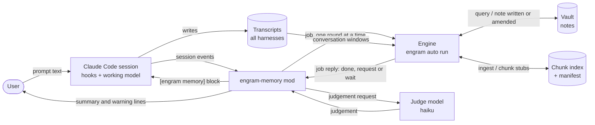
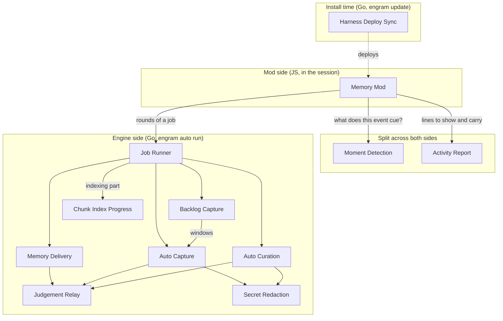
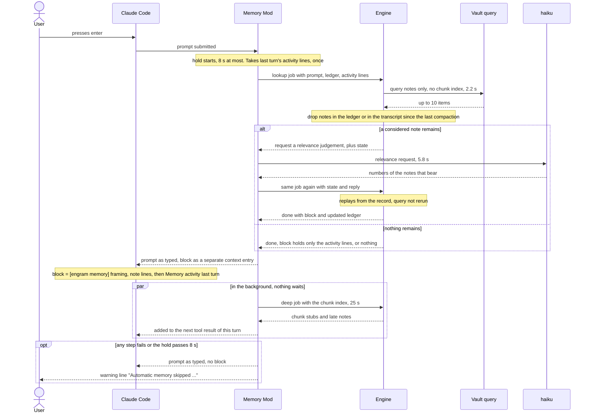
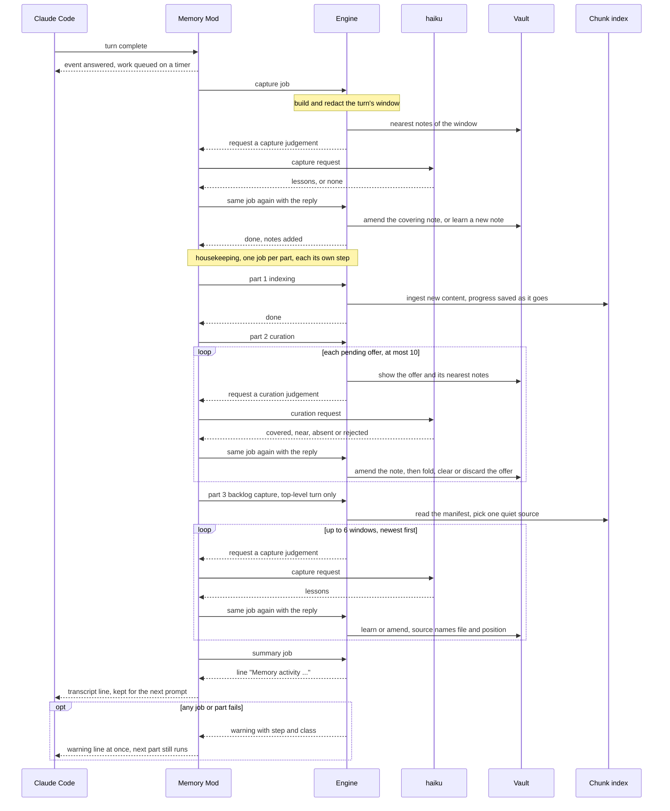
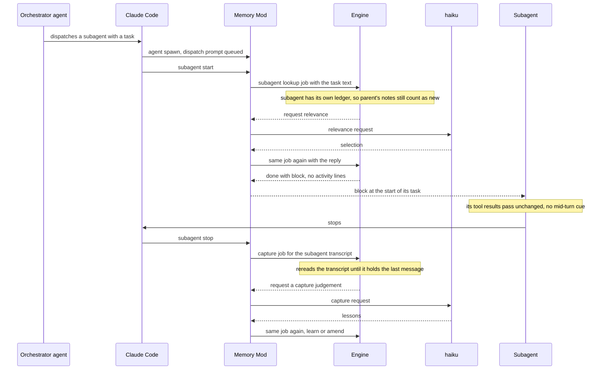
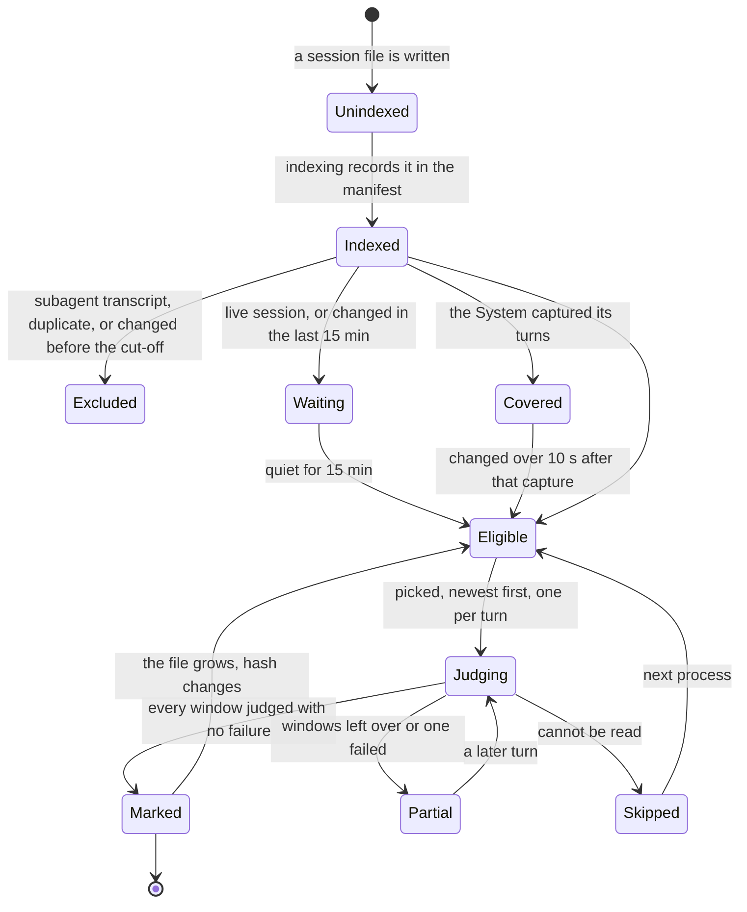
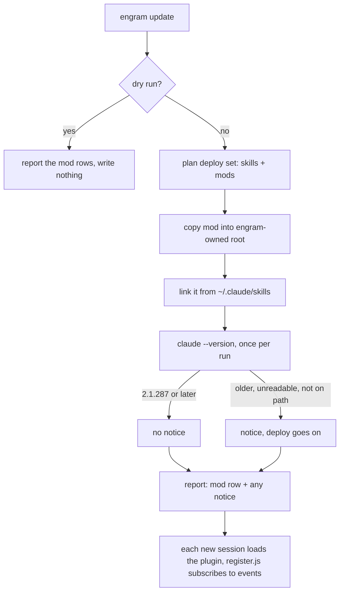

# 793 engram-memory: how the components work together

Derived from `docs/changes/793_parallel-memory-agent/793a_product-spec.md` and `793d_technical-spec.md` (branch `docs/parallel-memory-agent-requirements`), with names and call direction checked against `agent-instructions/mods/engram-memory/hooks/register.js` and `internal/auto/*.go`. Where the spec and the code disagree, the caption says so.

---

## 1. Context diagram

Source: 793d21a, 793d22a, 793d22b1, 793d22b5, 793d25b1, 793d27b1, 793d28b1–b2, 793d30b2.

The mod sits inside the Claude Code session and listens to its events. The engine (`engram auto run`) does all the memory thinking, but it never calls a model itself: when it needs a judgement it pauses and hands the request back, and the mod makes the call to haiku on the session's own credentials, then calls the engine again with the answer. Only the engine touches the vault, the chunk index and the transcripts. Everything the System does reaches the agent as one `[engram memory]` block, and reaches the user as lines in the transcript scrollback.

---

## 2. Component map

Source: 793d21a, 793d22a, 793d23a, 793d24a–793d30a, 793d31a, 793d36a, 793d39 (Realization lines), 793d32a, 793d33a.

The Memory Mod is a thin adapter: it turns events into jobs, relays model calls and shows lines, but decides nothing about memory. The Job Runner runs each job one round per call and sends it to the component that owns the work: Memory Delivery for lookups, Auto Capture, Auto Curation, Backlog Capture, and the index (Chunk Index Progress). Moment Detection and Activity Report run partly in the mod and partly in Go (for example, the mod notices a tool step but the engine classifies it). Not drawn, to keep the map readable: Moment Detection's step cue also uses Judgement Relay and Secret Redaction, and every engine component sends its warnings and counts to Activity Report through the Job Runner. Spec inconsistency: 793d21a names 11 components and leaves out Chunk Index Progress, while 793d35a counts 12.

---

## 3. Capability to components matrix

Legend: ● = listed as supporting in the 793d35b traceability table. ○ = has a role in the 793d32/793d33 flow or in a requirement's `Supports` line, but 793d35b does not list it.

Columns: **Mod** Memory Mod · **Run** Job Runner · **Det** Moment Detection · **Del** Memory Delivery · **Jud** Judgement Relay · **Red** Secret Redaction · **Cap** Auto Capture · **Bkl** Backlog Capture · **Cur** Auto Curation · **Act** Activity Report · **HDS** Harness Deploy Sync · **CIP** Chunk Index Progress

| Product requirement | Mod | Run | Det | Del | Jud | Red | Cap | Bkl | Cur | Act | HDS | CIP | Flows |
|---|---|---|---|---|---|---|---|---|---|---|---|---|---|
| 793a2n Memory reaches the agent at the moments | ● | ● | ● | ● | ● | ○ | | | | | | | 32 |
| 793a2e Nothing already in context is delivered again | ○ | | ● | ● | | | | | | | | | 32 |
| 793a3a Lessons are captured without the agent | ● | ● | | | ● | ● | ● | ● | | | | ● | 33 |
| 793a4j Indexing and curation after the turn | ● | ○ | | | ● | ● | | | ● | | | ● | 33 |
| 793a4c Memory purview only | ● | | | ● | | | | | | ● | | | — |
| 793a4b Session never broken or stalled | ● | ● | | | | ○ | | | | ● | | | 32, 33 |
| 793a5j Installed by engram update | | | | | | | | | | | ● | | 34 |
| 793a5h User sees a memory-activity summary | ○ | ○ | | ○ | | | | | | ● | | | 33 |
| 793a5k Intentional memory never blocked | | | ● | | | | ● | | | | | | 33 |
| 793a5c Other harnesses unchanged | | | | | | | | ● | | | ● | | 33 |

Source: 793d35b (●); the ○ cells come from 793d22b5 (the mod keeps the ledger), 793d32a (step cue redacts), 793d33b5 (the housekeeping is owned by the Job Runner), 793d36b3 (failure text redacted), 793d24b3 and 793d30b3 (the carried lines are built by Memory Delivery from the Activity Report's lines, and shown by the mod).

Read across a row to see which components one capability needs. "Delivering memory" (793a2n) takes five components working together, and "capturing lessons" (793a3a) takes seven. "Installed" (793a5j) needs only the deploy. The ○ cells are worth a look before you review: 793d35b leaves out the Job Runner for 793a4j, although 793d33b5 makes it the owner of the housekeeping sequence. It also lists only the Activity Report for 793a5h, although the carried lines are put into the block by Memory Delivery.

---

## 4. Sequence: a prompt turn

Source: 793d32a, 793d32b1, 793d32b3, 793d32b4, 793d22b1, 793d22b3, 793d22b5, 793d22b6, 793d24b1–b4, 793d30b3, 793d36b1–b3.

The prompt is held for at most 8 seconds while the engine looks up notes, drops anything the agent already has, and asks haiku which of the rest bear on the prompt. That judgement is a round trip: the engine pauses, the mod makes the model call, and the engine replays the job with the answer. The prompt itself is never changed. The block goes in beside it and also carries the System's summary and warning lines from the previous turn, at most five. A slower second lookup, which also searches the chunk index, runs afterwards and rides the agent's next tool result. Route results and subagent starts use the same lookup with their own text, and they carry no activity lines. Spec and code disagree on what the background lookup's failures are called: 793d22b6 and 793d24b4 say "the chunk lookup", but 793d22b3 and `register.js` (`STEP.deep`) say `history lookup`.

---

## 5. Sequence: a turn's memory work

Source: 793d33a, 793d33b1–b5, 793d22b2, 793d22b3, 793d22b5, 793d27b1–b2, 793d28b1–b3, 793d29b1–b2, 793d30b1–b2, 793d36b2–b3, 793d39b1.

The turn is answered first, so the user never waits. The capture job reads the turn, asks haiku whether it held a confirmed lesson, and writes a note, or reinforces the note that already says it. Housekeeping then runs as three separate jobs (indexing, curation, backlog capture) so that a failure is blamed on one named step and does not stop the others. Each judgement is the same pause, model call and replay round trip. Every failure becomes one "Automatic memory skipped" line naming the step, the reason and what happens next, and an entry in `auto.log`. Spec inconsistency: the 793d33a diagram draws one housekeeping job, while 793d22b2, 793d33b5 and `register.js` (`finish`) run one job per part. The backlog part also has two wordings for its "index not caught up" warning: 793d28b1 says `the index is not caught up (the backlog capture)`, while 793d36b3 and `failure.go` say `backlog capture was held back: the index is not caught up`.

---

## 6. Sequence: subagent moments

Source: 793d23b1, 793d24b1, 793d24b2, 793d24b3, 793d22b1, 793d22b2, 793d27b1, 793d33a, 793d33b1; event names checked in `register.js` (`agent.spawn`, `classic.SubagentStart`, `classic.SubagentStop`).

793d defines a separate path for subagents, so it gets its own diagram. When a subagent starts, it gets notes chosen for its dispatch task, with its own "already seen" list, so a note its parent already has is still delivered to it. When it stops, its whole transcript is read and judged for lessons, so a lesson does not depend on the subagent or its parent reporting it. A subagent's own steps and its turn-complete event trigger nothing. The housekeeping after a burst that holds only subagent stops runs indexing and curation, but no backlog capture and no summary line.

---

## 7. State diagram: a backlog source

Source: 793d28b1, 793d28b2, 793d28b3, 793d33b4, 793d39b1.

Every transcript, from any harness, becomes a backlog source once indexing has recorded it. It is captured only after it has been quiet for 15 minutes, newer than the cut-off (install time minus 7 days), and not already captured live by the System. One source is worked per turn, at most six windows at a time from the end backward, and it is marked "done" with its hash only when every window was judged with no failure. Otherwise the count of judged windows is kept and the source is tried again at a later turn. The only file Backlog Capture writes is its own mark file, never a source. If the newest session in the manifest is older than the cut-off, the index has not caught up, and the whole backlog step is held back with a warning.

---

## 8. Install flow

Source: 793d34a, 793d34b1, 793d31b1, 793d31b2, 793d31b3, 793d31c1; plugin files checked in `agent-instructions/mods/engram-memory/.claude-plugin/plugin.json` and `hooks/hooks.json`.

`engram update` treats the mod like a skill: it is copied into engram's own folder and linked from Claude Code's skills folder, so every Claude Code session loads it as a plugin and it is simply on. A second run changes nothing, and a dry run writes nothing but still reports the mod. Pi gets no mod. A Claude Code that is too old, or cannot be found, produces a notice in the report but does not stop the update. The dry-run path is simplified here: 793d31b3 says the version check also runs on a dry run. "Registration" here means Claude Code loading `hooks.json` and `register.js` subscribing to events. 793d does not specify any skill-runbook registration offer for mods.

---

## 9. How the capabilities are delivered

`engram update` installs the mod once, and from then on it rides every Claude Code session (8). The mod watches the session's events. At a prompt, a route result or a subagent start, it holds the event briefly while the engine looks up notes the agent lacks and haiku judges which ones bear (4, 6). It then adds one `[engram memory]` block, which also tells the agent what the System did last turn. After each turn, nothing waits: the engine captures confirmed lessons, indexes the new content, settles pending offers, and works one leftover transcript from any harness (5, 7). Then it shows a one-line summary. The engine keeps no state of its own. Every judgement is a pause, a model call by the mod, and a replay. Every failure becomes a named warning line and a log entry, never a broken session (1, 2). The matrix (3) shows which of these parts each requirement depends on.

---

**Could not derive / open points**
- 793d21a lists 11 components, while 793d35a counts 12 (Chunk Index Progress).
- The background lookup's failure is called `the chunk lookup` in 793d22b6 and 793d24b4, but `history lookup` in 793d22b3 and in the code.
- The backlog "index not caught up" warning is worded differently in 793d28b1 than in 793d36b3 and the code.
- The 793d33a diagram shows one housekeeping job, but the requirements and the code run one job per part.
- 793d33b5 calls the backlog step `the backlog capture`, while 793d22b2 and the code call it `backlog capture`.
- 793d does not specify a "registration" step for the mod beyond Claude Code loading the plugin.
