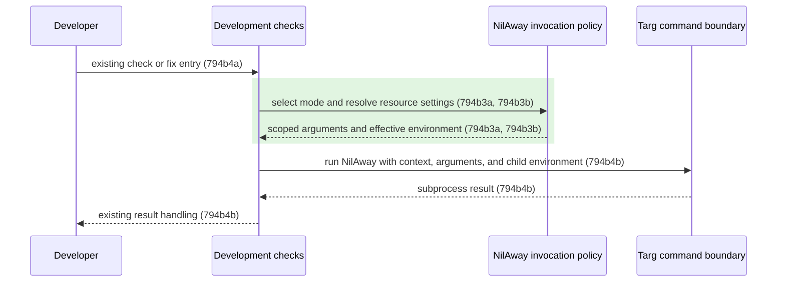

# 794b NilAway Resource Configuration - Technical Spec

## 794b1 Orientation

Engram imports shared development targets from the pinned Targ module. Those targets currently
execute unrestricted standalone NilAway, which analyzes dependencies and retains analysis state
in memory. The selected design keeps existing target pointers and supplies first-party analysis
arguments and per-command environment overrides.

The product scope is [794a2 development-checks](./794a_product-spec.md#794a2-added-development-checks).
The user selected scoping and runtime defaults; modular-driver migration, scheduling changes, hard
limits, and test exclusion are outside this change. Option comparison is omitted because the
implementation scope is already selected.

## 794b5 Product-Scenario Mapping

### 794b5a Project analysis

[794a2a1a Existing entry points use project analysis](./794a_product-spec.md#794a2a1-uat-scenarios):

```gherkin
Scenario Outline: 794a2a1a Existing entry points use project analysis
  Given an Engram checkout with NilAway installed
  When the developer invokes <entry>
  Then each invoked NilAway process analyzes Engram's first-party packages
  And it does not analyze third-party or standard-library package bodies
  Examples:
    | entry               |
    | check-nils-for-fail  |
    | check-nils-fix       |
    | check-nils          |
    | check               |
    | check-for-fail      |
    | check-full          |
```

Realized by [794b3a Mode and scope](#794b3a-mode-and-scope),
[794b4a Preserve entry points](#794b4a-preserve-entry-points), and
[794b4b Execute configured request](#794b4b-execute-configured-request).

### 794b5b Resource defaults

[794a2b1a Absent settings use subprocess defaults](./794a_product-spec.md#794a2b1-uat-scenarios):

```gherkin
Scenario Outline: 794a2b1a Absent settings use subprocess defaults
  Given none of GOMEMLIMIT, GOGC, or GOMAXPROCS is set
  When the developer invokes <entry>
  Then NilAway receives GOMEMLIMIT=2GiB, GOGC=50, and GOMAXPROCS=2
  And other checks retain their inherited resource settings
  Examples:
    | entry               |
    | check-nils-for-fail  |
    | check-nils-fix       |
```

Realized by [794b3b Environment precedence](#794b3b-environment-precedence) and
[794b4b Execute configured request](#794b4b-execute-configured-request).

### 794b5c Developer overrides

[794a2c1a Supplied settings take precedence](./794a_product-spec.md#794a2c1-uat-scenarios):

```gherkin
Scenario Outline: 794a2c1a Supplied settings take precedence
  Given the developer supplies <settings>
  When the developer invokes the nil check or fix command
  Then NilAway receives <effective>
  Examples:
    | settings                             | effective                                |
    | GOMEMLIMIT=4GiB                       | GOMEMLIMIT=4GiB, GOGC=50, GOMAXPROCS=2     |
    | GOMEMLIMIT=off, GOGC=off, GOMAXPROCS=8 | GOMEMLIMIT=off, GOGC=off, GOMAXPROCS=8     |
    | all three explicitly empty           | all three explicitly empty               |
```

Realized by [794b3b Environment precedence](#794b3b-environment-precedence) and
[794b4b Execute configured request](#794b4b-execute-configured-request).

## 794b2 Recommended Sequence Diffs



Green marks the added policy interaction. Target entry and process execution are retained.
The diagram is an informational summary; the normative flows and scenarios are defined below.

## 794b3 Added: nilaway-invocation-policy

Canonical destination at integration: `docs/specs/technical/nilaway-invocation-policy.md`.

Ownership: repository component. Responsibility: construct project-scoped analysis requests and
resolve resource settings. Its argument and environment contracts are independently testable,
survive function/file refactoring, and implement the selected product behavior. Current realization:
`dev/nilaway.go`.

### 794b3a Mode and scope

Requirement: 794b3a The invocation policy MUST produce
`-include-pkgs=github.com/toejough/engram` and `./...` for both modes, adding `-fix` only in fix mode.

Supports [794a2a1a Existing entry points use project analysis](./794a_product-spec.md#794a2a1-uat-scenarios).

#### 794b3a1 Contract Scenarios

```gherkin
Scenario Outline: 794b3a1a Scope and mode arguments
  Given the invocation mode is <mode>
  When the invocation policy constructs analyzer arguments
  Then the arguments are <arguments>
  Examples:
    | mode  | arguments                                                 |
    | check | -include-pkgs=github.com/toejough/engram ./...               |
    | fix   | -include-pkgs=github.com/toejough/engram -fix ./...          |
```

### 794b3b Environment precedence

Requirement: 794b3b The invocation policy MUST resolve each resource setting independently:
use a present environment value verbatim, including empty values; otherwise use
`GOMEMLIMIT=2GiB`, `GOGC=50`, or `GOMAXPROCS=2` as appropriate.

Supports [794a2b1a Absent settings use subprocess defaults](./794a_product-spec.md#794a2b1-uat-scenarios)
and [794a2c1a Supplied settings take precedence](./794a_product-spec.md#794a2c1-uat-scenarios).

#### 794b3b1 Contract Scenarios

```gherkin
Scenario Outline: 794b3b1a Resolve present and absent settings
  Given the supplied resource settings are <supplied>
  When the policy resolves the NilAway environment
  Then the effective values are <effective>
  Examples:
    | supplied                             | effective                                |
    | none                                 | GOMEMLIMIT=2GiB, GOGC=50, GOMAXPROCS=2    |
    | GOMEMLIMIT=4GiB                       | GOMEMLIMIT=4GiB, GOGC=50, GOMAXPROCS=2     |
    | GOMEMLIMIT=off, GOGC=off, GOMAXPROCS=8 | GOMEMLIMIT=off, GOGC=off, GOMAXPROCS=8     |
    | all three explicitly empty           | all three explicitly empty               |
```

## 794b4 Added: development-check-orchestration

Canonical destination at integration: `docs/specs/technical/development-check-orchestration.md`.

Ownership: repository component, including its Targ dependency-boundary interactions.
Responsibility: route existing nil-check entry points through the configured analyzer invocation.
Registration and execution contracts can be tested directly without running unrelated checks.
The concept survives registration and process-adapter refactoring and is required for all existing
entry points to receive the new policy. Current realization: `dev/targs.go` and `dev/nilaway.go`.

### 794b4a Preserve entry points

Requirement: 794b4a Development-check orchestration MUST replace the behavior of the existing
shared check/fix target objects in place, preserving the target names and all aggregate references.

Supports [794a2a1a Existing entry points use project analysis](./794a_product-spec.md#794a2a1-uat-scenarios).

#### 794b4a1 Contract Scenarios

```gherkin
Scenario: 794b4a1a Direct and aggregate target routing
  Given Targ has registered its shared development targets
  When Engram initializes its development targets
  Then the existing check and fix target objects execute Engram's configured invocation
  And check-nils retains both configured targets
  And check retains check-nils
  And check-for-fail and check-full retain the configured checking target
  And the direct target names remain check-nils-fix and check-nils-for-fail
```

### 794b4b Execute configured request

Requirement: 794b4b Development-check orchestration MUST send one configured NilAway request to
the command boundary with the supplied context, selected arguments, and effective child settings;
it MUST return the boundary's result without retrying or modifying the parent environment.
The command adapter MUST apply settings only to the child command while retaining inherited
environment values for unrelated keys.

Supports [794a2a1a Existing entry points use project analysis](./794a_product-spec.md#794a2a1-uat-scenarios),
[794a2b1a Absent settings use subprocess defaults](./794a_product-spec.md#794a2b1-uat-scenarios), and
[794a2c1a Supplied settings take precedence](./794a_product-spec.md#794a2c1-uat-scenarios).

#### 794b4b1 Contract Scenarios

```gherkin
Scenario Outline: 794b4b1a Successful configured invocation
  Given the invocation mode is <mode>
  And the environment has a partial explicit resource override
  When orchestration executes the request
  Then the command boundary receives one request with the supplied context and policy output
  And the boundary succeeds
  And orchestration returns success without modifying the parent environment
  Examples:
    | mode  |
    | check |
    | fix   |

Scenario: 794b4b1b Failed configured invocation
  Given the command boundary returns an analyzer failure
  When orchestration executes the configured check
  Then it returns that failure without retrying

Scenario: 794b4b1c Child environment isolation
  Given the parent environment has an unrelated marker and no resource overrides
  When the command adapter executes a configured analyzer request
  Then the child receives the marker and all three resource defaults
  And the parent resource settings remain absent
```

## 794b6 Recommended Impact

No dependencies or toolchain versions change. First-party scoping reduces analysis work and
cross-package visibility into excluded dependency implementations; it does not prevent dependency
source/type loading. Go's memory limit is soft and is not a machine-wide budget. Explicit
environment settings retain developer control. Parent and unrelated-check environments remain
unchanged.

Historical evidence is recorded in [794d2 Original validation](./794d_validation-record.md#794d2-original-validation).
Observed before documentation remediation: the configured real check passed in approximately
12 seconds with approximately 2.47 GiB reported maximum RSS. This is a single measurement, not
a bound or a before/after comparison. Existing dev tests and all substantive full-check gates
passed; the uncommitted-changes gate failed as expected.
