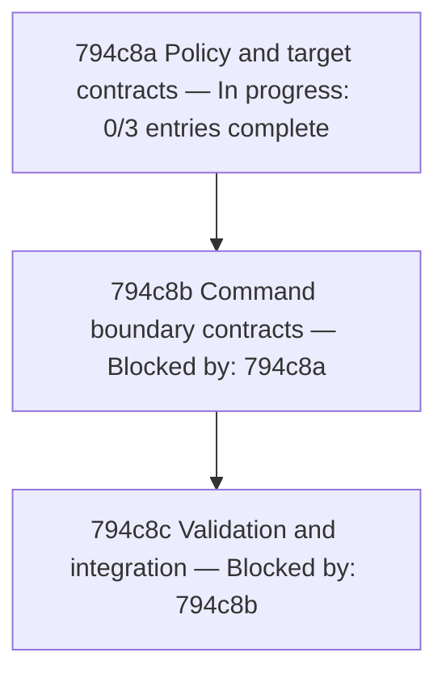

# 794c NilAway Resource Configuration - Implementation Plan

## 794c1 Purpose

Implement the confirmed contracts in
[794a NilAway Resource Configuration - Product Spec](./794a_product-spec.md#794a-nilaway-resource-configuration---product-spec)
and [794b NilAway Resource Configuration - Technical Spec](./794b_technical-spec.md#794b-nilaway-resource-configuration---technical-spec)
under issue [#794](https://github.com/toejough/engram/issues/794).

The original implementation preceded these artifacts and its tests were not observed failing
before implementation. That history is not claimed as TDD. The remediation below establishes
scenario-specific executable contracts, verifies their expected failures against the original
behavior, and restores or refactors the implementation under the shared test cycle.

## 794c2 Implementation Shape

One worktree, branch `fix/794-nilaway-resources`, based on `a8d926d6`. Keep shared Targ target
identities, pure argument/environment policy, and a thin Targ command adapter. The command boundary
must be injectable for direct orchestration tests. Use existing dependencies only. Add a `test-dev-integration` Targ target for the local subprocess
suite, using `-tags=targ,integration` and `./dev/...`; this target is planned and does not yet exist.

The governance edit makes the documentation workflow mandatory from the root instructions;
it is an instruction change, not a new runtime feature or automated enforcement mechanism.

## 794c3 Test Methods

Use dedicated examples for finite mode/environment policy and real pinned-Targ registration.
Use `imptest` for injected command-boundary interactions, including request values, call counts,
and returned errors. Use a local subprocess dependency-contract test tagged `targ && integration`
for command environment isolation. No network tests or property tests are needed.

For each new contract test: write it, observe the expected failure, implement the minimum fix,
run the complete applicable dev suites, and review complexity, consistency, boundaries, and performance
while keeping them green. The final validation gate additionally requires repository-wide checks;
environment failures at that gate are recorded without claiming successful delivery.
Existing test renames preserve their assertions; do not claim those
renames introduced a fresh failing behavior test.

## 794c4 Test Status

Catalog entries start at `Not started`. Test checkpoints are:
`Red` → `Green-single` → `Green-all` → `Refactor-complexity` →
`Refactor-consistency` → `Refactor-boundaries` → `Refactor-performance` → `Done`.
Non-test actions use `Not started` → `In progress` → `Done`.

Record each checkpoint and its evidence in the same commit. Do not move past an uncommitted
transition. Existing validation is historical evidence, not a completed catalog checkpoint.
Local commits were authorized by the user; publishing and integration remain review steps.

## 794c5 Dependency Tree

## 794c6 Parallel Worktree Method

The graph is a single chain because its entries share development-target code. Continue in the
existing worktree when the predecessor's validated result is committed. No fan-out or additional
worktrees are necessary. Do not merge or push before review. At authorized integration, rebase on
the destination branch, revalidate, merge only with `--ff-only`, and clean up the dedicated
worktree/branch after delivery.

## 794c7 Node Status

Use `Ready`, `Blocked by: <IDs>`, `In progress: n/x entries complete`, `Complete`, and `Merged`
as defined in the [implementation-plan guide](../../IMPLEMENTATION-PLAN-GUIDE.md#node-status).
A node is complete only when every entry is Done, the applicable complete suites pass, and its
result is committed. Merged additionally requires delivery and branch/worktree cleanup.

## 794c8 Implementation-Ordered Test Catalog

### 794c8a Policy and target contracts

| Entry | Gherkin | Classification | Why | Status |
|---|---|---|---|---|
| 794c8a1 Mode arguments | [794b3a1a Scope and mode arguments](./794b_technical-spec.md#794b3a1-contract-scenarios) | Dedicated examples | Exact check/fix argument contracts | Refactor-consistency |
| 794c8a2 Environment precedence | [794b3b1a Resolve present and absent settings](./794b_technical-spec.md#794b3b1-contract-scenarios) | Dedicated examples | Absent, partial, explicit, and empty settings | Refactor-consistency |
| 794c8a3 Entry-point routing | [794b4a1a Direct and aggregate target routing](./794b_technical-spec.md#794b4a1-contract-scenarios) | Pinned dependency contract | Actual Targ target identity, names, and aggregate references; extend the existing wiring test | Refactor-consistency |

### 794c8b Command boundary contracts

| Entry | Gherkin | Classification | Why | Status |
|---|---|---|---|---|
| 794c8b1 Successful request | [794b4b1a Successful configured invocation](./794b_technical-spec.md#794b4b1-contract-scenarios) | Injected imptest interaction | One call, context, mode, resolved environment, and success propagation | Not started |
| 794c8b2 Failed request | [794b4b1b Failed configured invocation](./794b_technical-spec.md#794b4b1-contract-scenarios) | Injected imptest interaction | Exact failure propagation without retry | Not started |
| 794c8b3 Environment isolation | [794b4b1c Child environment isolation](./794b_technical-spec.md#794b4b1-contract-scenarios) | Local integration dependency contract | Real Targ subprocess environment and unchanged parent | Not started |
| 794c8b4 Acceptance scope | [794a2a1a Existing entry points use project analysis](./794a_product-spec.md#794a2a1-uat-scenarios) | Local integration acceptance example | Local integration with the installed NilAway: a fixture has first-party and replaced third-party modules, each with a known nil dereference; include both filesystem roots in diagnostic reporting, verify the first-party diagnostic, and verify absence of the dependency diagnostic | Not started |
| 794c8b5 Acceptance defaults | [794a2b1a Absent settings use subprocess defaults](./794a_product-spec.md#794a2b1-uat-scenarios) | Local integration acceptance example | Check/fix child defaults and parent preservation | Not started |
| 794c8b6 Acceptance overrides | [794a2c1a Supplied settings take precedence](./794a_product-spec.md#794a2c1-uat-scenarios) | Local integration acceptance example | Developer-controlled effective settings | Not started |

Each corresponding executable test name begins with its Gherkin ID. A shared fixture may support
multiple tests, but each scenario keeps an independently named and tracked test.

### 794c8c Validation and integration

| Entry | Work | Classification | Why | Status |
|---|---|---|---|---|
| 794c8c1 Review and checks | Reconcile scenario links and ownership; run dev and tagged integration tests, configured NilAway, and full checks | Validation | Verify implementation and documentation agree | Not started |
| 794c8c2 Canonical promotion | Promote product and technical deltas, remove this change directory, and integrate atomically after review | Delivery | Canonical truth changes with implementation/tests | Not started |

## 794c9 Completion Gates

Every catalog scenario has an ID-prefixed executable test. All command-boundary collaboration
tests use imptest; the real local-boundary test is integration-tagged. Run `targ test-dev`, `targ test-dev-integration` (after adding the target described in
[794c2 Implementation Shape](#794c2-implementation-shape)), and `targ check-full --dep-mode serial`. The full check must pass
after the work is committed; an uncommitted-changes failure does not count as a passing full check.

Review the invocation policy and target identity against pinned Targ. Record actual RED and GREEN
evidence without rewriting the original implementation history. Every catalog entry must be Done
and every node Merged before delivery is complete.

At the same completed integration, create the semantic canonical product capability and two
technical component files from the normative blocks, retain stable IDs and scenario links, omit
change history/diagrams/options, and delete this change directory. Until integration is authorized,
these files remain active change artifacts; do not claim canonical promotion or integration.
