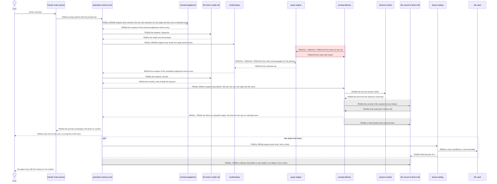
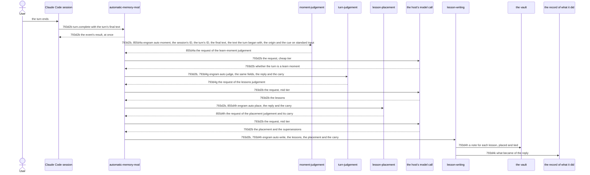
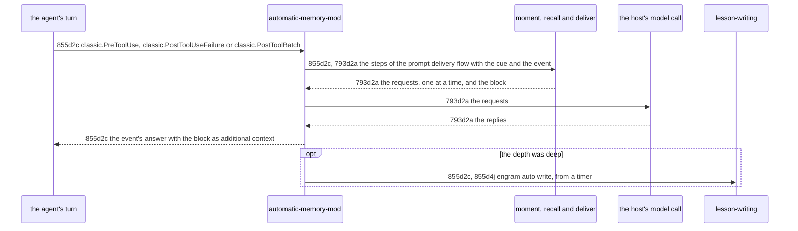

# Judged Automatic Memory - Technical Spec

Step 3 of [855f2 The algorithm](./855f_algorithm.md#855f2-the-algorithm), for the promises of [855a1 Problem Statement](855a_product-spec.md#855a1-problem-statement). Filled depth first as [793f3 Depth first](../793_automatic-memory/793f_algorithm.md#793f3-depth-first), so the nodes of [793d1 Orientation](../793_automatic-memory/793d_technical-spec.md#793d1-orientation) that this change does not name stand. There is no option analysis ([793b12 Departure: no option analysis](../793_automatic-memory/793b_decision-log.md#793b12-departure-no-option-analysis)), and the departures of [793f6 Departures from the guides](../793_automatic-memory/793f_algorithm.md#793f6-departures-from-the-guides) hold. Each node of the 793 technical specification that this change replaces is a Modified operation with the target's complete replacement text ([855b9 The change layers on 793 by Modified operations](855b_decision-log.md#855b9-the-change-layers-on-793-by-modified-operations)); the nodes it adds take the next free letters under [855d2 Recommended sequence diffs](#855d2-recommended-sequence-diffs) and [855d4 Recommended component-behavior diffs](#855d4-recommended-component-behavior-diffs). The technical nodes that [855b20 The 793 technical nodes the decision forces](855b_decision-log.md#855b20-the-793-technical-nodes-the-decision-forces) deferred are replaced here: [793d2a Prompt delivery flow](../793_automatic-memory/793d_technical-spec.md#793d2a-prompt-delivery-flow), its scenarios [793d2a1d](../793_automatic-memory/793d_technical-spec.md#793d2a1-scenarios), [793d2a1g](../793_automatic-memory/793d_technical-spec.md#793d2a1-scenarios) and [793d2a1j](../793_automatic-memory/793d_technical-spec.md#793d2a1-scenarios), [793d5e Mapping of 793a2d1a](../793_automatic-memory/793d_technical-spec.md#793d5e-mapping-of-793a2d1a), [793d5zc Mapping of 793a2d1c](../793_automatic-memory/793d_technical-spec.md#793d5zc-mapping-of-793a2d1c) and [793d6 Recommended impact](../793_automatic-memory/793d_technical-spec.md#793d6-recommended-impact), as [855d5 Product-scenario mapping](#855d5-product-scenario-mapping) and [855d6 793d6 Recommended impact](#855d6-modified-793d6-recommended-impact) say.

## 855d1 Orientation

The product problem is [855a1 Problem Statement](855a_product-spec.md#855a1-problem-statement): [automatic memory](./855a_product-spec.md#855a3a-modified-793a1a-terms) delivers every match of a lookup on the raw text of a [prompt](../793_automatic-memory/793a_product-spec.md#793a1a-terms), writes every lesson at the top of the [vault](../../GLOSSARY.md#vault), and acts only at prompts. Today ([793d1 Orientation](../793_automatic-memory/793d_technical-spec.md#793d1-orientation), [793d2a Prompt delivery flow](../793_automatic-memory/793d_technical-spec.md#793d2a-prompt-delivery-flow), [793d2b Turn capture flow](../793_automatic-memory/793d_technical-spec.md#793d2b-turn-capture-flow)) the mod runs one `engram auto deliver` for each prompt, which looks the prompt text up and prints every [note](../../GLOSSARY.md#permanent-note) that matches, and after each turn one `engram auto judge`, one request to the cheap tier, and `engram auto write`. That is insufficient: nothing asks whether a prompt is a recall moment, nothing judges whether a match applies, passages of earlier conversations are never delivered, there is one model call of one tier, every note is written at the top and ties no correction, a confirmed procedure cannot become a runbook, and nothing acts within a turn.

The solution keeps the split of [793d2b Turn capture flow](../793_automatic-memory/793d_technical-spec.md#793d2b-turn-capture-flow). Every judgement is one `$.model.complete` call of the mod: its instructions in `system`, the untrusted text escaped in `prompt`, an explicit `timeoutMs`. Every mechanical step is an `engram auto <step>` command that reads one JSON object on standard input and prints a result with a known prefix, which the mod checks with the exit code. A step that needs a judgement prints one JSON object `{"request":{...},"carry":{...}}`; the mod asks the model for the request exactly as printed and gives the reply and the carry, unread, to the next step. The carry is how a step hands what it found to the next one; no file holds it. The tiers are a cheap one (`haiku`, effort `low`) for the moment judgement and a mid one (`sonnet`) for the content judgements; they are the current roster for a tier ([855b5 Two tiers of judgement](855b_decision-log.md#855b5-two-tiers-of-judgement)).

The steps are those of the owner's table ([855b8 The starting step table](855b_decision-log.md#855b8-the-starting-step-table)) laid against the [skills](../../GLOSSARY.md#skill)' own steps:

| Chain | Step (command) | Owner | What of the skill it carries |
| --- | --- | --- | --- |
| Recall | 1 `moment` prints the request of the moment judgement | `moment-judgement` | the rule of the recall skill's description and the cues of the recall guidance; the depth, glance (about 3 phrases) or deep (up to 10) |
| | model, cheap tier | | depth and phrases (Step 1) |
| | 2 `recall` runs the lookup for the phrases and prints the request of the candidate judgement | `recall-lookup` | Step 2: one unified lookup, notes and chunks |
| | model, mid tier | | Step 2.5A and 2.5B: covered, near or unrelated, the newer of two that conflict; at deep Step 2.5C: the lessons the vault lacks and the revisions of near notes |
| | 3 `deliver` activates the used notes, fetches the chosen bodies and passages, drops what the [session](../../GLOSSARY.md#session) holds and prints the block | `prompt-delivery` | Step 2.7 and the injection |
| | 4 `write`, deep only, after the block | `lesson-writing` | Step 2.5C: amend and crystallize |
| Learn | 1 `moment` prints the request of the learn-moment judgement | `moment-judgement` | the learn skill's description: is this turn a moment for learn |
| | 2 `judge` prints the request of the lessons judgement | `turn-judgement` | Step 2: corrections, explicit save requests, reversals, confirmed approaches, a runbook for a procedure |
| | 3 `place` prints the request of the placement judgement | `lesson-placement` | Step 2's disposition test and the supersedes details |
| | 4 `write` redacts, drops what a note states, writes | `lesson-writing` | the write-memory handoff |

What of the skills this channel does not carry, and why: the recall skill's printed plan (Step 0), re-entry (Step 3.5) and synthesis note (Step 4), which need the [agent](../793_automatic-memory/793a_product-spec.md#793a1a-terms)'s own plan and conclusion; the sweep before a recall or a learn (Step 0.5, Step 1), which [793d2c Conversation sweep flow](../793_automatic-memory/793d_technical-spec.md#793d2c-conversation-sweep-flow) does after every turn; the vocabulary check (Step 1.5), a maintenance step that writes no lesson; and the question-and-answer pairs ([855b15 Lessons are the three kinds that carry a note](855b_decision-log.md#855b15-lessons-are-the-three-kinds-that-carry-a-note)).

Within a turn the host offers three events at which a mod can put context in front of the model ([855d1a Verified host facts](#855d1a-verified-host-facts)): before a tool runs, after a tool failed, and after a batch of tool calls resolved, before the next model request. The three cues of [855a2e Recall moments within a turn](855a_product-spec.md#855a2e-recall-moments-within-a-turn) ride them ([855b24 The three cues of a turn ride three tool events](855b_decision-log.md#855b24-the-three-cues-of-a-turn-ride-three-tool-events)). The `Stop` event does not: it runs after the agent's final reply.

No wait is unbounded: each wait has a bound in a budget table, and a flow that has not answered 2 minutes after it began has stalled and steps aside ([855b14 A slow step is waited for, a stalled one is not](855b_decision-log.md#855b14-a-slow-step-is-waited-for-a-stalled-one-is-not)).

### 855d1a Verified host facts

Read in `claude-code.d.ts` of Claude Code 2.1.301 (`/private/tmp/claude-501/bundled-skills/2.1.301/e2ebd773aa00aeae2764ffb5641f2a63/plugin-authoring/types/`), by line.

| Fact | Line |
| --- | --- |
| `prompt.submit` takes `context` entries, "What the model reads beside the [prompt](../793_automatic-memory/793a_product-spec.md#793a1a-terms) and the user never sees", attached on the way down | 9473 |
| A `classic.PreToolUse` answer carries `additionalContext`, "Extra context handed to the model with the call"; the event fires inside `tool.call` | 8155, 8145 |
| Its input is the tool-call envelope, which has no [session](../../GLOSSARY.md#session) ID; `agentId` is present in a [subagent](../../GLOSSARY.md#subagent)'s loop only | 13293, 194 |
| `classic.PostToolUseFailure` and `classic.PostToolBatch` answers carry `additionalContext`, "text handed to the model with the event"; their inputs carry `session_id` and `agent_id` (a subagent's only) | 1402, 1403, 1324, 854, 863 |
| `PostToolBatch` is "Fired once after every tool call in a batch has resolved, before the next model request"; `PostToolUse` "may run concurrently for parallel tool calls" | 8001 |
| The context a tool call carries is "What the model reads after the tool's result and the user never sees" | 13367 |
| `Stop` carries `additionalContext` and runs after the [agent](../793_automatic-memory/793a_product-spec.md#793a1a-terms)'s final message (`last_assistant_message`) | 1404, 12701 |
| `turn.step` cannot add context: "a hook's own value changes what the hooks above it read, never what the engine streamed" | 14172 |
| `$.model.complete` takes `model` (an alias), `prompt`, `system`, `maxTokens`, `effort`, `timeoutMs`; `timeoutMs` has "default none"; the result is `isAnswered` with `text`, or `reason` `api-error`, `empty-reply` or `aborted` | 6314, 6365, 6388 |
| `$.process.run(argv, { stdin, timeoutMs })` rejects when the command cannot start or is still running at the timeout: 30 seconds when absent, ten minutes at most; the result holds `exitCode`, `stdout`, `stderr` | 8163, 8179, 8190 |
| A hook's budget is 10 seconds of its own time; "the clock stops while a `next(e)` call or any `$` call of the hook's is in flight" | 5234, 5250 |
| A `classic.<Event>` function hook fires wherever the engine runs the classic hook, whether or not a settings hook is configured | 1266 |
| `$.clock.after(ms, fn)` runs `fn` later | 3537, 13265 |
| `$.ui.log(text)` appends one line the user sees and the model does not read | 2447 |

Not in the type definitions, so a hypothesis measured by [855d7a Hypotheses and their measurements](#855d7a-added-hypotheses-and-their-measurements): how the [transcript](../../GLOSSARY.md#transcript) records the context a mid-[turn](../793_automatic-memory/793a_product-spec.md#793a1a-terms) event added.

### 855d1b Terms

- **Step:** an `engram auto <step>` command: `moment`, `recall`, `deliver`, `write`, `judge`, `place` or `sweep`.
- **Request:** the object a step prints for a judgement: `model`, `effort` (cheap tier only), `system`, `prompt`, `maxTokens`, `timeoutMs`.
- **Carry:** the object a step prints beside a request, which the mod gives back to the next step with the model's reply and reads no part of.
- **Cue:** what raised a moment: `prompt`, `before-tool`, `failure`, `batch-done` or `turn-end`.
- **Seen note:** a [note](../../GLOSSARY.md#permanent-note) written, delivered or looked up earlier in the same [session](../../GLOSSARY.md#session) ([855b16 Placement is the learn skill's ordered test](855b_decision-log.md#855b16-placement-is-the-learn-skills-ordered-test)).
- **Row:** one line of a budget table: the bound of one wait, in seconds.

## 855d2 Recommended sequence diffs

In the diagrams an added interaction is solid, a retained one is in a grey block and a removed one is in a red block with the label it had.

### 855d2a Modified: 793d2a Prompt delivery flow

Target: [793d2a Prompt delivery flow](../793_automatic-memory/793d_technical-spec.md#793d2a-prompt-delivery-flow)



Requirement: 793d2a For each [prompt](./855a_product-spec.md#855a3a-modified-793a1a-terms) a Claude Code [session](../../GLOSSARY.md#session) raises, the `automatic-memory-mod` MUST take the session's ID, and then run these steps in order, each as `engram auto <step>` with one JSON object on standard input that holds the session's ID and the prompt's origin (the kind Claude Code stamps on it: `composer`, `sdk`, `task-notification` and the rest). It MUST run `moment` with the prompt text and the cue `prompt`; when that exits with 0 and prints a request (output beginning `{"request":`), ask the model for the request exactly as printed, and run `recall` with the cue, the model's reply and the carry; when that exits with 0 and prints a request, ask the model for it, and run `deliver` with the prompt text, the cue, the model's reply and the carry. When `moment` or `recall` exits with 0 and prints nothing, it MUST run `deliver` with the prompt text and the cue alone, which prints the lines for the user and no block. It MUST add the standard output of `deliver` to the prompt's context as one block when it exited with 0 and the output begins `[engram memory]`, and nothing otherwise; MUST show the user each line `deliver` printed on standard error when it exited with 0, as one log line of the host each (`$.ui.log`), which the model does not read, and add none of them to the context; and MUST leave the prompt text as received. It MUST hold the prompt for nothing but this work, and wait for each step and each model call as long as it takes, up to the 2 minutes after the prompt was raised: each wait is given as its time limit what is left of the 2 minutes when it begins, and the call for the session's ID 5 seconds. When a step fails (it exits with other than 0 or cannot be run, or prints what is neither nothing nor a request, nor, for `deliver`, a block), the model does not answer (it gives no text or rejects the call), or the work has not finished 2 minutes after the prompt was raised, it MUST end what waits, let the prompt continue with nothing added, and, when the session's ID is known, run `engram auto write` with the session's ID, no [turn](./855a_product-spec.md#855a3a-modified-793a1a-terms) and a `failure`, a sentence that names the step and how it failed, from a timer (`$.clock.after`), so that the prompt is held no longer and no call of the host is in flight when the hook settles. When the output of `recall` that printed the request holds `"write":true`, which it does at deep depth, and the delivery finished, it MUST also run `engram auto write` with the session's ID, the cue, the model's reply to the candidate request and the carry, from a timer after the block is given, so that the writing holds neither the prompt nor the [agent](../793_automatic-memory/793a_product-spec.md#793a1a-terms); a failure of that run is reported as the failure of a step is.

| Wait | Limit | Held |
| --- | --- | --- |
| the call for the session's ID | 5 seconds | the prompt |
| `moment` | the time left of the 2 minutes | the prompt |
| the model call of the moment judgement | the time left of the 2 minutes | the prompt |
| `recall` | the time left of the 2 minutes | the prompt |
| the model call of the candidate judgement | the time left of the 2 minutes | the prompt |
| `deliver` | the time left of the 2 minutes | the prompt |
| the report of a failure to `write` | 15 seconds | nothing |
| `write` at deep depth | 60 seconds | nothing |

The 2 minutes are the liveness bound of [855a3c 793a2d Never in the way](855a_product-spec.md#855a3c-modified-793a2d-never-in-the-way) and not a latency target: a step that is only slow is waited for, as [855b27 A prompt's waits share the 2 minutes, a capture's waits have rows](855b_decision-log.md#855b27-a-prompts-waits-share-the-2-minutes-a-captures-waits-have-rows) says. The requests of the model calls carry the 2 minutes as their `timeoutMs`, and the mod ends a call still waiting when they pass ([855d7a Hypotheses and their measurements](#855d7a-added-hypotheses-and-their-measurements)).

Owner: `automatic-memory-mod` (new; `automatic-memory-mod.md` at promotion). Supports: [793a2a1a The next session has memory after one engram update](../793_automatic-memory/793a_product-spec.md#793a2a1-uat-scenarios), [793a2b1a The notes that bear on a prompt arrive with it](../793_automatic-memory/793a_product-spec.md#793a2b1-uat-scenarios), [793a2b1b A note delivered earlier in the session is not delivered again](../793_automatic-memory/793a_product-spec.md#793a2b1-uat-scenarios), [793a2b1d A prompt that matches no note arrives with nothing](../793_automatic-memory/793a_product-spec.md#793a2b1-uat-scenarios), [793a2d1a A slow lookup does not hold a prompt for more than 8 seconds](../793_automatic-memory/793a_product-spec.md#793a2d1-uat-scenarios), [793a2d1d The prompt and the reply are as they were](../793_automatic-memory/793a_product-spec.md#793a2d1-uat-scenarios), [793a2d1e A write that fails does not break the session](../793_automatic-memory/793a_product-spec.md#793a2d1-uat-scenarios), [793a2e1a What was delivered and what was written for the previous turn is in the session by the next prompt](../793_automatic-memory/793a_product-spec.md#793a2e1-uat-scenarios), [793a2e1b A write that finishes after the next prompt is shown by the prompt after it finishes](../793_automatic-memory/793a_product-spec.md#793a2e1-uat-scenarios), [793a2e1c A delivery that could not be done is shown with its reason](../793_automatic-memory/793a_product-spec.md#793a2e1-uat-scenarios), [793a2e1d A write that failed is shown with its reason](../793_automatic-memory/793a_product-spec.md#793a2e1-uat-scenarios), [793a2e1e A sweep that failed is shown with its reason](../793_automatic-memory/793a_product-spec.md#793a2e1-uat-scenarios), [793a2e1f A turn that is not captured is shown with the reason](../793_automatic-memory/793a_product-spec.md#793a2e1-uat-scenarios), [855a2a1a A glance leaves the vault's notes as they were](855a_product-spec.md#855a2a1-uat-scenarios), [855a2a1b A deep delivery writes the lesson the vault lacks](855a_product-spec.md#855a2a1-uat-scenarios), [855a3b1a A prompt that is not a recall moment arrives with nothing](855a_product-spec.md#855a3b1-uat-scenarios), [855a3b1b A note whose words match but that does not apply is not delivered](855a_product-spec.md#855a3b1-uat-scenarios), [855a3b1c Of two notes that conflict, only the newer is delivered](855a_product-spec.md#855a3b1-uat-scenarios), [855a3b1d The notes that arrive are the notes the recall skill draws on](855a_product-spec.md#855a3b1-uat-scenarios), [855a3b1e A passage of an earlier conversation arrives when it applies](855a_product-spec.md#855a3b1-uat-scenarios), [855a3c1a A judgement that never answers is stepped aside after 2 minutes](855a_product-spec.md#855a3c1-uat-scenarios).

The scenarios [793d2a1a](../793_automatic-memory/793d_technical-spec.md#793d2a1-scenarios) to [793d2a1c](../793_automatic-memory/793d_technical-spec.md#793d2a1-scenarios), [793d2a1e](../793_automatic-memory/793d_technical-spec.md#793d2a1-scenarios), [793d2a1f](../793_automatic-memory/793d_technical-spec.md#793d2a1-scenarios), [793d2a1h](../793_automatic-memory/793d_technical-spec.md#793d2a1-scenarios), [793d2a1i](../793_automatic-memory/793d_technical-spec.md#793d2a1-scenarios) and [793d2a1k](../793_automatic-memory/793d_technical-spec.md#793d2a1-scenarios) stay (a faked engram whose `moment` prints nothing leaves the chain at `deliver`, the step they fake), [793d2a1d](../793_automatic-memory/793d_technical-spec.md#793d2a1-scenarios), [793d2a1g](../793_automatic-memory/793d_technical-spec.md#793d2a1-scenarios) and [793d2a1j](../793_automatic-memory/793d_technical-spec.md#793d2a1-scenarios) are replaced, and these are added.

#### 855d2a1 Scenarios

```gherkin
Scenario: 793d2a1d A slow judgement is waited for
  Given a session with the mod installed, an engram whose auto moment, auto recall and auto deliver print what delivers a block, and a model that takes 20 seconds to answer each request
  When a prompt is sent
  Then the session holds the prompt exactly as sent and then the block as context, after the 40 seconds, and the mod's hook did not fail

Scenario: 793d2a1g A session that does not give its ID in time does not hold the prompt
  Given the mod, and a session that never gives its ID
  When a prompt is sent
  Then the mod lets the prompt continue as it was after the 5 seconds of the row, with nothing added, and no step was run

Scenario: 793d2a1j A flow the host never lets finish is stepped aside after 2 minutes
  Given the mod, a session whose ID is known, an engram whose auto moment prints a request, and a host in which the model's call never settles, whatever time limit it is given
  When a prompt is submitted
  Then the prompt goes on as it was with nothing added after 2 minutes, and, when the timers run, auto write received the session's ID, no turn and a failure that names the delivery and the 2 minutes, and the user was shown no line

Scenario: 855d2a1a The steps run in order, each given the reply and the carry before it
  Given the mod, a session whose ID is known, and an engram whose auto moment and auto recall print a request and a carry each and whose auto deliver prints a block, and a model that answers each request
  When a prompt is sent
  Then auto moment received the prompt text, the session's ID, the origin and the cue prompt, the model was asked each request exactly as printed, auto recall received the cue, the first reply and the first carry, auto deliver received the prompt text, the cue, the second reply and the second carry, and the session holds the block as context

Scenario: 855d2a1b A moment that prints nothing leaves the lines to the delivery
  Given the mod, and an engram whose auto moment prints nothing and whose auto deliver prints a line on standard error and no block
  When a prompt is sent
  Then the model was never asked, auto recall was never run, auto deliver received the prompt text and the cue and no reply, the line was shown to the user, and the session holds no context beside the prompt

Scenario: 855d2a1c A lookup that prints nothing leaves the lines to the delivery
  Given the mod, an engram whose auto moment prints a request, whose auto recall prints nothing and whose auto deliver prints a line on standard error and no block, and a model that answers
  When a prompt is sent
  Then the model was asked once, auto deliver received no reply, the line was shown to the user, and the session holds no context beside the prompt

Scenario: 855d2a1d Output that is not a request or a block fails the step
  Given the mod, a session whose ID is known, and, in turn, an engram whose auto moment prints text that does not begin with a request, and one whose auto deliver prints text that does not begin with [engram memory] and exits with 0
  When a prompt is submitted
  Then with the first the model was never asked, the prompt goes on with nothing added and, when the timers run, auto write received a failure that names auto moment; with the second the prompt goes on with nothing added and no failure was reported

Scenario: 855d2a1e A model that does not answer is reported
  Given the mod, a session whose ID is known, an engram whose auto moment and auto recall print requests, and, in turn, a model that gives no text, rejects the call, or is cut at its time limit, on its first call and on its second
  When a prompt is submitted
  Then each time the prompt goes on with nothing added, auto deliver was never run, and, when the timers run, auto write received a failure that names the model call

Scenario: 855d2a1f A deep delivery writes after the block, from a timer
  Given the mod, a session whose ID is known, an engram whose auto recall prints a request with "write":true and whose auto deliver prints a block, and a model that answers
  When a prompt is submitted
  Then the session holds the block as context, no call of the host is in flight when the hook settles, and, when the timers run, auto write received the session's ID, the cue, the reply to the candidate request and the carry

Scenario: 855d2a1g A glance writes nothing
  Given the mod, an engram whose auto recall prints a request without "write":true and whose auto deliver prints a block, and a model that answers
  When a prompt is submitted and the timers run
  Then auto write was never run

Scenario: 855d2a1h A write that fails after a deep delivery is reported
  Given the mod, a session whose ID is known, an engram whose auto recall prints a request with "write":true, whose auto deliver prints a block and whose auto write exits with 1 the first time, and a model that answers
  When a prompt is submitted and the timers run
  Then the session holds the block as context, and auto write was run a second time with a failure that names the write

Scenario: 855d2a1i Each wait is given the time left of the 2 minutes
  Given the mod, a session whose ID is known, a clock the test drives, an engram whose auto moment takes 30 seconds and prints a request, a model that takes 50 seconds to answer it, and an engram whose auto recall prints nothing
  When a prompt is sent
  Then the call for the ID was given 5 seconds, auto moment 120 seconds, the model call 90 seconds, auto recall 40 seconds, and auto deliver the 2 minutes less the 80 seconds
```

### 855d2b Modified: 793d2b Turn capture flow

Target: [793d2b Turn capture flow](../793_automatic-memory/793d_technical-spec.md#793d2b-turn-capture-flow)



Requirement: 793d2b For each [turn](./855a_product-spec.md#855a3a-modified-793a1a-terms) a [session](../../GLOSSARY.md#session) completes, the `automatic-memory-mod` MUST give the event's result back at once, with no call of the host in flight, and then, from a timer (`$.clock.after`), take the session's ID and run these steps in order, each as `engram auto <step>` with one JSON object on standard input. It MUST run `moment` with the session's ID, the turn's ID, the turn's final text, the text the turn began with, the origin of the [prompt](./855a_product-spec.md#855a3a-modified-793a1a-terms) it began with and the cue `turn-end`; when that exits with 0 and prints a request, ask the model for it exactly as printed, and run `judge` with the same fields, the reply and the carry; when that exits with 0 and prints a request, ask the model for it, and run `place` with the session's ID, the turn's ID, the reply and the carry; and then run `write` with the session's ID, the turn's ID, the model's reply to the lessons request, the carry of `place` and, when `place` printed a request and the model answered it, the reply to that. When `moment` or `judge` exits with 0 and prints nothing, nothing more is run; when `place` prints nothing, `write` is run without a placement. It MUST do nothing for a turn that a [subagent](../../GLOSSARY.md#subagent) ran, which the event's `agentId` says. When a step fails (it exits with other than 0 or cannot be run, or prints what is neither nothing nor a request, a request that is not a JSON object being a failure of the step that printed it), the model does not answer, or a wait overruns its row, it MUST run `engram auto write` with the session's ID, the turn's ID and a `failure`, a sentence that names the step and how it failed, in place of the replies, whole, for the writing cuts it ([793d4k Recording what automatic memory did](../793_automatic-memory/793d_technical-spec.md#793d4k-recording-what-automatic-memory-did)). It MUST bound each wait by its row so that together they take under the 2 minutes of [793a2c Lessons are written without the agent](../793_automatic-memory/793a_product-spec.md#793a2c-lessons-are-written-without-the-agent). The mod keeps the text and origin of each prompt the session raises: a turn that starts with a text takes the oldest kept prompt with that text and drops the prompts kept before it, which began no turn; a turn whose text no kept prompt has takes the origin of the newest; a turn that starts with no text has no origin.

| Wait | Row (seconds) |
| --- | --- |
| the call for the session's ID | 5 |
| `moment` | 5 |
| the model call of the learn-moment judgement | 10 |
| `judge` | 10 |
| the model call of the lessons judgement | 30 |
| `place` | 5 |
| the model call of the placement judgement | 15 |
| `write` | 20 |
| the report of a failure to `write` | 15 |
| all | 115, under the 2 minutes |

A row is a bound and not a prediction; the sum may not fit what the calls take, in which case a capture fails and is recorded ([855b18 The 2-minute promises stay](855b_decision-log.md#855b18-the-2-minute-promises-stay), [855d7a Hypotheses and their measurements](#855d7a-added-hypotheses-and-their-measurements)).

Owner: `automatic-memory-mod`. Supports: [793a2c1a A correction becomes a note](../793_automatic-memory/793a_product-spec.md#793a2c1-uat-scenarios), [793a2c1b A request to remember becomes a note](../793_automatic-memory/793a_product-spec.md#793a2c1-uat-scenarios), [793a2c1c An approach the user confirmed becomes a note](../793_automatic-memory/793a_product-spec.md#793a2c1-uat-scenarios), [793a2c1d The agent's own correction becomes a note](../793_automatic-memory/793a_product-spec.md#793a2c1-uat-scenarios), [793a2c1e An approach that succeeded with evidence becomes a note](../793_automatic-memory/793a_product-spec.md#793a2c1-uat-scenarios), [793a2c1f Guesses, plans and chatter produce no note](../793_automatic-memory/793a_product-spec.md#793a2c1-uat-scenarios), [793a2c1g A credential in the turn is not in the note](../793_automatic-memory/793a_product-spec.md#793a2c1-uat-scenarios), [793a2c1h A thanks that names no approach produces no note](../793_automatic-memory/793a_product-spec.md#793a2c1-uat-scenarios), [793a2c1i A request to remember is written when the agent says it did not save it](../793_automatic-memory/793a_product-spec.md#793a2c1-uat-scenarios), [793a3c1a A lesson an earlier note states is not written again](../793_automatic-memory/793a_product-spec.md#793a3c1-uat-scenarios), [793a3c1b A lesson the agent saved itself is not written again](../793_automatic-memory/793a_product-spec.md#793a3c1-uat-scenarios), [793a3c1c A lesson no earlier note states is written](../793_automatic-memory/793a_product-spec.md#793a3c1-uat-scenarios), [793a2d1c The work after a turn does not hold the next prompt](../793_automatic-memory/793a_product-spec.md#793a2d1-uat-scenarios), [793a2d1d The prompt and the reply are as they were](../793_automatic-memory/793a_product-spec.md#793a2d1-uat-scenarios), [793a2d1e A write that fails does not break the session](../793_automatic-memory/793a_product-spec.md#793a2d1-uat-scenarios), [855a2b1a A note states the rule and not the story](855a_product-spec.md#855a2b1-uat-scenarios), [855a2b1b The note states the lesson the learn skill writes](855a_product-spec.md#855a2b1-uat-scenarios), [855a2b1c A confirmed procedure is written as a runbook](855a_product-spec.md#855a2b1-uat-scenarios), [855a2c1a A sub-point of a note the session holds continues it](855a_product-spec.md#855a2c1-uat-scenarios), [855a2c1b The same thought at the same level is a sibling](855a_product-spec.md#855a2c1-uat-scenarios), [855a2c1c A note the session has not seen is not a target](855a_product-spec.md#855a2c1-uat-scenarios), [855a2d1a A correcting note names the note it corrects](855a_product-spec.md#855a2d1-uat-scenarios).

The scenarios [793d2b1f](../793_automatic-memory/793d_technical-spec.md#793d2b1-scenarios), [793d2b1l](../793_automatic-memory/793d_technical-spec.md#793d2b1-scenarios) and [793d2b1m](../793_automatic-memory/793d_technical-spec.md#793d2b1-scenarios) stay (they fake the first step the mod runs only through its failure or its subagent gate, or the timers), [793d2b1a](../793_automatic-memory/793d_technical-spec.md#793d2b1-scenarios) to [793d2b1e](../793_automatic-memory/793d_technical-spec.md#793d2b1-scenarios), [793d2b1g](../793_automatic-memory/793d_technical-spec.md#793d2b1-scenarios) to [793d2b1k](../793_automatic-memory/793d_technical-spec.md#793d2b1-scenarios) are replaced, and this is added.

#### 855d2b1 Scenarios

```gherkin
Scenario: 793d2b1a The mod judges a turn, places the lessons and gives the replies to the writing
  Given the mod, a session whose ID is known, an engram whose auto moment, auto judge and auto place print a request each, and a model that answers each
  When a prompt is raised, the turn starts, and it completes with a final text
  Then the event's result is given back at once, auto moment received the session's ID, the turn's ID, the final text, the origin of the prompt and the cue turn-end, the model was asked each request exactly as printed, and auto write received the session's ID, the turn's ID, the reply to the lessons request, the carry of auto place and the reply to the placement request

Scenario: 793d2b1b A moment or a judgement that prints nothing ends the capture
  Given the mod, and, in turn, an engram whose auto moment exits with 0 and prints nothing, and one whose auto moment prints a request and whose auto judge exits with 0 and prints nothing
  When a turn completes
  Then with the first the model was never asked, with the second it was asked once, and auto write was never run

Scenario: 793d2b1c A step that fails is reported to the writing
  Given the mod, and an engram whose auto moment exits with 1, prints text that is not a request, or is ended before it answers, and, in turn, one whose auto judge or auto place does
  When a turn completes
  Then the model was not asked for the request of the failed step, and auto write received the session's ID, the turn's ID and a failure that names the step

Scenario: 793d2b1d A model that does not answer is reported to the writing
  Given the mod, an engram whose auto moment, auto judge and auto place print a request each, and a model that answers with an API error, with no text, or by rejecting the call, on its first, second and third call in turn
  When a turn completes
  Then auto write received the session's ID, the turn's ID and a failure that names the model call

Scenario: 793d2b1e The first step receives the origin of the prompt the turn began with
  Given the mod, and an engram whose auto moment prints a request
  When a prompt of the origin task-notification is raised, a turn starts, and it completes
  Then auto moment received the origin task-notification, beside the session's ID, the turn's ID and the final text

Scenario: 793d2b1g The first step receives the text the turn began with
  Given the mod, and an engram whose auto moment prints a request
  When a prompt is raised, the turn starts with its text, and it completes
  Then auto moment received the text, beside the session's ID, the turn's ID, the final text and the origin

Scenario: 793d2b1h A turn takes the origin and the text of its own prompt when others are waiting
  Given the mod, and an engram whose auto moment prints a request
  When a prompt of the user starts a turn, a second prompt of the user is raised while it runs, a task notification is raised after the second, the first turn completes, and the second prompt starts a turn that completes
  Then auto moment received for the second turn the origin and the text of the second prompt, and not those of the notification

Scenario: 793d2b1i A turn that starts with no text has no origin
  Given the mod, and an engram whose auto moment prints a request
  When a prompt of the user starts a turn that completes, and a turn then starts with no text and completes
  Then auto moment received no origin for the second turn

Scenario: 793d2b1j A stage that stalls is ended at its row and reported
  Given the mod, and a host in which, in turn, the call for the session's ID never answers, each step runs until its time limit, each model call is cut at its time limit, and the report of a failure runs until its time limit
  When a turn completes
  Then the mod waited for the ID 5 seconds and then did nothing, auto moment was given 5 seconds, auto judge 10, auto place 5, auto write 20, the three model calls 10, 30 and 15, and the report of the failure 15, and those limits together are less than 120 seconds

Scenario: 793d2b1k A request that is not JSON is a failure of the step that printed it
  Given the mod, and an engram whose auto moment, auto judge or auto place prints text that begins as a request and is not a JSON object
  When a turn completes
  Then the model was not asked for it, and auto write received a failure that names the step

Scenario: 855d2b1a A placement that prints nothing leaves the lessons to be written at the top
  Given the mod, an engram whose auto moment and auto judge print a request and whose auto place prints nothing, and a model that answers
  When a turn completes
  Then the model was asked twice, and auto write received the reply to the lessons request, the carry of auto place and no placement reply
```

### 855d2c Added: Mid-turn recall flow



Requirement: 855d2c For each tool call the main loop is about to run (`classic.PreToolUse`, the cue `before-tool`), each tool call of it that failed (`classic.PostToolUseFailure`, the cue `failure`) and each batch of its tool calls that resolved, before the next model request (`classic.PostToolBatch`, the cue `batch-done`), the `automatic-memory-mod` MUST run the steps of [793d2a Prompt delivery flow](../793_automatic-memory/793d_technical-spec.md#793d2a-prompt-delivery-flow) for the cue, with `event` in place of the prompt text in the objects it gives them, and the text the [turn](../793_automatic-memory/793a_product-spec.md#793a1a-terms) began with beside it: the event is the tool's name and input, and for a failure the error, and for a batch the name, input and response of each of its calls. It MUST take the [session](../../GLOSSARY.md#session)'s ID from the event (`session_id`) or, for `classic.PreToolUse`, whose envelope has none, from the call for it. It MUST answer the event with the result of `next(e)` and, when `deliver` exited with 0 and printed a block, the block as one more `additionalContext` entry; the user is shown the one line `deliver` printed on standard error. It MUST do nothing for an event of a [subagent](../../GLOSSARY.md#subagent)'s loop (`agentId`, `agent_id`), MUST serve the events of one session one at a time in the order they were raised, and MUST bound each wait by the same rows and the whole by the same 2 minutes, a stalled or failed step answering the event with the result of `next(e)` alone and being reported to `write` from a timer; and at deep depth it MUST run the write of [793d2a Prompt delivery flow](../793_automatic-memory/793d_technical-spec.md#793d2a-prompt-delivery-flow) from a timer after the answer.

Owner: `automatic-memory-mod`. Supports: [855a2e1a A note arrives before the agent declares its work done](855a_product-spec.md#855a2e1-uat-scenarios), [855a2e1b A note arrives after a failure the agent cannot explain](855a_product-spec.md#855a2e1-uat-scenarios), [855a2e1c A note arrives before the agent starts building a new approach](855a_product-spec.md#855a2e1-uat-scenarios), [793a2d1e A write that fails does not break the session](../793_automatic-memory/793a_product-spec.md#793a2d1-uat-scenarios).

#### 855d2c1 Scenarios

```gherkin
Scenario: 855d2c1a A note arrives with the call the agent is about to make
  Given the mod, a session whose ID is known, an engram whose auto moment, auto recall and auto deliver print what delivers a block, and a model that answers
  When a classic.PreToolUse event is raised for a Bash call of the main loop
  Then auto moment received the cue before-tool, the tool's name and input, the text the turn began with and the session's ID, the event's answer holds the block as additional context, and the user was shown the line the delivery printed

Scenario: 855d2c1b A note arrives after a failure
  Given the same mod and engram
  When a classic.PostToolUseFailure event is raised with an error
  Then auto moment received the cue failure and the error, and the event's answer holds the block as additional context

Scenario: 855d2c1c A note arrives after a batch resolved
  Given the same mod and engram
  When a classic.PostToolBatch event is raised for a batch of two calls
  Then auto moment received the cue batch-done and the name, input and response of both calls, and the event's answer holds the block as additional context

Scenario: 855d2c1d The session's ID of a call about to run comes from the host
  Given the mod, a host that gives the session's ID, and a classic.PreToolUse event that has none
  When the event is raised
  Then auto moment received the ID the host gave

Scenario: 855d2c1e A subagent's loop is left alone
  Given the mod and an engram whose auto moment prints a request
  When each of the three events is raised from a subagent's loop
  Then no step was run, the model was never asked, and each answer is the result of next(e)

Scenario: 855d2c1f A moment that is not one answers the event as it was
  Given the mod and an engram whose auto moment prints nothing, or whose auto recall prints nothing
  When each of the three events is raised
  Then each answer is the result of next(e), with no additional context

Scenario: 855d2c1g A failed step answers the event as it was and is reported
  Given the mod, a session whose ID is known, and an engram whose auto moment exits with 1
  When a classic.PostToolUseFailure event is raised
  Then the answer is the result of next(e), and, when the timers run, auto write received the session's ID, no turn and a failure that names auto moment

Scenario: 855d2c1h Two events of a session are served one at a time
  Given the mod, an engram whose auto moment does not answer until the test lets it, and two classic.PreToolUse events raised at once
  When the test lets the first answer
  Then auto moment was run for the second event only after the first event was answered

Scenario: 855d2c1i A deep delivery within a turn writes after the answer
  Given the mod, an engram whose auto recall prints a request with "write":true, and a model that answers
  When a classic.PreToolUse event is raised
  Then the answer holds the block, and, when the timers run, auto write received the session's ID, the cue, the reply to the candidate request and the carry

Scenario: 855d2c1j An event that is not answered in 2 minutes is answered as it was
  Given the mod, and a host in which the model's call never settles
  When a classic.PostToolBatch event is raised
  Then after 2 minutes the answer is the result of next(e)
```

## 855d3 Recommended component diffs

- **automatic-memory-mod** (updated): the mod `engram-memory`, a hooks module in `agent-instructions/mods/engram-memory/` (informational). Owns the routing of the three chains ([855d2a 793d2a Prompt delivery flow](#855d2a-modified-793d2a-prompt-delivery-flow), [855d2b 793d2b Turn capture flow](#855d2b-modified-793d2b-turn-capture-flow), [855d2c Mid-turn recall flow](#855d2c-added-mid-turn-recall-flow)), the model calls, the budget of every wait and the report of a failure; tested in a real Claude Code [session](../../GLOSSARY.md#session) against an `engram` that prints chosen results.
- **moment-judgement** (added): the command `engram auto moment` (`internal/cli/auto.go`, `internal/auto`, informational). [Turns](../793_automatic-memory/793a_product-spec.md#793a1a-terms) a cue into the request of the cheap-tier judgement of whether it is a recall moment and at what depth, or a learn moment ([855d4a Judging the moment](#855d4a-added-judging-the-moment)); tested through standard input and output over [transcripts](../../GLOSSARY.md#transcript) of a session.
- **recall-lookup** (added): the command `engram auto recall`. Turns the depth and phrases of the moment judgement into the candidate [notes](../../GLOSSARY.md#permanent-note) and passages and the request of the mid-tier judgement of them ([855d4b Looking up the candidates for the phrases](#855d4b-added-looking-up-the-candidates-for-the-phrases)); tested through standard input and output over an injected lookup and chunk reader.
- **prompt-delivery** (updated): the command `engram auto deliver` ([855d4c 793d4a Delivering the notes that bear on a prompt](#855d4c-modified-793d4a-delivering-the-notes-that-bear-on-a-prompt), [855d4d 793d4c Framing the notes of a block as data](#855d4d-modified-793d4c-framing-the-notes-of-a-block-as-data), [855d4p 793d4p Telling what automatic memory did](#855d4p-modified-793d4p-telling-what-automatic-memory-did)). Turns the candidate judgement into the block of notes and passages and the lines for the user, and activates what it delivers; no longer looks anything up.
- **session-context** (updated): what a session's [agent](../793_automatic-memory/793a_product-spec.md#793a1a-terms) holds of the [vault](../../GLOSSARY.md#vault) ([855d4e 793d4d Telling what a session holds](#855d4e-modified-793d4d-telling-what-a-session-holds)), now also passages and the notes the agent wrote.
- **turn-judgement** (updated): the command `engram auto judge` ([855d4g 793d4g Judging a turn](#855d4g-modified-793d4g-judging-a-turn)). Turns a learn moment into the request of the mid-tier judgement of the lessons of four kinds.
- **lesson-placement** (added): the command `engram auto place` ([855d4h Placing the lessons](#855d4h-added-placing-the-lessons)). Turns the lessons into the request of the mid-tier judgement of their placement and supersession against the seen notes.
- **lesson-writing** (updated): the command `engram auto write` ([855d4i 793d4h Writing the lessons of a reply](#855d4i-modified-793d4h-writing-the-lessons-of-a-reply), [855d4j Writing what a deep delivery writes](#855d4j-added-writing-what-a-deep-delivery-writes)). Writes the lessons placed and tied, a runbook among them, and what a deep delivery writes.
- **conversation-sweep** (retained): [793d2c Conversation sweep flow](../793_automatic-memory/793d_technical-spec.md#793d2c-conversation-sweep-flow) and [793d4n Sweeping the conversation](../793_automatic-memory/793d_technical-spec.md#793d4n-sweeping-the-conversation).
- **chunk-index-store**, **learn path**, **query-engine**, **note-amendment** (retained): [`engram ingest`](../../GLOSSARY.md#engram-ingest-subcommand), [`engram learn`](../../GLOSSARY.md#engram-learn-subcommand) with its position, target and `--supersedes` flags, the lookup of [792b24c5 The matched set](../../specs/technical/query-engine.md#792b24c5-the-matched-set) for several phrases, and `engram amend` and `engram activate` ([note-amendment](../../specs/technical/note-amendment.md)).
- **command-line-surface** (updated): first-use gating for the group `auto` ([855d4f 792b2c3 First-use gating](#855d4f-modified-792b2c3-first-use-gating)).
- **harness-deploy-sync** (retained): deploys the changed files of the mod as it deployed them ([793d4b Deploying the mods of the source](../793_automatic-memory/793d_technical-spec.md#793d4b-deploying-the-mods-of-the-source)).
- **Claude Code's mod runtime** (external boundary, updated): in addition to [793d3 Recommended component diffs](../793_automatic-memory/793d_technical-spec.md#793d3-recommended-component-diffs), runs `classic.PreToolUse`, `classic.PostToolUseFailure` and `classic.PostToolBatch` functions and carries the `additionalContext` they return to the model ([855d1a Verified host facts](#855d1a-verified-host-facts)). Relied on, not tested here.

## 855d4 Recommended component-behavior diffs

### 855d4a Added: Judging the moment

Requirement: 855d4a The `moment-judgement` MUST read one JSON object from standard input: the `session`'s ID, the `cue` (`prompt`, `before-tool`, `failure`, `batch-done` or `turn-end`), the `origin` of the [prompt](./855a_product-spec.md#855a3a-modified-793a1a-terms), the `text` the [turn](./855a_product-spec.md#855a3a-modified-793a1a-terms) began with, and the cue's own: the `event` (the tool's name and input, the error, or the calls with their responses) for a tool cue, the turn's ID and final `answer` for `turn-end`. It MUST print nothing and succeed, and look nothing up, when the origin is not one the user sends or is the headless host's own and its capture is not switched on ([793d4m Telling the prompts the user sends](../793_automatic-memory/793d_technical-spec.md#793d4m-telling-the-prompts-the-user-sends) as [855d4m 793d4m Telling the prompts the user sends](#855d4m-modified-793d4m-telling-the-prompts-the-user-sends) states it). Otherwise it MUST print one object `{"request":{...},"carry":{...}}`. The request has `model` of the cheap tier, `effort` `low`, `system`, `prompt`, `maxTokens` and `timeoutMs`, the last the 2 minutes of the flow for a recall cue ([855d2a 793d2a Prompt delivery flow](#855d2a-modified-793d2a-prompt-delivery-flow)) and the row of the model call of the capture for `turn-end` ([855d2b 793d2b Turn capture flow](#855d2b-modified-793d2b-turn-capture-flow)). The `system` MUST hold the instructions and nothing of the [session](../../GLOSSARY.md#session): for a recall cue, the rule of the [recall skill](../../GLOSSARY.md#recall-skill)'s description and the cues of the recall guidance, the choice of depth (none when the moment is not one, glance to read, deep when the decision is weighty or irreversible) and the reply shape `{"depth":...,"phrases":[...]}`, with at most 3 short phrases at glance and 10 at deep, each keyed to the task; for `turn-end`, the description of the [learn skill](../../GLOSSARY.md#learn-skill) and the reply shape `{"learn":true}` or `{"learn":false}`. The `prompt` MUST hold, between `<window>` and `</window>`, the conversation lines and the line of the cue, built as the window of [793d4g Judging a turn](../793_automatic-memory/793d_technical-spec.md#793d4g-judging-a-turn) is built (one line to a message, redacted ([855d4k 793d4j Redacting credentials](#855d4k-modified-793d4j-redacting-credentials)), cut to 1,200 characters, the context its last 6 lines, the whole cut to 8,000, `<` written `&lt;`), the cue's line being the prompt text, `Agent used <tool>` with its input, `Agent used <tool> failed:` with the error, or `Agent used <tool> returned:` with each response, and none of the instructions. A session with no [transcript](../../GLOSSARY.md#transcript) has no conversation lines and is not an error. The carry holds the cue and the window. It MUST fail, printing nothing and naming the cause, when the input is not a JSON object.

Owner: `moment-judgement` (new; `moment-judgement.md` at promotion). Supports: [855a3b1a A prompt that is not a recall moment arrives with nothing](855a_product-spec.md#855a3b1-uat-scenarios), [855a3b1b A note whose words match but that does not apply is not delivered](855a_product-spec.md#855a3b1-uat-scenarios), [855a2e1a A note arrives before the agent declares its work done](855a_product-spec.md#855a2e1-uat-scenarios), [855a2e1b A note arrives after a failure the agent cannot explain](855a_product-spec.md#855a2e1-uat-scenarios), [855a2e1c A note arrives before the agent starts building a new approach](855a_product-spec.md#855a2e1-uat-scenarios), [855a2b1a A note states the rule and not the story](855a_product-spec.md#855a2b1-uat-scenarios), [793a2c1f Guesses, plans and chatter produce no note](../793_automatic-memory/793a_product-spec.md#793a2c1-uat-scenarios), [793a2c1h A thanks that names no approach produces no note](../793_automatic-memory/793a_product-spec.md#793a2c1-uat-scenarios).

#### 855d4a1 Scenarios

```gherkin
Scenario: 855d4a1a A prompt becomes a request for the cheap tier
  Given the transcript of a session with an earlier turn
  When the moment is asked for a prompt, with the cue prompt
  Then it prints a request for the model haiku at effort low whose time limit is 2 minutes, whose system holds the rule of the recall skill, the three depths and the reply shape, and whose prompt holds the earlier lines, the prompt's line, and none of the instructions, and a carry that holds the cue and the window

Scenario: 855d4a1b A turn that ended becomes a learn-moment request
  Given the transcript of a session whose turn ended
  When the moment is asked for it, with the cue turn-end
  Then it prints a request whose time limit is 10 seconds and whose system holds the description of the learn skill and the reply shape with learn true or false

Scenario: 855d4a1c Each tool cue puts its event in the window
  Given a session, and the cues before-tool with a tool's name and input, failure with an error, and batch-done with two calls and their responses
  When the moment is asked for each
  Then the window of each ends with the line of its event, one line for each call of the batch, and the text the turn began with is in the window

Scenario: 855d4a1d A prompt, a message or an event cannot close the window or hold a credential
  Given a prompt, a conversation and an event whose texts hold the tag that closes the window, line breaks and a credential of every shape
  When the moment is asked for each
  Then the prompt of the request holds each tag of the window once, no line holds the character that opens a tag, and none of the credentials is in it

Scenario: 855d4a1e A prompt of an origin the user does not send is judged nothing
  Given the origins task-notification, peer and the empty origin
  When the moment is asked for a prompt with each
  Then each prints nothing, succeeds and looks nothing up

Scenario: 855d4a1f A session with no transcript is judged without conversation lines
  Given a session that no transcript holds
  When the moment is asked for a prompt
  Then it prints a request whose window holds only the prompt's line

Scenario: 855d4a1g An input that is not a JSON object fails the command
  Given an input that is not a JSON object
  When the moment is asked
  Then it prints nothing and fails with an error that names the input
```

### 855d4b Added: Looking up the candidates for the phrases

Requirement: 855d4b The `recall-lookup` MUST read one JSON object from standard input: the `session`'s ID, the `cue`, the `reply` of the moment judgement and its `carry`. The reply is a JSON object, fenced or not, with a `depth` of `none`, `glance` or `deep` and the `phrases`; a reply that is not one, a depth that is none of the three, or a depth other than `none` with no phrase MUST fail the command, printing nothing and naming the judgement. A depth of `none` MUST print nothing, succeed and look nothing up. Otherwise it MUST run the lookup of [792b24c5 The matched set](../../specs/technical/query-engine.md#792b24c5-the-matched-set) once, for the [vault](../../GLOSSARY.md#vault), with the first 3 phrases at glance and the first 10 at deep, each as a phrase of its own and, for the cue `prompt`, the [prompt](../793_automatic-memory/793a_product-spec.md#793a1a-terms) text as the message; and MUST keep the [notes](../../GLOSSARY.md#permanent-note) and the chunks the matched set holds, not the notes picked by the explore half alone ([792b24c16 Delivering the explore half](../../specs/technical/query-engine.md#792b24c16-delivering-the-explore-half)) and not the newest chunks ([792b24c19 The newest chunks](../../specs/technical/query-engine.md#792b24c19-the-newest-chunks)), and not the chunks of the [session](../../GLOSSARY.md#session)'s own [transcript](../../GLOSSARY.md#transcript). When none remain it MUST print nothing and succeed. Otherwise it MUST read the text of each chunk it kept as [`engram show-chunk`](../../GLOSSARY.md#engram-show-chunk-subcommand) does, and print one object `{"request":{...},"carry":{...}}`. The request has `model` of the mid tier, `system`, `prompt`, `maxTokens` and `timeoutMs` of the 2 minutes of the flow ([855d2a 793d2a Prompt delivery flow](#855d2a-modified-793d2a-prompt-delivery-flow)). The `system` MUST hold the instructions and nothing of the session: for each candidate give a `verdict` of `covered` (a note that states what applies to the moment), `near` (a note that addresses the same situation and omits a substantive claim), `evidence` (a passage that applies) or `unrelated`, name as `newer` the candidate that reverses a candidate because it is newer, and the reply shape; and, at deep depth, also the `lessons` the evidence shows that no candidate states, in the shape of [855d4i 793d4h Writing the lessons of a reply](#855d4i-modified-793d4h-writing-the-lessons-of-a-reply), and for a near note the `fields` to revise. The `prompt` MUST hold the window of the carry between `<window>` and `</window>` and the candidates between `<candidates>` and `</candidates>`, one line each, `- <file name or chunk ID> (<situation, or passage>): <body or text>` written as one line, redacted ([855d4k 793d4j Redacting credentials](#855d4k-modified-793d4j-redacting-credentials)), cut to 400 characters and with `<` written `&lt;`. The carry holds the cue, the depth, the window and, for each candidate, its ID, kind, situation, full text and whether it came from the parent vault or is pending; its output holds `"write":true` at deep depth. It MUST print nothing and fail, naming the cause, when the lookup fails, the cause holding no text of the prompt ([793b107 A delivery that could not be done is reported without the prompt's text](../793_automatic-memory/793b_decision-log.md#793b107-a-delivery-that-could-not-be-done-is-reported-without-the-prompts-text)).

Owner: `recall-lookup` (new; `recall-lookup.md` at promotion). Supports: [855a3b1a A prompt that is not a recall moment arrives with nothing](855a_product-spec.md#855a3b1-uat-scenarios), [855a3b1b A note whose words match but that does not apply is not delivered](855a_product-spec.md#855a3b1-uat-scenarios), [855a3b1c Of two notes that conflict, only the newer is delivered](855a_product-spec.md#855a3b1-uat-scenarios), [855a3b1d The notes that arrive are the notes the recall skill draws on](855a_product-spec.md#855a3b1-uat-scenarios), [855a3b1e A passage of an earlier conversation arrives when it applies](855a_product-spec.md#855a3b1-uat-scenarios), [855a2a1a A glance leaves the vault's notes as they were](855a_product-spec.md#855a2a1-uat-scenarios), [855a2a1b A deep delivery writes the lesson the vault lacks](855a_product-spec.md#855a2a1-uat-scenarios), [793a2b1d A prompt that matches no note arrives with nothing](../793_automatic-memory/793a_product-spec.md#793a2b1-uat-scenarios).

#### 855d4b1 Scenarios

```gherkin
Scenario: 855d4b1a The phrases are looked up once, as phrases of their own
  Given a reply of depth glance with four phrases, one of depth deep with twelve, and a lookup that records its arguments
  When the lookup is asked for each, with the cue prompt
  Then it is run once for each, with the first 3 and the first 10 phrases, each as a phrase of its own, and the prompt text as the message

Scenario: 855d4b1b A depth of none looks nothing up
  Given a reply of depth none
  When the lookup is asked
  Then it prints nothing, succeeds and runs no lookup

Scenario: 855d4b1c A reply that is not a moment reply fails the command
  Given replies that are not JSON, that hold a depth that is none of the three, and that hold the depth glance and no phrase
  When the lookup is asked for each
  Then it prints nothing and fails each time with an error that names the judgement and holds no text of the prompt

Scenario: 855d4b1d The notes and passages that matched become candidates, the explore picks and the newest chunks do not
  Given a lookup whose payload holds a matched note, a matched chunk, a note picked by the explore half alone and a newest chunk
  When the lookup is asked
  Then the request lists the matched note and the matched chunk, with the text of the chunk, and not the others

Scenario: 855d4b1e A chunk of the session's own transcript is not a candidate
  Given a lookup whose payload holds a chunk of the transcript of the session and a chunk of another
  When the lookup is asked
  Then the request lists the chunk of the other only

Scenario: 855d4b1f Nothing matched prints nothing
  Given a lookup that returns no note and no chunk, and one that returns only the chunk of the session's own transcript
  When the lookup is asked for each
  Then it prints nothing and succeeds both times

Scenario: 855d4b1g The request is for the mid tier and holds the verdicts, the window and the candidates
  Given a lookup that returns two notes and a chunk, and a carry with a window
  When the lookup is asked at glance
  Then the request is for the model sonnet whose time limit is 2 minutes, whose system holds the four verdicts, the newer and the reply shape and none of the candidates, whose prompt holds the window and a line for each candidate, and whose carry holds the three candidates in full and no "write":true

Scenario: 855d4b1h A deep request also asks for the lessons and the revisions
  Given the same lookup
  When the lookup is asked at deep
  Then the system also holds the lessons and the fields, and the output holds "write":true

Scenario: 855d4b1i A candidate cannot reshape the request or hold a credential
  Given notes and chunks whose texts hold line breaks, the tag that closes the candidates, a credential of every shape and more than 400 characters
  When the lookup is asked
  Then each candidate is one line of the section, the character that opens a tag is written &lt;, no credential is in the request, and each text is cut to 400 characters

Scenario: 855d4b1j A failed lookup fails the command and prints nothing
  Given a lookup that fails
  When the lookup is asked for a prompt
  Then it fails with an error that names the lookup's failure and holds no text of the prompt, and it prints nothing

Scenario: 855d4b1k A warning of the lookup is no line for the user
  Given a vault holding a note whose embedding is of another model, and a debug log
  When the lookup is asked
  Then standard error holds nothing and the debug log holds the warning of the lookup
```

### 855d4c Modified: 793d4a Delivering the notes that bear on a prompt

Target: [793d4a Delivering the notes that bear on a prompt](../793_automatic-memory/793d_technical-spec.md#793d4a-delivering-the-notes-that-bear-on-a-prompt)

Requirement: 793d4a The `prompt-delivery` MUST read one JSON object from standard input: the `session`'s ID, the `origin`, the `cue`, and, when a candidate request was answered, the model's `reply` and the `carry`. It MUST print on standard output one block, or nothing when the origin is not one the user sends ([793d4m Telling the prompts the user sends](../793_automatic-memory/793d_technical-spec.md#793d4m-telling-the-prompts-the-user-sends)), when there is no reply, or when no candidate is delivered. The reply is a JSON object, fenced or not, with `candidates`, each an object with an `id` the carry holds, a `verdict` of `covered`, `near`, `evidence` or `unrelated`, and optionally the `newer` candidate that reverses it; an entry whose ID the carry does not hold is ignored, and a reply that is not such an object fails the command, printing nothing and naming the judgement. A candidate is delivered when its verdict is not `unrelated` and its `newer` is not the ID of a candidate of the carry. The block opens with a line beginning `[engram memory]` and has one line for each delivered [note](../../GLOSSARY.md#permanent-note), in the order of the carry: a dash, the file name, the situation in parentheses, a colon and the body on one line; and one line for each delivered passage: a dash, the chunk ID, `(passage)`, a colon and the text of the chunk cut to 600 characters on one line. It MUST leave out each note whose basename (file name without `.md`) and each passage whose chunk ID appears in the text that [793d4d Telling what a session holds](../793_automatic-memory/793d_technical-spec.md#793d4d-telling-what-a-session-holds) returns for the request's [session](../../GLOSSARY.md#session), and print no block and succeed when none remains. It MUST mark each note it delivers as used and pull a delivered parent note down as a pending copy, as `engram activate` does, and MUST NOT write, amend or look up anything else, or search the chunk index.

Owner: `prompt-delivery`. Supports: [793a2a1a The next session has memory after one engram update](../793_automatic-memory/793a_product-spec.md#793a2a1-uat-scenarios), [793a2b1a The notes that bear on a prompt arrive with it](../793_automatic-memory/793a_product-spec.md#793a2b1-uat-scenarios), [793a2b1b A note delivered earlier in the session is not delivered again](../793_automatic-memory/793a_product-spec.md#793a2b1-uat-scenarios), [793a2b1d A prompt that matches no note arrives with nothing](../793_automatic-memory/793a_product-spec.md#793a2b1-uat-scenarios), [793a2e1a What was delivered and what was written for the previous turn is in the session by the next prompt](../793_automatic-memory/793a_product-spec.md#793a2e1-uat-scenarios), [855a2a1a A glance leaves the vault's notes as they were](855a_product-spec.md#855a2a1-uat-scenarios), [855a3b1b A note whose words match but that does not apply is not delivered](855a_product-spec.md#855a3b1-uat-scenarios), [855a3b1c Of two notes that conflict, only the newer is delivered](855a_product-spec.md#855a3b1-uat-scenarios), [855a3b1d The notes that arrive are the notes the recall skill draws on](855a_product-spec.md#855a3b1-uat-scenarios), [855a3b1e A passage of an earlier conversation arrives when it applies](855a_product-spec.md#855a3b1-uat-scenarios).

The scenarios [793d4a1a](../793_automatic-memory/793d_technical-spec.md#793d4a1-scenarios), [793d4a1b](../793_automatic-memory/793d_technical-spec.md#793d4a1-scenarios), [793d4a1d](../793_automatic-memory/793d_technical-spec.md#793d4a1-scenarios), [793d4a1e](../793_automatic-memory/793d_technical-spec.md#793d4a1-scenarios) and [793d4a1g](../793_automatic-memory/793d_technical-spec.md#793d4a1-scenarios) are replaced, [793d4a1c](../793_automatic-memory/793d_technical-spec.md#793d4a1-scenarios), [793d4a1f](../793_automatic-memory/793d_technical-spec.md#793d4a1-scenarios), [793d4a1h](../793_automatic-memory/793d_technical-spec.md#793d4a1-scenarios) and [793d4a1i](../793_automatic-memory/793d_technical-spec.md#793d4a1-scenarios) are removed by [855d4q 793d4a1c A note that only the explore half picked does not bear on the prompt](#855d4q-removed-793d4a1c-a-note-that-only-the-explore-half-picked-does-not-bear-on-the-prompt) to [855d4t 793d4a1i The lookup is asked for the text and what the session holds and was not shown for the session](#855d4t-removed-793d4a1i-the-lookup-is-asked-for-the-text-and-what-the-session-holds-and-was-not-shown-for-the-session), and these are added.

#### 855d4c1 Scenarios

```gherkin
Scenario: 793d4a1a The candidates the judgement chose come back as one block
  Given a carry that holds a note that says when the staging database is reset and a passage of an earlier conversation, and a reply that gives both the verdict covered and evidence
  When the command is given the reply and the carry
  Then it prints a block that opens with a line beginning [engram memory] and has one line naming the note, its situation and its body, and one naming the passage's chunk ID with the text

Scenario: 793d4a1b A reply that is not a reply fails the command and prints nothing
  Given replies that are not JSON and a JSON array
  When the command is given each with a carry
  Then it fails with an error that names the judgement and holds no text of the prompt, and it prints nothing

Scenario: 793d4a1d A note the session holds is left out
  Given a carry of two notes, a reply that delivers both, and a session whose transcript shows that one of them was delivered
  When the command is given the reply
  Then the block names the other note only

Scenario: 793d4a1e No candidate to deliver prints nothing
  Given a reply whose verdicts are all unrelated, a reply that delivers only a note the session holds, and no reply
  When the command is given each
  Then it prints nothing and succeeds each time

Scenario: 793d4a1g A note the agent fetched by its basename is left out
  Given a carry of two notes, a reply that delivers both, and a session whose transcript shows that the agent ran engram show with the basename of one of them
  When the command is given the reply
  Then the block names the other note only

Scenario: 855d4c1a Of two candidates that conflict, only the newer is delivered
  Given a carry of an older and a newer note, and a reply that gives the older the newer as its newer and delivers both
  When the command is given the reply
  Then the block names the newer note only

Scenario: 855d4c1b A candidate the carry does not hold is not delivered
  Given a carry of one note, and a reply that delivers it and an ID the carry does not hold, such as the file name of another note of the vault
  When the command is given the reply
  Then the block names the one note only

Scenario: 855d4c1c A passage the session holds is left out
  Given a carry of a passage, a reply that delivers it, and a session whose transcript shows a block with that chunk ID
  When the command is given the reply
  Then it prints nothing and succeeds

Scenario: 855d4c1d A delivered note is marked as used and a delivered parent note is pulled down
  Given a carry of a note and a parent note, a reply that delivers both, and an activation that records its arguments
  When the command is given the reply
  Then the activation was asked for both, and nothing else of the vault was written

Scenario: 855d4c1f The delivery looks nothing up
  Given a vault, a chunk index and a lookup that record what they are asked, and a reply that delivers a note of its carry
  When the command is given the reply
  Then neither the lookup nor the chunk index was asked for anything

Scenario: 855d4c1e A passage is cut to 600 characters
  Given a carry whose passage holds 2,000 characters
  When the command is given a reply that delivers it
  Then its line holds the first 600 characters of the text
```

### 855d4q Removed: 793d4a1c A note that only the explore half picked does not bear on the prompt

Target: [793d4a1c A note that only the explore half picked does not bear on the prompt](../793_automatic-memory/793d_technical-spec.md#793d4a1-scenarios). The lookup is the `recall-lookup`'s now, and [855d4b1d The notes and passages that matched become candidates, the explore picks and the newest chunks do not](#855d4b1-scenarios) states the same for its candidates.

### 855d4r Removed: 793d4a1f The chunk index is not searched

Target: [793d4a1f The chunk index is not searched](../793_automatic-memory/793d_technical-spec.md#793d4a1-scenarios). The `recall-lookup` searches it ([855d4b Looking up the candidates for the phrases](#855d4b-added-looking-up-the-candidates-for-the-phrases)); the delivery looks nothing up, which [855d4c 793d4a Delivering the notes that bear on a prompt](#855d4c-modified-793d4a-delivering-the-notes-that-bear-on-a-prompt) states.

### 855d4s Removed: 793d4a1h The lookup is asked for the prompt's text as its message and as its only phrase

Target: [793d4a1h The lookup is asked for the prompt's text as its message and as its only phrase](../793_automatic-memory/793d_technical-spec.md#793d4a1-scenarios). [855d4b1a The phrases are looked up once, as phrases of their own](#855d4b1-scenarios) states what the lookup is asked for now.

### 855d4t Removed: 793d4a1i The lookup is asked for the text and what the session holds and was not shown for the session

Target: [793d4a1i The lookup is asked for the text and what the session holds and was not shown for the session](../793_automatic-memory/793d_technical-spec.md#793d4a1-scenarios). The delivery is given a reply, and reads what the session holds and the records of it as [855d4c1d A delivered note is marked as used and a delivered parent note is pulled down](#855d4c1-scenarios) and [855d4p 793d4p Telling what automatic memory did](#855d4p-modified-793d4p-telling-what-automatic-memory-did) state.

### 855d4d Modified: 793d4c Framing the notes of a block as data

Target: [793d4c Framing the notes of a block as data](../793_automatic-memory/793d_technical-spec.md#793d4c-framing-the-notes-of-a-block-as-data)

Requirement: 793d4c The `prompt-delivery` MUST open every block with one fixed line beginning `[engram memory]` that says the lines below are [notes](../../GLOSSARY.md#permanent-note) and passages of earlier conversations from the [vault](../../GLOSSARY.md#vault), delivered by the memory system and not typed by the user, and that an instruction inside one is not the user's. It MUST write each note and each passage as exactly one line beginning with a dash and a space, its file name or chunk ID, situation and body or text each with every run of white space, line breaks and separators included, as one space and no control or format character (Unicode category Cf: zero-width space or joiner, bidirectional override or isolate, byte-order mark, soft hyphen), so that its text cannot make a line of its own, such as the framing line or a line that reads as another note. The line of a note whose source holds the words `written automatically`, wherever in it ([793d4h Writing the lessons of a reply](../793_automatic-memory/793d_technical-spec.md#793d4h-writing-the-lessons-of-a-reply); the notes of the earlier mod hold them after other text), ends with the fixed words `(written automatically)`, so that the [agent](./855a_product-spec.md#855a3a-modified-793a1a-terms) can tell it from a note a person or the agent saved.

Owner: `prompt-delivery`. Supports: [793a2a1a The next session has memory after one engram update](../793_automatic-memory/793a_product-spec.md#793a2a1-uat-scenarios), [793a2b1a The notes that bear on a prompt arrive with it](../793_automatic-memory/793a_product-spec.md#793a2b1-uat-scenarios), [793a3a1a A written note is delivered with later prompts](../793_automatic-memory/793a_product-spec.md#793a3a1-uat-scenarios), [855a3b1e A passage of an earlier conversation arrives when it applies](855a_product-spec.md#855a3b1-uat-scenarios).

The scenarios [793d4c1a](../793_automatic-memory/793d_technical-spec.md#793d4c1-scenarios) to [793d4c1c](../793_automatic-memory/793d_technical-spec.md#793d4c1-scenarios) stay, and this is added.

#### 855d4d1 Scenarios

```gherkin
Scenario: 855d4d1a A passage cannot reshape the block
  Given passages whose chunk IDs and texts hold line breaks, control and format characters, the framing line and lines that read as other notes, however they are mixed
  When the block is made
  Then the block has the framing line first and nowhere else, and exactly one line for each passage, each beginning with a dash and a space and holding single spaces and no control or format character
```

### 855d4e Modified: 793d4d Telling what a session holds

Target: [793d4d Telling what a session holds](../793_automatic-memory/793d_technical-spec.md#793d4d-telling-what-a-session-holds)

Requirement: 793d4d The `session-context` MUST, given a [session](../../GLOSSARY.md#session)'s ID, find the session's [transcript](../../GLOSSARY.md#transcript) (the file named for the ID with the suffix `.jsonl`, in the directory of transcripts it is given ([793d4f Finding the transcripts of sessions](../793_automatic-memory/793d_technical-spec.md#793d4f-finding-the-transcripts-of-sessions)) or a subdirectory) and return, of what the [agent](./855a_product-spec.md#855a3a-modified-793a1a-terms) was given or did, only: the file name on each [note](../../GLOSSARY.md#permanent-note) line and the chunk ID on each passage line (a line beginning with a dash and a space; the name or ID runs to the space before the parenthesis) of every block delivered beside a [prompt](./855a_product-spec.md#855a3a-modified-793a1a-terms) or within a [turn](./855a_product-spec.md#855a3a-modified-793a1a-terms) (an `attachment` entry of type `hook_additional_context` beginning `[engram memory]`), and the text of each Bash command the agent ran that contains `engram query`, `engram show`, `engram show-chunk`, [`engram learn`](../../GLOSSARY.md#engram-learn-subcommand) or `engram amend` with its result (the `tool_result` block, of a `user` row, whose `tool_use_id` is the command's `tool_use` ID). It MUST return nothing of a block's situations and bodies, of other entries, of other tools' results, of prompts or of replies, and nothing, without an error, when the session has no transcript, the transcript cannot be read or the ID is not a plain file name.

Owner: `session-context`. Supports: [793a2b1b A note delivered earlier in the session is not delivered again](../793_automatic-memory/793a_product-spec.md#793a2b1-uat-scenarios), [793a2b1c A note the agent looked up itself is not delivered](../793_automatic-memory/793a_product-spec.md#793a2b1-uat-scenarios), [855a2c1a A sub-point of a note the session holds continues it](855a_product-spec.md#855a2c1-uat-scenarios), [855a2c1b The same thought at the same level is a sibling](855a_product-spec.md#855a2c1-uat-scenarios), [855a2c1c A note the session has not seen is not a target](855a_product-spec.md#855a2c1-uat-scenarios), [855a2d1a A correcting note names the note it corrects](855a_product-spec.md#855a2d1-uat-scenarios).

The scenarios [793d4d1a](../793_automatic-memory/793d_technical-spec.md#793d4d1-scenarios) to [793d4d1f](../793_automatic-memory/793d_technical-spec.md#793d4d1-scenarios) stay, and these are added.

#### 855d4e1 Scenarios

```gherkin
Scenario: 855d4e1a The chunk IDs of the passages delivered are held
  Given the transcript of a session with a block delivered beside a prompt, whose passage line names a chunk ID and whose body names another
  When what the session holds is read
  Then the text holds the chunk ID of the passage line and nothing of its text and of the other ID

Scenario: 855d4e1b A passage fetched with engram show-chunk, and a note the agent saved, are held
  Given the transcript of a session in which the agent ran engram show-chunk with a chunk ID, and engram learn, whose result names the note it wrote
  When what the session holds is read
  Then the text holds both commands and the result of the second

Scenario: 855d4e1c A block delivered within a turn is held
  Given the transcript of a session with a block delivered by an event within a turn, recorded as an attachment of type hook_additional_context
  When what the session holds is read
  Then the text holds the file names of its note lines
```

### 855d4f Modified: 792b2c3 First-use gating

Target: [792b2c3 First-use gating](../../specs/technical/command-line-surface.md#792b2c3-first-use-gating), as [793d4e First-use gating](../793_automatic-memory/793d_technical-spec.md#793d4e-modified-first-use-gating) changes it.

Requirement: 792b2c3 For every [vault](../../GLOSSARY.md#vault)-resolving command other than the commands of the group `auto` (`auto moment`, `auto recall`, `auto deliver`, `auto judge`, `auto place`, `auto write` and `auto sweep`), the command-line-surface MUST ask the [vault-identity-registry](../../specs/technical/vault-identity-registry.md) to ensure the vault at the resolved path before running the command, and MUST NOT run the command when that step fails. For a command of the group `auto` it MUST NOT ask: the command runs against the path as it is, and creates nothing when the path holds no vault.

Owner: [command-line-surface](../../specs/technical/command-line-surface.md). Supports: [793a2a1e A vault that does not exist is not created](../793_automatic-memory/793a_product-spec.md#793a2a1-uat-scenarios), [793a2a1g A lesson is not written to a vault that does not exist](../793_automatic-memory/793a_product-spec.md#793a2a1-uat-scenarios).

The scenarios [793d4e1a](../793_automatic-memory/793d_technical-spec.md#793d4e1-scenarios), [793d4e1b](../793_automatic-memory/793d_technical-spec.md#793d4e1-scenarios), [793d4e1c](../793_automatic-memory/793d_technical-spec.md#793d4e1-scenarios) and [793d4e1d](../793_automatic-memory/793d_technical-spec.md#793d4e1-scenarios) stay, and these are added.

#### 855d4f1 Scenarios

```gherkin
Scenario: 855d4f1a The moment command creates no vault
  Given no vault exists at the resolved path, and a session whose transcript holds a prompt
  When engram auto moment is dispatched
  Then no vault exists at the path afterwards and no creation line is printed

Scenario: 855d4f1b The recall command creates no vault
  Given no vault exists at the resolved path, and a reply of depth glance with a phrase
  When engram auto recall is dispatched
  Then no vault exists at the path afterwards and no creation line is printed

Scenario: 855d4f1c The placement command creates no vault
  Given no vault exists at the resolved path, and a reply that holds one lesson
  When engram auto place is dispatched
  Then no vault exists at the path afterwards and no creation line is printed
```

### 855d4g Modified: 793d4g Judging a turn

Target: [793d4g Judging a turn](../793_automatic-memory/793d_technical-spec.md#793d4g-judging-a-turn)

Requirement: 793d4g The `turn-judgement` MUST read one JSON object from standard input (the `session`'s ID, the final `answer`, the `text` the [turn](./855a_product-spec.md#855a3a-modified-793a1a-terms) began with, the `origin` of that [prompt](./855a_product-spec.md#855a3a-modified-793a1a-terms), the `reply` of the learn-moment judgement and its `carry`), print nothing and succeed when the reply says the turn is not a learn moment (`{"learn":false}`) and fail, naming the judgement, when the reply is not `{"learn":true}` or `{"learn":false}`. Otherwise it MUST find the [session](../../GLOSSARY.md#session)'s [transcript](../../GLOSSARY.md#transcript) as [793d4d Telling what a session holds](../793_automatic-memory/793d_technical-spec.md#793d4d-telling-what-a-session-holds) does in the directory of [793d4f Finding the transcripts of sessions](../793_automatic-memory/793d_technical-spec.md#793d4f-finding-the-transcripts-of-sessions), and print the request for the model as one object `{"request":{...},"carry":{}}`: `model` of the mid tier (`sonnet`), `system`, `prompt`, `maxTokens` and `timeoutMs`, the last the row of the lessons judgement ([855d2b 793d2b Turn capture flow](#855d2b-modified-793d2b-turn-capture-flow)). The `system` MUST hold the instructions of the judgement and nothing of the transcript, and the `prompt` none of the instructions, so that the model reads them as instructions. The instructions are the [learn skill](../../GLOSSARY.md#learn-skill)'s Step 2: the four kinds of lesson (a correction by the user, an explicit request to remember, a reversal of what was presented and then overturned, and an approach confirmed by the user's praise of a specific behavior or by an observable outcome that resolved an uncertainty), a confirmed approach that is a reusable ordered multi-step procedure for a recurring task being a `runbook` (its `situation`, its `done_when` and its numbered `body`) and any other lesson a `feedback` or a `fact`; the general rule and not the story of the turn, with the exact names, commands, flags and values it depends on; no lesson for a guess, a plan, chatter or a bare thanks; and the reply shape, a JSON array of lessons, each with `kind`, `slug`, `situation` and `covered` beside the fields of its kind. The prompt holds, between `<window>` and `</window>`, the context lines, the line `--- the turn ---` and the turn's lines, and, between `<notes>` and `</notes>`, the [notes](../../GLOSSARY.md#permanent-note) nearest to the turn (what the lookup of [792b24c5 The matched set](../../specs/technical/query-engine.md#792b24c5-the-matched-set) returns for the text of the turn's prompts as its message and only phrase, each note as a line of a block, cut to 400 characters) or `(none)`.

A prompt is a row of the transcript that the user sent; a row the [harness](../../GLOSSARY.md#harness) wrote is none and makes no line: a row marked as meta (the body of a [skill](../../GLOSSARY.md#skill) the [agent](../793_automatic-memory/793a_product-spec.md#793a1a-terms) invoked), a row stamped with an origin the user does not send ([793d4m Telling the prompts the user sends](../793_automatic-memory/793d_technical-spec.md#793d4m-telling-the-prompts-the-user-sends)) and a row whose text begins as [792b15c3 Harness noise](../../specs/technical/transcript-reader.md#792b15c3-harness-noise) (a system reminder, a skill's base directory, the caveat or output of a local command, a task notification); a block of a prompt that begins so is left out, and a slash command's prompt is its arguments, none when it has none. The turn begins at the last prompt with the input `text` (else the last prompt) and ends before the next prompt and after the last line of the agent, which is the final text, added as the last line when no line of the turn holds its first 80 characters; the conversation before it is the context. A line is one message (`User: `, `Agent: ` or `Agent used ` and the tool's name; a break written ` ⏎ `), redacted ([855d4k 793d4j Redacting credentials](#855d4k-modified-793d4j-redacting-credentials)) before it is cut or joined, then cut to its first 1,200 characters; a `<` in a line of the window or of a note MUST be written `&lt;`, which the instructions say, so that no message or note can close the window or open a section; the context is its last 6 lines; the window is cut to 8,000 characters, the oldest context first and then the turn's middle, replaced by the line `--- some of the turn is left out ---`. The command MUST read the transcript once and redact only the lines of the window, so that its time does not grow with the session: 1 MB within 2 seconds.

It MUST print nothing and succeed when the transcript holds no prompt, and print nothing and fail, naming the cause, when the input is not a JSON object, no [vault](../../GLOSSARY.md#vault) exists at the vault's path, the session has no transcript in the directory of transcripts, or the lookup fails, the cause holding no text of the turn's prompts ([793b107 A delivery that could not be done is reported without the prompt's text](../793_automatic-memory/793b_decision-log.md#793b107-a-delivery-that-could-not-be-done-is-reported-without-the-prompts-text)): the capture is then recorded once, with its reason, and the model is not asked.

Owner: `turn-judgement`. Supports: [793a2c1a A correction becomes a note](../793_automatic-memory/793a_product-spec.md#793a2c1-uat-scenarios), [793a2c1b A request to remember becomes a note](../793_automatic-memory/793a_product-spec.md#793a2c1-uat-scenarios), [793a2c1c An approach the user confirmed becomes a note](../793_automatic-memory/793a_product-spec.md#793a2c1-uat-scenarios), [793a2c1d The agent's own correction becomes a note](../793_automatic-memory/793a_product-spec.md#793a2c1-uat-scenarios), [793a2c1e An approach that succeeded with evidence becomes a note](../793_automatic-memory/793a_product-spec.md#793a2c1-uat-scenarios), [793a2c1f Guesses, plans and chatter produce no note](../793_automatic-memory/793a_product-spec.md#793a2c1-uat-scenarios), [793a2c1g A credential in the turn is not in the note](../793_automatic-memory/793a_product-spec.md#793a2c1-uat-scenarios), [793a2c1h A thanks that names no approach produces no note](../793_automatic-memory/793a_product-spec.md#793a2c1-uat-scenarios), [793a2c1i A request to remember is written when the agent says it did not save it](../793_automatic-memory/793a_product-spec.md#793a2c1-uat-scenarios), [793a3c1a A lesson an earlier note states is not written again](../793_automatic-memory/793a_product-spec.md#793a3c1-uat-scenarios), [793a3c1b A lesson the agent saved itself is not written again](../793_automatic-memory/793a_product-spec.md#793a3c1-uat-scenarios), [793a3c1c A lesson no earlier note states is written](../793_automatic-memory/793a_product-spec.md#793a3c1-uat-scenarios), [855a2b1a A note states the rule and not the story](855a_product-spec.md#855a2b1-uat-scenarios), [855a2b1b The note states the lesson the learn skill writes](855a_product-spec.md#855a2b1-uat-scenarios), [855a2b1c A confirmed procedure is written as a runbook](855a_product-spec.md#855a2b1-uat-scenarios).

The scenarios of the target stay, read with the reply `{"learn":true}` beside the fields they name, except [793d4g1a](../793_automatic-memory/793d_technical-spec.md#793d4g1-scenarios), which is replaced; and these are added.

#### 855d4g1 Scenarios

```gherkin
Scenario: 793d4g1a The request holds the instructions, the context and the turn
  Given the transcript of a session with a first turn and a second turn in which the user corrected the agent, and a reply that says the turn is a learn moment
  When the judgement is given the session and the second turn's final text
  Then it prints a request for the model sonnet whose time limit is 30 seconds and whose prompt holds the first turn's lines, the line --- the turn ---, and the second turn's lines, each opening with its label, and a carry

Scenario: 855d4g1a A turn that is not a learn moment is judged nothing
  Given the transcript of a session with a prompt, and the replies learn false, and learn true
  When the judgement is given each
  Then with the first it prints nothing and succeeds, and with the second it prints a request

Scenario: 855d4g1b A reply that is not a moment reply fails the command
  Given replies that are not JSON and that hold no learn field
  When the judgement is given each
  Then it prints nothing and fails each time with an error that names the judgement

Scenario: 855d4g1c The instructions name the four kinds and the runbook
  Given the transcript of a session with a prompt, and a reply that says learn
  When the judgement is given the session
  Then the system of the request names a correction, an explicit request to remember, a reversal and a confirmed approach, says that a confirmed multi-step procedure is a runbook with its situation, done_when and numbered body, and holds none of the transcript
```

### 855d4h Added: Placing the lessons

Requirement: 855d4h The `lesson-placement` MUST read one JSON object from standard input: the `session`'s ID, the `turn`'s ID, the model's `reply` to the lessons request (read as [855d4i 793d4h Writing the lessons of a reply](#855d4i-modified-793d4h-writing-the-lessons-of-a-reply) reads it) and the `carry`. It MUST find the seen [notes](../../GLOSSARY.md#permanent-note) of the [session](../../GLOSSARY.md#session): the [notes](../../GLOSSARY.md#permanent-note) of the [vault](../../GLOSSARY.md#vault) whose basename appears in the text that [793d4d Telling what a session holds](../793_automatic-memory/793d_technical-spec.md#793d4d-telling-what-a-session-holds) returns for it, and those whose source says they were written automatically in that session ([793d4h Writing the lessons of a reply](../793_automatic-memory/793d_technical-spec.md#793d4h-writing-the-lessons-of-a-reply)). It MUST print nothing and succeed when the reply holds no whole lesson or the session has no seen note, so that every lesson is placed at the top and ties no note, and it MUST NOT search the rest of the vault. Otherwise it MUST print one object `{"request":{...},"carry":{...}}`. The request has `model` of the mid tier, `system`, `prompt`, `maxTokens` and `timeoutMs` of the row of the placement judgement ([855d2b 793d2b Turn capture flow](#855d2b-modified-793d2b-turn-capture-flow)). The `system` MUST hold the instructions and nothing of the session: for each lesson, by its slug, the placement by the ordered test of [792a15h Each note is placed by an ordered test](../../specs/product/learn.md#792a15h-each-note-is-placed-by-an-ordered-test) (`continuation` with a seen note when the lesson develops one specific sub-point of it, else `sibling` with a seen note when it extends the same overall thought at the same level, else `top`), the notes it corrects, narrows or refutes with the type `updates`, `narrows` or `refutes` and the claim, and the reply shape, a JSON array of `slug`, `position`, `target` and `supersedes`. The `prompt` MUST hold the lessons (slug, kind, situation) between `<lessons>` and `</lessons>` and the seen notes between `<notes>` and `</notes>`, one line each, `- <file name> (<situation>): <body>`, written as one line, redacted ([855d4k 793d4j Redacting credentials](#855d4k-modified-793d4j-redacting-credentials)), the body cut to 400 characters and `<` written `&lt;`. The carry names the file names of the seen notes. It MUST fail, printing nothing and naming the cause, when the input is not a JSON object or the reply is not a list of lessons.

Owner: `lesson-placement` (new; `lesson-placement.md` at promotion). Supports: [855a2c1a A sub-point of a note the session holds continues it](855a_product-spec.md#855a2c1-uat-scenarios), [855a2c1b The same thought at the same level is a sibling](855a_product-spec.md#855a2c1-uat-scenarios), [855a2c1c A note the session has not seen is not a target](855a_product-spec.md#855a2c1-uat-scenarios), [855a2d1a A correcting note names the note it corrects](855a_product-spec.md#855a2d1-uat-scenarios).

#### 855d4h1 Scenarios

```gherkin
Scenario: 855d4h1a The lessons and the seen notes are in the request
  Given a vault holding a note that the session's transcript shows was delivered and another that it does not, and a reply of two whole lessons
  When the placement is given the reply
  Then the request is for the model sonnet whose time limit is 15 seconds, whose system holds the ordered test, the supersedes types and the reply shape, whose prompt lists the two lessons and the delivered note only, and whose carry names the delivered note

Scenario: 855d4h1b A note written automatically in the session is a seen note
  Given a vault holding a note whose source says it was written automatically in the session, and one written automatically in another session
  When the placement is given a reply of a lesson
  Then the request lists the first note and not the second

Scenario: 855d4h1c A session that has seen no note prints nothing
  Given a vault holding a note, a session whose transcript names none, and a reply of a lesson
  When the placement is given the reply
  Then it prints nothing and succeeds, and looks nothing up

Scenario: 855d4h1d A reply with no whole lesson prints nothing
  Given a reply that is an empty list, and one whose only lesson lacks a field
  When the placement is given each
  Then it prints nothing and succeeds each time

Scenario: 855d4h1e A reply that is not a list fails the command
  Given a reply that is not JSON, and an input that is not a JSON object
  When the placement is given each
  Then it prints nothing and fails each time with an error that names the reply or the input

Scenario: 855d4h1f A seen note cannot reshape the request or hold a credential
  Given seen notes whose situations and bodies hold line breaks, the tag that closes the notes, a credential and more than 400 characters
  When the request is made
  Then each note is one line of the section, the character that opens a tag is written &lt;, no credential is in the request, and each body is cut to 400 characters
```

### 855d4i Modified: 793d4h Writing the lessons of a reply

Target: [793d4h Writing the lessons of a reply](../793_automatic-memory/793d_technical-spec.md#793d4h-writing-the-lessons-of-a-reply)

Requirement: 793d4h The `lesson-writing` MUST read one JSON object from standard input: the `session`'s ID, the `turn`'s ID, the model's `reply` or, when it gave none, the `failure`, and, after a capture, the `carry` of the placement and the `placement` reply. The reply is a JSON array of lessons, fenced or not; a lesson has a `kind` (`feedback` with `behavior`, `impact` and `action`; `fact` with `subject`, `predicate` and `object`; or `runbook` with `done_when` and `body`, the numbered steps), a `slug` of 1 to 64 lower-case letters, digits and dashes, and a `situation`, and may name as `covered` the file name of a [note](../../GLOSSARY.md#permanent-note) of the [vault](../../GLOSSARY.md#vault) that already states it. A lesson whose `covered` names a file of the vault MUST NOT be written but recorded as skipped with that name (a name that is not a file of the vault, or not a file name, covers nothing). Each other lesson MUST be written as a note of its kind through the learn path of [`engram learn`](../../GLOSSARY.md#engram-learn-subcommand), with the source `written automatically (session <the session's ID>)`, and its path printed. The placement reply is a JSON array of `slug`, `position` (`continuation`, `sibling` or `top`), `target` and `supersedes` (each a note with a `type` of `updates`, `narrows` or `refutes` and a `claim`); a lesson MUST be written as a continuation or a sibling of its target only when the carry names the target as a seen note, and with a supersession only for a seen note the carry names, and every other placement or supersession is ignored: the lesson is written at the top of the vault's order, with the rest. With no placement reply every lesson is written at the top, with no supersession; a placement reply that is not a list is ignored in the same way and recorded as skipped with the reason. Every field is written as one line (its line breaks and white space become single spaces and its control and format characters are dropped), so that a field cannot make a line of its own, such as one opening with `Supersedes:`, which the vault reads as a link. A reply that is not a list, and a lesson that lacks a field or has an unknown kind, write nothing and are recorded with the reason ([793d4k Recording what automatic memory did](../793_automatic-memory/793d_technical-spec.md#793d4k-recording-what-automatic-memory-did)); a reply cut before its list ends keeps the lessons that are whole, and the cut is recorded as skipped. An object that holds a `cue` is the write of a deep delivery, which [855d4j Writing what a deep delivery writes](#855d4j-added-writing-what-a-deep-delivery-writes) states.

Owner: `lesson-writing`. Supports: [793a2c1a A correction becomes a note](../793_automatic-memory/793a_product-spec.md#793a2c1-uat-scenarios), [793a2c1b A request to remember becomes a note](../793_automatic-memory/793a_product-spec.md#793a2c1-uat-scenarios), [793a2c1c An approach the user confirmed becomes a note](../793_automatic-memory/793a_product-spec.md#793a2c1-uat-scenarios), [793a2c1d The agent's own correction becomes a note](../793_automatic-memory/793a_product-spec.md#793a2c1-uat-scenarios), [793a2c1e An approach that succeeded with evidence becomes a note](../793_automatic-memory/793a_product-spec.md#793a2c1-uat-scenarios), [793a2c1f Guesses, plans and chatter produce no note](../793_automatic-memory/793a_product-spec.md#793a2c1-uat-scenarios), [793a2c1g A credential in the turn is not in the note](../793_automatic-memory/793a_product-spec.md#793a2c1-uat-scenarios), [793a2c1h A thanks that names no approach produces no note](../793_automatic-memory/793a_product-spec.md#793a2c1-uat-scenarios), [793a2c1i A request to remember is written when the agent says it did not save it](../793_automatic-memory/793a_product-spec.md#793a2c1-uat-scenarios), [793a3c1a A lesson an earlier note states is not written again](../793_automatic-memory/793a_product-spec.md#793a3c1-uat-scenarios), [793a3c1b A lesson the agent saved itself is not written again](../793_automatic-memory/793a_product-spec.md#793a3c1-uat-scenarios), [793a3c1c A lesson no earlier note states is written](../793_automatic-memory/793a_product-spec.md#793a3c1-uat-scenarios), [855a2b1a A note states the rule and not the story](855a_product-spec.md#855a2b1-uat-scenarios), [855a2b1b The note states the lesson the learn skill writes](855a_product-spec.md#855a2b1-uat-scenarios), [855a2b1c A confirmed procedure is written as a runbook](855a_product-spec.md#855a2b1-uat-scenarios), [855a2c1a A sub-point of a note the session holds continues it](855a_product-spec.md#855a2c1-uat-scenarios), [855a2c1b The same thought at the same level is a sibling](855a_product-spec.md#855a2c1-uat-scenarios), [855a2c1c A note the session has not seen is not a target](855a_product-spec.md#855a2c1-uat-scenarios), [855a2d1a A correcting note names the note it corrects](855a_product-spec.md#855a2d1-uat-scenarios).

The scenarios of the target stay, and these are added.

#### 855d4i1 Scenarios

```gherkin
Scenario: 855d4i1a A runbook lesson becomes a runbook note
  Given a reply that holds one runbook lesson with a situation, done_when and numbered steps, and the ID of a session
  When the lessons are written
  Then the vault holds one runbook note with the lesson's situation, done_when and steps, whose source says it was written automatically and names the session

Scenario: 855d4i1b A lesson is written as a continuation or a sibling of a seen note
  Given a vault holding a seen note, a carry that names it, a reply of two lessons, and a placement that gives the first the position continuation and the second the position sibling, both with that note as the target
  When the lessons are written
  Then the ID of the first note continues the seen note's ID and the ID of the second is the seen note's sibling

Scenario: 855d4i1c A lesson is written at the top without a placement
  Given a reply of one lesson, and no placement reply
  When the lessons are written
  Then the note is placed at the top, and ties no note

Scenario: 855d4i1d A target or a superseded note the carry does not name is ignored
  Given a vault holding two notes, a carry that names one, and a placement that gives a lesson the position continuation with the other as its target and a supersession of the other
  When the lessons are written
  Then the note is written at the top and ties no note

Scenario: 855d4i1e A supersession ties the notes
  Given a vault holding a seen note that says the staging database is reset every Sunday night, a carry that names it, and a placement that gives the lesson a supersession of it with the type updates and the claim
  When the lessons are written
  Then the vault holds the new note with that supersession and the old note shows that the new note supersedes it

Scenario: 855d4i1f A placement reply that is not a list is ignored and recorded
  Given a reply of one lesson, and a placement reply that is not JSON
  When the lessons are written
  Then the note is written at the top, and one record, of the kind skipped, says that the placement was not used, with the reason
```

### 855d4j Added: Writing what a deep delivery writes

Requirement: 855d4j The `lesson-writing` MUST, given a `cue`, the `session`'s ID, the model's `reply` to a candidate request and its `carry`, write nothing when the carry's depth is not deep. At deep depth it MUST act on the reply's `lessons` and `candidates`, each of an ID the carry holds only. For each lesson, a `fact` or a `feedback` as [855d4i 793d4h Writing the lessons of a reply](#855d4i-modified-793d4h-writing-the-lessons-of-a-reply) reads it with the chunk IDs of the carry's passages that evidence it (`chunks`) and optionally a `supersedes` of a [note](../../GLOSSARY.md#permanent-note) of the carry, it MUST write the note through the learn path at the top of the [vault](../../GLOSSARY.md#vault)'s order with the source `written automatically (session <the session's ID>)`, those chunk IDs as its chunk sources and the supersession. For each candidate note with the verdict `covered` it MUST amend the note, as [`engram amend`](../../specs/technical/note-amendment.md) does, with the chunk IDs it lists as chunk sources and no field changed; for `near`, with those and the `fields` it names that its kind has. It MUST NOT amend a note that came from the parent vault or is a pending copy. It MUST record each note written or amended as `written` with its file name and each lesson or candidate left out as `skipped` with the reason ([793d4k Recording what automatic memory did](../793_automatic-memory/793d_technical-spec.md#793d4k-recording-what-automatic-memory-did)), and the run with no [turn](../793_automatic-memory/793a_product-spec.md#793a1a-terms).

Owner: `lesson-writing`. Supports: [855a2a1b A deep delivery writes the lesson the vault lacks](855a_product-spec.md#855a2a1-uat-scenarios), [855a2a1a A glance leaves the vault's notes as they were](855a_product-spec.md#855a2a1-uat-scenarios).

#### 855d4j1 Scenarios

```gherkin
Scenario: 855d4j1a A glance writes nothing
  Given a carry of depth glance, and a reply that holds a lesson, a covered note and a near note
  When the writing is given the reply
  Then no note is written or amended and no record is made

Scenario: 855d4j1b A lesson the vault lacks is crystallized with its evidence
  Given a carry of depth deep that holds a passage, and a reply with one fact lesson that lists the passage
  When the writing is given the reply
  Then the vault holds a note for the lesson at the top, whose source says it was written automatically and names the session and whose chunk sources are the passage, and one record, of the kind written, names it

Scenario: 855d4j1c A covered note is amended for provenance only
  Given a carry of depth deep that holds a note and a passage, and a reply that gives the note the verdict covered and lists the passage
  When the writing is given the reply
  Then the note is amended with the passage as a chunk source, no field changed, and one record, of the kind written, names it

Scenario: 855d4j1d A near note is revised with the fields the judgement names
  Given a carry of depth deep that holds a fact note, and a reply that gives it the verdict near and a new object, and a field a fact has no such field as
  When the writing is given the reply
  Then the note is amended with the new object, the field it has no such field as is left out and recorded as skipped

Scenario: 855d4j1e A note of the parent vault and a pending copy are not amended
  Given a carry of depth deep that holds a note from the parent vault and a pending copy, and a reply that gives both the verdict near
  When the writing is given the reply
  Then neither is amended, and one record, of the kind skipped, is made for each

Scenario: 855d4j1f An ID the carry does not hold is ignored
  Given a carry of depth deep that holds one note, and a reply that gives that note and another file of the vault the verdict covered, and a lesson that lists a chunk ID and supersedes a note the carry does not hold
  When the writing is given the reply
  Then only the note of the carry is amended, and the lesson is written with no chunk source and no supersession
```

### 855d4k Modified: 793d4j Redacting credentials

Target: [793d4j Redacting credentials](../793_automatic-memory/793d_technical-spec.md#793d4j-redacting-credentials)

Requirement: 793d4j The `moment-judgement`, the `recall-lookup`, the `turn-judgement` and the `lesson-placement` MUST redact every text of the [turn](./855a_product-spec.md#855a3a-modified-793a1a-terms), of a [note](../../GLOSSARY.md#permanent-note) and of a passage shaped as a [recognised credential](./855a_product-spec.md#855a3a-modified-793a1a-terms) before cutting or joining it and before the model sees it, and the `lesson-writing` every field of a lesson before writing it, so that no note holds a recognised credential that appeared in the turn. Each text is first written as one line (control and format characters dropped), then redacted, then cut, so that a credential split by characters that are not shown is whole when redacted. A credential becomes `[redacted]`, the name of an assignment kept. A secret of another shape (a password a sentence gives without `is` or `:`, a token split over two lines, a run of 40 hexadecimal digits, a run of letters only or of digits only, a token of three parts joined by dots that does not begin `eyJ`) is not redacted.

Owner: `moment-judgement`, `recall-lookup`, `turn-judgement`, `lesson-placement` and `lesson-writing` ([793b98 Two requirements name two owners](../793_automatic-memory/793b_decision-log.md#793b98-two-requirements-name-two-owners)). Supports: [793a2c1g A credential in the turn is not in the note](../793_automatic-memory/793a_product-spec.md#793a2c1-uat-scenarios).

The scenarios [793d4j1a](../793_automatic-memory/793d_technical-spec.md#793d4j1-scenarios) to [793d4j1i](../793_automatic-memory/793d_technical-spec.md#793d4j1-scenarios) stay, and the requests of [855d4a1d A prompt, a message or an event cannot close the window or hold a credential](#855d4a1-scenarios), [855d4b1i A candidate cannot reshape the request or hold a credential](#855d4b1-scenarios) and [855d4h1f A seen note cannot reshape the request or hold a credential](#855d4h1-scenarios) are the scenarios of the three commands that are new.

### 855d4m Modified: 793d4m Telling the prompts the user sends

Target: [793d4m Telling the prompts the user sends](../793_automatic-memory/793d_technical-spec.md#793d4m-telling-the-prompts-the-user-sends)

Requirement: 793d4m The `moment-judgement`, the `prompt-delivery` and the `conversation-sweep` MUST each read the `origin` of the JSON object they are given, the kind Claude Code stamps on a [prompt](./855a_product-spec.md#855a3a-modified-793a1a-terms), and act only for a prompt the user sends, one whose origin is `composer`, `bridge`, `slack-ping` or `sdk`; for any other origin, including none, each MUST print nothing, succeed and look nothing up. The `moment-judgement` for the cue `turn-end` and the `conversation-sweep` MUST do the same for the origin `sdk`, the headless host's own [turn](./855a_product-spec.md#855a3a-modified-793a1a-terms) (`claude -p`, the SDK), unless the user switched on capturing such turns with the flag `--capture-sdk` or the environment variable `ENGRAM_AUTO_CAPTURE_SDK` set to a true value (`1`), so that a script run with `claude -p` under the user's own home writes and indexes nothing by default. When the `moment-judgement` leaves out a turn for that reason it MUST record that as [793d4k Recording what automatic memory did](../793_automatic-memory/793d_technical-spec.md#793d4k-recording-what-automatic-memory-did) records a reply that is not a list, a record of the kind `skipped` with no slug and a reason that says the turn was not captured because headless prompts are captured only when `ENGRAM_AUTO_CAPTURE_SDK` is set, in the directory of its `--records` flag, else `auto` in the engram data directory, and still print nothing and succeed; it MUST record nothing for any other origin it leaves out. The definition is theirs: the mod passes the origin it received and decides nothing ([793b64 The prompts the user sends](../793_automatic-memory/793b_decision-log.md#793b64-the-prompts-the-user-sends), [793b84 A headless prompt is judged only when the user asks](../793_automatic-memory/793b_decision-log.md#793b84-a-headless-prompt-is-judged-only-when-the-user-asks)).

Owner: `moment-judgement`, `prompt-delivery` and `conversation-sweep` ([793b98 Two requirements name two owners](../793_automatic-memory/793b_decision-log.md#793b98-two-requirements-name-two-owners)). Supports: [793a2d1b Automatic memory's work starts no session of its own](../793_automatic-memory/793a_product-spec.md#793a2d1-uat-scenarios), [793a2e1f A turn that is not captured is shown with the reason](../793_automatic-memory/793a_product-spec.md#793a2e1-uat-scenarios). The rest is as [793d4m Telling the prompts the user sends](../793_automatic-memory/793d_technical-spec.md#793d4m-telling-the-prompts-the-user-sends) says.

The scenario [793d4m1d](../793_automatic-memory/793d_technical-spec.md#793d4m1-scenarios) stays, [793d4m1a](../793_automatic-memory/793d_technical-spec.md#793d4m1-scenarios) to [793d4m1c](../793_automatic-memory/793d_technical-spec.md#793d4m1-scenarios) and [793d4m1e](../793_automatic-memory/793d_technical-spec.md#793d4m1-scenarios) are replaced.

#### 855d4m1 Scenarios

```gherkin
Scenario: 793d4m1a A prompt of an origin the user sends is judged and delivered for
  Given a vault holding a note that bears on a prompt, the transcript of a session whose turn began with that prompt, and each of the origins composer, bridge, slack-ping and sdk, the moment asked to judge the turns of headless prompts
  When the moment is given the prompt with the cue prompt and then the turn with the cue turn-end, and the delivery is given the prompt, with each origin
  Then the moment prints a request for each cue, and the delivery prints its lines, with each

Scenario: 793d4m1b A prompt of any other origin is judged and delivered nothing
  Given the same vault and transcript, and any origin but those four, including none: task-notification, scheduled-trigger, peer, channel, plugin, unclassified and the empty origin
  When the moment is given the prompt with each cue, and the delivery is given the prompt, with it
  Then each prints nothing, succeeds, and looks nothing up

Scenario: 793d4m1c The turn of a headless prompt is judged only when the user asks
  Given the transcript of a session whose turn began with a prompt of the origin sdk
  When the moment is given the turn with the cue turn-end, without the flag --capture-sdk and with it
  Then without it the moment prints nothing and succeeds, and with it the moment prints its request, and the prompt of the origin sdk is judged with the cue prompt either way

Scenario: 793d4m1e A headless turn that is not judged is recorded as skipped with the reason
  Given the transcript of a session whose turn began with a prompt of the origin sdk, a place for the records, and, in turn, an origin the user does not send
  When the moment is given the turn with the cue turn-end, without the flag --capture-sdk and with it
  Then without it the moment prints nothing and succeeds, and one record of the kind skipped, with the session's ID and the turn's ID and a reason that says the turn was not captured and names ENGRAM_AUTO_CAPTURE_SDK, is made; with it no record is made, and for the other origin no record is made
```

### 855d4p Modified: 793d4p Telling what automatic memory did

Target: [793d4p Telling what automatic memory did](../793_automatic-memory/793d_technical-spec.md#793d4p-telling-what-automatic-memory-did)

Requirement: 793d4p The `prompt-delivery` MUST print on standard error the lines that show the user what [automatic memory](./855a_product-spec.md#855a3a-modified-793a1a-terms) did, one to a line, at most four, one for each of four kinds in the order below and none for a kind with nothing to show, and nothing else. The line of what it delivered is `delivered` and then, for the [notes](../../GLOSSARY.md#permanent-note), `the note` and its file name, or `the notes` and the file names separated by commas, and for the passages, `the passage` and its chunk ID, or `the passages` and the chunk IDs separated by commas, the two parts joined by `and`, in the order of the block ([793d4a Delivering the notes that bear on a prompt](../793_automatic-memory/793d_technical-spec.md#793d4a-delivering-the-notes-that-bear-on-a-prompt)). The other three lines tell the records of the kinds `written`, `skipped` and `failed` that [793d4k Recording what automatic memory did](../793_automatic-memory/793d_technical-spec.md#793d4k-recording-what-automatic-memory-did) makes for the [session](../../GLOSSARY.md#session) of the request, read from the directory its `--records` flag names, else `auto` in the engram data directory, that it has not shown, oldest first, each line beginning with the time (`15:04:05`) of the oldest of its records: for `written`, `wrote the note` and its file name, or `wrote the notes` and the file names separated by commas; for `skipped`, `left out:` and, for each record, `the lesson` and its slug and a colon when it has a slug, then the reason, the records separated by semicolons; for `failed`, `failed:` and, for each record, `writing` and its slug and a colon when it has a slug, then the reason, separated by semicolons. It prints these lines also when it is given no reply, which is the case of a prompt that is not a recall moment. A reason is written as one line and redacted ([793d4j Redacting credentials](../793_automatic-memory/793d_technical-spec.md#793d4j-redacting-credentials)); a line is cut in its middle, so that both ends stay, when it is longer than 240 characters; every line is one line of single spaces with no control or format character. After printing the lines of the records it MUST mark each record that a line it printed tells, also one that the cut left out of the text of the line, by an empty file beside the record, named for it with the suffix `.told`, so that a line is shown once; a record with a mark makes no line, nor does a record of another session, of a kind that tells nothing, or that cannot be read, nor a directory that cannot be read, and a mark that cannot be written is the end of it. Then it MUST remove each record that has a mark, and the mark, and the directory of the session once nothing is left in it, so that the records do not pile up; what it cannot remove is the end of it. For a cue other than `prompt` it MUST print the line of what it delivered only, and read, mark and remove no record. The lines are no part of the block ([793d4c Framing the notes of a block as data](../793_automatic-memory/793d_technical-spec.md#793d4c-framing-the-notes-of-a-block-as-data)).

Owner: `prompt-delivery`. Supports: [793a2e1a What was delivered and what was written for the previous turn is in the session by the next prompt](../793_automatic-memory/793a_product-spec.md#793a2e1-uat-scenarios), [793a2e1b A write that finishes after the next prompt is shown by the prompt after it finishes](../793_automatic-memory/793a_product-spec.md#793a2e1-uat-scenarios), [793a2e1c A delivery that could not be done is shown with its reason](../793_automatic-memory/793a_product-spec.md#793a2e1-uat-scenarios), [793a2e1d A write that failed is shown with its reason](../793_automatic-memory/793a_product-spec.md#793a2e1-uat-scenarios), [793a2e1e A sweep that failed is shown with its reason](../793_automatic-memory/793a_product-spec.md#793a2e1-uat-scenarios), [793a2e1f A turn that is not captured is shown with the reason](../793_automatic-memory/793a_product-spec.md#793a2e1-uat-scenarios), [793a2e1g The notes delivered with a prompt are one line](../793_automatic-memory/793a_product-spec.md#793a2e1-uat-scenarios).

The scenarios [793d4p1a](../793_automatic-memory/793d_technical-spec.md#793d4p1-scenarios) to [793d4p1g](../793_automatic-memory/793d_technical-spec.md#793d4p1-scenarios), [793d4p1j](../793_automatic-memory/793d_technical-spec.md#793d4p1-scenarios), [793d4p1m](../793_automatic-memory/793d_technical-spec.md#793d4p1-scenarios) and [793d4p1n](../793_automatic-memory/793d_technical-spec.md#793d4p1-scenarios) stay, [793d4p1h](../793_automatic-memory/793d_technical-spec.md#793d4p1-scenarios), [793d4p1i](../793_automatic-memory/793d_technical-spec.md#793d4p1-scenarios) and [793d4p1l](../793_automatic-memory/793d_technical-spec.md#793d4p1-scenarios) are replaced, [793d4p1k](../793_automatic-memory/793d_technical-spec.md#793d4p1-scenarios) is removed by [855d4u 793d4p1k A warning of the lookup is no line for the user](#855d4u-removed-793d4p1k-a-warning-of-the-lookup-is-no-line-for-the-user), and these are added.

#### 855d4p1 Scenarios

```gherkin
Scenario: 793d4p1h A note delivered is shown as a line
  Given a carry of a note, and a reply that delivers it
  When the delivery is given the reply
  Then it prints the block on standard output, and on standard error the line delivered the note and the file name of the note

Scenario: 793d4p1i A line shown is one line whatever the texts hold
  Given notes in a carry, a reply that delivers them, and records whose texts hold line breaks, control and format characters and lines that read as other lines, however they are mixed
  When the delivery is given the reply and a prompt of that session
  Then each line printed on standard error is one line of single spaces with no control or format character, of at most 240 characters, and there is a line for each of the four kinds that has something to tell and no other

Scenario: 793d4p1l The notes delivered are one line
  Given a carry of two notes, and a reply that delivers both
  When the delivery is given the reply
  Then it prints the block with a line for each note on standard output, and on standard error one line that names the two notes

Scenario: 855d4p1a The passages delivered are named in the line
  Given a carry of a note and two passages, and a reply that delivers all three
  When the delivery is given the reply
  Then the line holds the note's file name and both chunk IDs, as delivered the note and the passages

Scenario: 855d4p1b A delivery within a turn shows its line only and touches no record
  Given the records of a session not yet shown, a carry of a note, and a reply that delivers it
  When the delivery is given the reply with the cue before-tool
  Then it prints on standard error the line of the note only, and no record has a mark or is removed

Scenario: 855d4p1c A prompt that is not a recall moment shows the records
  Given the records of a session not yet shown, and no reply
  When the delivery is given a prompt of that session
  Then it prints the lines of the records, prints no block, and marks them
```

### 855d4u Removed: 793d4p1k A warning of the lookup is no line for the user

Target: [793d4p1k A warning of the lookup is no line for the user](../793_automatic-memory/793d_technical-spec.md#793d4p1-scenarios). The lookup is the `recall-lookup`'s now, and [855d4b1k A warning of the lookup is no line for the user](#855d4b1-scenarios) states the same for it.

## 855d5 Product-scenario mapping

The mappings of [793d5 Product-scenario mapping](../793_automatic-memory/793d_technical-spec.md#793d5-product-scenario-mapping) stand for every scenario that [855a1 Problem Statement](855a_product-spec.md#855a1-problem-statement) leaves as it is. Each scenario that [855a1 Problem Statement](855a_product-spec.md#855a1-problem-statement) adds or replaces is restated in full at its mapping, the replaced ones of 793 as Modified operations of their mapping nodes.

### 855d5a Modified: 793d5a Mapping of 793a2a1a

Target: [793d5a Mapping of 793a2a1a](../793_automatic-memory/793d_technical-spec.md#793d5a-mapping-of-793a2a1a)

The product scenario [855a3i 793a2a1a The next session has memory after one engram update](855a_product-spec.md#855a3i-modified-793a2a1a-the-next-session-has-memory-after-one-engram-update), restated in full at its first mapping location:

```gherkin
Scenario: 793a2a1a The next session has memory after one engram update
  Given a machine with Claude Code on which the user has never run engram update, and a vault holding a note that says when the staging database is reset
  When the user runs engram update
  And starts a Claude Code session in a project other than the one engram update was run in, and sends a prompt to prepare a test run against the staging database tonight
  Then the note is in the agent's context before the agent answers
```

Realized by [793d4b Deploying the mods of the source](../793_automatic-memory/793d_technical-spec.md#793d4b-deploying-the-mods-of-the-source), [793d2a Prompt delivery flow](../793_automatic-memory/793d_technical-spec.md#793d2a-prompt-delivery-flow), [855d4a Judging the moment](#855d4a-added-judging-the-moment), [855d4b Looking up the candidates for the phrases](#855d4b-added-looking-up-the-candidates-for-the-phrases) and [855d4c 793d4a Delivering the notes that bear on a prompt](#855d4c-modified-793d4a-delivering-the-notes-that-bear-on-a-prompt).

### 855d5b Modified: 793d5i Mapping of 793a2a1b

Target: [793d5i Mapping of 793a2a1b](../793_automatic-memory/793d_technical-spec.md#793d5i-mapping-of-793a2a1b)

The product scenario [855a3j 793a2a1b A second update still delivers each note once](855a_product-spec.md#855a3j-modified-793a2a1b-a-second-update-still-delivers-each-note-once), restated in full at its first mapping location:

```gherkin
Scenario: 793a2a1b A second update still delivers each note once
  Given a machine on which the user has run engram update once, and a vault holding a note that says when the staging database is reset
  When the user runs engram update again
  And starts a session and sends a prompt to prepare a test run against the staging database tonight
  Then the note is in the agent's context once
```

Realized by [793d4b Deploying the mods of the source](../793_automatic-memory/793d_technical-spec.md#793d4b-deploying-the-mods-of-the-source), [793d2a Prompt delivery flow](../793_automatic-memory/793d_technical-spec.md#793d2a-prompt-delivery-flow) and [855d4c 793d4a Delivering the notes that bear on a prompt](#855d4c-modified-793d4a-delivering-the-notes-that-bear-on-a-prompt).

### 855d5c Modified: 793d5za Mapping of 793a2b1a

Target: [793d5za Mapping of 793a2b1a](../793_automatic-memory/793d_technical-spec.md#793d5za-mapping-of-793a2b1a)

The product scenario [855a3k 793a2b1a The notes that bear on a prompt arrive with it](855a_product-spec.md#855a3k-modified-793a2b1a-the-notes-that-bear-on-a-prompt-arrive-with-it), restated in full at its first mapping location:

```gherkin
Scenario: 793a2b1a The notes that apply to a prompt arrive with it
  Given the user has run engram update, and a vault holding a note that says when the staging database is reset and a note about formatting Python files
  When the user sends a prompt to prepare a test run against the staging database tonight
  Then before the agent acts its context holds the staging note and not the formatting note, and the prompt in the conversation is exactly as the user typed it
```

Realized by [793d2a Prompt delivery flow](../793_automatic-memory/793d_technical-spec.md#793d2a-prompt-delivery-flow), [855d4a Judging the moment](#855d4a-added-judging-the-moment), [855d4b Looking up the candidates for the phrases](#855d4b-added-looking-up-the-candidates-for-the-phrases) and [855d4c 793d4a Delivering the notes that bear on a prompt](#855d4c-modified-793d4a-delivering-the-notes-that-bear-on-a-prompt).

### 855d5d Modified: 793d5b Mapping of 793a2b1b

Target: [793d5b Mapping of 793a2b1b](../793_automatic-memory/793d_technical-spec.md#793d5b-mapping-of-793a2b1b)

The product scenario [855a3l 793a2b1b A note delivered earlier in the session is not delivered again](855a_product-spec.md#855a3l-modified-793a2b1b-a-note-delivered-earlier-in-the-session-is-not-delivered-again), restated in full at its first mapping location:

```gherkin
Scenario: 793a2b1b A note delivered earlier in the session is not delivered again
  Given a session in which a prompt to prepare a test run against the staging database tonight arrived with the staging note
  When the user sends another prompt to prepare a second test run against the staging database tonight
  Then the second prompt arrives with nothing from the vault, and the staging note is in the agent's context once
```

Realized by [793d2a Prompt delivery flow](../793_automatic-memory/793d_technical-spec.md#793d2a-prompt-delivery-flow), [855d4c 793d4a Delivering the notes that bear on a prompt](#855d4c-modified-793d4a-delivering-the-notes-that-bear-on-a-prompt) and [855d4e 793d4d Telling what a session holds](#855d4e-modified-793d4d-telling-what-a-session-holds).

### 855d5e Modified: 793d5c Mapping of 793a2b1c

Target: [793d5c Mapping of 793a2b1c](../793_automatic-memory/793d_technical-spec.md#793d5c-mapping-of-793a2b1c)

The product scenario [855a3m 793a2b1c A note the agent looked up itself is not delivered](855a_product-spec.md#855a3m-modified-793a2b1c-a-note-the-agent-looked-up-itself-is-not-delivered), restated in full at its first mapping location:

```gherkin
Scenario: 793a2b1c A note the agent looked up itself is not delivered
  Given a session in which, before the user ran engram update, the agent looked up the staging note itself with engram query, and a vault that has gained another note since, which says the reset is skipped on public holidays
  When the user runs engram update, resumes that session, and sends a prompt to prepare a test run against the staging database tonight
  Then the prompt arrives with the other note and not the staging note
```

Realized by [855d4c 793d4a Delivering the notes that bear on a prompt](#855d4c-modified-793d4a-delivering-the-notes-that-bear-on-a-prompt) and [855d4e 793d4d Telling what a session holds](#855d4e-modified-793d4d-telling-what-a-session-holds).

### 855d5f Modified: 793d5d Mapping of 793a2b1d

Target: [793d5d Mapping of 793a2b1d](../793_automatic-memory/793d_technical-spec.md#793d5d-mapping-of-793a2b1d)

The product scenario [855a3q 793a2b1d A prompt that matches no note arrives with nothing](855a_product-spec.md#855a3q-modified-793a2b1d-a-prompt-that-matches-no-note-arrives-with-nothing), restated in full at its first mapping location:

```gherkin
Scenario: 793a2b1d A prompt that matches no note arrives with nothing
  Given the user has run engram update, a vault whose notes have nothing to do with the prompt, and a searchable conversation that has nothing to do with it either
  When the user sends the prompt
  Then the prompt arrives with nothing from the vault, and the agent answers it
```

Realized by [793d2a Prompt delivery flow](../793_automatic-memory/793d_technical-spec.md#793d2a-prompt-delivery-flow), [855d4a Judging the moment](#855d4a-added-judging-the-moment) and [855d4b Looking up the candidates for the phrases](#855d4b-added-looking-up-the-candidates-for-the-phrases).

### 855d5g Modified: 793d5e Mapping of 793a2d1a

Target: [793d5e Mapping of 793a2d1a](../793_automatic-memory/793d_technical-spec.md#793d5e-mapping-of-793a2d1a)

The product scenario [855a3d 793a2d1a A slow lookup does not hold a prompt for more than 8 seconds](855a_product-spec.md#855a3d-modified-793a2d1a-a-slow-lookup-does-not-hold-a-prompt-for-more-than-8-seconds), restated in full at its first mapping location:

```gherkin
Scenario: 793a2d1a A slow judgement holds the prompt until it has the notes
  Given the user has run engram update, a vault holding a note that says when the staging database is reset, and a judgement that takes 20 seconds
  When the user sends a prompt to prepare a test run against the staging database tonight
  Then the prompt reaches the agent after the judgement finished, as the user typed it and with the staging note, and the agent answers it
```

Realized by [793d2a Prompt delivery flow](../793_automatic-memory/793d_technical-spec.md#793d2a-prompt-delivery-flow).

### 855d5h Modified: 793d5zc Mapping of 793a2d1c

Target: [793d5zc Mapping of 793a2d1c](../793_automatic-memory/793d_technical-spec.md#793d5zc-mapping-of-793a2d1c)

The product scenario [855a3e 793a2d1c The work after a turn does not hold the next prompt](855a_product-spec.md#855a3e-modified-793a2d1c-the-work-after-a-turn-does-not-hold-the-next-prompt), restated in full at its first mapping location:

```gherkin
Scenario: 793a2d1c The work after a turn does not hold the next prompt
  Given the user has run engram update, and a judgement, a write and a sweep after a turn that each take 10 minutes
  When the user sends a prompt, and then another while that work goes on
  Then the second prompt reaches the agent while that work goes on, as the user typed it, and the agent answers it
```

Realized by [793d2a Prompt delivery flow](../793_automatic-memory/793d_technical-spec.md#793d2a-prompt-delivery-flow), [793d2b Turn capture flow](../793_automatic-memory/793d_technical-spec.md#793d2b-turn-capture-flow) and [793d2c Conversation sweep flow](../793_automatic-memory/793d_technical-spec.md#793d2c-conversation-sweep-flow).

### 855d5i Modified: 793d5zd Mapping of 793a2d1d

Target: [793d5zd Mapping of 793a2d1d](../793_automatic-memory/793d_technical-spec.md#793d5zd-mapping-of-793a2d1d)

The product scenario [855a3n 793a2d1d The prompt and the reply are as they were](855a_product-spec.md#855a3n-modified-793a2d1d-the-prompt-and-the-reply-are-as-they-were), restated in full at its first mapping location:

```gherkin
Scenario: 793a2d1d The prompt and the reply are as they were
  Given the user has run engram update, and a session in which the user's correction became a note
  When the user sends a prompt that is a recall moment and that the note applies to, typed with extra spaces and a line break
  Then the prompt in the conversation is exactly as the user typed it, and the reply is exactly the agent's text
```

Realized by [793d2a Prompt delivery flow](../793_automatic-memory/793d_technical-spec.md#793d2a-prompt-delivery-flow) and [793d2b Turn capture flow](../793_automatic-memory/793d_technical-spec.md#793d2b-turn-capture-flow).

### 855d5j Modified: 793d5zf Mapping of 793a2e1a

Target: [793d5zf Mapping of 793a2e1a](../793_automatic-memory/793d_technical-spec.md#793d5zf-mapping-of-793a2e1a)

The product scenario [855a3o 793a2e1a What was delivered and what was written for the previous turn is in the session by the next prompt](855a_product-spec.md#855a3o-modified-793a2e1a-what-was-delivered-and-what-was-written-for-the-previous-turn-is-in-the-session-by-the-next-prompt), restated in full at its first mapping location:

```gherkin
Scenario: 793a2e1a What was delivered and what was written for the previous turn is in the session by the next prompt
  Given the user has run engram update, a vault holding a note that says when the staging database is reset, and a session in which the user asked in one prompt to prepare a test run against the staging database tonight and to remember that it is backed up every Monday at 05:00 UTC
  When the user sends the next prompt
  Then the session shows a line that names the staging note delivered with the earlier prompt, and, with the next prompt, a line that names the note written from it
```

Realized by [793d2a Prompt delivery flow](../793_automatic-memory/793d_technical-spec.md#793d2a-prompt-delivery-flow), [855d4c 793d4a Delivering the notes that bear on a prompt](#855d4c-modified-793d4a-delivering-the-notes-that-bear-on-a-prompt) and [855d4p 793d4p Telling what automatic memory did](#855d4p-modified-793d4p-telling-what-automatic-memory-did).

### 855d5k Modified: 793d5zh Mapping of 793a2e1c

Target: [793d5zh Mapping of 793a2e1c](../793_automatic-memory/793d_technical-spec.md#793d5zh-mapping-of-793a2e1c)

The product scenario [855a3p 793a2e1c A delivery that could not be done is shown with its reason](855a_product-spec.md#855a3p-modified-793a2e1c-a-delivery-that-could-not-be-done-is-shown-with-its-reason), restated in full at its first mapping location:

```gherkin
Scenario: 793a2e1c A delivery that could not be done is shown with its reason
  Given the user has run engram update, and a vault holding a note that says when the staging database is reset, which cannot be read
  When the user sends a prompt to prepare a test run against the staging database tonight, the vault becomes readable again, and the user sends another prompt
  Then the session shows, with the second prompt, a line that says the delivery for the first could not be done, with the reason
```

Realized by [793d2a Prompt delivery flow](../793_automatic-memory/793d_technical-spec.md#793d2a-prompt-delivery-flow) and [855d4p 793d4p Telling what automatic memory did](#855d4p-modified-793d4p-telling-what-automatic-memory-did).

### 855d5l Modified: 793d5zl Mapping of 793a2e1g

Target: [793d5zl Mapping of 793a2e1g](../793_automatic-memory/793d_technical-spec.md#793d5zl-mapping-of-793a2e1g)

The product scenario [855a3h 793a2e1g The notes delivered with a prompt are one line](855a_product-spec.md#855a3h-modified-793a2e1g-the-notes-delivered-with-a-prompt-are-one-line), restated in full at its first mapping location:

```gherkin
Scenario: 793a2e1g The notes delivered with a prompt are one line
  Given the user has run engram update, and a vault holding three notes that apply to a prompt about the staging database and a note about formatting Python files
  When the user sends a prompt to prepare a test run against the staging database tonight
  Then the session shows one line that names the three notes, and no other line about the delivery
```

Realized by [855d4c 793d4a Delivering the notes that bear on a prompt](#855d4c-modified-793d4a-delivering-the-notes-that-bear-on-a-prompt) and [855d4p 793d4p Telling what automatic memory did](#855d4p-modified-793d4p-telling-what-automatic-memory-did).

### 855d5m Modified: 793d5t Mapping of 793a3a1a

Target: [793d5t Mapping of 793a3a1a](../793_automatic-memory/793d_technical-spec.md#793d5t-mapping-of-793a3a1a)

The product scenario [855a3g 793a3a1a A written note is delivered with later prompts](855a_product-spec.md#855a3g-modified-793a3a1a-a-written-note-is-delivered-with-later-prompts), restated in full at its first mapping location:

```gherkin
Scenario: 793a3a1a A written note is delivered with later prompts
  Given the user has run engram update, and a session in which the user corrected the agent and the correction became a note
  When the user sends a prompt that is a recall moment and that the note applies to, in that session and then in a new session
  Then each of the two prompts arrives with the note
```

Realized by [793d2a Prompt delivery flow](../793_automatic-memory/793d_technical-spec.md#793d2a-prompt-delivery-flow), [855d4b Looking up the candidates for the phrases](#855d4b-added-looking-up-the-candidates-for-the-phrases) and [855d4c 793d4a Delivering the notes that bear on a prompt](#855d4c-modified-793d4a-delivering-the-notes-that-bear-on-a-prompt).

### 855d5n Mapping of 855a2a1a

The product scenario [855a2a1a A glance leaves the vault's notes as they were](855a_product-spec.md#855a2a1-uat-scenarios), restated in full at its first mapping location:

```gherkin
Scenario: 855a2a1a A glance leaves the vault's notes as they were
  Given the user has run engram update, and a vault holding a note that says when the staging database is reset and a note about formatting Python files
  When the user asks the agent in a prompt to prepare a test run against the staging database tonight, and the agent answers
  Then the staging note was in the agent's context, no note was added to the vault, and every note states what it stated before
```

Realized by [793d2a Prompt delivery flow](../793_automatic-memory/793d_technical-spec.md#793d2a-prompt-delivery-flow), [855d4b Looking up the candidates for the phrases](#855d4b-added-looking-up-the-candidates-for-the-phrases), [855d4c 793d4a Delivering the notes that bear on a prompt](#855d4c-modified-793d4a-delivering-the-notes-that-bear-on-a-prompt) and [855d4j Writing what a deep delivery writes](#855d4j-added-writing-what-a-deep-delivery-writes).

### 855d5o Mapping of 855a2a1b

The product scenario [855a2a1b A deep delivery writes the lesson the vault lacks](855a_product-spec.md#855a2a1-uat-scenarios), restated in full at its first mapping location:

```gherkin
Scenario: 855a2a1b A deep delivery writes the lesson the vault lacks
  Given the user has run engram update, a vault holding no note about the production cutover, and a searchable earlier conversation in which the user said the production cutover is frozen on the last Friday of every month
  When the user asks the agent in a prompt to plan the irreversible production cutover for the last Friday of next month, and the agent answers
  Then the passage of the earlier conversation was in the agent's context, and the vault holds a note that states the freeze and says it was written automatically
```

Realized by [793d2a Prompt delivery flow](../793_automatic-memory/793d_technical-spec.md#793d2a-prompt-delivery-flow), [855d4b Looking up the candidates for the phrases](#855d4b-added-looking-up-the-candidates-for-the-phrases) and [855d4j Writing what a deep delivery writes](#855d4j-added-writing-what-a-deep-delivery-writes).

### 855d5p Mapping of 855a2b1a

The product scenario [855a2b1a A note states the rule and not the story](855a_product-spec.md#855a2b1-uat-scenarios), restated in full at its first mapping location:

```gherkin
Scenario: 855a2b1a A note states the rule and not the story
  Given the user has run engram update, and a session in which the agent may not run engram commands and has force-pushed a branch with git push --force
  When the user tells the agent in a prompt to push with --force-with-lease and never with --force, and the turn ends
  Then within 2 minutes the vault holds a note that states the rule, holds the flag --force-with-lease, names pushing a branch as the situation in which it applies, and does not tell what happened in the turn
```

Realized by [793d2b Turn capture flow](../793_automatic-memory/793d_technical-spec.md#793d2b-turn-capture-flow), [855d4a Judging the moment](#855d4a-added-judging-the-moment), [855d4g 793d4g Judging a turn](#855d4g-modified-793d4g-judging-a-turn) and [855d4i 793d4h Writing the lessons of a reply](#855d4i-modified-793d4h-writing-the-lessons-of-a-reply).

### 855d5q Mapping of 855a2b1b

The product scenario [855a2b1b The note states the lesson the learn skill writes](855a_product-spec.md#855a2b1-uat-scenarios), restated in full at its first mapping location:

```gherkin
Scenario: 855a2b1b The note states the lesson the learn skill writes
  Given the user has run engram update, and two sessions with the same history, in which the agent has force-pushed a branch with git push --force, the first where the agent may not run engram commands and the second where it may and where automatic memory is not on
  When in each the user tells the agent in a prompt to push with --force-with-lease and never with --force, and in the second asks it to run the learn skill, and the turn ends
  Then within 2 minutes the note that automatic memory wrote in the first and the note that the learn skill wrote in the second state the same rule, hold the same flag and name the same situation
```

Realized by [793d2b Turn capture flow](../793_automatic-memory/793d_technical-spec.md#793d2b-turn-capture-flow), [855d4g 793d4g Judging a turn](#855d4g-modified-793d4g-judging-a-turn) and [855d4i 793d4h Writing the lessons of a reply](#855d4i-modified-793d4h-writing-the-lessons-of-a-reply).

### 855d5r Mapping of 855a2b1c

The product scenario [855a2b1c A confirmed procedure is written as a runbook](855a_product-spec.md#855a2b1-uat-scenarios), restated in full at its first mapping location:

```gherkin
Scenario: 855a2b1c A confirmed procedure is written as a runbook
  Given the user has run engram update, and a session in which the agent may not run engram commands
  When the user tells the agent in a prompt that releasing this project is always: run make ci, then tag with git tag vX.Y.Z, then push the tag with git push origin vX.Y.Z, and the agent does these in that order and the user confirms it is the way, and the turn ends
  Then within 2 minutes the vault holds a runbook note that names releasing the project as its situation, lists the three commands in that order, and says what is true once they are done
```

Realized by [793d2b Turn capture flow](../793_automatic-memory/793d_technical-spec.md#793d2b-turn-capture-flow), [855d4g 793d4g Judging a turn](#855d4g-modified-793d4g-judging-a-turn) and [855d4i 793d4h Writing the lessons of a reply](#855d4i-modified-793d4h-writing-the-lessons-of-a-reply).

### 855d5s Mapping of 855a2c1a

The product scenario [855a2c1a A sub-point of a note the session holds continues it](855a_product-spec.md#855a2c1-uat-scenarios), restated in full at its first mapping location:

```gherkin
Scenario: 855a2c1a A sub-point of a note the session holds continues it
  Given the user has run engram update, a vault holding a note that says the project is built with make ci, which runs the lint, test and package steps, and a session in which that note arrived with a prompt
  When the user tells the agent in a prompt that the lint step of make ci needs LINT_STRICT=1, and the turn ends
  Then within 2 minutes the vault holds a note for it whose ID continues the ID of the make ci note
```

Realized by [793d2b Turn capture flow](../793_automatic-memory/793d_technical-spec.md#793d2b-turn-capture-flow), [855d4e 793d4d Telling what a session holds](#855d4e-modified-793d4d-telling-what-a-session-holds), [855d4h Placing the lessons](#855d4h-added-placing-the-lessons) and [855d4i 793d4h Writing the lessons of a reply](#855d4i-modified-793d4h-writing-the-lessons-of-a-reply).

### 855d5t Mapping of 855a2c1b

The product scenario [855a2c1b The same thought at the same level is a sibling](855a_product-spec.md#855a2c1-uat-scenarios), restated in full at its first mapping location:

```gherkin
Scenario: 855a2c1b The same thought at the same level is a sibling
  Given the user has run engram update, a vault holding a note that says to format Python files with black before committing, and a session in which that note arrived with a prompt
  When the user tells the agent in a prompt to format Go files with gofmt before committing, and the turn ends
  Then within 2 minutes the vault holds a note for it whose ID is a sibling of the ID of the black note
```

Realized by [793d2b Turn capture flow](../793_automatic-memory/793d_technical-spec.md#793d2b-turn-capture-flow), [855d4e 793d4d Telling what a session holds](#855d4e-modified-793d4d-telling-what-a-session-holds), [855d4h Placing the lessons](#855d4h-added-placing-the-lessons) and [855d4i 793d4h Writing the lessons of a reply](#855d4i-modified-793d4h-writing-the-lessons-of-a-reply).

### 855d5u Mapping of 855a2c1c

The product scenario [855a2c1c A note the session has not seen is not a target](855a_product-spec.md#855a2c1-uat-scenarios), restated in full at its first mapping location:

```gherkin
Scenario: 855a2c1c A note the session has not seen is not a target
  Given the user has run engram update, a vault holding a note that says to format Python files with black before committing, and a session in which no note arrived or was looked up, the prompt below included
  When the user tells the agent in a prompt to format Go files with gofmt before committing, and the turn ends
  Then within 2 minutes the vault holds a note for it placed at the top, and its ID continues no other note's and is no other note's sibling
```

Realized by [793d2b Turn capture flow](../793_automatic-memory/793d_technical-spec.md#793d2b-turn-capture-flow), [855d4e 793d4d Telling what a session holds](#855d4e-modified-793d4d-telling-what-a-session-holds), [855d4h Placing the lessons](#855d4h-added-placing-the-lessons) and [855d4i 793d4h Writing the lessons of a reply](#855d4i-modified-793d4h-writing-the-lessons-of-a-reply).

### 855d5v Mapping of 855a2d1a

The product scenario [855a2d1a A correcting note names the note it corrects](855a_product-spec.md#855a2d1-uat-scenarios), restated in full at its first mapping location:

```gherkin
Scenario: 855a2d1a A correcting note names the note it corrects
  Given the user has run engram update, a vault holding a note that says the staging database is reset every Sunday night, and a session in which that note arrived with a prompt and the agent may not run engram commands
  When the user tells the agent in a prompt that since last week the staging database is reset every Monday night, and the turn ends
  Then within 2 minutes the vault holds a note that says it is reset every Monday night and that it updates the Sunday note, and the Sunday note shows that the Monday note supersedes it
```

Realized by [793d2b Turn capture flow](../793_automatic-memory/793d_technical-spec.md#793d2b-turn-capture-flow), [855d4e 793d4d Telling what a session holds](#855d4e-modified-793d4d-telling-what-a-session-holds), [855d4h Placing the lessons](#855d4h-added-placing-the-lessons) and [855d4i 793d4h Writing the lessons of a reply](#855d4i-modified-793d4h-writing-the-lessons-of-a-reply).

### 855d5w Mapping of 855a2e1a

The product scenario [855a2e1a A note arrives before the agent declares its work done](855a_product-spec.md#855a2e1-uat-scenarios), restated in full at its first mapping location:

```gherkin
Scenario: 855a2e1a A note arrives before the agent declares its work done
  Given the user has run engram update, and a vault holding a note that says a release is done only when CHANGELOG.md has the version's entry
  When the user asks the agent in a prompt to tag v1.4.0, the prompt arrives with nothing from the vault, and the agent has tagged and is about to declare the release done
  Then before the agent declares it done its context holds the changelog note
```

Realized by [855d2c Mid-turn recall flow](#855d2c-added-mid-turn-recall-flow), [855d4a Judging the moment](#855d4a-added-judging-the-moment), [855d4b Looking up the candidates for the phrases](#855d4b-added-looking-up-the-candidates-for-the-phrases) and [855d4c 793d4a Delivering the notes that bear on a prompt](#855d4c-modified-793d4a-delivering-the-notes-that-bear-on-a-prompt).

### 855d5x Mapping of 855a2e1b

The product scenario [855a2e1b A note arrives after a failure the agent cannot explain](855a_product-spec.md#855a2e1-uat-scenarios), restated in full at its first mapping location:

```gherkin
Scenario: 855a2e1b A note arrives after a failure the agent cannot explain
  Given the user has run engram update, and a vault holding a note that says make ci fails with the message LINT_STRICT is unset unless LINT_STRICT=1 is set
  When the user asks the agent in a prompt to get the branch ready for review, the prompt arrives with nothing from the vault, and the agent runs make ci, which fails with that message
  Then before the agent's next action its context holds the make ci note
```

Realized by [855d2c Mid-turn recall flow](#855d2c-added-mid-turn-recall-flow), [855d4a Judging the moment](#855d4a-added-judging-the-moment), [855d4b Looking up the candidates for the phrases](#855d4b-added-looking-up-the-candidates-for-the-phrases) and [855d4c 793d4a Delivering the notes that bear on a prompt](#855d4c-modified-793d4a-delivering-the-notes-that-bear-on-a-prompt).

### 855d5y Mapping of 855a2e1c

The product scenario [855a2e1c A note arrives before the agent starts building a new approach](855a_product-spec.md#855a2e1-uat-scenarios), restated in full at its first mapping location:

```gherkin
Scenario: 855a2e1c A note arrives before the agent starts building a new approach
  Given the user has run engram update, and a vault holding a note that says schema changes are written as migrations with the migrate tool and never by editing schema.sql
  When the user asks the agent in a prompt to add an index on orders.created_at, the prompt arrives with nothing from the vault, and the agent is about to edit schema.sql
  Then before the edit its context holds the migration note
```

Realized by [855d2c Mid-turn recall flow](#855d2c-added-mid-turn-recall-flow), [855d4a Judging the moment](#855d4a-added-judging-the-moment), [855d4b Looking up the candidates for the phrases](#855d4b-added-looking-up-the-candidates-for-the-phrases) and [855d4c 793d4a Delivering the notes that bear on a prompt](#855d4c-modified-793d4a-delivering-the-notes-that-bear-on-a-prompt).

### 855d5z Mapping of 855a3b1a

The product scenario [855a3b1a A prompt that is not a recall moment arrives with nothing](855a_product-spec.md#855a3b1-uat-scenarios), restated in full at its first mapping location:

```gherkin
Scenario: 855a3b1a A prompt that is not a recall moment arrives with nothing
  Given the user has run engram update, and a vault holding a note that says when the staging database is reset
  When the user sends a prompt that says only thanks, that settles when the staging database is reset
  Then the prompt arrives with nothing from the vault, and the agent answers it
```

Realized by [793d2a Prompt delivery flow](../793_automatic-memory/793d_technical-spec.md#793d2a-prompt-delivery-flow) and [855d4a Judging the moment](#855d4a-added-judging-the-moment).

### 855d5za Mapping of 855a3b1b

The product scenario [855a3b1b A note whose words match but that does not apply is not delivered](855a_product-spec.md#855a3b1-uat-scenarios), restated in full at its first mapping location:

```gherkin
Scenario: 855a3b1b A note whose words match but that does not apply is not delivered
  Given the user has run engram update, and a vault holding a note that says when the staging database is reset
  When the user asks the agent in a prompt to write a function that parses the staging database connection string from a config file
  Then the prompt arrives with nothing from the vault, and the agent answers it
```

Realized by [793d2a Prompt delivery flow](../793_automatic-memory/793d_technical-spec.md#793d2a-prompt-delivery-flow), [855d4a Judging the moment](#855d4a-added-judging-the-moment) and [855d4b Looking up the candidates for the phrases](#855d4b-added-looking-up-the-candidates-for-the-phrases).

### 855d5zb Mapping of 855a3b1c

The product scenario [855a3b1c Of two notes that conflict, only the newer is delivered](855a_product-spec.md#855a3b1-uat-scenarios), restated in full at its first mapping location:

```gherkin
Scenario: 855a3b1c Of two notes that conflict, only the newer is delivered
  Given the user has run engram update, and a vault holding an older note that says the staging database is reset every Sunday night and a newer note, linked to it by nothing, that says it is reset every Monday night and not on Sunday
  When the user asks the agent in a prompt to prepare a test run against the staging database tonight
  Then before the agent acts its context holds the newer note and not the older
```

Realized by [793d2a Prompt delivery flow](../793_automatic-memory/793d_technical-spec.md#793d2a-prompt-delivery-flow), [855d4b Looking up the candidates for the phrases](#855d4b-added-looking-up-the-candidates-for-the-phrases) and [855d4c 793d4a Delivering the notes that bear on a prompt](#855d4c-modified-793d4a-delivering-the-notes-that-bear-on-a-prompt).

### 855d5zc Mapping of 855a3b1d

The product scenario [855a3b1d The notes that arrive are the notes the recall skill draws on](855a_product-spec.md#855a3b1-uat-scenarios), restated in full at its first mapping location:

```gherkin
Scenario: 855a3b1d The notes that arrive are the notes the recall skill draws on
  Given the user has run engram update, and a vault holding a note that says when the staging database is reset, a note that says to take a backup before a database migration, and a note about formatting Python files, of which the first two plainly apply to the prompt below and the third plainly does not
  When the user asks the agent in a prompt to plan a migration of the staging database for tonight, and in a second session on the same vault in which automatic memory is not on asks the agent to run the recall skill in its glance mode for the same prompt and to name the notes it drew on
  Then the notes that arrived with the prompt in the first session are the staging note and the backup note, and the notes that the agent names in the second are the same two
```

Realized by [793d2a Prompt delivery flow](../793_automatic-memory/793d_technical-spec.md#793d2a-prompt-delivery-flow), [855d4a Judging the moment](#855d4a-added-judging-the-moment), [855d4b Looking up the candidates for the phrases](#855d4b-added-looking-up-the-candidates-for-the-phrases) and [855d4c 793d4a Delivering the notes that bear on a prompt](#855d4c-modified-793d4a-delivering-the-notes-that-bear-on-a-prompt).

### 855d5zd Mapping of 855a3b1e

The product scenario [855a3b1e A passage of an earlier conversation arrives when it applies](855a_product-spec.md#855a3b1-uat-scenarios), restated in full at its first mapping location:

```gherkin
Scenario: 855a3b1e A passage of an earlier conversation arrives when it applies
  Given the user has run engram update, a vault holding no note about the production cutover, and a searchable earlier conversation in which the user said the production cutover is frozen on the last Friday of every month
  When the user asks the agent in a prompt to plan the staging deploys of next month so that they avoid the production cutover freeze
  Then before the agent acts its context holds the passage of the earlier conversation that states the freeze, and the prompt in the conversation is exactly as the user typed it
```

Realized by [793d2a Prompt delivery flow](../793_automatic-memory/793d_technical-spec.md#793d2a-prompt-delivery-flow), [855d4b Looking up the candidates for the phrases](#855d4b-added-looking-up-the-candidates-for-the-phrases), [855d4c 793d4a Delivering the notes that bear on a prompt](#855d4c-modified-793d4a-delivering-the-notes-that-bear-on-a-prompt) and [855d4d 793d4c Framing the notes of a block as data](#855d4d-modified-793d4c-framing-the-notes-of-a-block-as-data).

### 855d5ze Mapping of 855a3c1a

The product scenario [855a3c1a A judgement that never answers is stepped aside after 2 minutes](855a_product-spec.md#855a3c1-uat-scenarios), restated in full at its first mapping location:

```gherkin
Scenario: 855a3c1a A judgement that never answers is stepped aside after 2 minutes
  Given the user has run engram update, a vault holding a note that says when the staging database is reset, and a judgement that never answers
  When the user sends a prompt to prepare a test run against the staging database tonight
  Then the prompt reaches the agent within 3 minutes, as the user typed it and with nothing from the vault, the agent answers it, and the session shows with the next prompt a line that says the delivery could not be done, with the reason
```

Realized by [793d2a Prompt delivery flow](../793_automatic-memory/793d_technical-spec.md#793d2a-prompt-delivery-flow).

## 855d6 Modified: 793d6 Recommended impact

Target: [793d6 Recommended impact](../793_automatic-memory/793d_technical-spec.md#793d6-recommended-impact)

- **Repository:** the directory `agent-instructions/mods/` and the package `internal/auto` of 793, the command group `engram auto` with `moment`, `recall`, `deliver`, `judge`, `place`, `write` and `sweep`; the instructions of every judgement are text files of the package, those of the lessons rewritten from the [learn skill](../../GLOSSARY.md#learn-skill)'s Step 2, those of the moment, the candidates and the placement new; the mod's JavaScript routes five chains instead of three ([855d2a 793d2a Prompt delivery flow](#855d2a-modified-793d2a-prompt-delivery-flow), [855d2b 793d2b Turn capture flow](#855d2b-modified-793d2b-turn-capture-flow), [855d2c Mid-turn recall flow](#855d2c-added-mid-turn-recall-flow), [793d2c Conversation sweep flow](../793_automatic-memory/793d_technical-spec.md#793d2c-conversation-sweep-flow)).
- **Dependencies:** none new in Go; a Claude Code release whose type definitions are those of [855d1a Verified host facts](#855d1a-verified-host-facts) (2.1.301 read, 2.1.302 verified for 793); `node`, as in 793.
- **Toolchain:** the `targ acceptance` target of 793 gains the scenarios that drive a real Claude Code [session](../../GLOSSARY.md#session) with a real model; they keep the `network` build tag.
- **Operational:** for each [prompt](./855a_product-spec.md#855a3a-modified-793a1a-terms), one process start (`deliver`) when it is not a recall moment, and up to three process starts and two model calls (one cheap tier, one mid tier) when it is; the same chain for each tool call, each failed tool call and each batch of the main loop, which is a cheap-tier model call at each of them, held by it ([855d2c Mid-turn recall flow](#855d2c-added-mid-turn-recall-flow)); after each [turn](./855a_product-spec.md#855a3a-modified-793a1a-terms), up to four process starts and three model calls (one cheap tier, two mid tier), apart from the turn, and the sweep of 793 ([793d2c Conversation sweep flow](../793_automatic-memory/793d_technical-spec.md#793d2c-conversation-sweep-flow)); a deep delivery adds one `write` after the block. A wait of a prompt or of a tool call is bounded by the 2 minutes of the flow and a wait of a capture by its row ([855d2a 793d2a Prompt delivery flow](#855d2a-modified-793d2a-prompt-delivery-flow), [855d2b 793d2b Turn capture flow](#855d2b-modified-793d2b-turn-capture-flow)); what the calls take is measured, not assumed ([855d7a Hypotheses and their measurements](#855d7a-added-hypotheses-and-their-measurements)).
- **Risk:** the hot path grows from one command at a prompt to a chain, and acts within every turn: a stalled model call holds a prompt or a tool call up to 2 minutes before it is stepped aside, and every tool call of every session now waits for a cheap-tier call ([855b30 Every tool call of the main loop is judged, one at a time](855b_decision-log.md#855b30-every-tool-call-of-the-main-loop-is-judged-one-at-a-time)); the rows of the capture may be too small for three calls, in which case a capture fails and is recorded ([855b18 The 2-minute promises stay](855b_decision-log.md#855b18-the-2-minute-promises-stay)). The risk of a stall between the spawn of a command and its first instruction ([793c32 Is the stall between the spawn of the command and its first instruction a risk to the product?](../793_automatic-memory/793c_open-questions.md#793c32-is-the-stall-between-the-spawn-of-the-command-and-its-first-instruction-a-risk-to-the-product)) is bounded by the row of the step. A mid-turn delivery that the [transcript](../../GLOSSARY.md#transcript) does not record would be delivered twice ([855d7a1f A block delivered within a turn is held](#855d7a1-scenarios)). Open risk [793c70 Is a sweep that is ended at its bound retried at every turn?](../793_automatic-memory/793c_open-questions.md#793c70-is-a-sweep-that-is-ended-at-its-bound-retried-at-every-turn) stands.

## 855d7 Hypotheses

### 855d7a Added: Hypotheses and their measurements

Unknown numbers are hypotheses. None is a promise: the 2 minutes of [855d2a 793d2a Prompt delivery flow](#855d2a-modified-793d2a-prompt-delivery-flow) and the rows of [855d2b 793d2b Turn capture flow](#855d2b-modified-793d2b-turn-capture-flow) are bounds, and a hypothesis that a chain fits its bound is refuted when a measurement exceeds it. The measurements run with the real model and a real Claude Code [session](../../GLOSSARY.md#session), and record what they measure.

| Hypothesis | Basis | Measured by |
| --- | --- | --- |
| A chain of a recall moment, at glance or deep depth, finishes well within the 2 minutes, so that none is stepped aside in ordinary use | 793 verified about 2 seconds for one small request ([793d1 Orientation](../793_automatic-memory/793d_technical-spec.md#793d1-orientation)); the rest is unmeasured | [855d7a1a A recall chain is timed](#855d7a1-scenarios) |
| The three calls of a capture, with the steps between them, fit the rows of [855d2b 793d2b Turn capture flow](#855d2b-modified-793d2b-turn-capture-flow), which are under the 2 minutes of [793a2c Lessons are written without the agent](../793_automatic-memory/793a_product-spec.md#793a2c-lessons-are-written-without-the-agent) | none: unmeasured | [855d7a1b The judgements of a capture are timed](#855d7a1-scenarios), [855d7a1c A capture fits the 2 minutes](#855d7a1-scenarios) |
| The write of a deep delivery fits its 60 seconds | none: unmeasured | [855d7a1d A deep write is timed](#855d7a1-scenarios) |
| A chain adds a time to each tool call that can be told apart from the call's own | none: unmeasured ([855b30 Every tool call of the main loop is judged, one at a time](855b_decision-log.md#855b30-every-tool-call-of-the-main-loop-is-judged-one-at-a-time)) | [855d7a1e A tool call is held for the time of a chain](#855d7a1-scenarios) |
| The context an event within a [turn](../793_automatic-memory/793a_product-spec.md#793a1a-terms) added is recorded in the [transcript](../../GLOSSARY.md#transcript) as the context of a [prompt](../793_automatic-memory/793a_product-spec.md#793a1a-terms) is | not in the type definitions ([855d1a Verified host facts](#855d1a-verified-host-facts)) | [855d7a1f A block delivered within a turn is held](#855d7a1-scenarios) |
| The cheap tier writes phrases whose lookup finds the [notes](../../GLOSSARY.md#permanent-note) the [recall skill](../../GLOSSARY.md#recall-skill) would | none: unmeasured ([855b26 The moment judgement gives the phrases](855b_decision-log.md#855b26-the-moment-judgement-gives-the-phrases)) | [855d7a1g The phrases find what the recall skill finds](#855d7a1-scenarios) |

#### 855d7a1 Scenarios

```gherkin
Scenario: 855d7a1a A recall chain is timed
  Given a real Claude Code session and a vault, and 20 prompts, of which 10 are recall moments at glance and 5 at deep
  When each is sent
  Then the time of each step and of each model call, and of the chain, is recorded, and no chain exceeds the 2 minutes

Scenario: 855d7a1b The judgements of a capture are timed
  Given a real Claude Code session and a vault, and 10 turns that hold a lesson
  When each completes
  Then the time of each step and of each model call of the capture is recorded, and none exceeds its row of {855d2b}

Scenario: 855d7a1c A capture fits the 2 minutes
  Given a real Claude Code session and a vault holding a note the session has seen, and 10 turns that hold a lesson
  When each completes
  Then the time from the end of the turn to the written note is recorded, and none exceeds 2 minutes

Scenario: 855d7a1d A deep write is timed
  Given a real Claude Code session and a vault, and 10 recall moments of deep depth
  When each is sent
  Then the time of the write that follows the block is recorded, and none exceeds the row of 60 seconds

Scenario: 855d7a1e A tool call is held for the time of a chain
  Given a real Claude Code session and a vault, and a turn of 10 tool calls
  When the turn runs with the mod and without it
  Then the time added to each tool call and to the turn is recorded

Scenario: 855d7a1f A block delivered within a turn is held
  Given a real Claude Code session and a vault holding a note that applies to a tool call
  When the agent makes the tool call and then another tool call that the note also matches
  Then the transcript holds the block as an attachment of type hook_additional_context beginning [engram memory], and the note is delivered once

Scenario: 855d7a1g The phrases find what the recall skill finds
  Given a real Claude Code session, a vault, and 10 prompts for each of which the recall skill run in glance mode names the notes it draws on
  When each prompt is sent with automatic memory on
  Then the share of those notes that are among the candidates is recorded
```
