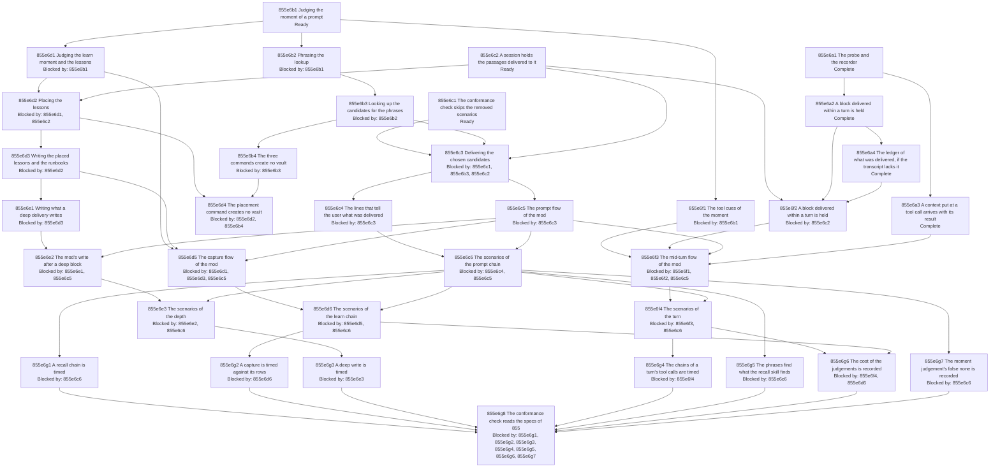

# Judged Automatic Memory - Implementation Plan

Step 5 of [855f2 The algorithm](./855f_algorithm.md#855f2-the-algorithm), planned and not executed: the order in which the tests of [855a Judged Automatic Memory - Product Spec](./855a_product-spec.md#judged-automatic-memory---product-spec) and [855d Judged Automatic Memory - Technical Spec](./855d_technical-spec.md#judged-automatic-memory---technical-spec) are written, made to pass and refactored on branch `feat/judged-automatic-memory`, which layers on the unmerged branch `feat/automatic-memory` ([855b9 The change layers on 793 by Modified operations](./855b_decision-log.md#855b9-the-change-layers-on-793-by-modified-operations)). The baseline is tip `8efa196a` of that branch, gated green on 2026-10-18: `targ check-full` 12/12, `targ test` green, acceptance 48/48. The guide's parallel worktree method is omitted: the nodes are worked in sequence on one branch.

## 855e1 Purpose

Source specifications [855a Judged Automatic Memory - Product Spec](./855a_product-spec.md#judged-automatic-memory---product-spec) and [855d Judged Automatic Memory - Technical Spec](./855d_technical-spec.md#judged-automatic-memory---technical-spec), with the nodes of [793a Automatic Memory - Product Spec](../793_automatic-memory/793a_product-spec.md#automatic-memory---product-spec) and [793d Automatic Memory - Technical Spec](../793_automatic-memory/793d_technical-spec.md#automatic-memory---technical-spec) that they modify. Scope: the product scenarios and the technical scenarios of 855 that are added or replaced, taken through step 5 of [855f2 The algorithm](./855f_algorithm.md#855f2-the-algorithm); the plan is written, not executed. It holds 143 test rows (102 unit, 32 acceptance, 9 measurement) for 31 product scenarios and 105 technical scenarios, and work rows for what is no scenario. The five scenarios that [855d Judged Automatic Memory - Technical Spec](./855d_technical-spec.md#judged-automatic-memory---technical-spec) removes have no test row: a work row of the node that replaces each deletes its test.

## 855e8 Implementation shape

Added to the shape of [793e8 Implementation shape](../793_automatic-memory/793e_implementation-plan.md#793e8-implementation-shape), no new Go dependency:

- `agent-instructions/mods/engram-memory/hooks/register.js`: five chains instead of three, the [prompt](../793_automatic-memory/793a_product-spec.md#793a1a-terms), the end of a [turn](../793_automatic-memory/793a_product-spec.md#793a1a-terms), `tool.call`, `classic.PostToolUseFailure` and `classic.PostToolBatch`; the model calls with their signals and limits; the set of delivered IDs; the report of a failure ([855d2a 793d2a Prompt delivery flow](./855d_technical-spec.md#855d2a-modified-793d2a-prompt-delivery-flow), [855d2b 793d2b Turn capture flow](./855d_technical-spec.md#855d2b-modified-793d2b-turn-capture-flow), [855d2c Mid-turn recall flow](./855d_technical-spec.md#855d2c-added-mid-turn-recall-flow)).
- `internal/auto/` and `internal/auto/prompts/`: the logic of the commands `moment`, `phrases`, `recall`, `place`, the rewritten `deliver`, `judge` and `write`, and the instruction text of each judgement, those of the lessons rewritten from the learn [skill](../../GLOSSARY.md#skill)'s Step 2 and the others new ([855d6 793d6 Recommended impact](./855d_technical-spec.md#855d6-modified-793d6-recommended-impact)).
- `internal/cli/auto.go`, `internal/cli/targets.go`, `internal/cli/primitives.go`: the commands, wired outside the first-use step ([793b71 The commands of the group auto take no first-use step](../793_automatic-memory/793b_decision-log.md#793b71-the-commands-of-the-group-auto-take-no-first-use-step)), and the adapters of the lookup and the chunk reader; every I/O capability enters through `cli.Primitives`.
- `dev/acceptance/`: the tests of the product scenarios and of the measurements, under the `network` tag, and the probe fixture of the gates ([855b46 The gate is measured with a probe mod the test installs](./855b_decision-log.md#855b46-the-gate-is-measured-with-a-probe-mod-the-test-installs)); `dev/conformance.go`: the check over the specs ([855b45 The conformance check follows the removals at once and reads 855 at the end](./855b_decision-log.md#855b45-the-conformance-check-follows-the-removals-at-once-and-reads-855-at-the-end)); `dev/mods_integration_internal_test.go`: the stand-in host of the mod's tests.

## 855e2 Test methods

The cycle, the classifications and the suites are those of [793e2 Test methods](../793_automatic-memory/793e_implementation-plan.md#793e2-test-methods): write the test; red, run it and confirm it fails for the expected reason, commit; green, the minimum change with the whole suite passing, commit; refactor, commit. Each scenario is run by one Go test named `Test<ID>_...`; a product scenario drives a real Claude Code [session](../../GLOSSARY.md#session) in an isolated HOME ([793f7 Test isolation](../793_automatic-memory/793f_algorithm.md#793f7-test-isolation)). What this plan adds:

- **Red `n/a`.** A test that pins inherited behaviour passes when written; its row says `n/a` in the red column and states the mutation that fails it. No other red cell has `n/a`.
- **Rewritten tests.** A scenario of 793 that 855 replaces keeps its test's name; the test is rewritten in place and its red is the rewrite failing against the earlier code ([855b47 Rewritten, adapted and deleted tests of 793](./855b_decision-log.md#855b47-rewritten-adapted-and-deleted-tests-of-793)).
- **Measurement rows.** The row records numbers and asserts its record and its bound ([855b48 A measurement row asserts a record and its bound](./855b_decision-log.md#855b48-a-measurement-row-asserts-a-record-and-its-bound)).
- **Judgement rows.** A product scenario whose outcome the model decides has a `Runs` entry, its passes in 10 runs against the bar of 9, each red attributed to its cause ([793b86 The acceptance run takes a count](../793_automatic-memory/793b_decision-log.md#793b86-the-acceptance-run-takes-a-count)).
- **Properties.** A `rapid` row names its properties; the named examples of the scenario stay beside it.

## 855e10 Process rules

Those of 793 stand: depth first, one node at a time, each document change and each phase its own commit ([793f3 Depth first](../793_automatic-memory/793f_algorithm.md#793f3-depth-first)); haiku searches, sonnet builds, opus reviews, one review round per phase and no more unless the owner asks ([793f4 Delegation](../793_automatic-memory/793f_algorithm.md#793f4-delegation), [793b33 One agent review round per phase](../793_automatic-memory/793b_decision-log.md#793b33-one-agent-review-round-per-phase)); the hash of a commit is recorded by the next commit ([793b30 Commit hashes are recorded by the next commit](../793_automatic-memory/793b_decision-log.md#793b30-commit-hashes-are-recorded-by-the-next-commit)); test isolation ([793f7 Test isolation](../793_automatic-memory/793f_algorithm.md#793f7-test-isolation)). The trailer of a commit is `AI-Used: [claude]` alone; no commit is amended, rebased or pushed before the review, and a merge is fast-forward only after a rebase on main and a re-test. A command is never run against the owner's installed binary, [vault](../../GLOSSARY.md#vault), `~/.claude`, `~/.pi` or `~/.local/share/engram`, and a temporary directory is removed by its literal path. What 855 adds: each step runs its unit tests and the acceptance rows it touches, and the full suite runs at the end of a group ([855b49 Tests are scoped per step, and the full suite runs at the end of a group](./855b_decision-log.md#855b49-tests-are-scoped-per-step-and-the-full-suite-runs-at-the-end-of-a-group)); the order of the groups is the order of the table in [855e4 Depth-first order](#855e4-depth-first-order), and the graph shows only the prerequisites.

## 855e3 Test status

`Not started` → `Red` → `Green-all` → `Done` for a test row ([855b44 The status of a row](./855b_decision-log.md#855b44-the-status-of-a-row)); `Refuted` ends a measurement row; a work row is `Not started` → `In progress` → `Done`, or `Not needed`. Each phase's commit sets the row's status; the red, green and refactor columns hold those commits' hashes, each filled in by the next commit.

## 855e4 Depth-first order

The groups, in the order of the table: the gates, then the prerequisites of each chain, then the chain, then its scenarios ([855b42 The order of the groups](./855b_decision-log.md#855b42-the-order-of-the-groups)). A group is buildable and reviewable alone: its nodes end with its scenarios, and the full suite passes at its end.

| Group | Source | Status |
| --- | --- | --- |
| [855e6a The gates: what the host records of a block added within a turn](#855e6a-the-gates-what-the-host-records-of-a-block-added-within-a-turn) | [855d7a1f A block delivered within a turn is held](./855d_technical-spec.md#855d7a1-scenarios), [855d7a1h A context put at a tool call arrives with its result](./855d_technical-spec.md#855d7a1-scenarios) | Complete |
| [855e6b The moment, the phrases and the candidates: three commands](#855e6b-the-moment-the-phrases-and-the-candidates-three-commands) | [855d4a Judging the moment](./855d_technical-spec.md#855d4a-added-judging-the-moment), [855d4v Phrasing the lookup](./855d_technical-spec.md#855d4v-added-phrasing-the-lookup), [855d4b Looking up the candidates for the phrases](./855d_technical-spec.md#855d4b-added-looking-up-the-candidates-for-the-phrases), [855d4f1a The moment, phrases, recall and placement commands create no vault](./855d_technical-spec.md#855d4f1-scenarios) | Ready |
| [855e6c The candidates are judged and delivered with the prompt](#855e6c-the-candidates-are-judged-and-delivered-with-the-prompt) | [855a3b 793a2b Memory arrives with the prompt](./855a_product-spec.md#855a3b-modified-793a2b-memory-arrives-with-the-prompt), [855a3c 793a2d Never in the way](./855a_product-spec.md#855a3c-modified-793a2d-never-in-the-way), [855d4c 793d4a Delivering the notes that bear on a prompt](./855d_technical-spec.md#855d4c-modified-793d4a-delivering-the-notes-that-bear-on-a-prompt), [855d4e 793d4d Telling what a session holds](./855d_technical-spec.md#855d4e-modified-793d4d-telling-what-a-session-holds), [855d2a 793d2a Prompt delivery flow](./855d_technical-spec.md#855d2a-modified-793d2a-prompt-delivery-flow), and the Modified scenarios [855a3d 793a2d1a A slow lookup does not hold a prompt for more than 8 seconds](./855a_product-spec.md#855a3d-modified-793a2d1a-a-slow-lookup-does-not-hold-a-prompt-for-more-than-8-seconds), [855a3h 793a2e1g The notes delivered with a prompt are one line](./855a_product-spec.md#855a3h-modified-793a2e1g-the-notes-delivered-with-a-prompt-are-one-line) to [855a3q 793a2b1d A prompt that matches no note arrives with nothing](./855a_product-spec.md#855a3q-modified-793a2b1d-a-prompt-that-matches-no-note-arrives-with-nothing) | Ready |
| [855e6d Lessons are judged, placed, tied and written](#855e6d-lessons-are-judged-placed-tied-and-written) | [855a2b Lessons are written as the learn skill writes them](./855a_product-spec.md#855a2b-lessons-are-written-as-the-learn-skill-writes-them), [855a2c Lessons are placed as the learn skill places them](./855a_product-spec.md#855a2c-lessons-are-placed-as-the-learn-skill-places-them), [855a2d Lessons that correct a note say so](./855a_product-spec.md#855a2d-lessons-that-correct-a-note-say-so), [855d4g 793d4g Judging a turn](./855d_technical-spec.md#855d4g-modified-793d4g-judging-a-turn), [855d4h Placing the lessons](./855d_technical-spec.md#855d4h-added-placing-the-lessons), [855d4i 793d4h Writing the lessons of a reply](./855d_technical-spec.md#855d4i-modified-793d4h-writing-the-lessons-of-a-reply), [855d2b 793d2b Turn capture flow](./855d_technical-spec.md#855d2b-modified-793d2b-turn-capture-flow) | Blocked by: [855e6b1 Judging the moment of a prompt](#855e6b1-judging-the-moment-of-a-prompt) |
| [855e6e A deep delivery writes what the recall skill's deep mode writes](#855e6e-a-deep-delivery-writes-what-the-recall-skills-deep-mode-writes) | [855a2a Delivery writes what its depth writes](./855a_product-spec.md#855a2a-delivery-writes-what-its-depth-writes), [855d4j Writing what a deep delivery writes](./855d_technical-spec.md#855d4j-added-writing-what-a-deep-delivery-writes) | Blocked by: [855e6d3 Writing the placed lessons and the runbooks](#855e6d3-writing-the-placed-lessons-and-the-runbooks) |
| [855e6f Recall moments within a turn](#855e6f-recall-moments-within-a-turn) | [855a2e Recall moments within a turn](./855a_product-spec.md#855a2e-recall-moments-within-a-turn), [855d2c Mid-turn recall flow](./855d_technical-spec.md#855d2c-added-mid-turn-recall-flow) | Blocked by: [855e6b1 Judging the moment of a prompt](#855e6b1-judging-the-moment-of-a-prompt) |
| [855e6g The remaining hypotheses are measured](#855e6g-the-remaining-hypotheses-are-measured) | [855d7a Hypotheses and their measurements](./855d_technical-spec.md#855d7a-added-hypotheses-and-their-measurements) | Blocked by: [855e6c6 The scenarios of the prompt chain](#855e6c6-the-scenarios-of-the-prompt-chain) |

## 855e9 Dependency graph

An arrow from A to B means that B reuses what A built (a component, a scenario, the acceptance [harness](../../GLOSSARY.md#harness), a record format) or needs its answer, so B could not be written without A; an arrow that follows from two others is left out. The label of a node ends with its status, as in [855e5 Node status](#855e5-node-status).

## 855e5 Node status

As in the plan guide: `Blocked by`, `Ready`, `In progress: n/x entries complete`, `Complete` and `Merged`. Every node becomes `Merged` together, when branch `feat/judged-automatic-memory` is merged to main ([855e7 Completion gates](#855e7-completion-gates)).

## 855e6 Test catalog

Rows are worked top to bottom within a node, and nodes in the order of [855e4 Depth-first order](#855e4-depth-first-order). A hash column is empty until its phase is committed.

### 855e6a The gates: what the host records of a block added within a turn

Proves, before anything that depends on them is built, the two hypotheses the plan hangs on: the [transcript](../../GLOSSARY.md#transcript) records a block that an event within a [turn](../793_automatic-memory/793a_product-spec.md#793a1a-terms) added ([855d7a1f A block delivered within a turn is held](./855d_technical-spec.md#855d7a1-scenarios)), and a context put at a tool call reaches the model after the tool's result ([855d7a1h A context put at a tool call arrives with its result](./855d_technical-spec.md#855d7a1-scenarios)). 793 tests it changes: none. Order of red commits: the probe and the recorder first, then the two measurement rows in table order. The answer to the first decides whether [855e6a4 The ledger of what was delivered, if the transcript lacks it](#855e6a4-the-ledger-of-what-was-delivered-if-the-transcript-lacks-it) is built ([855b40 A ledger of what was delivered, if the transcript lacks it](./855b_decision-log.md#855b40-a-ledger-of-what-was-delivered-if-the-transcript-lacks-it)); the answer to the second decides whether the before-tool cue keeps its promise ([855c4 Does the before-tool cue promise the note before the call or before the next action?](./855c_open-questions.md#855c4-does-the-before-tool-cue-promise-the-note-before-the-call-or-before-the-next-action)).

#### 855e6a1 The probe and the recorder

Not scenarios of the specs: the rows are named by what they build. Both are fixtures of the acceptance [harness](../../GLOSSARY.md#harness), shipped by nothing ([855b46 The gate is measured with a probe mod the test installs](./855b_decision-log.md#855b46-the-gate-is-measured-with-a-probe-mod-the-test-installs)).

| Work | Classification | Why | Status |
| --- | --- | --- | --- |
| The probe: a hooks module under `dev/acceptance/testdata` that the test links into the isolated machine's [skills](../../GLOSSARY.md#skill) directory, adding at `tool.call` a block that begins `[engram memory]` and names one [note](../../GLOSSARY.md#permanent-note), once for a [session](../../GLOSSARY.md#session), and holding no model call | Non-test action | the two hypotheses are about the host, and the mod of this change does not exist yet; the probe is the smallest thing that adds a block within a [turn](../793_automatic-memory/793a_product-spec.md#793a1a-terms), and [`engram update`](../../GLOSSARY.md#engram-update) never installs it | Done |
| The recorder: reads, from the session's [transcript](../../GLOSSARY.md#transcript) and from the stream events of `claude -p`, the type, the order and the times of the rows around a tool call | Non-test action | both gates are answered by what the host recorded, not by what the probe sent | Done |

#### 855e6a2 A block delivered within a turn is held

| Gherkin | Test | Classification | Why | Status | Red commit | Green commit | Refactor commit |
| --- | --- | --- | --- | --- | --- | --- | --- |
| 855d7a1f | `Test855d7a1f_Gate_ABlockDeliveredWithinATurnIsHeld` | Measurement, real dependency (`network`) | the [transcript](../../GLOSSARY.md#transcript)'s record of a block added within a [turn](../793_automatic-memory/793a_product-spec.md#793a1a-terms) is not in the type definitions ([855d1a Verified host facts](./855d_technical-spec.md#855d1a-verified-host-facts)); red is the run before the probe delivers: no block in the transcript. Confirmed is green; refuted (no record, or more than one) ends the row as `Refuted`, builds the ledger node and records the result in [855b Judged Automatic Memory - Decision Log](./855b_decision-log.md#judged-automatic-memory---decision-log) | Done | 38a584bf | 7bafa13a | c938317f |

#### 855e6a3 A context put at a tool call arrives with its result

| Gherkin | Test | Classification | Why | Status | Red commit | Green commit | Refactor commit |
| --- | --- | --- | --- | --- | --- | --- | --- |
| 855d7a1h | `Test855d7a1h_Gate_AContextPutAtAToolCallArrivesWithItsResult` | Measurement, real dependency (`network`) | the host's text says the context is read after the tool's result; the row records the order of the result, the block and the [agent](../793_automatic-memory/793a_product-spec.md#793a1a-terms)'s next message, and the time the block arrived. Refuted (the block precedes the result, or never arrives) ends the row as `Refuted` | Done | 370ef56a | f1ad2d8a | 613d0dcf, 9aec282a |

| Work | Classification | Why | Status |
| --- | --- | --- | --- |
| If refuted: record the order in [855b Judged Automatic Memory - Decision Log](./855b_decision-log.md#judged-automatic-memory---decision-log) and take [855c4 Does the before-tool cue promise the note before the call or before the next action?](./855c_open-questions.md#855c4-does-the-before-tool-cue-promise-the-note-before-the-call-or-before-the-next-action) to the owner with option (b); the before-tool rows of [855e6f3 The mid-turn flow of the mod](#855e6f3-the-mid-turn-flow-of-the-mod) and the scenario [855a2e1c A note arrives before the agent starts building a new approach](./855a_product-spec.md#855a2f-modified-855a2e1c-a-note-arrives-before-the-agent-starts-building-a-new-approach) wait for the answer | Non-test action | the promise of [855a2f 855a2e1c A note arrives before the agent starts building a new approach](./855a_product-spec.md#855a2f-modified-855a2e1c-a-note-arrives-before-the-agent-starts-building-a-new-approach) is the next action, and a refuted order cannot keep it | Not needed |

#### 855e6a4 The ledger of what was delivered, if the transcript lacks it

Built only when [855d7a1f A block delivered within a turn is held](./855d_technical-spec.md#855d7a1-scenarios) is refuted ([855b40 A ledger of what was delivered, if the transcript lacks it](./855b_decision-log.md#855b40-a-ledger-of-what-was-delivered-if-the-transcript-lacks-it)). The ledger has no scenario in [855d Judged Automatic Memory - Technical Spec](./855d_technical-spec.md#judged-automatic-memory---technical-spec) yet.

| Work | Classification | Why | Status |
| --- | --- | --- | --- |
| Add to [855d Judged Automatic Memory - Technical Spec](./855d_technical-spec.md#judged-automatic-memory---technical-spec) the scenarios of the ledger (`deliver` keeps for each [session](../../GLOSSARY.md#session) a record of what it delivered, never removed, and `session-context` reads it) through the specification lifecycle, show them to the owner, and give each a row here | Non-test action | a node without a scenario is untestable, and a scenario is an owner-visible change of the specification | Not needed |
| The rows of the ledger scenarios, each through the cycle | Non-test action | their tests do not exist until the scenarios do | Not needed |

### 855e6b The moment, the phrases and the candidates: three commands

Proves, through standard input and output over fixtures of a [vault](../../GLOSSARY.md#vault), a [transcript](../../GLOSSARY.md#transcript) and a model's replies, the first three steps of the recall chain ([855d4a Judging the moment](./855d_technical-spec.md#855d4a-added-judging-the-moment), [855d4v Phrasing the lookup](./855d_technical-spec.md#855d4v-added-phrasing-the-lookup), [855d4b Looking up the candidates for the phrases](./855d_technical-spec.md#855d4b-added-looking-up-the-candidates-for-the-phrases)); no mod and no delivery yet. 793 tests it changes: none (the replaced origin tests are rewritten with their commands in [855e6c3 Delivering the chosen candidates](#855e6c3-delivering-the-chosen-candidates) and [855e6d1 Judging the learn moment and the lessons](#855e6d1-judging-the-learn-moment-and-the-lessons)). Order of red commits: the first row of each node in table order, no product row. The commands are wired outside the first-use step, as the group `auto` already is ([793b71 The commands of the group auto take no first-use step](../793_automatic-memory/793b_decision-log.md#793b71-the-commands-of-the-group-auto-take-no-first-use-step)).

#### 855e6b1 Judging the moment of a prompt

The command `auto moment` with the cue `prompt`; the other cues join in [855e6d1 Judging the learn moment and the lessons](#855e6d1-judging-the-learn-moment-and-the-lessons) and [855e6f1 The tool cues of the moment](#855e6f1-the-tool-cues-of-the-moment).

| Gherkin | Test | Classification | Why | Properties | Status | Red commit | Green commit | Refactor commit |
| --- | --- | --- | --- | --- | --- | --- | --- | --- |
| 855d4a1a | `Test855d4a1a_Moment_APromptBecomesARequestForTheCheapTier` | Dedicated example | the request's model, effort, system and [prompt](../793_automatic-memory/793a_product-spec.md#793a1a-terms) over a [transcript](../../GLOSSARY.md#transcript) fixture; the instructions are the system and none of them is in the prompt |  | Not started |  |  |  |
| 855d4a1d | `Test855d4a1d_Moment_APromptAMessageOrAnEventCannotCloseTheWindowOrHoldACredential` | Property-based (`rapid`) with named examples | hostile text is open input, so a property covers the shapes an example would miss; the named example keeps one credential of every shape | for any prompt, message and event texts, with tags, line breaks, control and format characters and a generated recognised credential: the prompt of the request holds each section tag exactly once; no line holds the character that opens a tag except as a tag of the window; none of the generated credentials is in the request; the system holds none of the [session](../../GLOSSARY.md#session)'s text | Not started |  |  |  |
| 855d4a1e | `Test855d4a1e_Moment_APromptOfAnOriginTheUserDoesNotSendIsJudgedNothing` | Dedicated example | three named origins; the gate is finite |  | Not started |  |  |  |
| 855d4a1f | `Test855d4a1f_Moment_ASessionWithNoTranscriptIsJudgedWithoutConversationLines` | Dedicated example | the one branch with no transcript: the window holds the prompt's line only |  | Not started |  |  |  |
| 855d4a1g | `Test855d4a1g_Moment_AnInputThatIsNotAJSONObjectFailsTheCommand` | Dedicated example | the failure branch: input that is not a JSON object prints nothing and fails the command |  | Not started |  |  |  |

#### 855e6b2 Phrasing the lookup

The command `auto phrases`.

| Gherkin | Test | Classification | Why | Status | Red commit | Green commit | Refactor commit |
| --- | --- | --- | --- | --- | --- | --- | --- |
| 855d4v1a | `Test855d4v1a_Phrases_TheRequestHoldsTheTenAnglesAndTheWindow` | Dedicated example | the request's system holds the ten angles and no text of the [session](../../GLOSSARY.md#session); the [prompt](../793_automatic-memory/793a_product-spec.md#793a1a-terms) holds the window | Not started |  |  |  |
| 855d4v1b | `Test855d4v1b_Phrases_TheNumberOfPhrasesFollowsTheDepth` | Dedicated example | about 3 phrases at glance and 10 at deep: two named depths | Not started |  |  |  |
| 855d4v1c | `Test855d4v1c_Phrases_ADepthOfNoneLooksNothingUp` | Dedicated example | the branch where a depth of none prints nothing and looks nothing up | Not started |  |  |  |
| 855d4v1d | `Test855d4v1d_Phrases_AFencedReplyIsReadAndAReplyThatIsNotAMomentReplyFails` | Dedicated example | a fenced reply is read, and a reply that is no moment reply fails the command naming the judgement | Not started |  |  |  |

#### 855e6b3 Looking up the candidates for the phrases

The command `auto recall`: the lookup of the matched set for several phrases, the chunk reader, and the request of the candidate judgement.

| Gherkin | Test | Classification | Why | Properties | Status | Red commit | Green commit | Refactor commit |
| --- | --- | --- | --- | --- | --- | --- | --- | --- |
| 855d4b1a | `Test855d4b1a_Recall_ThePhrasesAreLookedUpOnceAsPhrasesOfTheirOwn` | Interaction (`imptest`) | the call count and the arguments of the injected lookup: once, the first 3 or 10 phrases each as a phrase of its own, no message |  | Not started |  |  |  |
| 855d4b1c | `Test855d4b1c_Recall_AReplyThatIsNotAPhrasesReplyFailsTheCommand` | Dedicated example | a reply that is no phrases reply fails the command, printing nothing |  | Not started |  |  |  |
| 855d4b1d | `Test855d4b1d_Recall_TheNotesAndPassagesThatMatchedBecomeCandidatesTheExplorePicksAndTheNewestChunks` | Dedicated example | which of the lookup's [notes](../../GLOSSARY.md#permanent-note) and chunks become candidates, and which (the explore picks, the newest chunks) do not |  | Not started |  |  |  |
| 855d4b1e | `Test855d4b1e_Recall_AChunkOfTheSessionsOwnTranscriptIsNotACandidate` | Dedicated example | the [session](../../GLOSSARY.md#session)'s own [transcript](../../GLOSSARY.md#transcript) is never a candidate: a chunk of it and a chunk of another |  | Not started |  |  |  |
| 855d4b1f | `Test855d4b1f_Recall_NothingMatchedPrintsNothing` | Dedicated example | the branch where nothing matched prints nothing |  | Not started |  |  |  |
| 855d4b1g | `Test855d4b1g_Recall_TheRequestIsForTheMidTierAndHoldsTheVerdictsTheWindowAndTheDated` | Dedicated example | the request is for the mid tier and holds the verdicts, the window and the dated candidates |  | Not started |  |  |  |
| 855d4b1h | `Test855d4b1h_Recall_ADeepRequestAlsoAsksForTheLessonsAndTheRevisions` | Dedicated example | the deep request also asks for the lessons and the revisions, and carries the write flag |  | Not started |  |  |  |
| 855d4b1i | `Test855d4b1i_Recall_ACandidateCannotReshapeTheRequestOrHoldACredential` | Property-based (`rapid`) with named examples | candidate text is open input; the named example holds the 400-character note and the 1,200-character chunk | for any note and chunk texts with line breaks, the closing tag of the candidates and generated recognised credentials: each candidate is one line of the section; the character that opens a tag is written `&lt;`; no generated credential is in the request; a note of any length is whole and a chunk is cut to at most 1,200 characters | Not started |  |  |  |
| 855d4b1j | `Test855d4b1j_Recall_AFailedLookupFailsTheCommandAndPrintsNothing` | Dedicated example | the failure branch: a failed lookup fails the command and prints nothing |  | Not started |  |  |  |
| 855d4b1k | `Test855d4b1k_Recall_AWarningOfTheLookupIsNoLineForTheUser` | Dedicated example | a warning of the lookup goes to the debug log; an ordinary buffer for standard error shows it holds none |  | Not started |  |  |  |
| 855d4b1l | `Test855d4b1l_Recall_TheCandidatesAreHeldToACountAndABudget` | Property-based (`rapid`) with named examples | the count and the budget hold for every size of matched set | for any matched set of notes and chunks of any lengths: at most 30 candidates; at most 60,000 characters of candidate text in all; the candidates are a prefix of the matched set in its order (the last dropped first) | Not started |  |  |  |

#### 855e6b4 The three commands create no vault

The row for `auto place` joins it in [855e6d4 The placement command creates no vault](#855e6d4-the-placement-command-creates-no-vault).

| Gherkin | Test | Classification | Why | Status | Red commit | Green commit | Refactor commit |
| --- | --- | --- | --- | --- | --- | --- | --- |
| 855d4f1a | `Test855d4f1a_TargetsMomentPhrasesRecall_TheMomentPhrasesRecallAndPlacementCommandsCreateNoVault` | Dedicated example | a path with no [vault](../../GLOSSARY.md#vault), the three commands dispatched through the real targets: no vault and no creation line afterwards | Not started |  |  |  |

### 855e6c The candidates are judged and delivered with the prompt

Proves the whole [prompt](../793_automatic-memory/793a_product-spec.md#793a1a-terms) chain: delivery of the chosen candidates, the lines for the user, the mod's prompt flow, and the 15 product scenarios of the prompt side. 793 tests it changes on purpose: the tests of 793d4a1a, 793d4a1b, 793d4a1d, 793d4a1e, 793d4a1g, 793d4p1h, 793d4p1i, 793d4p1l, 793d2a1d, 793d2a1g, 793d2a1j are rewritten in place, the tests of 793d4a1c, 793d4a1f, 793d4a1h, 793d4a1i and 793d4p1k are deleted, the deliver halves of the tests of 793d4m1a and 793d4m1b are rewritten, and the product tests of 793a2a1a, 793a2b1a, 793a2b1c, 793a2d1a, 793a2e1c and 793a2e1g change with their scenarios. Order of red commits: the 15 product rows of [855e6c6 The scenarios of the prompt chain](#855e6c6-the-scenarios-of-the-prompt-chain) first, then the rows of [855e6c1 The conformance check skips the removed scenarios](#855e6c1-the-conformance-check-skips-the-removed-scenarios) to [855e6c5 The prompt flow of the mod](#855e6c5-the-prompt-flow-of-the-mod) in node order.

#### 855e6c1 The conformance check skips the removed scenarios

Not scenarios of the specs: the rows are named by test. The specs of 793 still hold the scenarios that [855d Judged Automatic Memory - Technical Spec](./855d_technical-spec.md#judged-automatic-memory---technical-spec) removes until promotion, and this node comes before the first test is deleted ([855b45 The conformance check follows the removals at once and reads 855 at the end](./855b_decision-log.md#855b45-the-conformance-check-follows-the-removals-at-once-and-reads-855-at-the-end)).

| Gherkin | Test | Classification | Why | Status | Red commit | Green commit | Refactor commit |
| --- | --- | --- | --- | --- | --- | --- | --- |
| none | `TestScenariosWithoutTest_ARemovedScenarioNeedsNoTest` | Dedicated example (dev suite) | the pure reading: a scenario ID named by a Removed operation of [855d Judged Automatic Memory - Technical Spec](./855d_technical-spec.md#judged-automatic-memory---technical-spec) is exempt from having a test, and one no operation names is not | Not started |  |  |  |
| none | `TestConformance_EveryScenarioOfTheSpecsHasATest` | Dedicated example (dev suite) | the real specs against the real test files still pass after the deletions of this group. Mutation: a check that ignores the removals fails it once the first removed test is deleted | Not started | n/a |  |  |

#### 855e6c2 A session holds the passages delivered to it

| Gherkin | Test | Classification | Why | Status | Red commit | Green commit | Refactor commit |
| --- | --- | --- | --- | --- | --- | --- | --- |
| 855d4e1a | `Test855d4e1a_HeldText_TheChunkIDsOfThePassagesDeliveredAreHeld` | Dedicated example | the chunk IDs of the passages of delivered blocks are what a [session](../../GLOSSARY.md#session) holds, read from a [transcript](../../GLOSSARY.md#transcript) fixture | Not started |  |  |  |
| 855d4e1b | `Test855d4e1b_HeldText_APassageFetchedWithEngramShowChunkAndANoteTheAgentSavedAreHeld` | Dedicated example | a passage fetched with `engram show-chunk`, and a [note](../../GLOSSARY.md#permanent-note) the [agent](../793_automatic-memory/793a_product-spec.md#793a1a-terms) saved, are held: two named reads of the agent's own commands | Not started |  |  |  |

#### 855e6c3 Delivering the chosen candidates

The command `auto deliver` takes the candidate judgement's reply and the carry, and looks nothing up. The existing tests of the scenarios that stay and call it with the old input are adapted in the first row.

| Work | Classification | Why | Status |
| --- | --- | --- | --- |
| Adapt the tests of the scenarios 793d4c1a, 793d4c1b and 793d4c1c that call the delivery with the old input (the [prompt](../793_automatic-memory/793a_product-spec.md#793a1a-terms)'s text) to the new (the cue, the held IDs, the reply and the carry) | Non-test action | their contracts stay, so they have no red of their own; mutation: a delivery that reads the old input fails each of them | Not started |

| Gherkin | Test | Classification | Why | Properties | Status | Red commit | Green commit | Refactor commit |
| --- | --- | --- | --- | --- | --- | --- | --- | --- |
| 793d4a1a | `Test793d4a1a_RunAutoDeliver_PrintsTheNotesThatBearOnThePromptAsOneBlock` | Dedicated example | the candidates the judgement chose come back as one block; rewritten from the lookup of the text to the reply and the carry |  | Not started |  |  |  |
| 793d4a1b | `Test793d4a1b_RunAutoDeliver_AFailedLookupFailsTheCommandAndPrintsNothing` | Dedicated example | the failure branch: a reply that is not a reply fails the command and prints nothing |  | Not started |  |  |  |
| 793d4a1d | `Test793d4a1d_RunAutoDeliver_ANoteTheSessionHoldsIsLeftOut` | Dedicated example | a [note](../../GLOSSARY.md#permanent-note) the [session](../../GLOSSARY.md#session) holds is left out |  | Not started |  |  |  |
| 793d4a1e | `Test793d4a1e_RunAutoDeliver_NoNoteToDeliverPrintsNothing` | Dedicated example | no candidate to deliver prints nothing |  | Not started |  |  |  |
| 793d4a1g | `Test793d4a1g_RunAutoDeliver_ANoteTheAgentFetchedByItsBasenameIsLeftOut` | Dedicated example | a note the [agent](../793_automatic-memory/793a_product-spec.md#793a1a-terms) fetched by its basename is left out |  | Not started |  |  |  |
| 855d4c1a | `Test855d4c1a_Deliver_OfTwoCandidatesThatConflictOnlyTheNewerIsDelivered` | Dedicated example | of two candidates that conflict, the newer only: the `newer` field against the carry |  | Not started |  |  |  |
| 855d4c1b | `Test855d4c1b_Deliver_ACandidateTheCarryDoesNotHoldIsNotDelivered` | Dedicated example | an ID the carry does not hold is ignored |  | Not started |  |  |  |
| 855d4c1c | `Test855d4c1c_Deliver_APassageTheSessionHoldsIsLeftOut` | Dedicated example | a passage the session holds is left out |  | Not started |  |  |  |
| 855d4c1d | `Test855d4c1d_Deliver_ADeliveredNoteIsMarkedAsUsedAndADeliveredParentNoteIsPulledDown` | Interaction (`imptest`) | the calls to the injected activator: a delivered note is marked as used and a delivered parent note is pulled down, once each |  | Not started |  |  |  |
| 855d4c1f | `Test855d4c1f_Deliver_TheDeliveryLooksNothingUp` | Interaction (`imptest`) | forbidden calls: the injected lookup and chunk reader receive none |  | Not started |  |  |  |
| 855d4c1e | `Test855d4c1e_Deliver_APassageIsCutTo1200Characters` | Dedicated example | a passage is cut to 1,200 characters |  | Not started |  |  |  |
| 855d4c1g | `Test855d4c1g_Deliver_ANoteOrPassageTheModHasDeliveredAlreadyIsLeftOut` | Interaction (`imptest`) | a held ID is left out of the block and its note is not marked as used: a forbidden call |  | Not started |  |  |  |
| 855d4d1a | `Test855d4d1a_Deliver_APassageCannotReshapeTheBlock` | Property-based (`rapid`) with named examples | passage text is open input as note text was in 793 | for any chunk IDs and texts with line breaks, control and format characters, the framing line and lines that read as other notes, mixed: the framing line is first and nowhere else; there is exactly one line for each passage, each beginning with a dash and a space and holding single spaces and no control or format character | Not started |  |  |  |
| 793d4m1a | `Test793d4m1a_DeliverOrigin_APromptOfAnOriginTheUserSendsIsJudgedAndDelivered` | Dedicated example | the origin gate of the delivery: the four origins the user sends are delivered for; the rewritten test covers the delivery half only, the moment half is in [855e6d1 Judging the learn moment and the lessons](#855e6d1-judging-the-learn-moment-and-the-lessons) |  | Not started |  |  |  |
| 793d4m1b | `Test793d4m1b_DeliverOrigin_APromptOfAnyOtherOriginIsJudgedAndDeliveredNothing` | Dedicated example | any other origin, including none, is delivered nothing and looks nothing up |  | Not started |  |  |  |

| Work | Classification | Why | Status |
| --- | --- | --- | --- |
| Delete the tests of 793d4a1c, 793d4a1f, 793d4a1h and 793d4a1i ([855d4q 793d4a1c A note that only the explore half picked does not bear on the prompt](./855d_technical-spec.md#855d4q-removed-793d4a1c-a-note-that-only-the-explore-half-picked-does-not-bear-on-the-prompt), [855d4r 793d4a1f The chunk index is not searched](./855d_technical-spec.md#855d4r-removed-793d4a1f-the-chunk-index-is-not-searched), [855d4s 793d4a1h The lookup is asked for the prompt's text as its message and as its only phrase](./855d_technical-spec.md#855d4s-removed-793d4a1h-the-lookup-is-asked-for-the-prompts-text-as-its-message-and-as-its-only-phrase), [855d4t 793d4a1i The lookup is asked for the text and what the session holds and was not shown for the session](./855d_technical-spec.md#855d4t-removed-793d4a1i-the-lookup-is-asked-for-the-text-and-what-the-session-holds-and-was-not-shown-for-the-session)) | Non-test action | the behaviour moved to the new commands, whose rows state it; the conformance check of the first node exempts them | Not started |

#### 855e6c4 The lines that tell the user what was delivered

| Gherkin | Test | Classification | Why | Properties | Status | Red commit | Green commit | Refactor commit |
| --- | --- | --- | --- | --- | --- | --- | --- | --- |
| 793d4p1h | `Test793d4p1h_Deliver_ANoteDeliveredIsShownAsALine`, `Test793d4p1h_RunAutoDeliver_ANoteDeliveredIsShownAsALine` | Dedicated example | a [note](../../GLOSSARY.md#permanent-note) delivered is shown as a line; rewritten from the reply and the carry |  | Not started |  |  |  |
| 793d4p1i | `Test793d4p1i_Deliver_ALineShownIsOneLineWhateverTheTextsHold` | Property-based (`rapid`) with named examples | a line is one line whatever the texts hold | for any notes in a carry, reply and record texts with line breaks, control and format characters and lines that read as other lines: each line printed on standard error is one line of single spaces with no control or format character, of at most 240 characters, and there is one line for each of the four kinds that has something to tell and no other | Not started |  |  |  |
| 793d4p1l | `Test793d4p1l_Deliver_TheNotesDeliveredAreOneLine`, `Test793d4p1l_Targets_TheNotesDeliveredAreOneLine` | Dedicated example | the notes delivered are one line, naming each |  | Not started |  |  |  |
| 855d4p1a | `Test855d4p1a_Lines_ThePassagesDeliveredAreNamedInTheLine` | Dedicated example | the passages delivered are named in the line, in the formats of [855d8a Formats of the lines of 793d4p](./855d_technical-spec.md#855d8a-formats-of-the-lines-of-793d4p) |  | Not started |  |  |  |
| 855d4p1b | `Test855d4p1b_Lines_ADeliveryWithinATurnShowsItsLineOnlyAndTouchesNoRecord` | Interaction (`imptest`) | a delivery within a [turn](../793_automatic-memory/793a_product-spec.md#793a1a-terms) shows its line only: no record is marked or removed, a forbidden call on the injected records |  | Not started |  |  |  |
| 855d4p1c | `Test855d4p1c_Lines_APromptThatIsNotARecallMomentShowsTheRecords` | Dedicated example | a [prompt](../793_automatic-memory/793a_product-spec.md#793a1a-terms) that is not a recall moment gets no block and still shows and marks the records |  | Not started |  |  |  |

| Work | Classification | Why | Status |
| --- | --- | --- | --- |
| Delete the test of 793d4p1k ([855d4u 793d4p1k A warning of the lookup is no line for the user](./855d_technical-spec.md#855d4u-removed-793d4p1k-a-warning-of-the-lookup-is-no-line-for-the-user)) | Non-test action | the warning of the lookup is the recall command's now, in [855e6b3 Looking up the candidates for the phrases](#855e6b3-looking-up-the-candidates-for-the-phrases) | Not started |

#### 855e6c5 The prompt flow of the mod

The mod's JavaScript runs the steps in order for each [prompt](../793_automatic-memory/793a_product-spec.md#793a1a-terms), with its own deadline of 2 minutes for each wait. The tests of the scenarios 793d2a1a, 793d2a1b, 793d2a1c, 793d2a1e, 793d2a1f, 793d2a1h, 793d2a1i and 793d2a1k stay, and the first row adapts their stand-in engram.

| Work | Classification | Why | Status |
| --- | --- | --- | --- |
| Adapt the stand-in engram of the tests of 793d2a1a, 793d2a1b, 793d2a1c, 793d2a1e, 793d2a1f, 793d2a1h, 793d2a1i and 793d2a1k so that its `moment` prints nothing, which leaves the chain at the `deliver` they fake | Non-test action | the contracts stay and the mod now asks `moment` first; mutation: a mod that skips `moment` fails the adapted tests of the order | Not started |

| Gherkin | Test | Classification | Why | Status | Red commit | Green commit | Refactor commit |
| --- | --- | --- | --- | --- | --- | --- | --- |
| 793d2a1d | `Test793d2a1d_Mod_ASlowCommandIsEndedAndThePromptContinues` | Dedicated example, real dependency (`network`) | a real [session](../../GLOSSARY.md#session) against a stand-in engram and a model that takes 20 seconds: the prompt is held, not stepped aside; rewritten from the bound of 8 seconds | Not started |  |  |  |
| 793d2a1g | `Test793d2a1g_Mod_ASessionThatDoesNotGiveItsIDInTimeDoesNotHoldThePrompt` | Dedicated example, integration (stand-in host) | a session that does not give its ID in time does not hold the prompt: the 5 seconds of the row | Not started |  |  |  |
| 793d2a1j | `Test793d2a1j_Mod_ADeliveryThatDoesNotFinishWithinItsBoundIsReportedToTheWriting` | Dedicated example, integration (stand-in host) | a model call that never settles unless its signal aborts it is aborted 2 minutes after it began, and the failure is reported from a timer | Not started |  |  |  |
| 855d2a1a | `Test855d2a1a_Mod_TheStepsRunInOrderEachGivenTheReplyAndTheCarryBefore` | Dedicated example, integration (stand-in host) | the order of the steps and what each is given: the reply and the carry before it, the limits of the steps | Not started |  |  |  |
| 855d2a1b | `Test855d2a1b_Mod_AStepThatPrintsNothingLeavesTheLinesToTheDelivery` | Dedicated example, integration (stand-in host) | a step that prints nothing leaves the lines to the delivery: three named stops of the chain | Not started |  |  |  |
| 855d2a1d | `Test855d2a1d_Mod_OutputThatIsNotARequestOrABlockFailsTheStep` | Dedicated example, integration (stand-in host) | output that is neither a request nor a block fails the step, and one block-less success is no failure | Not started |  |  |  |

#### 855e6c6 The scenarios of the prompt chain

Real [sessions](../../GLOSSARY.md#session) in an isolated HOME ([793f7 Test isolation](../793_automatic-memory/793f_algorithm.md#793f7-test-isolation)). The red commits of these rows come first in the group; the green and refactor commits close it. The pins pass when written and state the mutation that fails them. A stand-in `engram` on the machine's PATH makes the stall of [855a3c1a A judgement that never answers is stepped aside after 2 minutes](./855a_product-spec.md#855a3c1-uat-scenarios), because a real model call cannot be made to hang.

| Gherkin | Test | Classification | Why | Runs | Status | Red commit | Green commit | Refactor commit |
| --- | --- | --- | --- | --- | --- | --- | --- | --- |
| 793a2a1a | `Test793a2a1a_NextSessionHasMemoryAfterOneEngramUpdate` | Dedicated example, product acceptance (`network`) | a real session after a real [`engram update`](../../GLOSSARY.md#engram-update) shows what reaches the [agent](../793_automatic-memory/793a_product-spec.md#793a1a-terms); the node that needs the whole chain |  | Not started |  |  |  |
| 793a2a1b | `Test793a2a1b_ASecondUpdateStillDeliversEachNoteOnce` | Dedicated example, product acceptance (`network`) | a second update leaves the [note](../../GLOSSARY.md#permanent-note) delivered once. Mutation: a second update that deploys the mod twice, or a delivery that does not drop what the session holds, fails it |  | Not started | n/a |  |  |
| 793a2b1a | `Test793a2b1a_TheNotesThatBearOnAPromptArriveWithIt` | Dedicated example, product acceptance (`network`) | the staging note and not the formatting note, with the [prompt](../793_automatic-memory/793a_product-spec.md#793a1a-terms) as typed |  | Not started |  |  |  |
| 793a2b1b | `Test793a2b1b_ANoteDeliveredEarlierInTheSessionIsNotDeliveredAgain` | Dedicated example, product acceptance (`network`) | the second prompt arrives with nothing and the note is in the context once. Mutation: a delivery that does not drop what the session holds fails it |  | Not started | n/a |  |  |
| 793a2b1c | `Test793a2b1c_ANoteTheAgentLookedUpItselfIsNotDelivered` | Dedicated example, product acceptance (`network`) | a note the agent looked up before the update is not delivered; the other note is |  | Not started |  |  |  |
| 793a2b1d | `Test793a2b1d_APromptThatMatchesNoNoteArrivesWithNothing` | Dedicated example, product acceptance (`network`) | notes and a conversation that have nothing to do with the prompt: nothing arrives. Mutation: a chain that delivers the nearest candidates whatever the verdict fails it |  | Not started | n/a |  |  |
| 855a3b1a | `Test855a3b1a_APromptThatIsNotARecallMomentArrivesWithNothing` | Dedicated example, product acceptance (`network`) | a prompt that is only thanks is no recall moment |  | Not started |  |  |  |
| 855a3b1b | `Test855a3b1b_ANoteWhoseWordsMatchButThatDoesNotApplyIsNotDelivered` | Dedicated example, product acceptance (`network`) | a note whose words match but that does not apply is not delivered |  | Not started |  |  |  |
| 855a3b1c | `Test855a3b1c_OfTwoNotesThatConflictOnlyTheNewerIsDelivered` | Dedicated example, product acceptance (`network`) | of two notes that conflict, the newer only, with no link between them |  | Not started |  |  |  |
| 855a3b1d | `Test855a3b1d_TheNotesThatArriveAreTheNotesTheRecallSkillDraws` | Dedicated example, product acceptance (`network`) | two sessions on one [vault](../../GLOSSARY.md#vault): the notes that arrive equal the notes the recall [skill](../../GLOSSARY.md#skill) names |  | Not started |  |  |  |
| 855a3b1e | `Test855a3b1e_APassageOfAnEarlierConversationArrivesWhenItApplies` | Dedicated example, product acceptance (`network`) | a passage of an earlier, swept conversation arrives when it applies |  | Not started |  |  |  |
| 855a3c1a | `Test855a3c1a_AJudgementThatNeverAnswersIsSteppedAsideAfter2Minutes` | Dedicated example, product acceptance (`network`) | a step that never answers is stepped aside after 2 minutes: the stand-in engram's `moment` never exits | 1 run | Not started |  |  |  |
| 793a2d1a | `Test793a2d1a_ASlowLookupDoesNotHoldAPromptForMoreThan8Seconds` | Dedicated example, product acceptance (`network`) | a judgement that takes 20 seconds holds the prompt until it has the notes (the stand-in engram delays its `moment`) | 1 run | Not started |  |  |  |
| 793a2e1c | `Test793a2e1c_ADeliveryThatCouldNotBeDoneIsShownWithItsReason` | Dedicated example, product acceptance (`network`) | a delivery that could not be done is shown with its reason by the next prompt: an unreadable vault | 1 run | Not started |  |  |  |
| 793a2e1g | `Test793a2e1g_TheNotesDeliveredWithAPromptAreOneLine` | Dedicated example, product acceptance (`network`) | the notes delivered with a prompt are one line, naming the three |  | Not started |  |  |  |

### 855e6d Lessons are judged, placed, tied and written

Proves the learn chain end to end: the learn-moment judgement, the lessons of four kinds, the placement and supersedes against the seen [notes](../../GLOSSARY.md#permanent-note), the runbook, and the mod's capture flow, with the 11 product scenarios of the learn side. 793 tests it changes on purpose: 793d2b1a to 793d2b1e and 793d2b1g to 793d2b1k, 793d4g1a and the origin tests of 793d4m1a to 793d4m1c and 793d4m1e are rewritten; the 23 other tests of 793d4g1 are adapted to carry the reply `{"learn":true}`; the product tests of 793a2d1c, 793a2d1d, 793a2e1a and 793a3a1a change with their scenarios. Order of red commits: the 11 product rows of [855e6d6 The scenarios of the learn chain](#855e6d6-the-scenarios-of-the-learn-chain) first, then the nodes in order.

#### 855e6d1 Judging the learn moment and the lessons

The command `auto moment` with the cue `turn-end`, the origin gate for headless [turns](../793_automatic-memory/793a_product-spec.md#793a1a-terms), and the command `auto judge`.

| Gherkin | Test | Classification | Why | Status | Red commit | Green commit | Refactor commit |
| --- | --- | --- | --- | --- | --- | --- | --- |
| 855d4a1b | `Test855d4a1b_Moment_ATurnThatEndedBecomesALearnMomentRequest` | Dedicated example | a turn that ended becomes the learn-moment request, with the 10-second limit | Not started |  |  |  |
| 793d4m1a | `Test793d4m1a_MomentOrigin_APromptOfAnOriginTheUserSendsIsJudgedAndDelivered` | Dedicated example | the moment half of the origin gate: the four origins are judged with both cues | Not started |  |  |  |
| 793d4m1b | `Test793d4m1b_MomentOrigin_APromptOfAnyOtherOriginIsJudgedAndDeliveredNothing` | Dedicated example | any other origin is judged nothing with each cue | Not started |  |  |  |
| 793d4m1c | `Test793d4m1c_Targets_TheTurnOfAHeadlessPromptIsJudgedOnlyWhenTheUserAsks` | Dedicated example | a headless turn is judged only with the flag; rewritten from the judgement to the moment | Not started |  |  |  |
| 793d4m1e | `Test793d4m1e_RunAutoJudge_AHeadlessTurnThatIsNotJudgedIsRecordedAsSkippedWithTheReason`, `Test793d4m1e_Targets_AHeadlessTurnThatIsNotJudgedIsRecordedUnderTheEngramDataDirectory` | Dedicated example | a headless turn left out is recorded as skipped with the reason; rewritten from the judgement to the moment | Not started |  |  |  |
| 793d4g1a | `Test793d4g1a_Judge_TheRequestHoldsTheInstructionsTheContextAndTheTurn`, `Test793d4g1a_RunAutoJudge_PrintsTheRequestForTheTurnTheRecordEndsWith` | Dedicated example | the request holds the instructions, the context and the turn; rewritten for the reply `{"learn":true}` beside the fields | Not started |  |  |  |
| 855d4g1a | `Test855d4g1a_Judge_ATurnThatIsNotALearnMomentIsJudgedNothing` | Dedicated example | a turn that is not a learn moment is judged nothing | Not started |  |  |  |
| 855d4g1b | `Test855d4g1b_Judge_AFencedReplyIsReadAndAReplyThatIsNotAMomentReplyFails` | Dedicated example | a fenced reply is read, and a reply that is no moment reply fails the command naming the judgement | Not started |  |  |  |
| 855d4g1c | `Test855d4g1c_Judge_TheInstructionsNameTheFourKindsAndTheRunbook` | Dedicated example | the instructions name the four kinds and the runbook, and hold none of the [transcript](../../GLOSSARY.md#transcript) | Not started |  |  |  |

| Work | Classification | Why | Status |
| --- | --- | --- | --- |
| Adapt the other 23 tests of the scenarios 793d4g1b to 793d4g1x to give the judgement the reply `{"learn":true}` beside the fields they name | Non-test action | their contracts stay ([855d4g 793d4g Judging a turn](./855d_technical-spec.md#855d4g-modified-793d4g-judging-a-turn)), so they have no red of their own; mutation: a judgement that prints nothing without the reply, or that fails it, fails each of them | Not started |

#### 855e6d2 Placing the lessons

The command `auto place`.

| Gherkin | Test | Classification | Why | Properties | Status | Red commit | Green commit | Refactor commit |
| --- | --- | --- | --- | --- | --- | --- | --- | --- |
| 855d4h1a | `Test855d4h1a_Place_TheLessonsAndTheSeenNotesAreInTheRequest` | Dedicated example | the lessons and the seen [notes](../../GLOSSARY.md#permanent-note) are in the request |  | Not started |  |  |  |
| 855d4h1b | `Test855d4h1b_Place_ANoteWrittenAutomaticallyInTheSessionIsASeenNote` | Dedicated example | a note written automatically in the [session](../../GLOSSARY.md#session) is a seen note, as one the session delivered is |  | Not started |  |  |  |
| 855d4h1c | `Test855d4h1c_Place_ASessionThatHasSeenNoNoteAndAReplyWithNoWholeLessonPrintNothing` | Dedicated example | a session that has seen no note, and a reply with no whole lesson, print nothing |  | Not started |  |  |  |
| 855d4h1e | `Test855d4h1e_Place_AReplyThatIsNotAListFailsTheCommand` | Dedicated example | a reply that is not a list fails the command |  | Not started |  |  |  |
| 855d4h1f | `Test855d4h1f_Place_ASeenNoteCannotReshapeTheRequestOrHoldACredential` | Property-based (`rapid`) with named examples | seen-note text is open input | for any seen-note situations and bodies with line breaks, the closing tag of the notes and generated recognised credentials: each note is one line of the section; the character that opens a tag is written `&lt;`; no generated credential is in the request; each body is cut to at most 400 characters | Not started |  |  |  |

#### 855e6d3 Writing the placed lessons and the runbooks

The command `auto write` after a capture. The scenarios of 793d4h that stay need no row.

| Gherkin | Test | Classification | Why | Status | Red commit | Green commit | Refactor commit |
| --- | --- | --- | --- | --- | --- | --- | --- |
| 855d4i1a | `Test855d4i1a_Write_ARunbookLessonBecomesARunbookNote` | Interaction (`imptest`) | the arguments of the learn path: a runbook lesson becomes a runbook [note](../../GLOSSARY.md#permanent-note) with its situation, steps and what is true when done | Not started |  |  |  |
| 855d4i1b | `Test855d4i1b_Write_ALessonIsWrittenAsAContinuationOrASiblingOfASeenNote` | Interaction (`imptest`) | the position and target flags of the learn path: a continuation or a sibling of a seen note | Not started |  |  |  |
| 855d4i1c | `Test855d4i1c_Write_ALessonIsWrittenAtTheTopWithoutAPlacement` | Interaction (`imptest`) | no placement: the lesson is written at the top, with no position flag | Not started |  |  |  |
| 855d4i1d | `Test855d4i1d_Write_ATargetOrASupersededNoteTheCarryDoesNotNameIsIgnored` | Dedicated example | a target or a superseded note the carry does not name is ignored | Not started |  |  |  |
| 855d4i1e | `Test855d4i1e_Write_ASupersessionTiesTheNotes` | Interaction (`imptest`) | a supersession ties the notes: the supersedes arguments of the learn path | Not started |  |  |  |
| 855d4i1f | `Test855d4i1f_Write_APlacementReplyThatIsNotAListIsIgnoredAndRecorded` | Dedicated example | a placement reply that is not a list is ignored and recorded | Not started |  |  |  |

#### 855e6d4 The placement command creates no vault

| Gherkin | Test | Classification | Why | Status | Red commit | Green commit | Refactor commit |
| --- | --- | --- | --- | --- | --- | --- | --- |
| 855d4f1a | `Test855d4f1a_TargetsPlace_TheMomentPhrasesRecallAndPlacementCommandsCreateNoVault` | Dedicated example | the fourth command of the scenario, `auto place`, through the real targets: no [vault](../../GLOSSARY.md#vault) and no creation line | Not started |  |  |  |

#### 855e6d5 The capture flow of the mod

The mod runs `moment`, `judge` and `place`, asks the model for each request exactly as printed, and runs `write` with the replies and the carry. The tests of 793d2b1f, 793d2b1l and 793d2b1m stay.

| Gherkin | Test | Classification | Why | Status | Red commit | Green commit | Refactor commit |
| --- | --- | --- | --- | --- | --- | --- | --- |
| 793d2b1a | `Test793d2b1a_Mod_JudgesATurnAndGivesTheReplyToTheWriting` | Dedicated example, integration (stand-in host) | the replies and the carry reach the writing; rewritten from one judgement to three steps | Not started |  |  |  |
| 793d2b1b | `Test793d2b1b_Mod_AJudgementThatPrintsNothingEndsTheCapture` | Dedicated example, integration (stand-in host) | a moment or a judgement that prints nothing ends the capture | Not started |  |  |  |
| 793d2b1c | `Test793d2b1c_Mod_AStepThatFailsIsReportedToTheWriting` | Dedicated example, integration (stand-in host) | a step that fails is reported to the writing | Not started |  |  |  |
| 793d2b1d | `Test793d2b1d_Mod_AModelThatDoesNotAnswerIsReportedToTheWriting` | Dedicated example, integration (stand-in host) | a model that does not answer is reported to the writing | Not started |  |  |  |
| 793d2b1e | `Test793d2b1e_Mod_TheJudgementReceivesTheOriginOfThePromptTheTurnBeganWith` | Dedicated example, integration (stand-in host) | the first step receives the origin of the [prompt](../793_automatic-memory/793a_product-spec.md#793a1a-terms) the [turn](../793_automatic-memory/793a_product-spec.md#793a1a-terms) began with | Not started |  |  |  |
| 793d2b1g | `Test793d2b1g_Mod_TheJudgementReceivesTheTextTheTurnBeganWith` | Dedicated example, integration (stand-in host) | the first step receives the text the turn began with | Not started |  |  |  |
| 793d2b1h | `Test793d2b1h_Mod_ATurnTakesTheOriginAndTheTextOfItsOwnPromptWhenOthersAreWaiting` | Dedicated example, integration (stand-in host) | a turn takes the origin and the text of its own prompt when others are waiting | Not started |  |  |  |
| 793d2b1i | `Test793d2b1i_Mod_ATurnThatStartsWithNoTextHasNoOrigin` | Dedicated example, integration (stand-in host) | a turn that starts with no text has no origin | Not started |  |  |  |
| 793d2b1j | `Test793d2b1j_Mod_AStageThatStallsIsEndedAtItsBoundAndReported` | Dedicated example, integration (stand-in host) | a stage that stalls is ended at its row and reported; the rows of [855d2b 793d2b Turn capture flow](./855d_technical-spec.md#855d2b-modified-793d2b-turn-capture-flow) | Not started |  |  |  |
| 793d2b1k | `Test793d2b1k_Mod_ARequestThatIsNotJSONIsAFailureOfTheJudgement` | Dedicated example, integration (stand-in host) | a request that is not JSON is a failure of the step that printed it | Not started |  |  |  |
| 855d2b1a | `Test855d2b1a_Mod_APlacementThatPrintsNothingLeavesTheLessonsToBeWrittenAtTheTop` | Dedicated example, integration (stand-in host) | a placement that prints nothing leaves the lessons to be written at the top | Not started |  |  |  |

#### 855e6d6 The scenarios of the learn chain

Real [sessions](../../GLOSSARY.md#session) in an isolated HOME. These are judgement rows: each outcome is the model's, tallied in 10 runs against the bar of 9 ([793b86 The acceptance run takes a count](../793_automatic-memory/793b_decision-log.md#793b86-the-acceptance-run-takes-a-count)).

| Gherkin | Test | Classification | Why | Runs | Status | Red commit | Green commit | Refactor commit |
| --- | --- | --- | --- | --- | --- | --- | --- | --- |
| 855a2b1a | `Test855a2b1a_ANoteStatesTheRuleAndNotTheStory` | Dedicated example, product acceptance (`network`) | the [note](../../GLOSSARY.md#permanent-note) states the rule and the flag, names the situation, and does not tell the story |  | Not started |  |  |  |
| 855a2b1b | `Test855a2b1b_TheNoteStatesTheLessonTheLearnSkillWrites` | Dedicated example, product acceptance (`network`) | two sessions with one history: the note of [automatic memory](../793_automatic-memory/793a_product-spec.md#793a1a-terms) and the note of the learn [skill](../../GLOSSARY.md#skill) state the same rule |  | Not started |  |  |  |
| 855a2b1c | `Test855a2b1c_AConfirmedProcedureIsWrittenAsARunbook` | Dedicated example, product acceptance (`network`) | a confirmed procedure is written as a runbook with its three commands in order |  | Not started |  |  |  |
| 855a2c1a | `Test855a2c1a_ASubPointOfANoteTheSessionHoldsContinues` | Dedicated example, product acceptance (`network`) | a sub-point of a note the session holds continues its ID |  | Not started |  |  |  |
| 855a2c1b | `Test855a2c1b_TheSameThoughtAtTheSameLevelIsASibling` | Dedicated example, product acceptance (`network`) | the same thought at the same level is a sibling |  | Not started |  |  |  |
| 855a2c1c | `Test855a2c1c_ANoteTheSessionHasNotSeenIsNotATarget` | Dedicated example, product acceptance (`network`) | a note the session has not seen is not a target: the new note is at the top |  | Not started |  |  |  |
| 855a2d1a | `Test855a2d1a_ACorrectingNoteNamesTheNoteItCorrects` | Dedicated example, product acceptance (`network`) | a correcting note names the note it corrects, and the old note shows the supersession |  | Not started |  |  |  |
| 793a2e1a | `Test793a2e1a_WhatWasDeliveredAndWhatWasWrittenForThePreviousTurnIsInTheSessionByTheNextPrompt` | Dedicated example, product acceptance (`network`) | the lines of the delivered and the written notes reach the session by the next [prompt](../793_automatic-memory/793a_product-spec.md#793a1a-terms) |  | Not started |  |  |  |
| 793a3a1a | `Test793a3a1a_AWrittenNoteIsDeliveredWithLaterPrompts` | Dedicated example, product acceptance (`network`) | a note that was written is delivered with later prompts, in the session and in a new one |  | Not started |  |  |  |
| 793a2d1c | `Test793a2d1c_TheWorkAfterATurnDoesNotHoldTheNextPrompt` | Dedicated example, product acceptance (`network`) | work after a [turn](../793_automatic-memory/793a_product-spec.md#793a1a-terms) that takes 10 minutes does not hold the next prompt (the stand-in engram delays the steps) | 1 run | Not started |  |  |  |
| 793a2d1d | `Test793a2d1d_ThePromptAndTheReplyAreAsTheyWere` | Dedicated example, product acceptance (`network`) | the prompt and the reply are as they were. Mutation: a mod that edits the prompt's text, or the reply's, fails it |  | Not started | n/a |  |  |

### 855e6e A deep delivery writes what the recall skill's deep mode writes

Proves the write that follows a deep block: the crystallized lesson, the amended [notes](../../GLOSSARY.md#permanent-note), and the glance that writes nothing, with the 2 product scenarios of the depth. 793 tests it changes: none. Order of red commits: the 2 product rows of [855e6e3 The scenarios of the depth](#855e6e3-the-scenarios-of-the-depth) first, then the nodes in order.

#### 855e6e1 Writing what a deep delivery writes

The command `auto write` after a delivery.

| Gherkin | Test | Classification | Why | Status | Red commit | Green commit | Refactor commit |
| --- | --- | --- | --- | --- | --- | --- | --- |
| 855d4j1b | `Test855d4j1b_WriteDeep_ALessonTheVaultLacksIsCrystallizedWithItsEvidence` | Interaction (`imptest`) | a lesson the [vault](../../GLOSSARY.md#vault) lacks is written at the top through the learn path, with its chunk sources and its supersession | Not started |  |  |  |
| 855d4j1c | `Test855d4j1c_WriteDeep_ACoveredNoteIsAmendedForProvenanceOnly` | Interaction (`imptest`) | a covered [note](../../GLOSSARY.md#permanent-note) is amended with its chunk sources only, no field changed: the arguments of the amend | Not started |  |  |  |
| 855d4j1d | `Test855d4j1d_WriteDeep_ANearNoteIsRevisedWithTheFieldsTheJudgementNames` | Interaction (`imptest`) | a near note is revised with the fields the judgement names | Not started |  |  |  |
| 855d4j1e | `Test855d4j1e_WriteDeep_ANoteOfTheParentVaultAndAPendingCopyAreNotAmended` | Dedicated example | a note of the parent vault and a pending copy are not amended | Not started |  |  |  |
| 855d4j1f | `Test855d4j1f_WriteDeep_AnIDTheCarryDoesNotHoldIsIgnored` | Dedicated example | an ID the carry does not hold is ignored | Not started |  |  |  |

#### 855e6e2 The mod's write after a deep block

| Gherkin | Test | Classification | Why | Status | Red commit | Green commit | Refactor commit |
| --- | --- | --- | --- | --- | --- | --- | --- |
| 855d2a1e | `Test855d2a1e_Mod_AModelThatDoesNotAnswerAndAWriteThatFailsAreReported` | Dedicated example, integration (stand-in host) | a model that does not answer and a write that fails are reported: two named branches | Not started |  |  |  |
| 855d2a1f | `Test855d2a1f_Mod_ADeepDeliveryWritesAfterTheBlockFromATimer` | Dedicated example, integration (stand-in host) | a deep delivery writes after the block, from a timer, with no call of the host in flight | Not started |  |  |  |
| 855d2a1g | `Test855d2a1g_Mod_AGlanceWritesNothing` | Dedicated example, integration (stand-in host) | a glance writes nothing. Mutation: a mod that runs `write` for every delivery fails it | Not started | n/a |  |  |

#### 855e6e3 The scenarios of the depth

Judgement rows, tallied in 10 runs.

| Gherkin | Test | Classification | Why | Runs | Status | Red commit | Green commit | Refactor commit |
| --- | --- | --- | --- | --- | --- | --- | --- | --- |
| 855a2a1a | `Test855a2a1a_AGlanceLeavesTheVaultsNotesAsThey` | Dedicated example, product acceptance (`network`) | a glance leaves the [vault](../../GLOSSARY.md#vault)'s [notes](../../GLOSSARY.md#permanent-note) as they were. Mutation: a glance that runs the deep write adds a note and fails it |  | Not started | n/a |  |  |
| 855a2a1b | `Test855a2a1b_ADeepDeliveryWritesTheLessonTheVaultLacks` | Dedicated example, product acceptance (`network`) | a deep delivery writes the lesson the vault lacks from a passage of an earlier conversation, and says it was written automatically |  | Not started |  |  |  |

### 855e6f Recall moments within a turn

Proves the three cues of a [turn](../793_automatic-memory/793a_product-spec.md#793a1a-terms), riding the three events of the host that the gates confirmed: a [note](../../GLOSSARY.md#permanent-note) before the [agent](../793_automatic-memory/793a_product-spec.md#793a1a-terms) declares its work done, after a failure it cannot explain, and before it starts a new approach, with the 3 product scenarios of the turn. 793 tests it changes: none. Order of red commits: the 3 product rows of [855e6f4 The scenarios of the turn](#855e6f4-the-scenarios-of-the-turn) first, then the nodes in order.

#### 855e6f1 The tool cues of the moment

| Gherkin | Test | Classification | Why | Status | Red commit | Green commit | Refactor commit |
| --- | --- | --- | --- | --- | --- | --- | --- |
| 855d4a1c | `Test855d4a1c_Moment_EachToolCuePutsItsEventInTheWindow` | Dedicated example | each tool cue puts its event in the window: the call, the error, the calls of a batch with their responses | Not started |  |  |  |

#### 855e6f2 A block delivered within a turn is held

Built on the [transcript](../../GLOSSARY.md#transcript) when [855d7a1f A block delivered within a turn is held](./855d_technical-spec.md#855d7a1-scenarios) is confirmed, else on the ledger of [855e6a4 The ledger of what was delivered, if the transcript lacks it](#855e6a4-the-ledger-of-what-was-delivered-if-the-transcript-lacks-it).

| Gherkin | Test | Classification | Why | Status | Red commit | Green commit | Refactor commit |
| --- | --- | --- | --- | --- | --- | --- | --- |
| 855d4e1c | `Test855d4e1c_HeldText_ABlockDeliveredWithinATurnIsHeld` | Dedicated example | the file names of a block that an event within a [turn](../793_automatic-memory/793a_product-spec.md#793a1a-terms) added are held, read from a transcript fixture. Mutation: a reader that takes only the blocks that precede the [agent](../793_automatic-memory/793a_product-spec.md#793a1a-terms)'s first reply fails it | Not started | n/a |  |  |

#### 855e6f3 The mid-turn flow of the mod

The mod handles `tool.call`, `classic.PostToolUseFailure` and `classic.PostToolBatch`.

| Gherkin | Test | Classification | Why | Status | Red commit | Green commit | Refactor commit |
| --- | --- | --- | --- | --- | --- | --- | --- |
| 855d2c1a | `Test855d2c1a_Mod_ANoteArrivesWithTheCallAfterAFailureAndAfterABatch` | Dedicated example, integration (stand-in host) | the three events: each cue, its event, the block in the result's context or as additional context, the line shown | Not started |  |  |  |
| 855d2c1d | `Test855d2c1d_Mod_TheSessionsIDOfACallAboutToRunComesFromTheHost` | Dedicated example, integration (stand-in host) | the [session](../../GLOSSARY.md#session)'s ID of a call about to run comes from the host | Not started |  |  |  |
| 855d2c1e | `Test855d2c1e_Mod_ASubagentsLoopIsLeftAlone` | Dedicated example, integration (stand-in host) | a [subagent](../../GLOSSARY.md#subagent)'s loop is left alone: no step, no model call | Not started |  |  |  |
| 855d2c1f | `Test855d2c1f_Mod_AMomentThatIsNotOneAnswersTheEvent` | Dedicated example, integration (stand-in host) | a moment that is not one answers the event as it was | Not started |  |  |  |
| 855d2c1g | `Test855d2c1g_Mod_AFailedOrStalledStepAnswersTheEventAsItWasAndIsReported` | Dedicated example, integration (stand-in host) | a failed or stalled step answers the event as it was and is reported | Not started |  |  |  |
| 855d2c1h | `Test855d2c1h_Mod_ChainsOfOneSessionRunAtOnceAndANoteIsDeliveredOnce` | Dedicated example, integration (stand-in host) | chains of one session run at once and a [note](../../GLOSSARY.md#permanent-note) is delivered once: the delivered-ID set | Not started |  |  |  |
| 855d2c1k | `Test855d2c1k_Mod_AUsersInterruptAndABatchOfFailuresJudgedAlreadyAreLeftAlone` | Dedicated example, integration (stand-in host) | a user's interrupt and a batch of failures judged already are left alone | Not started |  |  |  |

#### 855e6f4 The scenarios of the turn

Judgement rows, tallied in 10 runs.

| Gherkin | Test | Classification | Why | Runs | Status | Red commit | Green commit | Refactor commit |
| --- | --- | --- | --- | --- | --- | --- | --- | --- |
| 855a2e1a | `Test855a2e1a_ANoteArrivesBeforeTheAgentDeclaresItsWorkDone` | Dedicated example, product acceptance (`network`) | a [note](../../GLOSSARY.md#permanent-note) arrives before the [agent](../793_automatic-memory/793a_product-spec.md#793a1a-terms) declares its work done |  | Not started |  |  |  |
| 855a2e1b | `Test855a2e1b_ANoteArrivesAfterAFailureTheAgentCannotExplain` | Dedicated example, product acceptance (`network`) | a note arrives after a failure the agent cannot explain |  | Not started |  |  |  |
| 855a2e1c | `Test855a2e1c_ANoteArrivesBeforeTheAgentStartsBuildingANewApproach` | Dedicated example, product acceptance (`network`) | a note arrives before the agent's next action when it is about to start building a new approach |  | Not started |  |  |  |

### 855e6g The remaining hypotheses are measured

Measures the seven hypotheses of [855d7a Hypotheses and their measurements](./855d_technical-spec.md#855d7a-added-hypotheses-and-their-measurements) that need the whole chain; a refuted hypothesis is recorded, not repaired. 793 tests it changes: none. Order of red commits: the node order, each row's recorder first. The last node reads the conformance check over both changes as the last act of the plan.

#### 855e6g1 A recall chain is timed

| Gherkin | Test | Classification | Why | Status | Red commit | Green commit | Refactor commit |
| --- | --- | --- | --- | --- | --- | --- | --- |
| 855d7a1a | `Test855d7a1a_Hyp_ARecallChainIsTimed` | Measurement, real dependency (`network`) | 20 [prompts](../793_automatic-memory/793a_product-spec.md#793a1a-terms): the depth chosen and the time of each step, each model call and the chain against the 2 minutes; records the numbers and asserts its record and its bound; red is the run before the recorder exists (no record); a refuted bound ends the row `Refuted` with the numbers in [855b Judged Automatic Memory - Decision Log](./855b_decision-log.md#judged-automatic-memory---decision-log) ([855b48 A measurement row asserts a record and its bound](./855b_decision-log.md#855b48-a-measurement-row-asserts-a-record-and-its-bound)) | Not started |  |  |  |

#### 855e6g2 A capture is timed against its rows

| Gherkin | Test | Classification | Why | Status | Red commit | Green commit | Refactor commit |
| --- | --- | --- | --- | --- | --- | --- | --- |
| 855d7a1b | `Test855d7a1b_Hyp_ACaptureIsTimedAgainstItsRowsAndThe2Minutes` | Measurement, real dependency (`network`) | 10 [turns](../793_automatic-memory/793a_product-spec.md#793a1a-terms) that hold a lesson: each step and call against its row, and the time from the end of the turn to the [note](../../GLOSSARY.md#permanent-note) against the 2 minutes; records the numbers and asserts its record and its bound; red is the run before the recorder exists (no record); a refuted bound ends the row `Refuted` with the numbers in [855b Judged Automatic Memory - Decision Log](./855b_decision-log.md#judged-automatic-memory---decision-log) ([855b48 A measurement row asserts a record and its bound](./855b_decision-log.md#855b48-a-measurement-row-asserts-a-record-and-its-bound)) | Not started |  |  |  |

#### 855e6g3 A deep write is timed

| Gherkin | Test | Classification | Why | Status | Red commit | Green commit | Refactor commit |
| --- | --- | --- | --- | --- | --- | --- | --- |
| 855d7a1d | `Test855d7a1d_Hyp_ADeepWriteIsTimed` | Measurement, real dependency (`network`) | 10 deep moments: the write that follows the block against its 60 seconds; records the numbers and asserts its record and its bound; red is the run before the recorder exists (no record); a refuted bound ends the row `Refuted` with the numbers in [855b Judged Automatic Memory - Decision Log](./855b_decision-log.md#judged-automatic-memory---decision-log) ([855b48 A measurement row asserts a record and its bound](./855b_decision-log.md#855b48-a-measurement-row-asserts-a-record-and-its-bound)) | Not started |  |  |  |

#### 855e6g4 The chains of a turn's tool calls are timed

| Gherkin | Test | Classification | Why | Status | Red commit | Green commit | Refactor commit |
| --- | --- | --- | --- | --- | --- | --- | --- |
| 855d7a1e | `Test855d7a1e_Hyp_TheChainsOfATurnsToolCallsAreTimed` | Measurement, real dependency (`network`) | a [turn](../793_automatic-memory/793a_product-spec.md#793a1a-terms) of 10 tool calls with and without the mod: the time added to each call and to the turn against the sum of the times of the chains; records the numbers and asserts its record and its bound; red is the run before the recorder exists (no record); a refuted bound ends the row `Refuted` with the numbers in [855b Judged Automatic Memory - Decision Log](./855b_decision-log.md#judged-automatic-memory---decision-log) ([855b48 A measurement row asserts a record and its bound](./855b_decision-log.md#855b48-a-measurement-row-asserts-a-record-and-its-bound)) | Not started |  |  |  |

#### 855e6g5 The phrases find what the recall skill finds

| Gherkin | Test | Classification | Why | Status | Red commit | Green commit | Refactor commit |
| --- | --- | --- | --- | --- | --- | --- | --- |
| 855d7a1g | `Test855d7a1g_Hyp_ThePhrasesFindWhatTheRecallSkillFinds` | Measurement, real dependency (`network`) | 10 [prompts](../793_automatic-memory/793a_product-spec.md#793a1a-terms): the share of the [notes](../../GLOSSARY.md#permanent-note) the recall [skill](../../GLOSSARY.md#skill) draws on that are among the candidates, against the share the skill's own phrases reach; records the numbers and asserts its record and its bound; red is the run before the recorder exists (no record); a refuted bound ends the row `Refuted` with the numbers in [855b Judged Automatic Memory - Decision Log](./855b_decision-log.md#judged-automatic-memory---decision-log) ([855b48 A measurement row asserts a record and its bound](./855b_decision-log.md#855b48-a-measurement-row-asserts-a-record-and-its-bound)) | Not started |  |  |  |

#### 855e6g6 The cost of the judgements is recorded

| Gherkin | Test | Classification | Why | Status | Red commit | Green commit | Refactor commit |
| --- | --- | --- | --- | --- | --- | --- | --- |
| 855d7a1i | `Test855d7a1i_Hyp_TheCostOfTheJudgementsIsRecorded` | Measurement, real dependency (`network`) | a [session](../../GLOSSARY.md#session) of 10 [prompts](../793_automatic-memory/793a_product-spec.md#793a1a-terms) with and without the mod: the tokens and cost of the cheap-tier calls, the mid-tier calls and the [agent](../793_automatic-memory/793a_product-spec.md#793a1a-terms)'s own use, against the agent's own; records the numbers and asserts its record and its bound; red is the run before the recorder exists (no record); a refuted bound ends the row `Refuted` with the numbers in [855b Judged Automatic Memory - Decision Log](./855b_decision-log.md#judged-automatic-memory---decision-log) ([855b48 A measurement row asserts a record and its bound](./855b_decision-log.md#855b48-a-measurement-row-asserts-a-record-and-its-bound)) | Not started |  |  |  |

#### 855e6g7 The moment judgement's false none is recorded

| Gherkin | Test | Classification | Why | Status | Red commit | Green commit | Refactor commit |
| --- | --- | --- | --- | --- | --- | --- | --- |
| 855d7a1j | `Test855d7a1j_Hyp_TheMomentJudgementsFalseNoneIsRecorded` | Measurement, real dependency (`network`) | 20 [prompts](../793_automatic-memory/793a_product-spec.md#793a1a-terms) for which the recall [skill](../../GLOSSARY.md#skill) draws on a [note](../../GLOSSARY.md#permanent-note): the share answered none against one half; records the numbers and asserts its record and its bound; red is the run before the recorder exists (no record); a refuted bound ends the row `Refuted` with the numbers in [855b Judged Automatic Memory - Decision Log](./855b_decision-log.md#judged-automatic-memory---decision-log) ([855b48 A measurement row asserts a record and its bound](./855b_decision-log.md#855b48-a-measurement-row-asserts-a-record-and-its-bound)) | Not started |  |  |  |

#### 855e6g8 The conformance check reads the specs of 855

Not scenarios of the specs: the rows are named by test. Every scenario of [855a Judged Automatic Memory - Product Spec](./855a_product-spec.md#judged-automatic-memory---product-spec) and [855d Judged Automatic Memory - Technical Spec](./855d_technical-spec.md#judged-automatic-memory---technical-spec) has a test by now ([855b45 The conformance check follows the removals at once and reads 855 at the end](./855b_decision-log.md#855b45-the-conformance-check-follows-the-removals-at-once-and-reads-855-at-the-end)). The check reads this change's specs and moves to the promoted specs or is deleted with the directory ([793b48 The conformance check reads this change's specs and fails when they are gone](../793_automatic-memory/793b_decision-log.md#793b48-the-conformance-check-reads-this-changes-specs-and-fails-when-they-are-gone)).

| Gherkin | Test | Classification | Why | Status | Red commit | Green commit | Refactor commit |
| --- | --- | --- | --- | --- | --- | --- | --- |
| none | `TestScenarioIDs_ReadsTheScenariosOfBothChanges` | Dedicated example (dev suite) | the pure reading: the scenario IDs of a product or technical spec of change 793 or 855, a restated scenario counted once | Not started |  |  |  |
| none | `TestConformance_EveryScenarioOfTheSpecsHasATest` | Dedicated example (dev suite) | the real specs of both changes against the real test files, `network`-tagged files included. Mutation: a check that reads only the 793 specs does not name a scenario of 855 that has no test | Not started | n/a |  |  |

## 855e7 Completion gates

- Every scenario of [855a Judged Automatic Memory - Product Spec](./855a_product-spec.md#judged-automatic-memory---product-spec) and [855d Judged Automatic Memory - Technical Spec](./855d_technical-spec.md#judged-automatic-memory---technical-spec) that this change adds, replaces or restates has a row, every row is `Done` (a measurement row may be `Refuted` with the owner's answer recorded), and the tests of the five removed scenarios are deleted.
- Every product scenario has a Go test named with its ID that drove a real Claude Code [session](../../GLOSSARY.md#session) in an isolated HOME and passed, its run output recorded; each judgement row has 9 passes in 10 runs, its `Runs` entry filled with the cause of each red; every technical scenario has a passing Go test named with its ID; the conformance check over both changes passes.
- No test, check or run touched the owner's real `~/.claude`, `~/.local/share/engram`, `~/.pi` or GOBIN ([793f7 Test isolation](../793_automatic-memory/793f_algorithm.md#793f7-test-isolation)).
- Every `rapid` row has its properties; every injected or impure collaboration has the call, argument, ordering and side-effect evidence from `imptest` that its contract needs; the valid path and the invalid-path gating and preservation of each command and flow are covered by passing tests.
- `targ check-full`, `targ test` and the full `targ acceptance` pass on the final commit of the branch, and at the end of every group.
- The nine hypotheses of [855d7a Hypotheses and their measurements](./855d_technical-spec.md#855d7a-added-hypotheses-and-their-measurements) are measured and the result of each is in [855b Judged Automatic Memory - Decision Log](./855b_decision-log.md#judged-automatic-memory---decision-log), with the numbers.
- The docs checker reports no hard finding for the change directories of 855 and 793, and nothing soft for 855 but the bare first-cell IDs of the catalog.
- Every `Done` row has its red, green and refactor commits recorded, and every refactor commit's message names the code it removed or merged, or says that nothing could be removed.
- The order of integration is that of [855b9 The change layers on 793 by Modified operations](./855b_decision-log.md#855b9-the-change-layers-on-793-by-modified-operations): 793 is promoted and merged first; this branch is then rebased on main, its links into `../793_automatic-memory/` and its edits to [793c Automatic Memory - Open Questions](../793_automatic-memory/793c_open-questions.md#automatic-memory---open-questions) are re-pointed to the canonical files, and every gate above is run again before the fast-forward merge.
- The product and technical deltas of 855 are applied to the canonical specifications after those of 793, without changing stable IDs, and this change directory is deleted in the same merge as the implementation; the terms of [855a3a 793a1a Terms](./855a_product-spec.md#855a3a-modified-793a1a-terms) are entered in `docs/GLOSSARY.md` in that merge.
- The review of the branch against main is done and its findings are applied before the merge ([793b33 One agent review round per phase](../793_automatic-memory/793b_decision-log.md#793b33-one-agent-review-round-per-phase)).
- Every node is `Merged`.
