# Documentation Framework Adoption - Implementation Plan

Scope. The approved work is the migration of the repository's documentation of unchanged behavior to the adopted guides (change 858; the decisions are the rows of [Questions and decisions](./858d_questions-and-decisions.md#questions-and-decisions)). Sources: the 24 product and 56 technical files under `docs/specs/`, `docs/GLOSSARY.md`, the root `AGENTS.md` and `README.md`, the shipped skills, guidance and mods, the Go code and tests. Responsibilities in scope: restructure each file to its recipe, correct every statement found to differ from the shipped behavior, audit each file, record every gap. Constraints: requirement, scenario and diagram text and all IDs stay (the only edits are the doc-fixed rows); shipped instructions are code and are never edited; no behavior change and no new test; one branch, one worktree, so the status `Merged` is not used.

## Work graph

```mermaid
flowchart TD
    subgraph SETUP["Setup"]
        N1a["858c1a Root guidance carries the Project Profile and points at the adopted guides<br/>Ready"]
        N1b["858c1b README points at the adopted guides; the image moves to docs/assets<br/>Ready"]
        N1c["858c1c The three guides are vendored; the six local guides are deleted<br/>Blocked by: 858c1a"]
    end
    subgraph TCOMP["Technical components"]
        N1d["858c1d Migrate and audit agent-instruction-bundle.md<br/>Ready"]
        N1e["858c1e Migrate and audit automatic-memory-mod.md<br/>Ready"]
        N1f["858c1f Migrate and audit chunk-index-store.md<br/>Ready"]
        N1g["858c1g Migrate and audit command-line-surface.md<br/>Ready"]
        N1h["858c1h Migrate and audit conversation-sweep.md<br/>Ready"]
        N1i["858c1i Migrate and audit development-check-orchestration.md<br/>Ready"]
        N1j["858c1j Migrate and audit durable-file-store.md<br/>Ready"]
        N1k["858c1k Migrate and audit embedding-sidecar.md<br/>Ready"]
        N1l["858c1l Migrate and audit eval-trial-harness.md<br/>Ready"]
        N1m["858c1m Migrate and audit exchange-versioning.md<br/>Ready"]
        N1n["858c1n Migrate and audit harness-deploy-sync.md<br/>Ready"]
        N1o["858c1o Migrate and audit ingestion-source-discovery.md<br/>Ready"]
        N1p["858c1p Migrate and audit lesson-placement.md<br/>Ready"]
        N1q["858c1q Migrate and audit lesson-writing.md<br/>Ready"]
        N1r["858c1r Migrate and audit luhmann-addressing.md<br/>Ready"]
        N1s["858c1s Migrate and audit memory-loop-auditor.md<br/>Ready"]
        N1t["858c1t Migrate and audit moment-judgement.md<br/>Ready"]
        N1u["858c1u Migrate and audit nilaway-invocation-policy.md<br/>Ready"]
        N1v["858c1v Migrate and audit nilaway-subprocess.md<br/>Ready"]
        N1w["858c1w Migrate and audit note-amendment.md<br/>Ready"]
        N1x["858c1x Migrate and audit note-authoring.md<br/>Ready"]
        N1y["858c1y Migrate and audit note-document-format.md<br/>Ready"]
        N1z["858c1z Migrate and audit note-provenance.md<br/>Ready"]
        N1za["858c1za Migrate and audit note-reparenting.md<br/>Ready"]
        N1zb["858c1zb Migrate and audit offer-outbox.md<br/>Ready"]
        N1zc["858c1zc Migrate and audit parent-vault-client.md<br/>Ready"]
        N1zd["858c1zd Migrate and audit pending-offer-bookkeeping.md<br/>Ready"]
        N1ze["858c1ze Migrate and audit phrase-judgement.md<br/>Ready"]
        N1zf["858c1zf Migrate and audit prompt-delivery.md<br/>Ready"]
        N1zg["858c1zg Migrate and audit query-engine.md<br/>Ready"]
        N1zh["858c1zh Migrate and audit query-payload-renderer.md<br/>Ready"]
        N1zi["858c1zi Migrate and audit recall-lookup.md<br/>Ready"]
        N1zj["858c1zj Migrate and audit recency-ranking.md<br/>Ready"]
        N1zk["858c1zk Migrate and audit runbook-trigger-matching.md<br/>Ready"]
        N1zl["858c1zl Migrate and audit self-installer.md<br/>Ready"]
        N1zm["858c1zm Migrate and audit session-context.md<br/>Ready"]
        N1zn["858c1zn Migrate and audit similarity-clustering.md<br/>Ready"]
        N1zo["858c1zo Migrate and audit skill-registration-ledger.md<br/>Ready"]
        N1zp["858c1zp Migrate and audit skill-source-discovery.md<br/>Ready"]
        N1zq["858c1zq Migrate and audit source-chunking.md<br/>Ready"]
        N1zr["858c1zr Migrate and audit subprocess-runner.md<br/>Ready"]
        N1zs["858c1zs Migrate and audit text-embedder.md<br/>Ready"]
        N1zt["858c1zt Migrate and audit transcript-reader.md<br/>Ready"]
        N1zu["858c1zu Migrate and audit turn-judgement.md<br/>Ready"]
        N1zv["858c1zv Migrate and audit vault-counter.md<br/>Ready"]
        N1zw["858c1zw Migrate and audit vault-http-server.md<br/>Ready"]
        N1zx["858c1zx Migrate and audit vault-identity-registry.md<br/>Ready"]
        N1zy["858c1zy Migrate and audit vault-invariant-checker.md<br/>Ready"]
        N1zz["858c1zz Migrate and audit vault-write-lock.md<br/>Ready"]
        N1zza["858c1zza Migrate and audit vocabulary-engine.md<br/>Ready"]
        N1zzb["858c1zzb Migrate and audit wikilink-graph.md<br/>Ready"]
    end
    subgraph TWF["Technical workflows"]
        N1zzc["858c1zzc Migrate and audit conversation-sweep-workflow.md<br/>Blocked by: 858c1d through 858c1zzb"]
        N1zzd["858c1zzd Migrate and audit mid-turn-recall-workflow.md<br/>Blocked by: 858c1d through 858c1zzb"]
        N1zze["858c1zze Migrate and audit nil-check-run-workflow.md<br/>Blocked by: 858c1d through 858c1zzb"]
        N1zzf["858c1zzf Migrate and audit prompt-delivery-workflow.md<br/>Blocked by: 858c1d through 858c1zzb"]
        N1zzg["858c1zzg Migrate and audit turn-capture-workflow.md<br/>Blocked by: 858c1d through 858c1zzb"]
    end
    subgraph PROD["Product capabilities"]
        N1zzh["858c1zzh Migrate and audit ambient-guidance.md<br/>Blocked by: 858c1d through 858c1zzg"]
        N1zzi["858c1zzi Migrate and audit automatic-memory.md<br/>Blocked by: 858c1d through 858c1zzg"]
        N1zzj["858c1zzj Migrate and audit chunk-indexing.md<br/>Blocked by: 858c1d through 858c1zzg"]
        N1zzk["858c1zzk Migrate and audit controlled-vocabulary.md<br/>Blocked by: 858c1d through 858c1zzg"]
        N1zzl["858c1zzl Migrate and audit curate.md<br/>Blocked by: 858c1d through 858c1zzg"]
        N1zzm["858c1zzm Migrate and audit development-checks.md<br/>Blocked by: 858c1d through 858c1zzg"]
        N1zzn["858c1zzn Migrate and audit install-and-update.md<br/>Blocked by: 858c1d through 858c1zzg"]
        N1zzo["858c1zzo Migrate and audit learn.md<br/>Blocked by: 858c1d through 858c1zzg"]
        N1zzp["858c1zzp Migrate and audit lessons-contract.md<br/>Blocked by: 858c1d through 858c1zzg"]
        N1zzq["858c1zzq Migrate and audit memory-effectiveness-evaluation.md<br/>Blocked by: 858c1d through 858c1zzg"]
        N1zzr["858c1zzr Migrate and audit memory-query.md<br/>Blocked by: 858c1d through 858c1zzg"]
        N1zzs["858c1zzs Migrate and audit note-revision.md<br/>Blocked by: 858c1d through 858c1zzg"]
        N1zzt["858c1zzt Migrate and audit note-writing.md<br/>Blocked by: 858c1d through 858c1zzg"]
        N1zzu["858c1zzu Migrate and audit parent-sync.md<br/>Blocked by: 858c1d through 858c1zzg"]
        N1zzv["858c1zzv Migrate and audit please.md<br/>Blocked by: 858c1d through 858c1zzg"]
        N1zzw["858c1zzw Migrate and audit recall.md<br/>Blocked by: 858c1d through 858c1zzg"]
        N1zzx["858c1zzx Migrate and audit route.md<br/>Blocked by: 858c1d through 858c1zzg"]
        N1zzy["858c1zzy Migrate and audit skill-runbook-registration.md<br/>Blocked by: 858c1d through 858c1zzg"]
        N1zzz["858c1zzz Migrate and audit vault-counting.md<br/>Blocked by: 858c1d through 858c1zzg"]
        N1zzza["858c1zzza Migrate and audit vault-health.md<br/>Blocked by: 858c1d through 858c1zzg"]
        N1zzzb["858c1zzzb Migrate and audit vault-identity.md<br/>Blocked by: 858c1d through 858c1zzg"]
        N1zzzc["858c1zzzc Migrate and audit vault-migration.md<br/>Blocked by: 858c1d through 858c1zzg"]
        N1zzzd["858c1zzzd Migrate and audit vault-serving.md<br/>Blocked by: 858c1d through 858c1zzg"]
        N1zzze["858c1zzze Migrate and audit write-memory.md<br/>Blocked by: 858c1d through 858c1zzg"]
    end
    N1zzzf["858c1zzzf Glossary in business terms and technical terms<br/>Ready"]
    N1zzzg["858c1zzzg The test of scenario 858b2a1a is named by its ID<br/>Blocked by: 858c1p"]
    N1zzzh["858c1zzzh Audit rows, catalog, issues and decision log are final<br/>Blocked by: 858c1a through 858c1zzzg"]
    N1a --> N1c
    TCOMP --> TWF
    TWF --> PROD
    N1p --> N1zzzg
    PROD --> N1zzzh
    SETUP --> N1zzzh
    N1zzzf --> N1zzzh
    N1zzzg --> N1zzzh
```

## 858c1 Migration and verification nodes

Each node is one cohesive work package; statuses follow WORKFLOW 282-310. Existing tests keep their actual status; completing documentation never marks a test passing.

### 858c1a Root guidance carries the Project Profile and points at the adopted guides

Status: Ready

| ID | Work | Classification | Why | Status |
| --- | --- | --- | --- | --- |
| 858c1a1 | Add the Project Profile to `AGENTS.md`, re-point its references to the deleted guides and fold the Worktree and Merge Rules into the Profile | Action | [858d50 M3 Project Profile](./858d_questions-and-decisions.md#questions-and-decisions) | Not started |
| 858c1a2 | Link check of `AGENTS.md` (0 broken) | Action | [858d70 M23 Validation](./858d_questions-and-decisions.md#questions-and-decisions) | Not started |

### 858c1b README points at the adopted guides; the image moves to docs/assets

Status: Ready

| ID | Work | Classification | Why | Status |
| --- | --- | --- | --- | --- |
| 858c1b1 | Point `README.md` at `docs/assets/` and at the three adopted guides (two lines) | Action | [858d49 M2 Guides](./858d_questions-and-decisions.md#questions-and-decisions), [858d51 M4 Assets](./858d_questions-and-decisions.md#questions-and-decisions) | Not started |
| 858c1b2 | Move `docs/images/vault-graph.png` to `docs/assets/vault-graph.png` (index operation) | Action | [858d51 M4 Assets](./858d_questions-and-decisions.md#questions-and-decisions), CONV 258-259 | Not started |

### 858c1c The three guides are vendored; the six local guides are deleted

Status: Blocked by: [858c1a Root guidance carries the Project Profile and points at the adopted guides](#858c1a-root-guidance-carries-the-project-profile-and-points-at-the-adopted-guides)

| ID | Work | Classification | Why | Status |
| --- | --- | --- | --- | --- |
| 858c1c1 | Copy the three guides byte-identical from the adopted commit and `cmp` them | Action | [858d49 M2 Guides](./858d_questions-and-decisions.md#questions-and-decisions) | Not started |
| 858c1c2 | Delete `docs/AGENTS.md` and the five other local guides after the Profile commit | Action | [858d49 M2 Guides](./858d_questions-and-decisions.md#questions-and-decisions), [858d50 M3 Project Profile](./858d_questions-and-decisions.md#questions-and-decisions) | Not started |
| 858c1c3 | `git grep` for the six names and `docs/images` returns no line outside `dev/eval` and this change | Action | [858d70 M23 Validation](./858d_questions-and-decisions.md#questions-and-decisions) | Not started |

### 858c1d Migrate and audit agent-instruction-bundle.md

Status: Ready

- Template: component recipe (SPEC 239-313); defining heading `792b32 Agent Instruction Bundle`.
- Sources: [Agent Instruction Bundle](../../specs/technical/agent-instruction-bundle.md); the shipped artifacts and tests the file names.
- Cautions: [792b32c1 Skill metadata fits the harness limit](../../specs/technical/agent-instruction-bundle.md#792b32c1-skill-metadata-fits-the-harness-limit) carries `Supports: none` (SPEC 209-238): left, audit `unclear` ([858d97 Technical requirements without a product purpose](./858d_questions-and-decisions.md#questions-and-decisions)).

| ID | Work | Classification | Why | Status |
| --- | --- | --- | --- | --- |
| 858c1d1 | Insert the defining heading and demote the headings below it | Action | CONV 265-268 | Not started |
| 858c1d2 | Write the Orientation lines: qualification, ownership classification, required behavior, supported capabilities | Action | SPEC 239-313, 209-238 | Not started |
| 858c1d3 | Doc-fixed edits of the node | Action | [858d112 Supported-capabilities lists of the technical files](./858d_questions-and-decisions.md#questions-and-decisions) | Not started |
| 858c1d4 | Frozen text unchanged: outside the recorded edits every requirement, scenario, diagram, `Rationale:`, `Supports:` and `Owner:` line, heading and anchor equals the base commit | Action | [858d52 M5 Defining IDs](./858d_questions-and-decisions.md#questions-and-decisions), [858d54 M7 Component recipe in place](./858d_questions-and-decisions.md#questions-and-decisions) | Not started |

### 858c1e Migrate and audit automatic-memory-mod.md

Status: Ready

- Template: component recipe (SPEC 239-313); defining heading `793d3a Automatic Memory Mod`.
- Sources: [Automatic Memory Mod](../../specs/technical/automatic-memory-mod.md); the shipped artifacts and tests the file names.
- Cautions: No requirement or scenario: its contract is the four workflow interaction requirements. Qualification doubtful ([858d95 Doubtful component qualification and split candidates](./858d_questions-and-decisions.md#questions-and-decisions)). The anchor #793d3a-orientation, retired by the retitle, has no inbound link.

| ID | Work | Classification | Why | Status |
| --- | --- | --- | --- | --- |
| 858c1e1 | Retitle the Orientation heading to the component name | Action | CONV 265-268 | Not started |
| 858c1e2 | Write the Orientation lines: qualification, ownership classification, required behavior, supported capabilities | Action | SPEC 239-313, 209-238 | Not started |
| 858c1e3 | Doc-fixed edits of the node | Action | [858d108 Further stale statements (extension of M14c)](./858d_questions-and-decisions.md#questions-and-decisions) | Not started |
| 858c1e4 | Frozen text unchanged: outside the recorded edits every requirement, scenario, diagram, `Rationale:`, `Supports:` and `Owner:` line, heading and anchor equals the base commit | Action | [858d52 M5 Defining IDs](./858d_questions-and-decisions.md#questions-and-decisions), [858d54 M7 Component recipe in place](./858d_questions-and-decisions.md#questions-and-decisions) | Not started |

### 858c1f Migrate and audit chunk-index-store.md

Status: Ready

- Template: component recipe (SPEC 239-313); defining heading `792b18 Chunk Index Store`.
- Sources: [Chunk Index Store](../../specs/technical/chunk-index-store.md); the shipped artifacts and tests the file names.
- Cautions: 8 scenarios without a test, all under [792b18c15 Reporting a prune backlog](../../specs/technical/chunk-index-store.md#792b18c15-reporting-a-prune-backlog).

| ID | Work | Classification | Why | Status |
| --- | --- | --- | --- | --- |
| 858c1f1 | Insert the defining heading and demote the headings below it | Action | CONV 265-268 | Not started |
| 858c1f2 | Write the Orientation lines: qualification, ownership classification, required behavior, supported capabilities | Action | SPEC 239-313, 209-238 | Not started |
| 858c1f3 | Frozen text unchanged: outside the recorded edits every requirement, scenario, diagram, `Rationale:`, `Supports:` and `Owner:` line, heading and anchor equals the base commit | Action | [858d52 M5 Defining IDs](./858d_questions-and-decisions.md#questions-and-decisions), [858d54 M7 Component recipe in place](./858d_questions-and-decisions.md#questions-and-decisions) | Not started |

### 858c1g Migrate and audit command-line-surface.md

Status: Ready

- Template: component recipe (SPEC 239-313); defining heading `792b2 Command Line Surface`.
- Sources: [Command Line Surface](../../specs/technical/command-line-surface.md); the shipped artifacts and tests the file names.
- Cautions: The anchor of [792b2c3 First-use gating](../../specs/technical/command-line-surface.md#792b2c3-first-use-gating) stays because pending change 795 links it. Its Orientation statement on the first-use vault step and its Responsibility are corrected ([858d73 M14(c) Stale orientation and capability lists](./858d_questions-and-decisions.md#questions-and-decisions), [858d108 Further stale statements (extension of M14c)](./858d_questions-and-decisions.md#questions-and-decisions)). #860: [793d4e1a The delivery command creates no vault](../../specs/technical/command-line-surface.md#793d4e1-scenarios), [793d4e1d The sweep command creates no vault](../../specs/technical/command-line-surface.md#793d4e1-scenarios).

| ID | Work | Classification | Why | Status |
| --- | --- | --- | --- | --- |
| 858c1g1 | Insert the defining heading and demote the headings below it | Action | CONV 265-268 | Not started |
| 858c1g2 | Write the Orientation lines: qualification, ownership classification, required behavior, supported capabilities | Action | SPEC 239-313, 209-238 | Not started |
| 858c1g3 | Doc-fixed edits of the node | Action | [858d73 M14(c) Stale orientation and capability lists](./858d_questions-and-decisions.md#questions-and-decisions), [858d108 Further stale statements (extension of M14c)](./858d_questions-and-decisions.md#questions-and-decisions) | Not started |
| 858c1g4 | Frozen text unchanged: outside the recorded edits every requirement, scenario, diagram, `Rationale:`, `Supports:` and `Owner:` line, heading and anchor equals the base commit | Action | [858d52 M5 Defining IDs](./858d_questions-and-decisions.md#questions-and-decisions), [858d54 M7 Component recipe in place](./858d_questions-and-decisions.md#questions-and-decisions) | Not started |

### 858c1h Migrate and audit conversation-sweep.md

Status: Ready

- Template: component recipe (SPEC 239-313); defining heading `793d3f Conversation Sweep`.
- Sources: [Conversation Sweep](../../specs/technical/conversation-sweep.md); the shipped artifacts and tests the file names.
- Cautions: `## Shared requirements` is navigational without an ID: kept. Two roots, 793d3f and [793d4n Sweeping the conversation](../../specs/technical/conversation-sweep.md#793d4n-sweeping-the-conversation). #860: [793d4n1a The transcript of the session is indexed as the one explicit source](../../specs/technical/conversation-sweep.md#793d4n1-scenarios) through [793d4n1d A failed index fails the command, naming the cause](../../specs/technical/conversation-sweep.md#793d4n1-scenarios). The Owner line is plain text: left (frozen).

| ID | Work | Classification | Why | Status |
| --- | --- | --- | --- | --- |
| 858c1h1 | Retitle the Orientation heading to the component name | Action | CONV 265-268 | Not started |
| 858c1h2 | Write the Orientation lines: qualification, ownership classification, required behavior, supported capabilities | Action | SPEC 239-313, 209-238 | Not started |
| 858c1h3 | Frozen text unchanged: outside the recorded edits every requirement, scenario, diagram, `Rationale:`, `Supports:` and `Owner:` line, heading and anchor equals the base commit | Action | [858d52 M5 Defining IDs](./858d_questions-and-decisions.md#questions-and-decisions), [858d54 M7 Component recipe in place](./858d_questions-and-decisions.md#questions-and-decisions) | Not started |

### 858c1i Migrate and audit development-check-orchestration.md

Status: Ready

- Template: component recipe (SPEC 239-313); defining heading `794b4 Development Check Orchestration`.
- Sources: [Development Check Orchestration](../../specs/technical/development-check-orchestration.md); the shipped artifacts and tests the file names.
- Cautions: 794b4 is the component node that change 794 gave it (`## 794b4 Added: development-check-orchestration`); [794b4a Preserve entry points](../../specs/technical/development-check-orchestration.md#794b4a-preserve-entry-points) is its requirement and keeps its text. The two links to the renamed workflow are re-pointed.

| ID | Work | Classification | Why | Status |
| --- | --- | --- | --- | --- |
| 858c1i1 | Insert the defining heading and demote the headings below it | Action | CONV 265-268 | Not started |
| 858c1i2 | Write the Orientation lines: qualification, ownership classification, required behavior, supported capabilities | Action | SPEC 239-313, 209-238 | Not started |
| 858c1i3 | Frozen text unchanged: outside the recorded edits every requirement, scenario, diagram, `Rationale:`, `Supports:` and `Owner:` line, heading and anchor equals the base commit | Action | [858d52 M5 Defining IDs](./858d_questions-and-decisions.md#questions-and-decisions), [858d54 M7 Component recipe in place](./858d_questions-and-decisions.md#questions-and-decisions) | Not started |

### 858c1j Migrate and audit durable-file-store.md

Status: Ready

- Template: component recipe (SPEC 239-313); defining heading `792b3 Durable File Store`.
- Sources: [Durable File Store](../../specs/technical/durable-file-store.md); the shipped artifacts and tests the file names.
- Cautions: Qualification doubtful ([858d95 Doubtful component qualification and split candidates](./858d_questions-and-decisions.md#questions-and-decisions)). The anchor of [792b3c4 Vault Markdown listing](../../specs/technical/durable-file-store.md#792b3c4-vault-markdown-listing) stays because pending change 796 links it. The real-filesystem tests are untagged ([858d99 Test-suite classification deviations](./858d_questions-and-decisions.md#questions-and-decisions)).

| ID | Work | Classification | Why | Status |
| --- | --- | --- | --- | --- |
| 858c1j1 | Insert the defining heading and demote the headings below it | Action | CONV 265-268 | Not started |
| 858c1j2 | Write the Orientation lines: qualification, ownership classification, required behavior, supported capabilities | Action | SPEC 239-313, 209-238 | Not started |
| 858c1j3 | Doc-fixed edits of the node | Action | [858d112 Supported-capabilities lists of the technical files](./858d_questions-and-decisions.md#questions-and-decisions) | Not started |
| 858c1j4 | Frozen text unchanged: outside the recorded edits every requirement, scenario, diagram, `Rationale:`, `Supports:` and `Owner:` line, heading and anchor equals the base commit | Action | [858d52 M5 Defining IDs](./858d_questions-and-decisions.md#questions-and-decisions), [858d54 M7 Component recipe in place](./858d_questions-and-decisions.md#questions-and-decisions) | Not started |

### 858c1k Migrate and audit embedding-sidecar.md

Status: Ready

- Template: component recipe (SPEC 239-313); defining heading `792b10 Embedding Sidecar`.
- Sources: [Embedding Sidecar](../../specs/technical/embedding-sidecar.md); the shipped artifacts and tests the file names.
- Cautions: The anchor of [792b10c7 State classification](../../specs/technical/embedding-sidecar.md#792b10c7-state-classification) stays because pending change 795 links it.

| ID | Work | Classification | Why | Status |
| --- | --- | --- | --- | --- |
| 858c1k1 | Insert the defining heading and demote the headings below it | Action | CONV 265-268 | Not started |
| 858c1k2 | Write the Orientation lines: qualification, ownership classification, required behavior, supported capabilities | Action | SPEC 239-313, 209-238 | Not started |
| 858c1k3 | Doc-fixed edits of the node | Action | [858d112 Supported-capabilities lists of the technical files](./858d_questions-and-decisions.md#questions-and-decisions) | Not started |
| 858c1k4 | Frozen text unchanged: outside the recorded edits every requirement, scenario, diagram, `Rationale:`, `Supports:` and `Owner:` line, heading and anchor equals the base commit | Action | [858d52 M5 Defining IDs](./858d_questions-and-decisions.md#questions-and-decisions), [858d54 M7 Component recipe in place](./858d_questions-and-decisions.md#questions-and-decisions) | Not started |

### 858c1l Migrate and audit eval-trial-harness.md

Status: Ready

- Template: component recipe (SPEC 239-313); defining heading `792b38 Eval Trial Harness`.
- Sources: [Eval Trial Harness](../../specs/technical/eval-trial-harness.md); the shipped artifacts and tests the file names.
- Cautions: None of the 73 scenarios has a Go test; pytest in `dev/eval` covers 69 ([858d100 Scenarios covered only by pytest](./858d_questions-and-decisions.md#questions-and-decisions)).

| ID | Work | Classification | Why | Status |
| --- | --- | --- | --- | --- |
| 858c1l1 | Insert the defining heading and demote the headings below it | Action | CONV 265-268 | Not started |
| 858c1l2 | Write the Orientation lines: qualification, ownership classification, required behavior, supported capabilities | Action | SPEC 239-313, 209-238 | Not started |
| 858c1l3 | Frozen text unchanged: outside the recorded edits every requirement, scenario, diagram, `Rationale:`, `Supports:` and `Owner:` line, heading and anchor equals the base commit | Action | [858d52 M5 Defining IDs](./858d_questions-and-decisions.md#questions-and-decisions), [858d54 M7 Component recipe in place](./858d_questions-and-decisions.md#questions-and-decisions) | Not started |

### 858c1m Migrate and audit exchange-versioning.md

Status: Ready

- Template: component recipe (SPEC 239-313); defining heading `792b33 Exchange Versioning`.
- Sources: [Exchange Versioning](../../specs/technical/exchange-versioning.md); the shipped artifacts and tests the file names.
- Cautions: `Supports: none` on six requirements: left, audit `unclear` ([858d97 Technical requirements without a product purpose](./858d_questions-and-decisions.md#questions-and-decisions)).

| ID | Work | Classification | Why | Status |
| --- | --- | --- | --- | --- |
| 858c1m1 | Insert the defining heading and demote the headings below it | Action | CONV 265-268 | Not started |
| 858c1m2 | Write the Orientation lines: qualification, ownership classification, required behavior, supported capabilities | Action | SPEC 239-313, 209-238 | Not started |
| 858c1m3 | Frozen text unchanged: outside the recorded edits every requirement, scenario, diagram, `Rationale:`, `Supports:` and `Owner:` line, heading and anchor equals the base commit | Action | [858d52 M5 Defining IDs](./858d_questions-and-decisions.md#questions-and-decisions), [858d54 M7 Component recipe in place](./858d_questions-and-decisions.md#questions-and-decisions) | Not started |

### 858c1n Migrate and audit harness-deploy-sync.md

Status: Ready

- Template: component recipe (SPEC 239-313); defining heading `792b29 Harness Deploy Sync`.
- Sources: [Harness Deploy Sync](../../specs/technical/harness-deploy-sync.md); the shipped artifacts and tests the file names.
- Cautions: 1145 lines, the longest technical file. Demotion makes the deepest headings level 5.

| ID | Work | Classification | Why | Status |
| --- | --- | --- | --- | --- |
| 858c1n1 | Insert the defining heading and demote the headings below it | Action | CONV 265-268 | Not started |
| 858c1n2 | Write the Orientation lines: qualification, ownership classification, required behavior, supported capabilities | Action | SPEC 239-313, 209-238 | Not started |
| 858c1n3 | Doc-fixed edits of the node | Action | [858d73 M14(c) Stale orientation and capability lists](./858d_questions-and-decisions.md#questions-and-decisions) | Not started |
| 858c1n4 | Frozen text unchanged: outside the recorded edits every requirement, scenario, diagram, `Rationale:`, `Supports:` and `Owner:` line, heading and anchor equals the base commit | Action | [858d52 M5 Defining IDs](./858d_questions-and-decisions.md#questions-and-decisions), [858d54 M7 Component recipe in place](./858d_questions-and-decisions.md#questions-and-decisions) | Not started |

### 858c1o Migrate and audit ingestion-source-discovery.md

Status: Ready

- Template: component recipe (SPEC 239-313); defining heading `792b17 Ingestion Source Discovery`.
- Sources: [Ingestion Source Discovery](../../specs/technical/ingestion-source-discovery.md); the shipped artifacts and tests the file names.
- Cautions: None.

| ID | Work | Classification | Why | Status |
| --- | --- | --- | --- | --- |
| 858c1o1 | Insert the defining heading and demote the headings below it | Action | CONV 265-268 | Not started |
| 858c1o2 | Write the Orientation lines: qualification, ownership classification, required behavior, supported capabilities | Action | SPEC 239-313, 209-238 | Not started |
| 858c1o3 | Frozen text unchanged: outside the recorded edits every requirement, scenario, diagram, `Rationale:`, `Supports:` and `Owner:` line, heading and anchor equals the base commit | Action | [858d52 M5 Defining IDs](./858d_questions-and-decisions.md#questions-and-decisions), [858d54 M7 Component recipe in place](./858d_questions-and-decisions.md#questions-and-decisions) | Not started |

### 858c1p Migrate and audit lesson-placement.md

Status: Ready

- Template: component recipe (SPEC 239-313); defining heading `855d3d Lesson Placement`.
- Sources: [Lesson Placement](../../specs/technical/lesson-placement.md); the shipped artifacts and tests the file names.
- Cautions: `## Shared requirements` is navigational: kept. The scenario IDs 855d4h1d and 855d4h1g do not exist: not reused.

| ID | Work | Classification | Why | Status |
| --- | --- | --- | --- | --- |
| 858c1p1 | Retitle the Orientation heading to the component name | Action | CONV 265-268 | Not started |
| 858c1p2 | Write the Orientation lines: qualification, ownership classification, required behavior, supported capabilities | Action | SPEC 239-313, 209-238 | Not started |
| 858c1p3 | Doc-fixed edits of the node | Action | [858d85 M24d Scenario for "a lesson the vault already states is not placed"](./858d_questions-and-decisions.md#questions-and-decisions), [858d104 Requirement 855d4h does not state what 858b2a1a verifies](./858d_questions-and-decisions.md#questions-and-decisions) | Not started |
| 858c1p4 | Rename `TestPlace_ALessonTheVaultAlreadyStatesIsNotPlaced` to `Test858b2a1a_Place_ALessonTheVaultAlreadyStatesIsNotPlaced` (node [858c1zzzg The test of scenario 858b2a1a is named by its ID](#858c1zzzg-the-test-of-scenario-858b2a1a-is-named-by-its-id)) | Action | WORKFLOW 545-549 | Not started |
| 858c1p5 | Frozen text unchanged: outside the recorded edits every requirement, scenario, diagram, `Rationale:`, `Supports:` and `Owner:` line, heading and anchor equals the base commit | Action | [858d52 M5 Defining IDs](./858d_questions-and-decisions.md#questions-and-decisions), [858d54 M7 Component recipe in place](./858d_questions-and-decisions.md#questions-and-decisions) | Not started |

### 858c1q Migrate and audit lesson-writing.md

Status: Ready

- Template: component recipe (SPEC 239-313); defining heading `793d3e Lesson Writing`.
- Sources: [Lesson Writing](../../specs/technical/lesson-writing.md); the shipped artifacts and tests the file names.
- Cautions: None.

| ID | Work | Classification | Why | Status |
| --- | --- | --- | --- | --- |
| 858c1q1 | Retitle the Orientation heading to the component name | Action | CONV 265-268 | Not started |
| 858c1q2 | Write the Orientation lines: qualification, ownership classification, required behavior, supported capabilities | Action | SPEC 239-313, 209-238 | Not started |
| 858c1q3 | Frozen text unchanged: outside the recorded edits every requirement, scenario, diagram, `Rationale:`, `Supports:` and `Owner:` line, heading and anchor equals the base commit | Action | [858d52 M5 Defining IDs](./858d_questions-and-decisions.md#questions-and-decisions), [858d54 M7 Component recipe in place](./858d_questions-and-decisions.md#questions-and-decisions) | Not started |

### 858c1r Migrate and audit luhmann-addressing.md

Status: Ready

- Template: component recipe (SPEC 239-313); defining heading `792b7 Luhmann Addressing`.
- Sources: [Luhmann Addressing](../../specs/technical/luhmann-addressing.md); the shipped artifacts and tests the file names.
- Cautions: None.

| ID | Work | Classification | Why | Status |
| --- | --- | --- | --- | --- |
| 858c1r1 | Insert the defining heading and demote the headings below it | Action | CONV 265-268 | Not started |
| 858c1r2 | Write the Orientation lines: qualification, ownership classification, required behavior, supported capabilities | Action | SPEC 239-313, 209-238 | Not started |
| 858c1r3 | Frozen text unchanged: outside the recorded edits every requirement, scenario, diagram, `Rationale:`, `Supports:` and `Owner:` line, heading and anchor equals the base commit | Action | [858d52 M5 Defining IDs](./858d_questions-and-decisions.md#questions-and-decisions), [858d54 M7 Component recipe in place](./858d_questions-and-decisions.md#questions-and-decisions) | Not started |

### 858c1s Migrate and audit memory-loop-auditor.md

Status: Ready

- Template: component recipe (SPEC 239-313); defining heading `792b39 Memory Loop Auditor`.
- Sources: [Memory Loop Auditor](../../specs/technical/memory-loop-auditor.md); the shipped artifacts and tests the file names.
- Cautions: None of the 54 scenarios has a Go test; pytest covers 49 ([858d100 Scenarios covered only by pytest](./858d_questions-and-decisions.md#questions-and-decisions)). The Orientation says replay and mine are planned: unverifiable here, audit `unclear`.

| ID | Work | Classification | Why | Status |
| --- | --- | --- | --- | --- |
| 858c1s1 | Insert the defining heading and demote the headings below it | Action | CONV 265-268 | Not started |
| 858c1s2 | Write the Orientation lines: qualification, ownership classification, required behavior, supported capabilities | Action | SPEC 239-313, 209-238 | Not started |
| 858c1s3 | Frozen text unchanged: outside the recorded edits every requirement, scenario, diagram, `Rationale:`, `Supports:` and `Owner:` line, heading and anchor equals the base commit | Action | [858d52 M5 Defining IDs](./858d_questions-and-decisions.md#questions-and-decisions), [858d54 M7 Component recipe in place](./858d_questions-and-decisions.md#questions-and-decisions) | Not started |

### 858c1t Migrate and audit moment-judgement.md

Status: Ready

- Template: component recipe (SPEC 239-313); defining heading `855d3a Moment Judgement`.
- Sources: [Moment Judgement](../../specs/technical/moment-judgement.md); the shipped artifacts and tests the file names.
- Cautions: Four roots across two changes (855d3a, [855d4a Judging the moment](../../specs/technical/moment-judgement.md#855d4a-judging-the-moment), [793d4j Redacting credentials](../../specs/technical/moment-judgement.md#793d4j-redacting-credentials), [793d4m Telling the prompts the user sends](../../specs/technical/moment-judgement.md#793d4m-telling-the-prompts-the-user-sends)). One Supports line carries prose after the IDs: left. #860: [793d4m1e A headless turn that is not judged is recorded as skipped with the reason](../../specs/technical/moment-judgement.md#793d4m1-scenarios).

| ID | Work | Classification | Why | Status |
| --- | --- | --- | --- | --- |
| 858c1t1 | Retitle the Orientation heading to the component name | Action | CONV 265-268 | Not started |
| 858c1t2 | Write the Orientation lines: qualification, ownership classification, required behavior, supported capabilities | Action | SPEC 239-313, 209-238 | Not started |
| 858c1t3 | Frozen text unchanged: outside the recorded edits every requirement, scenario, diagram, `Rationale:`, `Supports:` and `Owner:` line, heading and anchor equals the base commit | Action | [858d52 M5 Defining IDs](./858d_questions-and-decisions.md#questions-and-decisions), [858d54 M7 Component recipe in place](./858d_questions-and-decisions.md#questions-and-decisions) | Not started |

### 858c1u Migrate and audit nilaway-invocation-policy.md

Status: Ready

- Template: component recipe (SPEC 239-313); defining heading `794b3 NilAway Invocation Policy`.
- Sources: [NilAway Invocation Policy](../../specs/technical/nilaway-invocation-policy.md); the shipped artifacts and tests the file names.
- Cautions: Qualification doubtful ([858d95 Doubtful component qualification and split candidates](./858d_questions-and-decisions.md#questions-and-decisions)).

| ID | Work | Classification | Why | Status |
| --- | --- | --- | --- | --- |
| 858c1u1 | Insert the defining heading and demote the headings below it | Action | CONV 265-268 | Not started |
| 858c1u2 | Write the Orientation lines: qualification, ownership classification, required behavior, supported capabilities | Action | SPEC 239-313, 209-238 | Not started |
| 858c1u3 | Frozen text unchanged: outside the recorded edits every requirement, scenario, diagram, `Rationale:`, `Supports:` and `Owner:` line, heading and anchor equals the base commit | Action | [858d52 M5 Defining IDs](./858d_questions-and-decisions.md#questions-and-decisions), [858d54 M7 Component recipe in place](./858d_questions-and-decisions.md#questions-and-decisions) | Not started |

### 858c1v Migrate and audit nilaway-subprocess.md

Status: Ready

- Template: component recipe (SPEC 239-313); defining heading `794b4c Run NilAway`.
- Sources: [NilAway Subprocess](../../specs/technical/nilaway-subprocess.md); the shipped artifacts and tests the file names.
- Cautions: Qualification doubtful ([858d95 Doubtful component qualification and split candidates](./858d_questions-and-decisions.md#questions-and-decisions)); the link to the renamed workflow is re-pointed.

| ID | Work | Classification | Why | Status |
| --- | --- | --- | --- | --- |
| 858c1v1 | Keep the existing defining heading | Action | CONV 265-268 | Not started |
| 858c1v2 | Write the Orientation lines: qualification, ownership classification, required behavior, supported capabilities | Action | SPEC 239-313, 209-238 | Not started |
| 858c1v3 | Frozen text unchanged: outside the recorded edits every requirement, scenario, diagram, `Rationale:`, `Supports:` and `Owner:` line, heading and anchor equals the base commit | Action | [858d52 M5 Defining IDs](./858d_questions-and-decisions.md#questions-and-decisions), [858d54 M7 Component recipe in place](./858d_questions-and-decisions.md#questions-and-decisions) | Not started |

### 858c1w Migrate and audit note-amendment.md

Status: Ready

- Template: component recipe (SPEC 239-313); defining heading `792b14 Note Amendment`.
- Sources: [Note Amendment](../../specs/technical/note-amendment.md); the shipped artifacts and tests the file names.
- Cautions: 15 scenarios without a test ([792b14c12 Activation against the parent](../../specs/technical/note-amendment.md#792b14c12-activation-against-the-parent), [792b14c13 A discard of a pulled note records its decline](../../specs/technical/note-amendment.md#792b14c13-a-discard-of-a-pulled-note-records-its-decline), [792b14c14 Settling a pending offer](../../specs/technical/note-amendment.md#792b14c14-settling-a-pending-offer)).

| ID | Work | Classification | Why | Status |
| --- | --- | --- | --- | --- |
| 858c1w1 | Insert the defining heading and demote the headings below it | Action | CONV 265-268 | Not started |
| 858c1w2 | Write the Orientation lines: qualification, ownership classification, required behavior, supported capabilities | Action | SPEC 239-313, 209-238 | Not started |
| 858c1w3 | Frozen text unchanged: outside the recorded edits every requirement, scenario, diagram, `Rationale:`, `Supports:` and `Owner:` line, heading and anchor equals the base commit | Action | [858d52 M5 Defining IDs](./858d_questions-and-decisions.md#questions-and-decisions), [858d54 M7 Component recipe in place](./858d_questions-and-decisions.md#questions-and-decisions) | Not started |

### 858c1x Migrate and audit note-authoring.md

Status: Ready

- Template: component recipe (SPEC 239-313); defining heading `792b12 Note Authoring`.
- Sources: [Note Authoring](../../specs/technical/note-authoring.md); the shipped artifacts and tests the file names.
- Cautions: None.

| ID | Work | Classification | Why | Status |
| --- | --- | --- | --- | --- |
| 858c1x1 | Insert the defining heading and demote the headings below it | Action | CONV 265-268 | Not started |
| 858c1x2 | Write the Orientation lines: qualification, ownership classification, required behavior, supported capabilities | Action | SPEC 239-313, 209-238 | Not started |
| 858c1x3 | Frozen text unchanged: outside the recorded edits every requirement, scenario, diagram, `Rationale:`, `Supports:` and `Owner:` line, heading and anchor equals the base commit | Action | [858d52 M5 Defining IDs](./858d_questions-and-decisions.md#questions-and-decisions), [858d54 M7 Component recipe in place](./858d_questions-and-decisions.md#questions-and-decisions) | Not started |

### 858c1y Migrate and audit note-document-format.md

Status: Ready

- Template: component recipe (SPEC 239-313); defining heading `792b6 Note Document Format`.
- Sources: [Note Document Format](../../specs/technical/note-document-format.md); the shipped artifacts and tests the file names.
- Cautions: None.

| ID | Work | Classification | Why | Status |
| --- | --- | --- | --- | --- |
| 858c1y1 | Insert the defining heading and demote the headings below it | Action | CONV 265-268 | Not started |
| 858c1y2 | Write the Orientation lines: qualification, ownership classification, required behavior, supported capabilities | Action | SPEC 239-313, 209-238 | Not started |
| 858c1y3 | Doc-fixed edits of the node | Action | [858d112 Supported-capabilities lists of the technical files](./858d_questions-and-decisions.md#questions-and-decisions) | Not started |
| 858c1y4 | Frozen text unchanged: outside the recorded edits every requirement, scenario, diagram, `Rationale:`, `Supports:` and `Owner:` line, heading and anchor equals the base commit | Action | [858d52 M5 Defining IDs](./858d_questions-and-decisions.md#questions-and-decisions), [858d54 M7 Component recipe in place](./858d_questions-and-decisions.md#questions-and-decisions) | Not started |

### 858c1z Migrate and audit note-provenance.md

Status: Ready

- Template: component recipe (SPEC 239-313); defining heading `792b11 Note Provenance`.
- Sources: [Note Provenance](../../specs/technical/note-provenance.md); the shipped artifacts and tests the file names.
- Cautions: 15 scenarios without a test; the provider is git.

| ID | Work | Classification | Why | Status |
| --- | --- | --- | --- | --- |
| 858c1z1 | Insert the defining heading and demote the headings below it | Action | CONV 265-268 | Not started |
| 858c1z2 | Write the Orientation lines: qualification, ownership classification, required behavior, supported capabilities | Action | SPEC 239-313, 209-238 | Not started |
| 858c1z3 | Frozen text unchanged: outside the recorded edits every requirement, scenario, diagram, `Rationale:`, `Supports:` and `Owner:` line, heading and anchor equals the base commit | Action | [858d52 M5 Defining IDs](./858d_questions-and-decisions.md#questions-and-decisions), [858d54 M7 Component recipe in place](./858d_questions-and-decisions.md#questions-and-decisions) | Not started |

### 858c1za Migrate and audit note-reparenting.md

Status: Ready

- Template: component recipe (SPEC 239-313); defining heading `792b27 Note Reparenting`.
- Sources: [Note Reparenting](../../specs/technical/note-reparenting.md); the shipped artifacts and tests the file names.
- Cautions: None.

| ID | Work | Classification | Why | Status |
| --- | --- | --- | --- | --- |
| 858c1za1 | Insert the defining heading and demote the headings below it | Action | CONV 265-268 | Not started |
| 858c1za2 | Write the Orientation lines: qualification, ownership classification, required behavior, supported capabilities | Action | SPEC 239-313, 209-238 | Not started |
| 858c1za3 | Frozen text unchanged: outside the recorded edits every requirement, scenario, diagram, `Rationale:`, `Supports:` and `Owner:` line, heading and anchor equals the base commit | Action | [858d52 M5 Defining IDs](./858d_questions-and-decisions.md#questions-and-decisions), [858d54 M7 Component recipe in place](./858d_questions-and-decisions.md#questions-and-decisions) | Not started |

### 858c1zb Migrate and audit offer-outbox.md

Status: Ready

- Template: component recipe (SPEC 239-313); defining heading `792b36 Offer Outbox`.
- Sources: [Offer Outbox](../../specs/technical/offer-outbox.md); the shipped artifacts and tests the file names.
- Cautions: 733 lines, 16 requirements, 13 scenarios without a test.

| ID | Work | Classification | Why | Status |
| --- | --- | --- | --- | --- |
| 858c1zb1 | Insert the defining heading and demote the headings below it | Action | CONV 265-268 | Not started |
| 858c1zb2 | Write the Orientation lines: qualification, ownership classification, required behavior, supported capabilities | Action | SPEC 239-313, 209-238 | Not started |
| 858c1zb3 | Doc-fixed edits of the node | Action | [858d112 Supported-capabilities lists of the technical files](./858d_questions-and-decisions.md#questions-and-decisions) | Not started |
| 858c1zb4 | Frozen text unchanged: outside the recorded edits every requirement, scenario, diagram, `Rationale:`, `Supports:` and `Owner:` line, heading and anchor equals the base commit | Action | [858d52 M5 Defining IDs](./858d_questions-and-decisions.md#questions-and-decisions), [858d54 M7 Component recipe in place](./858d_questions-and-decisions.md#questions-and-decisions) | Not started |

### 858c1zc Migrate and audit parent-vault-client.md

Status: Ready

- Template: component recipe (SPEC 239-313); defining heading `792b37 Parent Vault Client`.
- Sources: [Parent Vault Client](../../specs/technical/parent-vault-client.md); the shipped artifacts and tests the file names.
- Cautions: Three responsibilities (request and failure c1-c3, merge c4-c10, pull-down c11-c16) in one component: an optional split ([858d95 Doubtful component qualification and split candidates](./858d_questions-and-decisions.md#questions-and-decisions)). Three Rationale paragraphs longer than two sentences are left until promotion. The Supports lines reach vault-identity, which the Orientation list omits: added.

| ID | Work | Classification | Why | Status |
| --- | --- | --- | --- | --- |
| 858c1zc1 | Insert the defining heading and demote the headings below it | Action | CONV 265-268 | Not started |
| 858c1zc2 | Write the Orientation lines: qualification, ownership classification, required behavior, supported capabilities | Action | SPEC 239-313, 209-238 | Not started |
| 858c1zc3 | Frozen text unchanged: outside the recorded edits every requirement, scenario, diagram, `Rationale:`, `Supports:` and `Owner:` line, heading and anchor equals the base commit | Action | [858d52 M5 Defining IDs](./858d_questions-and-decisions.md#questions-and-decisions), [858d54 M7 Component recipe in place](./858d_questions-and-decisions.md#questions-and-decisions) | Not started |

### 858c1zd Migrate and audit pending-offer-bookkeeping.md

Status: Ready

- Template: component recipe (SPEC 239-313); defining heading `792b34 Pending Offer Bookkeeping`.
- Sources: [Pending Offer Bookkeeping](../../specs/technical/pending-offer-bookkeeping.md); the shipped artifacts and tests the file names.
- Cautions: None.

| ID | Work | Classification | Why | Status |
| --- | --- | --- | --- | --- |
| 858c1zd1 | Insert the defining heading and demote the headings below it | Action | CONV 265-268 | Not started |
| 858c1zd2 | Write the Orientation lines: qualification, ownership classification, required behavior, supported capabilities | Action | SPEC 239-313, 209-238 | Not started |
| 858c1zd3 | Frozen text unchanged: outside the recorded edits every requirement, scenario, diagram, `Rationale:`, `Supports:` and `Owner:` line, heading and anchor equals the base commit | Action | [858d52 M5 Defining IDs](./858d_questions-and-decisions.md#questions-and-decisions), [858d54 M7 Component recipe in place](./858d_questions-and-decisions.md#questions-and-decisions) | Not started |

### 858c1ze Migrate and audit phrase-judgement.md

Status: Ready

- Template: component recipe (SPEC 239-313); defining heading `855d3b Phrase Judgement`.
- Sources: [Phrase Judgement](../../specs/technical/phrase-judgement.md); the shipped artifacts and tests the file names.
- Cautions: Nothing links to it; 37 lines.

| ID | Work | Classification | Why | Status |
| --- | --- | --- | --- | --- |
| 858c1ze1 | Retitle the Orientation heading to the component name | Action | CONV 265-268 | Not started |
| 858c1ze2 | Write the Orientation lines: qualification, ownership classification, required behavior, supported capabilities | Action | SPEC 239-313, 209-238 | Not started |
| 858c1ze3 | Frozen text unchanged: outside the recorded edits every requirement, scenario, diagram, `Rationale:`, `Supports:` and `Owner:` line, heading and anchor equals the base commit | Action | [858d52 M5 Defining IDs](./858d_questions-and-decisions.md#questions-and-decisions), [858d54 M7 Component recipe in place](./858d_questions-and-decisions.md#questions-and-decisions) | Not started |

### 858c1zf Migrate and audit prompt-delivery.md

Status: Ready

- Template: component recipe (SPEC 239-313); defining heading `793d3b Prompt Delivery`.
- Sources: [Prompt Delivery](../../specs/technical/prompt-delivery.md); the shipped artifacts and tests the file names.
- Cautions: `## Shared requirements` is navigational: kept. Four roots; [793d4f Finding the transcripts of sessions](../../specs/technical/prompt-delivery.md#793d4f-finding-the-transcripts-of-sessions) is an input convention (re-home candidate, [858d95 Doubtful component qualification and split candidates](./858d_questions-and-decisions.md#questions-and-decisions)). #859, #860 ([793d4a1d A note the session holds is left out](../../specs/technical/prompt-delivery.md#793d4a1-scenarios), [793d4a1g A note the agent fetched by its basename is left out](../../specs/technical/prompt-delivery.md#793d4a1-scenarios), [793d4f1a ENGRAM_TRANSCRIPT_DIR names the transcripts first](../../specs/technical/prompt-delivery.md#793d4f1-scenarios), [793d4p1c A line that was shown is not shown again](../../specs/technical/prompt-delivery.md#793d4p1-scenarios), [793d4p1e One line is shown for each kind of record](../../specs/technical/prompt-delivery.md#793d4p1-scenarios) through [793d4p1h A note delivered is shown as a line](../../specs/technical/prompt-delivery.md#793d4p1-scenarios)).

| ID | Work | Classification | Why | Status |
| --- | --- | --- | --- | --- |
| 858c1zf1 | Retitle the Orientation heading to the component name | Action | CONV 265-268 | Not started |
| 858c1zf2 | Write the Orientation lines: qualification, ownership classification, required behavior, supported capabilities | Action | SPEC 239-313, 209-238 | Not started |
| 858c1zf3 | Frozen text unchanged: outside the recorded edits every requirement, scenario, diagram, `Rationale:`, `Supports:` and `Owner:` line, heading and anchor equals the base commit | Action | [858d52 M5 Defining IDs](./858d_questions-and-decisions.md#questions-and-decisions), [858d54 M7 Component recipe in place](./858d_questions-and-decisions.md#questions-and-decisions) | Not started |

### 858c1zg Migrate and audit query-engine.md

Status: Ready

- Template: component recipe (SPEC 239-313); defining heading `792b24 Query Engine`.
- Sources: [Query Engine](../../specs/technical/query-engine.md); the shipped artifacts and tests the file names.
- Cautions: 875 lines; linked from the roadmap. Three Scenario Outline blocks, which the conformance regexp does not see.

| ID | Work | Classification | Why | Status |
| --- | --- | --- | --- | --- |
| 858c1zg1 | Insert the defining heading and demote the headings below it | Action | CONV 265-268 | Not started |
| 858c1zg2 | Write the Orientation lines: qualification, ownership classification, required behavior, supported capabilities | Action | SPEC 239-313, 209-238 | Not started |
| 858c1zg3 | Doc-fixed edits of the node | Action | [858d108 Further stale statements (extension of M14c)](./858d_questions-and-decisions.md#questions-and-decisions) | Not started |
| 858c1zg4 | Frozen text unchanged: outside the recorded edits every requirement, scenario, diagram, `Rationale:`, `Supports:` and `Owner:` line, heading and anchor equals the base commit | Action | [858d52 M5 Defining IDs](./858d_questions-and-decisions.md#questions-and-decisions), [858d54 M7 Component recipe in place](./858d_questions-and-decisions.md#questions-and-decisions) | Not started |

### 858c1zh Migrate and audit query-payload-renderer.md

Status: Ready

- Template: component recipe (SPEC 239-313); defining heading `792b23 Query Payload Renderer`.
- Sources: [Query Payload Renderer](../../specs/technical/query-payload-renderer.md); the shipped artifacts and tests the file names.
- Cautions: One Scenario Outline block.

| ID | Work | Classification | Why | Status |
| --- | --- | --- | --- | --- |
| 858c1zh1 | Insert the defining heading and demote the headings below it | Action | CONV 265-268 | Not started |
| 858c1zh2 | Write the Orientation lines: qualification, ownership classification, required behavior, supported capabilities | Action | SPEC 239-313, 209-238 | Not started |
| 858c1zh3 | Frozen text unchanged: outside the recorded edits every requirement, scenario, diagram, `Rationale:`, `Supports:` and `Owner:` line, heading and anchor equals the base commit | Action | [858d52 M5 Defining IDs](./858d_questions-and-decisions.md#questions-and-decisions), [858d54 M7 Component recipe in place](./858d_questions-and-decisions.md#questions-and-decisions) | Not started |

### 858c1zi Migrate and audit recall-lookup.md

Status: Ready

- Template: component recipe (SPEC 239-313); defining heading `855d3c Recall Lookup`.
- Sources: [Recall Lookup](../../specs/technical/recall-lookup.md); the shipped artifacts and tests the file names.
- Cautions: `## Shared requirements` is navigational: kept. The lookup covers the local vault only (#859). Roots [855d4b Looking up the candidates for the phrases](../../specs/technical/recall-lookup.md#855d4b-looking-up-the-candidates-for-the-phrases) and [855d8b The candidates of the lookup](../../specs/technical/recall-lookup.md#855d8b-the-candidates-of-the-lookup).

| ID | Work | Classification | Why | Status |
| --- | --- | --- | --- | --- |
| 858c1zi1 | Retitle the Orientation heading to the component name | Action | CONV 265-268 | Not started |
| 858c1zi2 | Write the Orientation lines: qualification, ownership classification, required behavior, supported capabilities | Action | SPEC 239-313, 209-238 | Not started |
| 858c1zi3 | Frozen text unchanged: outside the recorded edits every requirement, scenario, diagram, `Rationale:`, `Supports:` and `Owner:` line, heading and anchor equals the base commit | Action | [858d52 M5 Defining IDs](./858d_questions-and-decisions.md#questions-and-decisions), [858d54 M7 Component recipe in place](./858d_questions-and-decisions.md#questions-and-decisions) | Not started |

### 858c1zj Migrate and audit recency-ranking.md

Status: Ready

- Template: component recipe (SPEC 239-313); defining heading `792b21 Recency Ranking`.
- Sources: [Recency Ranking](../../specs/technical/recency-ranking.md); the shipped artifacts and tests the file names.
- Cautions: Three Scenario Outline blocks; a pure component (no required behavior).

| ID | Work | Classification | Why | Status |
| --- | --- | --- | --- | --- |
| 858c1zj1 | Insert the defining heading and demote the headings below it | Action | CONV 265-268 | Not started |
| 858c1zj2 | Write the Orientation lines: qualification, ownership classification, required behavior, supported capabilities | Action | SPEC 239-313, 209-238 | Not started |
| 858c1zj3 | Frozen text unchanged: outside the recorded edits every requirement, scenario, diagram, `Rationale:`, `Supports:` and `Owner:` line, heading and anchor equals the base commit | Action | [858d52 M5 Defining IDs](./858d_questions-and-decisions.md#questions-and-decisions), [858d54 M7 Component recipe in place](./858d_questions-and-decisions.md#questions-and-decisions) | Not started |

### 858c1zk Migrate and audit runbook-trigger-matching.md

Status: Ready

- Template: component recipe (SPEC 239-313); defining heading `792b22 Runbook Trigger Matching`.
- Sources: [Runbook Trigger Matching](../../specs/technical/runbook-trigger-matching.md); the shipped artifacts and tests the file names.
- Cautions: A pure component (no required behavior); one Scenario Outline block.

| ID | Work | Classification | Why | Status |
| --- | --- | --- | --- | --- |
| 858c1zk1 | Insert the defining heading and demote the headings below it | Action | CONV 265-268 | Not started |
| 858c1zk2 | Write the Orientation lines: qualification, ownership classification, required behavior, supported capabilities | Action | SPEC 239-313, 209-238 | Not started |
| 858c1zk3 | Frozen text unchanged: outside the recorded edits every requirement, scenario, diagram, `Rationale:`, `Supports:` and `Owner:` line, heading and anchor equals the base commit | Action | [858d52 M5 Defining IDs](./858d_questions-and-decisions.md#questions-and-decisions), [858d54 M7 Component recipe in place](./858d_questions-and-decisions.md#questions-and-decisions) | Not started |

### 858c1zl Migrate and audit self-installer.md

Status: Ready

- Template: component recipe (SPEC 239-313); defining heading `792b28 Self Installer`.
- Sources: [Self Installer](../../specs/technical/self-installer.md); the shipped artifacts and tests the file names.
- Cautions: Qualification doubtful (the install boundary plus the update run, a workflow without a diagram): [858d95 Doubtful component qualification and split candidates](./858d_questions-and-decisions.md#questions-and-decisions), [858d113 Technical workflows beyond the five](./858d_questions-and-decisions.md#questions-and-decisions). 807 lines.

| ID | Work | Classification | Why | Status |
| --- | --- | --- | --- | --- |
| 858c1zl1 | Insert the defining heading and demote the headings below it | Action | CONV 265-268 | Not started |
| 858c1zl2 | Write the Orientation lines: qualification, ownership classification, required behavior, supported capabilities | Action | SPEC 239-313, 209-238 | Not started |
| 858c1zl3 | Frozen text unchanged: outside the recorded edits every requirement, scenario, diagram, `Rationale:`, `Supports:` and `Owner:` line, heading and anchor equals the base commit | Action | [858d52 M5 Defining IDs](./858d_questions-and-decisions.md#questions-and-decisions), [858d54 M7 Component recipe in place](./858d_questions-and-decisions.md#questions-and-decisions) | Not started |

### 858c1zm Migrate and audit session-context.md

Status: Ready

- Template: component recipe (SPEC 239-313); defining heading `793d3c Session Context`.
- Sources: [Session Context](../../specs/technical/session-context.md); the shipped artifacts and tests the file names.
- Cautions: Four roots; 66 lines. #860: [793d4d1b The transcript is found under its project directory](../../specs/technical/session-context.md#793d4d1-scenarios).

| ID | Work | Classification | Why | Status |
| --- | --- | --- | --- | --- |
| 858c1zm1 | Retitle the Orientation heading to the component name | Action | CONV 265-268 | Not started |
| 858c1zm2 | Write the Orientation lines: qualification, ownership classification, required behavior, supported capabilities | Action | SPEC 239-313, 209-238 | Not started |
| 858c1zm3 | Frozen text unchanged: outside the recorded edits every requirement, scenario, diagram, `Rationale:`, `Supports:` and `Owner:` line, heading and anchor equals the base commit | Action | [858d52 M5 Defining IDs](./858d_questions-and-decisions.md#questions-and-decisions), [858d54 M7 Component recipe in place](./858d_questions-and-decisions.md#questions-and-decisions) | Not started |

### 858c1zn Migrate and audit similarity-clustering.md

Status: Ready

- Template: component recipe (SPEC 239-313); defining heading `792b19 Similarity Clustering`.
- Sources: [Similarity Clustering](../../specs/technical/similarity-clustering.md); the shipped artifacts and tests the file names.
- Cautions: A pure component; two Scenario Outline blocks.

| ID | Work | Classification | Why | Status |
| --- | --- | --- | --- | --- |
| 858c1zn1 | Insert the defining heading and demote the headings below it | Action | CONV 265-268 | Not started |
| 858c1zn2 | Write the Orientation lines: qualification, ownership classification, required behavior, supported capabilities | Action | SPEC 239-313, 209-238 | Not started |
| 858c1zn3 | Frozen text unchanged: outside the recorded edits every requirement, scenario, diagram, `Rationale:`, `Supports:` and `Owner:` line, heading and anchor equals the base commit | Action | [858d52 M5 Defining IDs](./858d_questions-and-decisions.md#questions-and-decisions), [858d54 M7 Component recipe in place](./858d_questions-and-decisions.md#questions-and-decisions) | Not started |

### 858c1zo Migrate and audit skill-registration-ledger.md

Status: Ready

- Template: component recipe (SPEC 239-313); defining heading `792b31 Skill Registration Ledger`.
- Sources: [Skill Registration Ledger](../../specs/technical/skill-registration-ledger.md); the shipped artifacts and tests the file names.
- Cautions: 850 lines, 131 scenarios, every one with a test.

| ID | Work | Classification | Why | Status |
| --- | --- | --- | --- | --- |
| 858c1zo1 | Insert the defining heading and demote the headings below it | Action | CONV 265-268 | Not started |
| 858c1zo2 | Write the Orientation lines: qualification, ownership classification, required behavior, supported capabilities | Action | SPEC 239-313, 209-238 | Not started |
| 858c1zo3 | Frozen text unchanged: outside the recorded edits every requirement, scenario, diagram, `Rationale:`, `Supports:` and `Owner:` line, heading and anchor equals the base commit | Action | [858d52 M5 Defining IDs](./858d_questions-and-decisions.md#questions-and-decisions), [858d54 M7 Component recipe in place](./858d_questions-and-decisions.md#questions-and-decisions) | Not started |

### 858c1zp Migrate and audit skill-source-discovery.md

Status: Ready

- Template: component recipe (SPEC 239-313); defining heading `792b30 Skill Source Discovery`.
- Sources: [Skill Source Discovery](../../specs/technical/skill-source-discovery.md); the shipped artifacts and tests the file names.
- Cautions: 1032 lines, 146 scenarios.

| ID | Work | Classification | Why | Status |
| --- | --- | --- | --- | --- |
| 858c1zp1 | Insert the defining heading and demote the headings below it | Action | CONV 265-268 | Not started |
| 858c1zp2 | Write the Orientation lines: qualification, ownership classification, required behavior, supported capabilities | Action | SPEC 239-313, 209-238 | Not started |
| 858c1zp3 | Frozen text unchanged: outside the recorded edits every requirement, scenario, diagram, `Rationale:`, `Supports:` and `Owner:` line, heading and anchor equals the base commit | Action | [858d52 M5 Defining IDs](./858d_questions-and-decisions.md#questions-and-decisions), [858d54 M7 Component recipe in place](./858d_questions-and-decisions.md#questions-and-decisions) | Not started |

### 858c1zq Migrate and audit source-chunking.md

Status: Ready

- Template: component recipe (SPEC 239-313); defining heading `792b16 Source Chunking`.
- Sources: [Source Chunking](../../specs/technical/source-chunking.md); the shipped artifacts and tests the file names.
- Cautions: Only the embedder-window constraint is a required behavior.

| ID | Work | Classification | Why | Status |
| --- | --- | --- | --- | --- |
| 858c1zq1 | Insert the defining heading and demote the headings below it | Action | CONV 265-268 | Not started |
| 858c1zq2 | Write the Orientation lines: qualification, ownership classification, required behavior, supported capabilities | Action | SPEC 239-313, 209-238 | Not started |
| 858c1zq3 | Frozen text unchanged: outside the recorded edits every requirement, scenario, diagram, `Rationale:`, `Supports:` and `Owner:` line, heading and anchor equals the base commit | Action | [858d52 M5 Defining IDs](./858d_questions-and-decisions.md#questions-and-decisions), [858d54 M7 Component recipe in place](./858d_questions-and-decisions.md#questions-and-decisions) | Not started |

### 858c1zr Migrate and audit subprocess-runner.md

Status: Ready

- Template: component recipe (SPEC 239-313); defining heading `792b4 Subprocess Runner`.
- Sources: [Subprocess Runner](../../specs/technical/subprocess-runner.md); the shipped artifacts and tests the file names.
- Cautions: Qualification doubtful (an injection seam over os/exec): [858d95 Doubtful component qualification and split candidates](./858d_questions-and-decisions.md#questions-and-decisions). The real-provider test is untagged (`commander_integration_test.go`, [858d99 Test-suite classification deviations](./858d_questions-and-decisions.md#questions-and-decisions)).

| ID | Work | Classification | Why | Status |
| --- | --- | --- | --- | --- |
| 858c1zr1 | Insert the defining heading and demote the headings below it | Action | CONV 265-268 | Not started |
| 858c1zr2 | Write the Orientation lines: qualification, ownership classification, required behavior, supported capabilities | Action | SPEC 239-313, 209-238 | Not started |
| 858c1zr3 | Doc-fixed edits of the node | Action | [858d108 Further stale statements (extension of M14c)](./858d_questions-and-decisions.md#questions-and-decisions) | Not started |
| 858c1zr4 | Frozen text unchanged: outside the recorded edits every requirement, scenario, diagram, `Rationale:`, `Supports:` and `Owner:` line, heading and anchor equals the base commit | Action | [858d52 M5 Defining IDs](./858d_questions-and-decisions.md#questions-and-decisions), [858d54 M7 Component recipe in place](./858d_questions-and-decisions.md#questions-and-decisions) | Not started |

### 858c1zs Migrate and audit text-embedder.md

Status: Ready

- Template: component recipe (SPEC 239-313); defining heading `792b9 Text Embedder`.
- Sources: [Text Embedder](../../specs/technical/text-embedder.md); the shipped artifacts and tests the file names.
- Cautions: The real-provider test is untagged (`internal/embed/cachefs_integration_test.go`, [858d99 Test-suite classification deviations](./858d_questions-and-decisions.md#questions-and-decisions)). The README links this file.

| ID | Work | Classification | Why | Status |
| --- | --- | --- | --- | --- |
| 858c1zs1 | Insert the defining heading and demote the headings below it | Action | CONV 265-268 | Not started |
| 858c1zs2 | Write the Orientation lines: qualification, ownership classification, required behavior, supported capabilities | Action | SPEC 239-313, 209-238 | Not started |
| 858c1zs3 | Frozen text unchanged: outside the recorded edits every requirement, scenario, diagram, `Rationale:`, `Supports:` and `Owner:` line, heading and anchor equals the base commit | Action | [858d52 M5 Defining IDs](./858d_questions-and-decisions.md#questions-and-decisions), [858d54 M7 Component recipe in place](./858d_questions-and-decisions.md#questions-and-decisions) | Not started |

### 858c1zt Migrate and audit transcript-reader.md

Status: Ready

- Template: component recipe (SPEC 239-313); defining heading `792b15 Transcript Reader`.
- Sources: [Transcript Reader](../../specs/technical/transcript-reader.md); the shipped artifacts and tests the file names.
- Cautions: None.

| ID | Work | Classification | Why | Status |
| --- | --- | --- | --- | --- |
| 858c1zt1 | Insert the defining heading and demote the headings below it | Action | CONV 265-268 | Not started |
| 858c1zt2 | Write the Orientation lines: qualification, ownership classification, required behavior, supported capabilities | Action | SPEC 239-313, 209-238 | Not started |
| 858c1zt3 | Frozen text unchanged: outside the recorded edits every requirement, scenario, diagram, `Rationale:`, `Supports:` and `Owner:` line, heading and anchor equals the base commit | Action | [858d52 M5 Defining IDs](./858d_questions-and-decisions.md#questions-and-decisions), [858d54 M7 Component recipe in place](./858d_questions-and-decisions.md#questions-and-decisions) | Not started |

### 858c1zu Migrate and audit turn-judgement.md

Status: Ready

- Template: component recipe (SPEC 239-313); defining heading `793d3d Turn Judgement`.
- Sources: [Turn Judgement](../../specs/technical/turn-judgement.md); the shipped artifacts and tests the file names.
- Cautions: `## Shared requirements` is navigational: kept. #860: [793d4g1q A long transcript is judged in time](../../specs/technical/turn-judgement.md#793d4g1-scenarios), [793d4g1w A session with no transcript fails the command](../../specs/technical/turn-judgement.md#793d4g1-scenarios).

| ID | Work | Classification | Why | Status |
| --- | --- | --- | --- | --- |
| 858c1zu1 | Retitle the Orientation heading to the component name | Action | CONV 265-268 | Not started |
| 858c1zu2 | Write the Orientation lines: qualification, ownership classification, required behavior, supported capabilities | Action | SPEC 239-313, 209-238 | Not started |
| 858c1zu3 | Doc-fixed edits of the node | Action | [858d72 M14(b) The reading rule of 855d4g was dropped at promotion](./858d_questions-and-decisions.md#questions-and-decisions) | Not started |
| 858c1zu4 | Frozen text unchanged: outside the recorded edits every requirement, scenario, diagram, `Rationale:`, `Supports:` and `Owner:` line, heading and anchor equals the base commit | Action | [858d52 M5 Defining IDs](./858d_questions-and-decisions.md#questions-and-decisions), [858d54 M7 Component recipe in place](./858d_questions-and-decisions.md#questions-and-decisions) | Not started |

### 858c1zv Migrate and audit vault-counter.md

Status: Ready

- Template: component recipe (SPEC 239-313); defining heading `792b25 Vault Counter`.
- Sources: [Vault Counter](../../specs/technical/vault-counter.md); the shipped artifacts and tests the file names.
- Cautions: 13 scenarios without a test; a semantic neighbour of [795a10 The vault-counting intro no longer creates a missing vault](../795_vault-init-command/795a_product-spec.md#795a10-modified-the-vault-counting-intro-no-longer-creates-a-missing-vault).

| ID | Work | Classification | Why | Status |
| --- | --- | --- | --- | --- |
| 858c1zv1 | Insert the defining heading and demote the headings below it | Action | CONV 265-268 | Not started |
| 858c1zv2 | Write the Orientation lines: qualification, ownership classification, required behavior, supported capabilities | Action | SPEC 239-313, 209-238 | Not started |
| 858c1zv3 | Frozen text unchanged: outside the recorded edits every requirement, scenario, diagram, `Rationale:`, `Supports:` and `Owner:` line, heading and anchor equals the base commit | Action | [858d52 M5 Defining IDs](./858d_questions-and-decisions.md#questions-and-decisions), [858d54 M7 Component recipe in place](./858d_questions-and-decisions.md#questions-and-decisions) | Not started |

### 858c1zw Migrate and audit vault-http-server.md

Status: Ready

- Template: component recipe (SPEC 239-313); defining heading `792b35 Vault HTTP Server`.
- Sources: [Vault HTTP Server](../../specs/technical/vault-http-server.md); the shipped artifacts and tests the file names.
- Cautions: The real-provider test is untagged (`cmd/engram/serve_integration_test.go`, [858d99 Test-suite classification deviations](./858d_questions-and-decisions.md#questions-and-decisions)). Overlaps [795a12 Parent-sync vaults are created once with engram init](../795_vault-init-command/795a_product-spec.md#795a12-modified-parent-sync-vaults-are-created-once-with-engram-init) semantically only. [792b35c17 The bounded fetch client](../../specs/technical/vault-http-server.md#792b35c17-the-bounded-fetch-client) carries `Supports: none`: left, audit `unclear` ([858d97 Technical requirements without a product purpose](./858d_questions-and-decisions.md#questions-and-decisions)).

| ID | Work | Classification | Why | Status |
| --- | --- | --- | --- | --- |
| 858c1zw1 | Insert the defining heading and demote the headings below it | Action | CONV 265-268 | Not started |
| 858c1zw2 | Write the Orientation lines: qualification, ownership classification, required behavior, supported capabilities | Action | SPEC 239-313, 209-238 | Not started |
| 858c1zw3 | Doc-fixed edits of the node | Action | [858d108 Further stale statements (extension of M14c)](./858d_questions-and-decisions.md#questions-and-decisions) | Not started |
| 858c1zw4 | Frozen text unchanged: outside the recorded edits every requirement, scenario, diagram, `Rationale:`, `Supports:` and `Owner:` line, heading and anchor equals the base commit | Action | [858d52 M5 Defining IDs](./858d_questions-and-decisions.md#questions-and-decisions), [858d54 M7 Component recipe in place](./858d_questions-and-decisions.md#questions-and-decisions) | Not started |

### 858c1zx Migrate and audit vault-identity-registry.md

Status: Ready

- Template: component recipe (SPEC 239-313); defining heading `792b5 Vault Identity Registry`.
- Sources: [Vault Identity Registry](../../specs/technical/vault-identity-registry.md); the shipped artifacts and tests the file names.
- Cautions: Pending changes 795 and 796 overlap: [795a7 Vault creation happens only through engram init](../795_vault-init-command/795a_product-spec.md#795a7-modified-vault-creation-happens-only-through-engram-init), [795a8 Interrupted creation is repaired only by engram init](../795_vault-init-command/795a_product-spec.md#795a8-modified-interrupted-creation-is-repaired-only-by-engram-init) and [795a13 A read command creates the vault](../795_vault-init-command/795a_product-spec.md#795a13-removed-a-read-command-creates-the-vault) through [795a17 A half-created vault gets its ID](../795_vault-init-command/795a_product-spec.md#795a17-removed-a-half-created-vault-gets-its-id) replace or remove [792a2e First-use vault creation](../../specs/product/vault-identity.md#792a2e-first-use-vault-creation) and [792a2g Interrupted creation is repaired](../../specs/product/vault-identity.md#792a2g-interrupted-creation-is-repaired), which its Supports lines cite; [796a2 vault-identity (controlled vault README)](../796_controlled-vault-readme/796a_product-spec.md#796a2-modified-vault-identity-controlled-vault-readme) and [796a3 vault-identity (a user's README is a note)](../796_controlled-vault-readme/796a_product-spec.md#796a3-removed-vault-identity-a-users-readme-is-a-note) replace [792a2d Starter README](../../specs/product/vault-identity.md#792a2d-starter-readme), which [792b5c3 Starter files](../../specs/technical/vault-identity-registry.md#792b5c3-starter-files) realizes.

| ID | Work | Classification | Why | Status |
| --- | --- | --- | --- | --- |
| 858c1zx1 | Insert the defining heading and demote the headings below it | Action | CONV 265-268 | Not started |
| 858c1zx2 | Write the Orientation lines: qualification, ownership classification, required behavior, supported capabilities | Action | SPEC 239-313, 209-238 | Not started |
| 858c1zx3 | Frozen text unchanged: outside the recorded edits every requirement, scenario, diagram, `Rationale:`, `Supports:` and `Owner:` line, heading and anchor equals the base commit | Action | [858d52 M5 Defining IDs](./858d_questions-and-decisions.md#questions-and-decisions), [858d54 M7 Component recipe in place](./858d_questions-and-decisions.md#questions-and-decisions) | Not started |

### 858c1zy Migrate and audit vault-invariant-checker.md

Status: Ready

- Template: component recipe (SPEC 239-313); defining heading `792b26 Vault Invariant Checker`.
- Sources: [Vault Invariant Checker](../../specs/technical/vault-invariant-checker.md); the shipped artifacts and tests the file names.
- Cautions: 14 scenarios without a test.

| ID | Work | Classification | Why | Status |
| --- | --- | --- | --- | --- |
| 858c1zy1 | Insert the defining heading and demote the headings below it | Action | CONV 265-268 | Not started |
| 858c1zy2 | Write the Orientation lines: qualification, ownership classification, required behavior, supported capabilities | Action | SPEC 239-313, 209-238 | Not started |
| 858c1zy3 | Frozen text unchanged: outside the recorded edits every requirement, scenario, diagram, `Rationale:`, `Supports:` and `Owner:` line, heading and anchor equals the base commit | Action | [858d52 M5 Defining IDs](./858d_questions-and-decisions.md#questions-and-decisions), [858d54 M7 Component recipe in place](./858d_questions-and-decisions.md#questions-and-decisions) | Not started |

### 858c1zz Migrate and audit vault-write-lock.md

Status: Ready

- Template: component recipe (SPEC 239-313); defining heading `792b8 Vault Write Lock`.
- Sources: [Vault Write Lock](../../specs/technical/vault-write-lock.md); the shipped artifacts and tests the file names.
- Cautions: The real-provider test is untagged (`primitives_integration_test.go`, [858d99 Test-suite classification deviations](./858d_questions-and-decisions.md#questions-and-decisions)). The README links this file.

| ID | Work | Classification | Why | Status |
| --- | --- | --- | --- | --- |
| 858c1zz1 | Insert the defining heading and demote the headings below it | Action | CONV 265-268 | Not started |
| 858c1zz2 | Write the Orientation lines: qualification, ownership classification, required behavior, supported capabilities | Action | SPEC 239-313, 209-238 | Not started |
| 858c1zz3 | Frozen text unchanged: outside the recorded edits every requirement, scenario, diagram, `Rationale:`, `Supports:` and `Owner:` line, heading and anchor equals the base commit | Action | [858d52 M5 Defining IDs](./858d_questions-and-decisions.md#questions-and-decisions), [858d54 M7 Component recipe in place](./858d_questions-and-decisions.md#questions-and-decisions) | Not started |

### 858c1zza Migrate and audit vocabulary-engine.md

Status: Ready

- Template: component recipe (SPEC 239-313); defining heading `792b20 Vocabulary Engine`.
- Sources: [Vocabulary Engine](../../specs/technical/vocabulary-engine.md); the shipped artifacts and tests the file names.
- Cautions: 821 lines; requirements c20-c22 are a re-home candidate ([858d95 Doubtful component qualification and split candidates](./858d_questions-and-decisions.md#questions-and-decisions)).

| ID | Work | Classification | Why | Status |
| --- | --- | --- | --- | --- |
| 858c1zza1 | Insert the defining heading and demote the headings below it | Action | CONV 265-268 | Not started |
| 858c1zza2 | Write the Orientation lines: qualification, ownership classification, required behavior, supported capabilities | Action | SPEC 239-313, 209-238 | Not started |
| 858c1zza3 | Frozen text unchanged: outside the recorded edits every requirement, scenario, diagram, `Rationale:`, `Supports:` and `Owner:` line, heading and anchor equals the base commit | Action | [858d52 M5 Defining IDs](./858d_questions-and-decisions.md#questions-and-decisions), [858d54 M7 Component recipe in place](./858d_questions-and-decisions.md#questions-and-decisions) | Not started |

### 858c1zzb Migrate and audit wikilink-graph.md

Status: Ready

- Template: component recipe (SPEC 239-313); defining heading `792b13 Wikilink Graph`.
- Sources: [Wikilink Graph](../../specs/technical/wikilink-graph.md); the shipped artifacts and tests the file names.
- Cautions: Pending changes 795 and 796 overlap: [796a3 vault-identity (a user's README is a note)](../796_controlled-vault-readme/796a_product-spec.md#796a3-removed-vault-identity-a-users-readme-is-a-note) removes [792a2d1b A user's README is a note](../../specs/product/vault-identity.md#792a2d1-uat-scenarios), which the file cites; [796a2 vault-identity (controlled vault README)](../796_controlled-vault-readme/796a_product-spec.md#796a2-modified-vault-identity-controlled-vault-readme) says the root README is not a note while [792b13c1 Vault scan](../../specs/technical/wikilink-graph.md#792b13c1-vault-scan) scans every root `.md`.

| ID | Work | Classification | Why | Status |
| --- | --- | --- | --- | --- |
| 858c1zzb1 | Insert the defining heading and demote the headings below it | Action | CONV 265-268 | Not started |
| 858c1zzb2 | Write the Orientation lines: qualification, ownership classification, required behavior, supported capabilities | Action | SPEC 239-313, 209-238 | Not started |
| 858c1zzb3 | Doc-fixed edits of the node | Action | [858d112 Supported-capabilities lists of the technical files](./858d_questions-and-decisions.md#questions-and-decisions) | Not started |
| 858c1zzb4 | Frozen text unchanged: outside the recorded edits every requirement, scenario, diagram, `Rationale:`, `Supports:` and `Owner:` line, heading and anchor equals the base commit | Action | [858d52 M5 Defining IDs](./858d_questions-and-decisions.md#questions-and-decisions), [858d54 M7 Component recipe in place](./858d_questions-and-decisions.md#questions-and-decisions) | Not started |

### 858c1zzc Migrate and audit conversation-sweep-workflow.md

Status: Blocked by: [858c1d Migrate and audit agent-instruction-bundle.md](#858c1d-migrate-and-audit-agent-instruction-bundlemd) through [858c1zzb Migrate and audit wikilink-graph.md](#858c1zzb-migrate-and-audit-wikilink-graphmd)

- Template: technical workflow recipe (SPEC 314-348); defining heading `793d2c Conversation sweep flow`.
- Sources: [Conversation Sweep Technical Workflow](../../specs/technical/conversation-sweep-workflow.md); the shipped artifacts and tests the file names.
- Cautions: The diagram is frozen. The test in `dev/mods_integration_internal_test.go` fakes `auto moment`.

| ID | Work | Classification | Why | Status |
| --- | --- | --- | --- | --- |
| 858c1zzc1 | Keep the existing defining heading | Action | CONV 265-268 | Not started |
| 858c1zzc2 | Check the scope sentence, the diagram and the interaction requirement against SPEC 314-348 (no structural edit) | Action | SPEC 314-348 | Not started |
| 858c1zzc3 | Doc-fixed edits of the node | Action | [858d71 M14(a) Scenarios name `auto judge` where the tests fake `auto moment`](./858d_questions-and-decisions.md#questions-and-decisions) | Not started |
| 858c1zzc4 | Frozen text unchanged: outside the recorded edits every requirement, scenario, diagram, `Rationale:`, `Supports:` and `Owner:` line, heading and anchor equals the base commit | Action | [858d52 M5 Defining IDs](./858d_questions-and-decisions.md#questions-and-decisions), [858d55 M8 Technical workflows](./858d_questions-and-decisions.md#questions-and-decisions) | Not started |

### 858c1zzd Migrate and audit mid-turn-recall-workflow.md

Status: Blocked by: [858c1d Migrate and audit agent-instruction-bundle.md](#858c1d-migrate-and-audit-agent-instruction-bundlemd) through [858c1zzb Migrate and audit wikilink-graph.md](#858c1zzb-migrate-and-audit-wikilink-graphmd)

- Template: technical workflow recipe (SPEC 314-348); defining heading `855d2c Mid-turn recall flow`.
- Sources: [Mid-Turn Recall Technical Workflow](../../specs/technical/mid-turn-recall-workflow.md); the shipped artifacts and tests the file names.
- Cautions: The anchor of [855d2c Mid-turn recall flow](../../specs/technical/mid-turn-recall-workflow.md#855d2c-mid-turn-recall-flow) is linked from other files: the heading text stays.

| ID | Work | Classification | Why | Status |
| --- | --- | --- | --- | --- |
| 858c1zzd1 | Keep the existing defining heading | Action | CONV 265-268 | Not started |
| 858c1zzd2 | Check the scope sentence, the diagram and the interaction requirement against SPEC 314-348 (no structural edit) | Action | SPEC 314-348 | Not started |
| 858c1zzd3 | Frozen text unchanged: outside the recorded edits every requirement, scenario, diagram, `Rationale:`, `Supports:` and `Owner:` line, heading and anchor equals the base commit | Action | [858d52 M5 Defining IDs](./858d_questions-and-decisions.md#questions-and-decisions), [858d55 M8 Technical workflows](./858d_questions-and-decisions.md#questions-and-decisions) | Not started |

### 858c1zze Migrate and audit nil-check-run-workflow.md

Status: Blocked by: [858c1d Migrate and audit agent-instruction-bundle.md](#858c1d-migrate-and-audit-agent-instruction-bundlemd) through [858c1zzb Migrate and audit wikilink-graph.md](#858c1zzb-migrate-and-audit-wikilink-graphmd)

- Template: technical workflow recipe (SPEC 314-348); defining heading `794b4b Nil check run`.
- Sources: [Nil Check Run Technical Workflow](../../specs/technical/nil-check-run-flow.md); the shipped artifacts and tests the file names.
- Cautions: Renamed to [Nil Check Run Technical Workflow](../../specs/technical/nil-check-run-flow.md) ([858d55 M8 Technical workflows](./858d_questions-and-decisions.md#questions-and-decisions)); its inbound links are re-pointed. The scenarios of [794b4b Nil check run](../../specs/technical/nil-check-run-flow.md#794b4b-nil-check-run) are outside the conformance regexp.

| ID | Work | Classification | Why | Status |
| --- | --- | --- | --- | --- |
| 858c1zze1 | Keep the existing defining heading | Action | CONV 265-268 | Not started |
| 858c1zze2 | Check the scope sentence, the diagram and the interaction requirement against SPEC 314-348 (no structural edit) | Action | SPEC 314-348 | Not started |
| 858c1zze3 | Doc-fixed edits of the node | Action | [858d55 M8 Technical workflows](./858d_questions-and-decisions.md#questions-and-decisions) | Not started |
| 858c1zze4 | Frozen text unchanged: outside the recorded edits every requirement, scenario, diagram, `Rationale:`, `Supports:` and `Owner:` line, heading and anchor equals the base commit | Action | [858d52 M5 Defining IDs](./858d_questions-and-decisions.md#questions-and-decisions), [858d55 M8 Technical workflows](./858d_questions-and-decisions.md#questions-and-decisions) | Not started |

### 858c1zzf Migrate and audit prompt-delivery-workflow.md

Status: Blocked by: [858c1d Migrate and audit agent-instruction-bundle.md](#858c1d-migrate-and-audit-agent-instruction-bundlemd) through [858c1zzb Migrate and audit wikilink-graph.md](#858c1zzb-migrate-and-audit-wikilink-graphmd)

- Template: technical workflow recipe (SPEC 314-348); defining heading `793d2a Prompt delivery flow`.
- Sources: [Prompt Delivery Technical Workflow](../../specs/technical/prompt-delivery-workflow.md); the shipped artifacts and tests the file names.
- Cautions: The delivery looks up the local vault only (#859). The scenario group [855d2a1 Scenarios](../../specs/technical/prompt-delivery-workflow.md#855d2a1-scenarios) sits under [793d2a Prompt delivery flow](../../specs/technical/prompt-delivery-workflow.md#793d2a-prompt-delivery-flow).

| ID | Work | Classification | Why | Status |
| --- | --- | --- | --- | --- |
| 858c1zzf1 | Keep the existing defining heading | Action | CONV 265-268 | Not started |
| 858c1zzf2 | Check the scope sentence, the diagram and the interaction requirement against SPEC 314-348 (no structural edit) | Action | SPEC 314-348 | Not started |
| 858c1zzf3 | Frozen text unchanged: outside the recorded edits every requirement, scenario, diagram, `Rationale:`, `Supports:` and `Owner:` line, heading and anchor equals the base commit | Action | [858d52 M5 Defining IDs](./858d_questions-and-decisions.md#questions-and-decisions), [858d55 M8 Technical workflows](./858d_questions-and-decisions.md#questions-and-decisions) | Not started |

### 858c1zzg Migrate and audit turn-capture-workflow.md

Status: Blocked by: [858c1d Migrate and audit agent-instruction-bundle.md](#858c1d-migrate-and-audit-agent-instruction-bundlemd) through [858c1zzb Migrate and audit wikilink-graph.md](#858c1zzb-migrate-and-audit-wikilink-graphmd)

- Template: technical workflow recipe (SPEC 314-348); defining heading `793d2b Turn capture flow`.
- Sources: [Turn Capture Technical Workflow](../../specs/technical/turn-capture-workflow.md); the shipped artifacts and tests the file names.
- Cautions: The diagram is frozen. The anchor #793d2b-turn-capture-flow stays.

| ID | Work | Classification | Why | Status |
| --- | --- | --- | --- | --- |
| 858c1zzg1 | Keep the existing defining heading | Action | CONV 265-268 | Not started |
| 858c1zzg2 | Check the scope sentence, the diagram and the interaction requirement against SPEC 314-348 (no structural edit) | Action | SPEC 314-348 | Not started |
| 858c1zzg3 | Doc-fixed edits of the node | Action | [858d71 M14(a) Scenarios name `auto judge` where the tests fake `auto moment`](./858d_questions-and-decisions.md#questions-and-decisions) | Not started |
| 858c1zzg4 | Frozen text unchanged: outside the recorded edits every requirement, scenario, diagram, `Rationale:`, `Supports:` and `Owner:` line, heading and anchor equals the base commit | Action | [858d52 M5 Defining IDs](./858d_questions-and-decisions.md#questions-and-decisions), [858d55 M8 Technical workflows](./858d_questions-and-decisions.md#questions-and-decisions) | Not started |

### 858c1zzh Migrate and audit ambient-guidance.md

Status: Blocked by: [858c1d Migrate and audit agent-instruction-bundle.md](#858c1d-migrate-and-audit-agent-instruction-bundlemd) through [858c1zzg Migrate and audit turn-capture-workflow.md](#858c1zzg-migrate-and-audit-turn-capture-workflowmd)

- Template: capability recipe (SPEC 70-103, 38-50); defining heading `792a19 Ambient Guidance`.
- Sources: [Ambient Guidance](../../specs/product/ambient-guidance.md); the shipped artifacts and tests the file names.
- Cautions: Four abilities in one file (recall cues a-b, learn cues c-f, delegation g-i, runbook frame j-t, deployment u-v), kept as one capability file in this change ([858d80 Regroup the 24 product files per synthesis section 3.2? (author addition; the synthesis asks "Confirm")](./858d_questions-and-decisions.md#questions-and-decisions)). The UAT heading of [855a3t1 UAT Scenarios](../../specs/product/ambient-guidance.md#855a3t1-uat-scenarios) nests under its requirement [792a19j The first action on every request is an engram query](../../specs/product/ambient-guidance.md#792a19j-the-first-action-on-every-request-is-an-engram-query). Scenarios [792a19v1a A Claude Code document not yet imported is deployed with its line to add](../../specs/product/ambient-guidance.md#792a19v1-uat-scenarios) and [792a19v1b An imported document is refreshed](../../specs/product/ambient-guidance.md#792a19v1-uat-scenarios) quote report lines without the "(canonical: ...)" suffix of [792a11m1d The report states the canonical path](../../specs/product/install-and-update.md#792a11m1-uat-scenarios): audit `unclear`.

| ID | Work | Classification | Why | Status |
| --- | --- | --- | --- | --- |
| 858c1zzh1 | Insert the defining heading and demote the headings below it | Action | CONV 265-268 | Not started |
| 858c1zzh2 | Write the allocation block under the defining heading | Action | SPEC 38-50, 83-90 | Not started |
| 858c1zzh3 | Frozen text unchanged: outside the recorded edits every requirement, scenario, diagram, `Rationale:`, `Supports:` and `Owner:` line, heading and anchor equals the base commit | Action | [858d52 M5 Defining IDs](./858d_questions-and-decisions.md#questions-and-decisions), [858d53 M6 Capability recipe in place](./858d_questions-and-decisions.md#questions-and-decisions) | Not started |

### 858c1zzi Migrate and audit automatic-memory.md

Status: Blocked by: [858c1d Migrate and audit agent-instruction-bundle.md](#858c1d-migrate-and-audit-agent-instruction-bundlemd) through [858c1zzg Migrate and audit turn-capture-workflow.md](#858c1zzg-migrate-and-audit-turn-capture-workflowmd)

- Template: capability recipe (SPEC 70-103, 38-50); defining heading `793a2 Automatic memory`.
- Sources: [Automatic Memory](../../specs/product/automatic-memory.md); the shipped artifacts and tests the file names.
- Cautions: Three `##` roots ([793a2 Automatic memory](../../specs/product/automatic-memory.md#793a2-automatic-memory), [793a3 Interactions](../../specs/product/automatic-memory.md#793a3-interactions), [855a2 Judged automatic memory](../../specs/product/automatic-memory.md#855a2-judged-automatic-memory)). The anchors #793a2c1-uat-scenarios (32 links) and #855a3b1-uat-scenarios (20 links) stay. The scenarios of [793a2b Memory arrives with the prompt](../../specs/product/automatic-memory.md#793a2b-memory-arrives-with-the-prompt) depend on #859. The text of [793a2c Lessons are written without the agent](../../specs/product/automatic-memory.md#793a2c-lessons-are-written-without-the-agent) is untouched beyond [793a2c1i A request to remember is written when the agent says it did not save it](../../specs/product/automatic-memory.md#793a2c1-uat-scenarios).

| ID | Work | Classification | Why | Status |
| --- | --- | --- | --- | --- |
| 858c1zzi1 | Keep the existing defining heading | Action | CONV 265-268 | Not started |
| 858c1zzi2 | Write the allocation block under the defining heading | Action | SPEC 38-50, 83-90 | Not started |
| 858c1zzi3 | Doc-fixed edits of the node | Action | [858d74 M14(d) Scenario 793a2c1i lacks "durable"](./858d_questions-and-decisions.md#questions-and-decisions), [858d58 M11 Glossary](./858d_questions-and-decisions.md#questions-and-decisions) | Not started |
| 858c1zzi4 | Frozen text unchanged: outside the recorded edits every requirement, scenario, diagram, `Rationale:`, `Supports:` and `Owner:` line, heading and anchor equals the base commit | Action | [858d52 M5 Defining IDs](./858d_questions-and-decisions.md#questions-and-decisions), [858d53 M6 Capability recipe in place](./858d_questions-and-decisions.md#questions-and-decisions) | Not started |

### 858c1zzj Migrate and audit chunk-indexing.md

Status: Blocked by: [858c1d Migrate and audit agent-instruction-bundle.md](#858c1d-migrate-and-audit-agent-instruction-bundlemd) through [858c1zzg Migrate and audit turn-capture-workflow.md](#858c1zzg-migrate-and-audit-turn-capture-workflowmd)

- Template: capability recipe (SPEC 70-103, 38-50); defining heading `792a5 Chunk Indexing`.
- Sources: [Chunk Indexing](../../specs/product/chunk-indexing.md); the shipped artifacts and tests the file names.
- Cautions: Mechanism text in [792a5h Chunk boundaries and IDs](../../specs/product/chunk-indexing.md#792a5h-chunk-boundaries-and-ids), [792a5k Sources without chunks leave no index file](../../specs/product/chunk-indexing.md#792a5k-sources-without-chunks-leave-no-index-file), [792a5l Identical content is indexed once](../../specs/product/chunk-indexing.md#792a5l-identical-content-is-indexed-once), [792a5m A later, preferred copy replaces an indexed one](../../specs/product/chunk-indexing.md#792a5m-a-later-preferred-copy-replaces-an-indexed-one) and [792a5o Concurrent index writers never lose an update](../../specs/product/chunk-indexing.md#792a5o-concurrent-index-writers-never-lose-an-update) (chunk IDs, index files) stays ([858d110 Mechanism text in product requirements](./858d_questions-and-decisions.md#questions-and-decisions)).

| ID | Work | Classification | Why | Status |
| --- | --- | --- | --- | --- |
| 858c1zzj1 | Insert the defining heading and demote the headings below it | Action | CONV 265-268 | Not started |
| 858c1zzj2 | Write the allocation block under the defining heading | Action | SPEC 38-50, 83-90 | Not started |
| 858c1zzj3 | Frozen text unchanged: outside the recorded edits every requirement, scenario, diagram, `Rationale:`, `Supports:` and `Owner:` line, heading and anchor equals the base commit | Action | [858d52 M5 Defining IDs](./858d_questions-and-decisions.md#questions-and-decisions), [858d53 M6 Capability recipe in place](./858d_questions-and-decisions.md#questions-and-decisions) | Not started |

### 858c1zzk Migrate and audit controlled-vocabulary.md

Status: Blocked by: [858c1d Migrate and audit agent-instruction-bundle.md](#858c1d-migrate-and-audit-agent-instruction-bundlemd) through [858c1zzg Migrate and audit turn-capture-workflow.md](#858c1zzg-migrate-and-audit-turn-capture-workflowmd)

- Template: capability recipe (SPEC 70-103, 38-50); defining heading `792a6 Controlled Vocabulary`.
- Sources: [Controlled Vocabulary](../../specs/product/controlled-vocabulary.md); the shipped artifacts and tests the file names.
- Cautions: Algorithm parameters in [792a6d Write-time vocabulary tagging](../../specs/product/controlled-vocabulary.md#792a6d-write-time-vocabulary-tagging), [792a6j Deriving the vocabulary](../../specs/product/controlled-vocabulary.md#792a6j-deriving-the-vocabulary), [792a6k Term names stay stable](../../specs/product/controlled-vocabulary.md#792a6k-term-names-stay-stable) and [792a6s Refit trigger](../../specs/product/controlled-vocabulary.md#792a6s-refit-trigger) stay ([858d110 Mechanism text in product requirements](./858d_questions-and-decisions.md#questions-and-decisions)). The roadmap links the anchor of [792a6c Categorical tags share one list](../../specs/product/controlled-vocabulary.md#792a6c-categorical-tags-share-one-list): kept.

| ID | Work | Classification | Why | Status |
| --- | --- | --- | --- | --- |
| 858c1zzk1 | Insert the defining heading and demote the headings below it | Action | CONV 265-268 | Not started |
| 858c1zzk2 | Write the allocation block under the defining heading | Action | SPEC 38-50, 83-90 | Not started |
| 858c1zzk3 | Frozen text unchanged: outside the recorded edits every requirement, scenario, diagram, `Rationale:`, `Supports:` and `Owner:` line, heading and anchor equals the base commit | Action | [858d52 M5 Defining IDs](./858d_questions-and-decisions.md#questions-and-decisions), [858d53 M6 Capability recipe in place](./858d_questions-and-decisions.md#questions-and-decisions) | Not started |

### 858c1zzl Migrate and audit curate.md

Status: Blocked by: [858c1d Migrate and audit agent-instruction-bundle.md](#858c1d-migrate-and-audit-agent-instruction-bundlemd) through [858c1zzg Migrate and audit turn-capture-workflow.md](#858c1zzg-migrate-and-audit-turn-capture-workflowmd)

- Template: capability recipe (SPEC 70-103, 38-50); defining heading `792a22 Curate`.
- Sources: [Curate](../../specs/product/curate.md); the shipped artifacts and tests the file names.
- Cautions: None.

| ID | Work | Classification | Why | Status |
| --- | --- | --- | --- | --- |
| 858c1zzl1 | Insert the defining heading and demote the headings below it | Action | CONV 265-268 | Not started |
| 858c1zzl2 | Write the allocation block under the defining heading | Action | SPEC 38-50, 83-90 | Not started |
| 858c1zzl3 | Doc-fixed edits of the node | Action | [858d108 Further stale statements (extension of M14c)](./858d_questions-and-decisions.md#questions-and-decisions) | Not started |
| 858c1zzl4 | Frozen text unchanged: outside the recorded edits every requirement, scenario, diagram, `Rationale:`, `Supports:` and `Owner:` line, heading and anchor equals the base commit | Action | [858d52 M5 Defining IDs](./858d_questions-and-decisions.md#questions-and-decisions), [858d53 M6 Capability recipe in place](./858d_questions-and-decisions.md#questions-and-decisions) | Not started |

### 858c1zzm Migrate and audit development-checks.md

Status: Blocked by: [858c1d Migrate and audit agent-instruction-bundle.md](#858c1d-migrate-and-audit-agent-instruction-bundlemd) through [858c1zzg Migrate and audit turn-capture-workflow.md](#858c1zzg-migrate-and-audit-turn-capture-workflowmd)

- Template: capability recipe (SPEC 70-103, 38-50); defining heading `794a2 Development Checks`.
- Sources: [Development Checks](../../specs/product/development-checks.md); the shipped artifacts and tests the file names.
- Cautions: Only [794a2a Project analysis](../../specs/product/development-checks.md#794a2a-project-analysis) and [794a2c Resource settings pass-through](../../specs/product/development-checks.md#794a2c-resource-settings-pass-through) exist (there is no 794a2b); every scenario has a test; the tests are the `Test794a...` functions of `dev/nilaway_integration_internal_test.go`.

| ID | Work | Classification | Why | Status |
| --- | --- | --- | --- | --- |
| 858c1zzm1 | Insert the defining heading and demote the headings below it | Action | CONV 265-268 | Not started |
| 858c1zzm2 | Write the allocation block under the defining heading | Action | SPEC 38-50, 83-90 | Not started |
| 858c1zzm3 | Frozen text unchanged: outside the recorded edits every requirement, scenario, diagram, `Rationale:`, `Supports:` and `Owner:` line, heading and anchor equals the base commit | Action | [858d52 M5 Defining IDs](./858d_questions-and-decisions.md#questions-and-decisions), [858d53 M6 Capability recipe in place](./858d_questions-and-decisions.md#questions-and-decisions) | Not started |

### 858c1zzn Migrate and audit install-and-update.md

Status: Blocked by: [858c1d Migrate and audit agent-instruction-bundle.md](#858c1d-migrate-and-audit-agent-instruction-bundlemd) through [858c1zzg Migrate and audit turn-capture-workflow.md](#858c1zzg-migrate-and-audit-turn-capture-workflowmd)

- Template: capability recipe (SPEC 70-103, 38-50); defining heading `792a11 Install and Update`.
- Sources: [Install and Update](../../specs/product/install-and-update.md); the shipped artifacts and tests the file names.
- Cautions: Scenario ID [792a11a1f A go env setting decides the install location](../../specs/product/install-and-update.md#792a11a1-uat-scenarios) was duplicated and the second one was renumbered [792a11a1h Git is missing](../../specs/product/install-and-update.md#792a11a1-uat-scenarios) at d0ef2fb7: the duplicate-ID scan re-checks it. The lead says 'skills and mods' while [792a11h Skills are deployed to an engram-owned root and linked](../../specs/product/install-and-update.md#792a11h-skills-are-deployed-to-an-engram-owned-root-and-linked) names skills only (incomplete, not wrong): left.

| ID | Work | Classification | Why | Status |
| --- | --- | --- | --- | --- |
| 858c1zzn1 | Insert the defining heading and demote the headings below it | Action | CONV 265-268 | Not started |
| 858c1zzn2 | Write the allocation block under the defining heading | Action | SPEC 38-50, 83-90 | Not started |
| 858c1zzn3 | Frozen text unchanged: outside the recorded edits every requirement, scenario, diagram, `Rationale:`, `Supports:` and `Owner:` line, heading and anchor equals the base commit | Action | [858d52 M5 Defining IDs](./858d_questions-and-decisions.md#questions-and-decisions), [858d53 M6 Capability recipe in place](./858d_questions-and-decisions.md#questions-and-decisions) | Not started |

### 858c1zzo Migrate and audit learn.md

Status: Blocked by: [858c1d Migrate and audit agent-instruction-bundle.md](#858c1d-migrate-and-audit-agent-instruction-bundlemd) through [858c1zzg Migrate and audit turn-capture-workflow.md](#858c1zzg-migrate-and-audit-turn-capture-workflowmd)

- Template: capability recipe (SPEC 70-103, 38-50); defining heading `792a15 Learn`.
- Sources: [Learn](../../specs/product/learn.md); the shipped artifacts and tests the file names.
- Cautions: The UAT scenarios of [855a3r1 UAT Scenarios](../../specs/product/learn.md#855a3r1-uat-scenarios) nest under [792a15e The four kinds of explicit lesson](../../specs/product/learn.md#792a15e-the-four-kinds-of-explicit-lesson) and stay in place. Two issue roots.

| ID | Work | Classification | Why | Status |
| --- | --- | --- | --- | --- |
| 858c1zzo1 | Insert the defining heading and demote the headings below it | Action | CONV 265-268 | Not started |
| 858c1zzo2 | Write the allocation block under the defining heading | Action | SPEC 38-50, 83-90 | Not started |
| 858c1zzo3 | Doc-fixed edits of the node | Action | [858d73 M14(c) Stale orientation and capability lists](./858d_questions-and-decisions.md#questions-and-decisions) | Not started |
| 858c1zzo4 | Frozen text unchanged: outside the recorded edits every requirement, scenario, diagram, `Rationale:`, `Supports:` and `Owner:` line, heading and anchor equals the base commit | Action | [858d52 M5 Defining IDs](./858d_questions-and-decisions.md#questions-and-decisions), [858d53 M6 Capability recipe in place](./858d_questions-and-decisions.md#questions-and-decisions) | Not started |

### 858c1zzp Migrate and audit lessons-contract.md

Status: Blocked by: [858c1d Migrate and audit agent-instruction-bundle.md](#858c1d-migrate-and-audit-agent-instruction-bundlemd) through [858c1zzg Migrate and audit turn-capture-workflow.md](#858c1zzg-migrate-and-audit-turn-capture-workflowmd)

- Template: capability recipe (SPEC 70-103, 38-50); defining heading `792a16 Lessons Contract`.
- Sources: [Lessons Contract](../../specs/product/lessons-contract.md); the shipped artifacts and tests the file names.
- Cautions: The orientation-level Rationale and two later Rationale paragraphs hold evaluation text: left until promotion ([858d109 Rationale and history pruned at promotion](./858d_questions-and-decisions.md#questions-and-decisions)).

| ID | Work | Classification | Why | Status |
| --- | --- | --- | --- | --- |
| 858c1zzp1 | Insert the defining heading and demote the headings below it | Action | CONV 265-268 | Not started |
| 858c1zzp2 | Write the allocation block under the defining heading | Action | SPEC 38-50, 83-90 | Not started |
| 858c1zzp3 | Frozen text unchanged: outside the recorded edits every requirement, scenario, diagram, `Rationale:`, `Supports:` and `Owner:` line, heading and anchor equals the base commit | Action | [858d52 M5 Defining IDs](./858d_questions-and-decisions.md#questions-and-decisions), [858d53 M6 Capability recipe in place](./858d_questions-and-decisions.md#questions-and-decisions) | Not started |

### 858c1zzq Migrate and audit memory-effectiveness-evaluation.md

Status: Blocked by: [858c1d Migrate and audit agent-instruction-bundle.md](#858c1d-migrate-and-audit-agent-instruction-bundlemd) through [858c1zzg Migrate and audit turn-capture-workflow.md](#858c1zzg-migrate-and-audit-turn-capture-workflowmd)

- Template: capability recipe (SPEC 70-103, 38-50); defining heading `792a23 Memory Effectiveness Evaluation`.
- Sources: [Memory Effectiveness Evaluation](../../specs/product/memory-effectiveness-evaluation.md); the shipped artifacts and tests the file names.
- Cautions: The lead names the owner, and a line cites #708 beside scenario text: whether #708 is still open is checked and recorded before the last commit (SPEC 380-381). Classification pending [858d15 Q7 Is measuring memory's value part of the product?](./858d_questions-and-decisions.md#questions-and-decisions).

| ID | Work | Classification | Why | Status |
| --- | --- | --- | --- | --- |
| 858c1zzq1 | Insert the defining heading and demote the headings below it | Action | CONV 265-268 | Not started |
| 858c1zzq2 | Write the allocation block under the defining heading | Action | SPEC 38-50, 83-90 | Not started |
| 858c1zzq3 | Frozen text unchanged: outside the recorded edits every requirement, scenario, diagram, `Rationale:`, `Supports:` and `Owner:` line, heading and anchor equals the base commit | Action | [858d52 M5 Defining IDs](./858d_questions-and-decisions.md#questions-and-decisions), [858d53 M6 Capability recipe in place](./858d_questions-and-decisions.md#questions-and-decisions) | Not started |

### 858c1zzr Migrate and audit memory-query.md

Status: Blocked by: [858c1d Migrate and audit agent-instruction-bundle.md](#858c1d-migrate-and-audit-agent-instruction-bundlemd) through [858c1zzg Migrate and audit turn-capture-workflow.md](#858c1zzg-migrate-and-audit-turn-capture-workflowmd)

- Template: capability recipe (SPEC 70-103, 38-50); defining heading `792a7 Memory Query`.
- Sources: [Memory Query](../../specs/product/memory-query.md); the shipped artifacts and tests the file names.
- Cautions: Pending change 795 replaces the lead paragraph ([795a9 The memory-query intro no longer creates a missing vault](../795_vault-init-command/795a_product-spec.md#795a9-modified-the-memory-query-intro-no-longer-creates-a-missing-vault)): left verbatim. Largest scenario count (131). The roadmap links the anchors of [792a7e Matched-note floor](../../specs/product/memory-query.md#792a7e-matched-note-floor) and [792a7i Half of the notes are explored](../../specs/product/memory-query.md#792a7i-half-of-the-notes-are-explored): kept. Mechanism text in [792a7d Matched notes and chunks](../../specs/product/memory-query.md#792a7d-matched-notes-and-chunks) through [792a7k Explore picks the core of a term](../../specs/product/memory-query.md#792a7k-explore-picks-the-core-of-a-term) stays ([858d110 Mechanism text in product requirements](./858d_questions-and-decisions.md#questions-and-decisions)).

| ID | Work | Classification | Why | Status |
| --- | --- | --- | --- | --- |
| 858c1zzr1 | Insert the defining heading and demote the headings below it | Action | CONV 265-268 | Not started |
| 858c1zzr2 | Write the allocation block under the defining heading | Action | SPEC 38-50, 83-90 | Not started |
| 858c1zzr3 | Frozen text unchanged: outside the recorded edits every requirement, scenario, diagram, `Rationale:`, `Supports:` and `Owner:` line, heading and anchor equals the base commit | Action | [858d52 M5 Defining IDs](./858d_questions-and-decisions.md#questions-and-decisions), [858d53 M6 Capability recipe in place](./858d_questions-and-decisions.md#questions-and-decisions) | Not started |

### 858c1zzs Migrate and audit note-revision.md

Status: Blocked by: [858c1d Migrate and audit agent-instruction-bundle.md](#858c1d-migrate-and-audit-agent-instruction-bundlemd) through [858c1zzg Migrate and audit turn-capture-workflow.md](#858c1zzg-migrate-and-audit-turn-capture-workflowmd)

- Template: capability recipe (SPEC 70-103, 38-50); defining heading `792a4 Note Revision`.
- Sources: [Note Revision](../../specs/product/note-revision.md); the shipped artifacts and tests the file names.
- Cautions: Four scenario IDs without a test ([792a4g1b A provenance-only amend does not re-embed](../../specs/product/note-revision.md#792a4g1-uat-scenarios), [792a4h1d Empty user detection keeps the prior user](../../specs/product/note-revision.md#792a4h1-uat-scenarios), [792a4j1c Amend keeps the extra keys of a kept supersession](../../specs/product/note-revision.md#792a4j1-uat-scenarios), [792a4j1d Resituate keeps every untouched field](../../specs/product/note-revision.md#792a4j1-uat-scenarios)) are mentioned in test comments only: not tests.

| ID | Work | Classification | Why | Status |
| --- | --- | --- | --- | --- |
| 858c1zzs1 | Insert the defining heading and demote the headings below it | Action | CONV 265-268 | Not started |
| 858c1zzs2 | Write the allocation block under the defining heading | Action | SPEC 38-50, 83-90 | Not started |
| 858c1zzs3 | Frozen text unchanged: outside the recorded edits every requirement, scenario, diagram, `Rationale:`, `Supports:` and `Owner:` line, heading and anchor equals the base commit | Action | [858d52 M5 Defining IDs](./858d_questions-and-decisions.md#questions-and-decisions), [858d53 M6 Capability recipe in place](./858d_questions-and-decisions.md#questions-and-decisions) | Not started |

### 858c1zzt Migrate and audit note-writing.md

Status: Blocked by: [858c1d Migrate and audit agent-instruction-bundle.md](#858c1d-migrate-and-audit-agent-instruction-bundlemd) through [858c1zzg Migrate and audit turn-capture-workflow.md](#858c1zzg-migrate-and-audit-turn-capture-workflowmd)

- Template: capability recipe (SPEC 70-103, 38-50); defining heading `792a3 Note Writing`.
- Sources: [Note Writing](../../specs/product/note-writing.md); the shipped artifacts and tests the file names.
- Cautions: [792a3l Placement under an absent target](../../specs/product/note-writing.md#792a3l-placement-under-an-absent-target) is a MAY without a scenario (allowed). The roadmap links the anchor of [792a3q Question-and-answer pairs](../../specs/product/note-writing.md#792a3q-question-and-answer-pairs): kept. [792a3d1a Red flags are kept in order](../../specs/product/note-writing.md#792a3d1-uat-scenarios) and [792a3d1c Neither flag means neither field](../../specs/product/note-writing.md#792a3d1-uat-scenarios) are mentioned in test comments only.

| ID | Work | Classification | Why | Status |
| --- | --- | --- | --- | --- |
| 858c1zzt1 | Insert the defining heading and demote the headings below it | Action | CONV 265-268 | Not started |
| 858c1zzt2 | Write the allocation block under the defining heading | Action | SPEC 38-50, 83-90 | Not started |
| 858c1zzt3 | Frozen text unchanged: outside the recorded edits every requirement, scenario, diagram, `Rationale:`, `Supports:` and `Owner:` line, heading and anchor equals the base commit | Action | [858d52 M5 Defining IDs](./858d_questions-and-decisions.md#questions-and-decisions), [858d53 M6 Capability recipe in place](./858d_questions-and-decisions.md#questions-and-decisions) | Not started |

### 858c1zzu Migrate and audit parent-sync.md

Status: Blocked by: [858c1d Migrate and audit agent-instruction-bundle.md](#858c1d-migrate-and-audit-agent-instruction-bundlemd) through [858c1zzg Migrate and audit turn-capture-workflow.md](#858c1zzg-migrate-and-audit-turn-capture-workflowmd)

- Template: capability recipe (SPEC 70-103, 38-50); defining heading `792a21 Parent Sync`.
- Sources: [Parent Sync](../../specs/product/parent-sync.md); the shipped artifacts and tests the file names.
- Cautions: Pending change 795 replaces the lead paragraph ([795a12 Parent-sync vaults are created once with engram init](../795_vault-init-command/795a_product-spec.md#795a12-modified-parent-sync-vaults-are-created-once-with-engram-init)): left verbatim. 179 scenarios (68 with a test) and 37 requirements.

| ID | Work | Classification | Why | Status |
| --- | --- | --- | --- | --- |
| 858c1zzu1 | Insert the defining heading and demote the headings below it | Action | CONV 265-268 | Not started |
| 858c1zzu2 | Write the allocation block under the defining heading | Action | SPEC 38-50, 83-90 | Not started |
| 858c1zzu3 | Frozen text unchanged: outside the recorded edits every requirement, scenario, diagram, `Rationale:`, `Supports:` and `Owner:` line, heading and anchor equals the base commit | Action | [858d52 M5 Defining IDs](./858d_questions-and-decisions.md#questions-and-decisions), [858d53 M6 Capability recipe in place](./858d_questions-and-decisions.md#questions-and-decisions) | Not started |

### 858c1zzv Migrate and audit please.md

Status: Blocked by: [858c1d Migrate and audit agent-instruction-bundle.md](#858c1d-migrate-and-audit-agent-instruction-bundlemd) through [858c1zzg Migrate and audit turn-capture-workflow.md](#858c1zzg-migrate-and-audit-turn-capture-workflowmd)

- Template: capability recipe (SPEC 70-103, 38-50); defining heading `792a18 Please`.
- Sources: [Please](../../specs/product/please.md); the shipped artifacts and tests the file names.
- Cautions: A history sentence ends the lead: left until promotion ([858d109 Rationale and history pruned at promotion](./858d_questions-and-decisions.md#questions-and-decisions)). No skill tests directory exists: none of the 57 scenarios has a Go test.

| ID | Work | Classification | Why | Status |
| --- | --- | --- | --- | --- |
| 858c1zzv1 | Insert the defining heading and demote the headings below it | Action | CONV 265-268 | Not started |
| 858c1zzv2 | Write the allocation block under the defining heading | Action | SPEC 38-50, 83-90 | Not started |
| 858c1zzv3 | Frozen text unchanged: outside the recorded edits every requirement, scenario, diagram, `Rationale:`, `Supports:` and `Owner:` line, heading and anchor equals the base commit | Action | [858d52 M5 Defining IDs](./858d_questions-and-decisions.md#questions-and-decisions), [858d53 M6 Capability recipe in place](./858d_questions-and-decisions.md#questions-and-decisions) | Not started |

### 858c1zzw Migrate and audit recall.md

Status: Blocked by: [858c1d Migrate and audit agent-instruction-bundle.md](#858c1d-migrate-and-audit-agent-instruction-bundlemd) through [858c1zzg Migrate and audit turn-capture-workflow.md](#858c1zzg-migrate-and-audit-turn-capture-workflowmd)

- Template: capability recipe (SPEC 70-103, 38-50); defining heading `792a14 Recall`.
- Sources: [Recall](../../specs/product/recall.md); the shipped artifacts and tests the file names.
- Cautions: The UAT scenarios of [855a3s1 UAT Scenarios](../../specs/product/recall.md#855a3s1-uat-scenarios) nest under [792a14j Coverage is judged by the agent and written once per cluster](../../specs/product/recall.md#792a14j-coverage-is-judged-by-the-agent-and-written-once-per-cluster). A Rationale cites a vault note: left until promotion ([858d109 Rationale and history pruned at promotion](./858d_questions-and-decisions.md#questions-and-decisions)).

| ID | Work | Classification | Why | Status |
| --- | --- | --- | --- | --- |
| 858c1zzw1 | Insert the defining heading and demote the headings below it | Action | CONV 265-268 | Not started |
| 858c1zzw2 | Write the allocation block under the defining heading | Action | SPEC 38-50, 83-90 | Not started |
| 858c1zzw3 | Frozen text unchanged: outside the recorded edits every requirement, scenario, diagram, `Rationale:`, `Supports:` and `Owner:` line, heading and anchor equals the base commit | Action | [858d52 M5 Defining IDs](./858d_questions-and-decisions.md#questions-and-decisions), [858d53 M6 Capability recipe in place](./858d_questions-and-decisions.md#questions-and-decisions) | Not started |

### 858c1zzx Migrate and audit route.md

Status: Blocked by: [858c1d Migrate and audit agent-instruction-bundle.md](#858c1d-migrate-and-audit-agent-instruction-bundlemd) through [858c1zzg Migrate and audit turn-capture-workflow.md](#858c1zzg-migrate-and-audit-turn-capture-workflowmd)

- Template: capability recipe (SPEC 70-103, 38-50); defining heading `792a17 Route`.
- Sources: [Route](../../specs/product/route.md); the shipped artifacts and tests the file names.
- Cautions: The orientation-level Rationale holds an evaluation result and a decision, and another Rationale cites private vault notes: left until promotion ([858d109 Rationale and history pruned at promotion](./858d_questions-and-decisions.md#questions-and-decisions)).

| ID | Work | Classification | Why | Status |
| --- | --- | --- | --- | --- |
| 858c1zzx1 | Insert the defining heading and demote the headings below it | Action | CONV 265-268 | Not started |
| 858c1zzx2 | Write the allocation block under the defining heading | Action | SPEC 38-50, 83-90 | Not started |
| 858c1zzx3 | Frozen text unchanged: outside the recorded edits every requirement, scenario, diagram, `Rationale:`, `Supports:` and `Owner:` line, heading and anchor equals the base commit | Action | [858d52 M5 Defining IDs](./858d_questions-and-decisions.md#questions-and-decisions), [858d53 M6 Capability recipe in place](./858d_questions-and-decisions.md#questions-and-decisions) | Not started |

### 858c1zzy Migrate and audit skill-runbook-registration.md

Status: Blocked by: [858c1d Migrate and audit agent-instruction-bundle.md](#858c1d-migrate-and-audit-agent-instruction-bundlemd) through [858c1zzg Migrate and audit turn-capture-workflow.md](#858c1zzg-migrate-and-audit-turn-capture-workflowmd)

- Template: capability recipe (SPEC 70-103, 38-50); defining heading `792a12 Skill Runbook Registration`.
- Sources: [Skill Runbook Registration](../../specs/product/skill-runbook-registration.md); the shipped artifacts and tests the file names.
- Cautions: 998 lines; 124 scenarios, 123 without a test. [792a12e1f Authored fields survive a refresh](../../specs/product/skill-runbook-registration.md#792a12e1-uat-scenarios) is mentioned in a test comment only.

| ID | Work | Classification | Why | Status |
| --- | --- | --- | --- | --- |
| 858c1zzy1 | Insert the defining heading and demote the headings below it | Action | CONV 265-268 | Not started |
| 858c1zzy2 | Write the allocation block under the defining heading | Action | SPEC 38-50, 83-90 | Not started |
| 858c1zzy3 | Frozen text unchanged: outside the recorded edits every requirement, scenario, diagram, `Rationale:`, `Supports:` and `Owner:` line, heading and anchor equals the base commit | Action | [858d52 M5 Defining IDs](./858d_questions-and-decisions.md#questions-and-decisions), [858d53 M6 Capability recipe in place](./858d_questions-and-decisions.md#questions-and-decisions) | Not started |

### 858c1zzz Migrate and audit vault-counting.md

Status: Blocked by: [858c1d Migrate and audit agent-instruction-bundle.md](#858c1d-migrate-and-audit-agent-instruction-bundlemd) through [858c1zzg Migrate and audit turn-capture-workflow.md](#858c1zzg-migrate-and-audit-turn-capture-workflowmd)

- Template: capability recipe (SPEC 70-103, 38-50); defining heading `792a8 Vault Counting`.
- Sources: [Vault Counting](../../specs/product/vault-counting.md); the shipped artifacts and tests the file names.
- Cautions: Pending change 795 replaces the lead paragraph ([795a10 The vault-counting intro no longer creates a missing vault](../795_vault-init-command/795a_product-spec.md#795a10-modified-the-vault-counting-intro-no-longer-creates-a-missing-vault)): left verbatim.

| ID | Work | Classification | Why | Status |
| --- | --- | --- | --- | --- |
| 858c1zzz1 | Insert the defining heading and demote the headings below it | Action | CONV 265-268 | Not started |
| 858c1zzz2 | Write the allocation block under the defining heading | Action | SPEC 38-50, 83-90 | Not started |
| 858c1zzz3 | Frozen text unchanged: outside the recorded edits every requirement, scenario, diagram, `Rationale:`, `Supports:` and `Owner:` line, heading and anchor equals the base commit | Action | [858d52 M5 Defining IDs](./858d_questions-and-decisions.md#questions-and-decisions), [858d53 M6 Capability recipe in place](./858d_questions-and-decisions.md#questions-and-decisions) | Not started |

### 858c1zzza Migrate and audit vault-health.md

Status: Blocked by: [858c1d Migrate and audit agent-instruction-bundle.md](#858c1d-migrate-and-audit-agent-instruction-bundlemd) through [858c1zzg Migrate and audit turn-capture-workflow.md](#858c1zzg-migrate-and-audit-turn-capture-workflowmd)

- Template: capability recipe (SPEC 70-103, 38-50); defining heading `792a9 Vault Health`.
- Sources: [Vault Health](../../specs/product/vault-health.md); the shipped artifacts and tests the file names.
- Cautions: Pending change 795 replaces the lead paragraph ([795a11 The vault-health intro no longer creates a missing vault](../795_vault-init-command/795a_product-spec.md#795a11-modified-the-vault-health-intro-no-longer-creates-a-missing-vault)): left verbatim.

| ID | Work | Classification | Why | Status |
| --- | --- | --- | --- | --- |
| 858c1zzza1 | Insert the defining heading and demote the headings below it | Action | CONV 265-268 | Not started |
| 858c1zzza2 | Write the allocation block under the defining heading | Action | SPEC 38-50, 83-90 | Not started |
| 858c1zzza3 | Frozen text unchanged: outside the recorded edits every requirement, scenario, diagram, `Rationale:`, `Supports:` and `Owner:` line, heading and anchor equals the base commit | Action | [858d52 M5 Defining IDs](./858d_questions-and-decisions.md#questions-and-decisions), [858d53 M6 Capability recipe in place](./858d_questions-and-decisions.md#questions-and-decisions) | Not started |

### 858c1zzzb Migrate and audit vault-identity.md

Status: Blocked by: [858c1d Migrate and audit agent-instruction-bundle.md](#858c1d-migrate-and-audit-agent-instruction-bundlemd) through [858c1zzg Migrate and audit turn-capture-workflow.md](#858c1zzg-migrate-and-audit-turn-capture-workflowmd)

- Template: capability recipe (SPEC 70-103, 38-50); defining heading `792a2 Vault Identity`.
- Sources: [Vault Identity](../../specs/product/vault-identity.md); the shipped artifacts and tests the file names.
- Cautions: Pending changes 795 and 796 target [792a2d Starter README](../../specs/product/vault-identity.md#792a2d-starter-readme), [792a2d1b A user's README is a note](../../specs/product/vault-identity.md#792a2d1-uat-scenarios), [792a2e First-use vault creation](../../specs/product/vault-identity.md#792a2e-first-use-vault-creation), [792a2e1a A read command creates the vault](../../specs/product/vault-identity.md#792a2e1-uat-scenarios) through [792a2e1d A second run creates nothing](../../specs/product/vault-identity.md#792a2e1-uat-scenarios), [792a2g Interrupted creation is repaired](../../specs/product/vault-identity.md#792a2g-interrupted-creation-is-repaired) and [792a2g1a A half-created vault gets its ID](../../specs/product/vault-identity.md#792a2g1-uat-scenarios): left verbatim, with the anchors of [792a2d Starter README](../../specs/product/vault-identity.md#792a2d-starter-readme), [792a2e First-use vault creation](../../specs/product/vault-identity.md#792a2e-first-use-vault-creation), [792a2g Interrupted creation is repaired](../../specs/product/vault-identity.md#792a2g-interrupted-creation-is-repaired) and their UAT scenarios kept because those changes link to them.

| ID | Work | Classification | Why | Status |
| --- | --- | --- | --- | --- |
| 858c1zzzb1 | Insert the defining heading and demote the headings below it | Action | CONV 265-268 | Not started |
| 858c1zzzb2 | Write the allocation block under the defining heading | Action | SPEC 38-50, 83-90 | Not started |
| 858c1zzzb3 | Doc-fixed edits of the node | Action | [858d108 Further stale statements (extension of M14c)](./858d_questions-and-decisions.md#questions-and-decisions) | Not started |
| 858c1zzzb4 | Frozen text unchanged: outside the recorded edits every requirement, scenario, diagram, `Rationale:`, `Supports:` and `Owner:` line, heading and anchor equals the base commit | Action | [858d52 M5 Defining IDs](./858d_questions-and-decisions.md#questions-and-decisions), [858d53 M6 Capability recipe in place](./858d_questions-and-decisions.md#questions-and-decisions) | Not started |

### 858c1zzzc Migrate and audit vault-migration.md

Status: Blocked by: [858c1d Migrate and audit agent-instruction-bundle.md](#858c1d-migrate-and-audit-agent-instruction-bundlemd) through [858c1zzg Migrate and audit turn-capture-workflow.md](#858c1zzg-migrate-and-audit-turn-capture-workflowmd)

- Template: capability recipe (SPEC 70-103, 38-50); defining heading `792a10 Vault Migration`.
- Sources: [Vault Migration](../../specs/product/vault-migration.md); the shipped artifacts and tests the file names.
- Cautions: None.

| ID | Work | Classification | Why | Status |
| --- | --- | --- | --- | --- |
| 858c1zzzc1 | Insert the defining heading and demote the headings below it | Action | CONV 265-268 | Not started |
| 858c1zzzc2 | Write the allocation block under the defining heading | Action | SPEC 38-50, 83-90 | Not started |
| 858c1zzzc3 | Frozen text unchanged: outside the recorded edits every requirement, scenario, diagram, `Rationale:`, `Supports:` and `Owner:` line, heading and anchor equals the base commit | Action | [858d52 M5 Defining IDs](./858d_questions-and-decisions.md#questions-and-decisions), [858d53 M6 Capability recipe in place](./858d_questions-and-decisions.md#questions-and-decisions) | Not started |

### 858c1zzzd Migrate and audit vault-serving.md

Status: Blocked by: [858c1d Migrate and audit agent-instruction-bundle.md](#858c1d-migrate-and-audit-agent-instruction-bundlemd) through [858c1zzg Migrate and audit turn-capture-workflow.md](#858c1zzg-migrate-and-audit-turn-capture-workflowmd)

- Template: capability recipe (SPEC 70-103, 38-50); defining heading `792a20 Vault Serving`.
- Sources: [Vault Serving](../../specs/product/vault-serving.md); the shipped artifacts and tests the file names.
- Cautions: The history sentence of the lead stays until promotion ([858d109 Rationale and history pruned at promotion](./858d_questions-and-decisions.md#questions-and-decisions)); the mechanism text of [792a20n Request and response bodies are capped](../../specs/product/vault-serving.md#792a20n-request-and-response-bodies-are-capped) (the 4 MiB cap) stays ([858d110 Mechanism text in product requirements](./858d_questions-and-decisions.md#questions-and-decisions)).

| ID | Work | Classification | Why | Status |
| --- | --- | --- | --- | --- |
| 858c1zzzd1 | Insert the defining heading and demote the headings below it | Action | CONV 265-268 | Not started |
| 858c1zzzd2 | Write the allocation block under the defining heading | Action | SPEC 38-50, 83-90 | Not started |
| 858c1zzzd3 | Frozen text unchanged: outside the recorded edits every requirement, scenario, diagram, `Rationale:`, `Supports:` and `Owner:` line, heading and anchor equals the base commit | Action | [858d52 M5 Defining IDs](./858d_questions-and-decisions.md#questions-and-decisions), [858d53 M6 Capability recipe in place](./858d_questions-and-decisions.md#questions-and-decisions) | Not started |

### 858c1zzze Migrate and audit write-memory.md

Status: Blocked by: [858c1d Migrate and audit agent-instruction-bundle.md](#858c1d-migrate-and-audit-agent-instruction-bundlemd) through [858c1zzg Migrate and audit turn-capture-workflow.md](#858c1zzg-migrate-and-audit-turn-capture-workflowmd)

- Template: capability recipe (SPEC 70-103, 38-50); defining heading `792a13 Write Memory`.
- Sources: [Write Memory](../../specs/product/write-memory.md); the shipped artifacts and tests the file names.
- Cautions: The orientation-level Rationale is left until promotion.

| ID | Work | Classification | Why | Status |
| --- | --- | --- | --- | --- |
| 858c1zzze1 | Insert the defining heading and demote the headings below it | Action | CONV 265-268 | Not started |
| 858c1zzze2 | Write the allocation block under the defining heading | Action | SPEC 38-50, 83-90 | Not started |
| 858c1zzze3 | Frozen text unchanged: outside the recorded edits every requirement, scenario, diagram, `Rationale:`, `Supports:` and `Owner:` line, heading and anchor equals the base commit | Action | [858d52 M5 Defining IDs](./858d_questions-and-decisions.md#questions-and-decisions), [858d53 M6 Capability recipe in place](./858d_questions-and-decisions.md#questions-and-decisions) | Not started |

### 858c1zzzf Glossary in business terms and technical terms

Status: Ready

| ID | Work | Classification | Why | Status |
| --- | --- | --- | --- | --- |
| 858c1zzzf1 | Move the 114 entries under `## Business terms` (71) and `## Technical terms` (43), headings unchanged | Action | [858d58 M11 Glossary](./858d_questions-and-decisions.md#questions-and-decisions) | Not started |
| 858c1zzzf2 | Add the two disambiguation lines (`handoff contract`, `capability axes (C1-C7)`) and the new intro; delete the empty Open Questions section | Action | [858d58 M11 Glossary](./858d_questions-and-decisions.md#questions-and-decisions), [858d105 Glossary: flags and subcommands are Business terms](./858d_questions-and-decisions.md#questions-and-decisions), [858d106 Glossary: the empty Open Questions section is deleted](./858d_questions-and-decisions.md#questions-and-decisions) | Not started |
| 858c1zzzf3 | Anchor-stability check: all 114 entry slugs identical; link check 0 broken | Action | [858d58 M11 Glossary](./858d_questions-and-decisions.md#questions-and-decisions), [858d70 M23 Validation](./858d_questions-and-decisions.md#questions-and-decisions) | Not started |

### 858c1zzzg The test of scenario 858b2a1a is named by its ID

Status: Blocked by: [858c1p Migrate and audit lesson-placement.md](#858c1p-migrate-and-audit-lesson-placementmd)

| ID | Work | Classification | Why | Status |
| --- | --- | --- | --- | --- |
| 858c1zzzg1 | Rename the test function in `internal/cli/auto_place_test.go` | Action | [858d85 M24d Scenario for "a lesson the vault already states is not placed"](./858d_questions-and-decisions.md#questions-and-decisions) | Not started |
| 858c1zzzg2 | `targ reorder-decls`; `targ test` passes | Action | [858d62 M15 Tests and catalog](./858d_questions-and-decisions.md#questions-and-decisions), [858d63 M16 Commits](./858d_questions-and-decisions.md#questions-and-decisions) | Not started |

### 858c1zzzh Audit rows, catalog, issues and decision log are final

Status: Blocked by: [858c1a Root guidance carries the Project Profile and points at the adopted guides](#858c1a-root-guidance-carries-the-project-profile-and-points-at-the-adopted-guides) through [858c1zzzg The test of scenario 858b2a1a is named by its ID](#858c1zzzg-the-test-of-scenario-858b2a1a-is-named-by-its-id)

| ID | Work | Classification | Why | Status |
| --- | --- | --- | --- | --- |
| 858c1zzzh1 | File the umbrella issue of [858d91 M25 One umbrella issue for the scenario coverage gaps](./858d_questions-and-decisions.md#questions-and-decisions) and the suite-deviations issue ([858d99 Test-suite classification deviations](./858d_questions-and-decisions.md#questions-and-decisions)); fill their numbers and replace the 858d99 link in `AGENTS.md` with the suite-deviations issue | Action | [858d91 M25 One umbrella issue for the scenario coverage gaps](./858d_questions-and-decisions.md#questions-and-decisions) | Not started |
| 858c1zzzh2 | Add the builder-reported rows to 858d and 858c; set statuses; fill the shared evidence rows | Action | WORKFLOW 561-582 | Not started |
| 858c1zzzh3 | Owner-facing summary of 858d (every Open row with options) | Action | WORKFLOW 612-614 | Not started |

## 858c2 Test catalog

The catalog is the scripted coverage pass of the specs against the tests ([858d62 M15 Tests and catalog](./858d_questions-and-decisions.md#questions-and-decisions)). Test names already carry scenario IDs, so no test is renamed except the one of node [858c1zzzg The test of scenario 858b2a1a is named by its ID](#858c1zzzg-the-test-of-scenario-858b2a1a-is-named-by-its-id). A gap is listed here and in the umbrella issue [858d91 M25 One umbrella issue for the scenario coverage gaps](./858d_questions-and-decisions.md#questions-and-decisions); it is not counted as passing.

### 858c2a Scenarios without a test, by owner file

A scenario has a test when a top-level function `Test<ID>_...` exists in some `*_test.go` (the rule of `dev/conformance.go`). At this commit: 3561 scenarios, 1906 with a test, 1655 without.

| Owner file | Node | Scenarios | Without a test |
| --- | --- | --- | --- |
| [Memory Query](../../specs/product/memory-query.md) | [858c1zzr Migrate and audit memory-query.md](#858c1zzr-migrate-and-audit-memory-querymd) | 131 | 130 |
| [Skill Runbook Registration](../../specs/product/skill-runbook-registration.md) | [858c1zzy Migrate and audit skill-runbook-registration.md](#858c1zzy-migrate-and-audit-skill-runbook-registrationmd) | 124 | 123 |
| [Parent Sync](../../specs/product/parent-sync.md) | [858c1zzu Migrate and audit parent-sync.md](#858c1zzu-migrate-and-audit-parent-syncmd) | 179 | 111 |
| [Ambient Guidance](../../specs/product/ambient-guidance.md) | [858c1zzh Migrate and audit ambient-guidance.md](#858c1zzh-migrate-and-audit-ambient-guidancemd) | 78 | 77 |
| [Eval Trial Harness](../../specs/technical/eval-trial-harness.md) | [858c1l Migrate and audit eval-trial-harness.md](#858c1l-migrate-and-audit-eval-trial-harnessmd) | 73 | 73 |
| [Install and Update](../../specs/product/install-and-update.md) | [858c1zzn Migrate and audit install-and-update.md](#858c1zzn-migrate-and-audit-install-and-updatemd) | 66 | 65 |
| [Recall](../../specs/product/recall.md) | [858c1zzw Migrate and audit recall.md](#858c1zzw-migrate-and-audit-recallmd) | 64 | 62 |
| [Vault Serving](../../specs/product/vault-serving.md) | [858c1zzzd Migrate and audit vault-serving.md](#858c1zzzd-migrate-and-audit-vault-servingmd) | 61 | 57 |
| [Please](../../specs/product/please.md) | [858c1zzv Migrate and audit please.md](#858c1zzv-migrate-and-audit-pleasemd) | 57 | 57 |
| [Memory Loop Auditor](../../specs/technical/memory-loop-auditor.md) | [858c1s Migrate and audit memory-loop-auditor.md](#858c1s-migrate-and-audit-memory-loop-auditormd) | 54 | 54 |
| [Vault Migration](../../specs/product/vault-migration.md) | [858c1zzzc Migrate and audit vault-migration.md](#858c1zzzc-migrate-and-audit-vault-migrationmd) | 52 | 52 |
| [Chunk Indexing](../../specs/product/chunk-indexing.md) | [858c1zzj Migrate and audit chunk-indexing.md](#858c1zzj-migrate-and-audit-chunk-indexingmd) | 50 | 50 |
| [Route](../../specs/product/route.md) | [858c1zzx Migrate and audit route.md](#858c1zzx-migrate-and-audit-routemd) | 48 | 48 |
| [Learn](../../specs/product/learn.md) | [858c1zzo Migrate and audit learn.md](#858c1zzo-migrate-and-audit-learnmd) | 48 | 47 |
| [Controlled Vocabulary](../../specs/product/controlled-vocabulary.md) | [858c1zzk Migrate and audit controlled-vocabulary.md](#858c1zzk-migrate-and-audit-controlled-vocabularymd) | 49 | 45 |
| [Memory Effectiveness Evaluation](../../specs/product/memory-effectiveness-evaluation.md) | [858c1zzq Migrate and audit memory-effectiveness-evaluation.md](#858c1zzq-migrate-and-audit-memory-effectiveness-evaluationmd) | 43 | 43 |
| [Vault Health](../../specs/product/vault-health.md) | [858c1zzza Migrate and audit vault-health.md](#858c1zzza-migrate-and-audit-vault-healthmd) | 43 | 42 |
| [Note Writing](../../specs/product/note-writing.md) | [858c1zzt Migrate and audit note-writing.md](#858c1zzt-migrate-and-audit-note-writingmd) | 44 | 41 |
| [Curate](../../specs/product/curate.md) | [858c1zzl Migrate and audit curate.md](#858c1zzl-migrate-and-audit-curatemd) | 45 | 39 |
| [Parent Vault Client](../../specs/technical/parent-vault-client.md) | [858c1zc Migrate and audit parent-vault-client.md](#858c1zc-migrate-and-audit-parent-vault-clientmd) | 84 | 36 |
| [Note Revision](../../specs/product/note-revision.md) | [858c1zzs Migrate and audit note-revision.md](#858c1zzs-migrate-and-audit-note-revisionmd) | 38 | 36 |
| [Vault Counting](../../specs/product/vault-counting.md) | [858c1zzz Migrate and audit vault-counting.md](#858c1zzz-migrate-and-audit-vault-countingmd) | 35 | 34 |
| [Write Memory](../../specs/product/write-memory.md) | [858c1zzze Migrate and audit write-memory.md](#858c1zzze-migrate-and-audit-write-memorymd) | 30 | 30 |
| [Vault Identity](../../specs/product/vault-identity.md) | [858c1zzzb Migrate and audit vault-identity.md](#858c1zzzb-migrate-and-audit-vault-identitymd) | 42 | 30 |
| [Lessons Contract](../../specs/product/lessons-contract.md) | [858c1zzp Migrate and audit lessons-contract.md](#858c1zzp-migrate-and-audit-lessons-contractmd) | 24 | 24 |
| [Self Installer](../../specs/technical/self-installer.md) | [858c1zl Migrate and audit self-installer.md](#858c1zl-migrate-and-audit-self-installermd) | 97 | 23 |
| [Harness Deploy Sync](../../specs/technical/harness-deploy-sync.md) | [858c1n Migrate and audit harness-deploy-sync.md](#858c1n-migrate-and-audit-harness-deploy-syncmd) | 157 | 17 |
| [Vault HTTP Server](../../specs/technical/vault-http-server.md) | [858c1zw Migrate and audit vault-http-server.md](#858c1zw-migrate-and-audit-vault-http-servermd) | 60 | 16 |
| [Command Line Surface](../../specs/technical/command-line-surface.md) | [858c1g Migrate and audit command-line-surface.md](#858c1g-migrate-and-audit-command-line-surfacemd) | 44 | 16 |
| [Note Provenance](../../specs/technical/note-provenance.md) | [858c1z Migrate and audit note-provenance.md](#858c1z-migrate-and-audit-note-provenancemd) | 35 | 15 |
| [Note Amendment](../../specs/technical/note-amendment.md) | [858c1w Migrate and audit note-amendment.md](#858c1w-migrate-and-audit-note-amendmentmd) | 67 | 15 |
| [Vault Invariant Checker](../../specs/technical/vault-invariant-checker.md) | [858c1zy Migrate and audit vault-invariant-checker.md](#858c1zy-migrate-and-audit-vault-invariant-checkermd) | 24 | 14 |
| [Vault Counter](../../specs/technical/vault-counter.md) | [858c1zv Migrate and audit vault-counter.md](#858c1zv-migrate-and-audit-vault-countermd) | 31 | 13 |
| [Offer Outbox](../../specs/technical/offer-outbox.md) | [858c1zb Migrate and audit offer-outbox.md](#858c1zb-migrate-and-audit-offer-outboxmd) | 79 | 13 |
| [Vault Identity Registry](../../specs/technical/vault-identity-registry.md) | [858c1zx Migrate and audit vault-identity-registry.md](#858c1zx-migrate-and-audit-vault-identity-registrymd) | 45 | 11 |
| [Embedding Sidecar](../../specs/technical/embedding-sidecar.md) | [858c1k Migrate and audit embedding-sidecar.md](#858c1k-migrate-and-audit-embedding-sidecarmd) | 51 | 11 |
| [Note Reparenting](../../specs/technical/note-reparenting.md) | [858c1za Migrate and audit note-reparenting.md](#858c1za-migrate-and-audit-note-reparentingmd) | 57 | 10 |
| [Agent Instruction Bundle](../../specs/technical/agent-instruction-bundle.md) | [858c1d Migrate and audit agent-instruction-bundle.md](#858c1d-migrate-and-audit-agent-instruction-bundlemd) | 10 | 9 |
| [Pending Offer Bookkeeping](../../specs/technical/pending-offer-bookkeeping.md) | [858c1zd Migrate and audit pending-offer-bookkeeping.md](#858c1zd-migrate-and-audit-pending-offer-bookkeepingmd) | 30 | 8 |
| [Chunk Index Store](../../specs/technical/chunk-index-store.md) | [858c1f Migrate and audit chunk-index-store.md](#858c1f-migrate-and-audit-chunk-index-storemd) | 76 | 8 |
| [Runbook Trigger Matching](../../specs/technical/runbook-trigger-matching.md) | [858c1zk Migrate and audit runbook-trigger-matching.md](#858c1zk-migrate-and-audit-runbook-trigger-matchingmd) | 16 | 7 |
| [Transcript Reader](../../specs/technical/transcript-reader.md) | [858c1zt Migrate and audit transcript-reader.md](#858c1zt-migrate-and-audit-transcript-readermd) | 17 | 5 |
| [Exchange Versioning](../../specs/technical/exchange-versioning.md) | [858c1m Migrate and audit exchange-versioning.md](#858c1m-migrate-and-audit-exchange-versioningmd) | 44 | 5 |
| [Ingestion Source Discovery](../../specs/technical/ingestion-source-discovery.md) | [858c1o Migrate and audit ingestion-source-discovery.md](#858c1o-migrate-and-audit-ingestion-source-discoverymd) | 24 | 4 |
| [Vault Write Lock](../../specs/technical/vault-write-lock.md) | [858c1zz Migrate and audit vault-write-lock.md](#858c1zz-migrate-and-audit-vault-write-lockmd) | 8 | 3 |
| [Recency Ranking](../../specs/technical/recency-ranking.md) | [858c1zj Migrate and audit recency-ranking.md](#858c1zj-migrate-and-audit-recency-rankingmd) | 16 | 3 |
| [Query Payload Renderer](../../specs/technical/query-payload-renderer.md) | [858c1zh Migrate and audit query-payload-renderer.md](#858c1zh-migrate-and-audit-query-payload-renderermd) | 37 | 3 |
| [Query Engine](../../specs/technical/query-engine.md) | [858c1zg Migrate and audit query-engine.md](#858c1zg-migrate-and-audit-query-enginemd) | 93 | 3 |
| [Durable File Store](../../specs/technical/durable-file-store.md) | [858c1j Migrate and audit durable-file-store.md](#858c1j-migrate-and-audit-durable-file-storemd) | 18 | 3 |
| [Wikilink Graph](../../specs/technical/wikilink-graph.md) | [858c1zzb Migrate and audit wikilink-graph.md](#858c1zzb-migrate-and-audit-wikilink-graphmd) | 27 | 2 |
| [Vocabulary Engine](../../specs/technical/vocabulary-engine.md) | [858c1zza Migrate and audit vocabulary-engine.md](#858c1zza-migrate-and-audit-vocabulary-enginemd) | 85 | 2 |
| [Source Chunking](../../specs/technical/source-chunking.md) | [858c1zq Migrate and audit source-chunking.md](#858c1zq-migrate-and-audit-source-chunkingmd) | 10 | 2 |
| [Skill Source Discovery](../../specs/technical/skill-source-discovery.md) | [858c1zp Migrate and audit skill-source-discovery.md](#858c1zp-migrate-and-audit-skill-source-discoverymd) | 146 | 2 |
| [Note Authoring](../../specs/technical/note-authoring.md) | [858c1x Migrate and audit note-authoring.md](#858c1x-migrate-and-audit-note-authoringmd) | 34 | 2 |
| [Luhmann Addressing](../../specs/technical/luhmann-addressing.md) | [858c1r Migrate and audit luhmann-addressing.md](#858c1r-migrate-and-audit-luhmann-addressingmd) | 20 | 2 |
| [Subprocess Runner](../../specs/technical/subprocess-runner.md) | [858c1zr Migrate and audit subprocess-runner.md](#858c1zr-migrate-and-audit-subprocess-runnermd) | 11 | 1 |
| [Note Document Format](../../specs/technical/note-document-format.md) | [858c1y Migrate and audit note-document-format.md](#858c1y-migrate-and-audit-note-document-formatmd) | 42 | 1 |

- [Memory Query](../../specs/product/memory-query.md) (130): [792a7a1a A query with nothing to search for fails](../../specs/product/memory-query.md#792a7a1-uat-scenarios), [792a7a1b Several phrases are searched together](../../specs/product/memory-query.md#792a7a1-uat-scenarios), [792a7b1a The payload has the documented shape](../../specs/product/memory-query.md#792a7b1-uat-scenarios), [792a7b1b A note item is labelled by its type](../../specs/product/memory-query.md#792a7b1-uat-scenarios), [792a7b1c Wikilinks are flattened in the content](../../specs/product/memory-query.md#792a7b1-uat-scenarios), [792a7c1a Notes of another model are dropped with a warning](../../specs/product/memory-query.md#792a7c1-uat-scenarios), [792a7c1b A vault with no usable embeddings is an error](../../specs/product/memory-query.md#792a7c1-uat-scenarios), [792a7c1c Old-schema sidecars are skipped with their own warning](../../specs/product/memory-query.md#792a7c1-uat-scenarios), [792a7d1a Notes are ranked by their better axis](../../specs/product/memory-query.md#792a7d1-uat-scenarios), [792a7d1b An item below the floor is dropped](../../specs/product/memory-query.md#792a7d1-uat-scenarios), [792a7d1c Only the best 30 of a phrase are kept](../../specs/product/memory-query.md#792a7d1-uat-scenarios), [792a7d1d An item keeps its best score across phrases](../../specs/product/memory-query.md#792a7d1-uat-scenarios), [792a7d1e The matched set is capped at 300](../../specs/product/memory-query.md#792a7d1-uat-scenarios), [792a7d1f Notes and chunks compete in one list](../../specs/product/memory-query.md#792a7d1-uat-scenarios), [792a7d1g A definition note is an ordinary match](../../specs/product/memory-query.md#792a7d1-uat-scenarios), [792a7d1h A note is found by its own situation](../../specs/product/memory-query.md#792a7d1-uat-scenarios), [792a7e1a A relevant note survives a flood of chunks](../../specs/product/memory-query.md#792a7e1-uat-scenarios), [792a7e1b A note below the floor is not promoted](../../specs/product/memory-query.md#792a7e1-uat-scenarios), [792a7e1c Several notes share the reserved slots](../../specs/product/memory-query.md#792a7e1-uat-scenarios), [792a7e1d A definition note is promoted like any other](../../specs/product/memory-query.md#792a7e1-uat-scenarios), [792a7f1a An old chunk is scaled down](../../specs/product/memory-query.md#792a7f1-uat-scenarios), [792a7f1b A long-unused note is scaled down](../../specs/product/memory-query.md#792a7f1-uat-scenarios), [792a7f1c The floor ignores the scaling](../../specs/product/memory-query.md#792a7f1-uat-scenarios), [792a7f1d A note that was never used is not scaled](../../specs/product/memory-query.md#792a7f1-uat-scenarios), [792a7f1e A late turn is lifted](../../specs/product/memory-query.md#792a7f1-uat-scenarios), [792a7g1b Matches with no structure form one cluster](../../specs/product/memory-query.md#792a7g1-uat-scenarios), [792a7g1c Nothing matched means no clusters](../../specs/product/memory-query.md#792a7g1-uat-scenarios), [792a7g1d The same query gives the same clusters](../../specs/product/memory-query.md#792a7g1-uat-scenarios), [792a7h1a Candidates are the cluster's nearest notes](../../specs/product/memory-query.md#792a7h1-uat-scenarios), [792a7h1b A cluster of chunks has no candidates](../../specs/product/memory-query.md#792a7h1-uat-scenarios), [792a7h1c A small cluster lists all its notes](../../specs/product/memory-query.md#792a7h1-uat-scenarios), [792a7i1a The halves are equal on a healthy vault](../../specs/product/memory-query.md#792a7i1-uat-scenarios), [792a7i1b Missing centroids leave only the matches](../../specs/product/memory-query.md#792a7i1-uat-scenarios), [792a7i1c No matched note means no explore half](../../specs/product/memory-query.md#792a7i1-uat-scenarios), [792a7i1d A small vault shortens the explore half](../../specs/product/memory-query.md#792a7i1-uat-scenarios), [792a7j1a Nearer terms sample more](../../specs/product/memory-query.md#792a7j1-uat-scenarios), [792a7j1b Evidence lifts a distant term](../../specs/product/memory-query.md#792a7j1-uat-scenarios), [792a7j1c The bonus does not stack](../../specs/product/memory-query.md#792a7j1-uat-scenarios), [792a7k1a The core outranks the fringe](../../specs/product/memory-query.md#792a7k1-uat-scenarios), [792a7k1b Definition notes are never picked](../../specs/product/memory-query.md#792a7k1-uat-scenarios), [792a7l1a A duplicate is replaced](../../specs/product/memory-query.md#792a7l1-uat-scenarios), [792a7l1b A note under two terms is picked once](../../specs/product/memory-query.md#792a7l1-uat-scenarios), [792a7l1c Exhausted candidates leave the budget unmet](../../specs/product/memory-query.md#792a7l1-uat-scenarios), [792a7m1a An explore note names its term](../../specs/product/memory-query.md#792a7m1-uat-scenarios), [792a7m1b Explore notes are outside the clusters](../../specs/product/memory-query.md#792a7m1-uat-scenarios), [792a7m1c The budget counts what was delivered](../../specs/product/memory-query.md#792a7m1-uat-scenarios), [792a7n1a The newer note follows the older one](../../specs/product/memory-query.md#792a7n1-uat-scenarios), [792a7n1b A note already present is not inserted again](../../specs/product/memory-query.md#792a7n1-uat-scenarios), [792a7n1c Several superseders are all inserted](../../specs/product/memory-query.md#792a7n1-uat-scenarios), [792a7n1d A missing superseder is skipped](../../specs/product/memory-query.md#792a7n1-uat-scenarios), [792a7o1a Recent chunks follow the matches](../../specs/product/memory-query.md#792a7o1-uat-scenarios), [792a7o1b A matched chunk is not repeated](../../specs/product/memory-query.md#792a7o1-uat-scenarios), [792a7o1c The count can be set](../../specs/product/memory-query.md#792a7o1-uat-scenarios), [792a7o1d A negative count turns the channel off](../../specs/product/memory-query.md#792a7o1-uat-scenarios), [792a7o1e Zero means the default](../../specs/product/memory-query.md#792a7o1-uat-scenarios), [792a7o1f A chunk without a time sorts last](../../specs/product/memory-query.md#792a7o1-uat-scenarios), [792a7p1a A Markdown chunk takes the ingest time](../../specs/product/memory-query.md#792a7p1-uat-scenarios), [792a7p1b A transcript chunk takes the session's last timestamp](../../specs/product/memory-query.md#792a7p1-uat-scenarios), [792a7p1c Ingesting again keeps the first time](../../specs/product/memory-query.md#792a7p1-uat-scenarios), [792a7p1d An old chunk gets its source's modification time](../../specs/product/memory-query.md#792a7p1-uat-scenarios), [792a7q1a The default caps a large result](../../specs/product/memory-query.md#792a7q1-uat-scenarios), [792a7q1b An explicit limit caps the result](../../specs/product/memory-query.md#792a7q1-uat-scenarios), [792a7q1c A small result is returned whole](../../specs/product/memory-query.md#792a7q1-uat-scenarios), [792a7q1d Trigger hits do not use the limit](../../specs/product/memory-query.md#792a7q1-uat-scenarios), [792a7q1e The recent chunks survive a full set of matches](../../specs/product/memory-query.md#792a7q1-uat-scenarios), [792a7r1a Later chunks become snippets](../../specs/product/memory-query.md#792a7r1-uat-scenarios), [792a7r1b A long chunk is cut with an ellipsis](../../specs/product/memory-query.md#792a7r1-uat-scenarios), [792a7r1c Notes are never reduced](../../specs/product/memory-query.md#792a7r1-uat-scenarios), [792a7r1d A negative budget means none](../../specs/product/memory-query.md#792a7r1-uat-scenarios), [792a7s1a Chunks carry no content](../../specs/product/memory-query.md#792a7s1-uat-scenarios), [792a7s1b Notes keep their content](../../specs/product/memory-query.md#792a7s1-uat-scenarios), [792a7s1c The environment can turn it on](../../specs/product/memory-query.md#792a7s1-uat-scenarios), [792a7s1d Without the flag the field is absent](../../specs/product/memory-query.md#792a7s1-uat-scenarios), [792a7t1a A chunk's text is printed](../../specs/product/memory-query.md#792a7t1-uat-scenarios), [792a7t1b An unknown chunk is an error](../../specs/product/memory-query.md#792a7t1-uat-scenarios), [792a7t1c An empty ID is an error](../../specs/product/memory-query.md#792a7t1-uat-scenarios), [792a7u1a Notes of other projects are dropped](../../specs/product/memory-query.md#792a7u1-uat-scenarios), [792a7u1b A body mention does not match](../../specs/product/memory-query.md#792a7u1-uat-scenarios), [792a7u1c No filter drops nothing](../../specs/product/memory-query.md#792a7u1-uat-scenarios), [792a7u1d Explore and ride-along notes of other projects are dropped](../../specs/product/memory-query.md#792a7u1-uat-scenarios), [792a7v1a A runbook is returned like a fact](../../specs/product/memory-query.md#792a7v1-uat-scenarios), [792a7v1b Surfacing does not need a candidate slot](../../specs/product/memory-query.md#792a7v1-uat-scenarios), [792a7v1c A runbook has no kind boost](../../specs/product/memory-query.md#792a7v1-uat-scenarios), [792a7w1a Red flags are in the payload](../../specs/product/memory-query.md#792a7w1-uat-scenarios), [792a7w1b An oversized list keeps its newest entries](../../specs/product/memory-query.md#792a7w1-uat-scenarios), [792a7w1c A short list is unchanged](../../specs/product/memory-query.md#792a7w1-uat-scenarios), [792a7w1d A trigger hit is truncated the same way](../../specs/product/memory-query.md#792a7w1-uat-scenarios), [792a7x1a A note is printed with its links](../../specs/product/memory-query.md#792a7x1-uat-scenarios), [792a7x1b A note with no links says so](../../specs/product/memory-query.md#792a7x1-uat-scenarios), [792a7x1c Every reference form resolves](../../specs/product/memory-query.md#792a7x1-uat-scenarios), [792a7x1d Show never truncates red flags](../../specs/product/memory-query.md#792a7x1-uat-scenarios), [792a7x1e A fenced link is not listed](../../specs/product/memory-query.md#792a7x1-uat-scenarios), [792a7x1f An unknown note is an error](../../specs/product/memory-query.md#792a7x1-uat-scenarios), [792a7x1g A blank reference is an error](../../specs/product/memory-query.md#792a7x1-uat-scenarios), [792a7x1h Each link is listed once](../../specs/product/memory-query.md#792a7x1-uat-scenarios), [792a7y1a Text alone is a trigger lookup](../../specs/product/memory-query.md#792a7y1-uat-scenarios), [792a7y1b Without text nothing changes](../../specs/product/memory-query.md#792a7y1-uat-scenarios), [792a7y1c Text is not matched by similarity](../../specs/product/memory-query.md#792a7y1-uat-scenarios), [792a7za1a A hit with no similarity match is first](../../specs/product/memory-query.md#792a7za1-uat-scenarios), [792a7za1b A hit outranks a stronger match](../../specs/product/memory-query.md#792a7za1-uat-scenarios), [792a7za1c Other kinds never hit](../../specs/product/memory-query.md#792a7za1-uat-scenarios), [792a7za1d A hit that matched keeps its score](../../specs/product/memory-query.md#792a7za1-uat-scenarios), [792a7za1e A hit outside the project is not surfaced](../../specs/product/memory-query.md#792a7za1-uat-scenarios), [792a7zb1a Case and whitespace are ignored](../../specs/product/memory-query.md#792a7zb1-uat-scenarios), [792a7zb1b A bare word hits as a whole word](../../specs/product/memory-query.md#792a7zb1-uat-scenarios), [792a7zb1c A bare word does not hit inside a longer word](../../specs/product/memory-query.md#792a7zb1-uat-scenarios), [792a7zb1d A slash form needs only a right boundary](../../specs/product/memory-query.md#792a7zb1-uat-scenarios), [792a7zb1e A slash before a bare word is a boundary](../../specs/product/memory-query.md#792a7zb1-uat-scenarios), [792a7zb1f The edges of the text are boundaries](../../specs/product/memory-query.md#792a7zb1-uat-scenarios), [792a7zb1g A later occurrence can match](../../specs/product/memory-query.md#792a7zb1-uat-scenarios), [792a7zb1h Unicode letters and digits are not boundaries](../../specs/product/memory-query.md#792a7zb1-uat-scenarios), [792a7zb1i Hyphen and underscore are boundaries](../../specs/product/memory-query.md#792a7zb1-uat-scenarios), [792a7zc1a Every payload names its model](../../specs/product/memory-query.md#792a7zc1-uat-scenarios), [792a7zd1a A pending refit is reported](../../specs/product/memory-query.md#792a7zd1-uat-scenarios), [792a7zd1b Otherwise the field is absent](../../specs/product/memory-query.md#792a7zd1-uat-scenarios), [792a7ze1a Timings are reported on request](../../specs/product/memory-query.md#792a7ze1-uat-scenarios), [792a7ze1b Timings are absent by default](../../specs/product/memory-query.md#792a7ze1-uat-scenarios), [792a7zf1a Chunks are ranked by cosine](../../specs/product/memory-query.md#792a7zf1-uat-scenarios), [792a7zf1b The limit is honoured](../../specs/product/memory-query.md#792a7zf1-uat-scenarios), [792a7zf1c Many chunks are clustered](../../specs/product/memory-query.md#792a7zf1-uat-scenarios), [792a7zf1d A phrase is required](../../specs/product/memory-query.md#792a7zf1-uat-scenarios), [792a7zf1e An empty index is an empty payload](../../specs/product/memory-query.md#792a7zf1-uat-scenarios), [792a7zg1a The project filter reads a CRLF note](../../specs/product/memory-query.md#792a7zg1-uat-scenarios), [792a7zg1b A CRLF runbook's trigger matches](../../specs/product/memory-query.md#792a7zg1-uat-scenarios), [792a7zg1c A CRLF note is not rewritten](../../specs/product/memory-query.md#792a7zg1-uat-scenarios), [792a7zg1d The creation date of a CRLF note is read](../../specs/product/memory-query.md#792a7zg1-uat-scenarios), [792a7zg1e A CRLF runbook's red flags are previewed](../../specs/product/memory-query.md#792a7zg1-uat-scenarios), [792a7zg1f A CRLF note keeps its kind](../../specs/product/memory-query.md#792a7zg1-uat-scenarios), [792a7zg1g The lists in a CRLF note's frontmatter are read](../../specs/product/memory-query.md#792a7zg1-uat-scenarios), [792a7zh1a A query leaves the vault as it was](../../specs/product/memory-query.md#792a7zh1-uat-scenarios)
- [Skill Runbook Registration](../../specs/product/skill-runbook-registration.md) (123): [792a12a1a A deployed skill is byte-identical](../../specs/product/skill-runbook-registration.md#792a12a1-uat-scenarios), [792a12a1b Command and prompt files are untouched](../../specs/product/skill-runbook-registration.md#792a12a1-uat-scenarios), [792a12b1a Note located by skill_key](../../specs/product/skill-runbook-registration.md#792a12b1-uat-scenarios), [792a12b1b Note not located by slug](../../specs/product/skill-runbook-registration.md#792a12b1-uat-scenarios), [792a12b1c Duplicate notes are an error](../../specs/product/skill-runbook-registration.md#792a12b1-uat-scenarios), [792a12b1d Unkeyed legacy notes are ignored until adopted](../../specs/product/skill-runbook-registration.md#792a12b1-uat-scenarios), [792a12b1e An unrecognized skill_key is never matched or removed](../../specs/product/skill-runbook-registration.md#792a12b1-uat-scenarios), [792a12b1f A skill-prefixed slug without skill_hash is not a skill note](../../specs/product/skill-runbook-registration.md#792a12b1-uat-scenarios), [792a12b1g A keyed note with another slug is not found](../../specs/product/skill-runbook-registration.md#792a12b1-uat-scenarios), [792a12c1a A new skill is offered once](../../specs/product/skill-runbook-registration.md#792a12c1-uat-scenarios), [792a12c1b A changed skill is offered again after a decline](../../specs/product/skill-runbook-registration.md#792a12c1-uat-scenarios), [792a12c1c A matching hash makes no offer](../../specs/product/skill-runbook-registration.md#792a12c1-uat-scenarios), [792a12c1d A declined removal is not offered again](../../specs/product/skill-runbook-registration.md#792a12c1-uat-scenarios), [792a12d1a Accepted registration](../../specs/product/skill-runbook-registration.md#792a12d1-uat-scenarios), [792a12d1b A plugin skill's preamble names its real file](../../specs/product/skill-runbook-registration.md#792a12d1-uat-scenarios), [792a12d1c A command is registered from its file](../../specs/product/skill-runbook-registration.md#792a12d1-uat-scenarios), [792a12e1a Accepted refresh](../../specs/product/skill-runbook-registration.md#792a12e1-uat-scenarios), [792a12e1b Refresh follows a plugin version bump](../../specs/product/skill-runbook-registration.md#792a12e1-uat-scenarios), [792a12e1c Refresh keeps an unmodeled key](../../specs/product/skill-runbook-registration.md#792a12e1-uat-scenarios), [792a12e1d Refresh converts a CRLF note](../../specs/product/skill-runbook-registration.md#792a12e1-uat-scenarios), [792a12e1e Refresh refuses an anchored key](../../specs/product/skill-runbook-registration.md#792a12e1-uat-scenarios), [792a12e1f Authored fields survive a refresh](../../specs/product/skill-runbook-registration.md#792a12e1-uat-scenarios), [792a12f1a A skill no longer shipped](../../specs/product/skill-runbook-registration.md#792a12f1-uat-scenarios), [792a12g1a An agent runs update through a shell](../../specs/product/skill-runbook-registration.md#792a12g1-uat-scenarios), [792a12h1a An agent relays the user's answer](../../specs/product/skill-runbook-registration.md#792a12h1-uat-scenarios), [792a12h1b A dry run](../../specs/product/skill-runbook-registration.md#792a12h1-uat-scenarios), [792a12h1c An answer matching nothing is noted](../../specs/product/skill-runbook-registration.md#792a12h1-uat-scenarios), [792a12h1d A skills-dir run is a preview](../../specs/product/skill-runbook-registration.md#792a12h1-uat-scenarios), [792a12h1e A skills-dir run refuses answers](../../specs/product/skill-runbook-registration.md#792a12h1-uat-scenarios), [792a12h1f One answer in both flags is refused](../../specs/product/skill-runbook-registration.md#792a12h1-uat-scenarios), [792a12i1a Adopting a previously promoted note](../../specs/product/skill-runbook-registration.md#792a12i1-uat-scenarios), [792a12i1b Adopt keeps an unmodeled key](../../specs/product/skill-runbook-registration.md#792a12i1-uat-scenarios), [792a12i1c Adopt refuses an anchored key](../../specs/product/skill-runbook-registration.md#792a12i1-uat-scenarios), [792a12i1d Adopt converts a CRLF note](../../specs/product/skill-runbook-registration.md#792a12i1-uat-scenarios), [792a12i1e Adopt refuses a note that is not a runbook](../../specs/product/skill-runbook-registration.md#792a12i1-uat-scenarios), [792a12i1f Adopt refuses a note keyed to another skill](../../specs/product/skill-runbook-registration.md#792a12i1-uat-scenarios), [792a12i1g Adopt refuses an unscanned key](../../specs/product/skill-runbook-registration.md#792a12i1-uat-scenarios), [792a12i1h Adopt refuses an ambiguous reference](../../specs/product/skill-runbook-registration.md#792a12i1-uat-scenarios), [792a12i1i A dry run adopts nothing](../../specs/product/skill-runbook-registration.md#792a12i1-uat-scenarios), [792a12i1j Adopt refuses a skill that Pi disables](../../specs/product/skill-runbook-registration.md#792a12i1-uat-scenarios), [792a12j1a A symlinked user skill is found](../../specs/product/skill-runbook-registration.md#792a12j1-uat-scenarios), [792a12j1b A dangling symlink is skipped](../../specs/product/skill-runbook-registration.md#792a12j1-uat-scenarios), [792a12j1c A user command in a subdirectory](../../specs/product/skill-runbook-registration.md#792a12j1-uat-scenarios), [792a12j1d Synced skills come from manifest buckets](../../specs/product/skill-runbook-registration.md#792a12j1-uat-scenarios), [792a12k1a A Pi prompt template](../../specs/product/skill-runbook-registration.md#792a12k1-uat-scenarios), [792a12k1b A Pi settings skill path](../../specs/product/skill-runbook-registration.md#792a12k1-uat-scenarios), [792a12k1c Package skills come from its manifest](../../specs/product/skill-runbook-registration.md#792a12k1-uat-scenarios), [792a12k1d A string-form package with a pi key ignores convention directories](../../specs/product/skill-runbook-registration.md#792a12k1-uat-scenarios), [792a12k1e An object-form omitted type falls back per type](../../specs/product/skill-runbook-registration.md#792a12k1-uat-scenarios), [792a12k1f An object-form empty skills filter](../../specs/product/skill-runbook-registration.md#792a12k1-uat-scenarios), [792a12k1g A Pi root markdown skill](../../specs/product/skill-runbook-registration.md#792a12k1-uat-scenarios), [792a12k1h A configured package with a missing path contributes nothing](../../specs/product/skill-runbook-registration.md#792a12k1-uat-scenarios), [792a12l1a plugin.json commands replace the commands directory](../../specs/product/skill-runbook-registration.md#792a12l1-uat-scenarios), [792a12l1b A disabled plugin contributes nothing](../../specs/product/skill-runbook-registration.md#792a12l1-uat-scenarios), [792a12l1c A plugin without an enabledPlugins entry and without an install path](../../specs/product/skill-runbook-registration.md#792a12l1-uat-scenarios), [792a12l1d Only the installed version is read](../../specs/product/skill-runbook-registration.md#792a12l1-uat-scenarios), [792a12m1a Agents skills in an ancestor](../../specs/product/skill-runbook-registration.md#792a12m1-uat-scenarios), [792a12m1b Trust falls back to defaultProjectTrust always](../../specs/product/skill-runbook-registration.md#792a12m1-uat-scenarios), [792a12m1c An untrusted Pi project is not scanned](../../specs/product/skill-runbook-registration.md#792a12m1-uat-scenarios), [792a12m1d Claude project sources from a subdirectory](../../specs/product/skill-runbook-registration.md#792a12m1-uat-scenarios), [792a12m1e Root markdown in the project skills directory is ignored](../../specs/product/skill-runbook-registration.md#792a12m1-uat-scenarios), [792a12m1f Outside a repository there are no project entries](../../specs/product/skill-runbook-registration.md#792a12m1-uat-scenarios), [792a12n1a A machine without Pi reads no Pi sources](../../specs/product/skill-runbook-registration.md#792a12n1-uat-scenarios), [792a12n1b A name with a colon is skipped](../../specs/product/skill-runbook-registration.md#792a12n1-uat-scenarios), [792a12o1a A plugin skill's key and slug](../../specs/product/skill-runbook-registration.md#792a12o1-uat-scenarios), [792a12o1b A plugin's skill and command never collide](../../specs/product/skill-runbook-registration.md#792a12o1-uat-scenarios), [792a12o1c A worktree resolves to owner and repository](../../specs/product/skill-runbook-registration.md#792a12o1-uat-scenarios), [792a12o1d Two same-named projects stay distinct](../../specs/product/skill-runbook-registration.md#792a12o1-uat-scenarios), [792a12o1e Engram-installed skills are keyed by their folder](../../specs/product/skill-runbook-registration.md#792a12o1-uat-scenarios), [792a12o1f A Claude user command's key](../../specs/product/skill-runbook-registration.md#792a12o1-uat-scenarios), [792a12o1g A plugin named claude is reserved](../../specs/product/skill-runbook-registration.md#792a12o1-uat-scenarios), [792a12o1h A disabled reserved-name plugin is silent](../../specs/product/skill-runbook-registration.md#792a12o1-uat-scenarios), [792a12o1i A plugin named cmd is an ordinary plugin](../../specs/product/skill-runbook-registration.md#792a12o1-uat-scenarios), [792a12o1j A prompt template's key](../../specs/product/skill-runbook-registration.md#792a12o1-uat-scenarios), [792a12p1a A Pi copy of an engram skill makes no offer](../../specs/product/skill-runbook-registration.md#792a12p1-uat-scenarios), [792a12p1b Two Pi skills with one name and different content](../../specs/product/skill-runbook-registration.md#792a12p1-uat-scenarios), [792a12p1c The same project skill at two levels](../../specs/product/skill-runbook-registration.md#792a12p1-uat-scenarios), [792a12p1d A plugin name in two marketplaces](../../specs/product/skill-runbook-registration.md#792a12p1-uat-scenarios), [792a12p1e Diverged harness copies are separate keys](../../specs/product/skill-runbook-registration.md#792a12p1-uat-scenarios), [792a12p1f Two synced buckets hold the same skill](../../specs/product/skill-runbook-registration.md#792a12p1-uat-scenarios), [792a12p1g A diverged plugin skill of the same name is its own skill](../../specs/product/skill-runbook-registration.md#792a12p1-uat-scenarios), [792a12q1a A project skill note from another directory](../../specs/product/skill-runbook-registration.md#792a12q1-uat-scenarios), [792a12q1b An update run without a project](../../specs/product/skill-runbook-registration.md#792a12q1-uat-scenarios), [792a12q1c A disabled plugin keeps its notes](../../specs/product/skill-runbook-registration.md#792a12q1-uat-scenarios), [792a12q1d A Pi-disabled skill keeps its note](../../specs/product/skill-runbook-registration.md#792a12q1-uat-scenarios), [792a12q1e An uninstalled plugin is offered for removal](../../specs/product/skill-runbook-registration.md#792a12q1-uat-scenarios), [792a12q1f An unreadable user skills directory](../../specs/product/skill-runbook-registration.md#792a12q1-uat-scenarios), [792a12q1g Another namespace's missing root does not block removal](../../specs/product/skill-runbook-registration.md#792a12q1-uat-scenarios), [792a12q1h An unkeyed legacy note is never offered for removal](../../specs/product/skill-runbook-registration.md#792a12q1-uat-scenarios), [792a12q1i A missing synced manifest](../../specs/product/skill-runbook-registration.md#792a12q1-uat-scenarios), [792a12q1j A nested-only project skill is safe from the top level](../../specs/product/skill-runbook-registration.md#792a12q1-uat-scenarios), [792a12q1k One failing synced bucket](../../specs/product/skill-runbook-registration.md#792a12q1-uat-scenarios), [792a12q1l A Pi settings note is tied to its own entry](../../specs/product/skill-runbook-registration.md#792a12q1-uat-scenarios), [792a12q1m A package dropped from settings leaves an orphan](../../specs/product/skill-runbook-registration.md#792a12q1-uat-scenarios), [792a12q1n An alias keeps its note](../../specs/product/skill-runbook-registration.md#792a12q1-uat-scenarios), [792a12q1o A machine without the harness](../../specs/product/skill-runbook-registration.md#792a12q1-uat-scenarios), [792a12r1a Decline a whole plugin](../../specs/product/skill-runbook-registration.md#792a12r1-uat-scenarios), [792a12r1b The longest pattern wins](../../specs/product/skill-runbook-registration.md#792a12r1-uat-scenarios), [792a12r1c An exact key beats a pattern](../../specs/product/skill-runbook-registration.md#792a12r1-uat-scenarios), [792a12r1d The Claude user scope is nameable](../../specs/product/skill-runbook-registration.md#792a12r1-uat-scenarios), [792a12r1e Removals are never bulk-accepted](../../specs/product/skill-runbook-registration.md#792a12r1-uat-scenarios), [792a12r1f Skip leaves the scope for next time](../../specs/product/skill-runbook-registration.md#792a12r1-uat-scenarios), [792a12r1g A scope with several offers is asked once](../../specs/product/skill-runbook-registration.md#792a12r1-uat-scenarios), [792a12r1h End of input at a prompt records nothing](../../specs/product/skill-runbook-registration.md#792a12r1-uat-scenarios), [792a12s1a A version-1 file fails loudly](../../specs/product/skill-runbook-registration.md#792a12s1-uat-scenarios), [792a12s1b An unknown schema version fails loudly](../../specs/product/skill-runbook-registration.md#792a12s1-uat-scenarios), [792a12s1c A missing file is no declines](../../specs/product/skill-runbook-registration.md#792a12s1-uat-scenarios), [792a12t1a An interactive update](../../specs/product/skill-runbook-registration.md#792a12t1-uat-scenarios), [792a12t1b A non-interactive update](../../specs/product/skill-runbook-registration.md#792a12t1-uat-scenarios), [792a12t1c A dry run previews the offers too](../../specs/product/skill-runbook-registration.md#792a12t1-uat-scenarios), [792a12t1e A registration failure does not roll back the deploy](../../specs/product/skill-runbook-registration.md#792a12t1-uat-scenarios), [792a12u1a Amend preserves the identity fields](../../specs/product/skill-runbook-registration.md#792a12u1-uat-scenarios), [792a12u1b Resituate preserves the identity fields](../../specs/product/skill-runbook-registration.md#792a12u1-uat-scenarios), [792a12u1c Reparenting preserves the identity fields](../../specs/product/skill-runbook-registration.md#792a12u1-uat-scenarios), [792a12u1d A wikilink rewrite preserves the identity fields](../../specs/product/skill-runbook-registration.md#792a12u1-uat-scenarios), [792a12u1e The identity backfill preserves the identity fields](../../specs/product/skill-runbook-registration.md#792a12u1-uat-scenarios), [792a12u1f Vocabulary rewrites preserve the identity fields](../../specs/product/skill-runbook-registration.md#792a12u1-uat-scenarios), [792a12u1g Ordinary capture carries none](../../specs/product/skill-runbook-registration.md#792a12u1-uat-scenarios), [792a12v1a A skill note surfaces like a captured one](../../specs/product/skill-runbook-registration.md#792a12v1-uat-scenarios), [792a12v1b The body preamble marks the source](../../specs/product/skill-runbook-registration.md#792a12v1-uat-scenarios), [792a12v1c A non-engram skill's preamble names the real file](../../specs/product/skill-runbook-registration.md#792a12v1-uat-scenarios), [792a12v1d An engram-installed skill's preamble names the deployed file](../../specs/product/skill-runbook-registration.md#792a12v1-uat-scenarios), [792a12v1e A pending skill note is a pending offer](../../specs/product/skill-runbook-registration.md#792a12v1-uat-scenarios)
- [Parent Sync](../../specs/product/parent-sync.md) (111): [792a21a1b Writes are refused too](../../specs/product/parent-sync.md#792a21a1-uat-scenarios), [792a21a1c serve is not exempt](../../specs/product/parent-sync.md#792a21a1-uat-scenarios), [792a21b1a ENGRAM_PARENT names the one parent](../../specs/product/parent-sync.md#792a21b1-uat-scenarios), [792a21c1b A parent chunk never appears](../../specs/product/parent-sync.md#792a21c1-uat-scenarios), [792a21d1a Trigger hits lead, local before parent](../../specs/product/parent-sync.md#792a21d1-uat-scenarios), [792a21d1b Explore picks do not crowd out direct matches](../../specs/product/parent-sync.md#792a21d1-uat-scenarios), [792a21d1c The note floor survives the merged cap](../../specs/product/parent-sync.md#792a21d1-uat-scenarios), [792a21e1a content-budget caps full-content chunk items across the merged set](../../specs/product/parent-sync.md#792a21e1-uat-scenarios), [792a21e1b recent-fill caps the recency channel across the merged set](../../specs/product/parent-sync.md#792a21e1-uat-scenarios), [792a21e1c limit caps the merged relevance channel](../../specs/product/parent-sync.md#792a21e1-uat-scenarios), [792a21f1a Mismatched model_id does not block the merge](../../specs/product/parent-sync.md#792a21f1-uat-scenarios), [792a21f1b Every merged item carries its source's model](../../specs/product/parent-sync.md#792a21f1-uat-scenarios), [792a21g1b A payload with no merge has no from_parent](../../specs/product/parent-sync.md#792a21g1-uat-scenarios), [792a21h1a No cross-node cluster grouping](../../specs/product/parent-sync.md#792a21h1-uat-scenarios), [792a21h1b The pending-offer flag is the local vault's](../../specs/product/parent-sync.md#792a21h1-uat-scenarios), [792a21h1c A local pending offer shows in a merged payload](../../specs/product/parent-sync.md#792a21h1-uat-scenarios), [792a21i1a The budget block is populated](../../specs/product/parent-sync.md#792a21i1-uat-scenarios), [792a21j1b A covered link dedupes](../../specs/product/parent-sync.md#792a21j1-uat-scenarios), [792a21j1c A link resolved through an alias](../../specs/product/parent-sync.md#792a21j1-uat-scenarios), [792a21j1d Identical content without a link](../../specs/product/parent-sync.md#792a21j1-uat-scenarios), [792a21j1e A pending pulled copy does not hide the parent note](../../specs/product/parent-sync.md#792a21j1-uat-scenarios), [792a21j1f The local copy is substituted when it did not rank locally](../../specs/product/parent-sync.md#792a21j1-uat-scenarios), [792a21j1g Near-duplicates are left alone](../../specs/product/parent-sync.md#792a21j1-uat-scenarios), [792a21j1h A link under another parent vault is ignored](../../specs/product/parent-sync.md#792a21j1-uat-scenarios), [792a21j1i The dedupe keys are not in the payload](../../specs/product/parent-sync.md#792a21j1-uat-scenarios), [792a21m1a No parent configured](../../specs/product/parent-sync.md#792a21m1-uat-scenarios), [792a21n1c A runbook-field amend is offered](../../specs/product/parent-sync.md#792a21n1-uat-scenarios), [792a21n1d A content amend of an unlinked note is a learn-offer](../../specs/product/parent-sync.md#792a21n1-uat-scenarios), [792a21n1i Identity backfill stays local](../../specs/product/parent-sync.md#792a21n1-uat-scenarios), [792a21n1j Registration notes and qa notes are never offered](../../specs/product/parent-sync.md#792a21n1-uat-scenarios), [792a21n1k A pending note is never offered](../../specs/product/parent-sync.md#792a21n1-uat-scenarios), [792a21n1l An unchanged round trip is suppressed](../../specs/product/parent-sync.md#792a21n1-uat-scenarios), [792a21o1a Only offered fields move the hash](../../specs/product/parent-sync.md#792a21o1-uat-scenarios), [792a21o1b Non-content fields do not move the hash](../../specs/product/parent-sync.md#792a21o1-uat-scenarios), [792a21o1c A hash version change is unknown, not changed](../../specs/product/parent-sync.md#792a21o1-uat-scenarios), [792a21p1a Placement is not sent](../../specs/product/parent-sync.md#792a21p1-uat-scenarios), [792a21p1b Supersedes is translated or dropped](../../specs/product/parent-sync.md#792a21p1-uat-scenarios), [792a21p1c The note's author is declared, not the drainer's](../../specs/product/parent-sync.md#792a21p1-uat-scenarios), [792a21p1d The offer names its origin, key and path](../../specs/product/parent-sync.md#792a21p1-uat-scenarios), [792a21p1e An amend-offer names its target](../../specs/product/parent-sync.md#792a21p1-uat-scenarios), [792a21p1f Tags are not offered](../../specs/product/parent-sync.md#792a21p1-uat-scenarios), [792a21q1c A renamed note keeps its entry](../../specs/product/parent-sync.md#792a21q1-uat-scenarios), [792a21q1d A discarded note's entry is dropped](../../specs/product/parent-sync.md#792a21q1-uat-scenarios), [792a21q1f A pending note's entry is dropped](../../specs/product/parent-sync.md#792a21q1-uat-scenarios), [792a21q1g The first offer creates the exchange state in the right order](../../specs/product/parent-sync.md#792a21q1-uat-scenarios), [792a21r1a Query drains a backlog](../../specs/product/parent-sync.md#792a21r1-uat-scenarios), [792a21r1b A transport failure stops the drain](../../specs/product/parent-sync.md#792a21r1-uat-scenarios), [792a21r1c A rejected offer does not block the queue](../../specs/product/parent-sync.md#792a21r1-uat-scenarios), [792a21r1d A concurrent enqueue survives the drain](../../specs/product/parent-sync.md#792a21r1-uat-scenarios), [792a21r1e A note amended in flight stays queued](../../specs/product/parent-sync.md#792a21r1-uat-scenarios), [792a21r1f A note deleted in flight drops its receipt](../../specs/product/parent-sync.md#792a21r1-uat-scenarios), [792a21r1g An unbuildable payload does not stop the drain](../../specs/product/parent-sync.md#792a21r1-uat-scenarios), [792a21r1h An empty outbox touches nothing](../../specs/product/parent-sync.md#792a21r1-uat-scenarios), [792a21r1i Sends hold no lock](../../specs/product/parent-sync.md#792a21r1-uat-scenarios), [792a21r1k A vault that fails its location check sends nothing](../../specs/product/parent-sync.md#792a21r1-uat-scenarios), [792a21s1a Commands inside the backoff window make no request](../../specs/product/parent-sync.md#792a21s1-uat-scenarios), [792a21s1c The delay grows and is capped](../../specs/product/parent-sync.md#792a21s1-uat-scenarios), [792a21s1d A success resets the count](../../specs/product/parent-sync.md#792a21s1-uat-scenarios), [792a21s1e A different parent URL is not backed off](../../specs/product/parent-sync.md#792a21s1-uat-scenarios), [792a21s1f The window ends](../../specs/product/parent-sync.md#792a21s1-uat-scenarios), [792a21t1a Lost response, then retry](../../specs/product/parent-sync.md#792a21t1-uat-scenarios), [792a21u1a Receipt links the note](../../specs/product/parent-sync.md#792a21u1-uat-scenarios), [792a21u1b Re-link to the resolved target](../../specs/product/parent-sync.md#792a21u1-uat-scenarios), [792a21u1c A receipt keeps the note's author](../../specs/product/parent-sync.md#792a21u1-uat-scenarios), [792a21u1d A receipt under another parent starts over](../../specs/product/parent-sync.md#792a21u1-uat-scenarios), [792a21v1c A failed write keeps the entry](../../specs/product/parent-sync.md#792a21v1-uat-scenarios), [792a21w1a A refused receipt needs attention](../../specs/product/parent-sync.md#792a21w1-uat-scenarios), [792a21w1b An attention entry is not sent again](../../specs/product/parent-sync.md#792a21w1-uat-scenarios), [792a21w1c A kept receipt is recorded while the parent is backed off](../../specs/product/parent-sync.md#792a21w1-uat-scenarios), [792a21w1d A kept receipt from another parent is discarded](../../specs/product/parent-sync.md#792a21w1-uat-scenarios), [792a21w1e An attention entry resumes once the note is fixed](../../specs/product/parent-sync.md#792a21w1-uat-scenarios), [792a21w1f An attention entry without a receipt is sent](../../specs/product/parent-sync.md#792a21w1-uat-scenarios), [792a21w1g A retry failure is reported](../../specs/product/parent-sync.md#792a21w1-uat-scenarios), [792a21w1h An attention entry of a deleted note is dropped](../../specs/product/parent-sync.md#792a21w1-uat-scenarios), [792a21y1a A cycle rejects the entry and continues](../../specs/product/parent-sync.md#792a21y1-uat-scenarios), [792a21y1b An unmarked conflict is an ordinary rejection](../../specs/product/parent-sync.md#792a21y1-uat-scenarios), [792a21y1c A self-parent refusal waits](../../specs/product/parent-sync.md#792a21y1-uat-scenarios), [792a21y1d A self-parent receipt is not recorded](../../specs/product/parent-sync.md#792a21y1-uat-scenarios), [792a21y1e A cached self-parent sends nothing](../../specs/product/parent-sync.md#792a21y1-uat-scenarios), [792a21za1d Update drains through a backoff](../../specs/product/parent-sync.md#792a21za1-uat-scenarios), [792a21zb1a A CRLF note hashes as its LF form](../../specs/product/parent-sync.md#792a21zb1-uat-scenarios), [792a21zb1c A CRLF pending offer stays pending](../../specs/product/parent-sync.md#792a21zb1-uat-scenarios), [792a21zc1h A miss with no parent fails the ref](../../specs/product/parent-sync.md#792a21zc1-uat-scenarios), [792a21zd1a Pulled note is pending and linked](../../specs/product/parent-sync.md#792a21zd1-uat-scenarios), [792a21zd1b Remote identity and registration fields are stripped](../../specs/product/parent-sync.md#792a21zd1-uat-scenarios), [792a21zd1c Chunk provenance does not travel](../../specs/product/parent-sync.md#792a21zd1-uat-scenarios), [792a21zd1h A pending parent note is never pulled](../../specs/product/parent-sync.md#792a21zd1-uat-scenarios), [792a21zd1i The pulled note is embedded and does not keep the parent's tags](../../specs/product/parent-sync.md#792a21zd1-uat-scenarios), [792a21ze1d A decline survives a parent rename](../../specs/product/parent-sync.md#792a21ze1-uat-scenarios), [792a21ze1e A changed parent note arrives as a new offer](../../specs/product/parent-sync.md#792a21ze1-uat-scenarios), [792a21ze1f Accepting a pulled note sends nothing up](../../specs/product/parent-sync.md#792a21ze1-uat-scenarios), [792a21zf1c A declined update is not pulled again](../../specs/product/parent-sync.md#792a21zf1-uat-scenarios), [792a21zf1d An unreachable parent does not fail the local activate](../../specs/product/parent-sync.md#792a21zf1-uat-scenarios), [792a21zf1e A link under another parent is never checked](../../specs/product/parent-sync.md#792a21zf1-uat-scenarios), [792a21zg1a Parent recency is bumped](../../specs/product/parent-sync.md#792a21zg1-uat-scenarios), [792a21zg1g A failed local write sends no signal](../../specs/product/parent-sync.md#792a21zg1-uat-scenarios), [792a21zi1a No backfill](../../specs/product/parent-sync.md#792a21zi1-uat-scenarios), [792a21zi1b The xid survives a rename](../../specs/product/parent-sync.md#792a21zi1-uat-scenarios), [792a21zj1a Offered note is linked](../../specs/product/parent-sync.md#792a21zj1-uat-scenarios), [792a21zj1b A changed parent address keeps links valid](../../specs/product/parent-sync.md#792a21zj1-uat-scenarios), [792a21zj1c A different parent vault ignores old links](../../specs/product/parent-sync.md#792a21zj1-uat-scenarios), [792a21zk1a A rename records the old name](../../specs/product/parent-sync.md#792a21zk1-uat-scenarios), [792a21zk1b A fold unions aliases](../../specs/product/parent-sync.md#792a21zk1-uat-scenarios), [792a21zk1c A fold keeps E's primary link](../../specs/product/parent-sync.md#792a21zk1-uat-scenarios), [792a21zl1a Amend preserves the exchange fields](../../specs/product/parent-sync.md#792a21zl1-uat-scenarios), [792a21zl1b Identity backfill preserves the link](../../specs/product/parent-sync.md#792a21zl1-uat-scenarios), [792a21zl1c Fold refuses an anchored parent](../../specs/product/parent-sync.md#792a21zl1-uat-scenarios), [792a21zl1d Fold keeps unknown keys under parent](../../specs/product/parent-sync.md#792a21zl1-uat-scenarios), [792a21zl1e Receipt refuses an anchored parent](../../specs/product/parent-sync.md#792a21zl1-uat-scenarios), [792a21zl1f Receipt keeps unknown keys under parent](../../specs/product/parent-sync.md#792a21zl1-uat-scenarios), [792a21zl1g Every other rewrite path preserves the fields](../../specs/product/parent-sync.md#792a21zl1-uat-scenarios)
- [Ambient Guidance](../../specs/product/ambient-guidance.md) (77): [792a19a1a A proposed approach is recalled before it is endorsed](../../specs/product/ambient-guidance.md#792a19a1-uat-scenarios), [792a19a1b Work is recalled before it is declared done](../../specs/product/ambient-guidance.md#792a19a1-uat-scenarios), [792a19a1c An unexplained failure is recalled once](../../specs/product/ambient-guidance.md#792a19a1-uat-scenarios), [792a19a1d A new approach is recalled before it is built](../../specs/product/ambient-guidance.md#792a19a1-uat-scenarios), [792a19b1a A weighty decision escalates](../../specs/product/ambient-guidance.md#792a19b1-uat-scenarios), [792a19b1b An unresolved gap escalates](../../specs/product/ambient-guidance.md#792a19b1-uat-scenarios), [792a19c1a A rejected approach is captured before the fix](../../specs/product/ambient-guidance.md#792a19c1-uat-scenarios), [792a19c1b A failing check with a known cause is captured](../../specs/product/ambient-guidance.md#792a19c1-uat-scenarios), [792a19c1c A self-discovered reversal is captured](../../specs/product/ambient-guidance.md#792a19c1-uat-scenarios), [792a19c1d A one-line fix still earns the note](../../specs/product/ambient-guidance.md#792a19c1-uat-scenarios), [792a19d1a The learn skill is invoked, not a native memory write](../../specs/product/ambient-guidance.md#792a19d1-uat-scenarios), [792a19d1b No sweep runs mid-task](../../specs/product/ambient-guidance.md#792a19d1-uat-scenarios), [792a19d1c A rejection is captured without the right answer](../../specs/product/ambient-guidance.md#792a19d1-uat-scenarios), [792a19d1d A hunch is not captured](../../specs/product/ambient-guidance.md#792a19d1-uat-scenarios), [792a19e1a A confirmed correction is captured before the next unit](../../specs/product/ambient-guidance.md#792a19e1-uat-scenarios), [792a19e1b A confirmed approach is captured as such](../../specs/product/ambient-guidance.md#792a19e1-uat-scenarios), [792a19e1c Two returns give two notes](../../specs/product/ambient-guidance.md#792a19e1-uat-scenarios), [792a19e1d An ad hoc dispatch carries the cue](../../specs/product/ambient-guidance.md#792a19e1-uat-scenarios), [792a19e1e The last return is captured before the turn ends](../../specs/product/ambient-guidance.md#792a19e1-uat-scenarios), [792a19f1a LESSONS none is skipped](../../specs/product/ambient-guidance.md#792a19f1-uat-scenarios), [792a19f1b A routine narrative is skipped](../../specs/product/ambient-guidance.md#792a19f1-uat-scenarios), [792a19f1c An unconfirmed hunch is skipped](../../specs/product/ambient-guidance.md#792a19f1-uat-scenarios), [792a19g1a A multi-step change is decomposed](../../specs/product/ambient-guidance.md#792a19g1-uat-scenarios), [792a19g1b A rename is still routed](../../specs/product/ambient-guidance.md#792a19g1-uat-scenarios), [792a19g1c A look at the files is a unit of work](../../specs/product/ambient-guidance.md#792a19g1-uat-scenarios), [792a19g1d The first tool call is a plan or a dispatch](../../specs/product/ambient-guidance.md#792a19g1-uat-scenarios), [792a19g1e A dispatch is routed](../../specs/product/ambient-guidance.md#792a19g1-uat-scenarios), [792a19h1a A trivial forecast does not license solo work](../../specs/product/ambient-guidance.md#792a19h1-uat-scenarios), [792a19h1b A greenfield repository does not license solo work](../../specs/product/ambient-guidance.md#792a19h1-uat-scenarios), [792a19h1c A measured record licenses inline work](../../specs/product/ambient-guidance.md#792a19h1-uat-scenarios), [792a19i1a A completed unit is reviewed fresh](../../specs/product/ambient-guidance.md#792a19i1-uat-scenarios), [792a19i1b The report carries the route evidence](../../specs/product/ambient-guidance.md#792a19i1-uat-scenarios), [792a19j1a A shim-only session queries first](../../specs/product/ambient-guidance.md#792a19j1-uat-scenarios), [792a19j1b A one-shot request still queries](../../specs/product/ambient-guidance.md#792a19j1-uat-scenarios), [792a19j1c The message is passed unchanged](../../specs/product/ambient-guidance.md#792a19j1-uat-scenarios), [792a19j1d A message that begins with a dash survives](../../specs/product/ambient-guidance.md#792a19j1-uat-scenarios), [792a19j1e Deciding to delegate does not skip the query](../../specs/product/ambient-guidance.md#792a19j1-uat-scenarios), [792a19k1a A deliverable-laden phrase is rewritten](../../specs/product/ambient-guidance.md#792a19k1-uat-scenarios), [792a19k1b The re-check wording is runbook-agnostic](../../specs/product/ambient-guidance.md#792a19k1-uat-scenarios), [792a19k1c The re-check does not regress another runbook's retrieval](../../specs/product/ambient-guidance.md#792a19k1-uat-scenarios), [792a19l1a A fact with steps gets no frame](../../specs/product/ambient-guidance.md#792a19l1-uat-scenarios), [792a19l1b Feedback is a standing instruction](../../specs/product/ambient-guidance.md#792a19l1-uat-scenarios), [792a19l1c Chunks are not instructions](../../specs/product/ambient-guidance.md#792a19l1-uat-scenarios), [792a19m1a The announcement precedes the first mutating action](../../specs/product/ambient-guidance.md#792a19m1-uat-scenarios), [792a19m1b The steps are restated and followed in order](../../specs/product/ambient-guidance.md#792a19m1-uat-scenarios), [792a19m1c A related runbook is not followed](../../specs/product/ambient-guidance.md#792a19m1-uat-scenarios), [792a19n1a A red flag stops the work](../../specs/product/ambient-guidance.md#792a19n1-uat-scenarios), [792a19n1b A runbook without red flags starts normally](../../specs/product/ambient-guidance.md#792a19n1-uat-scenarios), [792a19o1a Completion waits for verification](../../specs/product/ambient-guidance.md#792a19o1-uat-scenarios), [792a19o1b An unmet condition blocks the report](../../specs/product/ambient-guidance.md#792a19o1-uat-scenarios), [792a19p1a An ambiguous step yields a question](../../specs/product/ambient-guidance.md#792a19p1-uat-scenarios), [792a19p1b A missing target yields a question](../../specs/product/ambient-guidance.md#792a19p1-uat-scenarios), [792a19p1c A verified earlier step does not license a stop](../../specs/product/ambient-guidance.md#792a19p1-uat-scenarios), [792a19p1d A specific instruction beats its incidental example](../../specs/product/ambient-guidance.md#792a19p1-uat-scenarios), [792a19q1a A linked runbook is fetched and followed](../../specs/product/ambient-guidance.md#792a19q1-uat-scenarios), [792a19q1c A truncated runbook is fetched in full](../../specs/product/ambient-guidance.md#792a19q1-uat-scenarios), [792a19q1d A parent-vault runbook is followed](../../specs/product/ambient-guidance.md#792a19q1-uat-scenarios), [792a19q1e A registered skill's runbook is followed](../../specs/product/ambient-guidance.md#792a19q1-uat-scenarios), [792a19r1a The floor is in the shim and not in the notes](../../specs/product/ambient-guidance.md#792a19r1-uat-scenarios), [792a19r1b A related action is not a completion](../../specs/product/ambient-guidance.md#792a19r1-uat-scenarios), [792a19s1a Pending work is acted on after the request](../../specs/product/ambient-guidance.md#792a19s1-uat-scenarios), [792a19s1b A destructive and uncertain action still asks](../../specs/product/ambient-guidance.md#792a19s1-uat-scenarios), [792a19s1c The rule is generic](../../specs/product/ambient-guidance.md#792a19s1-uat-scenarios), [792a19t1a Work is queried before it is declared done](../../specs/product/ambient-guidance.md#792a19t1-uat-scenarios), [792a19t1b A new approach is queried before it is built](../../specs/product/ambient-guidance.md#792a19t1-uat-scenarios), [792a19t1c A weighty decision escalates to deep](../../specs/product/ambient-guidance.md#792a19t1-uat-scenarios), [792a19u1a A config with three imports gains the shim](../../specs/product/ambient-guidance.md#792a19u1-uat-scenarios), [792a19u1b The shim does not replace the other documents](../../specs/product/ambient-guidance.md#792a19u1-uat-scenarios), [792a19v1a A Claude Code document not yet imported is deployed with its line to add](../../specs/product/ambient-guidance.md#792a19v1-uat-scenarios), [792a19v1b An imported document is refreshed](../../specs/product/ambient-guidance.md#792a19v1-uat-scenarios), [792a19v1c A Pi document is deployed with Pi's paths](../../specs/product/ambient-guidance.md#792a19v1-uat-scenarios), [792a19v1d The harnesses are wired independently](../../specs/product/ambient-guidance.md#792a19v1-uat-scenarios), [792a19v1e Each document is judged on its own](../../specs/product/ambient-guidance.md#792a19v1-uat-scenarios), [792a19v1f A user who has not opted in is nudged](../../specs/product/ambient-guidance.md#792a19v1-uat-scenarios), [792a19v1g A user who already imports is not nudged](../../specs/product/ambient-guidance.md#792a19v1-uat-scenarios), [792a19v1h The flag suppresses the nudge](../../specs/product/ambient-guidance.md#792a19v1-uat-scenarios), [792a19v1i A dry run prefixes the guidance lines](../../specs/product/ambient-guidance.md#792a19v1-uat-scenarios)
- [Eval Trial Harness](../../specs/technical/eval-trial-harness.md) (73): [792b38c1a1 A missing source raises](../../specs/technical/eval-trial-harness.md#792b38c1a-scenarios), [792b38c1a2 A source with no SKILL.md raises](../../specs/technical/eval-trial-harness.md#792b38c1a-scenarios), [792b38c1a3 The copy is verified at the destination](../../specs/technical/eval-trial-harness.md#792b38c1a-scenarios), [792b38c2a1 The trap harness verifies a successful installation](../../specs/technical/eval-trial-harness.md#792b38c2a-scenarios), [792b38c2a2 The trap harness raises on a missing source](../../specs/technical/eval-trial-harness.md#792b38c2a-scenarios), [792b38c2a3 The trap harness raises on an empty source](../../specs/technical/eval-trial-harness.md#792b38c2a-scenarios), [792b38c2a4 The cumulative harness installs the real skills](../../specs/technical/eval-trial-harness.md#792b38c2a-scenarios), [792b38c2a5 The cumulative harness raises on a missing source](../../specs/technical/eval-trial-harness.md#792b38c2a-scenarios), [792b38c2a6 The cumulative harness raises on an empty source](../../specs/technical/eval-trial-harness.md#792b38c2a-scenarios), [792b38c2a7 The cumulative pools are still built end to end](../../specs/technical/eval-trial-harness.md#792b38c2a-scenarios), [792b38c2a8 The probe harness keeps its default skills](../../specs/technical/eval-trial-harness.md#792b38c2a-scenarios), [792b38c2a9 An empty skills list installs none, and a pool inherits it](../../specs/technical/eval-trial-harness.md#792b38c2a-scenarios), [792b38c2a10 The probe harness raises on a missing source](../../specs/technical/eval-trial-harness.md#792b38c2a-scenarios), [792b38c2a11 The probe harness raises on an empty source](../../specs/technical/eval-trial-harness.md#792b38c2a-scenarios), [792b38c2a12 The repository root comes from the file's own location](../../specs/technical/eval-trial-harness.md#792b38c2a-scenarios), [792b38c3a1 Every state variable points into the trial](../../specs/technical/eval-trial-harness.md#792b38c3a-scenarios), [792b38c3a2 The vault and chunk directories exist](../../specs/technical/eval-trial-harness.md#792b38c3a-scenarios), [792b38c3a3 The base environment is kept](../../specs/technical/eval-trial-harness.md#792b38c3a-scenarios), [792b38c3a4 An unset state variable is refused](../../specs/technical/eval-trial-harness.md#792b38c3a-scenarios), [792b38c3a5 An unset configuration directory is refused](../../specs/technical/eval-trial-harness.md#792b38c3a-scenarios), [792b38c3a6 A path inside the maintainer's data directory is refused](../../specs/technical/eval-trial-harness.md#792b38c3a-scenarios), [792b38c3a7 A working directory with a Claude or VCS ancestor is refused](../../specs/technical/eval-trial-harness.md#792b38c3a-scenarios), [792b38c3a8 A clean trial is accepted](../../specs/technical/eval-trial-harness.md#792b38c3a-scenarios), [792b38c3a9 A direct engram call's environment is isolated](../../specs/technical/eval-trial-harness.md#792b38c3a-scenarios), [792b38c3a10 The maintainer's real vault is refused for a direct call](../../specs/technical/eval-trial-harness.md#792b38c3a-scenarios), [792b38c3a11 A direct call is judged without the Claude variables](../../specs/technical/eval-trial-harness.md#792b38c3a-scenarios), [792b38c3a12 The data directory follows XDG](../../specs/technical/eval-trial-harness.md#792b38c3a-scenarios), [792b38c3a13 Building the environment registers the trial directory](../../specs/technical/eval-trial-harness.md#792b38c3a-scenarios), [792b38c3a14 A direct call's environment registers its vault](../../specs/technical/eval-trial-harness.md#792b38c3a-scenarios), [792b38c4a1 Notes are counted and sidecars ignored](../../specs/technical/eval-trial-harness.md#792b38c4a-scenarios), [792b38c4a2 A missing vault is empty](../../specs/technical/eval-trial-harness.md#792b38c4a-scenarios), [792b38c5a1 A new note naming no registered marker is ignored](../../specs/technical/eval-trial-harness.md#792b38c5a-scenarios), [792b38c5a2 A new note naming a registered marker raises](../../specs/technical/eval-trial-harness.md#792b38c5a-scenarios), [792b38c5a3 A short generic basename in passing is ignored](../../specs/technical/eval-trial-harness.md#792b38c5a-scenarios), [792b38c5a4 A distinctive basename alone raises](../../specs/technical/eval-trial-harness.md#792b38c5a-scenarios), [792b38c5a5 Real mkdtemp suffixes are distinctive](../../specs/technical/eval-trial-harness.md#792b38c5a-scenarios), [792b38c5a6 A fixed underscore-bearing suffix is judged by its last segment](../../specs/technical/eval-trial-harness.md#792b38c5a-scenarios), [792b38c5a7 The harness's own deterministic names are not distinctive](../../specs/technical/eval-trial-harness.md#792b38c5a-scenarios), [792b38c5a8 A leak the guard cannot see is not raised](../../specs/technical/eval-trial-harness.md#792b38c5a-scenarios), [792b38c6a1 Every harness snapshots the real vault](../../specs/technical/eval-trial-harness.md#792b38c6a-scenarios), [792b38c6a2 Every harness asserts no leak](../../specs/technical/eval-trial-harness.md#792b38c6a-scenarios), [792b38c6a3 The retired whole-vault comparison is gone](../../specs/technical/eval-trial-harness.md#792b38c6a-scenarios), [792b38c7a1 The hyphenated form matches](../../specs/technical/eval-trial-harness.md#792b38c7a-scenarios), [792b38c7a2 The space-separated form still matches](../../specs/technical/eval-trial-harness.md#792b38c7a-scenarios), [792b38c7a3 Letter-adjacent substrings do not match](../../specs/technical/eval-trial-harness.md#792b38c7a-scenarios), [792b38c7a4 A full trial with the hyphenated form scores every step as followed](../../specs/technical/eval-trial-harness.md#792b38c7a-scenarios), [792b38c8a1 Ambiguity text ending the transcript is a stop](../../specs/technical/eval-trial-harness.md#792b38c8a-scenarios), [792b38c8a2 A question mid-paragraph counts](../../specs/technical/eval-trial-harness.md#792b38c8a-scenarios), [792b38c8a3 A later mutation means no stop](../../specs/technical/eval-trial-harness.md#792b38c8a-scenarios), [792b38c8a4 No ambiguity, no stop](../../specs/technical/eval-trial-harness.md#792b38c8a-scenarios), [792b38c8a5 An AskUserQuestion after the ambiguity is a stop](../../specs/technical/eval-trial-harness.md#792b38c8a-scenarios), [792b38c8a6 The last ambiguity mention decides](../../specs/technical/eval-trial-harness.md#792b38c8a-scenarios), [792b38c8a7 A trailing question after completion is not a stop](../../specs/technical/eval-trial-harness.md#792b38c8a-scenarios), [792b38c8a8 A failing end state with an ambiguity is a stop](../../specs/technical/eval-trial-harness.md#792b38c8a-scenarios), [792b38c8a9 Live scoring wires the end state](../../specs/technical/eval-trial-harness.md#792b38c8a-scenarios), [792b38c8a10 Re-scoring wires the end state](../../specs/technical/eval-trial-harness.md#792b38c8a-scenarios), [792b38c9a1 The prompt names the target](../../specs/technical/eval-trial-harness.md#792b38c9a-scenarios), [792b38c9a2 The fixture holds the file from the initial commit](../../specs/technical/eval-trial-harness.md#792b38c9a-scenarios), [792b38c9a3 Filing through a native edit scores](../../specs/technical/eval-trial-harness.md#792b38c9a-scenarios), [792b38c9a4 Filing through a bash append or tee scores](../../specs/technical/eval-trial-harness.md#792b38c9a-scenarios), [792b38c9a5 Step 8 is false when step 6 never matched](../../specs/technical/eval-trial-harness.md#792b38c9a-scenarios), [792b38c9a6 An unanchored append or a mention does not score](../../specs/technical/eval-trial-harness.md#792b38c9a-scenarios), [792b38c10a1 A target in items[] surfaces at its rank](../../specs/technical/eval-trial-harness.md#792b38c10a-scenarios), [792b38c10a2 The old candidate_l2s logic would have missed it](../../specs/technical/eval-trial-harness.md#792b38c10a-scenarios), [792b38c10a3 A batched runbook probe reports success, miss and failure](../../specs/technical/eval-trial-harness.md#792b38c10a-scenarios), [792b38c10a4 Escalation is per phrase and the corpus loads](../../specs/technical/eval-trial-harness.md#792b38c10a-scenarios), [792b38c11a1 Tier A sites import the isolation module](../../specs/technical/eval-trial-harness.md#792b38c11a-scenarios), [792b38c11a2 Tier A sites call isolated_env](../../specs/technical/eval-trial-harness.md#792b38c11a-scenarios), [792b38c11a3 No tier A site hand-rolls its environment](../../specs/technical/eval-trial-harness.md#792b38c11a-scenarios), [792b38c11a4 No Python site sets a vault without a chunk directory](../../specs/technical/eval-trial-harness.md#792b38c11a-scenarios), [792b38c11a5 Tier B Python sites use engram_env](../../specs/technical/eval-trial-harness.md#792b38c11a-scenarios), [792b38c11a6 No shell site sets a vault without a chunk directory](../../specs/technical/eval-trial-harness.md#792b38c11a-scenarios), [792b38c11a7 The Claude harness delegates to the isolation module](../../specs/technical/eval-trial-harness.md#792b38c11a-scenarios)
- [Install and Update](../../specs/product/install-and-update.md) (65): [792a11a1a A local clone is installed in place](../../specs/product/install-and-update.md#792a11a1-uat-scenarios), [792a11a1c The install location follows the Go toolchain](../../specs/product/install-and-update.md#792a11a1-uat-scenarios), [792a11a1d The first go.mod ends the walk](../../specs/product/install-and-update.md#792a11a1-uat-scenarios), [792a11a1e Go is missing](../../specs/product/install-and-update.md#792a11a1-uat-scenarios), [792a11a1f A go env setting decides the install location](../../specs/product/install-and-update.md#792a11a1-uat-scenarios), [792a11a1g The first GOPATH entry is used](../../specs/product/install-and-update.md#792a11a1-uat-scenarios), [792a11a1h Git is missing](../../specs/product/install-and-update.md#792a11a1-uat-scenarios), [792a11b1a A pointer file stops the install](../../specs/product/install-and-update.md#792a11b1-uat-scenarios), [792a11b1b A real model installs](../../specs/product/install-and-update.md#792a11b1-uat-scenarios), [792a11b1c An unreadable model is an error](../../specs/product/install-and-update.md#792a11b1-uat-scenarios), [792a11c1a A provable downgrade is refused](../../specs/product/install-and-update.md#792a11c1-uat-scenarios), [792a11c1b The flag bypasses the check](../../specs/product/install-and-update.md#792a11c1-uat-scenarios), [792a11c1c A first install is not checked](../../specs/product/install-and-update.md#792a11c1-uat-scenarios), [792a11c1d An unknown installed revision does not block](../../specs/product/install-and-update.md#792a11c1-uat-scenarios), [792a11c1e An unreadable revision does not block](../../specs/product/install-and-update.md#792a11c1-uat-scenarios), [792a11d1a A local install reports its revision](../../specs/product/install-and-update.md#792a11d1-uat-scenarios), [792a11d1b A real install reports where the binary went](../../specs/product/install-and-update.md#792a11d1-uat-scenarios), [792a11d1c A remote source reports its revision](../../specs/product/install-and-update.md#792a11d1-uat-scenarios), [792a11e1a The deploy runs in the new binary](../../specs/product/install-and-update.md#792a11e1-uat-scenarios), [792a11e1b The install result comes first](../../specs/product/install-and-update.md#792a11e1-uat-scenarios), [792a11e1c A failed hand-off falls back](../../specs/product/install-and-update.md#792a11e1-uat-scenarios), [792a11e1d A handed-off run does not claim an install](../../specs/product/install-and-update.md#792a11e1-uat-scenarios), [792a11e1e A dry run never hands off](../../specs/product/install-and-update.md#792a11e1-uat-scenarios), [792a11f1a A dry run on a never-synced harness leaves no trace](../../specs/product/install-and-update.md#792a11f1-uat-scenarios), [792a11f1b Action lines carry the prefix, notices do not](../../specs/product/install-and-update.md#792a11f1-uat-scenarios), [792a11f1c A dry run installs nothing](../../specs/product/install-and-update.md#792a11f1-uat-scenarios), [792a11g1a Only the harnesses present are updated](../../specs/product/install-and-update.md#792a11g1-uat-scenarios), [792a11g1b Both harnesses are updated in a stable order](../../specs/product/install-and-update.md#792a11g1-uat-scenarios), [792a11g1c No harness is an error before any install](../../specs/product/install-and-update.md#792a11g1-uat-scenarios), [792a11g1d One failing harness does not stop the other](../../specs/product/install-and-update.md#792a11g1-uat-scenarios), [792a11g1e A missing skills source is an error](../../specs/product/install-and-update.md#792a11g1-uat-scenarios), [792a11h1a A skill deploys as a directory link](../../specs/product/install-and-update.md#792a11h1-uat-scenarios), [792a11h1b Added and changed sources deploy](../../specs/product/install-and-update.md#792a11h1-uat-scenarios), [792a11h1c A link that points elsewhere is repointed](../../specs/product/install-and-update.md#792a11h1-uat-scenarios), [792a11h1d The report lists each skill and its file count](../../specs/product/install-and-update.md#792a11h1-uat-scenarios), [792a11h1e Re-running changes nothing](../../specs/product/install-and-update.md#792a11h1-uat-scenarios), [792a11i1a A removed skill disappears](../../specs/product/install-and-update.md#792a11i1-uat-scenarios), [792a11i1b A removed file inside a kept skill disappears](../../specs/product/install-and-update.md#792a11i1-uat-scenarios), [792a11j1a An unmarked root is not purged](../../specs/product/install-and-update.md#792a11j1-uat-scenarios), [792a11j1b The marker enables deletion on the next run](../../specs/product/install-and-update.md#792a11j1-uat-scenarios), [792a11j1c A dangling engram link is removed and a foreign link kept](../../specs/product/install-and-update.md#792a11j1-uat-scenarios), [792a11j1d User-owned real files are never deleted](../../specs/product/install-and-update.md#792a11j1-uat-scenarios), [792a11j1e A root that is a file is refused](../../specs/product/install-and-update.md#792a11j1-uat-scenarios), [792a11k1a A copied skill becomes a link](../../specs/product/install-and-update.md#792a11k1-uat-scenarios), [792a11k1b An unmanaged entry is reported, not deleted](../../specs/product/install-and-update.md#792a11k1-uat-scenarios), [792a11k1c The unmanaged list is not repeated](../../specs/product/install-and-update.md#792a11k1-uat-scenarios), [792a11l1a The flag deploys guidance](../../specs/product/install-and-update.md#792a11l1-uat-scenarios), [792a11l1b An existing import keeps guidance current](../../specs/product/install-and-update.md#792a11l1-uat-scenarios), [792a11l1c Without opt-in guidance is untouched](../../specs/product/install-and-update.md#792a11l1-uat-scenarios), [792a11l1d An import inside a code fence does not count](../../specs/product/install-and-update.md#792a11l1-uat-scenarios), [792a11l1e A guidance document removed from the source is deleted once managed](../../specs/product/install-and-update.md#792a11l1-uat-scenarios), [792a11l1f Pi guidance is linked into Pi's guidance directory](../../specs/product/install-and-update.md#792a11l1-uat-scenarios), [792a11l1g One harness's import manages guidance for every harness](../../specs/product/install-and-update.md#792a11l1-uat-scenarios), [792a11m1a An existing import still resolves](../../specs/product/install-and-update.md#792a11m1-uat-scenarios), [792a11m1b A real flat file from an earlier version is adopted](../../specs/product/install-and-update.md#792a11m1-uat-scenarios), [792a11m1c A link whose document left the source is removed](../../specs/product/install-and-update.md#792a11m1-uat-scenarios), [792a11m1d The report states the canonical path](../../specs/product/install-and-update.md#792a11m1-uat-scenarios), [792a11n1a Update reports the prune command when duplicates exist](../../specs/product/install-and-update.md#792a11n1-uat-scenarios), [792a11n1b A refusal-only backlog is silent](../../specs/product/install-and-update.md#792a11n1-uat-scenarios), [792a11n1c Empty index files are reported](../../specs/product/install-and-update.md#792a11n1-uat-scenarios), [792a11n1d A clean or missing index is silent](../../specs/product/install-and-update.md#792a11n1-uat-scenarios), [792a11n1e The notices coexist with the other upgrade notices](../../specs/product/install-and-update.md#792a11n1-uat-scenarios), [792a11o1a The help lists every option](../../specs/product/install-and-update.md#792a11o1-uat-scenarios), [792a11o1b Options reach the handed-off run](../../specs/product/install-and-update.md#792a11o1-uat-scenarios), [792a11o1c Re-parenting skips the install and the deploy](../../specs/product/install-and-update.md#792a11o1-uat-scenarios)
- [Recall](../../specs/product/recall.md) (62): [792a14a1a The three blocks come first](../../specs/product/recall.md#792a14a1-uat-scenarios), [792a14a1b The plan is the unguided plan](../../specs/product/recall.md#792a14a1-uat-scenarios), [792a14b1a The first recall of a session sweeps](../../specs/product/recall.md#792a14b1-uat-scenarios), [792a14b1b A later recall does not sweep again](../../specs/product/recall.md#792a14b1-uat-scenarios), [792a14b1c A failed sweep does not stop recall](../../specs/product/recall.md#792a14b1-uat-scenarios), [792a14c1a No mode means deep](../../specs/product/recall.md#792a14c1-uat-scenarios), [792a14c1b Glance asks for about three phrases](../../specs/product/recall.md#792a14c1-uat-scenarios), [792a14c1c Glance writes no vault knowledge](../../specs/product/recall.md#792a14c1-uat-scenarios), [792a14c1d Glance still reads, weights, activates and synthesizes](../../specs/product/recall.md#792a14c1-uat-scenarios), [792a14d1a A recent convention that the decision turns on](../../specs/product/recall.md#792a14d1-uat-scenarios), [792a14d1b Ordinary conventions do not escalate](../../specs/product/recall.md#792a14d1-uat-scenarios), [792a14e1a Ten phrases, one per angle](../../specs/product/recall.md#792a14e1-uat-scenarios), [792a14e1b Phrases name the task, not the fear](../../specs/product/recall.md#792a14e1-uat-scenarios), [792a14f1a All phrases in one call](../../specs/product/recall.md#792a14f1-uat-scenarios), [792a14f1b No vault flags](../../specs/product/recall.md#792a14f1-uat-scenarios), [792a14f1c Values are attached to their flags](../../specs/product/recall.md#792a14f1-uat-scenarios), [792a14g1a Chunks are evidence, not quotations](../../specs/product/recall.md#792a14g1-uat-scenarios), [792a14g1b Notes are applied as they stand](../../specs/product/recall.md#792a14g1-uat-scenarios), [792a14g1c Recent items are read first and not judged](../../specs/product/recall.md#792a14g1-uat-scenarios), [792a14g1d An empty matched set is reported](../../specs/product/recall.md#792a14g1-uat-scenarios), [792a14h1a A zero-note cluster still gets its chunks read](../../specs/product/recall.md#792a14h1-uat-scenarios), [792a14h1b A title is not evidence](../../specs/product/recall.md#792a14h1-uat-scenarios), [792a14h1c A load-bearing chunk beside a distractor](../../specs/product/recall.md#792a14h1-uat-scenarios), [792a14h1d Candidate notes are read from the payload](../../specs/product/recall.md#792a14h1-uat-scenarios), [792a14i1a A reversal favors the newer note](../../specs/product/recall.md#792a14i1-uat-scenarios), [792a14i1b A stable convention is not demoted](../../specs/product/recall.md#792a14i1-uat-scenarios), [792a14i1c A candidate that only matches the superseded claim is near](../../specs/product/recall.md#792a14i1-uat-scenarios), [792a14j1a Covered refreshes provenance and recency only](../../specs/product/recall.md#792a14j1-uat-scenarios), [792a14j1b Near re-synthesizes](../../specs/product/recall.md#792a14j1-uat-scenarios), [792a14j1c Absent creates through the worker](../../specs/product/recall.md#792a14j1-uat-scenarios), [792a14j1d A correction carries a supersession](../../specs/product/recall.md#792a14j1-uat-scenarios), [792a14j1e One note per cluster](../../specs/product/recall.md#792a14j1-uat-scenarios), [792a14j1f High cosine does not decide](../../specs/product/recall.md#792a14j1-uat-scenarios), [792a14j1g Writes are sequential](../../specs/product/recall.md#792a14j1-uat-scenarios), [792a14j1h Updates never use learn](../../specs/product/recall.md#792a14j1-uat-scenarios), [792a14k1a A parent note covers a cluster](../../specs/product/recall.md#792a14k1-uat-scenarios), [792a14k1b A pending copy is not amended](../../specs/product/recall.md#792a14k1-uat-scenarios), [792a14l1a Used notes are activated](../../specs/product/recall.md#792a14l1-uat-scenarios), [792a14l1b Unused returns are not activated](../../specs/product/recall.md#792a14l1-uat-scenarios), [792a14l1c Chunks and recent items are never activated](../../specs/product/recall.md#792a14l1-uat-scenarios), [792a14l1d A used parent note is pulled down and left pending](../../specs/product/recall.md#792a14l1-uat-scenarios), [792a14l1e No notes drawn, no activation](../../specs/product/recall.md#792a14l1-uat-scenarios), [792a14m1a The count opens the synthesis](../../specs/product/recall.md#792a14m1-uat-scenarios), [792a14m1b The plan is walked in order](../../specs/product/recall.md#792a14m1-uat-scenarios), [792a14m1c Conventions are framed as requirements](../../specs/product/recall.md#792a14m1-uat-scenarios), [792a14m1d Silence is brief](../../specs/product/recall.md#792a14m1-uat-scenarios), [792a14m1e No payload dump](../../specs/product/recall.md#792a14m1-uat-scenarios), [792a14n1a The asked task stays first](../../specs/product/recall.md#792a14n1-uat-scenarios), [792a14n1b Old reasoning is not new evidence](../../specs/product/recall.md#792a14n1-uat-scenarios), [792a14o1a A new recommendation triggers a re-entry query](../../specs/product/recall.md#792a14o1-uat-scenarios), [792a14o1b The line sits above the recommendation](../../specs/product/recall.md#792a14o1-uat-scenarios), [792a14o1c A closed recommendation is dropped](../../specs/product/recall.md#792a14o1-uat-scenarios), [792a14o1d A revisit needs new evidence](../../specs/product/recall.md#792a14o1-uat-scenarios), [792a14o1e A cited re-entry note is activated](../../specs/product/recall.md#792a14o1-uat-scenarios), [792a14o1f A recommendation without its line violates the step](../../specs/product/recall.md#792a14o1-uat-scenarios), [792a14p1a A sound new conclusion is handed off](../../specs/product/recall.md#792a14p1-uat-scenarios), [792a14p1b An abduction is marked probable](../../specs/product/recall.md#792a14p1-uat-scenarios), [792a14p1c A hunch is not persisted](../../specs/product/recall.md#792a14p1-uat-scenarios), [792a14p1d A glance recall persists nothing](../../specs/product/recall.md#792a14p1-uat-scenarios), [792a14p1e Citations are typed inline](../../specs/product/recall.md#792a14p1-uat-scenarios), [792a14q1a A cited synthesis gets a qa note](../../specs/product/recall.md#792a14q1-uat-scenarios), [792a14q1b An uncited synthesis gets none](../../specs/product/recall.md#792a14q1-uat-scenarios)
- [Please](../../specs/product/please.md) (57): [792a18a1a The slash form always fires](../../specs/product/please.md#792a18a1-uat-scenarios), [792a18a1b A handed-over piece of work fires](../../specs/product/please.md#792a18a1-uat-scenarios), [792a18a1c A casual please does not](../../specs/product/please.md#792a18a1-uat-scenarios), [792a18a1d An unclear boundary fires](../../specs/product/please.md#792a18a1-uat-scenarios), [792a18b1a A bare invocation gets one question](../../specs/product/please.md#792a18b1-uat-scenarios), [792a18b1b Nothing happens meanwhile](../../specs/product/please.md#792a18b1-uat-scenarios), [792a18c1a Seven tasks in one call](../../specs/product/please.md#792a18c1-uat-scenarios), [792a18c1b No step starts early](../../specs/product/please.md#792a18c1-uat-scenarios), [792a18c1c A missing mechanism is the only N/A](../../specs/product/please.md#792a18c1-uat-scenarios), [792a18c1d Small is not N/A](../../specs/product/please.md#792a18c1-uat-scenarios), [792a18c1e Hurry does not waive](../../specs/product/please.md#792a18c1-uat-scenarios), [792a18c1f A redirect updates the list](../../specs/product/please.md#792a18c1-uat-scenarios), [792a18d1a Learn first](../../specs/product/please.md#792a18d1-uat-scenarios), [792a18d1b Recall is literal](../../specs/product/please.md#792a18d1-uat-scenarios), [792a18d1c Orientation loops on doubt](../../specs/product/please.md#792a18d1-uat-scenarios), [792a18e1a A flaw is stated with stakes](../../specs/product/please.md#792a18e1-uat-scenarios), [792a18e1b The challenge is not softened](../../specs/product/please.md#792a18e1-uat-scenarios), [792a18e1c The user's reaffirmation is recorded and honored](../../specs/product/please.md#792a18e1-uat-scenarios), [792a18f1a The asked task begins](../../specs/product/please.md#792a18f1-uat-scenarios), [792a18f1b A reversal needs a new fact](../../specs/product/please.md#792a18f1-uat-scenarios), [792a18g1a A user-supplied plan is still captured](../../specs/product/please.md#792a18g1-uat-scenarios), [792a18g1b The plan is committed before code](../../specs/product/please.md#792a18g1-uat-scenarios), [792a18h1a A repeated invariant changes](../../specs/product/please.md#792a18h1-uat-scenarios), [792a18h1b A small surface still greps](../../specs/product/please.md#792a18h1-uat-scenarios), [792a18h1c The list names file, disposition and reason](../../specs/product/please.md#792a18h1-uat-scenarios), [792a18h1d A minimal change to a widely referenced concept](../../specs/product/please.md#792a18h1-uat-scenarios), [792a18i1a RED is not skipped as too simple](../../specs/product/please.md#792a18i1-uat-scenarios), [792a18i1b A unit is verified by running the commands](../../specs/product/please.md#792a18i1-uat-scenarios), [792a18i1c Each refactor is gated](../../specs/product/please.md#792a18i1-uat-scenarios), [792a18j1a Touched docs are updated and gated](../../specs/product/please.md#792a18j1-uat-scenarios), [792a18k1a Completion cleans up and commits](../../specs/product/please.md#792a18k1-uat-scenarios), [792a18l1a Gate A fans out four reviewers](../../specs/product/please.md#792a18l1-uat-scenarios), [792a18l1b Gate B follows every refactor](../../specs/product/please.md#792a18l1-uat-scenarios), [792a18l1c Gate C reviews every touched doc](../../specs/product/please.md#792a18l1-uat-scenarios), [792a18l1d Gate D reviews outward prose](../../specs/product/please.md#792a18l1-uat-scenarios), [792a18l1e A small artifact is still gated](../../specs/product/please.md#792a18l1-uat-scenarios), [792a18l1f Angles are not merged](../../specs/product/please.md#792a18l1-uat-scenarios), [792a18l1g Staffing is routed](../../specs/product/please.md#792a18l1-uat-scenarios), [792a18m1a Ask-alignment finds a gap and scope creep](../../specs/product/please.md#792a18m1-uat-scenarios), [792a18m1b The enumeration list does not narrow the scan](../../specs/product/please.md#792a18m1-uat-scenarios), [792a18m1c A clean pass says what was checked](../../specs/product/please.md#792a18m1-uat-scenarios), [792a18n1a A reviewer recalls first](../../specs/product/please.md#792a18n1-uat-scenarios), [792a18n1b Every finding is fixed or rebutted](../../specs/product/please.md#792a18n1-uat-scenarios), [792a18n1c A deadlock is escalated](../../specs/product/please.md#792a18n1-uat-scenarios), [792a18n1d An absent subject is named](../../specs/product/please.md#792a18n1-uat-scenarios), [792a18o1a A measured claim has a pointer](../../specs/product/please.md#792a18o1-uat-scenarios), [792a18o1b An unverified figure is labeled](../../specs/product/please.md#792a18o1-uat-scenarios), [792a18p1a The corpus is enumerated](../../specs/product/please.md#792a18p1-uat-scenarios), [792a18p1b Each item maps or says why not](../../specs/product/please.md#792a18p1-uat-scenarios), [792a18p1c An unmapped item becomes a reversal handoff](../../specs/product/please.md#792a18p1-uat-scenarios), [792a18p1d The list is in the closing report](../../specs/product/please.md#792a18p1-uat-scenarios), [792a18q1a An existing note is searched for first](../../specs/product/please.md#792a18q1-uat-scenarios), [792a18q1b A stale situation line is reworded](../../specs/product/please.md#792a18q1-uat-scenarios), [792a18q1c A repository change is a last resort](../../specs/product/please.md#792a18q1-uat-scenarios), [792a18r1a The closing learn receives both inputs](../../specs/product/please.md#792a18r1-uat-scenarios), [792a18r1b The question-and-answer capture is learn's](../../specs/product/please.md#792a18r1-uat-scenarios), [792a18s1a Reviews and building are dispatched](../../specs/product/please.md#792a18s1-uat-scenarios)
- [Vault Serving](../../specs/product/vault-serving.md) (57): [792a20a1a A served command is reachable](../../specs/product/vault-serving.md#792a20a1-uat-scenarios), [792a20a1b A host-only command has no route](../../specs/product/vault-serving.md#792a20a1-uat-scenarios), [792a20a1c A served command refuses the wrong method](../../specs/product/vault-serving.md#792a20a1-uat-scenarios), [792a20b1c The help states the address rule](../../specs/product/vault-serving.md#792a20b1-uat-scenarios), [792a20c1a A served query matches the local query](../../specs/product/vault-serving.md#792a20c1-uat-scenarios), [792a20c1c Concurrent local and served writers lose nothing](../../specs/product/vault-serving.md#792a20c1-uat-scenarios), [792a20c1d A request cannot redirect the server](../../specs/product/vault-serving.md#792a20c1-uat-scenarios), [792a20d1a The receipt names the pending note](../../specs/product/vault-serving.md#792a20d1-uat-scenarios), [792a20d1b The offered note is pending, not live](../../specs/product/vault-serving.md#792a20d1-uat-scenarios), [792a20d1c The receipt carries no content](../../specs/product/vault-serving.md#792a20d1-uat-scenarios), [792a20e1a The declared identity is stamped as given](../../specs/product/vault-serving.md#792a20e1-uat-scenarios), [792a20e1b An empty identity is rejected](../../specs/product/vault-serving.md#792a20e1-uat-scenarios), [792a20f1a repo reflects the caller's detection](../../specs/product/vault-serving.md#792a20f1-uat-scenarios), [792a20f1b vault falls back to the server's name](../../specs/product/vault-serving.md#792a20f1-uat-scenarios), [792a20f1c An in-place rewrite is stamped from its own request](../../specs/product/vault-serving.md#792a20f1-uat-scenarios), [792a20g1a An amend before curation updates the pending offer](../../specs/product/vault-serving.md#792a20g1-uat-scenarios), [792a20g1b A duplicate key writes nothing](../../specs/product/vault-serving.md#792a20g1-uat-scenarios), [792a20g1c A retry after acceptance writes nothing](../../specs/product/vault-serving.md#792a20g1-uat-scenarios), [792a20g1d A late retry never reverts a newer amend](../../specs/product/vault-serving.md#792a20g1-uat-scenarios), [792a20g1e A late retry of a superseded key never reverts the note](../../specs/product/vault-serving.md#792a20g1-uat-scenarios), [792a20g1f A new key from an accepted origin makes a new pending note](../../specs/product/vault-serving.md#792a20g1-uat-scenarios), [792a20g1g No cross-origin overwrite](../../specs/product/vault-serving.md#792a20g1-uat-scenarios), [792a20g1h An amend-offer names a live target](../../specs/product/vault-serving.md#792a20g1-uat-scenarios), [792a20g1i A renamed target resolves through its aliases](../../specs/product/vault-serving.md#792a20g1-uat-scenarios), [792a20g1j An unresolvable target is dropped](../../specs/product/vault-serving.md#792a20g1-uat-scenarios), [792a20g1k Prior keys are bounded](../../specs/product/vault-serving.md#792a20g1-uat-scenarios), [792a20g1l An unreadable note fails the request](../../specs/product/vault-serving.md#792a20g1-uat-scenarios), [792a20h1a A key without an origin is rejected](../../specs/product/vault-serving.md#792a20h1-uat-scenarios), [792a20h1b A malformed or oversized path is rejected](../../specs/product/vault-serving.md#792a20h1-uat-scenarios), [792a20h1c A malformed origin is rejected](../../specs/product/vault-serving.md#792a20h1-uat-scenarios), [792a20h1d A cycle is refused](../../specs/product/vault-serving.md#792a20h1-uat-scenarios), [792a20h1e Invalid note content is a client error](../../specs/product/vault-serving.md#792a20h1-uat-scenarios), [792a20i1a Placement is ignored](../../specs/product/vault-serving.md#792a20i1-uat-scenarios), [792a20i1b Wire tags are dropped](../../specs/product/vault-serving.md#792a20i1-uat-scenarios), [792a20j1a Remote-set link and registration fields are ignored](../../specs/product/vault-serving.md#792a20j1-uat-scenarios), [792a20j1b A caller cannot forge a link](../../specs/product/vault-serving.md#792a20j1-uat-scenarios), [792a20k1a Show without raw matches the local output](../../specs/product/vault-serving.md#792a20k1-uat-scenarios), [792a20k1b Raw show is exact](../../specs/product/vault-serving.md#792a20k1-uat-scenarios), [792a20k1c Raw show follows a rename](../../specs/product/vault-serving.md#792a20k1-uat-scenarios), [792a20k1d A missing note is not found](../../specs/product/vault-serving.md#792a20k1-uat-scenarios), [792a20k1e A pending note is not served raw](../../specs/product/vault-serving.md#792a20k1-uat-scenarios), [792a20k1f A missing ref is a bad request](../../specs/product/vault-serving.md#792a20k1-uat-scenarios), [792a20l1a A path ref is rejected](../../specs/product/vault-serving.md#792a20l1-uat-scenarios), [792a20l1b A listed note name is activated](../../specs/product/vault-serving.md#792a20l1-uat-scenarios), [792a20l1c No ref found is a 404](../../specs/product/vault-serving.md#792a20l1-uat-scenarios), [792a20l1d A partial result is a 200](../../specs/product/vault-serving.md#792a20l1-uat-scenarios), [792a20l1e A failed activation is a 500](../../specs/product/vault-serving.md#792a20l1-uat-scenarios), [792a20l1f Local activate keeps paths](../../specs/product/vault-serving.md#792a20l1-uat-scenarios), [792a20m1a Short text round-trips unchanged](../../specs/product/vault-serving.md#792a20m1-uat-scenarios), [792a20m1b Long text is truncated on a rune boundary](../../specs/product/vault-serving.md#792a20m1-uat-scenarios), [792a20m1c Keys are present only on request](../../specs/product/vault-serving.md#792a20m1-uat-scenarios), [792a20m1d A note whose keys cannot be computed loses only its own](../../specs/product/vault-serving.md#792a20m1-uat-scenarios), [792a20n1a An oversized request is refused](../../specs/product/vault-serving.md#792a20n1-uat-scenarios), [792a20n1b Another unreadable body is a bad request](../../specs/product/vault-serving.md#792a20n1-uat-scenarios), [792a20n1c An oversized parent response is refused](../../specs/product/vault-serving.md#792a20n1-uat-scenarios), [792a20o1a A served offer is tagged by the receiving vault](../../specs/product/vault-serving.md#792a20o1-uat-scenarios), [792a20o1b A rewrite is re-tagged](../../specs/product/vault-serving.md#792a20o1-uat-scenarios)
- [Memory Loop Auditor](../../specs/technical/memory-loop-auditor.md) (54): [792b39c1a1 A small file is one window](../../specs/technical/memory-loop-auditor.md#792b39c1a-scenarios), [792b39c1a2 The lines are preserved as they are](../../specs/technical/memory-loop-auditor.md#792b39c1a-scenarios), [792b39c1a3 A window carries its fields](../../specs/technical/memory-loop-auditor.md#792b39c1a-scenarios), [792b39c1a4 Locations count from one](../../specs/technical/memory-loop-auditor.md#792b39c1a-scenarios), [792b39c1a5 A larger file is split at line boundaries](../../specs/technical/memory-loop-auditor.md#792b39c1a-scenarios), [792b39c1a6 An oversized line is detected](../../specs/technical/memory-loop-auditor.md#792b39c1a-scenarios), [792b39c2a1 Moments are detected from a window](../../specs/technical/memory-loop-auditor.md#792b39c2a-scenarios), [792b39c2a2 A low-yield window is re-read with the stronger model](../../specs/technical/memory-loop-auditor.md#792b39c2a-scenarios), [792b39c2a3 Lines are numbered by absolute location](../../specs/technical/memory-loop-auditor.md#792b39c2a-scenarios), [792b39c2a4 A reply parses whether JSON, an error flag or garbage](../../specs/technical/memory-loop-auditor.md#792b39c2a-scenarios), [792b39c2a5 Exhausted retries raise](../../specs/technical/memory-loop-auditor.md#792b39c2a-scenarios), [792b39c2a6 A genuine zero is not an error](../../specs/technical/memory-loop-auditor.md#792b39c2a-scenarios), [792b39c2a7 A prompt that is too long fails at once](../../specs/technical/memory-loop-auditor.md#792b39c2a-scenarios), [792b39c2a8 A transient error still retries](../../specs/technical/memory-loop-auditor.md#792b39c2a-scenarios), [792b39c2a9 A stub makes no subprocess call](../../specs/technical/memory-loop-auditor.md#792b39c2a-scenarios), [792b39c3a1 A candidate is judged into a record](../../specs/technical/memory-loop-auditor.md#792b39c3a-scenarios), [792b39c3a2 A record has every field of the scorecard](../../specs/technical/memory-loop-auditor.md#792b39c3a-scenarios), [792b39c3a3 Deferred fields are null without search phrases](../../specs/technical/memory-loop-auditor.md#792b39c3a-scenarios), [792b39c3a4 The moment identifier is stable](../../specs/technical/memory-loop-auditor.md#792b39c3a-scenarios), [792b39c3a5 The timestamp is read from the window](../../specs/technical/memory-loop-auditor.md#792b39c3a-scenarios), [792b39c3a6 A not-applicable answer is stamped](../../specs/technical/memory-loop-auditor.md#792b39c3a-scenarios), [792b39c3a7 The prompt asks for not-applicable and rationales](../../specs/technical/memory-loop-auditor.md#792b39c3a-scenarios), [792b39c3a8 The record carries the instrument version](../../specs/technical/memory-loop-auditor.md#792b39c3a-scenarios), [792b39c3a9 The prompt is scoped by moment type](../../specs/technical/memory-loop-auditor.md#792b39c3a-scenarios), [792b39c3a10 The record reflects the extracted events](../../specs/technical/memory-loop-auditor.md#792b39c3a-scenarios), [792b39c3a11 The whole pipeline runs on stubs](../../specs/technical/memory-loop-auditor.md#792b39c3a-scenarios), [792b39c3a12 Judgment failures raise their own errors](../../specs/technical/memory-loop-auditor.md#792b39c3a-scenarios), [792b39c4a1 An empty scratch vault returns nothing](../../specs/technical/memory-loop-auditor.md#792b39c4a-scenarios), [792b39c4a2 The live vault is unchanged](../../specs/technical/memory-loop-auditor.md#792b39c4a-scenarios), [792b39c4a3 The worktree is removed when the query fails](../../specs/technical/memory-loop-auditor.md#792b39c4a-scenarios), [792b39c4a4 Chunks are filtered by ingestion date](../../specs/technical/memory-loop-auditor.md#792b39c4a-scenarios), [792b39c4a5 Derived and estimate are told apart by the migration boundary](../../specs/technical/memory-loop-auditor.md#792b39c4a-scenarios), [792b39c4a6 The estimate branch still has real content](../../specs/technical/memory-loop-auditor.md#792b39c4a-scenarios), [792b39c4a7 The check runs with the moment's search phrases](../../specs/technical/memory-loop-auditor.md#792b39c4a-scenarios), [792b39c4a8 The top five are captured and graded](../../specs/technical/memory-loop-auditor.md#792b39c4a-scenarios), [792b39c5a1 A phrase is one argument](../../specs/technical/memory-loop-auditor.md#792b39c5a-scenarios), [792b39c5a2 A phrase starting with -- cannot break the invocation](../../specs/technical/memory-loop-auditor.md#792b39c5a-scenarios), [792b39c5a3 A real error on standard output is preserved](../../specs/technical/memory-loop-auditor.md#792b39c5a-scenarios), [792b39c5a4 The result shape tells failure from emptiness](../../specs/technical/memory-loop-auditor.md#792b39c5a-scenarios), [792b39c5a5 A judged moment records a query error and an empty result](../../specs/technical/memory-loop-auditor.md#792b39c5a-scenarios), [792b39c6a1 The last recall before the fork point is found](../../specs/technical/memory-loop-auditor.md#792b39c6a-scenarios), [792b39c6a2 An early branch point has no recall](../../specs/technical/memory-loop-auditor.md#792b39c6a-scenarios), [792b39c6a3 A missing parent transcript is reported](../../specs/technical/memory-loop-auditor.md#792b39c6a-scenarios), [792b39c6a4 A transcript that is not a fork is reported](../../specs/technical/memory-loop-auditor.md#792b39c6a-scenarios), [792b39c6a5 A deleted note is skipped and the rest are kept](../../specs/technical/memory-loop-auditor.md#792b39c6a-scenarios), [792b39c6a6 A fork's prompt includes the inherited recall](../../specs/technical/memory-loop-auditor.md#792b39c6a-scenarios), [792b39c6a7 A non-fork prompt has no such section](../../specs/technical/memory-loop-auditor.md#792b39c6a-scenarios), [792b39c6a8 An unresolvable fork has no dangling section](../../specs/technical/memory-loop-auditor.md#792b39c6a-scenarios), [792b39c7a1 A fresh subagent's injected memories count as found](../../specs/technical/memory-loop-auditor.md#792b39c7a-scenarios), [792b39c8a1 A followed memory is applied-helped and a contradicted one applied-hurt](../../specs/technical/memory-loop-auditor.md#792b39c8a-scenarios), [792b39c8a2 An ignored memory is injected-unused or surfaced-ignored](../../specs/technical/memory-loop-auditor.md#792b39c8a-scenarios), [792b39c8a3 A search that never ran gives no Rule 1 record](../../specs/technical/memory-loop-auditor.md#792b39c8a-scenarios), [792b39c8a4 An absent or unsurfaced memory is absent-needed](../../specs/technical/memory-loop-auditor.md#792b39c8a-scenarios), [792b39c8a5 The derivation is deterministic and writes no note](../../specs/technical/memory-loop-auditor.md#792b39c8a-scenarios)
- [Vault Migration](../../specs/product/vault-migration.md) (52): [792a10a1a Only top-level notes](../../specs/product/vault-migration.md#792a10a1-uat-scenarios), [792a10a1b A branched note silences the notice](../../specs/product/vault-migration.md#792a10a1-uat-scenarios), [792a10a1c An empty vault has no notice](../../specs/product/vault-migration.md#792a10a1-uat-scenarios), [792a10a1d The notice names the answering procedure](../../specs/product/vault-migration.md#792a10a1-uat-scenarios), [792a10b1a Plain update never re-parents](../../specs/product/vault-migration.md#792a10b1-uat-scenarios), [792a10b1b The flag runs nothing else](../../specs/product/vault-migration.md#792a10b1-uat-scenarios), [792a10c1a Candidates are emitted for review](../../specs/product/vault-migration.md#792a10c1-uat-scenarios), [792a10c1b No pair is similar enough](../../specs/product/vault-migration.md#792a10c1-uat-scenarios), [792a10c1c The instruction routes to the learn skill](../../specs/product/vault-migration.md#792a10c1-uat-scenarios), [792a10c1d Only top-level notes with sidecars are considered](../../specs/product/vault-migration.md#792a10c1-uat-scenarios), [792a10d1a A missing answers file](../../specs/product/vault-migration.md#792a10d1-uat-scenarios), [792a10d1b Malformed answers](../../specs/product/vault-migration.md#792a10d1-uat-scenarios), [792a10d1c Stale answers](../../specs/product/vault-migration.md#792a10d1-uat-scenarios), [792a10d1d An unknown note](../../specs/product/vault-migration.md#792a10d1-uat-scenarios), [792a10e1a A continuation answer renames the note and rewrites links](../../specs/product/vault-migration.md#792a10e1-uat-scenarios), [792a10e1b Renames are ordered by original ID](../../specs/product/vault-migration.md#792a10e1-uat-scenarios), [792a10e1c Cascading renames resolve to the final names](../../specs/product/vault-migration.md#792a10e1-uat-scenarios), [792a10e1d A top answer changes nothing](../../specs/product/vault-migration.md#792a10e1-uat-scenarios), [792a10e1e Only supersedes entries are rewritten in a frontmatter list](../../specs/product/vault-migration.md#792a10e1-uat-scenarios), [792a10e1f Rewritten notes are not left stale](../../specs/product/vault-migration.md#792a10e1-uat-scenarios), [792a10e1g An untouched note is not written](../../specs/product/vault-migration.md#792a10e1-uat-scenarios), [792a10f1a The new path is indexed and the old entry detached](../../specs/product/vault-migration.md#792a10f1-uat-scenarios), [792a10f1b A failed re-index leaves the rename](../../specs/product/vault-migration.md#792a10f1-uat-scenarios), [792a10f1c Nothing renamed, nothing re-indexed](../../specs/product/vault-migration.md#792a10f1-uat-scenarios), [792a10g1a More candidates remain](../../specs/product/vault-migration.md#792a10g1-uat-scenarios), [792a10g1b The vault is fully evaluated](../../specs/product/vault-migration.md#792a10g1-uat-scenarios), [792a10h1a A preview changes nothing](../../specs/product/vault-migration.md#792a10h1-uat-scenarios), [792a10h1b A preview without answers is refused](../../specs/product/vault-migration.md#792a10h1-uat-scenarios), [792a10h1c A preview reports a refusal](../../specs/product/vault-migration.md#792a10h1-uat-scenarios), [792a10i1a An anchored luhmann value is refused](../../specs/product/vault-migration.md#792a10i1-uat-scenarios), [792a10i1b Every refusal is named](../../specs/product/vault-migration.md#792a10i1-uat-scenarios), [792a10i1c A CRLF note that is renamed becomes LF](../../specs/product/vault-migration.md#792a10i1-uat-scenarios), [792a10i1d A CRLF referrer is rewritten](../../specs/product/vault-migration.md#792a10i1-uat-scenarios), [792a10i1e An untouched CRLF note stays as it was](../../specs/product/vault-migration.md#792a10i1-uat-scenarios), [792a10i1f The exchange hash survives the conversion](../../specs/product/vault-migration.md#792a10i1-uat-scenarios), [792a10i1g An anchor-free note renames with every other key intact](../../specs/product/vault-migration.md#792a10i1-uat-scenarios), [792a10j1a Notes missing identity are noticed](../../specs/product/vault-migration.md#792a10j1-uat-scenarios), [792a10j1b No notice when nothing is missing](../../specs/product/vault-migration.md#792a10j1-uat-scenarios), [792a10j1c No notice for a note that cannot be stamped](../../specs/product/vault-migration.md#792a10j1-uat-scenarios), [792a10j1d A CRLF note is noticed](../../specs/product/vault-migration.md#792a10j1-uat-scenarios), [792a10k1a The current environment is stamped](../../specs/product/vault-migration.md#792a10k1-uat-scenarios), [792a10k1b The project field is preferred](../../specs/product/vault-migration.md#792a10k1-uat-scenarios), [792a10k1c Without a project field the repo is detected](../../specs/product/vault-migration.md#792a10k1-uat-scenarios), [792a10k1d A backfill twice stamps once](../../specs/product/vault-migration.md#792a10k1-uat-scenarios), [792a10k1e An omitted user is filled in](../../specs/product/vault-migration.md#792a10k1-uat-scenarios), [792a10k1f A dry run writes nothing](../../specs/product/vault-migration.md#792a10k1-uat-scenarios), [792a10k1g Other note types are left alone](../../specs/product/vault-migration.md#792a10k1-uat-scenarios), [792a10l1a An unmodeled key is kept](../../specs/product/vault-migration.md#792a10l1-uat-scenarios), [792a10l1b An anchor on an unedited key is kept](../../specs/product/vault-migration.md#792a10l1-uat-scenarios), [792a10l1c An anchored identity key is refused](../../specs/product/vault-migration.md#792a10l1-uat-scenarios), [792a10l1d A CRLF note is converted](../../specs/product/vault-migration.md#792a10l1-uat-scenarios), [792a10l1e An ordinary note is written as before](../../specs/product/vault-migration.md#792a10l1-uat-scenarios)
- [Chunk Indexing](../../specs/product/chunk-indexing.md) (50): [792a5a1a The flag wins over the environment](../../specs/product/chunk-indexing.md#792a5a1-uat-scenarios), [792a5a1b The environment variable is used without a flag](../../specs/product/chunk-indexing.md#792a5a1-uat-scenarios), [792a5a1c The XDG data directory is the default](../../specs/product/chunk-indexing.md#792a5a1-uat-scenarios), [792a5a1d The home directory is the last fallback](../../specs/product/chunk-indexing.md#792a5a1-uat-scenarios), [792a5b1a A named transcript and document are indexed](../../specs/product/chunk-indexing.md#792a5b1-uat-scenarios), [792a5b1b A Pi sessions directory is indexed without its scratch](../../specs/product/chunk-indexing.md#792a5b1-uat-scenarios), [792a5b1c A Pi sessions value that is not a directory is ignored](../../specs/product/chunk-indexing.md#792a5b1-uat-scenarios), [792a5b1d An unreadable named file fails the command](../../specs/product/chunk-indexing.md#792a5b1-uat-scenarios), [792a5c1a A swept directory's documents and transcripts are indexed](../../specs/product/chunk-indexing.md#792a5c1-uat-scenarios), [792a5c1b A swept file that vanishes is skipped](../../specs/product/chunk-indexing.md#792a5c1-uat-scenarios), [792a5c1c The chunk index directory is never indexed](../../specs/product/chunk-indexing.md#792a5c1-uat-scenarios), [792a5d1a The repository, its ancestors and the session logs are swept](../../specs/product/chunk-indexing.md#792a5d1-uat-scenarios), [792a5d1b Without a repository marker the working directory is the root](../../specs/product/chunk-indexing.md#792a5d1-uat-scenarios), [792a5d1c Harness scratch and state are not swept](../../specs/product/chunk-indexing.md#792a5d1-uat-scenarios), [792a5d1d ENGRAM_TRANSCRIPT_DIR names the session logs](../../specs/product/chunk-indexing.md#792a5d1-uat-scenarios), [792a5e1a A repository adds a root and turns one off](../../specs/product/chunk-indexing.md#792a5e1-uat-scenarios), [792a5e1b A malformed sweep file is refused](../../specs/product/chunk-indexing.md#792a5e1-uat-scenarios), [792a5f1a Sessions recorded in a throwaway directory are skipped](../../specs/product/chunk-indexing.md#792a5f1-uat-scenarios), [792a5f1b A throwaway working directory is not swept](../../specs/product/chunk-indexing.md#792a5f1-uat-scenarios), [792a5f1c An ancestor directory under the macOS temp root is dropped](../../specs/product/chunk-indexing.md#792a5f1-uat-scenarios), [792a5f1d Explicit sources are indexed anywhere](../../specs/product/chunk-indexing.md#792a5f1-uat-scenarios), [792a5g1a A conversation is indexed as text with tool summaries](../../specs/product/chunk-indexing.md#792a5g1-uat-scenarios), [792a5h1a Markdown is chunked by heading](../../specs/product/chunk-indexing.md#792a5h1-uat-scenarios), [792a5h1b A transcript is chunked by turns](../../specs/product/chunk-indexing.md#792a5h1-uat-scenarios), [792a5h1c Short sections are not indexed](../../specs/product/chunk-indexing.md#792a5h1-uat-scenarios), [792a5h1d A long section is split under one anchor](../../specs/product/chunk-indexing.md#792a5h1-uat-scenarios), [792a5i1a An unchanged source costs nothing](../../specs/product/chunk-indexing.md#792a5i1-uat-scenarios), [792a5i1b A changed source embeds only its new text](../../specs/product/chunk-indexing.md#792a5i1-uat-scenarios), [792a5j1a Edited-away text stays searchable](../../specs/product/chunk-indexing.md#792a5j1-uat-scenarios), [792a5k1a An empty transcript writes no index file](../../specs/product/chunk-indexing.md#792a5k1-uat-scenarios), [792a5l1a A repository file outranks its copy in an ancestor .claude directory](../../specs/product/chunk-indexing.md#792a5l1-uat-scenarios), [792a5l1b A named file outranks the repository copy](../../specs/product/chunk-indexing.md#792a5l1-uat-scenarios), [792a5l1c The nearer ancestor directory wins](../../specs/product/chunk-indexing.md#792a5l1-uat-scenarios), [792a5l1d A transcript and a document with the same bytes are both indexed](../../specs/product/chunk-indexing.md#792a5l1-uat-scenarios), [792a5m1a A copy indexed first gives way to the preferred one](../../specs/product/chunk-indexing.md#792a5m1-uat-scenarios), [792a5m1b A copy with a history of its own is kept](../../specs/product/chunk-indexing.md#792a5m1-uat-scenarios), [792a5m1c The remaining copy is indexed when the preferred one goes away](../../specs/product/chunk-indexing.md#792a5m1-uat-scenarios), [792a5n1a A vault-note copy outside the vault is skipped](../../specs/product/chunk-indexing.md#792a5n1-uat-scenarios), [792a5o1a An ingest and a prune at the same time both take effect](../../specs/product/chunk-indexing.md#792a5o1-uat-scenarios), [792a5p1a A deleted source is detached and stays searchable](../../specs/product/chunk-indexing.md#792a5p1-uat-scenarios), [792a5p1b A source that still exists is kept](../../specs/product/chunk-indexing.md#792a5p1-uat-scenarios), [792a5p1c An empty index has nothing to prune](../../specs/product/chunk-indexing.md#792a5p1-uat-scenarios), [792a5p1d A dry run changes nothing](../../specs/product/chunk-indexing.md#792a5p1-uat-scenarios), [792a5q1a Empty index files are removed](../../specs/product/chunk-indexing.md#792a5q1-uat-scenarios), [792a5q1b A dry run removes nothing](../../specs/product/chunk-indexing.md#792a5q1-uat-scenarios), [792a5r1a A duplicate group is collapsed](../../specs/product/chunk-indexing.md#792a5r1-uat-scenarios), [792a5r1b A duplicate with chunks of its own is refused](../../specs/product/chunk-indexing.md#792a5r1-uat-scenarios), [792a5r1c A dry run removes nothing](../../specs/product/chunk-indexing.md#792a5r1-uat-scenarios), [792a5r1d A second run removes nothing more](../../specs/product/chunk-indexing.md#792a5r1-uat-scenarios), [792a5r1e A failed removal is reported and fails the run](../../specs/product/chunk-indexing.md#792a5r1-uat-scenarios)
- [Route](../../specs/product/route.md) (48): [792a17a1a Object-level work is dispatched](../../specs/product/route.md#792a17a1-uat-scenarios), [792a17a1b Orchestration stays with the orchestrator](../../specs/product/route.md#792a17a1-uat-scenarios), [792a17a1c Easy work is delegated cheaply](../../specs/product/route.md#792a17a1-uat-scenarios), [792a17b1a No evidence, cheapest tier](../../specs/product/route.md#792a17b1-uat-scenarios), [792a17b1b Hard-looking work starts cheap](../../specs/product/route.md#792a17b1-uat-scenarios), [792a17b1c Recalled failure raises the start](../../specs/product/route.md#792a17b1-uat-scenarios), [792a17b1d A hunch is not evidence](../../specs/product/route.md#792a17b1-uat-scenarios), [792a17b1e Evidence is read by plain recall](../../specs/product/route.md#792a17b1-uat-scenarios), [792a17c1a The first failure rewrites the spec](../../specs/product/route.md#792a17c1-uat-scenarios), [792a17c1b The second failure escalates](../../specs/product/route.md#792a17c1-uat-scenarios), [792a17c1c Escalation stops at deep](../../specs/product/route.md#792a17c1-uat-scenarios), [792a17d1a The discount applies](../../specs/product/route.md#792a17d1-uat-scenarios), [792a17d1b The discount stops at cheap](../../specs/product/route.md#792a17d1-uat-scenarios), [792a17e1a A free local model is preferred](../../specs/product/route.md#792a17e1-uat-scenarios), [792a17e1b No free local model, the cheapest paid one](../../specs/product/route.md#792a17e1-uat-scenarios), [792a17e1c A paid dispatch with a free option available is a red flag](../../specs/product/route.md#792a17e1-uat-scenarios), [792a17f1a A work-kind clears the thresholds](../../specs/product/route.md#792a17f1-uat-scenarios), [792a17f1b A high cheap pass rate stays at the default](../../specs/product/route.md#792a17f1-uat-scenarios), [792a17f1c A recalled outcome overrides a prior](../../specs/product/route.md#792a17f1-uat-scenarios), [792a17g1a A complete handoff](../../specs/product/route.md#792a17g1-uat-scenarios), [792a17g1b A vague handoff is fixed](../../specs/product/route.md#792a17g1-uat-scenarios), [792a17h1a Recall first is in every handoff](../../specs/product/route.md#792a17h1-uat-scenarios), [792a17h1b A large unit is decomposed](../../specs/product/route.md#792a17h1-uat-scenarios), [792a17i1a A passing dispatch is recorded](../../specs/product/route.md#792a17i1-uat-scenarios), [792a17i1b The outcome is the verdict](../../specs/product/route.md#792a17i1-uat-scenarios), [792a17i1c An escalated dispatch records where it passed](../../specs/product/route.md#792a17i1-uat-scenarios), [792a17j1a A rate is known](../../specs/product/route.md#792a17j1-uat-scenarios), [792a17j1b No rate is known](../../specs/product/route.md#792a17j1-uat-scenarios), [792a17j1c A harness with no usage signal](../../specs/product/route.md#792a17j1-uat-scenarios), [792a17j1d A non-Anthropic platform](../../specs/product/route.md#792a17j1-uat-scenarios), [792a17j1e A bare number is never recorded](../../specs/product/route.md#792a17j1-uat-scenarios), [792a17k1a A passing dispatch gets a tagged note](../../specs/product/route.md#792a17k1-uat-scenarios), [792a17k1b A failing dispatch is tagged fail with its escalation](../../specs/product/route.md#792a17k1-uat-scenarios), [792a17k1c The tag format is validated](../../specs/product/route.md#792a17k1-uat-scenarios), [792a17k1d Fields, not flags](../../specs/product/route.md#792a17k1-uat-scenarios), [792a17l1a The first dispatch creates the aggregate](../../specs/product/route.md#792a17l1-uat-scenarios), [792a17l1b A later dispatch amends it](../../specs/product/route.md#792a17l1-uat-scenarios), [792a17l1c A fuzzy match is not a match](../../specs/product/route.md#792a17l1-uat-scenarios), [792a17l1d A no-match result is checked before creating](../../specs/product/route.md#792a17l1-uat-scenarios), [792a17l1e Duplicates are merged](../../specs/product/route.md#792a17l1-uat-scenarios), [792a17l1f The write-path split is stated](../../specs/product/route.md#792a17l1-uat-scenarios), [792a17m1a A work-kind is audited](../../specs/product/route.md#792a17m1-uat-scenarios), [792a17m1b A drifted aggregate is repaired](../../specs/product/route.md#792a17m1-uat-scenarios), [792a17m1c The footgun is avoided](../../specs/product/route.md#792a17m1-uat-scenarios), [792a17n1a The aggregate still surfaces](../../specs/product/route.md#792a17n1-uat-scenarios), [792a17n1b A missing aggregate is reported](../../specs/product/route.md#792a17n1-uat-scenarios), [792a17o1a A confirming tier outcome is a confirmed approach](../../specs/product/route.md#792a17o1-uat-scenarios), [792a17o1b An overturned tier assumption is a reversal](../../specs/product/route.md#792a17o1-uat-scenarios)
- [Learn](../../specs/product/learn.md) (47): [792a15a1a A session with no lesson writes nothing](../../specs/product/learn.md#792a15a1-uat-scenarios), [792a15a1b No episode or summary is written](../../specs/product/learn.md#792a15a1-uat-scenarios), [792a15b1a The sweep runs and is reported](../../specs/product/learn.md#792a15b1-uat-scenarios), [792a15b1b A failed sweep does not block the lessons](../../specs/product/learn.md#792a15b1-uat-scenarios), [792a15b1c An earlier sweep is not repeated](../../specs/product/learn.md#792a15b1-uat-scenarios), [792a15b1d The closing learn always sweeps](../../specs/product/learn.md#792a15b1-uat-scenarios), [792a15c1a A rejected approach is captured at once](../../specs/product/learn.md#792a15c1-uat-scenarios), [792a15c1b No mid-task sweep](../../specs/product/learn.md#792a15c1-uat-scenarios), [792a15d1a A healthy vocabulary needs nothing](../../specs/product/learn.md#792a15d1-uat-scenarios), [792a15d1b A pending refit is run autonomously](../../specs/product/learn.md#792a15d1-uat-scenarios), [792a15d1c No structure found is reported as such](../../specs/product/learn.md#792a15d1-uat-scenarios), [792a15d1d New clusters are named and the refit re-run](../../specs/product/learn.md#792a15d1-uat-scenarios), [792a15d1e A stale answer restarts the refit](../../specs/product/learn.md#792a15d1-uat-scenarios), [792a15d1f An applied refit is reported loudly](../../specs/product/learn.md#792a15d1-uat-scenarios), [792a15d1g The QA round-2 gate is reported and not run](../../specs/product/learn.md#792a15d1-uat-scenarios), [792a15e1a A correction becomes a feedback note](../../specs/product/learn.md#792a15e1-uat-scenarios), [792a15e1b A save-request becomes a fact note at once](../../specs/product/learn.md#792a15e1-uat-scenarios), [792a15e1c A reversal becomes a feedback note about the root cause](../../specs/product/learn.md#792a15e1-uat-scenarios), [792a15e1d A confirmed approach becomes a feedback note](../../specs/product/learn.md#792a15e1-uat-scenarios), [792a15e1e A correction of an existing note carries a supersession](../../specs/product/learn.md#792a15e1-uat-scenarios), [792a15f1a A self-discovered reversal is captured](../../specs/product/learn.md#792a15f1-uat-scenarios), [792a15f1b A repo-doc correction does not count](../../specs/product/learn.md#792a15f1-uat-scenarios), [792a15g1a Specific praise is captured](../../specs/product/learn.md#792a15g1-uat-scenarios), [792a15g1b A bare thanks is not](../../specs/product/learn.md#792a15g1-uat-scenarios), [792a15g1c A self-validated bet is captured](../../specs/product/learn.md#792a15g1-uat-scenarios), [792a15g1d A routine success is not](../../specs/product/learn.md#792a15g1-uat-scenarios), [792a15g1e A procedure becomes a runbook](../../specs/product/learn.md#792a15g1-uat-scenarios), [792a15g1f A single tweak stays feedback](../../specs/product/learn.md#792a15g1-uat-scenarios), [792a15g1g A runbook is not duplicated as a save-request](../../specs/product/learn.md#792a15g1-uat-scenarios), [792a15h1a A sub-point is a continuation](../../specs/product/learn.md#792a15h1-uat-scenarios), [792a15h1b The same thought at the same level is a sibling](../../specs/product/learn.md#792a15h1-uat-scenarios), [792a15h1c An unrelated note is top-level](../../specs/product/learn.md#792a15h1-uat-scenarios), [792a15h1d Continuation is checked before sibling](../../specs/product/learn.md#792a15h1-uat-scenarios), [792a15h1e The vault is not searched](../../specs/product/learn.md#792a15h1-uat-scenarios), [792a15i1a The principle, not the instance](../../specs/product/learn.md#792a15i1-uat-scenarios), [792a15i1b One note per principle](../../specs/product/learn.md#792a15i1-uat-scenarios), [792a15j1a An unreachable parent is not a failure](../../specs/product/learn.md#792a15j1-uat-scenarios), [792a15j1b ENGRAM_SERVER is never set](../../specs/product/learn.md#792a15j1-uat-scenarios), [792a15k1a A cited answer gets a pair](../../specs/product/learn.md#792a15k1-uat-scenarios), [792a15k1b Generic advice gets none](../../specs/product/learn.md#792a15k1-uat-scenarios), [792a15k1c A pair already written is not written again](../../specs/product/learn.md#792a15k1-uat-scenarios), [792a15k1d The agent's own note is the capture](../../specs/product/learn.md#792a15k1-uat-scenarios), [792a15k1e A prior note still earns a pair](../../specs/product/learn.md#792a15k1-uat-scenarios), [792a15k1f A rejected contributor is surfaced](../../specs/product/learn.md#792a15k1-uat-scenarios), [792a15l1a Every candidate note is answered once](../../specs/product/learn.md#792a15l1-uat-scenarios), [792a15l1b A high score does not decide](../../specs/product/learn.md#792a15l1-uat-scenarios), [792a15l1c The fingerprint is echoed and the next step is the user's](../../specs/product/learn.md#792a15l1-uat-scenarios)
- [Controlled Vocabulary](../../specs/product/controlled-vocabulary.md) (45): [792a6a1a A definition note carries its self-tag](../../specs/product/controlled-vocabulary.md#792a6a1-uat-scenarios), [792a6a1b A definition is never assigned a term](../../specs/product/controlled-vocabulary.md#792a6a1-uat-scenarios), [792a6b1a Bootstrap creates the family note](../../specs/product/controlled-vocabulary.md#792a6b1-uat-scenarios), [792a6b1b The version follows propose and refit](../../specs/product/controlled-vocabulary.md#792a6b1-uat-scenarios), [792a6c1a A categorical tag survives tagging](../../specs/product/controlled-vocabulary.md#792a6c1-uat-scenarios), [792a6c1b A categorical tag survives a refit](../../specs/product/controlled-vocabulary.md#792a6c1-uat-scenarios), [792a6d1a A learned note is tagged with its closest terms](../../specs/product/controlled-vocabulary.md#792a6d1-uat-scenarios), [792a6d1b A note close to no term gets no tag](../../specs/product/controlled-vocabulary.md#792a6d1-uat-scenarios), [792a6d1c At most three terms are kept](../../specs/product/controlled-vocabulary.md#792a6d1-uat-scenarios), [792a6d1d An amend re-tags the note](../../specs/product/controlled-vocabulary.md#792a6d1-uat-scenarios), [792a6d1e A resituated note is re-tagged](../../specs/product/controlled-vocabulary.md#792a6d1-uat-scenarios), [792a6e1a A vault without a vocabulary writes plain notes](../../specs/product/controlled-vocabulary.md#792a6e1-uat-scenarios), [792a6e1b A note whose embedding failed is not tagged](../../specs/product/controlled-vocabulary.md#792a6e1-uat-scenarios), [792a6f1a Vocab tagging reads a CRLF note](../../specs/product/controlled-vocabulary.md#792a6f1-uat-scenarios), [792a6g1a Bootstrap seeds terms and tags existing notes](../../specs/product/controlled-vocabulary.md#792a6g1-uat-scenarios), [792a6g1b A second bootstrap creates nothing new](../../specs/product/controlled-vocabulary.md#792a6g1-uat-scenarios), [792a6i1a A proposed term is created](../../specs/product/controlled-vocabulary.md#792a6i1-uat-scenarios), [792a6i1c Both flags are required](../../specs/product/controlled-vocabulary.md#792a6i1-uat-scenarios), [792a6j1a The term count follows the vault's clusters](../../specs/product/controlled-vocabulary.md#792a6j1-uat-scenarios), [792a6k1a A cluster keeps its term's name](../../specs/product/controlled-vocabulary.md#792a6k1-uat-scenarios), [792a6k1b Unmatched clusters and terms are reported](../../specs/product/controlled-vocabulary.md#792a6k1-uat-scenarios), [792a6l1a Dry run reports the derivation diff without writing](../../specs/product/controlled-vocabulary.md#792a6l1-uat-scenarios), [792a6m1a New clusters are emitted as naming requests](../../specs/product/controlled-vocabulary.md#792a6m1-uat-scenarios), [792a6n1a A bad naming answer is refused](../../specs/product/controlled-vocabulary.md#792a6n1-uat-scenarios), [792a6o1a A named cluster becomes a term](../../specs/product/controlled-vocabulary.md#792a6o1-uat-scenarios), [792a6o1b A refit with nothing to name applies at once](../../specs/product/controlled-vocabulary.md#792a6o1-uat-scenarios), [792a6p1a A retired term is deleted with its references](../../specs/product/controlled-vocabulary.md#792a6p1-uat-scenarios), [792a6p1b Retirement leaves no dangling body link](../../specs/product/controlled-vocabulary.md#792a6p1-uat-scenarios), [792a6q1a An unmatched proposed term is kept](../../specs/product/controlled-vocabulary.md#792a6q1-uat-scenarios), [792a6r1a The plan flow is gone](../../specs/product/controlled-vocabulary.md#792a6r1-uat-scenarios), [792a6s1a Growth marks a refit pending](../../specs/product/controlled-vocabulary.md#792a6s1-uat-scenarios), [792a6s1b Growth without enough time does not trigger](../../specs/product/controlled-vocabulary.md#792a6s1-uat-scenarios), [792a6s1c A first write records the baseline](../../specs/product/controlled-vocabulary.md#792a6s1-uat-scenarios), [792a6s1d A high untagged rate alone does not trigger](../../specs/product/controlled-vocabulary.md#792a6s1-uat-scenarios), [792a6t1b Hubs and orphans are flagged](../../specs/product/controlled-vocabulary.md#792a6t1-uat-scenarios), [792a6t1c Questions and definitions are not member notes](../../specs/product/controlled-vocabulary.md#792a6t1-uat-scenarios), [792a6t1d A pending refit is the verdict](../../specs/product/controlled-vocabulary.md#792a6t1-uat-scenarios), [792a6u1a Backfill adds missing self-tags](../../specs/product/controlled-vocabulary.md#792a6u1-uat-scenarios), [792a6u1b Backfill is idempotent](../../specs/product/controlled-vocabulary.md#792a6u1-uat-scenarios), [792a6v1a An old-format vault is flagged](../../specs/product/controlled-vocabulary.md#792a6v1-uat-scenarios), [792a6v1b A missing self-tag is flagged](../../specs/product/controlled-vocabulary.md#792a6v1-uat-scenarios), [792a6v1c A current vault gets no vocab notice](../../specs/product/controlled-vocabulary.md#792a6v1-uat-scenarios), [792a6w1a An old-format vocabulary is migrated](../../specs/product/controlled-vocabulary.md#792a6w1-uat-scenarios), [792a6w1b A dry run changes nothing](../../specs/product/controlled-vocabulary.md#792a6w1-uat-scenarios), [792a6w1c Nothing to migrate](../../specs/product/controlled-vocabulary.md#792a6w1-uat-scenarios)
- [Memory Effectiveness Evaluation](../../specs/product/memory-effectiveness-evaluation.md) (43): [792a23a1a Successful skill installation is verified](../../specs/product/memory-effectiveness-evaluation.md#792a23a1-uat-scenarios), [792a23a1b Post-copy destination content is confirmed](../../specs/product/memory-effectiveness-evaluation.md#792a23a1-uat-scenarios), [792a23a1c Every warm-configuration builder verifies the same way](../../specs/product/memory-effectiveness-evaluation.md#792a23a1-uat-scenarios), [792a23b1a A missing skill source raises](../../specs/product/memory-effectiveness-evaluation.md#792a23b1-uat-scenarios), [792a23b1b An empty skill source raises](../../specs/product/memory-effectiveness-evaluation.md#792a23b1-uat-scenarios), [792a23b1c Every builder raises on a missing source](../../specs/product/memory-effectiveness-evaluation.md#792a23b1-uat-scenarios), [792a23c1a The path resolves independent of the working directory](../../specs/product/memory-effectiveness-evaluation.md#792a23c1-uat-scenarios), [792a23c1b The cumulative harness resolves its path the same way](../../specs/product/memory-effectiveness-evaluation.md#792a23c1-uat-scenarios), [792a23d1a The orchestrating session's own writes do not trigger a leak report](../../specs/product/memory-effectiveness-evaluation.md#792a23d1-uat-scenarios), [792a23d1b A harness captures no trial evidence itself and still gets a correct guard](../../specs/product/memory-effectiveness-evaluation.md#792a23d1-uat-scenarios), [792a23d1c Every harness snapshots the real vault and asserts no leak](../../specs/product/memory-effectiveness-evaluation.md#792a23d1-uat-scenarios), [792a23e1a A new real-vault note naming a trial is flagged](../../specs/product/memory-effectiveness-evaluation.md#792a23e1-uat-scenarios), [792a23e1b A note naming only a distinctive basename is still flagged](../../specs/product/memory-effectiveness-evaluation.md#792a23e1-uat-scenarios), [792a23e1c A note naming only a short deterministic basename is not flagged](../../specs/product/memory-effectiveness-evaluation.md#792a23e1-uat-scenarios), [792a23f1a A leak through an unmediated path is not caught](../../specs/product/memory-effectiveness-evaluation.md#792a23f1-uat-scenarios), [792a23f1b A leak whose content does not self-identify is not caught](../../specs/product/memory-effectiveness-evaluation.md#792a23f1-uat-scenarios), [792a23f1c A same-filename in-place mutation is not caught](../../specs/product/memory-effectiveness-evaluation.md#792a23f1-uat-scenarios), [792a23f1d A leak naming only a non-distinctive basename is not caught](../../specs/product/memory-effectiveness-evaluation.md#792a23f1-uat-scenarios), [792a23g1a The hyphenated git-filter-repo form is matched](../../specs/product/memory-effectiveness-evaluation.md#792a23g1-uat-scenarios), [792a23g1b The space-separated git filter-repo form still matches](../../specs/product/memory-effectiveness-evaluation.md#792a23g1-uat-scenarios), [792a23g1c An unrelated command is still not matched](../../specs/product/memory-effectiveness-evaluation.md#792a23g1-uat-scenarios), [792a23g1d A letter-adjacent substring is not matched](../../specs/product/memory-effectiveness-evaluation.md#792a23g1-uat-scenarios), [792a23h1a A trailing follow-up question after full completion is not a stop](../../specs/product/memory-effectiveness-evaluation.md#792a23h1-uat-scenarios), [792a23h1b A genuine pre-completion stop is still detected](../../specs/product/memory-effectiveness-evaluation.md#792a23h1-uat-scenarios), [792a23i1a The bisect-before-fix fixture names a local issue-filing target](../../specs/product/memory-effectiveness-evaluation.md#792a23i1-uat-scenarios), [792a23j1a A target present in items[] counts as surfaced](../../specs/product/memory-effectiveness-evaluation.md#792a23j1-uat-scenarios), [792a23j1b candidate_l2s absence does not count as a miss](../../specs/product/memory-effectiveness-evaluation.md#792a23j1-uat-scenarios), [792a23k1a A subtle correction is detected](../../specs/product/memory-effectiveness-evaluation.md#792a23k1-uat-scenarios), [792a23k1b A success moment is detected](../../specs/product/memory-effectiveness-evaluation.md#792a23k1-uat-scenarios), [792a23k1c The miss rate is agreed before the real run](../../specs/product/memory-effectiveness-evaluation.md#792a23k1-uat-scenarios), [792a23l1a A complete moment record](../../specs/product/memory-effectiveness-evaluation.md#792a23l1-uat-scenarios), [792a23l1b A rate without a fixed counting unit is a violation](../../specs/product/memory-effectiveness-evaluation.md#792a23l1-uat-scenarios), [792a23m1a An exact answer via git checkout](../../specs/product/memory-effectiveness-evaluation.md#792a23m1-uat-scenarios), [792a23m1b An approximate answer without history](../../specs/product/memory-effectiveness-evaluation.md#792a23m1-uat-scenarios), [792a23m1c The live vault is untouched](../../specs/product/memory-effectiveness-evaluation.md#792a23m1-uat-scenarios), [792a23m1d Chunks are always judged by ingestion date](../../specs/product/memory-effectiveness-evaluation.md#792a23m1-uat-scenarios), [792a23n1a A phrase starting with -- does not break the invocation](../../specs/product/memory-effectiveness-evaluation.md#792a23n1-uat-scenarios), [792a23n1b A real query failure's error text is preserved](../../specs/product/memory-effectiveness-evaluation.md#792a23n1-uat-scenarios), [792a23o1a An injected memory counts as found for the subagent](../../specs/product/memory-effectiveness-evaluation.md#792a23o1-uat-scenarios), [792a23o1b A dispatch moment measures the handoff on the orchestrator's side](../../specs/product/memory-effectiveness-evaluation.md#792a23o1-uat-scenarios), [792a23o1c Paraphrased content is told from missing content](../../specs/product/memory-effectiveness-evaluation.md#792a23o1-uat-scenarios), [792a23p1a Output only, no side effects](../../specs/product/memory-effectiveness-evaluation.md#792a23p1-uat-scenarios), [792a23q1a Adding without disturbing what is there](../../specs/product/memory-effectiveness-evaluation.md#792a23q1-uat-scenarios)
- [Vault Health](../../specs/product/vault-health.md) (42): [792a9a1a A clean vault passes](../../specs/product/vault-health.md#792a9a1-uat-scenarios), [792a9a1b A FAIL line fails the command](../../specs/product/vault-health.md#792a9a1-uat-scenarios), [792a9a1c A WARN line does not fail the command](../../specs/product/vault-health.md#792a9a1-uat-scenarios), [792a9a1d Offenders are capped at ten](../../specs/product/vault-health.md#792a9a1-uat-scenarios), [792a9a1e An unreadable note stops the check](../../specs/product/vault-health.md#792a9a1-uat-scenarios), [792a9a1g A note that is not valid UTF-8 is still checked](../../specs/product/vault-health.md#792a9a1-uat-scenarios), [792a9b1a A bare-ID link fails](../../specs/product/vault-health.md#792a9b1-uat-scenarios), [792a9b1b A basename link passes](../../specs/product/vault-health.md#792a9b1-uat-scenarios), [792a9b1c A legacy suffixed link resolves](../../specs/product/vault-health.md#792a9b1-uat-scenarios), [792a9c1a A link to a missing note warns](../../specs/product/vault-health.md#792a9c1-uat-scenarios), [792a9c1b A missing note is reported once however it is spelled](../../specs/product/vault-health.md#792a9c1-uat-scenarios), [792a9c1c A note's link to itself is not reported](../../specs/product/vault-health.md#792a9c1-uat-scenarios), [792a9c1d A link inside a fenced code block is not reported](../../specs/product/vault-health.md#792a9c1-uat-scenarios), [792a9c1e A vault with no dangling link prints no G3 line](../../specs/product/vault-health.md#792a9c1-uat-scenarios), [792a9d1a A fact without a situation fails](../../specs/product/vault-health.md#792a9d1-uat-scenarios), [792a9d1b A blank situation fails](../../specs/product/vault-health.md#792a9d1-uat-scenarios), [792a9d1c Every situation present passes](../../specs/product/vault-health.md#792a9d1-uat-scenarios), [792a9d1d Other note types are not judged](../../specs/product/vault-health.md#792a9d1-uat-scenarios), [792a9d1e A note without usable frontmatter is not judged](../../specs/product/vault-health.md#792a9d1-uat-scenarios), [792a9d1f A CRLF note is judged](../../specs/product/vault-health.md#792a9d1-uat-scenarios), [792a9e1a An old-schema sidecar fails](../../specs/product/vault-health.md#792a9e1-uat-scenarios), [792a9e1b A malformed sidecar fails](../../specs/product/vault-health.md#792a9e1-uat-scenarios), [792a9e1c A current sidecar passes](../../specs/product/vault-health.md#792a9e1-uat-scenarios), [792a9e1d A missing sidecar warns](../../specs/product/vault-health.md#792a9e1-uat-scenarios), [792a9f1a A check leaves the vault as it was](../../specs/product/vault-health.md#792a9f1-uat-scenarios), [792a9g1a Notes without sidecars are counted as without](../../specs/product/vault-health.md#792a9g1-uat-scenarios), [792a9g1b Every state is counted](../../specs/product/vault-health.md#792a9g1-uat-scenarios), [792a9g1c An unreadable note stops the census](../../specs/product/vault-health.md#792a9g1-uat-scenarios), [792a9h1a The default embeds only notes without a sidecar](../../specs/product/vault-health.md#792a9h1-uat-scenarios), [792a9h1b --stale embeds changed notes and not another model's sidecars](../../specs/product/vault-health.md#792a9h1-uat-scenarios), [792a9h1c --force replaces another model's sidecar](../../specs/product/vault-health.md#792a9h1-uat-scenarios), [792a9h1d --all embeds every note](../../specs/product/vault-health.md#792a9h1-uat-scenarios), [792a9h1e Mode flags combine](../../specs/product/vault-health.md#792a9h1-uat-scenarios), [792a9h1f A broken sidecar is always replaced](../../specs/product/vault-health.md#792a9h1-uat-scenarios), [792a9i1a A missing sidecar is written](../../specs/product/vault-health.md#792a9i1-uat-scenarios), [792a9i1b A dry run writes nothing](../../specs/product/vault-health.md#792a9i1-uat-scenarios), [792a9i1c Only sidecars are written](../../specs/product/vault-health.md#792a9i1-uat-scenarios), [792a9i1d A failed write is reported and the run goes on](../../specs/product/vault-health.md#792a9i1-uat-scenarios), [792a9i1e Notes are embedded in order](../../specs/product/vault-health.md#792a9i1-uat-scenarios), [792a9i1f An unreadable note stops the run](../../specs/product/vault-health.md#792a9i1-uat-scenarios), [792a9j1a A CRLF note is not stale](../../specs/product/vault-health.md#792a9j1-uat-scenarios), [792a9j1b A CRLF note gets its LF form's sidecar](../../specs/product/vault-health.md#792a9j1-uat-scenarios)
- [Note Writing](../../specs/product/note-writing.md) (41): [792a3a1b A leading When is not doubled](../../specs/product/note-writing.md#792a3a1-uat-scenarios), [792a3b1b A leading When is not doubled](../../specs/product/note-writing.md#792a3b1-uat-scenarios), [792a3c1a A runbook note is written](../../specs/product/note-writing.md#792a3c1-uat-scenarios), [792a3d1a Red flags are kept in order](../../specs/product/note-writing.md#792a3d1-uat-scenarios), [792a3d1b Triggers follow the red flags in order](../../specs/product/note-writing.md#792a3d1-uat-scenarios), [792a3d1c Neither flag means neither field](../../specs/product/note-writing.md#792a3d1-uat-scenarios), [792a3e1a A task type is refused](../../specs/product/note-writing.md#792a3e1-uat-scenarios), [792a3f1a A missing situation is refused](../../specs/product/note-writing.md#792a3f1-uat-scenarios), [792a3f1b A blank situation is refused](../../specs/product/note-writing.md#792a3f1-uat-scenarios), [792a3f1c A runbook without done-when is refused](../../specs/product/note-writing.md#792a3f1-uat-scenarios), [792a3g1a An invalid argument is refused before any write](../../specs/product/note-writing.md#792a3g1-uat-scenarios), [792a3h1a Optional metadata is written](../../specs/product/note-writing.md#792a3h1-uat-scenarios), [792a3h1b Absent metadata writes no field](../../specs/product/note-writing.md#792a3h1-uat-scenarios), [792a3i1a The tier defaults to L2](../../specs/product/note-writing.md#792a3i1-uat-scenarios), [792a3i1b A legacy tier is written as given](../../specs/product/note-writing.md#792a3i1-uat-scenarios), [792a3j1a Top takes the next top-level number](../../specs/product/note-writing.md#792a3j1-uat-scenarios), [792a3j1b A continuation of a number takes the next letter](../../specs/product/note-writing.md#792a3j1-uat-scenarios), [792a3j1c A continuation of a letter takes the next number](../../specs/product/note-writing.md#792a3j1-uat-scenarios), [792a3j1d A sibling takes the next child of the target's parent](../../specs/product/note-writing.md#792a3j1-uat-scenarios), [792a3j1e Letters roll over from z to aa](../../specs/product/note-writing.md#792a3j1-uat-scenarios), [792a3k1a A missing position is refused](../../specs/product/note-writing.md#792a3k1-uat-scenarios), [792a3k1b A continuation without a target is refused](../../specs/product/note-writing.md#792a3k1-uat-scenarios), [792a3k1c A sibling of a top-level note is refused](../../specs/product/note-writing.md#792a3k1-uat-scenarios), [792a3k1d A malformed target is refused](../../specs/product/note-writing.md#792a3k1-uat-scenarios), [792a3n1a A learned note has its sidecar](../../specs/product/note-writing.md#792a3n1-uat-scenarios), [792a3n1b A failed embedding keeps the note](../../specs/product/note-writing.md#792a3n1-uat-scenarios), [792a3o1a The origin remote names the repo](../../specs/product/note-writing.md#792a3o1-uat-scenarios), [792a3o1b Without an origin the top-level directory names the repo](../../specs/product/note-writing.md#792a3o1-uat-scenarios), [792a3o1c Outside a git repository there is no repo](../../specs/product/note-writing.md#792a3o1-uat-scenarios), [792a3p1a The git email names the user](../../specs/product/note-writing.md#792a3p1-uat-scenarios), [792a3p1b The OS username is the fallback](../../specs/product/note-writing.md#792a3p1-uat-scenarios), [792a3p1c No detectable user](../../specs/product/note-writing.md#792a3p1-uat-scenarios), [792a3q1a A pair is captured](../../specs/product/note-writing.md#792a3q1-uat-scenarios), [792a3q1b A pair without contributors](../../specs/product/note-writing.md#792a3q1-uat-scenarios), [792a3q1c The answer can come from a file](../../specs/product/note-writing.md#792a3q1-uat-scenarios), [792a3r1a An invalid pair is refused before any write](../../specs/product/note-writing.md#792a3r1-uat-scenarios), [792a3r1b Certainty defaults to medium](../../specs/product/note-writing.md#792a3r1-uat-scenarios), [792a3s1a A failed answer removes the question](../../specs/product/note-writing.md#792a3s1-uat-scenarios), [792a3t1a The answer is found and the question is not](../../specs/product/note-writing.md#792a3t1-uat-scenarios), [792a3u1a A runbook is tagged](../../specs/product/note-writing.md#792a3u1-uat-scenarios), [792a3u1b The answer is tagged and the question is not](../../specs/product/note-writing.md#792a3u1-uat-scenarios)
- [Curate](../../specs/product/curate.md) (39): [792a22a1a A pending offer does not surface in recall](../../specs/product/curate.md#792a22a1-uat-scenarios), [792a22c1a A served activate commits immediately](../../specs/product/curate.md#792a22c1-uat-scenarios), [792a22c1b A local activate commits immediately](../../specs/product/curate.md#792a22c1-uat-scenarios), [792a22d1a A served offer and a pulled-down offer are judged alike](../../specs/product/curate.md#792a22d1-uat-scenarios), [792a22d1b Judgment reads the content, not a score](../../specs/product/curate.md#792a22d1-uat-scenarios), [792a22d1c The offers are found by scanning the vault](../../specs/product/curate.md#792a22d1-uat-scenarios), [792a22d1d Curation does not run inside the request](../../specs/product/curate.md#792a22d1-uat-scenarios), [792a22d1e The vault is checked afterwards](../../specs/product/curate.md#792a22d1-uat-scenarios), [792a22e1a An amend-offer is judged against its target](../../specs/product/curate.md#792a22e1-uat-scenarios), [792a22f1a A covered offer is discarded](../../specs/product/curate.md#792a22f1-uat-scenarios), [792a22f1b A pulled-down offer covered by a local note](../../specs/product/curate.md#792a22f1-uat-scenarios), [792a22g1a A near offer is folded into an existing note](../../specs/product/curate.md#792a22g1-uat-scenarios), [792a22h1b Accepting an offer keeps its author](../../specs/product/curate.md#792a22h1-uat-scenarios), [792a22i1a A rejected pulled-down offer is remembered](../../specs/product/curate.md#792a22i1-uat-scenarios), [792a22i1b A rejected offer is never folded in](../../specs/product/curate.md#792a22i1-uat-scenarios), [792a22j1a Curation never composes a new learn](../../specs/product/curate.md#792a22j1-uat-scenarios), [792a22j1b A free-text value is attached to its flag](../../specs/product/curate.md#792a22j1-uat-scenarios), [792a22k1a A new skill note gets its runbook fields](../../specs/product/curate.md#792a22k1-uat-scenarios), [792a22k1b A refreshed skill note is re-checked, not discarded](../../specs/product/curate.md#792a22k1-uat-scenarios), [792a22k1c Curation does not trim valid red flags to fit the preview budget](../../specs/product/curate.md#792a22k1-uat-scenarios), [792a22l1a A step on a served offer without the hash is refused](../../specs/product/curate.md#792a22l1-uat-scenarios), [792a22l1b An offer updated after judgment is not accepted](../../specs/product/curate.md#792a22l1-uat-scenarios), [792a22l1c A changed offer is judged again](../../specs/product/curate.md#792a22l1-uat-scenarios), [792a22l1d A note with no exchange header needs no hash](../../specs/product/curate.md#792a22l1-uat-scenarios), [792a22m1a A fold unions aliases and links](../../specs/product/curate.md#792a22m1-uat-scenarios), [792a22m1b A bad --into is refused](../../specs/product/curate.md#792a22m1-uat-scenarios), [792a22m1c A fold does not re-stamp identity](../../specs/product/curate.md#792a22m1-uat-scenarios), [792a22m1d A fold converts a CRLF existing note](../../specs/product/curate.md#792a22m1-uat-scenarios), [792a22m1e A fold that changes nothing leaves E alone](../../specs/product/curate.md#792a22m1-uat-scenarios), [792a22n1a The server responds before curation happens](../../specs/product/curate.md#792a22n1-uat-scenarios), [792a22o1a The query payload reflects current state](../../specs/product/curate.md#792a22o1-uat-scenarios), [792a22o1b The payload carries the hint when offers are pending](../../specs/product/curate.md#792a22o1-uat-scenarios), [792a22o1c The flag and hint lead the payload](../../specs/product/curate.md#792a22o1-uat-scenarios), [792a22o1d The instruction says curation is expected upkeep](../../specs/product/curate.md#792a22o1-uat-scenarios), [792a22o1e The payload has no hint without offers](../../specs/product/curate.md#792a22o1-uat-scenarios), [792a22o1f A served query carries the hint](../../specs/product/curate.md#792a22o1-uat-scenarios), [792a22o1g Update surfaces a notice](../../specs/product/curate.md#792a22o1-uat-scenarios), [792a22o1h The write-path nudge fires](../../specs/product/curate.md#792a22o1-uat-scenarios), [792a22o1i The notice's command surfaces the runbook](../../specs/product/curate.md#792a22o1-uat-scenarios)
- [Note Revision](../../specs/product/note-revision.md) (36): [792a4a1a Every reference form finds the note](../../specs/product/note-revision.md#792a4a1-uat-scenarios), [792a4b1a A fact field is replaced](../../specs/product/note-revision.md#792a4b1-uat-scenarios), [792a4b1b A feedback field is replaced](../../specs/product/note-revision.md#792a4b1-uat-scenarios), [792a4b1c A runbook's steps and red flags are replaced](../../specs/product/note-revision.md#792a4b1-uat-scenarios), [792a4c1a A question-and-answer note is refused](../../specs/product/note-revision.md#792a4c1-uat-scenarios), [792a4d1a A supersession is written in canonical form](../../specs/product/note-revision.md#792a4d1-uat-scenarios), [792a4d1b The list is replaced, not appended to](../../specs/product/note-revision.md#792a4d1-uat-scenarios), [792a4e1a Chunk sources are merged without duplicates](../../specs/product/note-revision.md#792a4e1-uat-scenarios), [792a4f1a An invalid amend argument is refused before any write](../../specs/product/note-revision.md#792a4f1-uat-scenarios), [792a4g1a A content amend re-embeds](../../specs/product/note-revision.md#792a4g1-uat-scenarios), [792a4g1b A provenance-only amend does not re-embed](../../specs/product/note-revision.md#792a4g1-uat-scenarios), [792a4g1c A failed re-embed keeps the amend](../../specs/product/note-revision.md#792a4g1-uat-scenarios), [792a4h1a Amend from another environment re-stamps](../../specs/product/note-revision.md#792a4h1-uat-scenarios), [792a4h1b Amend backfills missing identity](../../specs/product/note-revision.md#792a4h1-uat-scenarios), [792a4h1c The project field does not stand in for the repo](../../specs/product/note-revision.md#792a4h1-uat-scenarios), [792a4h1d Empty user detection keeps the prior user](../../specs/product/note-revision.md#792a4h1-uat-scenarios), [792a4h1e Empty user detection never writes an empty user](../../specs/product/note-revision.md#792a4h1-uat-scenarios), [792a4h1f Without a vault name the default is stamped](../../specs/product/note-revision.md#792a4h1-uat-scenarios), [792a4h1g Recording a use keeps the declared identity](../../specs/product/note-revision.md#792a4h1-uat-scenarios), [792a4i1a A use recorded on a note without vault fills it in](../../specs/product/note-revision.md#792a4i1-uat-scenarios), [792a4j1a Amend keeps an unmodeled key](../../specs/product/note-revision.md#792a4j1-uat-scenarios), [792a4j1b Amend keeps an anchor on a key it does not edit](../../specs/product/note-revision.md#792a4j1-uat-scenarios), [792a4j1c Amend keeps the extra keys of a kept supersession](../../specs/product/note-revision.md#792a4j1-uat-scenarios), [792a4j1d Resituate keeps every untouched field](../../specs/product/note-revision.md#792a4j1-uat-scenarios), [792a4k1a Amend refuses an anchored edited key](../../specs/product/note-revision.md#792a4k1-uat-scenarios), [792a4k1b Resituate refuses an anchored situation](../../specs/product/note-revision.md#792a4k1-uat-scenarios), [792a4l1a A fact is resituated](../../specs/product/note-revision.md#792a4l1-uat-scenarios), [792a4l1b A runbook cannot be resituated](../../specs/product/note-revision.md#792a4l1-uat-scenarios), [792a4l1c A failed sidecar rebuild fails the command](../../specs/product/note-revision.md#792a4l1-uat-scenarios), [792a4m1a Amend converts a CRLF note](../../specs/product/note-revision.md#792a4m1-uat-scenarios), [792a4m1b Resituate converts a CRLF note](../../specs/product/note-revision.md#792a4m1-uat-scenarios), [792a4n1a A note's use is recorded](../../specs/product/note-revision.md#792a4n1-uat-scenarios), [792a4n1b A note without a sidecar still counts](../../specs/product/note-revision.md#792a4n1-uat-scenarios), [792a4n1d Amend records a use](../../specs/product/note-revision.md#792a4n1-uat-scenarios), [792a4o1a Concurrent amends both take effect](../../specs/product/note-revision.md#792a4o1-uat-scenarios), [792a4o1b An activation does not undo a re-embed](../../specs/product/note-revision.md#792a4o1-uat-scenarios)
- [Parent Vault Client](../../specs/technical/parent-vault-client.md) (36): [792b37c2a3 A transport error is unreachable](../../specs/technical/parent-vault-client.md#792b37c2a-scenarios), [792b37c4a3 A self-parent answer returns the local result](../../specs/technical/parent-vault-client.md#792b37c4a-scenarios), [792b37c4a5 A failing parent leaves the local answer](../../specs/technical/parent-vault-client.md#792b37c4a-scenarios), [792b37c4a6 A backed-off parent is not asked](../../specs/technical/parent-vault-client.md#792b37c4a-scenarios), [792b37c4a7 A parent-only runbook is returned and then shown](../../specs/technical/parent-vault-client.md#792b37c4a-scenarios), [792b37c4a8 A merged answer drains the outbox](../../specs/technical/parent-vault-client.md#792b37c4a-scenarios), [792b37c11a1 A failed check pauses the pull-down](../../specs/technical/parent-vault-client.md#792b37c11a-scenarios), [792b37c11a2 An outage pauses the later refs](../../specs/technical/parent-vault-client.md#792b37c11a-scenarios), [792b37c11a3 An unrecordable failure names the error](../../specs/technical/parent-vault-client.md#792b37c11a-scenarios), [792b37c11a4 A pull-down drains the outbox](../../specs/technical/parent-vault-client.md#792b37c11a-scenarios), [792b37c12a1 An older parent is detected](../../specs/technical/parent-vault-client.md#792b37c12a-scenarios), [792b37c12a2 A malformed envelope writes nothing](../../specs/technical/parent-vault-client.md#792b37c12a-scenarios), [792b37c12a3 A mismatched hash writes nothing](../../specs/technical/parent-vault-client.md#792b37c12a-scenarios), [792b37c12a4 A note of another type is refused](../../specs/technical/parent-vault-client.md#792b37c12a-scenarios), [792b37c12a5 A CRLF envelope pulls as LF](../../specs/technical/parent-vault-client.md#792b37c12a-scenarios), [792b37c12a6 The fetch holds no lock and an answer resets the backoff](../../specs/technical/parent-vault-client.md#792b37c12a-scenarios), [792b37c12a7 A pending parent note is not pulled](../../specs/technical/parent-vault-client.md#792b37c12a-scenarios), [792b37c13a1 The copy is pending, linked and stripped](../../specs/technical/parent-vault-client.md#792b37c13a-scenarios), [792b37c13a2 The identity is stamped locally](../../specs/technical/parent-vault-client.md#792b37c13a-scenarios), [792b37c13a3 An undetectable user is omitted](../../specs/technical/parent-vault-client.md#792b37c13a-scenarios), [792b37c13a4 The copy hashes like the parent's note](../../specs/technical/parent-vault-client.md#792b37c13a-scenarios), [792b37c13a5 The parent's tags are not kept](../../specs/technical/parent-vault-client.md#792b37c13a-scenarios), [792b37c14a1 A linked live note is bumped, not copied](../../specs/technical/parent-vault-client.md#792b37c14a-scenarios), [792b37c14a2 A decline suppresses an unchanged note](../../specs/technical/parent-vault-client.md#792b37c14a-scenarios), [792b37c14a3 A decline under another parent does not apply](../../specs/technical/parent-vault-client.md#792b37c14a-scenarios), [792b37c14a4 A changed note arrives again](../../specs/technical/parent-vault-client.md#792b37c14a-scenarios), [792b37c14a5 A copy that lands mid-pull is seen](../../specs/technical/parent-vault-client.md#792b37c14a-scenarios), [792b37c14a6 Racing pulls write one copy](../../specs/technical/parent-vault-client.md#792b37c14a-scenarios), [792b37c14a7 No sequence duplicates](../../specs/technical/parent-vault-client.md#792b37c14a-scenarios), [792b37c15a1 The parent's recency is bumped](../../specs/technical/parent-vault-client.md#792b37c15a-scenarios), [792b37c15a2 A failed signal is harmless](../../specs/technical/parent-vault-client.md#792b37c15a-scenarios), [792b37c15a3 A failed local write sends no signal](../../specs/technical/parent-vault-client.md#792b37c15a-scenarios), [792b37c16a1 A changed parent note arrives through the local copy](../../specs/technical/parent-vault-client.md#792b37c16a-scenarios), [792b37c16a2 An unchanged or declined note writes nothing](../../specs/technical/parent-vault-client.md#792b37c16a-scenarios), [792b37c16a3 A link under another parent is never written](../../specs/technical/parent-vault-client.md#792b37c16a-scenarios), [792b37c16a4 An unreachable parent does not fail the activate](../../specs/technical/parent-vault-client.md#792b37c16a-scenarios)
- [Vault Counting](../../specs/product/vault-counting.md) (34): [792a8a1a A scalar attribute is counted per value](../../specs/product/vault-counting.md#792a8a1-uat-scenarios), [792a8a1b A list attribute counts each distinct element once per note](../../specs/product/vault-counting.md#792a8a1-uat-scenarios), [792a8a1c A repeated element counts once](../../specs/product/vault-counting.md#792a8a1-uat-scenarios), [792a8a1d Equal counts are ordered by value](../../specs/product/vault-counting.md#792a8a1-uat-scenarios), [792a8a1e Only notes at the vault root are counted](../../specs/product/vault-counting.md#792a8a1-uat-scenarios), [792a8b1a Notes without the attribute are reported](../../specs/product/vault-counting.md#792a8b1-uat-scenarios), [792a8b1b No note has the attribute](../../specs/product/vault-counting.md#792a8b1-uat-scenarios), [792a8b1d An empty attribute counts only toward the total](../../specs/product/vault-counting.md#792a8b1-uat-scenarios), [792a8c1a A scalar filter matches by equality](../../specs/product/vault-counting.md#792a8c1-uat-scenarios), [792a8c1b A list filter matches by membership](../../specs/product/vault-counting.md#792a8c1-uat-scenarios), [792a8c1c Every filter must match](../../specs/product/vault-counting.md#792a8c1-uat-scenarios), [792a8c1d A note without the filter's attribute is excluded](../../specs/product/vault-counting.md#792a8c1-uat-scenarios), [792a8c1e No note matches](../../specs/product/vault-counting.md#792a8c1-uat-scenarios), [792a8c1f A filter without = is refused](../../specs/product/vault-counting.md#792a8c1-uat-scenarios), [792a8d1a A note without usable frontmatter is skipped](../../specs/product/vault-counting.md#792a8d1-uat-scenarios), [792a8d1b An unreadable note is skipped](../../specs/product/vault-counting.md#792a8d1-uat-scenarios), [792a8d1c A CRLF note is counted](../../specs/product/vault-counting.md#792a8d1-uat-scenarios), [792a8e1a A note with incoming links](../../specs/product/vault-counting.md#792a8e1-uat-scenarios), [792a8e1b A note with no incoming links](../../specs/product/vault-counting.md#792a8e1-uat-scenarios), [792a8e1c A basename that is not a note](../../specs/product/vault-counting.md#792a8e1-uat-scenarios), [792a8e1d A repeated link counts once](../../specs/product/vault-counting.md#792a8e1-uat-scenarios), [792a8e1e A note's link to itself does not count](../../specs/product/vault-counting.md#792a8e1-uat-scenarios), [792a8e1f A link inside a fenced code block does not count](../../specs/product/vault-counting.md#792a8e1-uat-scenarios), [792a8e1g A link ending in .md counts as the bare link](../../specs/product/vault-counting.md#792a8e1-uat-scenarios), [792a8e1h A link to a missing note counts for no note](../../specs/product/vault-counting.md#792a8e1-uat-scenarios), [792a8e1i Only notes at the vault root link](../../specs/product/vault-counting.md#792a8e1-uat-scenarios), [792a8e1j An unreadable note fails the report](../../specs/product/vault-counting.md#792a8e1-uat-scenarios), [792a8f1a Both flags are refused](../../specs/product/vault-counting.md#792a8f1-uat-scenarios), [792a8f1b Neither flag is refused](../../specs/product/vault-counting.md#792a8f1-uat-scenarios), [792a8f1c A filter alone is not a mode](../../specs/product/vault-counting.md#792a8f1-uat-scenarios), [792a8g1a The modes agree when every linker is a member](../../specs/product/vault-counting.md#792a8g1-uat-scenarios), [792a8g1b The in-degree exceeds the count by the non-member linkers](../../specs/product/vault-counting.md#792a8g1-uat-scenarios), [792a8h1a A count leaves the vault as it was](../../specs/product/vault-counting.md#792a8h1-uat-scenarios), [792a8h1b Every note is counted without sidecars](../../specs/product/vault-counting.md#792a8h1-uat-scenarios)
- [Vault Identity](../../specs/product/vault-identity.md) (30): [792a2a1a The flag wins over the environment](../../specs/product/vault-identity.md#792a2a1-uat-scenarios), [792a2a1b The environment variable is used without a flag](../../specs/product/vault-identity.md#792a2a1-uat-scenarios), [792a2a1c The XDG data directory is the default](../../specs/product/vault-identity.md#792a2a1-uat-scenarios), [792a2a1d The home directory is the last fallback](../../specs/product/vault-identity.md#792a2a1-uat-scenarios), [792a2b1b The environment names the vault](../../specs/product/vault-identity.md#792a2b1-uat-scenarios), [792a2b1c The flag wins over the environment](../../specs/product/vault-identity.md#792a2b1-uat-scenarios), [792a2c1a A Markdown file in a subdirectory is not a note](../../specs/product/vault-identity.md#792a2c1-uat-scenarios), [792a2d1b A user's README is a note](../../specs/product/vault-identity.md#792a2d1-uat-scenarios), [792a2e1c A child host gets its own vault](../../specs/product/vault-identity.md#792a2e1-uat-scenarios), [792a2e1d A second run creates nothing](../../specs/product/vault-identity.md#792a2e1-uat-scenarios), [792a2f1a An existing vault is untouched by read-only use](../../specs/product/vault-identity.md#792a2f1-uat-scenarios), [792a2g1a A half-created vault gets its ID](../../specs/product/vault-identity.md#792a2g1-uat-scenarios), [792a2h1c Concurrent creation converges](../../specs/product/vault-identity.md#792a2h1-uat-scenarios), [792a2i1a Uncommitted ID is flagged](../../specs/product/vault-identity.md#792a2i1-uat-scenarios), [792a2i1b An ignored ID is flagged](../../specs/product/vault-identity.md#792a2i1-uat-scenarios), [792a2i1c A committed ID is not flagged](../../specs/product/vault-identity.md#792a2i1-uat-scenarios), [792a2i1d A vault outside git is not flagged](../../specs/product/vault-identity.md#792a2i1-uat-scenarios), [792a2j1c vault-id reports the corrupt file](../../specs/product/vault-identity.md#792a2j1-uat-scenarios), [792a2k1a State does not dirty the vault's git](../../specs/product/vault-identity.md#792a2k1-uat-scenarios), [792a2k1b The root .gitignore is untouched](../../specs/product/vault-identity.md#792a2k1-uat-scenarios), [792a2l1b A moved vault reports a mismatch with both remedies](../../specs/product/vault-identity.md#792a2l1-uat-scenarios), [792a2l1c A vault without an ID is reported without writing](../../specs/product/vault-identity.md#792a2l1-uat-scenarios), [792a2m1a Regenerate gives a copy its own identity](../../specs/product/vault-identity.md#792a2m1-uat-scenarios), [792a2n1a Claim accepts a moved vault](../../specs/product/vault-identity.md#792a2n1-uat-scenarios), [792a2n1b Claim needs an ID](../../specs/product/vault-identity.md#792a2n1-uat-scenarios), [792a2o1a Both flags are refused](../../specs/product/vault-identity.md#792a2o1-uat-scenarios), [792a2p1b A cloned child's merged query still runs](../../specs/product/vault-identity.md#792a2p1-uat-scenarios), [792a2p1d A symlinked path is not a false positive](../../specs/product/vault-identity.md#792a2p1-uat-scenarios), [792a2p1e A hostname change is not a false positive](../../specs/product/vault-identity.md#792a2p1-uat-scenarios), [792a2q1b A write in a vault that is its own parent queues nothing](../../specs/product/vault-identity.md#792a2q1-uat-scenarios)
- [Write Memory](../../specs/product/write-memory.md) (30): [792a13a1a A complete handoff is executed](../../specs/product/write-memory.md#792a13a1-uat-scenarios), [792a13a1b The parent's decision is not re-litigated](../../specs/product/write-memory.md#792a13a1-uat-scenarios), [792a13a1c No handoff, no fire](../../specs/product/write-memory.md#792a13a1-uat-scenarios), [792a13b1a A write site names the worker](../../specs/product/write-memory.md#792a13b1-uat-scenarios), [792a13b1b A session without the skill follows the runbook note](../../specs/product/write-memory.md#792a13b1-uat-scenarios), [792a13c1a A missing field is requested](../../specs/product/write-memory.md#792a13c1-uat-scenarios), [792a13c1b Content is never invented](../../specs/product/write-memory.md#792a13c1-uat-scenarios), [792a13d1a Feedback composition](../../specs/product/write-memory.md#792a13d1-uat-scenarios), [792a13d1b Fact composition](../../specs/product/write-memory.md#792a13d1-uat-scenarios), [792a13e1a A runbook handoff is executed](../../specs/product/write-memory.md#792a13e1-uat-scenarios), [792a13e1b No red flags, no flag](../../specs/product/write-memory.md#792a13e1-uat-scenarios), [792a13f1a QA composition](../../specs/product/write-memory.md#792a13f1-uat-scenarios), [792a13g1a No placement means top](../../specs/product/write-memory.md#792a13g1-uat-scenarios), [792a13g1b A continuation carries its target](../../specs/product/write-memory.md#792a13g1-uat-scenarios), [792a13g1c Top never carries a target](../../specs/product/write-memory.md#792a13g1-uat-scenarios), [792a13h1a A value beginning with a dash survives](../../specs/product/write-memory.md#792a13h1-uat-scenarios), [792a13i1a Chunk sources become flags](../../specs/product/write-memory.md#792a13i1-uat-scenarios), [792a13i1b Tags are passed through exactly](../../specs/product/write-memory.md#792a13i1-uat-scenarios), [792a13i1c A supersession is passed as given](../../specs/product/write-memory.md#792a13i1-uat-scenarios), [792a13j1a QA tags are dropped and reported](../../specs/product/write-memory.md#792a13j1-uat-scenarios), [792a13k1a One kind's flags per command](../../specs/product/write-memory.md#792a13k1-uat-scenarios), [792a13k1b A cited note is written inline](../../specs/product/write-memory.md#792a13k1-uat-scenarios), [792a13l1a Triggers become flags](../../specs/product/write-memory.md#792a13l1-uat-scenarios), [792a13l1b No triggers, no flag](../../specs/product/write-memory.md#792a13l1-uat-scenarios), [792a13m1a A distinctive bare word is composed without asking](../../specs/product/write-memory.md#792a13m1-uat-scenarios), [792a13m1b A very common bare word is questioned](../../specs/product/write-memory.md#792a13m1-uat-scenarios), [792a13m1c A deliberate over-fire is passed through](../../specs/product/write-memory.md#792a13m1-uat-scenarios), [792a13n1a Success is reported in one line](../../specs/product/write-memory.md#792a13n1-uat-scenarios), [792a13n1b A named error is corrected and retried](../../specs/product/write-memory.md#792a13n1-uat-scenarios), [792a13n1c Persistent failure is reported verbatim](../../specs/product/write-memory.md#792a13n1-uat-scenarios)
- [Lessons Contract](../../specs/product/lessons-contract.md) (24): [792a16a1a A subagent with lessons reports them](../../specs/product/lessons-contract.md#792a16a1-uat-scenarios), [792a16a1b A subagent with nothing to report says so](../../specs/product/lessons-contract.md#792a16a1-uat-scenarios), [792a16a1c At most three lessons](../../specs/product/lessons-contract.md#792a16a1-uat-scenarios), [792a16b1a A fresh-context dispatch carries the mandate](../../specs/product/lessons-contract.md#792a16b1-uat-scenarios), [792a16b1b A fork's handoff carries it too](../../specs/product/lessons-contract.md#792a16b1-uat-scenarios), [792a16b1c It follows the task description](../../specs/product/lessons-contract.md#792a16b1-uat-scenarios), [792a16c1a A missing line is re-asked](../../specs/product/lessons-contract.md#792a16c1-uat-scenarios), [792a16c1b The answer counts like an on-time line](../../specs/product/lessons-contract.md#792a16c1-uat-scenarios), [792a16c1c There is no second re-ask](../../specs/product/lessons-contract.md#792a16c1-uat-scenarios), [792a16d1a Lines are kept in order and verbatim](../../specs/product/lessons-contract.md#792a16d1-uat-scenarios), [792a16d1b A none is still recorded](../../specs/product/lessons-contract.md#792a16d1-uat-scenarios), [792a16d1c A gate does not filter the list](../../specs/product/lessons-contract.md#792a16d1-uat-scenarios), [792a16e1a A confirmed correction is captured at the return](../../specs/product/lessons-contract.md#792a16e1-uat-scenarios), [792a16e1b None and bare success are left alone](../../specs/product/lessons-contract.md#792a16e1-uat-scenarios), [792a16e1c An unconfirmed lesson is left alone](../../specs/product/lessons-contract.md#792a16e1-uat-scenarios), [792a16e1d The last return is captured before the turn ends](../../specs/product/lessons-contract.md#792a16e1-uat-scenarios), [792a16f1a The closing learn receives the list](../../specs/product/lessons-contract.md#792a16f1-uat-scenarios), [792a16f1b No dispatch, empty collection](../../specs/product/lessons-contract.md#792a16f1-uat-scenarios), [792a16f1c A line captured at its return is skipped](../../specs/product/lessons-contract.md#792a16f1-uat-scenarios), [792a16f1d A missed line is caught](../../specs/product/lessons-contract.md#792a16f1-uat-scenarios), [792a16f1e A mixed batch](../../specs/product/lessons-contract.md#792a16f1-uat-scenarios), [792a16g1a A completion anchors the scan](../../specs/product/lessons-contract.md#792a16g1-uat-scenarios), [792a16g1b An exemplar-shaped line is recognized](../../specs/product/lessons-contract.md#792a16g1-uat-scenarios), [792a16g1c A bare success is still not kind 4](../../specs/product/lessons-contract.md#792a16g1-uat-scenarios)
- [Self Installer](../../specs/technical/self-installer.md) (23): [792b28c1a2 GOPATH is next](../../specs/technical/self-installer.md#792b28c1a-scenarios), [792b28c1a3 The home directory is the fallback](../../specs/technical/self-installer.md#792b28c1a-scenarios), [792b28c1a4 A go env setting is honored](../../specs/technical/self-installer.md#792b28c1a-scenarios), [792b28c1a5 The first GOPATH entry is used](../../specs/technical/self-installer.md#792b28c1a-scenarios), [792b28c4a3 An unresolvable revision is unknown](../../specs/technical/self-installer.md#792b28c4a-scenarios), [792b28c5a2 An earlier clone is removed first](../../specs/technical/self-installer.md#792b28c5a-scenarios), [792b28c5a4 Another clone failure surfaces](../../specs/technical/self-installer.md#792b28c5a-scenarios), [792b28c6a2 A file under one mebibyte is refused](../../specs/technical/self-installer.md#792b28c6a-scenarios), [792b28c6a3 An unreadable model is an error](../../specs/technical/self-installer.md#792b28c6a-scenarios), [792b28c6a4 A real model passes](../../specs/technical/self-installer.md#792b28c6a-scenarios), [792b28c7a6 A descendant installs](../../specs/technical/self-installer.md#792b28c7a-scenarios), [792b28c8a4 A remote dry run still clones](../../specs/technical/self-installer.md#792b28c8a-scenarios), [792b28c10a2 The flags forwarded to the hand-off](../../specs/technical/self-installer.md#792b28c10a-scenarios), [792b28c10a8 A plain update never re-parents](../../specs/technical/self-installer.md#792b28c10a-scenarios), [792b28c10a9 The help lists every flag](../../specs/technical/self-installer.md#792b28c10a-scenarios), [792b28c11a4 A failed run runs no checks](../../specs/technical/self-installer.md#792b28c11a-scenarios), [792b28c13a7 Notices coexist](../../specs/technical/self-installer.md#792b28c13a-scenarios), [792b28c13a8 The notices follow a fixed order](../../specs/technical/self-installer.md#792b28c13a-scenarios), [792b28c14a2 A dry-run regeneration is phrased as a preview](../../specs/technical/self-installer.md#792b28c14a-scenarios), [792b28c14a3 A regeneration with nothing to do](../../specs/technical/self-installer.md#792b28c14a-scenarios), [792b28c14a5 A dry-run backfill is phrased as a preview](../../specs/technical/self-installer.md#792b28c14a-scenarios), [792b28c14a6 A backfill with nothing to do](../../specs/technical/self-installer.md#792b28c14a-scenarios), [792b28c15a7 A report that cannot be written is an error](../../specs/technical/self-installer.md#792b28c15a-scenarios)
- [Harness Deploy Sync](../../specs/technical/harness-deploy-sync.md) (17): [792b29c1a7 An unreadable probe is an error](../../specs/technical/harness-deploy-sync.md#792b29c1a-scenarios), [792b29c3a8 One harness's import manages guidance for every harness](../../specs/technical/harness-deploy-sync.md#792b29c3a-scenarios), [792b29c4a5 A fence hides imports](../../specs/technical/harness-deploy-sync.md#792b29c4a-scenarios), [792b29c4a6 Stale and foreign prefixes do not count](../../specs/technical/harness-deploy-sync.md#792b29c4a-scenarios), [792b29c5a6 A root that is a file is an error](../../specs/technical/harness-deploy-sync.md#792b29c5a-scenarios), [792b29c14a3 A dry-run deploy plans the skills](../../specs/technical/harness-deploy-sync.md#792b29c14a-scenarios), [792b29c15a2 The failure does not stop the other harness](../../specs/technical/harness-deploy-sync.md#792b29c15a-scenarios), [792b29c17a9 The skill rows map source to skills directory](../../specs/technical/harness-deploy-sync.md#792b29c17a-scenarios), [792b29c18a2 An imported Claude Code file is refreshed](../../specs/technical/harness-deploy-sync.md#792b29c18a-scenarios), [792b29c18a3 A Pi file not imported is deployed with Pi's paths](../../specs/technical/harness-deploy-sync.md#792b29c18a-scenarios), [792b29c18a4 An imported Pi file is refreshed](../../specs/technical/harness-deploy-sync.md#792b29c18a-scenarios), [792b29c18a5 Each harness is judged on its own imports](../../specs/technical/harness-deploy-sync.md#792b29c18a-scenarios), [792b29c18a6 A plain update with nothing deployed or imported gives the nudge](../../specs/technical/harness-deploy-sync.md#792b29c18a-scenarios), [792b29c18a7 An existing import silences the nudge](../../specs/technical/harness-deploy-sync.md#792b29c18a-scenarios), [792b29c18a8 Each file is judged on its own imports](../../specs/technical/harness-deploy-sync.md#792b29c18a-scenarios), [792b29c18a9 The flag silences the nudge](../../specs/technical/harness-deploy-sync.md#792b29c18a-scenarios), [792b29c18a10 A dry run prefixes the guidance lines](../../specs/technical/harness-deploy-sync.md#792b29c18a-scenarios)
- [Command Line Surface](../../specs/technical/command-line-surface.md) (16): [792b2c2a2 The environment names the vault](../../specs/technical/command-line-surface.md#792b2c2a-scenarios), [792b2c2a3 The flag wins](../../specs/technical/command-line-surface.md#792b2c2a-scenarios), [792b2c3a2 A failed first-use step stops the command](../../specs/technical/command-line-surface.md#792b2c3a-scenarios), [792b2c4a2 A success neither exits nor writes stderr](../../specs/technical/command-line-surface.md#792b2c4a-scenarios), [792b2c5a2 A missing required flag is refused](../../specs/technical/command-line-surface.md#792b2c5a-scenarios), [792b2c6a2 The environment is used without a flag](../../specs/technical/command-line-surface.md#792b2c6a-scenarios), [792b2c6a3 XDG_DATA_HOME sets the default](../../specs/technical/command-line-surface.md#792b2c6a-scenarios), [792b2c6a4 The home directory is the last fallback](../../specs/technical/command-line-surface.md#792b2c6a-scenarios), [792b2c9a1 Every command is refused before anything is touched](../../specs/technical/command-line-surface.md#792b2c9a-scenarios), [792b2c9a2 The value is only echoed](../../specs/technical/command-line-surface.md#792b2c9a-scenarios), [792b2c10a1 --parent asks the parent only](../../specs/technical/command-line-surface.md#792b2c10a-scenarios), [792b2c10a2 --parent with no parent is an error](../../specs/technical/command-line-surface.md#792b2c10a-scenarios), [792b2c10a3 A local hit does not contact the parent](../../specs/technical/command-line-surface.md#792b2c10a-scenarios), [792b2c10a4 A local miss falls back, labeled](../../specs/technical/command-line-surface.md#792b2c10a-scenarios), [792b2c10a6 Another local error does not reach the parent](../../specs/technical/command-line-surface.md#792b2c10a-scenarios), [792b2c10a11 show-chunk never reaches the parent](../../specs/technical/command-line-surface.md#792b2c10a-scenarios)
- [Vault HTTP Server](../../specs/technical/vault-http-server.md) (16): [792b35c1a2 An unrouted path or method is refused](../../specs/technical/vault-http-server.md#792b35c1a-scenarios), [792b35c2a2 A close after cancellation is not an error](../../specs/technical/vault-http-server.md#792b35c2a-scenarios), [792b35c2a3 A corrupt ID or a mismatched location warns and serves](../../specs/technical/vault-http-server.md#792b35c2a-scenarios), [792b35c3a4 A slow header read is cut off](../../specs/technical/vault-http-server.md#792b35c3a-scenarios), [792b35c4a3 The parameters reach the query](../../specs/technical/vault-http-server.md#792b35c4a-scenarios), [792b35c4a4 A failing query is a 500](../../specs/technical/vault-http-server.md#792b35c4a-scenarios), [792b35c8a7 The server's vault wins](../../specs/technical/vault-http-server.md#792b35c8a-scenarios), [792b35c8a8 A served offer is tagged by the vault's vocabulary](../../specs/technical/vault-http-server.md#792b35c8a-scenarios), [792b35c9a4 A key without an origin is a 400](../../specs/technical/vault-http-server.md#792b35c9a-scenarios), [792b35c9a5 Invalid note content is a 400](../../specs/technical/vault-http-server.md#792b35c9a-scenarios), [792b35c12a1 A new key from an accepted origin makes a new pending note](../../specs/technical/vault-http-server.md#792b35c12a-scenarios), [792b35c12a2 The live note is untouched](../../specs/technical/vault-http-server.md#792b35c12a-scenarios), [792b35c13a2 A renamed target resolves through aliases](../../specs/technical/vault-http-server.md#792b35c13a-scenarios), [792b35c13a3 There is no cross-origin overwrite](../../specs/technical/vault-http-server.md#792b35c13a-scenarios), [792b35c13a4 An unresolvable target is dropped](../../specs/technical/vault-http-server.md#792b35c13a-scenarios), [792b35c17a2 The read limit is one byte over the accepted maximum](../../specs/technical/vault-http-server.md#792b35c17a-scenarios)
- [Note Amendment](../../specs/technical/note-amendment.md) (15): [792b14c12a1 A local hit is bumped and the parent is not contacted](../../specs/technical/note-amendment.md#792b14c12a-scenarios), [792b14c12a2 A basename that misses is pulled down](../../specs/technical/note-amendment.md#792b14c12a-scenarios), [792b14c12a3 An ID or a path is not sent](../../specs/technical/note-amendment.md#792b14c12a-scenarios), [792b14c12a4 --parent resolves every ref against the parent](../../specs/technical/note-amendment.md#792b14c12a-scenarios), [792b14c12a5 --parent with no parent fails before any lookup](../../specs/technical/note-amendment.md#792b14c12a-scenarios), [792b14c12a6 A linked hit is re-checked and a failure is not fatal](../../specs/technical/note-amendment.md#792b14c12a-scenarios), [792b14c12a7 The finish step runs once](../../specs/technical/note-amendment.md#792b14c12a-scenarios), [792b14c12a8 Failed refs are counted](../../specs/technical/note-amendment.md#792b14c12a-scenarios), [792b14c13a1 A decline that cannot be recorded keeps the note](../../specs/technical/note-amendment.md#792b14c13a-scenarios), [792b14c13a2 A repeated decline is recorded once](../../specs/technical/note-amendment.md#792b14c13a-scenarios), [792b14c13a3 A note that is not pulled records nothing](../../specs/technical/note-amendment.md#792b14c13a-scenarios), [792b14c13a4 An unconfigured vault records nothing](../../specs/technical/note-amendment.md#792b14c13a-scenarios), [792b14c14a1 Clearing the marker makes the note live](../../specs/technical/note-amendment.md#792b14c14a-scenarios), [792b14c14a2 A skill note keeps its skill_hash when cleared](../../specs/technical/note-amendment.md#792b14c14a-scenarios), [792b14c14a3 A local amend never sets the marker](../../specs/technical/note-amendment.md#792b14c14a-scenarios)
- [Note Provenance](../../specs/technical/note-provenance.md) (15): [792b11c1a2 Without an origin the top-level basename names it](../../specs/technical/note-provenance.md#792b11c1a-scenarios), [792b11c1a3 Outside git there is no repository](../../specs/technical/note-provenance.md#792b11c1a-scenarios), [792b11c1a4 An unresolvable working directory has no repository](../../specs/technical/note-provenance.md#792b11c1a-scenarios), [792b11c2a2 The OS username is the fallback](../../specs/technical/note-provenance.md#792b11c2a-scenarios), [792b11c2a3 No source resolves](../../specs/technical/note-provenance.md#792b11c2a-scenarios), [792b11c4a1 All three are overwritten](../../specs/technical/note-provenance.md#792b11c4a-scenarios), [792b11c5a2 Without a project the detection is used](../../specs/technical/note-provenance.md#792b11c5a-scenarios), [792b11c5a3 Neither resolves](../../specs/technical/note-provenance.md#792b11c5a-scenarios), [792b11c6a2 A CRLF note is found](../../specs/technical/note-provenance.md#792b11c6a-scenarios), [792b11c6a3 A stamped note is not found](../../specs/technical/note-provenance.md#792b11c6a-scenarios), [792b11c6a4 Other note types are not found](../../specs/technical/note-provenance.md#792b11c6a-scenarios), [792b11c6a5 An unreadable vault is not found](../../specs/technical/note-provenance.md#792b11c6a-scenarios), [792b11c6a6 A note with vault: and no resolvable user is not found](../../specs/technical/note-provenance.md#792b11c6a-scenarios), [792b11c7a2 A second backfill writes nothing](../../specs/technical/note-provenance.md#792b11c7a-scenarios), [792b11c7a12 The report records the run](../../specs/technical/note-provenance.md#792b11c7a-scenarios)
- [Vault Invariant Checker](../../specs/technical/vault-invariant-checker.md) (14): [792b26c1a4 A scan failure is returned before any line](../../specs/technical/vault-invariant-checker.md#792b26c1a-scenarios), [792b26c1a5 A note that is not valid UTF-8 is checked](../../specs/technical/vault-invariant-checker.md#792b26c1a-scenarios), [792b26c2a3 A link to a missing note warns](../../specs/technical/vault-invariant-checker.md#792b26c2a-scenarios), [792b26c2a4 A bare ID that matches no note is dangling](../../specs/technical/vault-invariant-checker.md#792b26c2a-scenarios), [792b26c2a5 No G3 line without a dangling link](../../specs/technical/vault-invariant-checker.md#792b26c2a-scenarios), [792b26c3a2 A blank situation fails](../../specs/technical/vault-invariant-checker.md#792b26c3a-scenarios), [792b26c3a4 Other types are skipped](../../specs/technical/vault-invariant-checker.md#792b26c3a-scenarios), [792b26c3a5 Unparseable notes are skipped](../../specs/technical/vault-invariant-checker.md#792b26c3a-scenarios), [792b26c3a7 An unreadable note is skipped](../../specs/technical/vault-invariant-checker.md#792b26c3a-scenarios), [792b26c4a1 An old-schema sidecar fails](../../specs/technical/vault-invariant-checker.md#792b26c4a-scenarios), [792b26c4a2 A current sidecar passes](../../specs/technical/vault-invariant-checker.md#792b26c4a-scenarios), [792b26c4a3 A missing sidecar warns](../../specs/technical/vault-invariant-checker.md#792b26c4a-scenarios), [792b26c4a4 A malformed sidecar fails](../../specs/technical/vault-invariant-checker.md#792b26c4a-scenarios), [792b26c6a1 A check writes nothing](../../specs/technical/vault-invariant-checker.md#792b26c6a-scenarios)
- [Offer Outbox](../../specs/technical/offer-outbox.md) (13): [792b36c4a7 No parent, no exchange state](../../specs/technical/offer-outbox.md#792b36c4a-scenarios), [792b36c4a8 Queueing leaves the vault's tracked files alone](../../specs/technical/offer-outbox.md#792b36c4a-scenarios), [792b36c4a9 A self-parent vault queues nothing](../../specs/technical/offer-outbox.md#792b36c4a-scenarios), [792b36c5a2 A failed location check sends nothing](../../specs/technical/offer-outbox.md#792b36c5a-scenarios), [792b36c5a5 A probe that fails keeps the offers queued](../../specs/technical/offer-outbox.md#792b36c5a-scenarios), [792b36c5a6 The probe caches the vault ID](../../specs/technical/offer-outbox.md#792b36c5a-scenarios), [792b36c5a7 A backed-off parent is not drained](../../specs/technical/offer-outbox.md#792b36c5a-scenarios), [792b36c6a6 A CRLF note is found and sent](../../specs/technical/offer-outbox.md#792b36c6a-scenarios), [792b36c8a6 A CRLF note takes its receipt as LF](../../specs/technical/offer-outbox.md#792b36c8a-scenarios), [792b36c16a1 A dry run only reports, a real run drains through the window](../../specs/technical/offer-outbox.md#792b36c16a-scenarios), [792b36c16a2 An idle outbox has no notice](../../specs/technical/offer-outbox.md#792b36c16a-scenarios), [792b36c16a3 Rejected and attention entries are listed](../../specs/technical/offer-outbox.md#792b36c16a-scenarios), [792b36c16a4 An attention entry is counted and listed through the production wiring](../../specs/technical/offer-outbox.md#792b36c16a-scenarios)
- [Vault Counter](../../specs/technical/vault-counter.md) (13): [792b25c1a3 A basename alone selects the incoming-link report](../../specs/technical/vault-counter.md#792b25c1a-scenarios), [792b25c1a4 An attribute alone selects the attribute count](../../specs/technical/vault-counter.md#792b25c1a-scenarios), [792b25c2a4 An empty value counts only toward the total](../../specs/technical/vault-counter.md#792b25c2a-scenarios), [792b25c3a4 A note without the attribute does not match](../../specs/technical/vault-counter.md#792b25c3a-scenarios), [792b25c4a2 An unreadable note is skipped](../../specs/technical/vault-counter.md#792b25c4a-scenarios), [792b25c5a1 Values are ordered by count, then value](../../specs/technical/vault-counter.md#792b25c5a-scenarios), [792b25c5a2 The absent line precedes the total](../../specs/technical/vault-counter.md#792b25c5a-scenarios), [792b25c5a3 Every note is absent](../../specs/technical/vault-counter.md#792b25c5a-scenarios), [792b25c5a5 The total counts notes, not values](../../specs/technical/vault-counter.md#792b25c5a-scenarios), [792b25c6a2 A note nothing links to](../../specs/technical/vault-counter.md#792b25c6a-scenarios), [792b25c6a3 A basename that is not a note](../../specs/technical/vault-counter.md#792b25c6a-scenarios), [792b25c8a1 A count writes nothing](../../specs/technical/vault-counter.md#792b25c8a-scenarios), [792b25c8a2 Notes are counted without sidecars](../../specs/technical/vault-counter.md#792b25c8a-scenarios)
- [Embedding Sidecar](../../specs/technical/embedding-sidecar.md) (11): [792b10c10a2 Every state is counted](../../specs/technical/embedding-sidecar.md#792b10c10a-scenarios), [792b10c10a3 A scan failure is returned](../../specs/technical/embedding-sidecar.md#792b10c10a-scenarios), [792b10c11a2 The all flag selects every state](../../specs/technical/embedding-sidecar.md#792b10c11a-scenarios), [792b10c11a3 The stale flag selects stale and broken](../../specs/technical/embedding-sidecar.md#792b10c11a-scenarios), [792b10c11a4 The force flag selects incompatible and broken](../../specs/technical/embedding-sidecar.md#792b10c11a-scenarios), [792b10c11a5 The missing flag is the explicit default](../../specs/technical/embedding-sidecar.md#792b10c11a-scenarios), [792b10c11a6 Mode flags combine](../../specs/technical/embedding-sidecar.md#792b10c11a-scenarios), [792b10c12a7 A note that cannot be read is skipped](../../specs/technical/embedding-sidecar.md#792b10c12a-scenarios), [792b10c12a8 A scan failure is returned](../../specs/technical/embedding-sidecar.md#792b10c12a-scenarios), [792b10c12a9 Notes are embedded in ascending order](../../specs/technical/embedding-sidecar.md#792b10c12a-scenarios), [792b10c12a10 Only sidecars are written](../../specs/technical/embedding-sidecar.md#792b10c12a-scenarios)
- [Vault Identity Registry](../../specs/technical/vault-identity-registry.md) (11): [792b5c4a4 An existing ID is reused](../../specs/technical/vault-identity-registry.md#792b5c4a-scenarios), [792b5c5a2 A read failure is returned](../../specs/technical/vault-identity-registry.md#792b5c5a-scenarios), [792b5c6a2 State-directory failures are returned](../../specs/technical/vault-identity-registry.md#792b5c6a-scenarios), [792b5c11a1 The report prints the ID and the check](../../specs/technical/vault-identity-registry.md#792b5c11a-scenarios), [792b5c11a2 Both flags are refused](../../specs/technical/vault-identity-registry.md#792b5c11a-scenarios), [792b5c15a1 Only a 32-character lowercase hexadecimal string is an identifier](../../specs/technical/vault-identity-registry.md#792b5c15a-scenarios), [792b5c15a2 A basename with a separator is refused](../../specs/technical/vault-identity-registry.md#792b5c15a-scenarios), [792b5c16a1 A decline is recorded once](../../specs/technical/vault-identity-registry.md#792b5c16a-scenarios), [792b5c16a2 A decline matches by vault, name and hash](../../specs/technical/vault-identity-registry.md#792b5c16a-scenarios), [792b5c16a3 An unknown hash comparison still matches](../../specs/technical/vault-identity-registry.md#792b5c16a-scenarios), [792b5c16a4 A missing record is empty and a corrupt one is an error](../../specs/technical/vault-identity-registry.md#792b5c16a-scenarios)
- [Note Reparenting](../../specs/technical/note-reparenting.md) (10): [792b27c1a2 One branched note is enough](../../specs/technical/note-reparenting.md#792b27c1a-scenarios), [792b27c1a3 An empty vault is not flat](../../specs/technical/note-reparenting.md#792b27c1a-scenarios), [792b27c1a4 An unreadable vault is not flat](../../specs/technical/note-reparenting.md#792b27c1a-scenarios), [792b27c1a5 An ID that does not parse is not top-level](../../specs/technical/note-reparenting.md#792b27c1a-scenarios), [792b27c2a4 Branched notes and notes without a sidecar are left out](../../specs/technical/note-reparenting.md#792b27c2a-scenarios), [792b27c2a5 An excerpt is capped](../../specs/technical/note-reparenting.md#792b27c2a-scenarios), [792b27c3a1 The payload carries candidates, fingerprint and next command](../../specs/technical/note-reparenting.md#792b27c3a-scenarios), [792b27c3a2 No candidates is a message](../../specs/technical/note-reparenting.md#792b27c3a-scenarios), [792b27c5a3 Two children are allocated in order](../../specs/technical/note-reparenting.md#792b27c5a-scenarios), [792b27c9a3 A failed prune keeps the rename](../../specs/technical/note-reparenting.md#792b27c9a-scenarios)
- [Agent Instruction Bundle](../../specs/technical/agent-instruction-bundle.md) (9): [792b32c1a2 Every shipped skill has a description](../../specs/technical/agent-instruction-bundle.md#792b32c1a-scenarios), [792b32c1a3 A description stays under the limit](../../specs/technical/agent-instruction-bundle.md#792b32c1a-scenarios), [792b32c2a1 A skill's example command uses the attached form](../../specs/technical/agent-instruction-bundle.md#792b32c2a-scenarios), [792b32c2a2 A value beginning with a dash succeeds](../../specs/technical/agent-instruction-bundle.md#792b32c2a-scenarios), [792b32c2a3 A binary-emitted instruction uses the attached form](../../specs/technical/agent-instruction-bundle.md#792b32c2a-scenarios), [792b32c3a1 A skill states the rule and its reason](../../specs/technical/agent-instruction-bundle.md#792b32c3a-scenarios), [792b32c3a2 An improvised command uses the attached form](../../specs/technical/agent-instruction-bundle.md#792b32c3a-scenarios), [792b32c4a1 A new note is written by learn](../../specs/technical/agent-instruction-bundle.md#792b32c4a-scenarios), [792b32c4a2 An existing note is edited by amend or resituate](../../specs/technical/agent-instruction-bundle.md#792b32c4a-scenarios)
- [Chunk Index Store](../../specs/technical/chunk-index-store.md) (8): [792b18c15a2 An empty file among non-empty ones is found](../../specs/technical/chunk-index-store.md#792b18c15a-scenarios), [792b18c15a3 Non-empty files are not a backlog](../../specs/technical/chunk-index-store.md#792b18c15a-scenarios), [792b18c15a4 An empty file of another kind is ignored](../../specs/technical/chunk-index-store.md#792b18c15a-scenarios), [792b18c15a5 A missing directory has no backlog](../../specs/technical/chunk-index-store.md#792b18c15a-scenarios), [792b18c15a7 Entries that are not a removable group are ignored](../../specs/technical/chunk-index-store.md#792b18c15a-scenarios), [792b18c15a8 A group that prune would collapse is reported](../../specs/technical/chunk-index-store.md#792b18c15a-scenarios), [792b18c15a9 A refusal-only group is silent](../../specs/technical/chunk-index-store.md#792b18c15a-scenarios), [792b18c15a10 A malformed manifest is no backlog](../../specs/technical/chunk-index-store.md#792b18c15a-scenarios)
- [Pending Offer Bookkeeping](../../specs/technical/pending-offer-bookkeeping.md) (8): [792b34c3a2 A vault of normal notes is not flagged](../../specs/technical/pending-offer-bookkeeping.md#792b34c3a-scenarios), [792b34c3a3 A missing vault directory is silent](../../specs/technical/pending-offer-bookkeeping.md#792b34c3a-scenarios), [792b34c3a5 The nudge is silent without pending offers](../../specs/technical/pending-offer-bookkeeping.md#792b34c3a-scenarios), [792b34c3a6 A missing dependency makes the check a no-op](../../specs/technical/pending-offer-bookkeeping.md#792b34c3a-scenarios), [792b34c5a4 A hash that cannot be computed fails](../../specs/technical/pending-offer-bookkeeping.md#792b34c5a-scenarios), [792b34c7a1 An existing link keeps its role and takes the offer's hash](../../specs/technical/pending-offer-bookkeeping.md#792b34c7a-scenarios), [792b34c7a2 A vault switch drops the links under the old vault](../../specs/technical/pending-offer-bookkeeping.md#792b34c7a-scenarios), [792b34c8a2 No header without an xid](../../specs/technical/pending-offer-bookkeeping.md#792b34c8a-scenarios)
- [Runbook Trigger Matching](../../specs/technical/runbook-trigger-matching.md) (7): [792b22c1a1 A runbook's triggers are indexed](../../specs/technical/runbook-trigger-matching.md#792b22c1a-scenarios), [792b22c3a1 Hits are listed once, in order](../../specs/technical/runbook-trigger-matching.md#792b22c3a-scenarios), [792b22c3a2 An empty message has no hits](../../specs/technical/runbook-trigger-matching.md#792b22c3a-scenarios), [792b22c4a2 A ranked hit keeps its score](../../specs/technical/runbook-trigger-matching.md#792b22c4a-scenarios), [792b22c4a3 A chunk is not a hit](../../specs/technical/runbook-trigger-matching.md#792b22c4a-scenarios), [792b22c4a4 A hit outside the requested project is not added](../../specs/technical/runbook-trigger-matching.md#792b22c4a-scenarios), [792b22c4a5 No hits changes nothing](../../specs/technical/runbook-trigger-matching.md#792b22c4a-scenarios)
- [Exchange Versioning](../../specs/technical/exchange-versioning.md) (5): [792b33c5a3 Equal matches and changed changes](../../specs/technical/exchange-versioning.md#792b33c5a-scenarios), [792b33c7a2 An existing xid is kept](../../specs/technical/exchange-versioning.md#792b33c7a-scenarios), [792b33c7a3 A note with no frontmatter cannot be stamped](../../specs/technical/exchange-versioning.md#792b33c7a-scenarios), [792b33c9a6 A note with no frontmatter cannot take a receipt](../../specs/technical/exchange-versioning.md#792b33c9a-scenarios), [792b33c9a7 A CRLF note takes the receipt as LF](../../specs/technical/exchange-versioning.md#792b33c9a-scenarios)
- [Transcript Reader](../../specs/technical/transcript-reader.md) (5): [792b15c3a1 A system reminder is dropped](../../specs/technical/transcript-reader.md#792b15c3a-scenarios), [792b15c3a2 Injected skill bodies, command output and task notifications are dropped](../../specs/technical/transcript-reader.md#792b15c3a-scenarios), [792b15c3a3 A slash command keeps only its arguments](../../specs/technical/transcript-reader.md#792b15c3a-scenarios), [792b15c4a1 Base64 data is replaced](../../specs/technical/transcript-reader.md#792b15c4a-scenarios), [792b15c4a2 An oversized line is cut](../../specs/technical/transcript-reader.md#792b15c4a-scenarios)
- [Ingestion Source Discovery](../../specs/technical/ingestion-source-discovery.md) (4): [792b17c3a6 Ancestor depth is the physical distance](../../specs/technical/ingestion-source-discovery.md#792b17c3a-scenarios), [792b17c5a4 An invalid configuration file is an error](../../specs/technical/ingestion-source-discovery.md#792b17c5a-scenarios), [792b17c8a1 Only documents and transcripts are sources](../../specs/technical/ingestion-source-discovery.md#792b17c8a-scenarios), [792b17c8a2 The chunk index is never a source](../../specs/technical/ingestion-source-discovery.md#792b17c8a-scenarios)
- [Durable File Store](../../specs/technical/durable-file-store.md) (3): [792b3c1a5 A permission failure removes the temp](../../specs/technical/durable-file-store.md#792b3c1a-scenarios), [792b3c1a8 Exhausted temp names give a bounded error](../../specs/technical/durable-file-store.md#792b3c1a-scenarios), [792b3c4a4 The starter README is left out](../../specs/technical/durable-file-store.md#792b3c4a-scenarios)
- [Query Engine](../../specs/technical/query-engine.md) (3): [792b24c4a3 The floor uses the unscaled cosine](../../specs/technical/query-engine.md#792b24c4a-scenarios), [792b24c12a7 Explore and ride-along notes are filtered too](../../specs/technical/query-engine.md#792b24c12a-scenarios), [792b24c24a1 Each stage ends with a reading](../../specs/technical/query-engine.md#792b24c24a-scenarios)
- [Query Payload Renderer](../../specs/technical/query-payload-renderer.md) (3): [792b23c1a4 The keys come in order](../../specs/technical/query-payload-renderer.md#792b23c1a-scenarios), [792b23c6a2 Counts follow what is printed](../../specs/technical/query-payload-renderer.md#792b23c6a-scenarios), [792b23c6a3 The allocation is always present](../../specs/technical/query-payload-renderer.md#792b23c6a-scenarios)
- [Recency Ranking](../../specs/technical/recency-ranking.md) (3): [792b21c1a2 Production ranking uses a 60-day half-life](../../specs/technical/recency-ranking.md#792b21c1a-scenarios), [792b21c2a2 An unreadable or future date is no age](../../specs/technical/recency-ranking.md#792b21c2a-scenarios), [792b21c5a4 A chunk without a time comes last](../../specs/technical/recency-ranking.md#792b21c5a-scenarios)
- [Vault Write Lock](../../specs/technical/vault-write-lock.md) (3): [792b8c1a2 An absent lock file is created](../../specs/technical/vault-write-lock.md#792b8c1a-scenarios), [792b8c2a2 An unlock failure is reported and the file still closed](../../specs/technical/vault-write-lock.md#792b8c2a-scenarios), [792b8c2a3 A close failure is reported](../../specs/technical/vault-write-lock.md#792b8c2a-scenarios)
- [Luhmann Addressing](../../specs/technical/luhmann-addressing.md) (2): [792b7c6a2 A filename without a leading ID is refused](../../specs/technical/luhmann-addressing.md#792b7c6a-scenarios), [792b7c6a3 A filename with too few segments is refused](../../specs/technical/luhmann-addressing.md#792b7c6a-scenarios)
- [Note Authoring](../../specs/technical/note-authoring.md) (2): [792b12c6a3 The question of a pair is not tagged](../../specs/technical/note-authoring.md#792b12c6a-scenarios), [792b12c8a1 A local learn writes no marker](../../specs/technical/note-authoring.md#792b12c8a-scenarios)
- [Skill Source Discovery](../../specs/technical/skill-source-discovery.md) (2): [792b30c3a5 A dangling link is skipped](../../specs/technical/skill-source-discovery.md#792b30c3a-scenarios), [792b30c11a9 Agents and Pi project sources need a trusted project only](../../specs/technical/skill-source-discovery.md#792b30c11a-scenarios)
- [Source Chunking](../../specs/technical/source-chunking.md) (2): [792b16c1a3 Text before the first heading is the preamble](../../specs/technical/source-chunking.md#792b16c1a-scenarios), [792b16c4a2 A tiny section yields nothing](../../specs/technical/source-chunking.md#792b16c4a-scenarios)
- [Vocabulary Engine](../../specs/technical/vocabulary-engine.md) (2): [792b20c5a1 A written note is tagged](../../specs/technical/vocabulary-engine.md#792b20c5a-scenarios), [792b20c10a5 A bad seed fails before the lock](../../specs/technical/vocabulary-engine.md#792b20c10a-scenarios)
- [Wikilink Graph](../../specs/technical/wikilink-graph.md) (2): [792b13c3a10 A display part stays in the target](../../specs/technical/wikilink-graph.md#792b13c3a-scenarios), [792b13c5a2 An unknown basename has in-degree 0](../../specs/technical/wikilink-graph.md#792b13c5a-scenarios)
- [Note Document Format](../../specs/technical/note-document-format.md) (1): [792b6c1a2 A pair's filenames](../../specs/technical/note-document-format.md#792b6c1a-scenarios)
- [Subprocess Runner](../../specs/technical/subprocess-runner.md) (1): [792b4c4a6 The program shares the caller's streams](../../specs/technical/subprocess-runner.md#792b4c4a-scenarios)

### 858c2b Test functions whose ID is in no spec

| Test function | File | Disposition |
| --- | --- | --- |
| `Test855d7a1f_Gate_ABlockDeliveredWithinATurnIsHeld` | `dev/acceptance/gate_test.go` | ID of a deleted 855d7 hypothesis (acceptance measurement): keep |
| `Test855d7a1h_Gate_AContextPutAtAToolCallArrivesWithItsResult` | `dev/acceptance/gate_test.go` | ID of a deleted 855d7 hypothesis (acceptance measurement): keep |
| `Test855d7a1b_Hyp_ACaptureIsTimedAgainstItsRowsAndThe2Minutes` | `dev/acceptance/measure_capture_test.go` | ID of a deleted 855d7 hypothesis (acceptance measurement): keep |
| `Test855d7a1i_Hyp_TheCostOfTheJudgementsIsRecorded` | `dev/acceptance/measure_cost_test.go` | ID of a deleted 855d7 hypothesis (acceptance measurement): keep |
| `Test855d7a1d_Hyp_ADeepWriteIsTimed` | `dev/acceptance/measure_deep_test.go` | ID of a deleted 855d7 hypothesis (acceptance measurement): keep |
| `Test855d7a1j_Hyp_TheMomentJudgementsFalseNoneIsRecorded` | `dev/acceptance/measure_none_test.go` | ID of a deleted 855d7 hypothesis (acceptance measurement): keep |
| `Test855d7a1g_Hyp_ThePhrasesFindWhatTheRecallSkillFinds` | `dev/acceptance/measure_phrases_test.go` | ID of a deleted 855d7 hypothesis (acceptance measurement): keep |
| `Test855d7a1a_Hyp_ARecallChainIsTimed` | `dev/acceptance/measure_recall_test.go` | ID of a deleted 855d7 hypothesis (acceptance measurement): keep |
| `Test855d7a1e_Hyp_TheChainsOfATurnsToolCallsAreTimed` | `dev/acceptance/measure_turn_test.go` | ID of a deleted 855d7 hypothesis (acceptance measurement): keep |
| `Test855d4j1_ReadDeep_ALessonNamesTheNoteItCorrectsAsAFileNameAnObjectOrAList` | `internal/auto/deep_test.go` | group ID without a scenario letter: rename to the scenario it verifies (umbrella issue) |
| `Test855d4j1_ReadDeep_ALessonWithNoSlugIsLeftOutByItsPlace` | `internal/auto/deep_test.go` | group ID without a scenario letter: rename to the scenario it verifies (umbrella issue) |
| `Test855d4j1_ReadDeep_AListOfNamesIsTheTiesOfThoseNotes` | `internal/auto/deep_test.go` | group ID without a scenario letter: rename to the scenario it verifies (umbrella issue) |
| `Test855d4j1_ReadDeep_ANearNoteIsRevisedByTheFieldsOfItsKind` | `internal/auto/deep_test.go` | group ID without a scenario letter: rename to the scenario it verifies (umbrella issue) |
| `Test855d4j1_ReadDeep_AReplyThatIsNoObjectWritesNothingAndSaysWhy` | `internal/auto/deep_test.go` | group ID without a scenario letter: rename to the scenario it verifies (umbrella issue) |
| `Test855d4j1_ReadDeep_AReplyWithNoCandidatesKeyOrCutShortIsNoDeepReply` | `internal/auto/deep_test.go` | group ID without a scenario letter: rename to the scenario it verifies (umbrella issue) |
| `Test855d4j1_ReadDeep_ARunbookLessonIsLeftOutAndSaidSo` | `internal/auto/deep_test.go` | group ID without a scenario letter: rename to the scenario it verifies (umbrella issue) |
| `Test855d4j1_ReadDeep_ASupersessionNamedWithoutItsExtensionOrWithSpacesIsStoredUnderTheNoteID` | `internal/auto/deep_test.go` | group ID without a scenario letter: rename to the scenario it verifies (umbrella issue) |
| `Test855d4j1_WriteDeep_ALessonTheVaultStatesAndAWriteThatFailsAreRecorded` | `internal/cli/auto_write_deep_test.go` | group ID without a scenario letter: rename to the scenario it verifies (umbrella issue) |
| `Test855d4j1_WriteDeep_NothingOutsideTheCarryIsWritten` | `internal/cli/auto_write_deep_test.go` | group ID without a scenario letter: rename to the scenario it verifies (umbrella issue) |

19 functions.

### 858c2c Build tags of the test files

| Tag line | Files (dev/eval excluded) |
| --- | --- |
| `//go:build network` | 24 |
| `//go:build targ` | 9 |
| `//go:build targ && integration` | 7 |
| `//go:build parity` | 1 |

### 858c2d The default-suite tests that cross the filesystem (#860)

Eighteen scenario rows whose tests use a real temporary directory in the default suite (decision D4; rows [858d77 D4: the 18 filesystem-crossing default-suite tests keep their tags](./858d_questions-and-decisions.md#questions-and-decisions), [858d90 M24i Issues #859 and #860; #856 and #838 stay open](./858d_questions-and-decisions.md#questions-and-decisions)). Under CONV 366-372 they belong to the `integration` suite; the deviation is recorded, not hidden.

| Scenario | Owner file | Test |
| --- | --- | --- |
| [793d4d1b The transcript is found under its project directory](../../specs/technical/session-context.md#793d4d1-scenarios) | [Session Context](../../specs/technical/session-context.md) | `internal/cli/auto_test.go` |
| [793d4a1d A note the session holds is left out](../../specs/technical/prompt-delivery.md#793d4a1-scenarios), [793d4a1g A note the agent fetched by its basename is left out](../../specs/technical/prompt-delivery.md#793d4a1-scenarios), [793d4f1a ENGRAM_TRANSCRIPT_DIR names the transcripts first](../../specs/technical/prompt-delivery.md#793d4f1-scenarios) | [Prompt Delivery](../../specs/technical/prompt-delivery.md) | `internal/cli/auto_test.go` |
| [793d4e1a The delivery command creates no vault](../../specs/technical/command-line-surface.md#793d4e1-scenarios) | [Command Line Surface](../../specs/technical/command-line-surface.md) | `internal/cli/auto_test.go` |
| [793d4g1q A long transcript is judged in time](../../specs/technical/turn-judgement.md#793d4g1-scenarios), [793d4g1w A session with no transcript fails the command](../../specs/technical/turn-judgement.md#793d4g1-scenarios) | [Turn Judgement](../../specs/technical/turn-judgement.md) | `internal/cli/auto_judge_test.go` |
| [793d4p1c A line that was shown is not shown again](../../specs/technical/prompt-delivery.md#793d4p1-scenarios), [793d4p1e One line is shown for each kind of record](../../specs/technical/prompt-delivery.md#793d4p1-scenarios), [793d4p1f The records of another session, a record that cannot be read and a missing directory make no line](../../specs/technical/prompt-delivery.md#793d4p1-scenarios), [793d4p1g The records are read from the directory the flag names, else from the engram data directory](../../specs/technical/prompt-delivery.md#793d4p1-scenarios), [793d4p1h A note delivered is shown as a line](../../specs/technical/prompt-delivery.md#793d4p1-scenarios) | [Prompt Delivery](../../specs/technical/prompt-delivery.md) | `internal/cli/auto_activity_test.go` ([793d4p1e One line is shown for each kind of record](../../specs/technical/prompt-delivery.md#793d4p1-scenarios) and [793d4p1h A note delivered is shown as a line](../../specs/technical/prompt-delivery.md#793d4p1-scenarios) also `internal/auto/`, pure) |
| [793d4m1e A headless turn that is not judged is recorded as skipped with the reason](../../specs/technical/moment-judgement.md#793d4m1-scenarios) | [Moment Judgement](../../specs/technical/moment-judgement.md) | `internal/cli/auto_headless_test.go` |
| [793d4n1a The transcript of the session is indexed as the one explicit source](../../specs/technical/conversation-sweep.md#793d4n1-scenarios), [793d4n1b A session with no transcript fails the command](../../specs/technical/conversation-sweep.md#793d4n1-scenarios), [793d4n1c A prompt of an origin that is not swept is swept nothing](../../specs/technical/conversation-sweep.md#793d4n1-scenarios), [793d4n1d A failed index fails the command, naming the cause](../../specs/technical/conversation-sweep.md#793d4n1-scenarios) | [Conversation Sweep](../../specs/technical/conversation-sweep.md) | `internal/cli/auto_sweep_test.go` |
| [793d4e1d The sweep command creates no vault](../../specs/technical/command-line-surface.md#793d4e1-scenarios) | [Command Line Surface](../../specs/technical/command-line-surface.md) | `internal/cli/auto_sweep_test.go` |

### 858c2e Real-provider and adapter compatibility evidence known today

Required assumptions are recorded in the Orientation of each technical component (row [858d96 Required behavior is absent in all 56 technical files](./858d_questions-and-decisions.md#questions-and-decisions)). The real-provider tests that exist are listed here; none carries the `integration` tag, so none is in the suite the guides assign ([858d99 Test-suite classification deviations](./858d_questions-and-decisions.md#questions-and-decisions)).

| Provider | Consumer | Test |
| --- | --- | --- |
| operating-system filesystem, locks | [Durable File Store](../../specs/technical/durable-file-store.md), [Vault Write Lock](../../specs/technical/vault-write-lock.md) | `internal/cli/primitives_integration_test.go` |
| subprocess | [Subprocess Runner](../../specs/technical/subprocess-runner.md) | `internal/cli/commander_integration_test.go` |
| filesystem cache | [Text Embedder](../../specs/technical/text-embedder.md) | `internal/embed/cachefs_integration_test.go` |
| HTTP over a real listener | [Vault HTTP Server](../../specs/technical/vault-http-server.md), [Parent Vault Client](../../specs/technical/parent-vault-client.md) | `cmd/engram/serve_integration_test.go` |
| the agent harness skill loader | [Agent Instruction Bundle](../../specs/technical/agent-instruction-bundle.md) | none beyond `dev/skillsmeta/metadata_test.go` (checks the shipped files) |
| Claude Code mod runtime | [Automatic Memory Mod](../../specs/technical/automatic-memory-mod.md) | `dev/acceptance` (network tag) |

## 858c3 Evidence and status

### 858c3a Shared evidence

| ID | Evidence | Command | Result | Recorded at |
| --- | --- | --- | --- | --- |
| 858c3a1 | Conformance: every 793/855 scenario has a `Test<ID>_` function; the specs hold exactly 178 and 133 of them | `targ test-dev-integration` (runs `TestConformance` in `dev/conformance_integration_internal_test.go` with the rest of `./dev`) | Not yet run | pending |
| 858c3a2 | Scenario-to-test coverage pass over all of `docs/specs` | a scripted pass applying the rule of `dev/conformance.go` (a top-level function `Test<ID>_...` in a `*_test.go` file) | 3561 scenarios, 1906 with a test, 1655 without at generation time (base commit: 3561, 1906, 1655; 858b2a1a is added with a test) | pending |
| 858c3a3 | Default suite | `targ test` | Not yet run | pending |
| 858c3a4 | Lint, coverage, nil analysis, dev tests | `targ check-full` | Not yet run | pending |
| 858c3a5 | Links, IDs, frozen text, titles | link check over `docs/`, `README.md` and `AGENTS.md`; duplicate-ID and ID-label scan over `docs/specs` and `docs/changes`; comparison of the 80 canonical files with the base commit; title and defining-heading scan | Not yet run | the staged tree of the last commit, run before it |
| 858c3a6 | Full acceptance run (live Claude Code sessions) | `targ acceptance` | Not yet run | pending; after the merge to main and the reinstall (`go install ./cmd/engram`, `engram update --with-guidance`) the final run is reported to the owner and not recorded here; the push to main follows only if it passes (owner order 2026-10-20) |

## 858c4 Completion gates

A documentation-only adoption closes under WORKFLOW 588-614 (Close Out and Promote), not the gates of behavior delivery.

| ID | Gate | Evidence |
| --- | --- | --- |
| 858c4a | Source map: every legacy claim has one destination or a reasoned deletion; retained and excluded material stays usable (WORKFLOW 599-601) | [858c5 Source map](#858c5-source-map) |
| 858c4b | Owner recipes, product audits and scenario renames are complete (WORKFLOW 601-602) | [858c1 Migration and verification nodes](#858c1-migration-and-verification-nodes) statuses and audit rows, node [858c1zzzg The test of scenario 858b2a1a is named by its ID](#858c1zzzg-the-test-of-scenario-858b2a1a-is-named-by-its-id) |
| 858c4c | Coverage-gap records: every scenario without a test, test without a scenario and unverified assumption is listed and linked to an issue; none is counted as passing (WORKFLOW 578-582, 605-608) | [858c2 Test catalog](#858c2-test-catalog), [858d91 M25 One umbrella issue for the scenario coverage gaps](./858d_questions-and-decisions.md#questions-and-decisions), [858d99 Test-suite classification deviations](./858d_questions-and-decisions.md#questions-and-decisions) |
| 858c4d | Live links: no broken link, no duplicate or mislabelled ID, no reference to a removed path | [858c3a Shared evidence](#858c3a-shared-evidence), row 5 |
| 858c4e | Quality: the full quality checks ran and their actual results are recorded; errors introduced by the migration are corrected (WORKFLOW 602-603) | [858c3a Shared evidence](#858c3a-shared-evidence), rows 1-4 and 6 |
| 858c4f | Owner rulings: every `unclear` finding and every Open row of 858d is presented for the walkthrough; unresolved rows stay Open (WORKFLOW 603, 612-614) | 858d |
| 858c4g | Promotion: 858 is promoted atomically only after the owner validates 858d (WORKFLOW 612-614, [858d67 M20 858 stays in flight](./858d_questions-and-decisions.md#questions-and-decisions)) | 858d |

## 858c5 Source map

Every separable claim of the legacy material has one destination or a reasoned deletion (WORKFLOW 510-513). The claims of the 80 canonical files are migrated in place, each file being the owner of its own claims (nodes of [858c1 Migration and verification nodes](#858c1-migration-and-verification-nodes)). The tables account for the rest: the six local guides that are deleted, the root instructions, the README, the glossary, the asset and the in-flight changes. Line numbers of the local guides are those at the base commit (readable in history); CONV, SPEC and WORKFLOW line numbers are those of the adopted guides.

### 858c5a Rules of the six local guides that the adopted guides do not state

| ID | Local guide and lines | Rule | Destination |
| --- | --- | --- | --- |
| 858c5a1 | `docs/AGENTS.md` 46, 50, 250 | Concision of the final document; concrete language and examples | Project Profile, Documentation bullet |
| 858c5a2 | `PRODUCT-SPEC-GUIDE.md` 22, `TECHNICAL-SPEC-GUIDE.md` 26, `IMPLEMENTATION-PLAN-GUIDE.md` 43 | Interview one focused question at a time | Dropped, open question [858d111 One-question interview rule of the deleted guides](./858d_questions-and-decisions.md#questions-and-decisions) (no adopted text says it; WORKFLOW 639-640 batches questions by row ID) |
| 858c5a3 | `TECHNICAL-SPEC-GUIDE.md` 84-85 | An external-library, operating-system, standard-library or remote-service boundary may qualify as a component | Open question [858d95 Doubtful component qualification and split candidates](./858d_questions-and-decisions.md#questions-and-decisions) and [858d98 Addressable entries for external providers](./858d_questions-and-decisions.md#questions-and-decisions) (SPEC 270-272 references such providers by entry) |
| 858c5a4 | `TECHNICAL-SPEC-GUIDE.md` 176-180, `SPECIFICATION-LIFECYCLE-GUIDE.md` 103-108 | A requirement binding two components is split into one per owner | Kept as decided at promotion, [858d86 M24e Requirements with several owners are stated once](./858d_questions-and-decisions.md#questions-and-decisions) (the same rule is SPEC 272-274) |
| 858c5a5 | `TECHNICAL-SPEC-GUIDE.md` 114-115 | The default suite holds only pure, deterministic tests | Project Profile, Test suites bullet (CONV 366-368); the known violation is [858d77 D4: the 18 filesystem-crossing default-suite tests keep their tags](./858d_questions-and-decisions.md#questions-and-decisions) and [858d99 Test-suite classification deviations](./858d_questions-and-decisions.md#questions-and-decisions) |
| 858c5a6 | `TECHNICAL-SPEC-GUIDE.md` 117-139 | The `integration` and `network` tags, their commands, the combined run | Project Profile, Test suites table (CONV 361-375), with the commands of `targ` |
| 858c5a7 | `TECHNICAL-SPEC-GUIDE.md` 134 | Network tests skip with a clear reason when the endpoint or credentials are absent | Dropped as a rule (CONV 373-374); the deviation is recorded in [858d99 Test-suite classification deviations](./858d_questions-and-decisions.md#questions-and-decisions) |
| 858c5a8 | `IMPLEMENTATION-PLAN-GUIDE.md` 109-110 | Property-based tests use `rapid` | Project Profile, Test frameworks bullet |
| 858c5a9 | `IMPLEMENTATION-PLAN-GUIDE.md` 126-127, 291 | Injection and impure-interaction tests use `imptest` | Project Profile, Test frameworks bullet |
| 858c5a10 | `IMPLEMENTATION-PLAN-GUIDE.md` 139-140 | Real dependencies in dependency-contract tests; ordinary buffers for standard output and error | Project Profile, Test frameworks bullet |
| 858c5a11 | `IMPLEMENTATION-PLAN-GUIDE.md` 115-122 | Each `rapid` entry has a Properties column | Project Profile, Test frameworks bullet (kept as a MUST); WORKFLOW 102-103, 140 |
| 858c5a12 | `IMPLEMENTATION-PLAN-GUIDE.md` 200-224, root `AGENTS.md` 84-91 | Worktree and merge rules: ff-only, rebase on main, review before merge and push | Project Profile, Branch and integration policy; the root section is deleted (CONV 216, one home) |
| 858c5a13 | `ADOPTION-GUIDE.md` 33-37 | Quarantine legacy documents under `docs/deprecated/` | Reasoned deletion: the owner said delete and history is the fallback ([858d49 M2 Guides](./858d_questions-and-decisions.md#questions-and-decisions)) |
| 858c5a14 | `docs/AGENTS.md` 41-42 | The glossary and the roadmap are unnumbered central documents | `docs/GLOSSARY.md` and `docs/ROADMAP.md` stay central (CONV 260-261); the glossary is reorganised ([858d58 M11 Glossary](./858d_questions-and-decisions.md#questions-and-decisions)) |
| 858c5a15 | `docs/AGENTS.md` 13 | The workflow is required repository-wide | Project Profile, Required workflow bullet (WORKFLOW 34-36) |

### 858c5b Rules of the six local guides that the adopted guides state

| ID | Local guide and lines | Rules | Adopted text |
| --- | --- | --- | --- |
| 858c5b1 | `docs/AGENTS.md` 5-7 | Prospective; no renumbering without a migration request | CONV 252-255 |
| 858c5b2 | `docs/AGENTS.md` 9-31 | Required workflow; reconcile before completion; no size exemption | WORKFLOW 34-39 |
| 858c5b3 | `docs/AGENTS.md` 33-40 | Governance files exempt from IDs | CONV 260-261, 265-271 |
| 858c5b4 | `docs/AGENTS.md` 47-49 | Confirmed scope; resolve ambiguity | WORKFLOW 49-51, 618-623 |
| 858c5b5 | `docs/AGENTS.md` 51 | Shared conventions in one file | CONV 352-353 |
| 858c5b6 | `docs/AGENTS.md` 55-72 | Decision log and open-questions files; record as items arise; answer in the applying commit | WORKFLOW 625-642 |
| 858c5b7 | `docs/AGENTS.md` 74-84 | One review round, one walkthrough, batching, author choices per standing rule | WORKFLOW 184-188, 618-623, 638-642 |
| 858c5b8 | `docs/AGENTS.md` 88-110 | Directory layout; one file per capability, component and flow; assets | CONV 235-261, SPEC 24-27; assets moved ([858d51 M4 Assets](./858d_questions-and-decisions.md#questions-and-decisions)) |
| 858c5b9 | `docs/AGENTS.md` 112-166 | Stable Luhmann IDs, issue roots, canonical IDs, titles | CONV 263-303 |
| 858c5b10 | `docs/AGENTS.md` 179-201 | References to addressable content | CONV 318-334 |
| 858c5b11 | `docs/AGENTS.md` 203-211 | Defined terms | CONV 336-342 (scope [858d87 M24f Defined Terms on inherited prose](./858d_questions-and-decisions.md#questions-and-decisions)) |
| 858c5b12 | `docs/AGENTS.md` 213-229 | Lifecycle and authoring-guide pointers | Root `AGENTS.md` pointers ([858c1a Root guidance carries the Project Profile and points at the adopted guides](#858c1a-root-guidance-carries-the-project-profile-and-points-at-the-adopted-guides)) |
| 858c5b13 | `docs/AGENTS.md` 231-250 | Shared checklist | WORKFLOW 165-169 |
| 858c5b14 | `SPECIFICATION-LIFECYCLE-GUIDE.md` 21-44 | Deltas, misnumbered drafts, containers not addressable | SPEC 359-372, CONV 265-268, 295-303 |
| 858c5b15 | `SPECIFICATION-LIFECYCLE-GUIDE.md` 46-67 | Canonical content; rationale at promotion | SPEC 374-391 |
| 858c5b16 | `SPECIFICATION-LIFECYCLE-GUIDE.md` 69-111 | Canonical product and technical files, naming, scenario IDs | CONV 237-251, SPEC 24-26, 220-221, 267-274 |
| 858c5b17 | `SPECIFICATION-LIFECYCLE-GUIDE.md` 113-135 | Atomic promotion; no archive; version-control conflicts | WORKFLOW 382-397 |
| 858c5b18 | `SPECIFICATION-LIFECYCLE-GUIDE.md` 137-162 | Completion checklist | WORKFLOW 384-392, SPEC 374-391 |
| 858c5b19 | `PRODUCT-SPEC-GUIDE.md` 7-15 | No architecture in a product spec; three sections | SPEC 40-46 |
| 858c5b20 | `PRODUCT-SPEC-GUIDE.md` 19-37 | Interview; problem statement | WORKFLOW 48-53, SPEC 45-48 |
| 858c5b21 | `PRODUCT-SPEC-GUIDE.md` 39-45, 63-73 | Requirements and UAT scenarios | SPEC 35-36, 125-130, 138-150 |
| 858c5b22 | `TECHNICAL-SPEC-GUIDE.md` 7-11 | Purpose; standalone | SPEC 173-176 |
| 858c5b23 | `TECHNICAL-SPEC-GUIDE.md` 15-26 | Authoring workflow | WORKFLOW 62-63 |
| 858c5b24 | `TECHNICAL-SPEC-GUIDE.md` 28-41 | Default structure | SPEC 184-195 |
| 858c5b25 | `TECHNICAL-SPEC-GUIDE.md` 43-62 | Sequence and interaction requirements | SPEC 319-347 |
| 858c5b26 | `TECHNICAL-SPEC-GUIDE.md` 64-82 | Component qualification (five criteria) | SPEC 244-265 (four conditions; the adopted text wins, see [858d95 Doubtful component qualification and split candidates](./858d_questions-and-decisions.md#questions-and-decisions)) |
| 858c5b27 | `TECHNICAL-SPEC-GUIDE.md` 87-110 | Component and behavior requirements | SPEC 198-205, 267-303 |
| 858c5b28 | `TECHNICAL-SPEC-GUIDE.md` 146-156 | Product traceability; freedom of MAY | SPEC 199-203, 209-238 |
| 858c5b29 | `TECHNICAL-SPEC-GUIDE.md` 158-185 | Lifecycle rules | SPEC 220-221, 267-274, 319-330, 383-386 |
| 858c5b30 | `TECHNICAL-SPEC-GUIDE.md` 187-220 | Option analysis, risk and complexity measures | WORKFLOW 431-452, SPEC 193-195 |
| 858c5b31 | `IMPLEMENTATION-PLAN-GUIDE.md` 8-25 | Purpose; no agent or skill assumed | WORKFLOW 66-83 |
| 858c5b32 | `IMPLEMENTATION-PLAN-GUIDE.md` 27-61 | Authoring workflow; default structure | WORKFLOW 41-69 |
| 858c5b33 | `IMPLEMENTATION-PLAN-GUIDE.md` 63-92 | Contract audit; one ID per row; test naming | WORKFLOW 100-115 |
| 858c5b34 | `IMPLEMENTATION-PLAN-GUIDE.md` 94-143 | Test methods | WORKFLOW 132-144 (library names: the Profile) |
| 858c5b35 | `IMPLEMENTATION-PLAN-GUIDE.md` 145-185 | TDD cycle; per-test status ladder | WORKFLOW 190-206, 288-300 |
| 858c5b36 | `IMPLEMENTATION-PLAN-GUIDE.md` 187-198, 226-239 | Dependency graph; node status | WORKFLOW 85-96, 302-310 |
| 858c5b37 | `IMPLEMENTATION-PLAN-GUIDE.md` 241-278 | Test catalog; completion gates | WORKFLOW 98-115, 146-163, 242-243 |
| 858c5b38 | `ADOPTION-GUIDE.md` 10-28 | End state; roles | WORKFLOW 465-481, 599-610, 635-637 |
| 858c5b39 | `ADOPTION-GUIDE.md` 42-98 | Adoption change, inventory, source map, plan | WORKFLOW 483-528 |
| 858c5b40 | `ADOPTION-GUIDE.md` 100-143 | Port capabilities and components; rename tests; rename exemptions | WORKFLOW 530-553 |
| 858c5b41 | `ADOPTION-GUIDE.md` 145-192 | Close-out; audit; behavior changes | WORKFLOW 555-597, 584-586 |
| 858c5b42 | `ADOPTION-GUIDE.md` 194-212 | Completion checklist | WORKFLOW 599-614 |

### 858c5c Other legacy material

| ID | Source | Content | Destination |
| --- | --- | --- | --- |
| 858c5c1 | Root `AGENTS.md` 10, 34, 46, 48, 120, 123 | Workflow sentence, directory tree, guide index, the behavior-record line, the two domain-docs lines | Rewritten to point at the adopted guides and the Project Profile ([858c1a Root guidance carries the Project Profile and points at the adopted guides](#858c1a-root-guidance-carries-the-project-profile-and-points-at-the-adopted-guides)) |
| 858c5c2 | Root `AGENTS.md` 84-91 | Worktree and Merge Rules | Project Profile, Branch and integration policy; section deleted (one home) |
| 858c5c3 | Root `AGENTS.md` 63-68 | Code Quality: `targ` for all build, test and check operations | Kept; the Profile points at it instead of restating it |
| 858c5c4 | `README.md` 16, 180 | Image path; the sentence naming `docs/AGENTS.md` | Re-pointed to `docs/assets/` and to the three adopted guides ([858c1b README points at the adopted guides; the image moves to docs/assets](#858c1b-readme-points-at-the-adopted-guides-the-image-moves-to-docsassets)) |
| 858c5c5 | `docs/images/vault-graph.png` | The README image | Moved to `docs/assets/` ([858d51 M4 Assets](./858d_questions-and-decisions.md#questions-and-decisions)) |
| 858c5c6 | `docs/GLOSSARY.md` | 114 entries in 13 sections; an empty Open Questions section | Business terms and technical terms, entries unchanged ([858c1zzzf Glossary in business terms and technical terms](#858c1zzzf-glossary-in-business-terms-and-technical-terms), [858d58 M11 Glossary](./858d_questions-and-decisions.md#questions-and-decisions), [858d105 Glossary: flags and subcommands are Business terms](./858d_questions-and-decisions.md#questions-and-decisions), [858d106 Glossary: the empty Open Questions section is deleted](./858d_questions-and-decisions.md#questions-and-decisions)) |
| 858c5c7 | `docs/ROADMAP.md` | Planned, parked and shipped work | Unchanged ([858d59 M12 ROADMAP](./858d_questions-and-decisions.md#questions-and-decisions)); re-ranking is the open question [858d24 Q15 What should re-rank the ROADMAP?](./858d_questions-and-decisions.md#questions-and-decisions) |
| 858c5c8 | `docs/changes/795_*`, `docs/changes/796_*` | Two in-flight changes | Unchanged; they promote in their own format ([858d65 M18 In-flight changes 795 and 796 are not converted by 858](./858d_questions-and-decisions.md#questions-and-decisions), [858d79 M18 Convert in-flight changes 795 and 796 to the 858 artifact set?](./858d_questions-and-decisions.md#questions-and-decisions)) |
| 858c5c9 | The 24 product and 56 technical files | Requirements, scenarios, diagrams, Rationale, Supports, Owner | Each is the owner of its own claims and is migrated in place (nodes of [858c1 Migration and verification nodes](#858c1-migration-and-verification-nodes)); text outside the recorded edits is frozen |
| 858c5c10 | Rationale, history and measurements inside the canonical files | Text SPEC 383-391 prunes at promotion | Stays until promotion ([858d109 Rationale and history pruned at promotion](./858d_questions-and-decisions.md#questions-and-decisions)) |
| 858c5c11 | Mechanism text in product requirements | Algorithms, storage, parameters | Stays, frozen ([858d110 Mechanism text in product requirements](./858d_questions-and-decisions.md#questions-and-decisions)) |
| 858c5c12 | Shipped skills, guidance and mods | Instructions that count as code (WORKFLOW 469-470) | Not edited; defects become issues |
| 858c5c13 | The deleted change documents of 793 and 855 | Decision logs and delta specs removed at promotion | Not restored; readable in history at the commit before their removal ([858d82 M24a Promotion review: PD4 accepted, PD15 moot, 793b134 accepted](./858d_questions-and-decisions.md#questions-and-decisions)) |
