# Documentation Framework Adoption - Implementation Plan

Scope. The approved work is the migration of the repository's documentation of unchanged behavior to the adopted guides (change 858; the decisions are the rows of [Questions and decisions](./858d_questions-and-decisions.md#questions-and-decisions)). Sources: the 24 product and 56 technical files under `docs/specs/`, `docs/GLOSSARY.md`, the root `AGENTS.md` and `README.md`, the shipped skills, guidance and mods, the Go code and tests. Responsibilities in scope: restructure each file to its recipe, correct every statement found to differ from the shipped behavior, audit each file, record every gap. Constraints: requirement, scenario and diagram text and all IDs stay (the only edits are the doc-fixed rows); shipped instructions are code and are never edited; no behavior change and no new test; one branch, one worktree, so the status `Merged` is not used.

## Work graph

```mermaid
flowchart TD
    subgraph SETUP["Setup"]
        N1a["858c1a Root guidance carries the Project Profile and points at the adopted guides<br/>Complete"]
        N1b["858c1b README points at the adopted guides; the image moves to docs/assets<br/>Complete"]
        N1c["858c1c The three guides are vendored; the six local guides are deleted<br/>Complete"]
    end
    subgraph TCOMP["Technical components"]
        N1d["858c1d Migrate and audit agent-instruction-bundle.md<br/>Complete"]
        N1e["858c1e Migrate and audit automatic-memory-mod.md<br/>Complete"]
        N1f["858c1f Migrate and audit chunk-index-store.md<br/>Complete"]
        N1g["858c1g Migrate and audit command-line-surface.md<br/>Complete"]
        N1h["858c1h Migrate and audit conversation-sweep.md<br/>Complete"]
        N1i["858c1i Migrate and audit development-check-orchestration.md<br/>Complete"]
        N1j["858c1j Migrate and audit durable-file-store.md<br/>Complete"]
        N1k["858c1k Migrate and audit embedding-sidecar.md<br/>Complete"]
        N1l["858c1l Migrate and audit eval-trial-harness.md<br/>Complete"]
        N1m["858c1m Migrate and audit exchange-versioning.md<br/>Complete"]
        N1n["858c1n Migrate and audit harness-deploy-sync.md<br/>Complete"]
        N1o["858c1o Migrate and audit ingestion-source-discovery.md<br/>Complete"]
        N1p["858c1p Migrate and audit lesson-placement.md<br/>Complete"]
        N1q["858c1q Migrate and audit lesson-writing.md<br/>Complete"]
        N1r["858c1r Migrate and audit luhmann-addressing.md<br/>Complete"]
        N1s["858c1s Migrate and audit memory-loop-auditor.md<br/>Complete"]
        N1t["858c1t Migrate and audit moment-judgement.md<br/>Complete"]
        N1u["858c1u Migrate and audit nilaway-invocation-policy.md<br/>Complete"]
        N1v["858c1v Migrate and audit nilaway-subprocess.md<br/>Complete"]
        N1w["858c1w Migrate and audit note-amendment.md<br/>Complete"]
        N1x["858c1x Migrate and audit note-authoring.md<br/>Complete"]
        N1y["858c1y Migrate and audit note-document-format.md<br/>Complete"]
        N1z["858c1z Migrate and audit note-provenance.md<br/>Complete"]
        N1za["858c1za Migrate and audit note-reparenting.md<br/>Complete"]
        N1zb["858c1zb Migrate and audit offer-outbox.md<br/>Complete"]
        N1zc["858c1zc Migrate and audit parent-vault-client.md<br/>Complete"]
        N1zd["858c1zd Migrate and audit pending-offer-bookkeeping.md<br/>Complete"]
        N1ze["858c1ze Migrate and audit phrase-judgement.md<br/>Complete"]
        N1zf["858c1zf Migrate and audit prompt-delivery.md<br/>Complete"]
        N1zg["858c1zg Migrate and audit query-engine.md<br/>Complete"]
        N1zh["858c1zh Migrate and audit query-payload-renderer.md<br/>Complete"]
        N1zi["858c1zi Migrate and audit recall-lookup.md<br/>Complete"]
        N1zj["858c1zj Migrate and audit recency-ranking.md<br/>Complete"]
        N1zk["858c1zk Migrate and audit runbook-trigger-matching.md<br/>Complete"]
        N1zl["858c1zl Migrate and audit self-installer.md<br/>Complete"]
        N1zm["858c1zm Migrate and audit session-context.md<br/>Complete"]
        N1zn["858c1zn Migrate and audit similarity-clustering.md<br/>Complete"]
        N1zo["858c1zo Migrate and audit skill-registration-ledger.md<br/>Complete"]
        N1zp["858c1zp Migrate and audit skill-source-discovery.md<br/>Complete"]
        N1zq["858c1zq Migrate and audit source-chunking.md<br/>Complete"]
        N1zr["858c1zr Migrate and audit subprocess-runner.md<br/>Complete"]
        N1zs["858c1zs Migrate and audit text-embedder.md<br/>Complete"]
        N1zt["858c1zt Migrate and audit transcript-reader.md<br/>Complete"]
        N1zu["858c1zu Migrate and audit turn-judgement.md<br/>Complete"]
        N1zv["858c1zv Migrate and audit vault-counter.md<br/>Complete"]
        N1zw["858c1zw Migrate and audit vault-http-server.md<br/>Complete"]
        N1zx["858c1zx Migrate and audit vault-identity-registry.md<br/>Complete"]
        N1zy["858c1zy Migrate and audit vault-invariant-checker.md<br/>Complete"]
        N1zz["858c1zz Migrate and audit vault-write-lock.md<br/>Complete"]
        N1zza["858c1zza Migrate and audit vocabulary-engine.md<br/>Complete"]
        N1zzb["858c1zzb Migrate and audit wikilink-graph.md<br/>Complete"]
    end
    subgraph TWF["Technical workflows"]
        N1zzc["858c1zzc Migrate and audit conversation-sweep-workflow.md<br/>Complete"]
        N1zzd["858c1zzd Migrate and audit mid-turn-recall-workflow.md<br/>Complete"]
        N1zze["858c1zze Migrate and audit nil-check-run-workflow.md<br/>Complete"]
        N1zzf["858c1zzf Migrate and audit prompt-delivery-workflow.md<br/>Complete"]
        N1zzg["858c1zzg Migrate and audit turn-capture-workflow.md<br/>Complete"]
    end
    subgraph PROD["Product capabilities"]
        N1zzh["858c1zzh Migrate and audit ambient-guidance.md<br/>Complete"]
        N1zzi["858c1zzi Migrate and audit automatic-memory.md<br/>Complete"]
        N1zzj["858c1zzj Migrate and audit chunk-indexing.md<br/>Complete"]
        N1zzk["858c1zzk Migrate and audit controlled-vocabulary.md<br/>Complete"]
        N1zzl["858c1zzl Migrate and audit curate.md<br/>Complete"]
        N1zzm["858c1zzm Migrate and audit development-checks.md<br/>Complete"]
        N1zzn["858c1zzn Migrate and audit install-and-update.md<br/>Complete"]
        N1zzo["858c1zzo Migrate and audit learn.md<br/>Complete"]
        N1zzp["858c1zzp Migrate and audit lessons-contract.md<br/>Complete"]
        N1zzq["858c1zzq Migrate and audit memory-effectiveness-evaluation.md<br/>Complete"]
        N1zzr["858c1zzr Migrate and audit memory-query.md<br/>Complete"]
        N1zzs["858c1zzs Migrate and audit note-revision.md<br/>Complete"]
        N1zzt["858c1zzt Migrate and audit note-writing.md<br/>Complete"]
        N1zzu["858c1zzu Migrate and audit parent-sync.md<br/>Complete"]
        N1zzv["858c1zzv Migrate and audit please.md<br/>Complete"]
        N1zzw["858c1zzw Migrate and audit recall.md<br/>Complete"]
        N1zzx["858c1zzx Migrate and audit route.md<br/>Complete"]
        N1zzy["858c1zzy Migrate and audit skill-runbook-registration.md<br/>Complete"]
        N1zzz["858c1zzz Migrate and audit vault-counting.md<br/>Complete"]
        N1zzza["858c1zzza Migrate and audit vault-health.md<br/>Complete"]
        N1zzzb["858c1zzzb Migrate and audit vault-identity.md<br/>Complete"]
        N1zzzc["858c1zzzc Migrate and audit vault-migration.md<br/>Complete"]
        N1zzzd["858c1zzzd Migrate and audit vault-serving.md<br/>Complete"]
        N1zzze["858c1zzze Migrate and audit write-memory.md<br/>Complete"]
    end
    N1zzzf["858c1zzzf Glossary in business terms and technical terms<br/>Complete"]
    N1zzzg["858c1zzzg The test of scenario 858b2a1a is named by its ID<br/>Complete"]
    N1zzzh["858c1zzzh Audit rows, catalog, issues and decision log are final<br/>Complete"]
    N1a --> N1c
    TCOMP --> TWF
    TWF --> PROD
    N1p --> N1zzzg
    PROD --> N1zzzh
    SETUP --> N1zzzh
    N1zzzf --> N1zzzh
    N1zzzg --> N1zzzh
```

## 858c1 Migration and verification nodes

Each node is one cohesive work package; statuses follow WORKFLOW 282-310. Existing tests keep their actual status; completing documentation never marks a test passing.

### 858c1a Root guidance carries the Project Profile and points at the adopted guides

Status: Complete (48e2ab43)

| ID | Work | Classification | Why | Status |
| --- | --- | --- | --- | --- |
| 858c1a1 | Add the Project Profile to `AGENTS.md`, re-point its references to the deleted guides and fold the Worktree and Merge Rules into the Profile | Action | [858d50 M3 Project Profile](./858d_questions-and-decisions.md#questions-and-decisions) | Done |
| 858c1a2 | Link check of `AGENTS.md` (0 broken) | Action | [858d70 M23 Validation](./858d_questions-and-decisions.md#questions-and-decisions) | Done |

Audit (rows continue the numbering above):

| ID | Scope | Evidence | Verdict | Issue or change |
| --- | --- | --- | --- | --- |
| 858c1a3 | `AGENTS.md` | Profile added; six stale references to the deleted guides re-pointed; Worktree and Merge Rules folded into the Profile; no reference to the six deleted guide names remains outside `dev/eval` and this change | doc fixed | [858d50 M3 Project Profile](858d_questions-and-decisions.md#questions-and-decisions) |
| 858c1a4 | Profile statement "never `targ fmt-code`" | no artifact in the repository states the prohibition (`dev/targs.go` lists `targdev.Fmt` in `check`; `fmt-code` appears only in a target-name map of `dev/nilaway_integration_internal_test.go`); the sentence rests on the decision record alone | unclear | [858d50 M3 Project Profile](858d_questions-and-decisions.md#questions-and-decisions) |
| 858c1a5 | Profile "Commits" type list | omits `spec`, `eval`, `perf`, `build` and `revert`, which history uses (107, 47, 9, 9 and 7 commits); the commit skill lists feat, fix, refactor, test, docs and chore; kept as written | unclear | [858d50 M3 Project Profile](858d_questions-and-decisions.md#questions-and-decisions) |

### 858c1b README points at the adopted guides; the image moves to docs/assets

Status: Complete (34c34df5, 48e2ab43)

| ID | Work | Classification | Why | Status |
| --- | --- | --- | --- | --- |
| 858c1b1 | Point `README.md` at `docs/assets/` and at the three adopted guides (two lines) | Action | [858d49 M2 Guides](./858d_questions-and-decisions.md#questions-and-decisions), [858d51 M4 Assets](./858d_questions-and-decisions.md#questions-and-decisions) | Done |
| 858c1b2 | Move `docs/images/vault-graph.png` to `docs/assets/vault-graph.png` (index operation) | Action | [858d51 M4 Assets](./858d_questions-and-decisions.md#questions-and-decisions), CONV 258-259 | Done |

Audit (rows continue the numbering above):

| ID | Scope | Evidence | Verdict | Issue or change |
| --- | --- | --- | --- | --- |
| 858c1b3 | `README.md` and `docs/assets/vault-graph.png` | image path and guide links re-pointed; link check of the root files 0 broken; image bytes equal the base blob | doc fixed | [858d51 M4 Assets](858d_questions-and-decisions.md#questions-and-decisions) |

### 858c1c The three guides are vendored; the six local guides are deleted

Status: Complete (f11ef349, 413f2a08)

| ID | Work | Classification | Why | Status |
| --- | --- | --- | --- | --- |
| 858c1c1 | Copy the three guides byte-identical from the adopted commit and `cmp` them | Action | [858d49 M2 Guides](./858d_questions-and-decisions.md#questions-and-decisions) | Done |
| 858c1c2 | Delete `docs/AGENTS.md` and the five other local guides after the Profile commit | Action | [858d49 M2 Guides](./858d_questions-and-decisions.md#questions-and-decisions), [858d50 M3 Project Profile](./858d_questions-and-decisions.md#questions-and-decisions) | Done |
| 858c1c3 | `git grep` for the six names and `docs/images` returns no line outside `dev/eval` and this change | Action | [858d70 M23 Validation](./858d_questions-and-decisions.md#questions-and-decisions) | Done |

Audit (rows continue the numbering above):

| ID | Scope | Evidence | Verdict | Issue or change |
| --- | --- | --- | --- | --- |
| 858c1c4 | The three vendored guides | `cmp` against the adopted commit and the three sha256 values identical; the six local guides deleted (their rules are carried by the adopted guides or the Profile) | match | [858d49 M2 Guides](858d_questions-and-decisions.md#questions-and-decisions) |

### 858c1d Migrate and audit agent-instruction-bundle.md

Status: Complete (84a90ab9)

- Template: component recipe (SPEC 239-313); defining heading `792b32 Agent Instruction Bundle`.
- Sources: [Agent Instruction Bundle](../../specs/technical/agent-instruction-bundle.md); the shipped artifacts and tests the file names.
- Cautions: [792b32c1 Skill metadata fits the harness limit](../../specs/technical/agent-instruction-bundle.md#792b32c1-skill-metadata-fits-the-harness-limit) carries `Supports: none` (SPEC 209-238): left, audit `unclear` ([858d97 Technical requirements without a product purpose](./858d_questions-and-decisions.md#questions-and-decisions)).

| ID | Work | Classification | Why | Status |
| --- | --- | --- | --- | --- |
| 858c1d1 | Insert the defining heading and demote the headings below it | Action | CONV 265-268 | Done |
| 858c1d2 | Write the Orientation lines: qualification, ownership classification, required behavior, supported capabilities | Action | SPEC 239-313, 209-238 | Done |
| 858c1d3 | Doc-fixed edits of the node | Action | [858d112 Supported-capabilities lists of the technical files](./858d_questions-and-decisions.md#questions-and-decisions) | Done |
| 858c1d4 | Frozen text unchanged: outside the recorded edits every requirement, scenario, diagram, `Rationale:`, `Supports:` and `Owner:` line, heading and anchor equals the base commit | Action | [858d52 M5 Defining IDs](./858d_questions-and-decisions.md#questions-and-decisions), [858d54 M7 Component recipe in place](./858d_questions-and-decisions.md#questions-and-decisions) | Done |

Audit (rows continue the numbering above):

| ID | Scope | Evidence | Verdict | Issue or change |
| --- | --- | --- | --- | --- |
| 858c1d5 | The 10 scenarios with a `Test<ID>_` function | tests in `dev/skillsmeta/metadata_test.go` (tags: none); shared evidence 858c3a1-858c3a5 | match | - |
| 858c1d6 | The 0 scenarios without a `Test<ID>_` function (listed in [858c2a Scenarios without a test, by owner file](#858c2a-scenarios-without-a-test-by-owner-file)) | no direct test names them; pytest in dev/eval covers 2 of 10; behavior unverified, not counted as passing | match | - |
| 858c1d7 | `Supports: none` on [792b32c1 Skill metadata fits the harness limit](../../specs/technical/agent-instruction-bundle.md#792b32c1-skill-metadata-fits-the-harness-limit) | SPEC 209-238 asks for a product purpose; none is recorded | unclear | [858d97 Technical requirements without a product purpose](858d_questions-and-decisions.md#questions-and-decisions) |
| 858c1d8 | Required behavior and provider compatibility | assumptions recorded where the sources support them (Orientation); no Gherkin for them and no real-provider compatibility verification through an adapter | unclear | [858d96 Required behavior is absent in all 56 technical files](858d_questions-and-decisions.md#questions-and-decisions), [#869](https://github.com/toejough/engram/issues/869) |
| 858c1d9 | Value of the qualification (SPEC 252-253) | Value clause present; stated by the file-level Rationale, last sentence ("the constraints they share are written here once") | match | [858d95 Doubtful component qualification and split candidates](858d_questions-and-decisions.md#questions-and-decisions) |
| 858c1d10 | Supported capabilities (D5) | plain-text `curate` linked as a canonical file; no capability added or removed | doc fixed | [858d112 Supported-capabilities lists of the technical files](858d_questions-and-decisions.md#questions-and-decisions) |
| 858c1d11 | The engram command-line parser as a provider (an attached `--flag="value"` is read as that flag's value even when dash-led; [792b32c2 Free-text flag values use the attached form](../../specs/technical/agent-instruction-bundle.md#792b32c2-free-text-flag-values-use-the-attached-form) Rationale) | unwritten Required behavior: `command-line-surface.md` has no requirement on how a flag value is read and no test runs the parser on a dash-led value; the same assumption sits under 792b39c5 The existence check's query | unclear | [858d96 Required behavior is absent in all 56 technical files](858d_questions-and-decisions.md#questions-and-decisions) |
| 858c1d12 | The agent harness skill loader | no compatibility verification | unclear | [858d96 Required behavior is absent in all 56 technical files](858d_questions-and-decisions.md#questions-and-decisions) |

### 858c1e Migrate and audit automatic-memory-mod.md

Status: Complete (5dea26a8)

- Template: component recipe (SPEC 239-313); defining heading `793d3a Automatic Memory Mod`.
- Sources: [Automatic Memory Mod](../../specs/technical/automatic-memory-mod.md); the shipped artifacts and tests the file names.
- Cautions: No requirement or scenario: its contract is the four workflow interaction requirements. Qualification doubtful ([858d95 Doubtful component qualification and split candidates](./858d_questions-and-decisions.md#questions-and-decisions)). The anchor #793d3a-orientation, retired by the retitle, has no inbound link.

| ID | Work | Classification | Why | Status |
| --- | --- | --- | --- | --- |
| 858c1e1 | Retitle the Orientation heading to the component name | Action | CONV 265-268 | Done |
| 858c1e2 | Write the Orientation lines: qualification, ownership classification, required behavior, supported capabilities | Action | SPEC 239-313, 209-238 | Done |
| 858c1e3 | Doc-fixed edits of the node | Action | [858d108 Further stale statements (extension of M14c)](./858d_questions-and-decisions.md#questions-and-decisions) | Done |
| 858c1e4 | Frozen text unchanged: outside the recorded edits every requirement, scenario, diagram, `Rationale:`, `Supports:` and `Owner:` line, heading and anchor equals the base commit | Action | [858d52 M5 Defining IDs](./858d_questions-and-decisions.md#questions-and-decisions), [858d54 M7 Component recipe in place](./858d_questions-and-decisions.md#questions-and-decisions) | Done |

Audit (rows continue the numbering above):

| ID | Scope | Evidence | Verdict | Issue or change |
| --- | --- | --- | --- | --- |
| 858c1e5 | Orientation only (the file has no requirement or scenario) | text checked against the code it names; shared evidence 858c3a1-858c3a5 | match | - |
| 858c1e6 | Required behavior and provider compatibility | assumptions recorded where the sources support them (Orientation); no Gherkin for them and no real-provider compatibility verification through an adapter | unclear | [858d96 Required behavior is absent in all 56 technical files](858d_questions-and-decisions.md#questions-and-decisions), [#869](https://github.com/toejough/engram/issues/869) |
| 858c1e7 | Stale or incomplete statement in the Orientation or lead | corrected in place after a check against the code the file names | doc fixed | [858d73 M14(c) Stale orientation and capability lists](858d_questions-and-decisions.md#questions-and-decisions), [858d108 Further stale statements (extension of M14c)](858d_questions-and-decisions.md#questions-and-decisions) |
| 858c1e8 | Value of the qualification (SPEC 252-253) | no source states what the boundary buys. Nearest: "the commands, not the mod, hold the logic" says what the mod does not hold. Checked the file, the Owner lines of the four workflow files, the pre-promotion 793d3 and 855d3 bullets. A Contract distinct from the callers' composition is not stated either | unclear | [858d95 Doubtful component qualification and split candidates](858d_questions-and-decisions.md#questions-and-decisions) |
| 858c1e9 | Host facts and observations about Claude Code's mod runtime (file L15-30) | not verified one by one against the real runtime; dev/acceptance records the order of a tool result and a context, and its engram is a stand-in; the integration test's host is a stand-in, so it proves coordination only | unclear | [858d96 Required behavior is absent in all 56 technical files](858d_questions-and-decisions.md#questions-and-decisions) |

### 858c1f Migrate and audit chunk-index-store.md

Status: Complete (dd251ae0)

- Template: component recipe (SPEC 239-313); defining heading `792b18 Chunk Index Store`.
- Sources: [Chunk Index Store](../../specs/technical/chunk-index-store.md); the shipped artifacts and tests the file names.
- Cautions: 8 scenarios without a test, all under [792b18c15 Reporting a prune backlog](../../specs/technical/chunk-index-store.md#792b18c15-reporting-a-prune-backlog).

| ID | Work | Classification | Why | Status |
| --- | --- | --- | --- | --- |
| 858c1f1 | Insert the defining heading and demote the headings below it | Action | CONV 265-268 | Done |
| 858c1f2 | Write the Orientation lines: qualification, ownership classification, required behavior, supported capabilities | Action | SPEC 239-313, 209-238 | Done |
| 858c1f3 | Frozen text unchanged: outside the recorded edits every requirement, scenario, diagram, `Rationale:`, `Supports:` and `Owner:` line, heading and anchor equals the base commit | Action | [858d52 M5 Defining IDs](./858d_questions-and-decisions.md#questions-and-decisions), [858d54 M7 Component recipe in place](./858d_questions-and-decisions.md#questions-and-decisions) | Done |

Audit (rows continue the numbering above):

| ID | Scope | Evidence | Verdict | Issue or change |
| --- | --- | --- | --- | --- |
| 858c1f4 | The 76 scenarios with a `Test<ID>_` function | tests in `internal/chunk/ingestedat_test.go`, `internal/cli/amend_test.go`, `internal/cli/ingest_dedup_internal_test.go`, `internal/cli/ingest_dedup_test.go` and 10 more (tags: none); shared evidence 858c3a1-858c3a5 | match | - |
| 858c1f5 | The 0 scenarios without a `Test<ID>_` function (listed in [858c2a Scenarios without a test, by owner file](#858c2a-scenarios-without-a-test-by-owner-file)) | no direct test names them; behavior unverified, not counted as passing | match | - |
| 858c1f6 | Required behavior and provider compatibility | assumptions recorded where the sources support them (Orientation); no Gherkin for them and no real-provider compatibility verification through an adapter | unclear | [858d96 Required behavior is absent in all 56 technical files](858d_questions-and-decisions.md#questions-and-decisions), [#869](https://github.com/toejough/engram/issues/869) |
| 858c1f7 | Value of the qualification (SPEC 252-253) | Value clause restates the Rationale of the file (append-only index file; separate locks because ingest and prune never touch notes); no source says what a boundary of its own buys beyond that, so the owner may judge it thin | match | [858d95 Doubtful component qualification and split candidates](858d_questions-and-decisions.md#questions-and-decisions) |
| 858c1f8 | [792b18c2 Locked reconciliation](../../specs/technical/chunk-index-store.md#792b18c2-locked-reconciliation), c9 and c11 | `readManifest` (`internal/cli/ingest.go:547-556`) and `RunPrune` (`prune.go:79-85`) treat any read error as an absent manifest, so an unreadable manifest is read as empty and then rewritten, while [792b18c2 Locked reconciliation](../../specs/technical/chunk-index-store.md#792b18c2-locked-reconciliation) asks for an error on invalid JSON; no test pins either behavior; possible code bug, no issue filed | unclear | - |
| 858c1f9 | Index reads, removals, `MkdirAll` and `Stat` | go through the same file capability (`newIngestDeps`), for which `durable-file-store.md` specifies only atomic replace, exclusive create, error identity and Markdown listing | unclear | [858d96 Required behavior is absent in all 56 technical files](858d_questions-and-decisions.md#questions-and-decisions) |
| 858c1f10 | Supported capabilities listed but cited by no Supports line | `learn`; kept; traceability | unclear | [858d112 Supported-capabilities lists of the technical files](858d_questions-and-decisions.md#questions-and-decisions) |

### 858c1g Migrate and audit command-line-surface.md

Status: Complete (85632cd2)

- Template: component recipe (SPEC 239-313); defining heading `792b2 Command Line Surface`.
- Sources: [Command Line Surface](../../specs/technical/command-line-surface.md); the shipped artifacts and tests the file names.
- Cautions: The anchor of [792b2c3 First-use gating](../../specs/technical/command-line-surface.md#792b2c3-first-use-gating) stays because pending change 795 links it. Its Orientation statement on the first-use vault step and its Responsibility are corrected ([858d73 M14(c) Stale orientation and capability lists](./858d_questions-and-decisions.md#questions-and-decisions), [858d108 Further stale statements (extension of M14c)](./858d_questions-and-decisions.md#questions-and-decisions)). #860: [793d4e1a The delivery command creates no vault](../../specs/technical/command-line-surface.md#793d4e1-scenarios), [793d4e1d The sweep command creates no vault](../../specs/technical/command-line-surface.md#793d4e1-scenarios).

| ID | Work | Classification | Why | Status |
| --- | --- | --- | --- | --- |
| 858c1g1 | Insert the defining heading and demote the headings below it | Action | CONV 265-268 | Done |
| 858c1g2 | Write the Orientation lines: qualification, ownership classification, required behavior, supported capabilities | Action | SPEC 239-313, 209-238 | Done |
| 858c1g3 | Doc-fixed edits of the node | Action | [858d73 M14(c) Stale orientation and capability lists](./858d_questions-and-decisions.md#questions-and-decisions), [858d108 Further stale statements (extension of M14c)](./858d_questions-and-decisions.md#questions-and-decisions) | Done |
| 858c1g4 | Frozen text unchanged: outside the recorded edits every requirement, scenario, diagram, `Rationale:`, `Supports:` and `Owner:` line, heading and anchor equals the base commit | Action | [858d52 M5 Defining IDs](./858d_questions-and-decisions.md#questions-and-decisions), [858d54 M7 Component recipe in place](./858d_questions-and-decisions.md#questions-and-decisions) | Done |

Audit (rows continue the numbering above):

| ID | Scope | Evidence | Verdict | Issue or change |
| --- | --- | --- | --- | --- |
| 858c1g5 | The 43 scenarios with a `Test<ID>_` function | tests in `internal/cli/auto_novault_test.go`, `internal/cli/auto_sweep_test.go`, `internal/cli/auto_test.go`, `internal/cli/chunksdir_test.go` and 9 more (tags: none); shared evidence 858c3a1-858c3a5 | match | - |
| 858c1g6 | The 1 scenario without a `Test<ID>_` function (listed in [858c2a Scenarios without a test, by owner file](#858c2a-scenarios-without-a-test-by-owner-file)) | no direct test names them; behavior unverified, not counted as passing | unclear | [#861](https://github.com/toejough/engram/issues/861) |
| 858c1g7 | Required behavior and provider compatibility | assumptions recorded where the sources support them (Orientation); no Gherkin for them and no real-provider compatibility verification through an adapter | unclear | [858d96 Required behavior is absent in all 56 technical files](858d_questions-and-decisions.md#questions-and-decisions), [#869](https://github.com/toejough/engram/issues/869) |
| 858c1g8 | Scenarios [793d4e1a The delivery command creates no vault](../../specs/technical/command-line-surface.md#793d4e1-scenarios), [793d4e1d The sweep command creates no vault](../../specs/technical/command-line-surface.md#793d4e1-scenarios) | their tests use a real temporary directory in the default suite | unclear | #860 |
| 858c1g9 | Stale or incomplete statement in the Orientation or lead | corrected in place after a check against the code the file names | doc fixed | [858d73 M14(c) Stale orientation and capability lists](858d_questions-and-decisions.md#questions-and-decisions), [858d108 Further stale statements (extension of M14c)](858d_questions-and-decisions.md#questions-and-decisions) |
| 858c1g10 | Value of the qualification (SPEC 252-253) | no source states what the boundary buys. The Value written covers the shared first-use step and the removed-variable check only (Rationale of [792b2c3 First-use gating](../../specs/technical/command-line-surface.md#792b2c3-first-use-gating) and [792b2c9 A removed environment variable is refused](../../specs/technical/command-line-surface.md#792b2c9-a-removed-environment-variable-is-refused)); the file Rationale describes the process model only | unclear | [858d95 Doubtful component qualification and split candidates](858d_questions-and-decisions.md#questions-and-decisions) |
| 858c1g11 | Required behavior for the operating system's environment and standard streams | the file states no assumption about them; none written | unclear | [858d96 Required behavior is absent in all 56 technical files](858d_questions-and-decisions.md#questions-and-decisions) |
| 858c1g12 | Requirements [792b2c10 Parent routing of note lookup](../../specs/technical/command-line-surface.md#792b2c10-parent-routing-of-note-lookup) and [792b37c10 The parent-sourced label](../../specs/technical/parent-vault-client.md#792b37c10-the-parent-sourced-label) | both say their component writes the line `# from_parent: true` (frozen; SPEC 272-274 asks one owner per requirement) | unclear | - |

### 858c1h Migrate and audit conversation-sweep.md

Status: Complete (5dea26a8)

- Template: component recipe (SPEC 239-313); defining heading `793d3f Conversation Sweep`.
- Sources: [Conversation Sweep](../../specs/technical/conversation-sweep.md); the shipped artifacts and tests the file names.
- Cautions: `## Shared requirements` is navigational without an ID: kept. Two roots, [793d3f Conversation Sweep](../../specs/technical/conversation-sweep.md#793d3f-conversation-sweep) and [793d4n Sweeping the conversation](../../specs/technical/conversation-sweep.md#793d4n-sweeping-the-conversation). #860: [793d4n1a The transcript of the session is indexed as the one explicit source](../../specs/technical/conversation-sweep.md#793d4n1-scenarios) through [793d4n1d A failed index fails the command, naming the cause](../../specs/technical/conversation-sweep.md#793d4n1-scenarios). The Owner line is plain text: left (frozen).

| ID | Work | Classification | Why | Status |
| --- | --- | --- | --- | --- |
| 858c1h1 | Retitle the Orientation heading to the component name | Action | CONV 265-268 | Done |
| 858c1h2 | Write the Orientation lines: qualification, ownership classification, required behavior, supported capabilities | Action | SPEC 239-313, 209-238 | Done |
| 858c1h3 | Frozen text unchanged: outside the recorded edits every requirement, scenario, diagram, `Rationale:`, `Supports:` and `Owner:` line, heading and anchor equals the base commit | Action | [858d52 M5 Defining IDs](./858d_questions-and-decisions.md#questions-and-decisions), [858d54 M7 Component recipe in place](./858d_questions-and-decisions.md#questions-and-decisions) | Done |

Audit (rows continue the numbering above):

| ID | Scope | Evidence | Verdict | Issue or change |
| --- | --- | --- | --- | --- |
| 858c1h4 | The 8 scenarios with a `Test<ID>_` function | tests in `dev/auto_sweep_integration_internal_test.go`, `internal/cli/auto_sweep_test.go` (tags: none/targ && integration); shared evidence 858c3a1-858c3a5 | match | - |
| 858c1h5 | Required behavior and provider compatibility | assumptions recorded where the sources support them (Orientation); no Gherkin for them and no real-provider compatibility verification through an adapter | unclear | [858d96 Required behavior is absent in all 56 technical files](858d_questions-and-decisions.md#questions-and-decisions), [#869](https://github.com/toejough/engram/issues/869) |
| 858c1h6 | Scenarios [793d4n1a The transcript of the session is indexed as the one explicit source](../../specs/technical/conversation-sweep.md#793d4n1-scenarios), [793d4n1b A session with no transcript fails the command](../../specs/technical/conversation-sweep.md#793d4n1-scenarios), [793d4n1c A prompt of an origin that is not swept is swept nothing](../../specs/technical/conversation-sweep.md#793d4n1-scenarios), [793d4n1d A failed index fails the command, naming the cause](../../specs/technical/conversation-sweep.md#793d4n1-scenarios) | their tests use a real temporary directory in the default suite | unclear | #860 |
| 858c1h7 | Value of the qualification (SPEC 252-253) | no source states what the boundary buys. Nearest: the ownership split of the transcript and turn choice from `engram ingest`; no benefit stated. Repository history has a candidate (decision 793b100: a session is indexed after each turn, at the cost of one session), not written | unclear | [858d95 Doubtful component qualification and split candidates](858d_questions-and-decisions.md#questions-and-decisions) |

### 858c1i Migrate and audit development-check-orchestration.md

Status: Complete (84a90ab9)

- Template: component recipe (SPEC 239-313); defining heading `794b4 Development Check Orchestration`.
- Sources: [Development Check Orchestration](../../specs/technical/development-check-orchestration.md); the shipped artifacts and tests the file names.
- Cautions: [794b4 Development Check Orchestration](../../specs/technical/development-check-orchestration.md#794b4-development-check-orchestration) is the component node that change 794 gave it (`## 794b4 Added: development-check-orchestration`); [794b4a Preserve entry points](../../specs/technical/development-check-orchestration.md#794b4a-preserve-entry-points) is its requirement and keeps its text. The two links to the renamed workflow are re-pointed.

| ID | Work | Classification | Why | Status |
| --- | --- | --- | --- | --- |
| 858c1i1 | Insert the defining heading and demote the headings below it | Action | CONV 265-268 | Done |
| 858c1i2 | Write the Orientation lines: qualification, ownership classification, required behavior, supported capabilities | Action | SPEC 239-313, 209-238 | Done |
| 858c1i3 | Frozen text unchanged: outside the recorded edits every requirement, scenario, diagram, `Rationale:`, `Supports:` and `Owner:` line, heading and anchor equals the base commit | Action | [858d52 M5 Defining IDs](./858d_questions-and-decisions.md#questions-and-decisions), [858d54 M7 Component recipe in place](./858d_questions-and-decisions.md#questions-and-decisions) | Done |

Audit (rows continue the numbering above):

| ID | Scope | Evidence | Verdict | Issue or change |
| --- | --- | --- | --- | --- |
| 858c1i4 | The 5 scenarios with a `Test<ID>_` function | tests in `dev/nilaway_integration_internal_test.go`, `dev/nilaway_internal_test.go` (tags: targ/targ && integration); shared evidence 858c3a1-858c3a5 | match | - |
| 858c1i5 | Required behavior and provider compatibility | assumptions recorded where the sources support them (Orientation); no Gherkin for them and no real-provider compatibility verification through an adapter | unclear | [858d96 Required behavior is absent in all 56 technical files](858d_questions-and-decisions.md#questions-and-decisions), [#869](https://github.com/toejough/engram/issues/869) |
| 858c1i6 | Value of the qualification (SPEC 252-253) | Value clause present; stated by the Rationale of [794b4a Preserve entry points](../../specs/technical/development-check-orchestration.md#794b4a-preserve-entry-points) (Targ's aggregates hold direct references to its own nil targets, so replacing the nil targets alone leaves them running Targ's versions) | match | [858d95 Doubtful component qualification and split candidates](858d_questions-and-decisions.md#questions-and-decisions) |
| 858c1i7 | Links to the renamed workflow (D2, D3) | `nil-check-run-flow.md` re-pointed to `nil-check-run-workflow.md` in L5 and L6 | doc fixed | [858d55 M8 Technical workflows](858d_questions-and-decisions.md#questions-and-decisions) |
| 858c1i8 | Identity clause | omitted: no source states that the contract survives refactoring or injection changes; checked the file, its Rationale, `dev/targs.go`, `dev/nilaway.go` and the tests | unclear | - |
| 858c1i9 | Scenario numbering | 794b4a1b is never listed (inherited, untouched) | unclear | - |

### 858c1j Migrate and audit durable-file-store.md

Status: Complete (c83c0981)

- Template: component recipe (SPEC 239-313); defining heading `792b3 Durable File Store`.
- Sources: [Durable File Store](../../specs/technical/durable-file-store.md); the shipped artifacts and tests the file names.
- Cautions: Qualification doubtful ([858d95 Doubtful component qualification and split candidates](./858d_questions-and-decisions.md#questions-and-decisions)). The anchor of [792b3c4 Vault Markdown listing](../../specs/technical/durable-file-store.md#792b3c4-vault-markdown-listing) stays because pending change 796 links it. The real-filesystem tests are untagged ([858d99 Test-suite classification deviations](./858d_questions-and-decisions.md#questions-and-decisions)).

| ID | Work | Classification | Why | Status |
| --- | --- | --- | --- | --- |
| 858c1j1 | Insert the defining heading and demote the headings below it | Action | CONV 265-268 | Done |
| 858c1j2 | Write the Orientation lines: qualification, ownership classification, required behavior, supported capabilities | Action | SPEC 239-313, 209-238 | Done |
| 858c1j3 | Doc-fixed edits of the node | Action | [858d112 Supported-capabilities lists of the technical files](./858d_questions-and-decisions.md#questions-and-decisions) | Done |
| 858c1j4 | Frozen text unchanged: outside the recorded edits every requirement, scenario, diagram, `Rationale:`, `Supports:` and `Owner:` line, heading and anchor equals the base commit | Action | [858d52 M5 Defining IDs](./858d_questions-and-decisions.md#questions-and-decisions), [858d54 M7 Component recipe in place](./858d_questions-and-decisions.md#questions-and-decisions) | Done |

Audit (rows continue the numbering above):

| ID | Scope | Evidence | Verdict | Issue or change |
| --- | --- | --- | --- | --- |
| 858c1j5 | The 17 scenarios with a `Test<ID>_` function | tests in `internal/cli/edgefs_test.go`, `internal/cli/primitives_integration_test.go`, `internal/cli/vault_fs_test.go` (tags: none); shared evidence 858c3a1-858c3a5 | match | - |
| 858c1j6 | The 1 scenario without a `Test<ID>_` function (listed in [858c2a Scenarios without a test, by owner file](#858c2a-scenarios-without-a-test-by-owner-file)) | no direct test names them; behavior unverified, not counted as passing | unclear | [#861](https://github.com/toejough/engram/issues/861) |
| 858c1j7 | Required behavior and provider compatibility | assumptions recorded where the sources support them (Orientation); no Gherkin for them and no real-provider compatibility verification through an adapter; real-provider test exists but is untagged | unclear | [858d96 Required behavior is absent in all 56 technical files](858d_questions-and-decisions.md#questions-and-decisions), [#869](https://github.com/toejough/engram/issues/869) |
| 858c1j8 | Value of the qualification (SPEC 252-253) | Value clause present; stated by the file-level Rationale ("`os.WriteFile` is not atomic ... a same-directory rename is atomic on POSIX") | match | [858d95 Doubtful component qualification and split candidates](858d_questions-and-decisions.md#questions-and-decisions) |
| 858c1j9 | Supported capabilities (D1) | duplicate bare token removed, vault-counting added (cited by the Supports lines of [792b3c4 Vault Markdown listing](../../specs/technical/durable-file-store.md#792b3c4-vault-markdown-listing) and scenarios [792a8a1e Only notes at the vault root are counted](../../specs/product/vault-counting.md#792a8a1-uat-scenarios) and [792a8b1c An empty vault prints nothing](../../specs/product/vault-counting.md#792a8b1-uat-scenarios)), labels set to the product titles | doc fixed | [858d112 Supported-capabilities lists of the technical files](858d_questions-and-decisions.md#questions-and-decisions) |
| 858c1j10 | [792b3c1a5 A permission failure removes the temp](../../specs/technical/durable-file-store.md#792b3c1a-scenarios), [792b3c1a8 Exhausted temp names give a bounded error](../../specs/technical/durable-file-store.md#792b3c1a-scenarios) and [792b3c4a4 The starter README is left out](../../specs/technical/durable-file-store.md#792b3c4a-scenarios) | exercised under other names: subtests of `Test792b3c1a4_` and `Test792b3c1a7_` (`internal/cli/edgefs_test.go`) and `Test792a2d1a_Targets_StarterReadmeHiddenUserReadmeVisible`; no `Test<ID>_` function (naming gaps) | unclear | - |
| 858c1j11 | Real-filesystem tests | untagged | unclear | [858d99 Test-suite classification deviations](858d_questions-and-decisions.md#questions-and-decisions) |

### 858c1k Migrate and audit embedding-sidecar.md

Status: Complete (41aeb199)

- Template: component recipe (SPEC 239-313); defining heading `792b10 Embedding Sidecar`.
- Sources: [Embedding Sidecar](../../specs/technical/embedding-sidecar.md); the shipped artifacts and tests the file names.
- Cautions: The anchor of [792b10c7 State classification](../../specs/technical/embedding-sidecar.md#792b10c7-state-classification) stays because pending change 795 links it.

| ID | Work | Classification | Why | Status |
| --- | --- | --- | --- | --- |
| 858c1k1 | Insert the defining heading and demote the headings below it | Action | CONV 265-268 | Done |
| 858c1k2 | Write the Orientation lines: qualification, ownership classification, required behavior, supported capabilities | Action | SPEC 239-313, 209-238 | Done |
| 858c1k3 | Doc-fixed edits of the node | Action | [858d112 Supported-capabilities lists of the technical files](./858d_questions-and-decisions.md#questions-and-decisions) | Done |
| 858c1k4 | Frozen text unchanged: outside the recorded edits every requirement, scenario, diagram, `Rationale:`, `Supports:` and `Owner:` line, heading and anchor equals the base commit | Action | [858d52 M5 Defining IDs](./858d_questions-and-decisions.md#questions-and-decisions), [858d54 M7 Component recipe in place](./858d_questions-and-decisions.md#questions-and-decisions) | Done |

Audit (rows continue the numbering above):

| ID | Scope | Evidence | Verdict | Issue or change |
| --- | --- | --- | --- | --- |
| 858c1k5 | The 51 scenarios with a `Test<ID>_` function | tests in `internal/cli/auto_embed_test.go`, `internal/cli/embed_selection_test.go`, `internal/cli/embed_test.go`, `internal/cli/os_adapters_test.go` and 9 more (tags: none); shared evidence 858c3a1-858c3a5 | match | - |
| 858c1k6 | The 0 scenarios without a `Test<ID>_` function (listed in [858c2a Scenarios without a test, by owner file](#858c2a-scenarios-without-a-test-by-owner-file)) | no direct test names them; behavior unverified, not counted as passing | match | - |
| 858c1k7 | Required behavior and provider compatibility | assumptions recorded where the sources support them (Orientation); no Gherkin for them and no real-provider compatibility verification through an adapter | unclear | [858d96 Required behavior is absent in all 56 technical files](858d_questions-and-decisions.md#questions-and-decisions), [#869](https://github.com/toejough/engram/issues/869) |
| 858c1k8 | Value of the qualification (SPEC 252-253) | Value clause present; stated by the Orientation Rationale (every note carries its own sidecar, so there is no index to maintain or invalidate) | match | [858d95 Doubtful component qualification and split candidates](858d_questions-and-decisions.md#questions-and-decisions) |
| 858c1k9 | Supported capabilities | commas and a final period only; the same six product files | doc fixed | [858d112 Supported-capabilities lists of the technical files](858d_questions-and-decisions.md#questions-and-decisions) |
| 858c1k10 | Collaborators | the file names none; the bullets for Wikilink Graph and Note Document Format come from code (`newEmbedDeps`, `ExtractBody` calling `SplitFrontmatter`) and from the providers' Current realization lines; the owner may confirm that boundary | unclear | - |
| 858c1k11 | Supported capabilities listed but cited by no Supports line | `chunk-indexing`, `memory-query`; kept | unclear | [858d112 Supported-capabilities lists of the technical files](858d_questions-and-decisions.md#questions-and-decisions) |

### 858c1l Migrate and audit eval-trial-harness.md

Status: Complete (84a90ab9)

- Template: component recipe (SPEC 239-313); defining heading `792b38 Eval Trial Harness`.
- Sources: Eval Trial Harness; the shipped artifacts and tests the file names.
- Cautions: None of the 73 scenarios has a Go test; pytest in `dev/eval` covers 69 ([858d100 Scenarios covered only by pytest](./858d_questions-and-decisions.md#questions-and-decisions)).

| ID | Work | Classification | Why | Status |
| --- | --- | --- | --- | --- |
| 858c1l1 | Insert the defining heading and demote the headings below it | Action | CONV 265-268 | Done |
| 858c1l2 | Write the Orientation lines: qualification, ownership classification, required behavior, supported capabilities | Action | SPEC 239-313, 209-238 | Done |
| 858c1l3 | Frozen text unchanged: outside the recorded edits every requirement, scenario, diagram, `Rationale:`, `Supports:` and `Owner:` line, heading and anchor equals the base commit | Action | [858d52 M5 Defining IDs](./858d_questions-and-decisions.md#questions-and-decisions), [858d54 M7 Component recipe in place](./858d_questions-and-decisions.md#questions-and-decisions) | Done |

Audit (rows continue the numbering above):

| ID | Scope | Evidence | Verdict | Issue or change |
| --- | --- | --- | --- | --- |
| 858c1l4 | The 73 scenarios without a `Test<ID>_` function (listed in [858c2a Scenarios without a test, by owner file](#858c2a-scenarios-without-a-test-by-owner-file)) | no direct test names them; pytest in dev/eval covers 69 of 73; behavior unverified, not counted as passing | withdrawn from the record, 861d21 (e) | - |
| 858c1l5 | Required behavior and provider compatibility | assumptions recorded where the sources support them (Orientation); no Gherkin for them and no real-provider compatibility verification through an adapter | withdrawn from the record, 861d21 (e) | - |
| 858c1l6 | Value of the qualification (SPEC 252-253) | Value clause present; stated by the file-level Rationale (one primitive proves the isolation before it returns, one function installs a skill, because hand-mirrored copies can drift) | withdrawn from the record, 861d21 (e) | - |
| 858c1l7 | Vault fingerprint | counts every root `.md` file (`dev/eval/isolation.py` `_note_names`, including the starter README) while [792b3c4 Vault Markdown listing](../../specs/technical/durable-file-store.md#792b3c4-vault-markdown-listing) of `durable-file-store.md` lists notes without it; no source states which is meant, so no Required behavior written for the vault layout | withdrawn from the record, 861d21 (e) | - |
| 858c1l8 | Claude Code assumptions | compatibility verification is `none`: no test makes a model call | withdrawn from the record, 861d21 (e) | - |

### 858c1m Migrate and audit exchange-versioning.md

Status: Complete (04a1b996)

- Template: component recipe (SPEC 239-313); defining heading `792b33 Exchange Versioning`.
- Sources: [Exchange Versioning](../../specs/technical/exchange-versioning.md); the shipped artifacts and tests the file names.
- Cautions: `Supports: none` on six requirements: left, audit `unclear` ([858d97 Technical requirements without a product purpose](./858d_questions-and-decisions.md#questions-and-decisions)).

| ID | Work | Classification | Why | Status |
| --- | --- | --- | --- | --- |
| 858c1m1 | Insert the defining heading and demote the headings below it | Action | CONV 265-268 | Done |
| 858c1m2 | Write the Orientation lines: qualification, ownership classification, required behavior, supported capabilities | Action | SPEC 239-313, 209-238 | Done |
| 858c1m3 | Frozen text unchanged: outside the recorded edits every requirement, scenario, diagram, `Rationale:`, `Supports:` and `Owner:` line, heading and anchor equals the base commit | Action | [858d52 M5 Defining IDs](./858d_questions-and-decisions.md#questions-and-decisions), [858d54 M7 Component recipe in place](./858d_questions-and-decisions.md#questions-and-decisions) | Done |

Audit (rows continue the numbering above):

| ID | Scope | Evidence | Verdict | Issue or change |
| --- | --- | --- | --- | --- |
| 858c1m4 | The 44 scenarios with a `Test<ID>_` function | tests in `internal/cli/exchange_blocks_internal_test.go`, `internal/cli/exchange_crlf_test.go`, `internal/cli/exchangefields_survival_test.go`, `internal/cli/exchangefields_test.go` and 6 more (tags: none); shared evidence 858c3a1-858c3a5 | match | - |
| 858c1m5 | The 0 scenarios without a `Test<ID>_` function (listed in [858c2a Scenarios without a test, by owner file](#858c2a-scenarios-without-a-test-by-owner-file)) | no direct test names them; behavior unverified, not counted as passing | match | - |
| 858c1m6 | `Supports: none` on 6 requirements, [792b33c2 What the hash covers](../../specs/technical/exchange-versioning.md#792b33c2-what-the-hash-covers), [792b33c3 The canonical body](../../specs/technical/exchange-versioning.md#792b33c3-the-canonical-body), [792b33c4 An unreadable frontmatter has no hash](../../specs/technical/exchange-versioning.md#792b33c4-an-unreadable-frontmatter-has-no-hash), [792b33c5 Comparing two hashes](../../specs/technical/exchange-versioning.md#792b33c5-comparing-two-hashes), [792b33c8 Editing the exchange blocks](../../specs/technical/exchange-versioning.md#792b33c8-editing-the-exchange-blocks), [792b33c9 Recording an offer receipt](../../specs/technical/exchange-versioning.md#792b33c9-recording-an-offer-receipt) | SPEC 209-238 asks for a product purpose; none is recorded | unclear | [858d97 Technical requirements without a product purpose](858d_questions-and-decisions.md#questions-and-decisions) |
| 858c1m7 | Required behavior and provider compatibility | assumptions recorded where the sources support them (Orientation); no Gherkin for them and no real-provider compatibility verification through an adapter | unclear | [858d96 Required behavior is absent in all 56 technical files](858d_questions-and-decisions.md#questions-and-decisions), [#869](https://github.com/toejough/engram/issues/869) |
| 858c1m8 | Value of the qualification (SPEC 252-253) | Value clause present; stated by the file-level Rationale and the Rationale of [792b33c1 The exchange hash](../../specs/technical/exchange-versioning.md#792b33c1-the-exchange-hash) (one function serves both sides, so the same file hashes the same on a child and on its parent) | match | [858d95 Doubtful component qualification and split candidates](858d_questions-and-decisions.md#questions-and-decisions) |
| 858c1m9 | The YAML library parsed and encoded with directly (`exchangehash.go`, `exchange_blocks.go`) | not named in the file; no external entry written | unclear | [858d98 Addressable entries for external providers](858d_questions-and-decisions.md#questions-and-decisions) |

### 858c1n Migrate and audit harness-deploy-sync.md

Status: Complete (85632cd2)

- Template: component recipe (SPEC 239-313); defining heading `792b29 Harness Deploy Sync`.
- Sources: [Harness Deploy Sync](../../specs/technical/harness-deploy-sync.md); the shipped artifacts and tests the file names.
- Cautions: 1145 lines, the longest technical file. Demotion makes the deepest headings level 5.

| ID | Work | Classification | Why | Status |
| --- | --- | --- | --- | --- |
| 858c1n1 | Insert the defining heading and demote the headings below it | Action | CONV 265-268 | Done |
| 858c1n2 | Write the Orientation lines: qualification, ownership classification, required behavior, supported capabilities | Action | SPEC 239-313, 209-238 | Done |
| 858c1n3 | Doc-fixed edits of the node | Action | [858d73 M14(c) Stale orientation and capability lists](./858d_questions-and-decisions.md#questions-and-decisions) | Done |
| 858c1n4 | Frozen text unchanged: outside the recorded edits every requirement, scenario, diagram, `Rationale:`, `Supports:` and `Owner:` line, heading and anchor equals the base commit | Action | [858d52 M5 Defining IDs](./858d_questions-and-decisions.md#questions-and-decisions), [858d54 M7 Component recipe in place](./858d_questions-and-decisions.md#questions-and-decisions) | Done |

Audit (rows continue the numbering above):

| ID | Scope | Evidence | Verdict | Issue or change |
| --- | --- | --- | --- | --- |
| 858c1n5 | The 157 scenarios with a `Test<ID>_` function | tests in `internal/cli/invariants_u1_test.go`, `internal/cli/update_mods_test.go`, `internal/cli/update_test.go`, `internal/update/migration_test.go` and 5 more (tags: none); shared evidence 858c3a1-858c3a5 | match | - |
| 858c1n6 | The 0 scenarios without a `Test<ID>_` function (listed in [858c2a Scenarios without a test, by owner file](#858c2a-scenarios-without-a-test-by-owner-file)) | no direct test names them; behavior unverified, not counted as passing | match | - |
| 858c1n7 | Required behavior and provider compatibility | assumptions recorded where the sources support them (Orientation); no Gherkin for them and no real-provider compatibility verification through an adapter | unclear | [858d96 Required behavior is absent in all 56 technical files](858d_questions-and-decisions.md#questions-and-decisions), [#869](https://github.com/toejough/engram/issues/869) |
| 858c1n8 | Stale or incomplete statement in the Orientation or lead | corrected in place after a check against the code the file names | doc fixed | [858d73 M14(c) Stale orientation and capability lists](858d_questions-and-decisions.md#questions-and-decisions), [858d108 Further stale statements (extension of M14c)](858d_questions-and-decisions.md#questions-and-decisions) |
| 858c1n9 | Value of the qualification (SPEC 252-253) | Value clause present; stated by the file-level Rationale (deletions only inside a root engram proved its own, so removals propagate without risking user files) | match | [858d95 Doubtful component qualification and split candidates](858d_questions-and-decisions.md#questions-and-decisions) |
| 858c1n10 | Required behavior for the operating-system filesystem and for self-installer | the file states no assumption beyond the failures of [792b29c6 Root synchronization](../../specs/technical/harness-deploy-sync.md#792b29c6-root-synchronization) and c7; self-installer is the caller | unclear | [858d96 Required behavior is absent in all 56 technical files](858d_questions-and-decisions.md#questions-and-decisions) |
| 858c1n11 | Claude Code mod reload after about 0.4 seconds ([793d4b Deploying the mods of the source](../../specs/technical/harness-deploy-sync.md#793d4b-deploying-the-mods-of-the-source)) and Pi's link discovery | no test verifies either; checked `internal/update/*_test.go` (in-memory filesystem) and `dev/acceptance` | unclear | [858d96 Required behavior is absent in all 56 technical files](858d_questions-and-decisions.md#questions-and-decisions) |

### 858c1o Migrate and audit ingestion-source-discovery.md

Status: Complete (dd251ae0)

- Template: component recipe (SPEC 239-313); defining heading `792b17 Ingestion Source Discovery`.
- Sources: [Ingestion Source Discovery](../../specs/technical/ingestion-source-discovery.md); the shipped artifacts and tests the file names.
- Cautions: None.

| ID | Work | Classification | Why | Status |
| --- | --- | --- | --- | --- |
| 858c1o1 | Insert the defining heading and demote the headings below it | Action | CONV 265-268 | Done |
| 858c1o2 | Write the Orientation lines: qualification, ownership classification, required behavior, supported capabilities | Action | SPEC 239-313, 209-238 | Done |
| 858c1o3 | Frozen text unchanged: outside the recorded edits every requirement, scenario, diagram, `Rationale:`, `Supports:` and `Owner:` line, heading and anchor equals the base commit | Action | [858d52 M5 Defining IDs](./858d_questions-and-decisions.md#questions-and-decisions), [858d54 M7 Component recipe in place](./858d_questions-and-decisions.md#questions-and-decisions) | Done |

Audit (rows continue the numbering above):

| ID | Scope | Evidence | Verdict | Issue or change |
| --- | --- | --- | --- | --- |
| 858c1o4 | The 24 scenarios with a `Test<ID>_` function | tests in `internal/cli/ingest_auto_test.go`, `internal/cli/ingest_family_deps_test.go`, `internal/cli/ingest_sweep_test.go`, `internal/cli/pi_sessions_test.go` and 1 more (tags: none); shared evidence 858c3a1-858c3a5 | match | - |
| 858c1o5 | The 0 scenarios without a `Test<ID>_` function (listed in [858c2a Scenarios without a test, by owner file](#858c2a-scenarios-without-a-test-by-owner-file)) | no direct test names them; behavior unverified, not counted as passing | match | - |
| 858c1o6 | Required behavior and provider compatibility | assumptions recorded where the sources support them (Orientation); no Gherkin for them and no real-provider compatibility verification through an adapter | unclear | [858d96 Required behavior is absent in all 56 technical files](858d_questions-and-decisions.md#questions-and-decisions), [#869](https://github.com/toejough/engram/issues/869) |
| 858c1o7 | Value of the qualification (SPEC 252-253) | Value clause restates the Rationale of the file, sentence 1 (the sweep is declarative: what `--auto` covers is data, overridable per repository); no source says what a boundary of its own buys beyond that, so the owner may judge it thin | match | [858d95 Doubtful component qualification and split candidates](858d_questions-and-decisions.md#questions-and-decisions) |
| 858c1o8 | The directory walk that Ownership names as the provider | no requirement of `durable-file-store.md` specifies it; the Required behavior bullet states the assumption (`sweepListerFrom`) | unclear | [858d96 Required behavior is absent in all 56 technical files](858d_questions-and-decisions.md#questions-and-decisions) |
| 858c1o9 | Scenario [792b17c7a2 A throwaway-named directory is pruned](../../specs/technical/ingestion-source-discovery.md#792b17c7a-scenarios) | the frozen text carries the account name of the machine in an example directory name, and the matching test quotes the same string; not edited, the owner rules (M19) | unclear | - |

### 858c1p Migrate and audit lesson-placement.md

Status: Complete (5dea26a8)

- Template: component recipe (SPEC 239-313); defining heading `855d3d Lesson Placement`.
- Sources: [Lesson Placement](../../specs/technical/lesson-placement.md); the shipped artifacts and tests the file names.
- Cautions: `## Shared requirements` is navigational: kept. The scenario IDs 855d4h1d and 855d4h1g do not exist: not reused.

| ID | Work | Classification | Why | Status |
| --- | --- | --- | --- | --- |
| 858c1p1 | Retitle the Orientation heading to the component name | Action | CONV 265-268 | Done |
| 858c1p2 | Write the Orientation lines: qualification, ownership classification, required behavior, supported capabilities | Action | SPEC 239-313, 209-238 | Done |
| 858c1p3 | Doc-fixed edits of the node | Action | [858d85 M24d Scenario for "a lesson the vault already states is not placed"](./858d_questions-and-decisions.md#questions-and-decisions), [858d104 Requirement 855d4h does not state what 858b2a1a verifies](./858d_questions-and-decisions.md#questions-and-decisions) | Done |
| 858c1p4 | Rename `TestPlace_ALessonTheVaultAlreadyStatesIsNotPlaced` to `Test858b2a1a_Place_ALessonTheVaultAlreadyStatesIsNotPlaced` (node [858c1zzzg The test of scenario 858b2a1a is named by its ID](#858c1zzzg-the-test-of-scenario-858b2a1a-is-named-by-its-id)) | Action | WORKFLOW 545-549 | Done |
| 858c1p5 | Frozen text unchanged: outside the recorded edits every requirement, scenario, diagram, `Rationale:`, `Supports:` and `Owner:` line, heading and anchor equals the base commit | Action | [858d52 M5 Defining IDs](./858d_questions-and-decisions.md#questions-and-decisions), [858d54 M7 Component recipe in place](./858d_questions-and-decisions.md#questions-and-decisions) | Done |

Audit (rows continue the numbering above):

| ID | Scope | Evidence | Verdict | Issue or change |
| --- | --- | --- | --- | --- |
| 858c1p6 | The 7 scenarios with a `Test<ID>_` function | tests in `internal/auto/place_test.go`, `internal/cli/auto_place_test.go` (tags: none); shared evidence 858c3a1-858c3a5 | match | - |
| 858c1p7 | Required behavior and provider compatibility | assumptions recorded where the sources support them (Orientation); no Gherkin for them and no real-provider compatibility verification through an adapter | unclear | [858d96 Required behavior is absent in all 56 technical files](858d_questions-and-decisions.md#questions-and-decisions), [#869](https://github.com/toejough/engram/issues/869) |
| 858c1p8 | Behavior with a test and no scenario: a lesson the vault already states is not placed | scenario [858b2a1a A lesson the vault already states is not placed](../../specs/technical/lesson-placement.md#855d4h1-scenarios) added in place; the test is renamed to carry its ID (node [858c1zzzg The test of scenario 858b2a1a is named by its ID](#858c1zzzg-the-test-of-scenario-858b2a1a-is-named-by-its-id)) | doc fixed | [858d85 M24d Scenario for "a lesson the vault already states is not placed"](858d_questions-and-decisions.md#questions-and-decisions), [858d104 Requirement 855d4h does not state what 858b2a1a verifies](858d_questions-and-decisions.md#questions-and-decisions) |
| 858c1p9 | Value of the qualification (SPEC 252-253) | no source states what the boundary buys. Nearest: "Turns the lessons into the request ... against the seen notes". No candidate in 855b16 or 855b17 (they state the scope of placement, not a benefit) | unclear | [858d95 Doubtful component qualification and split candidates](858d_questions-and-decisions.md#questions-and-decisions) |
| 858c1p10 | Traceability of scenario [858b2a1a A lesson the vault already states is not placed](../../specs/technical/lesson-placement.md#855d4h1-scenarios) | the Supports line of [855d4h Placing the lessons](../../specs/technical/lesson-placement.md#855d4h-placing-the-lessons) cites no product scenario for it (nearest: [793a3c1a A lesson an earlier note states is not written again](../../specs/product/automatic-memory.md#793a3c1-uat-scenarios), under [793a3c Nothing the vault already says is written again](../../specs/product/automatic-memory.md#793a3c-nothing-the-vault-already-says-is-written-again) "Nothing the vault already says is written again") and the requirement text does not state the skip of a covered lesson | unclear | [858d104 Requirement 855d4h does not state what 858b2a1a verifies](858d_questions-and-decisions.md#questions-and-decisions) |
| 858c1p11 | Tests of [855d4h1a The lessons and the seen notes are in the request](../../specs/technical/lesson-placement.md#855d4h1-scenarios), [855d4h1b A note written automatically in the session is a seen note](../../specs/technical/lesson-placement.md#855d4h1-scenarios), [855d4h1c A session that has seen no note, and a reply with no whole lesson, print nothing](../../specs/technical/lesson-placement.md#855d4h1-scenarios), [855d4h1e A reply that is not a list fails the command](../../specs/technical/lesson-placement.md#855d4h1-scenarios) and [858b2a1a A lesson the vault already states is not placed](../../specs/technical/lesson-placement.md#855d4h1-scenarios) | use a real temporary directory in the default suite (`internal/cli/auto_place_test.go`) and are not among the 18 rows of #860 | unclear | #860 |
| 858c1p12 | The marker `written automatically (session <ID>)` read by placement and written by lesson writing | checked only on a planted note; no test runs the writing and then the placement | unclear | - |

### 858c1q Migrate and audit lesson-writing.md

Status: Complete (5dea26a8)

- Template: component recipe (SPEC 239-313); defining heading `793d3e Lesson Writing`.
- Sources: [Lesson Writing](../../specs/technical/lesson-writing.md); the shipped artifacts and tests the file names.
- Cautions: None.

| ID | Work | Classification | Why | Status |
| --- | --- | --- | --- | --- |
| 858c1q1 | Retitle the Orientation heading to the component name | Action | CONV 265-268 | Done |
| 858c1q2 | Write the Orientation lines: qualification, ownership classification, required behavior, supported capabilities | Action | SPEC 239-313, 209-238 | Done |
| 858c1q3 | Frozen text unchanged: outside the recorded edits every requirement, scenario, diagram, `Rationale:`, `Supports:` and `Owner:` line, heading and anchor equals the base commit | Action | [858d52 M5 Defining IDs](./858d_questions-and-decisions.md#questions-and-decisions), [858d54 M7 Component recipe in place](./858d_questions-and-decisions.md#questions-and-decisions) | Done |

Audit (rows continue the numbering above):

| ID | Scope | Evidence | Verdict | Issue or change |
| --- | --- | --- | --- | --- |
| 858c1q4 | The 44 scenarios with a `Test<ID>_` function | tests in `internal/auto/deep_test.go`, `internal/auto/lesson_test.go`, `internal/cli/auto_write_deep_test.go`, `internal/cli/auto_write_placed_test.go` and 1 more (tags: none); shared evidence 858c3a1-858c3a5 | match | - |
| 858c1q5 | Required behavior and provider compatibility | assumptions recorded where the sources support them (Orientation); no Gherkin for them and no real-provider compatibility verification through an adapter | unclear | [858d96 Required behavior is absent in all 56 technical files](858d_questions-and-decisions.md#questions-and-decisions), [#869](https://github.com/toejough/engram/issues/869) |
| 858c1q6 | Value of the qualification (SPEC 252-253) | no source states what the boundary buys. Whether [793d4k Recording what automatic memory did](../../specs/technical/lesson-writing.md#793d4k-recording-what-automatic-memory-did) Recording what automatic memory did is a component of its own is open | unclear | [858d95 Doubtful component qualification and split candidates](858d_questions-and-decisions.md#questions-and-decisions) |
| 858c1q7 | Deep write through Note Amendment | no real-provider verification: `internal/cli/auto_write_deep_test.go` uses `MockAmendRun` only; no acceptance test mentions amend | unclear | [858d96 Required behavior is absent in all 56 technical files](858d_questions-and-decisions.md#questions-and-decisions) |

### 858c1r Migrate and audit luhmann-addressing.md

Status: Complete (c83c0981)

- Template: component recipe (SPEC 239-313); defining heading `792b7 Luhmann Addressing`.
- Sources: [Luhmann Addressing](../../specs/technical/luhmann-addressing.md); the shipped artifacts and tests the file names.
- Cautions: None.

| ID | Work | Classification | Why | Status |
| --- | --- | --- | --- | --- |
| 858c1r1 | Insert the defining heading and demote the headings below it | Action | CONV 265-268 | Done |
| 858c1r2 | Write the Orientation lines: qualification, ownership classification, required behavior, supported capabilities | Action | SPEC 239-313, 209-238 | Done |
| 858c1r3 | Frozen text unchanged: outside the recorded edits every requirement, scenario, diagram, `Rationale:`, `Supports:` and `Owner:` line, heading and anchor equals the base commit | Action | [858d52 M5 Defining IDs](./858d_questions-and-decisions.md#questions-and-decisions), [858d54 M7 Component recipe in place](./858d_questions-and-decisions.md#questions-and-decisions) | Done |

Audit (rows continue the numbering above):

| ID | Scope | Evidence | Verdict | Issue or change |
| --- | --- | --- | --- | --- |
| 858c1r4 | The 20 scenarios with a `Test<ID>_` function | tests in `internal/cli/learn_test.go`, `internal/cli/luhmann_test.go`, `internal/cli/vocab_commands_test.go`, `internal/luhmann/luhmann_test.go` (tags: none); shared evidence 858c3a1-858c3a5 | match | - |
| 858c1r5 | The 0 scenarios without a `Test<ID>_` function (listed in [858c2a Scenarios without a test, by owner file](#858c2a-scenarios-without-a-test-by-owner-file)) | no direct test names them; behavior unverified, not counted as passing | match | - |
| 858c1r6 | Required behavior and provider compatibility | assumptions recorded where the sources support them (Orientation); no Gherkin for them and no real-provider compatibility verification through an adapter | unclear | [858d96 Required behavior is absent in all 56 technical files](858d_questions-and-decisions.md#questions-and-decisions), [#869](https://github.com/toejough/engram/issues/869) |
| 858c1r7 | Value of the qualification (SPEC 252-253) | no source states what the boundary buys. Checked the file-level Rationale (uniqueness and well-formedness guarantee), the Rationale of [792b7c3 Letter order](../../specs/technical/luhmann-addressing.md#792b7c3-letter-order) and the Orientation; the "shared kernel" sentence is a caller count (SPEC 255) | unclear | [858d95 Doubtful component qualification and split candidates](858d_questions-and-decisions.md#questions-and-decisions) |
| 858c1r8 | Supported capabilities (D2) | a period between two entries replaced by a comma; labels set to the product titles | doc fixed | [858d112 Supported-capabilities lists of the technical files](858d_questions-and-decisions.md#questions-and-decisions) |
| 858c1r9 | Requirement [792b7c6 ID and date from a filename](../../specs/technical/luhmann-addressing.md#792b7c6-id-and-date-from-a-filename) (ID and date from a filename) | realized by `idAndDateFromNoteFilename` (`internal/cli/vocab_commands.go:855`), which neither the Responsibility nor the Current realization names; both bullets are frozen, so nothing was edited | unclear | - |
| 858c1r10 | [792b7c6a2 A filename without a leading ID is refused](../../specs/technical/luhmann-addressing.md#792b7c6a-scenarios) and [792b7c6a3 A filename with too few segments is refused](../../specs/technical/luhmann-addressing.md#792b7c6a-scenarios) | exercised by subtests of `Test792b7c6a1_IdAndDateFromNoteFilename`; no `Test<ID>_` function (naming gap) | unclear | - |

### 858c1s Migrate and audit memory-loop-auditor.md

Status: Complete (84a90ab9)

- Template: component recipe (SPEC 239-313); defining heading `792b39 Memory Loop Auditor`.
- Sources: Memory Loop Auditor; the shipped artifacts and tests the file names.
- Cautions: None of the 54 scenarios has a Go test; pytest covers 49 ([858d100 Scenarios covered only by pytest](./858d_questions-and-decisions.md#questions-and-decisions)). The Orientation says replay and mine are planned: unverifiable here, audit `unclear`.

| ID | Work | Classification | Why | Status |
| --- | --- | --- | --- | --- |
| 858c1s1 | Insert the defining heading and demote the headings below it | Action | CONV 265-268 | Done |
| 858c1s2 | Write the Orientation lines: qualification, ownership classification, required behavior, supported capabilities | Action | SPEC 239-313, 209-238 | Done |
| 858c1s3 | Frozen text unchanged: outside the recorded edits every requirement, scenario, diagram, `Rationale:`, `Supports:` and `Owner:` line, heading and anchor equals the base commit | Action | [858d52 M5 Defining IDs](./858d_questions-and-decisions.md#questions-and-decisions), [858d54 M7 Component recipe in place](./858d_questions-and-decisions.md#questions-and-decisions) | Done |

Audit (rows continue the numbering above):

| ID | Scope | Evidence | Verdict | Issue or change |
| --- | --- | --- | --- | --- |
| 858c1s4 | The 54 scenarios without a `Test<ID>_` function (listed in [858c2a Scenarios without a test, by owner file](#858c2a-scenarios-without-a-test-by-owner-file)) | no direct test names them; pytest in dev/eval covers 49 of 54; behavior unverified, not counted as passing | withdrawn from the record, 861d21 (e) | - |
| 858c1s5 | Required behavior and provider compatibility | assumptions recorded where the sources support them (Orientation); no Gherkin for them and no real-provider compatibility verification through an adapter | withdrawn from the record, 861d21 (e) | - |
| 858c1s6 | Value of the qualification (SPEC 252-253) | no source states what the boundary buys. The Rationale states the audit's purpose; "judged-only, nothing in the vault changes unjudged" is the nearest candidate (risk isolation) but is not stated as a benefit of the boundary | withdrawn from the record, 861d21 (e) | - |
| 858c1s7 | Qualification clause "every requirement is tested with a stub in place of the model and a scratch vault and chunk index" | kept as written, but `test_792b39c4a2` and `test_792b39c4a3` read a real vault repository (read-only, skipped when absent); `dev/eval/audit/test_audit_moments.py` L1329-1470 | withdrawn from the record, 861d21 (e) | - |
| 858c1s8 | Rationale of 792b39c5 The existence check's query | says engram's own errors print to standard output; `command-line-surface.md` [792b2c4 Result reporting](../../specs/technical/command-line-surface.md#792b2c4-result-reporting) and `newErrHandler` in `internal/cli/targets.go` write a failed command's error to stderr; frozen text left, unresolved | withdrawn from the record, 861d21 (e) | - |
| 858c1s9 | The `created:` key read by the ESTIMATE branch | no owned component states that notes carry it as a relied-on input (`recency-ranking.md` reads it), so no Required behavior written | withdrawn from the record, 861d21 (e) | - |
| 858c1s10 | Base L26-27 ("replay and mine ... are planned") | cannot be checked against code from this file; unchanged | withdrawn from the record, 861d21 (e) | - |

### 858c1t Migrate and audit moment-judgement.md

Status: Complete (5dea26a8)

- Template: component recipe (SPEC 239-313); defining heading `855d3a Moment Judgement`.
- Sources: [Moment Judgement](../../specs/technical/moment-judgement.md); the shipped artifacts and tests the file names.
- Cautions: Four roots across two changes ([855d3a Moment Judgement](../../specs/technical/moment-judgement.md#855d3a-moment-judgement), [855d4a Judging the moment](../../specs/technical/moment-judgement.md#855d4a-judging-the-moment), [793d4j Redacting credentials](../../specs/technical/moment-judgement.md#793d4j-redacting-credentials), [793d4m Telling the prompts the user sends](../../specs/technical/moment-judgement.md#793d4m-telling-the-prompts-the-user-sends)). One Supports line carries prose after the IDs: left. #860: [793d4m1e A headless turn that is not judged is recorded as skipped with the reason](../../specs/technical/moment-judgement.md#793d4m1-scenarios).

| ID | Work | Classification | Why | Status |
| --- | --- | --- | --- | --- |
| 858c1t1 | Retitle the Orientation heading to the component name | Action | CONV 265-268 | Done |
| 858c1t2 | Write the Orientation lines: qualification, ownership classification, required behavior, supported capabilities | Action | SPEC 239-313, 209-238 | Done |
| 858c1t3 | Frozen text unchanged: outside the recorded edits every requirement, scenario, diagram, `Rationale:`, `Supports:` and `Owner:` line, heading and anchor equals the base commit | Action | [858d52 M5 Defining IDs](./858d_questions-and-decisions.md#questions-and-decisions), [858d54 M7 Component recipe in place](./858d_questions-and-decisions.md#questions-and-decisions) | Done |

Audit (rows continue the numbering above):

| ID | Scope | Evidence | Verdict | Issue or change |
| --- | --- | --- | --- | --- |
| 858c1t4 | The 23 scenarios with a `Test<ID>_` function in the default or the integration suite | tests in `internal/auto/judge_test.go`, `internal/auto/moment_test.go`, `internal/auto/redact_test.go`, `internal/cli/auto_headless_test.go` and 4 more (tags: none); shared evidence 858c3a1-858c3a5 | match | - |
| 858c1t5 | The 1 scenario whose only tests carry the `network` tag | tests in `dev/acceptance/mod_test.go` (a real Claude Code session; part of no check); shared evidence 858c3a6 only | match | - |
| 858c1t6 | Required behavior and provider compatibility | assumptions recorded where the sources support them (Orientation); no Gherkin for them and no real-provider compatibility verification through an adapter | unclear | [858d96 Required behavior is absent in all 56 technical files](858d_questions-and-decisions.md#questions-and-decisions), [#869](https://github.com/toejough/engram/issues/869) |
| 858c1t7 | Scenarios [793d4m1e A headless turn that is not judged is recorded as skipped with the reason](../../specs/technical/moment-judgement.md#793d4m1-scenarios) | their tests use a real temporary directory in the default suite | unclear | #860 |
| 858c1t8 | Value of the qualification (SPEC 252-253) | no source states what the boundary buys. Repository history has candidates (decisions 855b5 and 855b26: the cheap-tier call decides the depth for every cue; the mid tier is spent only at a recall moment), not written. [793d4j Redacting credentials](../../specs/technical/moment-judgement.md#793d4j-redacting-credentials) and [793d4m Telling the prompts the user sends](../../specs/technical/moment-judgement.md#793d4m-telling-the-prompts-the-user-sends) inside the file are doubtful as parts of the component | unclear | [858d95 Doubtful component qualification and split candidates](858d_questions-and-decisions.md#questions-and-decisions) |
| 858c1t9 | Prompts `internal/auto/prompts/moment_recall.txt` and `moment_learn.txt` | no test ties them to the recall skill's description, the recall guidance and the learn skill's description that [855d4a Judging the moment](../../specs/technical/moment-judgement.md#855d4a-judging-the-moment) says the system holds | unclear | - |
| 858c1t10 | Scenarios [793d4m1a A prompt of an origin the user sends is judged and delivered for](../../specs/technical/moment-judgement.md#793d4m1-scenarios) and [793d4m1b A prompt of any other origin is judged and delivered nothing](../../specs/technical/moment-judgement.md#793d4m1-scenarios) | the test writes a record file in a temporary directory in the default suite and is not among the 18 rows of #860 | unclear | #860 |

### 858c1u Migrate and audit nilaway-invocation-policy.md

Status: Complete (84a90ab9)

- Template: component recipe (SPEC 239-313); defining heading `794b3 NilAway Invocation Policy`.
- Sources: [NilAway Invocation Policy](../../specs/technical/nilaway-invocation-policy.md); the shipped artifacts and tests the file names.
- Cautions: Qualification doubtful ([858d95 Doubtful component qualification and split candidates](./858d_questions-and-decisions.md#questions-and-decisions)).

| ID | Work | Classification | Why | Status |
| --- | --- | --- | --- | --- |
| 858c1u1 | Insert the defining heading and demote the headings below it | Action | CONV 265-268 | Done |
| 858c1u2 | Write the Orientation lines: qualification, ownership classification, required behavior, supported capabilities | Action | SPEC 239-313, 209-238 | Done |
| 858c1u3 | Frozen text unchanged: outside the recorded edits every requirement, scenario, diagram, `Rationale:`, `Supports:` and `Owner:` line, heading and anchor equals the base commit | Action | [858d52 M5 Defining IDs](./858d_questions-and-decisions.md#questions-and-decisions), [858d54 M7 Component recipe in place](./858d_questions-and-decisions.md#questions-and-decisions) | Done |

Audit (rows continue the numbering above):

| ID | Scope | Evidence | Verdict | Issue or change |
| --- | --- | --- | --- | --- |
| 858c1u4 | The 1 scenario with a `Test<ID>_` function | tests in `dev/nilaway_internal_test.go` (tags: targ); shared evidence 858c3a1-858c3a5 | match | - |
| 858c1u5 | Required behavior and provider compatibility | assumptions recorded where the sources support them (Orientation); no Gherkin for them and no real-provider compatibility verification through an adapter | unclear | [858d96 Required behavior is absent in all 56 technical files](858d_questions-and-decisions.md#questions-and-decisions), [#869](https://github.com/toejough/engram/issues/869) |
| 858c1u6 | Value of the qualification (SPEC 252-253) | Value clause present; stated by the Rationale of [794b3a Mode and scope](../../specs/technical/nilaway-invocation-policy.md#794b3a-mode-and-scope) (NilAway matches `-include-pkgs` entries as string prefixes and reports findings only for roots) | match | [858d95 Doubtful component qualification and split candidates](858d_questions-and-decisions.md#questions-and-decisions) |
| 858c1u7 | Identity clause | omitted: no source states that the contract survives refactoring or injection changes | unclear | - |

### 858c1v Migrate and audit nilaway-subprocess.md

Status: Complete (84a90ab9)

- Template: component recipe (SPEC 239-313); defining heading `794b4c Run NilAway`.
- Sources: [NilAway Subprocess](../../specs/technical/nilaway-subprocess.md); the shipped artifacts and tests the file names.
- Cautions: Qualification doubtful ([858d95 Doubtful component qualification and split candidates](./858d_questions-and-decisions.md#questions-and-decisions)); the link to the renamed workflow is re-pointed.

| ID | Work | Classification | Why | Status |
| --- | --- | --- | --- | --- |
| 858c1v1 | Keep the existing defining heading | Action | CONV 265-268 | Done |
| 858c1v2 | Write the Orientation lines: qualification, ownership classification, required behavior, supported capabilities | Action | SPEC 239-313, 209-238 | Done |
| 858c1v3 | Frozen text unchanged: outside the recorded edits every requirement, scenario, diagram, `Rationale:`, `Supports:` and `Owner:` line, heading and anchor equals the base commit | Action | [858d52 M5 Defining IDs](./858d_questions-and-decisions.md#questions-and-decisions), [858d54 M7 Component recipe in place](./858d_questions-and-decisions.md#questions-and-decisions) | Done |

Audit (rows continue the numbering above):

| ID | Scope | Evidence | Verdict | Issue or change |
| --- | --- | --- | --- | --- |
| 858c1v4 | The 4 scenarios with a `Test<ID>_` function | tests in `dev/nilaway_subprocess_integration_internal_test.go` (tags: targ && integration); shared evidence 858c3a1-858c3a5 | match | - |
| 858c1v5 | Required behavior and provider compatibility | assumptions recorded where the sources support them (Orientation); no Gherkin for them and no real-provider compatibility verification through an adapter | unclear | [858d96 Required behavior is absent in all 56 technical files](858d_questions-and-decisions.md#questions-and-decisions), [#869](https://github.com/toejough/engram/issues/869) |
| 858c1v6 | Value of the qualification (SPEC 252-253) | no source states what the boundary buys. No Rationale in the file; the product Rationale of [794a2c Resource settings pass-through](../../specs/product/development-checks.md#794a2c-resource-settings-pass-through) is Purpose | unclear | [858d95 Doubtful component qualification and split candidates](858d_questions-and-decisions.md#questions-and-decisions) |
| 858c1v7 | Link to the renamed workflow (D4) | `nil-check-run-flow.md` re-pointed to `nil-check-run-workflow.md` in L6 | doc fixed | [858d55 M8 Technical workflows](858d_questions-and-decisions.md#questions-and-decisions) |
| 858c1v8 | Identity clause | omitted: no source states it | unclear | - |
| 858c1v9 | NilAway compatibility | shown only through the entry-point tests `Test794a2a1a-d`; the component's own tests start a stand-in analyzer | unclear | [858d96 Required behavior is absent in all 56 technical files](858d_questions-and-decisions.md#questions-and-decisions) |

### 858c1w Migrate and audit note-amendment.md

Status: Complete (41aeb199)

- Template: component recipe (SPEC 239-313); defining heading `792b14 Note Amendment`.
- Sources: [Note Amendment](../../specs/technical/note-amendment.md); the shipped artifacts and tests the file names.
- Cautions: 15 scenarios without a test ([792b14c12 Activation against the parent](../../specs/technical/note-amendment.md#792b14c12-activation-against-the-parent), [792b14c13 A discard of a pulled note records its decline](../../specs/technical/note-amendment.md#792b14c13-a-discard-of-a-pulled-note-records-its-decline), [792b14c14 Settling a pending offer](../../specs/technical/note-amendment.md#792b14c14-settling-a-pending-offer)).

| ID | Work | Classification | Why | Status |
| --- | --- | --- | --- | --- |
| 858c1w1 | Insert the defining heading and demote the headings below it | Action | CONV 265-268 | Done |
| 858c1w2 | Write the Orientation lines: qualification, ownership classification, required behavior, supported capabilities | Action | SPEC 239-313, 209-238 | Done |
| 858c1w3 | Frozen text unchanged: outside the recorded edits every requirement, scenario, diagram, `Rationale:`, `Supports:` and `Owner:` line, heading and anchor equals the base commit | Action | [858d52 M5 Defining IDs](./858d_questions-and-decisions.md#questions-and-decisions), [858d54 M7 Component recipe in place](./858d_questions-and-decisions.md#questions-and-decisions) | Done |

Audit (rows continue the numbering above):

| ID | Scope | Evidence | Verdict | Issue or change |
| --- | --- | --- | --- | --- |
| 858c1w4 | The 67 scenarios with a `Test<ID>_` function | tests in `internal/cli/activate_test.go`, `internal/cli/amend_crlf_test.go`, `internal/cli/amend_identity_test.go`, `internal/cli/amend_test.go` and 7 more (tags: none); shared evidence 858c3a1-858c3a5 | match | - |
| 858c1w5 | The 0 scenarios without a `Test<ID>_` function (listed in [858c2a Scenarios without a test, by owner file](#858c2a-scenarios-without-a-test-by-owner-file)) | no direct test names them; behavior unverified, not counted as passing | match | - |
| 858c1w6 | Required behavior and provider compatibility | assumptions recorded where the sources support them (Orientation); no Gherkin for them and no real-provider compatibility verification through an adapter | unclear | [858d96 Required behavior is absent in all 56 technical files](858d_questions-and-decisions.md#questions-and-decisions), [#869](https://github.com/toejough/engram/issues/869) |
| 858c1w7 | Value of the qualification (SPEC 252-253) | Value clause present; stated by the Orientation Rationale (the lock is taken at the command's entry point and held through the note write, the sidecar rebuild and the last-used bump) | match | [858d95 Doubtful component qualification and split candidates](858d_questions-and-decisions.md#questions-and-decisions) |
| 858c1w8 | Ownership caller list | omits providers the text names (note-authoring, vocabulary-engine, pending-offer-bookkeeping, vault-identity-registry; offer-outbox and parent-vault-client only in the Current realization); frozen; the Required behavior bullets list them | unclear | - |
| 858c1w9 | Supported capabilities listed but cited by no Supports line | `recall`, `write-memory`; kept | unclear | [858d112 Supported-capabilities lists of the technical files](858d_questions-and-decisions.md#questions-and-decisions) |

### 858c1x Migrate and audit note-authoring.md

Status: Complete (41aeb199)

- Template: component recipe (SPEC 239-313); defining heading `792b12 Note Authoring`.
- Sources: [Note Authoring](../../specs/technical/note-authoring.md); the shipped artifacts and tests the file names.
- Cautions: None.

| ID | Work | Classification | Why | Status |
| --- | --- | --- | --- | --- |
| 858c1x1 | Insert the defining heading and demote the headings below it | Action | CONV 265-268 | Done |
| 858c1x2 | Write the Orientation lines: qualification, ownership classification, required behavior, supported capabilities | Action | SPEC 239-313, 209-238 | Done |
| 858c1x3 | Frozen text unchanged: outside the recorded edits every requirement, scenario, diagram, `Rationale:`, `Supports:` and `Owner:` line, heading and anchor equals the base commit | Action | [858d52 M5 Defining IDs](./858d_questions-and-decisions.md#questions-and-decisions), [858d54 M7 Component recipe in place](./858d_questions-and-decisions.md#questions-and-decisions) | Done |

Audit (rows continue the numbering above):

| ID | Scope | Evidence | Verdict | Issue or change |
| --- | --- | --- | --- | --- |
| 858c1x4 | The 34 scenarios with a `Test<ID>_` function | tests in `internal/cli/adapters_test.go`, `internal/cli/learn_adapters_test.go`, `internal/cli/learn_test.go`, `internal/cli/qa_test.go` and 2 more (tags: none); shared evidence 858c3a1-858c3a5 | match | - |
| 858c1x5 | The 0 scenarios without a `Test<ID>_` function (listed in [858c2a Scenarios without a test, by owner file](#858c2a-scenarios-without-a-test-by-owner-file)) | no direct test names them; behavior unverified, not counted as passing | match | - |
| 858c1x6 | Required behavior and provider compatibility | assumptions recorded where the sources support them (Orientation); no Gherkin for them and no real-provider compatibility verification through an adapter | unclear | [858d96 Required behavior is absent in all 56 technical files](858d_questions-and-decisions.md#questions-and-decisions), [#869](https://github.com/toejough/engram/issues/869) |
| 858c1x7 | Value of the qualification (SPEC 252-253) | Value clause present; stated by the Orientation Rationale (the vault lock spans listing the IDs to creating the note, so two writers never allocate the same ID) | match | [858d95 Doubtful component qualification and split candidates](858d_questions-and-decisions.md#questions-and-decisions) |
| 858c1x8 | Ownership caller list | omits vocabulary-engine, which the text names; frozen; the Required behavior bullets list it | unclear | - |
| 858c1x9 | Supported capabilities listed but cited by no Supports line | `learn`, `parent-sync`, `vault-serving`, `write-memory`; kept | unclear | [858d112 Supported-capabilities lists of the technical files](858d_questions-and-decisions.md#questions-and-decisions) |

### 858c1y Migrate and audit note-document-format.md

Status: Complete (41aeb199)

- Template: component recipe (SPEC 239-313); defining heading `792b6 Note Document Format`.
- Sources: [Note Document Format](../../specs/technical/note-document-format.md); the shipped artifacts and tests the file names.
- Cautions: None.

| ID | Work | Classification | Why | Status |
| --- | --- | --- | --- | --- |
| 858c1y1 | Insert the defining heading and demote the headings below it | Action | CONV 265-268 | Done |
| 858c1y2 | Write the Orientation lines: qualification, ownership classification, required behavior, supported capabilities | Action | SPEC 239-313, 209-238 | Done |
| 858c1y3 | Doc-fixed edits of the node | Action | [858d112 Supported-capabilities lists of the technical files](./858d_questions-and-decisions.md#questions-and-decisions) | Done |
| 858c1y4 | Frozen text unchanged: outside the recorded edits every requirement, scenario, diagram, `Rationale:`, `Supports:` and `Owner:` line, heading and anchor equals the base commit | Action | [858d52 M5 Defining IDs](./858d_questions-and-decisions.md#questions-and-decisions), [858d54 M7 Component recipe in place](./858d_questions-and-decisions.md#questions-and-decisions) | Done |

Audit (rows continue the numbering above):

| ID | Scope | Evidence | Verdict | Issue or change |
| --- | --- | --- | --- | --- |
| 858c1y5 | The 42 scenarios with a `Test<ID>_` function | tests in `internal/cli/amend_hash_parity_test.go`, `internal/cli/amend_list_entries_test.go`, `internal/cli/amend_test.go`, `internal/cli/amend_unknown_keys_test.go` and 11 more (tags: none); shared evidence 858c3a1-858c3a5 | match | - |
| 858c1y6 | The 0 scenarios without a `Test<ID>_` function (listed in [858c2a Scenarios without a test, by owner file](#858c2a-scenarios-without-a-test-by-owner-file)) | no direct test names them; behavior unverified, not counted as passing | match | - |
| 858c1y7 | Required behavior and provider compatibility | assumptions recorded where the sources support them (Orientation); no Gherkin for them and no real-provider compatibility verification through an adapter | unclear | [858d96 Required behavior is absent in all 56 technical files](858d_questions-and-decisions.md#questions-and-decisions), [#869](https://github.com/toejough/engram/issues/869) |
| 858c1y8 | Value of the qualification (SPEC 252-253) | no source states what the boundary buys. Nothing in the file says what the boundary as a whole buys; the Rationales of [792b6c2 Frontmatter block](../../specs/technical/note-document-format.md#792b6c2-frontmatter-block), c3, c4, c6, c7, c8, c9 and c10 justify single rules | unclear | [858d95 Doubtful component qualification and split candidates](858d_questions-and-decisions.md#questions-and-decisions) |
| 858c1y9 | Supported capabilities | vault-health added ([792b6c6 Frontmatter splitting](../../specs/technical/note-document-format.md#792b6c6-frontmatter-splitting) and [792b6c8 CRLF reading](../../specs/technical/note-document-format.md#792b6c8-crlf-reading) cite it) | doc fixed | [858d112 Supported-capabilities lists of the technical files](858d_questions-and-decisions.md#questions-and-decisions) |
| 858c1y10 | The YAML library, `git` and the operating system's user lookup | named in text; no addressable entry and no authoritative contract link; no test runs the real `git` or the real user lookup | unclear | [858d98 Addressable entries for external providers](858d_questions-and-decisions.md#questions-and-decisions) |
| 858c1y11 | Supported capabilities listed but cited by no Supports line | `parent-sync`; kept | unclear | [858d112 Supported-capabilities lists of the technical files](858d_questions-and-decisions.md#questions-and-decisions) |

### 858c1z Migrate and audit note-provenance.md

Status: Complete (41aeb199)

- Template: component recipe (SPEC 239-313); defining heading `792b11 Note Provenance`.
- Sources: [Note Provenance](../../specs/technical/note-provenance.md); the shipped artifacts and tests the file names.
- Cautions: 15 scenarios without a test; the provider is git.

| ID | Work | Classification | Why | Status |
| --- | --- | --- | --- | --- |
| 858c1z1 | Insert the defining heading and demote the headings below it | Action | CONV 265-268 | Done |
| 858c1z2 | Write the Orientation lines: qualification, ownership classification, required behavior, supported capabilities | Action | SPEC 239-313, 209-238 | Done |
| 858c1z3 | Frozen text unchanged: outside the recorded edits every requirement, scenario, diagram, `Rationale:`, `Supports:` and `Owner:` line, heading and anchor equals the base commit | Action | [858d52 M5 Defining IDs](./858d_questions-and-decisions.md#questions-and-decisions), [858d54 M7 Component recipe in place](./858d_questions-and-decisions.md#questions-and-decisions) | Done |

Audit (rows continue the numbering above):

| ID | Scope | Evidence | Verdict | Issue or change |
| --- | --- | --- | --- | --- |
| 858c1z4 | The 35 scenarios with a `Test<ID>_` function | tests in `internal/cli/amend_identity_test.go`, `internal/cli/first_write_user_test.go`, `internal/cli/identity_backfill_node_test.go`, `internal/cli/identity_backfill_parity_test.go` and 4 more (tags: none); shared evidence 858c3a1-858c3a5 | match | - |
| 858c1z5 | The 0 scenarios without a `Test<ID>_` function (listed in [858c2a Scenarios without a test, by owner file](#858c2a-scenarios-without-a-test-by-owner-file)) | no direct test names them; behavior unverified, not counted as passing | match | - |
| 858c1z6 | Required behavior and provider compatibility | assumptions recorded where the sources support them (Orientation); no Gherkin for them and no real-provider compatibility verification through an adapter | unclear | [858d96 Required behavior is absent in all 56 technical files](858d_questions-and-decisions.md#questions-and-decisions), [#869](https://github.com/toejough/engram/issues/869) |
| 858c1z7 | Value of the qualification (SPEC 252-253) | Value clause present; stated by the Orientation Rationale (a verified identity could later replace the provenance fields without changing them) | match | [858d95 Doubtful component qualification and split candidates](858d_questions-and-decisions.md#questions-and-decisions) |
| 858c1z8 | `git` and the operating system's user lookup | no addressable entry and no authoritative contract link; no test runs the real `git` or the real user lookup | unclear | [858d98 Addressable entries for external providers](858d_questions-and-decisions.md#questions-and-decisions) |
| 858c1z9 | Supported capabilities listed but cited by no Supports line | `parent-sync`, `vault-serving`; kept | unclear | [858d112 Supported-capabilities lists of the technical files](858d_questions-and-decisions.md#questions-and-decisions) |

### 858c1za Migrate and audit note-reparenting.md

Status: Complete (41aeb199)

- Template: component recipe (SPEC 239-313); defining heading `792b27 Note Reparenting`.
- Sources: [Note Reparenting](../../specs/technical/note-reparenting.md); the shipped artifacts and tests the file names.
- Cautions: None.

| ID | Work | Classification | Why | Status |
| --- | --- | --- | --- | --- |
| 858c1za1 | Insert the defining heading and demote the headings below it | Action | CONV 265-268 | Done |
| 858c1za2 | Write the Orientation lines: qualification, ownership classification, required behavior, supported capabilities | Action | SPEC 239-313, 209-238 | Done |
| 858c1za3 | Frozen text unchanged: outside the recorded edits every requirement, scenario, diagram, `Rationale:`, `Supports:` and `Owner:` line, heading and anchor equals the base commit | Action | [858d52 M5 Defining IDs](./858d_questions-and-decisions.md#questions-and-decisions), [858d54 M7 Component recipe in place](./858d_questions-and-decisions.md#questions-and-decisions) | Done |

Audit (rows continue the numbering above):

| ID | Scope | Evidence | Verdict | Issue or change |
| --- | --- | --- | --- | --- |
| 858c1za4 | The 57 scenarios with a `Test<ID>_` function | tests in `internal/cli/luhmann_reparent_apply_more_test.go`, `internal/cli/luhmann_reparent_apply_test.go`, `internal/cli/luhmann_reparent_crlf_test.go`, `internal/cli/luhmann_reparent_frontmatter_test.go` and 3 more (tags: none); shared evidence 858c3a1-858c3a5 | match | - |
| 858c1za5 | The 0 scenarios without a `Test<ID>_` function (listed in [858c2a Scenarios without a test, by owner file](#858c2a-scenarios-without-a-test-by-owner-file)) | no direct test names them; behavior unverified, not counted as passing | match | - |
| 858c1za6 | Required behavior and provider compatibility | assumptions recorded where the sources support them (Orientation); no Gherkin for them and no real-provider compatibility verification through an adapter | unclear | [858d96 Required behavior is absent in all 56 technical files](858d_questions-and-decisions.md#questions-and-decisions), [#869](https://github.com/toejough/engram/issues/869) |
| 858c1za7 | Value of the qualification (SPEC 252-253) | Value clause present; stated by the Orientation Rationale (rename, link rewrite and chunk-index update in one invocation; the fingerprint stops stale answers) | match | [858d95 Doubtful component qualification and split candidates](858d_questions-and-decisions.md#questions-and-decisions) |
| 858c1za8 | Durable File Store | has no requirement that states renaming a file, which [792b27c6 Rename and link rewrite](../../specs/technical/note-reparenting.md#792b27c6-rename-and-link-rewrite) and its rename-failure path rely on; the Required behavior bullet says so (`primFS.Rename` in `internal/cli/edgefs.go`) | unclear | [858d96 Required behavior is absent in all 56 technical files](858d_questions-and-decisions.md#questions-and-decisions) |
| 858c1za9 | Supported capabilities listed but cited by no Supports line | `install-and-update`, `parent-sync`; kept | unclear | [858d112 Supported-capabilities lists of the technical files](858d_questions-and-decisions.md#questions-and-decisions) |

### 858c1zb Migrate and audit offer-outbox.md

Status: Complete (04a1b996)

- Template: component recipe (SPEC 239-313); defining heading `792b36 Offer Outbox`.
- Sources: [Offer Outbox](../../specs/technical/offer-outbox.md); the shipped artifacts and tests the file names.
- Cautions: 733 lines, 16 requirements, 13 scenarios without a test.

| ID | Work | Classification | Why | Status |
| --- | --- | --- | --- | --- |
| 858c1zb1 | Insert the defining heading and demote the headings below it | Action | CONV 265-268 | Done |
| 858c1zb2 | Write the Orientation lines: qualification, ownership classification, required behavior, supported capabilities | Action | SPEC 239-313, 209-238 | Done |
| 858c1zb3 | Doc-fixed edits of the node | Action | [858d112 Supported-capabilities lists of the technical files](./858d_questions-and-decisions.md#questions-and-decisions) | Done |
| 858c1zb4 | Frozen text unchanged: outside the recorded edits every requirement, scenario, diagram, `Rationale:`, `Supports:` and `Owner:` line, heading and anchor equals the base commit | Action | [858d52 M5 Defining IDs](./858d_questions-and-decisions.md#questions-and-decisions), [858d54 M7 Component recipe in place](./858d_questions-and-decisions.md#questions-and-decisions) | Done |

Audit (rows continue the numbering above):

| ID | Scope | Evidence | Verdict | Issue or change |
| --- | --- | --- | --- | --- |
| 858c1zb5 | The 79 scenarios with a `Test<ID>_` function | tests in `internal/cli/identity_gaps_test.go`, `internal/cli/offer_classify_test.go`, `internal/cli/offer_errors_test.go`, `internal/cli/offer_payload_test.go` and 2 more (tags: none); shared evidence 858c3a1-858c3a5 | match | - |
| 858c1zb6 | The 0 scenarios without a `Test<ID>_` function (listed in [858c2a Scenarios without a test, by owner file](#858c2a-scenarios-without-a-test-by-owner-file)) | no direct test names them; behavior unverified, not counted as passing | match | - |
| 858c1zb7 | Required behavior and provider compatibility | assumptions recorded where the sources support them (Orientation); no Gherkin for them and no real-provider compatibility verification through an adapter | unclear | [858d96 Required behavior is absent in all 56 technical files](858d_questions-and-decisions.md#questions-and-decisions), [#869](https://github.com/toejough/engram/issues/869) |
| 858c1zb8 | Value of the qualification (SPEC 252-253) | Value clause present; stated by the Rationale of [792b36c4 Queueing an offer](../../specs/technical/offer-outbox.md#792b36c4-queueing-an-offer) and [792b36c6 Which entries are sent](../../specs/technical/offer-outbox.md#792b36c6-which-entries-are-sent) (the write completes locally whether or not the parent is up; sending without the lock keeps local writers moving) | match | [858d95 Doubtful component qualification and split candidates](858d_questions-and-decisions.md#questions-and-decisions) |
| 858c1zb9 | Supported capabilities | vault-identity added (cited by four Supports IDs of [792b36c4 Queueing an offer](../../specs/technical/offer-outbox.md#792b36c4-queueing-an-offer) and [792b36c5 Before a drain sends](../../specs/technical/offer-outbox.md#792b36c5-before-a-drain-sends)) | doc fixed | [858d112 Supported-capabilities lists of the technical files](858d_questions-and-decisions.md#questions-and-decisions) |
| 858c1zb10 | Responsibility, outcome list | lists six outcomes and omits `too old` ([792b36c7 The parent's answer](../../specs/technical/offer-outbox.md#792b36c7-the-parents-answer), [792b36c11 A parent that is too old](../../specs/technical/offer-outbox.md#792b36c11-a-parent-that-is-too-old); `offerTooOld` in `internal/cli/outbox.go`); the unit is frozen, so not edited; no code defect | unclear | - |
| 858c1zb11 | The vault lock, the atomic write of `outbox.json` and the clock | relied on by [792b36c4 Queueing an offer](../../specs/technical/offer-outbox.md#792b36c4-queueing-an-offer), c5, c14 and c15; the file names no provider; no entry written | unclear | [858d96 Required behavior is absent in all 56 technical files](858d_questions-and-decisions.md#questions-and-decisions) |

### 858c1zc Migrate and audit parent-vault-client.md

Status: Complete (04a1b996)

- Template: component recipe (SPEC 239-313); defining heading `792b37 Parent Vault Client`.
- Sources: [Parent Vault Client](../../specs/technical/parent-vault-client.md); the shipped artifacts and tests the file names.
- Cautions: Three responsibilities (request and failure c1-c3, merge c4-c10, pull-down c11-c16) in one component: an optional split ([858d95 Doubtful component qualification and split candidates](./858d_questions-and-decisions.md#questions-and-decisions)). Three Rationale paragraphs longer than two sentences are left until promotion. The Supports lines reach vault-identity, which the Orientation list omits: added.

| ID | Work | Classification | Why | Status |
| --- | --- | --- | --- | --- |
| 858c1zc1 | Insert the defining heading and demote the headings below it | Action | CONV 265-268 | Done |
| 858c1zc2 | Write the Orientation lines: qualification, ownership classification, required behavior, supported capabilities | Action | SPEC 239-313, 209-238 | Done |
| 858c1zc3 | Frozen text unchanged: outside the recorded edits every requirement, scenario, diagram, `Rationale:`, `Supports:` and `Owner:` line, heading and anchor equals the base commit | Action | [858d52 M5 Defining IDs](./858d_questions-and-decisions.md#questions-and-decisions), [858d54 M7 Component recipe in place](./858d_questions-and-decisions.md#questions-and-decisions) | Done |

Audit (rows continue the numbering above):

| ID | Scope | Evidence | Verdict | Issue or change |
| --- | --- | --- | --- | --- |
| 858c1zc4 | The 84 scenarios with a `Test<ID>_` function | tests in `internal/cli/merged_query_dedupe_internal_test.go`, `internal/cli/merged_query_dispatch_test.go`, `internal/cli/merged_query_internal_test.go`, `internal/cli/merged_query_w9_dispatch_test.go` and 1 more (tags: none); shared evidence 858c3a1-858c3a5 | match | - |
| 858c1zc5 | The 0 scenarios without a `Test<ID>_` function (listed in [858c2a Scenarios without a test, by owner file](#858c2a-scenarios-without-a-test-by-owner-file)) | no direct test names them; behavior unverified, not counted as passing | match | - |
| 858c1zc6 | Required behavior and provider compatibility | assumptions recorded where the sources support them (Orientation); no Gherkin for them and no real-provider compatibility verification through an adapter; real-provider test exists but is untagged | unclear | [858d96 Required behavior is absent in all 56 technical files](858d_questions-and-decisions.md#questions-and-decisions), [#869](https://github.com/toejough/engram/issues/869) |
| 858c1zc7 | Value of the qualification (SPEC 252-253) | Value clause present; stated by the file-level Rationale, last sentence (every request goes through the same gated, backoff-aware contact, so a down parent costs one connect timeout per window) | match | [858d95 Doubtful component qualification and split candidates](858d_questions-and-decisions.md#questions-and-decisions) |
| 858c1zc8 | Supported capabilities | vault-identity added (cited by Supports [792a2q1a A copied vault served back to itself](../../specs/product/vault-identity.md#792a2q1-uat-scenarios) of [792b37c4 The merged query](../../specs/technical/parent-vault-client.md#792b37c4-the-merged-query)) | doc fixed | [858d112 Supported-capabilities lists of the technical files](858d_questions-and-decisions.md#questions-and-decisions) |
| 858c1zc9 | The pull-down write ([792b37c13 The pulled copy](../../specs/technical/parent-vault-client.md#792b37c13-the-pulled-copy), c14) | relies on the vault lock, Luhmann ID allocation, sidecar embedding and vocabulary tagging; the file names no provider; no entry written (`pulldown.go`, `buildPulledNote`) | unclear | [858d96 Required behavior is absent in all 56 technical files](858d_questions-and-decisions.md#questions-and-decisions) |

### 858c1zd Migrate and audit pending-offer-bookkeeping.md

Status: Complete (04a1b996)

- Template: component recipe (SPEC 239-313); defining heading `792b34 Pending Offer Bookkeeping`.
- Sources: [Pending Offer Bookkeeping](../../specs/technical/pending-offer-bookkeeping.md); the shipped artifacts and tests the file names.
- Cautions: None.

| ID | Work | Classification | Why | Status |
| --- | --- | --- | --- | --- |
| 858c1zd1 | Insert the defining heading and demote the headings below it | Action | CONV 265-268 | Done |
| 858c1zd2 | Write the Orientation lines: qualification, ownership classification, required behavior, supported capabilities | Action | SPEC 239-313, 209-238 | Done |
| 858c1zd3 | Frozen text unchanged: outside the recorded edits every requirement, scenario, diagram, `Rationale:`, `Supports:` and `Owner:` line, heading and anchor equals the base commit | Action | [858d52 M5 Defining IDs](./858d_questions-and-decisions.md#questions-and-decisions), [858d54 M7 Component recipe in place](./858d_questions-and-decisions.md#questions-and-decisions) | Done |

Audit (rows continue the numbering above):

| ID | Scope | Evidence | Verdict | Issue or change |
| --- | --- | --- | --- | --- |
| 858c1zd4 | The 30 scenarios with a `Test<ID>_` function | tests in `internal/cli/amend_crlf_test.go`, `internal/cli/amend_fold_test.go`, `internal/cli/exchange_crlf_test.go`, `internal/cli/offer_test.go` and 1 more (tags: none); shared evidence 858c3a1-858c3a5 | match | - |
| 858c1zd5 | The 0 scenarios without a `Test<ID>_` function (listed in [858c2a Scenarios without a test, by owner file](#858c2a-scenarios-without-a-test-by-owner-file)) | no direct test names them; behavior unverified, not counted as passing | match | - |
| 858c1zd6 | Required behavior and provider compatibility | assumptions recorded where the sources support them (Orientation); no Gherkin for them and no real-provider compatibility verification through an adapter | unclear | [858d96 Required behavior is absent in all 56 technical files](858d_questions-and-decisions.md#questions-and-decisions), [#869](https://github.com/toejough/engram/issues/869) |
| 858c1zd7 | Value of the qualification (SPEC 252-253) | Value clause present; stated by the file-level Rationale and the Rationale of [792b34c4 The curate instruction](../../specs/technical/pending-offer-bookkeeping.md#792b34c4-the-curate-instruction) (the hint is derived from the flag and never transported) | match | [858d95 Doubtful component qualification and split candidates](858d_questions-and-decisions.md#questions-and-decisions) |

### 858c1ze Migrate and audit phrase-judgement.md

Status: Complete (5dea26a8)

- Template: component recipe (SPEC 239-313); defining heading `855d3b Phrase Judgement`.
- Sources: [Phrase Judgement](../../specs/technical/phrase-judgement.md); the shipped artifacts and tests the file names.
- Cautions: Nothing links to it; 37 lines.

| ID | Work | Classification | Why | Status |
| --- | --- | --- | --- | --- |
| 858c1ze1 | Retitle the Orientation heading to the component name | Action | CONV 265-268 | Done |
| 858c1ze2 | Write the Orientation lines: qualification, ownership classification, required behavior, supported capabilities | Action | SPEC 239-313, 209-238 | Done |
| 858c1ze3 | Frozen text unchanged: outside the recorded edits every requirement, scenario, diagram, `Rationale:`, `Supports:` and `Owner:` line, heading and anchor equals the base commit | Action | [858d52 M5 Defining IDs](./858d_questions-and-decisions.md#questions-and-decisions), [858d54 M7 Component recipe in place](./858d_questions-and-decisions.md#questions-and-decisions) | Done |

Audit (rows continue the numbering above):

| ID | Scope | Evidence | Verdict | Issue or change |
| --- | --- | --- | --- | --- |
| 858c1ze4 | The 4 scenarios with a `Test<ID>_` function | tests in `internal/auto/phrases_test.go`, `internal/cli/auto_phrases_test.go` (tags: none); shared evidence 858c3a1-858c3a5 | match | - |
| 858c1ze5 | Required behavior and provider compatibility | assumptions recorded where the sources support them (Orientation); no Gherkin for them and no real-provider compatibility verification through an adapter | unclear | [858d96 Required behavior is absent in all 56 technical files](858d_questions-and-decisions.md#questions-and-decisions), [#869](https://github.com/toejough/engram/issues/869) |
| 858c1ze6 | Value of the qualification (SPEC 252-253) | no source states what the boundary buys. Repository history has a candidate (855b26: a mid-tier call writes the phrases at a recall moment only), not written | unclear | [858d95 Doubtful component qualification and split candidates](858d_questions-and-decisions.md#questions-and-decisions) |
| 858c1ze7 | Step 1 of the recall skill and `internal/auto/prompts/phrases.txt` | a repeated text compared by no test; `Test855d4v1a_` checks the angle words only | unclear | - |

### 858c1zf Migrate and audit prompt-delivery.md

Status: Complete (85632cd2)

- Template: component recipe (SPEC 239-313); defining heading `793d3b Prompt Delivery`.
- Sources: [Prompt Delivery](../../specs/technical/prompt-delivery.md); the shipped artifacts and tests the file names.
- Cautions: `## Shared requirements` is navigational: kept. Four roots; [793d4f Finding the transcripts of sessions](../../specs/technical/prompt-delivery.md#793d4f-finding-the-transcripts-of-sessions) is an input convention (re-home candidate, [858d95 Doubtful component qualification and split candidates](./858d_questions-and-decisions.md#questions-and-decisions)). #859, #860 ([793d4a1d A note the session holds is left out](../../specs/technical/prompt-delivery.md#793d4a1-scenarios), [793d4a1g A note the agent fetched by its basename is left out](../../specs/technical/prompt-delivery.md#793d4a1-scenarios), [793d4f1a ENGRAM_TRANSCRIPT_DIR names the transcripts first](../../specs/technical/prompt-delivery.md#793d4f1-scenarios), [793d4p1c A line that was shown is not shown again](../../specs/technical/prompt-delivery.md#793d4p1-scenarios), [793d4p1e One line is shown for each kind of record](../../specs/technical/prompt-delivery.md#793d4p1-scenarios) through [793d4p1h A note delivered is shown as a line](../../specs/technical/prompt-delivery.md#793d4p1-scenarios)).

| ID | Work | Classification | Why | Status |
| --- | --- | --- | --- | --- |
| 858c1zf1 | Retitle the Orientation heading to the component name | Action | CONV 265-268 | Done |
| 858c1zf2 | Write the Orientation lines: qualification, ownership classification, required behavior, supported capabilities | Action | SPEC 239-313, 209-238 | Done |
| 858c1zf3 | Frozen text unchanged: outside the recorded edits every requirement, scenario, diagram, `Rationale:`, `Supports:` and `Owner:` line, heading and anchor equals the base commit | Action | [858d52 M5 Defining IDs](./858d_questions-and-decisions.md#questions-and-decisions), [858d54 M7 Component recipe in place](./858d_questions-and-decisions.md#questions-and-decisions) | Done |

Audit (rows continue the numbering above):

| ID | Scope | Evidence | Verdict | Issue or change |
| --- | --- | --- | --- | --- |
| 858c1zf4 | The 38 scenarios with a `Test<ID>_` function | tests in `internal/auto/activity_test.go`, `internal/auto/auto_test.go`, `internal/cli/auto_activity_test.go`, `internal/cli/auto_test.go` (tags: none); shared evidence 858c3a1-858c3a5 | match | - |
| 858c1zf5 | Required behavior and provider compatibility | assumptions recorded where the sources support them (Orientation); no Gherkin for them and no real-provider compatibility verification through an adapter | unclear | [858d96 Required behavior is absent in all 56 technical files](858d_questions-and-decisions.md#questions-and-decisions), [#869](https://github.com/toejough/engram/issues/869) |
| 858c1zf6 | Scenarios [793d4a1d A note the session holds is left out](../../specs/technical/prompt-delivery.md#793d4a1-scenarios), [793d4a1g A note the agent fetched by its basename is left out](../../specs/technical/prompt-delivery.md#793d4a1-scenarios), [793d4f1a ENGRAM_TRANSCRIPT_DIR names the transcripts first](../../specs/technical/prompt-delivery.md#793d4f1-scenarios), [793d4p1c A line that was shown is not shown again](../../specs/technical/prompt-delivery.md#793d4p1-scenarios), [793d4p1e One line is shown for each kind of record](../../specs/technical/prompt-delivery.md#793d4p1-scenarios), [793d4p1f The records of another session, a record that cannot be read and a missing directory make no line](../../specs/technical/prompt-delivery.md#793d4p1-scenarios), [793d4p1g The records are read from the directory the flag names, else from the engram data directory](../../specs/technical/prompt-delivery.md#793d4p1-scenarios), [793d4p1h A note delivered is shown as a line](../../specs/technical/prompt-delivery.md#793d4p1-scenarios) | their tests use a real temporary directory in the default suite | unclear | #860 |
| 858c1zf7 | Delivery of the parent vault: the whole delivery | the delivery looks up the local vault only | unclear | #859 |
| 858c1zf8 | Value of the qualification (SPEC 252-253) | no source states what the boundary buys. Checked the Orientation, the requirements (no Rationale line) and the deleted 793/855 specs and decision logs at `34e663b2^` | unclear | [858d95 Doubtful component qualification and split candidates](858d_questions-and-decisions.md#questions-and-decisions) |
| 858c1zf9 | Redaction applied by [793d4a Delivering the notes that apply to a prompt](../../specs/technical/prompt-delivery.md#793d4a-delivering-the-notes-that-apply-to-a-prompt) and [793d4p Telling what automatic memory did](../../specs/technical/prompt-delivery.md#793d4p-telling-what-automatic-memory-did) | the Owner line of [793d4j Redacting credentials](../../specs/technical/moment-judgement.md#793d4j-redacting-credentials) does not name Prompt Delivery (frozen); written as a Required behavior of prompt-delivery instead | unclear | - |
| 858c1zf10 | The vault as a provider (notes read, used-marks written) | no component is named for it in the file; no Required behavior written | unclear | [858d96 Required behavior is absent in all 56 technical files](858d_questions-and-decisions.md#questions-and-decisions) |

### 858c1zg Migrate and audit query-engine.md

Status: Complete (dd251ae0)

- Template: component recipe (SPEC 239-313); defining heading `792b24 Query Engine`.
- Sources: [Query Engine](../../specs/technical/query-engine.md); the shipped artifacts and tests the file names.
- Cautions: 875 lines; linked from the roadmap. Three Scenario Outline blocks, which the conformance regexp does not see.

| ID | Work | Classification | Why | Status |
| --- | --- | --- | --- | --- |
| 858c1zg1 | Insert the defining heading and demote the headings below it | Action | CONV 265-268 | Done |
| 858c1zg2 | Write the Orientation lines: qualification, ownership classification, required behavior, supported capabilities | Action | SPEC 239-313, 209-238 | Done |
| 858c1zg3 | Doc-fixed edits of the node | Action | [858d108 Further stale statements (extension of M14c)](./858d_questions-and-decisions.md#questions-and-decisions) | Done |
| 858c1zg4 | Frozen text unchanged: outside the recorded edits every requirement, scenario, diagram, `Rationale:`, `Supports:` and `Owner:` line, heading and anchor equals the base commit | Action | [858d52 M5 Defining IDs](./858d_questions-and-decisions.md#questions-and-decisions), [858d54 M7 Component recipe in place](./858d_questions-and-decisions.md#questions-and-decisions) | Done |

Audit (rows continue the numbering above):

| ID | Scope | Evidence | Verdict | Issue or change |
| --- | --- | --- | --- | --- |
| 858c1zg5 | The 93 scenarios with a `Test<ID>_` function | tests in `internal/cli/cluster_property_test.go`, `internal/cli/crlf_readers_internal_test.go`, `internal/cli/ingest_integration_test.go`, `internal/cli/invariants_c1_property_test.go` and 20 more (tags: none); shared evidence 858c3a1-858c3a5 | match | - |
| 858c1zg6 | The 0 scenarios without a `Test<ID>_` function (listed in [858c2a Scenarios without a test, by owner file](#858c2a-scenarios-without-a-test-by-owner-file)) | no direct test names them; behavior unverified, not counted as passing | match | - |
| 858c1zg7 | Required behavior and provider compatibility | assumptions recorded where the sources support them (Orientation); no Gherkin for them and no real-provider compatibility verification through an adapter | unclear | [858d96 Required behavior is absent in all 56 technical files](858d_questions-and-decisions.md#questions-and-decisions), [#869](https://github.com/toejough/engram/issues/869) |
| 858c1zg8 | Stale or incomplete statement in the Orientation or lead | corrected in place after a check against the code the file names | doc fixed | [858d73 M14(c) Stale orientation and capability lists](858d_questions-and-decisions.md#questions-and-decisions), [858d108 Further stale statements (extension of M14c)](858d_questions-and-decisions.md#questions-and-decisions) |
| 858c1zg9 | Value of the qualification (SPEC 252-253) | Value clause restates the Rationale of the file, sentence 1 (one deterministic pass with no LLM); no source says what a boundary of its own buys beyond that, so the owner may judge it thin | match | [858d95 Doubtful component qualification and split candidates](858d_questions-and-decisions.md#questions-and-decisions) |
| 858c1zg10 | Supported capabilities | automatic-memory added (arrow label `792b24c1, 792b24c5, 792b24c20` in `prompt-delivery-workflow.md`; [792b24c5 The matched set](../../specs/technical/query-engine.md#792b24c5-the-matched-set) lookup in `recall-lookup.md`); two artifacts repaired | doc fixed | [858d112 Supported-capabilities lists of the technical files](858d_questions-and-decisions.md#questions-and-decisions) |
| 858c1zg11 | Frontmatter reading "as its LF form" ([792b24c12 Project filter](../../specs/technical/query-engine.md#792b24c12-project-filter) and c18) | uses the note-document-format helpers (`embed.SplitFrontmatter`, `toLF`); the file names no such provider; no entry written | unclear | [858d96 Required behavior is absent in all 56 technical files](858d_questions-and-decisions.md#questions-and-decisions) |

### 858c1zh Migrate and audit query-payload-renderer.md

Status: Complete (dd251ae0)

- Template: component recipe (SPEC 239-313); defining heading `792b23 Query Payload Renderer`.
- Sources: [Query Payload Renderer](../../specs/technical/query-payload-renderer.md); the shipped artifacts and tests the file names.
- Cautions: One Scenario Outline block.

| ID | Work | Classification | Why | Status |
| --- | --- | --- | --- | --- |
| 858c1zh1 | Insert the defining heading and demote the headings below it | Action | CONV 265-268 | Done |
| 858c1zh2 | Write the Orientation lines: qualification, ownership classification, required behavior, supported capabilities | Action | SPEC 239-313, 209-238 | Done |
| 858c1zh3 | Frozen text unchanged: outside the recorded edits every requirement, scenario, diagram, `Rationale:`, `Supports:` and `Owner:` line, heading and anchor equals the base commit | Action | [858d52 M5 Defining IDs](./858d_questions-and-decisions.md#questions-and-decisions), [858d54 M7 Component recipe in place](./858d_questions-and-decisions.md#questions-and-decisions) | Done |

Audit (rows continue the numbering above):

| ID | Scope | Evidence | Verdict | Issue or change |
| --- | --- | --- | --- | --- |
| 858c1zh4 | The 37 scenarios with a `Test<ID>_` function | tests in `internal/cli/crlf_readers_internal_test.go`, `internal/cli/embed_selection_test.go`, `internal/cli/merged_query_internal_test.go`, `internal/cli/query_cap_test.go` and 5 more (tags: none); shared evidence 858c3a1-858c3a5 | match | - |
| 858c1zh5 | The 0 scenarios without a `Test<ID>_` function (listed in [858c2a Scenarios without a test, by owner file](#858c2a-scenarios-without-a-test-by-owner-file)) | no direct test names them; behavior unverified, not counted as passing | match | - |
| 858c1zh6 | Required behavior and provider compatibility | assumptions recorded where the sources support them (Orientation); no Gherkin for them and no real-provider compatibility verification through an adapter | unclear | [858d96 Required behavior is absent in all 56 technical files](858d_questions-and-decisions.md#questions-and-decisions), [#869](https://github.com/toejough/engram/issues/869) |
| 858c1zh7 | Value of the qualification (SPEC 252-253) | Value clause restates the Rationale of the file (a recall pass carries less to read without losing reach); no source says what a boundary of its own buys beyond that, so the owner may judge it thin | match | [858d95 Doubtful component qualification and split candidates](858d_questions-and-decisions.md#questions-and-decisions) |
| 858c1zh8 | Requirement [792b23c6 Budget block](../../specs/technical/query-payload-renderer.md#792b23c6-budget-block) | takes the counts of notes and of notes with embeddings "as the query-engine gives them", but no requirement of `query-engine.md` states the two figures; the bullet cites [792b23c6 Budget block](../../specs/technical/query-payload-renderer.md#792b23c6-budget-block) for them | unclear | - |
| 858c1zh9 | Two-space indentation | no test with the real library; stated as `none` in the bullet | unclear | [858d96 Required behavior is absent in all 56 technical files](858d_questions-and-decisions.md#questions-and-decisions) |

### 858c1zi Migrate and audit recall-lookup.md

Status: Complete (85632cd2)

- Template: component recipe (SPEC 239-313); defining heading `855d3c Recall Lookup`.
- Sources: [Recall Lookup](../../specs/technical/recall-lookup.md); the shipped artifacts and tests the file names.
- Cautions: `## Shared requirements` is navigational: kept. The lookup covers the local vault only (#859). Roots [855d4b Looking up the candidates for the phrases](../../specs/technical/recall-lookup.md#855d4b-looking-up-the-candidates-for-the-phrases) and [855d8b The candidates of the lookup](../../specs/technical/recall-lookup.md#855d8b-the-candidates-of-the-lookup).

| ID | Work | Classification | Why | Status |
| --- | --- | --- | --- | --- |
| 858c1zi1 | Retitle the Orientation heading to the component name | Action | CONV 265-268 | Done |
| 858c1zi2 | Write the Orientation lines: qualification, ownership classification, required behavior, supported capabilities | Action | SPEC 239-313, 209-238 | Done |
| 858c1zi3 | Frozen text unchanged: outside the recorded edits every requirement, scenario, diagram, `Rationale:`, `Supports:` and `Owner:` line, heading and anchor equals the base commit | Action | [858d52 M5 Defining IDs](./858d_questions-and-decisions.md#questions-and-decisions), [858d54 M7 Component recipe in place](./858d_questions-and-decisions.md#questions-and-decisions) | Done |

Audit (rows continue the numbering above):

| ID | Scope | Evidence | Verdict | Issue or change |
| --- | --- | --- | --- | --- |
| 858c1zi4 | The 19 scenarios with a `Test<ID>_` function | tests in `internal/auto/recall_test.go`, `internal/cli/auto_recall_test.go` (tags: none); shared evidence 858c3a1-858c3a5 | match | - |
| 858c1zi5 | Required behavior and provider compatibility | assumptions recorded where the sources support them (Orientation); no Gherkin for them and no real-provider compatibility verification through an adapter | unclear | [858d96 Required behavior is absent in all 56 technical files](858d_questions-and-decisions.md#questions-and-decisions), [#869](https://github.com/toejough/engram/issues/869) |
| 858c1zi6 | Delivery of the parent vault: the lookup | the delivery looks up the local vault only | unclear | #859 |
| 858c1zi7 | Value of the qualification (SPEC 252-253) | no source states what the boundary buys. Checked the Orientation, the requirements (no Rationale line) and the deleted 793/855 specs | unclear | [858d95 Doubtful component qualification and split candidates](858d_questions-and-decisions.md#questions-and-decisions) |
| 858c1zi8 | Text of the recall skill (Step 2.5) repeated by the request instructions | compared by no test (`internal/auto/prompts/candidates.txt`); stated as `compatibility verification: none` | unclear | [858d96 Required behavior is absent in all 56 technical files](858d_questions-and-decisions.md#questions-and-decisions) |
| 858c1zi9 | The vault as a provider | no component is named for it in the file; no Required behavior written | unclear | [858d96 Required behavior is absent in all 56 technical files](858d_questions-and-decisions.md#questions-and-decisions) |

### 858c1zj Migrate and audit recency-ranking.md

Status: Complete (c83c0981)

- Template: component recipe (SPEC 239-313); defining heading `792b21 Recency Ranking`.
- Sources: [Recency Ranking](../../specs/technical/recency-ranking.md); the shipped artifacts and tests the file names.
- Cautions: Three Scenario Outline blocks; a pure component (no required behavior).

| ID | Work | Classification | Why | Status |
| --- | --- | --- | --- | --- |
| 858c1zj1 | Insert the defining heading and demote the headings below it | Action | CONV 265-268 | Done |
| 858c1zj2 | Write the Orientation lines: qualification, ownership classification, required behavior, supported capabilities | Action | SPEC 239-313, 209-238 | Done |
| 858c1zj3 | Frozen text unchanged: outside the recorded edits every requirement, scenario, diagram, `Rationale:`, `Supports:` and `Owner:` line, heading and anchor equals the base commit | Action | [858d52 M5 Defining IDs](./858d_questions-and-decisions.md#questions-and-decisions), [858d54 M7 Component recipe in place](./858d_questions-and-decisions.md#questions-and-decisions) | Done |

Audit (rows continue the numbering above):

| ID | Scope | Evidence | Verdict | Issue or change |
| --- | --- | --- | --- | --- |
| 858c1zj4 | The 16 scenarios with a `Test<ID>_` function | tests in `internal/cli/crlf_readers_internal_test.go`, `internal/cli/recency_test.go` (tags: none); shared evidence 858c3a1-858c3a5 | match | - |
| 858c1zj5 | The 0 scenarios without a `Test<ID>_` function (listed in [858c2a Scenarios without a test, by owner file](#858c2a-scenarios-without-a-test-by-owner-file)) | no direct test names them; behavior unverified, not counted as passing | match | - |
| 858c1zj6 | Required behavior and provider compatibility | assumptions recorded where the sources support them (Orientation); no Gherkin for them and no real-provider compatibility verification through an adapter | unclear | [858d96 Required behavior is absent in all 56 technical files](858d_questions-and-decisions.md#questions-and-decisions), [#869](https://github.com/toejough/engram/issues/869) |
| 858c1zj7 | Value of the qualification (SPEC 252-253) | no source states what the boundary buys. The file-level Rationale explains the 60-day half-life, the tilt and the age rule, not what the boundary buys | unclear | [858d95 Doubtful component qualification and split candidates](858d_questions-and-decisions.md#questions-and-decisions) |
| 858c1zj8 | [792b21c1a2 Production ranking uses a 60-day half-life](../../specs/technical/recency-ranking.md#792b21c1a-scenarios) | no test asserts a 60-day half-life and a tail weight of 0.2; `TestDefaultRecencyParamsSaneDefaults` asserts only `floor > 0` (`internal/cli/recency.go:16-18`); real gap | unclear | - |
| 858c1zj9 | [792b21c2a2 An unreadable or future date is no age](../../specs/technical/recency-ranking.md#792b21c2a-scenarios) | `noteAgeDays` returns 0 for an unparseable or future date (`recency.go:223`); `Test792b21c2a1_` covers the empty case only; real gap | unclear | - |
| 858c1zj10 | [792b21c5a4 A chunk without a time comes last](../../specs/technical/recency-ranking.md#792b21c5a-scenarios) | `lessByIngestedAtDesc` puts a chunk without a time after those with one (`recency.go:113`); no test builds a chunk with a zero `IngestedAt`; real gap | unclear | - |

### 858c1zk Migrate and audit runbook-trigger-matching.md

Status: Complete (04a1b996)

- Template: component recipe (SPEC 239-313); defining heading `792b22 Runbook Trigger Matching`.
- Sources: [Runbook Trigger Matching](../../specs/technical/runbook-trigger-matching.md); the shipped artifacts and tests the file names.
- Cautions: A pure component (no required behavior); one Scenario Outline block.

| ID | Work | Classification | Why | Status |
| --- | --- | --- | --- | --- |
| 858c1zk1 | Insert the defining heading and demote the headings below it | Action | CONV 265-268 | Done |
| 858c1zk2 | Write the Orientation lines: qualification, ownership classification, required behavior, supported capabilities | Action | SPEC 239-313, 209-238 | Done |
| 858c1zk3 | Frozen text unchanged: outside the recorded edits every requirement, scenario, diagram, `Rationale:`, `Supports:` and `Owner:` line, heading and anchor equals the base commit | Action | [858d52 M5 Defining IDs](./858d_questions-and-decisions.md#questions-and-decisions), [858d54 M7 Component recipe in place](./858d_questions-and-decisions.md#questions-and-decisions) | Done |

Audit (rows continue the numbering above):

| ID | Scope | Evidence | Verdict | Issue or change |
| --- | --- | --- | --- | --- |
| 858c1zk4 | The 16 scenarios with a `Test<ID>_` function | tests in `internal/cli/crlf_readers_internal_test.go`, `internal/cli/query_runbook_test.go`, `internal/cli/query_trigger_property_test.go`, `internal/cli/query_triggers_test.go` (tags: none); shared evidence 858c3a1-858c3a5 | match | - |
| 858c1zk5 | The 0 scenarios without a `Test<ID>_` function (listed in [858c2a Scenarios without a test, by owner file](#858c2a-scenarios-without-a-test-by-owner-file)) | no direct test names them; behavior unverified, not counted as passing | match | - |
| 858c1zk6 | Required behavior and provider compatibility | assumptions recorded where the sources support them (Orientation); no Gherkin for them and no real-provider compatibility verification through an adapter | unclear | [858d96 Required behavior is absent in all 56 technical files](858d_questions-and-decisions.md#questions-and-decisions), [#869](https://github.com/toejough/engram/issues/869) |
| 858c1zk7 | Value of the qualification (SPEC 252-253) | Value clause present; stated by the file-level Rationale (a literal cue is matched lexically and never embedded; `triggers:` is outside the content hash) | match | [858d95 Doubtful component qualification and split candidates](858d_questions-and-decisions.md#questions-and-decisions) |

### 858c1zl Migrate and audit self-installer.md

Status: Complete (c83c0981)

- Template: component recipe (SPEC 239-313); defining heading `792b28 Self Installer`.
- Sources: [Self Installer](../../specs/technical/self-installer.md); the shipped artifacts and tests the file names.
- Cautions: Qualification doubtful (the install boundary plus the update run, a workflow without a diagram): [858d95 Doubtful component qualification and split candidates](./858d_questions-and-decisions.md#questions-and-decisions), [858d113 Technical workflows beyond the five](./858d_questions-and-decisions.md#questions-and-decisions). 807 lines.

| ID | Work | Classification | Why | Status |
| --- | --- | --- | --- | --- |
| 858c1zl1 | Insert the defining heading and demote the headings below it | Action | CONV 265-268 | Done |
| 858c1zl2 | Write the Orientation lines: qualification, ownership classification, required behavior, supported capabilities | Action | SPEC 239-313, 209-238 | Done |
| 858c1zl3 | Frozen text unchanged: outside the recorded edits every requirement, scenario, diagram, `Rationale:`, `Supports:` and `Owner:` line, heading and anchor equals the base commit | Action | [858d52 M5 Defining IDs](./858d_questions-and-decisions.md#questions-and-decisions), [858d54 M7 Component recipe in place](./858d_questions-and-decisions.md#questions-and-decisions) | Done |

Audit (rows continue the numbering above):

| ID | Scope | Evidence | Verdict | Issue or change |
| --- | --- | --- | --- | --- |
| 858c1zl4 | The 96 scenarios with a `Test<ID>_` function | tests in `internal/cli/invariants_u1_test.go`, `internal/cli/offer_wiring_test.go`, `internal/cli/reexec_test.go`, `internal/cli/update_skillreg_internal_test.go` and 6 more (tags: none); shared evidence 858c3a1-858c3a5 | match | - |
| 858c1zl5 | The 1 scenario without a `Test<ID>_` function (listed in [858c2a Scenarios without a test, by owner file](#858c2a-scenarios-without-a-test-by-owner-file)) | no direct test names them; behavior unverified, not counted as passing | unclear | [#861](https://github.com/toejough/engram/issues/861) |
| 858c1zl6 | Required behavior and provider compatibility | assumptions recorded where the sources support them (Orientation); no Gherkin for them and no real-provider compatibility verification through an adapter | unclear | [858d96 Required behavior is absent in all 56 technical files](858d_questions-and-decisions.md#questions-and-decisions), [#869](https://github.com/toejough/engram/issues/869) |
| 858c1zl7 | Value of the qualification (SPEC 252-253) | Value clause present; stated by the file-level Rationale (the installed binary, not the running one, carries out the deploy, so a release that changes how an update works does not take effect one update late) | match | [858d95 Doubtful component qualification and split candidates](858d_questions-and-decisions.md#questions-and-decisions) |
| 858c1zl8 | Scenarios [792b28c1a4 A go env setting is honored](../../specs/technical/self-installer.md#792b28c1a-scenarios) and [792b28c1a5 The first GOPATH entry is used](../../specs/technical/self-installer.md#792b28c1a-scenarios) | the requirement says `go env GOBIN GOPATH` (values set with `go env -w`) and the first `GOPATH` entry; `resolveBinaryPath` (`internal/update/update.go:2627`) reads only `Getenv("GOBIN")` and `Getenv("GOPATH")`, runs no `go env` and joins a multi-entry `GOPATH` whole; the code at the base commit still has the gap | code bug #831 | #831 |
| 858c1zl9 | Providers `update.Env` and `update.Filesystem` | no source states a behavior assumed from them (the Ownership names only the Go toolchain and git); not recorded | unclear | [858d96 Required behavior is absent in all 56 technical files](858d_questions-and-decisions.md#questions-and-decisions) |
| 858c1zl10 | Compatibility verification | `none` for `git`; for the Go toolchain only a `GOBIN`-set acceptance run; no test runs `go env -w` settings or a multi-entry `GOPATH` | unclear | [858d96 Required behavior is absent in all 56 technical files](858d_questions-and-decisions.md#questions-and-decisions), [858d98 Addressable entries for external providers](858d_questions-and-decisions.md#questions-and-decisions) |
| 858c1zl11 | [792b28c1a2 GOPATH is next](../../specs/technical/self-installer.md#792b28c1a-scenarios) and [792b28c1a3 The home directory is the fallback](../../specs/technical/self-installer.md#792b28c1a-scenarios) | table cases of `Test792b28c1a1_ResolveBinaryPath`; no `Test<ID>_` function (naming gap) | unclear | - |

### 858c1zm Migrate and audit session-context.md

Status: Complete (85632cd2)

- Template: component recipe (SPEC 239-313); defining heading `793d3c Session Context`.
- Sources: [Session Context](../../specs/technical/session-context.md); the shipped artifacts and tests the file names.
- Cautions: Four roots; 66 lines. #860: [793d4d1b The transcript is found under its project directory](../../specs/technical/session-context.md#793d4d1-scenarios).

| ID | Work | Classification | Why | Status |
| --- | --- | --- | --- | --- |
| 858c1zm1 | Retitle the Orientation heading to the component name | Action | CONV 265-268 | Done |
| 858c1zm2 | Write the Orientation lines: qualification, ownership classification, required behavior, supported capabilities | Action | SPEC 239-313, 209-238 | Done |
| 858c1zm3 | Frozen text unchanged: outside the recorded edits every requirement, scenario, diagram, `Rationale:`, `Supports:` and `Owner:` line, heading and anchor equals the base commit | Action | [858d52 M5 Defining IDs](./858d_questions-and-decisions.md#questions-and-decisions), [858d54 M7 Component recipe in place](./858d_questions-and-decisions.md#questions-and-decisions) | Done |

Audit (rows continue the numbering above):

| ID | Scope | Evidence | Verdict | Issue or change |
| --- | --- | --- | --- | --- |
| 858c1zm4 | The 9 scenarios with a `Test<ID>_` function | tests in `internal/auto/session_test.go`, `internal/cli/auto_test.go` (tags: none); shared evidence 858c3a1-858c3a5 | match | - |
| 858c1zm5 | Required behavior and provider compatibility | assumptions recorded where the sources support them (Orientation); no Gherkin for them and no real-provider compatibility verification through an adapter | unclear | [858d96 Required behavior is absent in all 56 technical files](858d_questions-and-decisions.md#questions-and-decisions), [#869](https://github.com/toejough/engram/issues/869) |
| 858c1zm6 | Scenarios [793d4d1b The transcript is found under its project directory](../../specs/technical/session-context.md#793d4d1-scenarios) | their tests use a real temporary directory in the default suite | unclear | #860 |
| 858c1zm7 | Value of the qualification (SPEC 252-253) | no source states what the boundary buys. The Value suggested by the inventory (one place that four consumers share) is not stated in the file; a caller count adds no qualification criterion (SPEC 255) | unclear | [858d95 Doubtful component qualification and split candidates](858d_questions-and-decisions.md#questions-and-decisions) |

### 858c1zn Migrate and audit similarity-clustering.md

Status: Complete (04a1b996)

- Template: component recipe (SPEC 239-313); defining heading `792b19 Similarity Clustering`.
- Sources: [Similarity Clustering](../../specs/technical/similarity-clustering.md); the shipped artifacts and tests the file names.
- Cautions: A pure component; two Scenario Outline blocks.

| ID | Work | Classification | Why | Status |
| --- | --- | --- | --- | --- |
| 858c1zn1 | Insert the defining heading and demote the headings below it | Action | CONV 265-268 | Done |
| 858c1zn2 | Write the Orientation lines: qualification, ownership classification, required behavior, supported capabilities | Action | SPEC 239-313, 209-238 | Done |
| 858c1zn3 | Frozen text unchanged: outside the recorded edits every requirement, scenario, diagram, `Rationale:`, `Supports:` and `Owner:` line, heading and anchor equals the base commit | Action | [858d52 M5 Defining IDs](./858d_questions-and-decisions.md#questions-and-decisions), [858d54 M7 Component recipe in place](./858d_questions-and-decisions.md#questions-and-decisions) | Done |

Audit (rows continue the numbering above):

| ID | Scope | Evidence | Verdict | Issue or change |
| --- | --- | --- | --- | --- |
| 858c1zn4 | The 15 scenarios with a `Test<ID>_` function | tests in `internal/cluster/autok_test.go`, `internal/cluster/distance_test.go`, `internal/cluster/kmeans_test.go`, `internal/cluster/silhouette_test.go` (tags: none); shared evidence 858c3a1-858c3a5 | match | - |
| 858c1zn5 | Required behavior and provider compatibility | assumptions recorded where the sources support them (Orientation); no Gherkin for them and no real-provider compatibility verification through an adapter | unclear | [858d96 Required behavior is absent in all 56 technical files](858d_questions-and-decisions.md#questions-and-decisions), [#869](https://github.com/toejough/engram/issues/869) |
| 858c1zn6 | Value of the qualification (SPEC 252-253) | Value clause present; stated by the file-level Rationale (the vocabulary reuses the clustering recall relies on; a fixed seed makes the result deterministic) | match | [858d95 Doubtful component qualification and split candidates](858d_questions-and-decisions.md#questions-and-decisions) |
| 858c1zn7 | Responsibility and Current realization | omit the per-point silhouette ([792b19c5 Per-point silhouette](../../specs/technical/similarity-clustering.md#792b19c5-per-point-silhouette); `PointSilhouette` in `internal/cluster/silhouette.go`); frozen units, not edited; no code defect | unclear | - |

### 858c1zo Migrate and audit skill-registration-ledger.md

Status: Complete (c83c0981)

- Template: component recipe (SPEC 239-313); defining heading `792b31 Skill Registration Ledger`.
- Sources: [Skill Registration Ledger](../../specs/technical/skill-registration-ledger.md); the shipped artifacts and tests the file names.
- Cautions: 850 lines, 131 scenarios, every one with a test.

| ID | Work | Classification | Why | Status |
| --- | --- | --- | --- | --- |
| 858c1zo1 | Insert the defining heading and demote the headings below it | Action | CONV 265-268 | Done |
| 858c1zo2 | Write the Orientation lines: qualification, ownership classification, required behavior, supported capabilities | Action | SPEC 239-313, 209-238 | Done |
| 858c1zo3 | Frozen text unchanged: outside the recorded edits every requirement, scenario, diagram, `Rationale:`, `Supports:` and `Owner:` line, heading and anchor equals the base commit | Action | [858d52 M5 Defining IDs](./858d_questions-and-decisions.md#questions-and-decisions), [858d54 M7 Component recipe in place](./858d_questions-and-decisions.md#questions-and-decisions) | Done |

Audit (rows continue the numbering above):

| ID | Scope | Evidence | Verdict | Issue or change |
| --- | --- | --- | --- | --- |
| 858c1zo4 | The 131 scenarios with a `Test<ID>_` function | tests in `internal/cli/crlf_node_edits_test.go`, `internal/cli/frontmatter_anchor_test.go`, `internal/cli/luhmann_reparent_crlf_test.go`, `internal/cli/register_skills_cli_test.go` and 14 more (tags: none); shared evidence 858c3a1-858c3a5 | match | - |
| 858c1zo5 | Required behavior and provider compatibility | assumptions recorded where the sources support them (Orientation); no Gherkin for them and no real-provider compatibility verification through an adapter | unclear | [858d96 Required behavior is absent in all 56 technical files](858d_questions-and-decisions.md#questions-and-decisions), [#869](https://github.com/toejough/engram/issues/869) |
| 858c1zo6 | Value of the qualification (SPEC 252-253) | Value clause present; stated by the file-level Rationale, first sentence (registration offers and never acts alone, because a skill note mirrors a file the user owns) | match | [858d95 Doubtful component qualification and split candidates](858d_questions-and-decisions.md#questions-and-decisions) |
| 858c1zo7 | Two behaviors of [792b31c7 Note actions](../../specs/technical/skill-registration-ledger.md#792b31c7-note-actions) | resolving the reference as `engram amend --target` does, and the rename with inbound-link rewrite and sidecar rebuild of referrers: their owners are not recorded as providers because the file does not name them; `note-amendment.md` and `note-reparenting.md` do not state they serve the adopt path | unclear | [858d96 Required behavior is absent in all 56 technical files](858d_questions-and-decisions.md#questions-and-decisions) |

### 858c1zp Migrate and audit skill-source-discovery.md

Status: Complete (c83c0981)

- Template: component recipe (SPEC 239-313); defining heading `792b30 Skill Source Discovery`.
- Sources: [Skill Source Discovery](../../specs/technical/skill-source-discovery.md); the shipped artifacts and tests the file names.
- Cautions: 1032 lines, 146 scenarios.

| ID | Work | Classification | Why | Status |
| --- | --- | --- | --- | --- |
| 858c1zp1 | Insert the defining heading and demote the headings below it | Action | CONV 265-268 | Done |
| 858c1zp2 | Write the Orientation lines: qualification, ownership classification, required behavior, supported capabilities | Action | SPEC 239-313, 209-238 | Done |
| 858c1zp3 | Frozen text unchanged: outside the recorded edits every requirement, scenario, diagram, `Rationale:`, `Supports:` and `Owner:` line, heading and anchor equals the base commit | Action | [858d52 M5 Defining IDs](./858d_questions-and-decisions.md#questions-and-decisions), [858d54 M7 Component recipe in place](./858d_questions-and-decisions.md#questions-and-decisions) | Done |

Audit (rows continue the numbering above):

| ID | Scope | Evidence | Verdict | Issue or change |
| --- | --- | --- | --- | --- |
| 858c1zp4 | The 146 scenarios with a `Test<ID>_` function | tests in `internal/cli/register_skills_resolve_test.go`, `internal/cli/skillkeys_qualified_test.go`, `internal/cli/skillkeys_test.go`, `internal/cli/skillsources_pi_test.go` and 5 more (tags: none); shared evidence 858c3a1-858c3a5 | match | - |
| 858c1zp5 | The 0 scenarios without a `Test<ID>_` function (listed in [858c2a Scenarios without a test, by owner file](#858c2a-scenarios-without-a-test-by-owner-file)) | no direct test names them; behavior unverified, not counted as passing | match | - |
| 858c1zp6 | Required behavior and provider compatibility | assumptions recorded where the sources support them (Orientation); no Gherkin for them and no real-provider compatibility verification through an adapter | unclear | [858d96 Required behavior is absent in all 56 technical files](858d_questions-and-decisions.md#questions-and-decisions), [#869](https://github.com/toejough/engram/issues/869) |
| 858c1zp7 | Value of the qualification (SPEC 252-253) | Value clause present; stated by the file-level Rationale, last sentence (a failed read is never treated as an empty folder, because a removal offer built on a misread folder would delete a note whose skill still exists) | match | [858d95 Doubtful component qualification and split candidates](858d_questions-and-decisions.md#questions-and-decisions) |
| 858c1zp8 | Claude Code and Pi | no authoritative contract in the repository and no compatibility test; both Required behavior bullets say so | unclear | [858d96 Required behavior is absent in all 56 technical files](858d_questions-and-decisions.md#questions-and-decisions), [858d98 Addressable entries for external providers](858d_questions-and-decisions.md#questions-and-decisions) |
| 858c1zp9 | [792b30c3a5 A dangling link is skipped](../../specs/technical/skill-source-discovery.md#792b30c3a-scenarios) and [792b30c11a9 Agents and Pi project sources need a trusted project only](../../specs/technical/skill-source-discovery.md#792b30c11a-scenarios) | covered by differently named tests (`Test792b30c3a3_`, `Test792b30c3a4_`, `Test792b30c11a8_`); no `Test<ID>_` function (naming gaps) | unclear | - |

### 858c1zq Migrate and audit source-chunking.md

Status: Complete (c83c0981)

- Template: component recipe (SPEC 239-313); defining heading `792b16 Source Chunking`.
- Sources: [Source Chunking](../../specs/technical/source-chunking.md); the shipped artifacts and tests the file names.
- Cautions: Only the embedder-window constraint is a required behavior.

| ID | Work | Classification | Why | Status |
| --- | --- | --- | --- | --- |
| 858c1zq1 | Insert the defining heading and demote the headings below it | Action | CONV 265-268 | Done |
| 858c1zq2 | Write the Orientation lines: qualification, ownership classification, required behavior, supported capabilities | Action | SPEC 239-313, 209-238 | Done |
| 858c1zq3 | Frozen text unchanged: outside the recorded edits every requirement, scenario, diagram, `Rationale:`, `Supports:` and `Owner:` line, heading and anchor equals the base commit | Action | [858d52 M5 Defining IDs](./858d_questions-and-decisions.md#questions-and-decisions), [858d54 M7 Component recipe in place](./858d_questions-and-decisions.md#questions-and-decisions) | Done |

Audit (rows continue the numbering above):

| ID | Scope | Evidence | Verdict | Issue or change |
| --- | --- | --- | --- | --- |
| 858c1zq4 | The 10 scenarios with a `Test<ID>_` function | tests in `internal/chunk/chunk_test.go` (tags: none); shared evidence 858c3a1-858c3a5 | match | - |
| 858c1zq5 | The 0 scenarios without a `Test<ID>_` function (listed in [858c2a Scenarios without a test, by owner file](#858c2a-scenarios-without-a-test-by-owner-file)) | no direct test names them; behavior unverified, not counted as passing | match | - |
| 858c1zq6 | Required behavior and provider compatibility | assumptions recorded where the sources support them (Orientation); no Gherkin for them and no real-provider compatibility verification through an adapter | unclear | [858d96 Required behavior is absent in all 56 technical files](858d_questions-and-decisions.md#questions-and-decisions), [#869](https://github.com/toejough/engram/issues/869) |
| 858c1zq7 | Value of the qualification (SPEC 252-253) | no source states what the boundary buys. The file-level Rationale explains why a chunk fits the embedder's window, why heading sections, why turns are merged | unclear | [858d95 Doubtful component qualification and split candidates](858d_questions-and-decisions.md#questions-and-decisions) |
| 858c1zq8 | [792b16c1a3 Text before the first heading is the preamble](../../specs/technical/source-chunking.md#792b16c1a-scenarios) | `Markdown` anchors text before the first heading `preamble` (`internal/chunk/chunk.go:28`); the only preamble test is the transcript one; real gap | unclear | - |
| 858c1zq9 | [792b16c4a2 A tiny section yields nothing](../../specs/technical/source-chunking.md#792b16c4a-scenarios) | `Markdown` drops a section under 40 characters (`chunk.go:33`); `Test792b16c4a1_` covers the transcript case only; real gap | unclear | - |

### 858c1zr Migrate and audit subprocess-runner.md

Status: Complete (84a90ab9)

- Template: component recipe (SPEC 239-313); defining heading `792b4 Subprocess Runner`.
- Sources: [Subprocess Runner](../../specs/technical/subprocess-runner.md); the shipped artifacts and tests the file names.
- Cautions: Qualification doubtful (an injection seam over os/exec): [858d95 Doubtful component qualification and split candidates](./858d_questions-and-decisions.md#questions-and-decisions). The real-provider test is untagged (`commander_integration_test.go`, [858d99 Test-suite classification deviations](./858d_questions-and-decisions.md#questions-and-decisions)).

| ID | Work | Classification | Why | Status |
| --- | --- | --- | --- | --- |
| 858c1zr1 | Insert the defining heading and demote the headings below it | Action | CONV 265-268 | Done |
| 858c1zr2 | Write the Orientation lines: qualification, ownership classification, required behavior, supported capabilities | Action | SPEC 239-313, 209-238 | Done |
| 858c1zr3 | Doc-fixed edits of the node | Action | [858d108 Further stale statements (extension of M14c)](./858d_questions-and-decisions.md#questions-and-decisions) | Done |
| 858c1zr4 | Frozen text unchanged: outside the recorded edits every requirement, scenario, diagram, `Rationale:`, `Supports:` and `Owner:` line, heading and anchor equals the base commit | Action | [858d52 M5 Defining IDs](./858d_questions-and-decisions.md#questions-and-decisions), [858d54 M7 Component recipe in place](./858d_questions-and-decisions.md#questions-and-decisions) | Done |

Audit (rows continue the numbering above):

| ID | Scope | Evidence | Verdict | Issue or change |
| --- | --- | --- | --- | --- |
| 858c1zr5 | The 11 scenarios with a `Test<ID>_` function | tests in `cmd/engram/main_test.go`, `internal/cli/commander_integration_test.go`, `internal/cli/commander_test.go`, `internal/cli/spawner_test.go` (tags: none); shared evidence 858c3a1-858c3a5 | match | - |
| 858c1zr6 | The 0 scenarios without a `Test<ID>_` function (listed in [858c2a Scenarios without a test, by owner file](#858c2a-scenarios-without-a-test-by-owner-file)) | no direct test names them; behavior unverified, not counted as passing | match | - |
| 858c1zr7 | Required behavior and provider compatibility | assumptions recorded where the sources support them (Orientation); no Gherkin for them and no real-provider compatibility verification through an adapter; real-provider test exists but is untagged | unclear | [858d96 Required behavior is absent in all 56 technical files](858d_questions-and-decisions.md#questions-and-decisions), [#869](https://github.com/toejough/engram/issues/869) |
| 858c1zr8 | Stale or incomplete statement in the Orientation or lead | corrected in place after a check against the code the file names | doc fixed | [858d73 M14(c) Stale orientation and capability lists](858d_questions-and-decisions.md#questions-and-decisions), [858d108 Further stale statements (extension of M14c)](858d_questions-and-decisions.md#questions-and-decisions) |
| 858c1zr9 | Value of the qualification (SPEC 252-253) | Value clause present; stated by the Rationale of [792b4c3 Not-found translation](../../specs/technical/subprocess-runner.md#792b4c3-not-found-translation) (callers such as the self-installer report a missing `git` or `go` differently from a failed one) | match | [858d95 Doubtful component qualification and split candidates](858d_questions-and-decisions.md#questions-and-decisions) |
| 858c1zr10 | Skill source discovery | depends on `update.Commander` (`probeProjectIdentity` in `internal/cli/skillsources_project.go`) but no Supports line of this file cites skill-runbook-registration, so neither Purpose nor Supported capabilities names it | unclear | [858d112 Supported-capabilities lists of the technical files](858d_questions-and-decisions.md#questions-and-decisions) |
| 858c1zr11 | [792b4c4a6 The program shares the caller's streams](../../specs/technical/subprocess-runner.md#792b4c4a-scenarios) (the program shares the caller's streams) | no test of any form | unclear | - |
| 858c1zr12 | Real-process tests | `commander_integration_test.go` carries no `//go:build` line | unclear | [858d99 Test-suite classification deviations](858d_questions-and-decisions.md#questions-and-decisions) |

### 858c1zs Migrate and audit text-embedder.md

Status: Complete (dd251ae0)

- Template: component recipe (SPEC 239-313); defining heading `792b9 Text Embedder`.
- Sources: [Text Embedder](../../specs/technical/text-embedder.md); the shipped artifacts and tests the file names.
- Cautions: The real-provider test is untagged (`internal/embed/cachefs_integration_test.go`, [858d99 Test-suite classification deviations](./858d_questions-and-decisions.md#questions-and-decisions)). The README links this file.

| ID | Work | Classification | Why | Status |
| --- | --- | --- | --- | --- |
| 858c1zs1 | Insert the defining heading and demote the headings below it | Action | CONV 265-268 | Done |
| 858c1zs2 | Write the Orientation lines: qualification, ownership classification, required behavior, supported capabilities | Action | SPEC 239-313, 209-238 | Done |
| 858c1zs3 | Frozen text unchanged: outside the recorded edits every requirement, scenario, diagram, `Rationale:`, `Supports:` and `Owner:` line, heading and anchor equals the base commit | Action | [858d52 M5 Defining IDs](./858d_questions-and-decisions.md#questions-and-decisions), [858d54 M7 Component recipe in place](./858d_questions-and-decisions.md#questions-and-decisions) | Done |

Audit (rows continue the numbering above):

| ID | Scope | Evidence | Verdict | Issue or change |
| --- | --- | --- | --- | --- |
| 858c1zs4 | The 31 scenarios with a `Test<ID>_` function | tests in `cmd/engram/hugot_test.go`, `internal/cli/targets_test.go`, `internal/embed/buildembedder_test.go`, `internal/embed/cache_test.go` and 7 more (tags: none/parity); shared evidence 858c3a1-858c3a5 | match | - |
| 858c1zs5 | Required behavior and provider compatibility | assumptions recorded where the sources support them (Orientation); no Gherkin for them and no real-provider compatibility verification through an adapter; real-provider test exists but is untagged | unclear | [858d96 Required behavior is absent in all 56 technical files](858d_questions-and-decisions.md#questions-and-decisions), [#869](https://github.com/toejough/engram/issues/869) |
| 858c1zs6 | Value of the qualification (SPEC 252-253) | Value clause restates the Rationale of the file (no network dependency, per-call cost or latency; embeddings deterministic, offline and free per call); no source says what a boundary of its own buys beyond that, so the owner may judge it thin | match | [858d95 Doubtful component qualification and split candidates](858d_questions-and-decisions.md#questions-and-decisions) |
| 858c1zs7 | Long text with the real library | no test; stated as `none` in the bullet | unclear | [858d96 Required behavior is absent in all 56 technical files](858d_questions-and-decisions.md#questions-and-decisions) |
| 858c1zs8 | Scenario [792b9c5a8 The cache directory follows XDG](../../specs/technical/text-embedder.md#792b9c5a-scenarios) | the frozen text carries the account name of the machine in an example home directory, and the matching test quotes the same string; not edited, the owner rules (M19) | unclear | - |

### 858c1zt Migrate and audit transcript-reader.md

Status: Complete (dd251ae0)

- Template: component recipe (SPEC 239-313); defining heading `792b15 Transcript Reader`.
- Sources: [Transcript Reader](../../specs/technical/transcript-reader.md); the shipped artifacts and tests the file names.
- Cautions: None.

| ID | Work | Classification | Why | Status |
| --- | --- | --- | --- | --- |
| 858c1zt1 | Insert the defining heading and demote the headings below it | Action | CONV 265-268 | Done |
| 858c1zt2 | Write the Orientation lines: qualification, ownership classification, required behavior, supported capabilities | Action | SPEC 239-313, 209-238 | Done |
| 858c1zt3 | Frozen text unchanged: outside the recorded edits every requirement, scenario, diagram, `Rationale:`, `Supports:` and `Owner:` line, heading and anchor equals the base commit | Action | [858d52 M5 Defining IDs](./858d_questions-and-decisions.md#questions-and-decisions), [858d54 M7 Component recipe in place](./858d_questions-and-decisions.md#questions-and-decisions) | Done |

Audit (rows continue the numbering above):

| ID | Scope | Evidence | Verdict | Issue or change |
| --- | --- | --- | --- | --- |
| 858c1zt4 | The 17 scenarios with a `Test<ID>_` function | tests in `internal/context/stripconfig_test.go`, `internal/transcript/transcript_test.go` (tags: none); shared evidence 858c3a1-858c3a5 | match | - |
| 858c1zt5 | The 0 scenarios without a `Test<ID>_` function (listed in [858c2a Scenarios without a test, by owner file](#858c2a-scenarios-without-a-test-by-owner-file)) | no direct test names them; behavior unverified, not counted as passing | match | - |
| 858c1zt6 | Required behavior and provider compatibility | assumptions recorded where the sources support them (Orientation); no Gherkin for them and no real-provider compatibility verification through an adapter | unclear | [858d96 Required behavior is absent in all 56 technical files](858d_questions-and-decisions.md#questions-and-decisions), [#869](https://github.com/toejough/engram/issues/869) |
| 858c1zt7 | Value of the qualification (SPEC 252-253) | Value clause restates the Rationale of the file (one reader serves both harnesses); no source says what a boundary of its own buys beyond that, so the owner may judge it thin | match | [858d95 Doubtful component qualification and split candidates](858d_questions-and-decisions.md#questions-and-decisions) |
| 858c1zt8 | The file read | goes through a caller-supplied reader (`fsFileReader` in `newIngestDeps`); the file states no assumption about it; no bullet | unclear | - |
| 858c1zt9 | Real-provider compatibility verification | exists only for the user turns of Claude Code (`Test793a2f1a`); none for Pi, injected texts, tool calls or the timestamp | unclear | [858d96 Required behavior is absent in all 56 technical files](858d_questions-and-decisions.md#questions-and-decisions) |

### 858c1zu Migrate and audit turn-judgement.md

Status: Complete (85632cd2)

- Template: component recipe (SPEC 239-313); defining heading `793d3d Turn Judgement`.
- Sources: [Turn Judgement](../../specs/technical/turn-judgement.md); the shipped artifacts and tests the file names.
- Cautions: `## Shared requirements` is navigational: kept. #860: [793d4g1q A long transcript is judged in time](../../specs/technical/turn-judgement.md#793d4g1-scenarios), [793d4g1w A session with no transcript fails the command](../../specs/technical/turn-judgement.md#793d4g1-scenarios).

| ID | Work | Classification | Why | Status |
| --- | --- | --- | --- | --- |
| 858c1zu1 | Retitle the Orientation heading to the component name | Action | CONV 265-268 | Done |
| 858c1zu2 | Write the Orientation lines: qualification, ownership classification, required behavior, supported capabilities | Action | SPEC 239-313, 209-238 | Done |
| 858c1zu3 | Doc-fixed edits of the node | Action | [858d72 M14(b) The reading rule of 855d4g was dropped at promotion](./858d_questions-and-decisions.md#questions-and-decisions) | Done |
| 858c1zu4 | Frozen text unchanged: outside the recorded edits every requirement, scenario, diagram, `Rationale:`, `Supports:` and `Owner:` line, heading and anchor equals the base commit | Action | [858d52 M5 Defining IDs](./858d_questions-and-decisions.md#questions-and-decisions), [858d54 M7 Component recipe in place](./858d_questions-and-decisions.md#questions-and-decisions) | Done |

Audit (rows continue the numbering above):

| ID | Scope | Evidence | Verdict | Issue or change |
| --- | --- | --- | --- | --- |
| 858c1zu5 | The 34 scenarios with a `Test<ID>_` function | tests in `internal/auto/judge_test.go`, `internal/cli/auto_interactive_test.go`, `internal/cli/auto_judge_test.go`, `internal/cli/auto_stale_test.go` and 1 more (tags: none); shared evidence 858c3a1-858c3a5 | match | - |
| 858c1zu6 | Required behavior and provider compatibility | assumptions recorded where the sources support them (Orientation); no Gherkin for them and no real-provider compatibility verification through an adapter | unclear | [858d96 Required behavior is absent in all 56 technical files](858d_questions-and-decisions.md#questions-and-decisions), [#869](https://github.com/toejough/engram/issues/869) |
| 858c1zu7 | Scenarios [793d4g1q A long transcript is judged in time](../../specs/technical/turn-judgement.md#793d4g1-scenarios), [793d4g1w A session with no transcript fails the command](../../specs/technical/turn-judgement.md#793d4g1-scenarios) | their tests use a real temporary directory in the default suite | unclear | #860 |
| 858c1zu8 | Statement of the file that differs from the shipped behavior | corrected in place; operation [858b2b The scenarios of 793d4g1 are read with the reply that the turn is a learn moment](858b_technical-spec.md#858b2b-added-the-scenarios-of-793d4g1-are-read-with-the-reply-that-the-turn-is-a-learn-moment) | doc fixed | 858d71-858d75 |
| 858c1zu9 | Value of the qualification (SPEC 252-253) | no source states what the boundary buys. Checked the Orientation, the requirements (no Rationale line) and the deleted 793/855 specs | unclear | [858d95 Doubtful component qualification and split candidates](858d_questions-and-decisions.md#questions-and-decisions) |
| 858c1zu10 | Text of the learn skill (Step 2) repeated by the request instructions | compared by no test (`internal/auto/prompts/judge.txt`); stated as `compatibility verification: none` | unclear | [858d96 Required behavior is absent in all 56 technical files](858d_questions-and-decisions.md#questions-and-decisions) |
| 858c1zu11 | The vault as a provider | no component is named for it in the file; no Required behavior written | unclear | [858d96 Required behavior is absent in all 56 technical files](858d_questions-and-decisions.md#questions-and-decisions) |

### 858c1zv Migrate and audit vault-counter.md

Status: Complete (41aeb199)

- Template: component recipe (SPEC 239-313); defining heading `792b25 Vault Counter`.
- Sources: [Vault Counter](../../specs/technical/vault-counter.md); the shipped artifacts and tests the file names.
- Cautions: 13 scenarios without a test; a semantic neighbour of [795a10 The vault-counting intro no longer creates a missing vault](../795_vault-init-command/795a_product-spec.md#795a10-modified-the-vault-counting-intro-no-longer-creates-a-missing-vault).

| ID | Work | Classification | Why | Status |
| --- | --- | --- | --- | --- |
| 858c1zv1 | Insert the defining heading and demote the headings below it | Action | CONV 265-268 | Done |
| 858c1zv2 | Write the Orientation lines: qualification, ownership classification, required behavior, supported capabilities | Action | SPEC 239-313, 209-238 | Done |
| 858c1zv3 | Frozen text unchanged: outside the recorded edits every requirement, scenario, diagram, `Rationale:`, `Supports:` and `Owner:` line, heading and anchor equals the base commit | Action | [858d52 M5 Defining IDs](./858d_questions-and-decisions.md#questions-and-decisions), [858d54 M7 Component recipe in place](./858d_questions-and-decisions.md#questions-and-decisions) | Done |

Audit (rows continue the numbering above):

| ID | Scope | Evidence | Verdict | Issue or change |
| --- | --- | --- | --- | --- |
| 858c1zv4 | The 31 scenarios with a `Test<ID>_` function | tests in `internal/cli/count_test.go`, `internal/cli/crlf_readers_internal_test.go` (tags: none); shared evidence 858c3a1-858c3a5 | match | - |
| 858c1zv5 | The 0 scenarios without a `Test<ID>_` function (listed in [858c2a Scenarios without a test, by owner file](#858c2a-scenarios-without-a-test-by-owner-file)) | no direct test names them; behavior unverified, not counted as passing | match | - |
| 858c1zv6 | Required behavior and provider compatibility | assumptions recorded where the sources support them (Orientation); no Gherkin for them and no real-provider compatibility verification through an adapter | unclear | [858d96 Required behavior is absent in all 56 technical files](858d_questions-and-decisions.md#questions-and-decisions), [#869](https://github.com/toejough/engram/issues/869) |
| 858c1zv7 | Value of the qualification (SPEC 252-253) | Value clause present; stated by the Orientation Rationale (a separate, read-only surface that never embeds, scores or clusters) | match | [858d95 Doubtful component qualification and split candidates](858d_questions-and-decisions.md#questions-and-decisions) |
| 858c1zv8 | Supported capabilities listed but cited by no Supports line | `route`; kept | unclear | [858d112 Supported-capabilities lists of the technical files](858d_questions-and-decisions.md#questions-and-decisions) |

### 858c1zw Migrate and audit vault-http-server.md

Status: Complete (04a1b996)

- Template: component recipe (SPEC 239-313); defining heading `792b35 Vault HTTP Server`.
- Sources: [Vault HTTP Server](../../specs/technical/vault-http-server.md); the shipped artifacts and tests the file names.
- Cautions: The real-provider test is untagged (`cmd/engram/serve_integration_test.go`, [858d99 Test-suite classification deviations](./858d_questions-and-decisions.md#questions-and-decisions)). Overlaps [795a12 Parent-sync vaults are created once with engram init](../795_vault-init-command/795a_product-spec.md#795a12-modified-parent-sync-vaults-are-created-once-with-engram-init) semantically only. [792b35c17 The bounded fetch client](../../specs/technical/vault-http-server.md#792b35c17-the-bounded-fetch-client) carries `Supports: none`: left, audit `unclear` ([858d97 Technical requirements without a product purpose](./858d_questions-and-decisions.md#questions-and-decisions)).

| ID | Work | Classification | Why | Status |
| --- | --- | --- | --- | --- |
| 858c1zw1 | Insert the defining heading and demote the headings below it | Action | CONV 265-268 | Done |
| 858c1zw2 | Write the Orientation lines: qualification, ownership classification, required behavior, supported capabilities | Action | SPEC 239-313, 209-238 | Done |
| 858c1zw3 | Doc-fixed edits of the node | Action | [858d108 Further stale statements (extension of M14c)](./858d_questions-and-decisions.md#questions-and-decisions) | Done |
| 858c1zw4 | Frozen text unchanged: outside the recorded edits every requirement, scenario, diagram, `Rationale:`, `Supports:` and `Owner:` line, heading and anchor equals the base commit | Action | [858d52 M5 Defining IDs](./858d_questions-and-decisions.md#questions-and-decisions), [858d54 M7 Component recipe in place](./858d_questions-and-decisions.md#questions-and-decisions) | Done |

Audit (rows continue the numbering above):

| ID | Scope | Evidence | Verdict | Issue or change |
| --- | --- | --- | --- | --- |
| 858c1zw5 | The 60 scenarios with a `Test<ID>_` function | tests in `cmd/engram/serve_config_test.go`, `internal/cli/amend_fold_test.go`, `internal/cli/learn_wire_test.go`, `internal/cli/pulldown_test.go` and 3 more (tags: none); shared evidence 858c3a1-858c3a5 | match | - |
| 858c1zw6 | The 0 scenarios without a `Test<ID>_` function (listed in [858c2a Scenarios without a test, by owner file](#858c2a-scenarios-without-a-test-by-owner-file)) | no direct test names them; behavior unverified, not counted as passing | match | - |
| 858c1zw7 | `Supports: none` on [792b35c17 The bounded fetch client](../../specs/technical/vault-http-server.md#792b35c17-the-bounded-fetch-client) | SPEC 209-238 asks for a product purpose; none is recorded | unclear | [858d97 Technical requirements without a product purpose](858d_questions-and-decisions.md#questions-and-decisions) |
| 858c1zw8 | Required behavior and provider compatibility | assumptions recorded where the sources support them (Orientation); no Gherkin for them and no real-provider compatibility verification through an adapter; real-provider test exists but is untagged | unclear | [858d96 Required behavior is absent in all 56 technical files](858d_questions-and-decisions.md#questions-and-decisions), [#869](https://github.com/toejough/engram/issues/869) |
| 858c1zw9 | Stale or incomplete statement in the Orientation or lead | corrected in place after a check against the code the file names | doc fixed | [858d73 M14(c) Stale orientation and capability lists](858d_questions-and-decisions.md#questions-and-decisions), [858d108 Further stale statements (extension of M14c)](858d_questions-and-decisions.md#questions-and-decisions) |
| 858c1zw10 | Value of the qualification (SPEC 252-253) | Value clause present; stated by the first two sentences of the file-level Rationale (each handler calls the command's own code under its locks; the server takes its vault once at startup) | match | [858d95 Doubtful component qualification and split candidates](858d_questions-and-decisions.md#questions-and-decisions) |
| 858c1zw11 | Matched items of `GET /query` and the write path of a served learn (note rendering, Luhmann ID, vocabulary tags, sidecar) | no single provider requirement is cited by the file; only the payload ([792b23c1 The document](../../specs/technical/query-payload-renderer.md#792b23c1-the-document), c10) is linked | unclear | [858d96 Required behavior is absent in all 56 technical files](858d_questions-and-decisions.md#questions-and-decisions) |
| 858c1zw12 | Real-TCP test | `cmd/engram/serve_integration_test.go` is the compatibility verification named in the `net/http` entry and carries no build tag | unclear | [858d99 Test-suite classification deviations](858d_questions-and-decisions.md#questions-and-decisions) |
| 858c1zw13 | Supported capabilities | parent-sync added for the bounded fetch client ([792b35c17 The bounded fetch client](../../specs/technical/vault-http-server.md#792b35c17-the-bounded-fetch-client)) | doc fixed | [858d112 Supported-capabilities lists of the technical files](858d_questions-and-decisions.md#questions-and-decisions) |

### 858c1zx Migrate and audit vault-identity-registry.md

Status: Complete (04a1b996)

- Template: component recipe (SPEC 239-313); defining heading `792b5 Vault Identity Registry`.
- Sources: [Vault Identity Registry](../../specs/technical/vault-identity-registry.md); the shipped artifacts and tests the file names.
- Cautions: Pending changes 795 and 796 overlap: [795a7 Vault creation happens only through engram init](../795_vault-init-command/795a_product-spec.md#795a7-modified-vault-creation-happens-only-through-engram-init), [795a8 Interrupted creation is repaired only by engram init](../795_vault-init-command/795a_product-spec.md#795a8-modified-interrupted-creation-is-repaired-only-by-engram-init) and [795a13 A read command creates the vault](../795_vault-init-command/795a_product-spec.md#795a13-removed-a-read-command-creates-the-vault) through [795a17 A half-created vault gets its ID](../795_vault-init-command/795a_product-spec.md#795a17-removed-a-half-created-vault-gets-its-id) replace or remove [792a2e First-use vault creation](../../specs/product/vault-identity.md#792a2e-first-use-vault-creation) and [792a2g Interrupted creation is repaired](../../specs/product/vault-identity.md#792a2g-interrupted-creation-is-repaired), which its Supports lines cite; [796a2 vault-identity (controlled vault README)](../796_controlled-vault-readme/796a_product-spec.md#796a2-modified-vault-identity-controlled-vault-readme) and [796a3 vault-identity (a user's README is a note)](../796_controlled-vault-readme/796a_product-spec.md#796a3-removed-vault-identity-a-users-readme-is-a-note) replace [792a2d Starter README](../../specs/product/vault-identity.md#792a2d-starter-readme), which [792b5c3 Starter files](../../specs/technical/vault-identity-registry.md#792b5c3-starter-files) realizes.

| ID | Work | Classification | Why | Status |
| --- | --- | --- | --- | --- |
| 858c1zx1 | Insert the defining heading and demote the headings below it | Action | CONV 265-268 | Done |
| 858c1zx2 | Write the Orientation lines: qualification, ownership classification, required behavior, supported capabilities | Action | SPEC 239-313, 209-238 | Done |
| 858c1zx3 | Frozen text unchanged: outside the recorded edits every requirement, scenario, diagram, `Rationale:`, `Supports:` and `Owner:` line, heading and anchor equals the base commit | Action | [858d52 M5 Defining IDs](./858d_questions-and-decisions.md#questions-and-decisions), [858d54 M7 Component recipe in place](./858d_questions-and-decisions.md#questions-and-decisions) | Done |

Audit (rows continue the numbering above):

| ID | Scope | Evidence | Verdict | Issue or change |
| --- | --- | --- | --- | --- |
| 858c1zx4 | The 45 scenarios with a `Test<ID>_` function | tests in `internal/cli/exchangestate_test.go`, `internal/cli/parent_backoff_test.go`, `internal/cli/vault_first_use_test.go`, `internal/cli/vault_init_test.go` (tags: none); shared evidence 858c3a1-858c3a5 | match | - |
| 858c1zx5 | The 0 scenarios without a `Test<ID>_` function (listed in [858c2a Scenarios without a test, by owner file](#858c2a-scenarios-without-a-test-by-owner-file)) | no direct test names them; behavior unverified, not counted as passing | match | - |
| 858c1zx6 | Required behavior and provider compatibility | assumptions recorded where the sources support them (Orientation); no Gherkin for them and no real-provider compatibility verification through an adapter | unclear | [858d96 Required behavior is absent in all 56 technical files](858d_questions-and-decisions.md#questions-and-decisions), [#869](https://github.com/toejough/engram/issues/869) |
| 858c1zx7 | Nodes changed by pending change 795, 796: the realizations of [792a2d Starter README](../../specs/product/vault-identity.md#792a2d-starter-readme), [792a2e First-use vault creation](../../specs/product/vault-identity.md#792a2e-first-use-vault-creation) and [792a2g Interrupted creation is repaired](../../specs/product/vault-identity.md#792a2g-interrupted-creation-is-repaired) ([795a7 Vault creation happens only through engram init](../795_vault-init-command/795a_product-spec.md#795a7-modified-vault-creation-happens-only-through-engram-init), [795a8 Interrupted creation is repaired only by engram init](../795_vault-init-command/795a_product-spec.md#795a8-modified-interrupted-creation-is-repaired-only-by-engram-init), 795a13-795a17, [796a2 vault-identity (controlled vault README)](../796_controlled-vault-readme/796a_product-spec.md#796a2-modified-vault-identity-controlled-vault-readme), [796a3 vault-identity (a user's README is a note)](../796_controlled-vault-readme/796a_product-spec.md#796a3-removed-vault-identity-a-users-readme-is-a-note)) | the change targets them; 858 leaves them verbatim | covered by pending change 795, 796 | - |
| 858c1zx8 | Value of the qualification (SPEC 252-253) | Value clause present; stated by the file-level Rationale and the Rationale of [792b5c7 Location record and check](../../specs/technical/vault-identity-registry.md#792b5c7-location-record-and-check) (links key on the vault ID, never on URL or hostname; the location record catches a copy) | match | [858d95 Doubtful component qualification and split candidates](858d_questions-and-decisions.md#questions-and-decisions) |
| 858c1zx9 | The random source of [792b5c1 First-use ensure](../../specs/technical/vault-identity-registry.md#792b5c1-first-use-ensure) and [792b5c4 Vault ID stamping](../../specs/technical/vault-identity-registry.md#792b5c4-vault-id-stamping) | injected; the file names no provider; no entry written | unclear | [858d96 Required behavior is absent in all 56 technical files](858d_questions-and-decisions.md#questions-and-decisions) |
| 858c1zx10 | [792b5c13a1 Uncommitted detection](../../specs/technical/vault-identity-registry.md#792b5c13a-scenarios) | `Test792b5c13a1_VaultIDUncommitted` (scripted git) and `..._RealGitIgnoredAndCommitted` (real git) both exist | match | - |

### 858c1zy Migrate and audit vault-invariant-checker.md

Status: Complete (dd251ae0)

- Template: component recipe (SPEC 239-313); defining heading `792b26 Vault Invariant Checker`.
- Sources: [Vault Invariant Checker](../../specs/technical/vault-invariant-checker.md); the shipped artifacts and tests the file names.
- Cautions: 14 scenarios without a test.

| ID | Work | Classification | Why | Status |
| --- | --- | --- | --- | --- |
| 858c1zy1 | Insert the defining heading and demote the headings below it | Action | CONV 265-268 | Done |
| 858c1zy2 | Write the Orientation lines: qualification, ownership classification, required behavior, supported capabilities | Action | SPEC 239-313, 209-238 | Done |
| 858c1zy3 | Frozen text unchanged: outside the recorded edits every requirement, scenario, diagram, `Rationale:`, `Supports:` and `Owner:` line, heading and anchor equals the base commit | Action | [858d52 M5 Defining IDs](./858d_questions-and-decisions.md#questions-and-decisions), [858d54 M7 Component recipe in place](./858d_questions-and-decisions.md#questions-and-decisions) | Done |

Audit (rows continue the numbering above):

| ID | Scope | Evidence | Verdict | Issue or change |
| --- | --- | --- | --- | --- |
| 858c1zy4 | The 24 scenarios with a `Test<ID>_` function | tests in `internal/cli/check_test.go`, `internal/cli/crlf_readers_internal_test.go` (tags: none); shared evidence 858c3a1-858c3a5 | match | - |
| 858c1zy5 | The 0 scenarios without a `Test<ID>_` function (listed in [858c2a Scenarios without a test, by owner file](#858c2a-scenarios-without-a-test-by-owner-file)) | no direct test names them; behavior unverified, not counted as passing | match | - |
| 858c1zy6 | Required behavior and provider compatibility | assumptions recorded where the sources support them (Orientation); no Gherkin for them and no real-provider compatibility verification through an adapter | unclear | [858d96 Required behavior is absent in all 56 technical files](858d_questions-and-decisions.md#questions-and-decisions), [#869](https://github.com/toejough/engram/issues/869) |
| 858c1zy7 | Value of the qualification (SPEC 252-253) | Value clause restates the Rationale of the file, paragraph 1 (invariants are executable and severity separates a break in correctness from corpus health); no source says what a boundary of its own buys beyond that, so the owner may judge it thin | match | [858d95 Doubtful component qualification and split candidates](858d_questions-and-decisions.md#questions-and-decisions) |
| 858c1zy8 | Reads of note and sidecar bytes | go through the durable-file-store's vault filesystem (`newCheckDeps`: `newVaultFS`), which the file does not name and `durable-file-store.md` does not specify; no bullet | unclear | [858d96 Required behavior is absent in all 56 technical files](858d_questions-and-decisions.md#questions-and-decisions) |

### 858c1zz Migrate and audit vault-write-lock.md

Status: Complete (c83c0981)

- Template: component recipe (SPEC 239-313); defining heading `792b8 Vault Write Lock`.
- Sources: [Vault Write Lock](../../specs/technical/vault-write-lock.md); the shipped artifacts and tests the file names.
- Cautions: The real-provider test is untagged (`primitives_integration_test.go`, [858d99 Test-suite classification deviations](./858d_questions-and-decisions.md#questions-and-decisions)). The README links this file.

| ID | Work | Classification | Why | Status |
| --- | --- | --- | --- | --- |
| 858c1zz1 | Insert the defining heading and demote the headings below it | Action | CONV 265-268 | Done |
| 858c1zz2 | Write the Orientation lines: qualification, ownership classification, required behavior, supported capabilities | Action | SPEC 239-313, 209-238 | Done |
| 858c1zz3 | Frozen text unchanged: outside the recorded edits every requirement, scenario, diagram, `Rationale:`, `Supports:` and `Owner:` line, heading and anchor equals the base commit | Action | [858d52 M5 Defining IDs](./858d_questions-and-decisions.md#questions-and-decisions), [858d54 M7 Component recipe in place](./858d_questions-and-decisions.md#questions-and-decisions) | Done |

Audit (rows continue the numbering above):

| ID | Scope | Evidence | Verdict | Issue or change |
| --- | --- | --- | --- | --- |
| 858c1zz4 | The 8 scenarios with a `Test<ID>_` function | tests in `internal/cli/deps_compose_internal_test.go`, `internal/cli/locker_test.go`, `internal/cli/primitives_integration_test.go` (tags: none); shared evidence 858c3a1-858c3a5 | match | - |
| 858c1zz5 | The 0 scenarios without a `Test<ID>_` function (listed in [858c2a Scenarios without a test, by owner file](#858c2a-scenarios-without-a-test-by-owner-file)) | no direct test names them; behavior unverified, not counted as passing | match | - |
| 858c1zz6 | Required behavior and provider compatibility | assumptions recorded where the sources support them (Orientation); no Gherkin for them and no real-provider compatibility verification through an adapter; real-provider test exists but is untagged | unclear | [858d96 Required behavior is absent in all 56 technical files](858d_questions-and-decisions.md#questions-and-decisions), [#869](https://github.com/toejough/engram/issues/869) |
| 858c1zz7 | Value of the qualification (SPEC 252-253) | Value clause present; stated by the file-level Rationale, first sentence (two concurrent writers would corrupt the vault or the chunk index) | match | [858d95 Doubtful component qualification and split candidates](858d_questions-and-decisions.md#questions-and-decisions) |
| 858c1zz8 | [792b8c2a2 An unlock failure is reported and the file still closed](../../specs/technical/vault-write-lock.md#792b8c2a-scenarios) and [792b8c2a3 A close failure is reported](../../specs/technical/vault-write-lock.md#792b8c2a-scenarios) | subtests of `Test792b8c2a1_PrimLocker_UnlockLifecycle`; no `Test<ID>_` function (naming gap) | unclear | - |
| 858c1zz9 | [792b8c1a2 An absent lock file is created](../../specs/technical/vault-write-lock.md#792b8c1a-scenarios) | `lockFilePerm = 0o600` (`internal/cli/locker.go:7`); no test asserts the mode of a created lock file; real gap | unclear | - |

### 858c1zza Migrate and audit vocabulary-engine.md

Status: Complete (dd251ae0)

- Template: component recipe (SPEC 239-313); defining heading `792b20 Vocabulary Engine`.
- Sources: [Vocabulary Engine](../../specs/technical/vocabulary-engine.md); the shipped artifacts and tests the file names.
- Cautions: 821 lines; requirements c20-c22 are a re-home candidate ([858d95 Doubtful component qualification and split candidates](./858d_questions-and-decisions.md#questions-and-decisions)).

| ID | Work | Classification | Why | Status |
| --- | --- | --- | --- | --- |
| 858c1zza1 | Insert the defining heading and demote the headings below it | Action | CONV 265-268 | Done |
| 858c1zza2 | Write the Orientation lines: qualification, ownership classification, required behavior, supported capabilities | Action | SPEC 239-313, 209-238 | Done |
| 858c1zza3 | Frozen text unchanged: outside the recorded edits every requirement, scenario, diagram, `Rationale:`, `Supports:` and `Owner:` line, heading and anchor equals the base commit | Action | [858d52 M5 Defining IDs](./858d_questions-and-decisions.md#questions-and-decisions), [858d54 M7 Component recipe in place](./858d_questions-and-decisions.md#questions-and-decisions) | Done |

Audit (rows continue the numbering above):

| ID | Scope | Evidence | Verdict | Issue or change |
| --- | --- | --- | --- | --- |
| 858c1zza4 | The 85 scenarios with a `Test<ID>_` function | tests in `internal/cli/crlf_readers_internal_test.go`, `internal/cli/qa_test.go`, `internal/cli/update_test.go`, `internal/cli/vocab_apply_test.go` and 5 more (tags: none); shared evidence 858c3a1-858c3a5 | match | - |
| 858c1zza5 | The 0 scenarios without a `Test<ID>_` function (listed in [858c2a Scenarios without a test, by owner file](#858c2a-scenarios-without-a-test-by-owner-file)) | no direct test names them; behavior unverified, not counted as passing | match | - |
| 858c1zza6 | Required behavior and provider compatibility | assumptions recorded where the sources support them (Orientation); no Gherkin for them and no real-provider compatibility verification through an adapter | unclear | [858d96 Required behavior is absent in all 56 technical files](858d_questions-and-decisions.md#questions-and-decisions), [#869](https://github.com/toejough/engram/issues/869) |
| 858c1zza7 | Value of the qualification (SPEC 252-253) | Value clause restates the Rationale of the file (tags by cosine alone at write time, no LLM; centroids in a separate file); no source says what a boundary of its own buys beyond that, so the owner may judge it thin | match | [858d95 Doubtful component qualification and split candidates](858d_questions-and-decisions.md#questions-and-decisions) |
| 858c1zza8 | Deletion of retired term notes, their sidecars and old-format files ([792b20c19 Retiring terms](../../specs/technical/vocabulary-engine.md#792b20c19-retiring-terms), c21) | uses a removal capability (`VocabDeps.DeleteFile`) that `durable-file-store.md` does not specify; no bullet (`vocab_commands.go:41-61`) | unclear | [858d96 Required behavior is absent in all 56 technical files](858d_questions-and-decisions.md#questions-and-decisions) |
| 858c1zza9 | Requirements [792b20c20 Self-tag backfill](../../specs/technical/vocabulary-engine.md#792b20c20-self-tag-backfill) to c22 | re-home candidate; the Qualification is written for the file as it is | unclear | [858d95 Doubtful component qualification and split candidates](858d_questions-and-decisions.md#questions-and-decisions) |

### 858c1zzb Migrate and audit wikilink-graph.md

Status: Complete (41aeb199)

- Template: component recipe (SPEC 239-313); defining heading `792b13 Wikilink Graph`.
- Sources: [Wikilink Graph](../../specs/technical/wikilink-graph.md); the shipped artifacts and tests the file names.
- Cautions: Pending changes 795 and 796 overlap: [796a3 vault-identity (a user's README is a note)](../796_controlled-vault-readme/796a_product-spec.md#796a3-removed-vault-identity-a-users-readme-is-a-note) removes [792a2d1b A user's README is a note](../../specs/product/vault-identity.md#792a2d1-uat-scenarios), which the file cites; [796a2 vault-identity (controlled vault README)](../796_controlled-vault-readme/796a_product-spec.md#796a2-modified-vault-identity-controlled-vault-readme) says the root README is not a note while [792b13c1 Vault scan](../../specs/technical/wikilink-graph.md#792b13c1-vault-scan) scans every root `.md`.

| ID | Work | Classification | Why | Status |
| --- | --- | --- | --- | --- |
| 858c1zzb1 | Insert the defining heading and demote the headings below it | Action | CONV 265-268 | Done |
| 858c1zzb2 | Write the Orientation lines: qualification, ownership classification, required behavior, supported capabilities | Action | SPEC 239-313, 209-238 | Done |
| 858c1zzb3 | Doc-fixed edits of the node | Action | [858d112 Supported-capabilities lists of the technical files](./858d_questions-and-decisions.md#questions-and-decisions) | Done |
| 858c1zzb4 | Frozen text unchanged: outside the recorded edits every requirement, scenario, diagram, `Rationale:`, `Supports:` and `Owner:` line, heading and anchor equals the base commit | Action | [858d52 M5 Defining IDs](./858d_questions-and-decisions.md#questions-and-decisions), [858d54 M7 Component recipe in place](./858d_questions-and-decisions.md#questions-and-decisions) | Done |

Audit (rows continue the numbering above):

| ID | Scope | Evidence | Verdict | Issue or change |
| --- | --- | --- | --- | --- |
| 858c1zzb5 | The 27 scenarios with a `Test<ID>_` function | tests in `internal/cli/amend_test.go`, `internal/cli/resituate_internal_test.go`, `internal/cli/resituate_test.go`, `internal/vaultgraph/fence_property_test.go` and 5 more (tags: none); shared evidence 858c3a1-858c3a5 | match | - |
| 858c1zzb6 | The 0 scenarios without a `Test<ID>_` function (listed in [858c2a Scenarios without a test, by owner file](#858c2a-scenarios-without-a-test-by-owner-file)) | no direct test names them; behavior unverified, not counted as passing | match | - |
| 858c1zzb7 | Required behavior and provider compatibility | assumptions recorded where the sources support them (Orientation); no Gherkin for them and no real-provider compatibility verification through an adapter | unclear | [858d96 Required behavior is absent in all 56 technical files](858d_questions-and-decisions.md#questions-and-decisions), [#869](https://github.com/toejough/engram/issues/869) |
| 858c1zzb8 | Nodes changed by pending change 796: [792a2d1b A user's README is a note](../../specs/product/vault-identity.md#792a2d1-uat-scenarios) ([796a3 vault-identity (a user's README is a note)](../796_controlled-vault-readme/796a_product-spec.md#796a3-removed-vault-identity-a-users-readme-is-a-note)) and [792b13c1 Vault scan](../../specs/technical/wikilink-graph.md#792b13c1-vault-scan) ([796a2 vault-identity (controlled vault README)](../796_controlled-vault-readme/796a_product-spec.md#796a2-modified-vault-identity-controlled-vault-readme)) | the change targets them; 858 leaves them verbatim | covered by pending change 796 | - |
| 858c1zzb9 | Value of the qualification (SPEC 252-253) | Value clause present; stated by the Orientation Rationale (no separate graph store that could drift; derived from the notes each time) | match | [858d95 Doubtful component qualification and split candidates](858d_questions-and-decisions.md#questions-and-decisions) |
| 858c1zzb10 | Supported capabilities | a repeated token removed and a comma added | doc fixed | [858d112 Supported-capabilities lists of the technical files](858d_questions-and-decisions.md#questions-and-decisions) |
| 858c1zzb11 | Current realization: `BFSWithCap`, `InDegreeIn` and `UndirectedNeighbors` have no production caller | the only non-test references are their definitions and `BFSWithCap`'s use of `UndirectedNeighbors` in `internal/vaultgraph/bfs.go` | match | - |
| 858c1zzb12 | Supported capabilities listed but cited by no Supports line | `vault-migration`; kept | unclear | [858d112 Supported-capabilities lists of the technical files](858d_questions-and-decisions.md#questions-and-decisions) |

### 858c1zzc Migrate and audit conversation-sweep-workflow.md

Status: Complete (5dea26a8)

- Template: technical workflow recipe (SPEC 314-348); defining heading `793d2c Conversation sweep flow`.
- Sources: [Conversation Sweep Technical Workflow](../../specs/technical/conversation-sweep-workflow.md); the shipped artifacts and tests the file names.
- Cautions: The diagram is frozen. The test in `dev/mods_integration_internal_test.go` fakes `auto moment`.

| ID | Work | Classification | Why | Status |
| --- | --- | --- | --- | --- |
| 858c1zzc1 | Keep the existing defining heading | Action | CONV 265-268 | Done |
| 858c1zzc2 | Check the scope sentence, the diagram and the interaction requirement against SPEC 314-348 (no structural edit) | Action | SPEC 314-348 | Done |
| 858c1zzc3 | Doc-fixed edits of the node | Action | [858d71 M14(a) Scenarios name `auto judge` where the tests fake `auto moment`](./858d_questions-and-decisions.md#questions-and-decisions) | Done |
| 858c1zzc4 | Frozen text unchanged: outside the recorded edits every requirement, scenario, diagram, `Rationale:`, `Supports:` and `Owner:` line, heading and anchor equals the base commit | Action | [858d52 M5 Defining IDs](./858d_questions-and-decisions.md#questions-and-decisions), [858d55 M8 Technical workflows](./858d_questions-and-decisions.md#questions-and-decisions) | Done |

Audit (rows continue the numbering above):

| ID | Scope | Evidence | Verdict | Issue or change |
| --- | --- | --- | --- | --- |
| 858c1zzc5 | The 6 scenarios with a `Test<ID>_` function | tests in `dev/mods_integration_internal_test.go` (tags: targ && integration); shared evidence 858c3a1-858c3a5 | match | - |
| 858c1zzc6 | Statement of the file that differs from the shipped behavior | corrected in place; operation [858b3c The mod sweeps the conversation after a turn, apart from the capture](858b_technical-spec.md#858b3c-modified-the-mod-sweeps-the-conversation-after-a-turn-apart-from-the-capture) | doc fixed | 858d71-858d75 |
| 858c1zzc7 | The Sweep to Index arrow of the diagram | carries [793d4n Sweeping the conversation](../../specs/technical/conversation-sweep.md#793d4n-sweeping-the-conversation) only, not the index-side [792b18c2 Locked reconciliation](../../specs/technical/chunk-index-store.md#792b18c2-locked-reconciliation) and [792b18c3 Change detection](../../specs/technical/chunk-index-store.md#792b18c3-change-detection) (SPEC 336-342); diagram frozen ([858d54 M7 Component recipe in place](858d_questions-and-decisions.md#questions-and-decisions)) | unclear | - |

### 858c1zzd Migrate and audit mid-turn-recall-workflow.md

Status: Complete (5dea26a8)

- Template: technical workflow recipe (SPEC 314-348); defining heading `855d2c Mid-turn recall flow`.
- Sources: [Mid-Turn Recall Technical Workflow](../../specs/technical/mid-turn-recall-workflow.md); the shipped artifacts and tests the file names.
- Cautions: The anchor of [855d2c Mid-turn recall flow](../../specs/technical/mid-turn-recall-workflow.md#855d2c-mid-turn-recall-flow) is linked from other files: the heading text stays.

| ID | Work | Classification | Why | Status |
| --- | --- | --- | --- | --- |
| 858c1zzd1 | Keep the existing defining heading | Action | CONV 265-268 | Done |
| 858c1zzd2 | Check the scope sentence, the diagram and the interaction requirement against SPEC 314-348 (no structural edit) | Action | SPEC 314-348 | Done |
| 858c1zzd3 | Frozen text unchanged: outside the recorded edits every requirement, scenario, diagram, `Rationale:`, `Supports:` and `Owner:` line, heading and anchor equals the base commit | Action | [858d52 M5 Defining IDs](./858d_questions-and-decisions.md#questions-and-decisions), [858d55 M8 Technical workflows](./858d_questions-and-decisions.md#questions-and-decisions) | Done |

Audit (rows continue the numbering above):

| ID | Scope | Evidence | Verdict | Issue or change |
| --- | --- | --- | --- | --- |
| 858c1zzd4 | The 14 scenarios with a `Test<ID>_` function | tests in `dev/mods_integration_internal_test.go`, `internal/auto/session_test.go` (tags: none/targ && integration); shared evidence 858c3a1-858c3a5 | match | - |
| 858c1zzd5 | Arrows to the opaque participant "moment, phrases, recall and deliver" | carry [855d2c Mid-turn recall flow](../../specs/technical/mid-turn-recall-workflow.md#855d2c-mid-turn-recall-flow) and [793d2a Prompt delivery flow](../../specs/technical/prompt-delivery-workflow.md#793d2a-prompt-delivery-flow) (a flow), not the component IDs [855d4a Judging the moment](../../specs/technical/moment-judgement.md#855d4a-judging-the-moment), [855d4v Phrasing the lookup](../../specs/technical/phrase-judgement.md#855d4v-phrasing-the-lookup), [855d4b Looking up the candidates for the phrases](../../specs/technical/recall-lookup.md#855d4b-looking-up-the-candidates-for-the-phrases) and [793d4a Delivering the notes that apply to a prompt](../../specs/technical/prompt-delivery.md#793d4a-delivering-the-notes-that-apply-to-a-prompt) (SPEC 336-342); diagram frozen ([858d54 M7 Component recipe in place](858d_questions-and-decisions.md#questions-and-decisions)) | unclear | - |

### 858c1zze Migrate and audit nil-check-run-workflow.md

Status: Complete (84a90ab9)

- Template: technical workflow recipe (SPEC 314-348); defining heading `794b4b Nil check run`.
- Sources: [Nil Check Run Technical Workflow](../../specs/technical/nil-check-run-workflow.md); the shipped artifacts and tests the file names.
- Cautions: Renamed to [Nil Check Run Technical Workflow](../../specs/technical/nil-check-run-workflow.md) ([858d55 M8 Technical workflows](./858d_questions-and-decisions.md#questions-and-decisions)); its inbound links are re-pointed. The scenarios of [794b4b Nil check run](../../specs/technical/nil-check-run-workflow.md#794b4b-nil-check-run) are outside the conformance regexp.

| ID | Work | Classification | Why | Status |
| --- | --- | --- | --- | --- |
| 858c1zze1 | Keep the existing defining heading | Action | CONV 265-268 | Done |
| 858c1zze2 | Check the scope sentence, the diagram and the interaction requirement against SPEC 314-348 (no structural edit) | Action | SPEC 314-348 | Done |
| 858c1zze3 | Doc-fixed edits of the node | Action | [858d55 M8 Technical workflows](./858d_questions-and-decisions.md#questions-and-decisions) | Done |
| 858c1zze4 | Frozen text unchanged: outside the recorded edits every requirement, scenario, diagram, `Rationale:`, `Supports:` and `Owner:` line, heading and anchor equals the base commit | Action | [858d52 M5 Defining IDs](./858d_questions-and-decisions.md#questions-and-decisions), [858d55 M8 Technical workflows](./858d_questions-and-decisions.md#questions-and-decisions) | Done |

Audit (rows continue the numbering above):

| ID | Scope | Evidence | Verdict | Issue or change |
| --- | --- | --- | --- | --- |
| 858c1zze5 | The 3 scenarios with a `Test<ID>_` function | tests in `dev/nilaway_interaction_internal_test.go` (tags: targ); shared evidence 858c3a1-858c3a5 | match | - |
| 858c1zze6 | Title and file name (D1, M8) | `nil-check-run-flow.md` renamed `nil-check-run-workflow.md`, title `Nil Check Run Technical Workflow - Technical Spec`; inbound links re-pointed | doc fixed | [858d55 M8 Technical workflows](858d_questions-and-decisions.md#questions-and-decisions) |

### 858c1zzf Migrate and audit prompt-delivery-workflow.md

Status: Complete (85632cd2)

- Template: technical workflow recipe (SPEC 314-348); defining heading `793d2a Prompt delivery flow`.
- Sources: [Prompt Delivery Technical Workflow](../../specs/technical/prompt-delivery-workflow.md); the shipped artifacts and tests the file names.
- Cautions: The delivery looks up the local vault only (#859). The scenario group [855d2a1 Scenarios](../../specs/technical/prompt-delivery-workflow.md#855d2a1-scenarios) sits under [793d2a Prompt delivery flow](../../specs/technical/prompt-delivery-workflow.md#793d2a-prompt-delivery-flow).

| ID | Work | Classification | Why | Status |
| --- | --- | --- | --- | --- |
| 858c1zzf1 | Keep the existing defining heading | Action | CONV 265-268 | Done |
| 858c1zzf2 | Check the scope sentence, the diagram and the interaction requirement against SPEC 314-348 (no structural edit) | Action | SPEC 314-348 | Done |
| 858c1zzf3 | Frozen text unchanged: outside the recorded edits every requirement, scenario, diagram, `Rationale:`, `Supports:` and `Owner:` line, heading and anchor equals the base commit | Action | [858d52 M5 Defining IDs](./858d_questions-and-decisions.md#questions-and-decisions), [858d55 M8 Technical workflows](./858d_questions-and-decisions.md#questions-and-decisions) | Done |

Audit (rows continue the numbering above):

| ID | Scope | Evidence | Verdict | Issue or change |
| --- | --- | --- | --- | --- |
| 858c1zzf4 | The 21 scenarios with a `Test<ID>_` function in the default or the integration suite | tests in `dev/mods_integration_internal_test.go` (tags: targ && integration); shared evidence 858c3a1-858c3a5 | match | - |
| 858c1zzf5 | The 5 scenarios whose only tests carry the `network` tag | tests in `dev/acceptance/mod_test.go` (a real Claude Code session; part of no check); shared evidence 858c3a6 only | match | - |

### 858c1zzg Migrate and audit turn-capture-workflow.md

Status: Complete (85632cd2)

- Template: technical workflow recipe (SPEC 314-348); defining heading `793d2b Turn capture flow`.
- Sources: [Turn Capture Technical Workflow](../../specs/technical/turn-capture-workflow.md); the shipped artifacts and tests the file names.
- Cautions: The diagram is frozen. The anchor #793d2b-turn-capture-flow stays.

| ID | Work | Classification | Why | Status |
| --- | --- | --- | --- | --- |
| 858c1zzg1 | Keep the existing defining heading | Action | CONV 265-268 | Done |
| 858c1zzg2 | Check the scope sentence, the diagram and the interaction requirement against SPEC 314-348 (no structural edit) | Action | SPEC 314-348 | Done |
| 858c1zzg3 | Doc-fixed edits of the node | Action | [858d71 M14(a) Scenarios name `auto judge` where the tests fake `auto moment`](./858d_questions-and-decisions.md#questions-and-decisions) | Done |
| 858c1zzg4 | Frozen text unchanged: outside the recorded edits every requirement, scenario, diagram, `Rationale:`, `Supports:` and `Owner:` line, heading and anchor equals the base commit | Action | [858d52 M5 Defining IDs](./858d_questions-and-decisions.md#questions-and-decisions), [858d55 M8 Technical workflows](./858d_questions-and-decisions.md#questions-and-decisions) | Done |

Audit (rows continue the numbering above):

| ID | Scope | Evidence | Verdict | Issue or change |
| --- | --- | --- | --- | --- |
| 858c1zzg5 | The 15 scenarios with a `Test<ID>_` function | tests in `dev/mods_integration_internal_test.go` (tags: targ && integration); shared evidence 858c3a1-858c3a5 | match | - |
| 858c1zzg6 | Statement of the file that differs from the shipped behavior | corrected in place; operation [858b3a The work after a turn is started from a timer, with no call in flight when the event settles](858b_technical-spec.md#858b3a-modified-the-work-after-a-turn-is-started-from-a-timer-with-no-call-in-flight-when-the-event-settles), [858b3b A long failure is reported whole](858b_technical-spec.md#858b3b-modified-a-long-failure-is-reported-whole) | doc fixed | 858d71-858d75 |

### 858c1zzh Migrate and audit ambient-guidance.md

Status: Complete (0fb53a72)

- Template: capability recipe (SPEC 70-103, 38-50); defining heading `792a19 Ambient Guidance`.
- Sources: [Ambient Guidance](../../specs/product/ambient-guidance.md); the shipped artifacts and tests the file names.
- Cautions: Four abilities in one file (recall cues a-b, learn cues c-f, delegation g-i, runbook frame j-t, deployment u-v), kept as one capability file in this change ([858d80 Regroup the 24 product files per synthesis section 3.2? (author addition; the synthesis asks "Confirm")](./858d_questions-and-decisions.md#questions-and-decisions)). The UAT heading of [855a3t1 UAT Scenarios](../../specs/product/ambient-guidance.md#855a3t1-uat-scenarios) nests under its requirement [792a19j The first action on every request is an engram query](../../specs/product/ambient-guidance.md#792a19j-the-first-action-on-every-request-is-an-engram-query). Scenarios [792a19v1a A Claude Code document not yet imported is deployed with its line to add](../../specs/product/ambient-guidance.md#792a19v1-uat-scenarios) and [792a19v1b An imported document is refreshed](../../specs/product/ambient-guidance.md#792a19v1-uat-scenarios) quote report lines without the "(canonical: ...)" suffix of [792a11m1d The report states the canonical path](../../specs/product/install-and-update.md#792a11m1-uat-scenarios): audit `unclear`.

| ID | Work | Classification | Why | Status |
| --- | --- | --- | --- | --- |
| 858c1zzh1 | Insert the defining heading and demote the headings below it | Action | CONV 265-268 | Done |
| 858c1zzh2 | Write the allocation block under the defining heading | Action | SPEC 38-50, 83-90 | Done |
| 858c1zzh3 | Frozen text unchanged: outside the recorded edits every requirement, scenario, diagram, `Rationale:`, `Supports:` and `Owner:` line, heading and anchor equals the base commit | Action | [858d52 M5 Defining IDs](./858d_questions-and-decisions.md#questions-and-decisions), [858d53 M6 Capability recipe in place](./858d_questions-and-decisions.md#questions-and-decisions) | Done |

Audit (rows continue the numbering above):

| ID | Scope | Evidence | Verdict | Issue or change |
| --- | --- | --- | --- | --- |
| 858c1zzh4 | The 77 scenarios with a `Test<ID>_` function | tests in `dev/skillrules_integration_internal_test.go` (tags: targ && integration); shared evidence 858c3a1-858c3a5 | match | - |
| 858c1zzh5 | The 1 scenario without a `Test<ID>_` function (listed in [858c2a Scenarios without a test, by owner file](#858c2a-scenarios-without-a-test-by-owner-file)) | no direct test names them; behavior unverified, not counted as passing | unclear | [#861](https://github.com/toejough/engram/issues/861) |
| 858c1zzh6 | The agent's compliance with the imported guidance | an assumption the software cannot guarantee; the file does not state it | unclear | - |
| 858c1zzh7 | Scenarios [792a19v1a A Claude Code document not yet imported is deployed with its line to add](../../specs/product/ambient-guidance.md#792a19v1-uat-scenarios) and [792a19v1b An imported document is refreshed](../../specs/product/ambient-guidance.md#792a19v1-uat-scenarios) | quote the Claude Code report lines without the `(canonical: ...)` suffix that scenario [792a11m1d The report states the canonical path](../../specs/product/install-and-update.md#792a11m1-uat-scenarios) requires and `internal/cli/update.go:815` builds; the Rationale of [792a19v The update report says how to activate guidance](../../specs/product/ambient-guidance.md#792a19v-the-update-report-says-how-to-activate-guidance) defers to [792a11m1d The report states the canonical path](../../specs/product/install-and-update.md#792a11m1-uat-scenarios) | unclear | - |
| 858c1zzh8 | Scenarios covered by text-presence tests | checked by `dev/skillrules_integration_internal_test.go`, so `match` is a text-level match only | match | [858d88 M24g Four skill-rule scenarios are verified by text-presence tests](858d_questions-and-decisions.md#questions-and-decisions) |

### 858c1zzi Migrate and audit automatic-memory.md

Status: Complete (0fb53a72)

- Template: capability recipe (SPEC 70-103, 38-50); defining heading `793a2 Automatic memory`.
- Sources: [Automatic Memory](../../specs/product/automatic-memory.md); the shipped artifacts and tests the file names.
- Cautions: Three `##` roots ([793a2 Automatic memory](../../specs/product/automatic-memory.md#793a2-automatic-memory), [793a3 Interactions](../../specs/product/automatic-memory.md#793a3-interactions), [855a2 Judged automatic memory](../../specs/product/automatic-memory.md#855a2-judged-automatic-memory)). The anchors #793a2c1-uat-scenarios (32 links) and #855a3b1-uat-scenarios (20 links) stay. The scenarios of [793a2b Memory arrives with the prompt](../../specs/product/automatic-memory.md#793a2b-memory-arrives-with-the-prompt) depend on #859. The text of [793a2c Lessons are written without the agent](../../specs/product/automatic-memory.md#793a2c-lessons-are-written-without-the-agent) is untouched beyond [793a2c1i A request to remember is written when the agent says it did not save it](../../specs/product/automatic-memory.md#793a2c1-uat-scenarios).

| ID | Work | Classification | Why | Status |
| --- | --- | --- | --- | --- |
| 858c1zzi1 | Keep the existing defining heading | Action | CONV 265-268 | Done |
| 858c1zzi2 | Write the allocation block under the defining heading | Action | SPEC 38-50, 83-90 | Done |
| 858c1zzi3 | Doc-fixed edits of the node | Action | [858d74 M14(d) Scenario 793a2c1i lacks "durable"](./858d_questions-and-decisions.md#questions-and-decisions), [858d58 M11 Glossary](./858d_questions-and-decisions.md#questions-and-decisions) | Done |
| 858c1zzi4 | Frozen text unchanged: outside the recorded edits every requirement, scenario, diagram, `Rationale:`, `Supports:` and `Owner:` line, heading and anchor equals the base commit | Action | [858d52 M5 Defining IDs](./858d_questions-and-decisions.md#questions-and-decisions), [858d53 M6 Capability recipe in place](./858d_questions-and-decisions.md#questions-and-decisions) | Done |

Audit (rows continue the numbering above):

| ID | Scope | Evidence | Verdict | Issue or change |
| --- | --- | --- | --- | --- |
| 858c1zzi5 | The 61 scenarios with a `Test<ID>_` function in the default or the integration suite | tests in `internal/auto/activity_test.go` (tags: none); shared evidence 858c3a1-858c3a5 | match | - |
| 858c1zzi6 | The 60 scenarios whose only tests carry the `network` tag | tests in `dev/acceptance/activity_test.go`, `dev/acceptance/depth_test.go`, `dev/acceptance/durable_test.go`, `dev/acceptance/judged_test.go` and 6 more (a real Claude Code session; part of no check); shared evidence 858c3a6 only; [793a2b1b A note delivered earlier in the session is not delivered again](../../specs/product/automatic-memory.md#793a2b1-uat-scenarios) and [855a3c1a A judgement that never answers is stepped aside after 2 minutes](../../specs/product/automatic-memory.md#855a3c1-uat-scenarios) both passed in the final run and rerun (858c3a6) | match | - |
| 858c1zzi7 | Delivery of the parent vault: the scenarios of [793a2b Memory arrives with the prompt](../../specs/product/automatic-memory.md#793a2b-memory-arrives-with-the-prompt) | the delivery looks up the local vault only | unclear | #859 |
| 858c1zzi8 | Statement of the file that differs from the shipped behavior | corrected in place; operation [858a5a A request to remember is written when the agent says it did not save it](858a_product-spec.md#858a5a-modified-a-request-to-remember-is-written-when-the-agent-says-it-did-not-save-it) | doc fixed | 858d71-858d75 |
| 858c1zzi9 | Host, judge and worker participants | appear only in the glossary and the technical specs; the product file names none, so the allocation block names user, agent, software, Claude Code and the vault configuration only | unclear | - |
| 858c1zzi10 | Lead | the glossary section "Automatic memory terms" is removed ([858d106 Glossary: the empty Open Questions section is deleted](858d_questions-and-decisions.md#questions-and-decisions)); the entry `automatic memory` holds the same terms; the lead link now points to it | doc fixed | [858d106 Glossary: the empty Open Questions section is deleted](858d_questions-and-decisions.md#questions-and-decisions) |
| 858c1zzi11 | Scenario [793a2c1i A request to remember is written when the agent says it did not save it](../../specs/product/automatic-memory.md#793a2c1-uat-scenarios), code side | the step label of `Test793a2c1i_` read "remember something and not to save it itself" while [793a2c Lessons are written without the agent](../../specs/product/automatic-memory.md#793a2c-lessons-are-written-without-the-agent) and [793a2c1b A request to remember becomes a note](../../specs/product/automatic-memory.md#793a2c1-uat-scenarios) say "durable"; `dev/acceptance/lessons_test.go` L321 now says "durable" (commit 16) | doc fixed | [858d74 M14(d) Scenario 793a2c1i lacks "durable"](858d_questions-and-decisions.md#questions-and-decisions) |

### 858c1zzj Migrate and audit chunk-indexing.md

Status: Complete (006185bc)

- Template: capability recipe (SPEC 70-103, 38-50); defining heading `792a5 Chunk Indexing`.
- Sources: [Chunk Indexing](../../specs/product/chunk-indexing.md); the shipped artifacts and tests the file names.
- Cautions: Mechanism text in [792a5h Chunk boundaries and IDs](../../specs/product/chunk-indexing.md#792a5h-chunk-boundaries-and-ids), [792a5k Sources without chunks leave no index file](../../specs/product/chunk-indexing.md#792a5k-sources-without-chunks-leave-no-index-file), [792a5l Identical content is indexed once](../../specs/product/chunk-indexing.md#792a5l-identical-content-is-indexed-once), [792a5m A later, preferred copy replaces an indexed one](../../specs/product/chunk-indexing.md#792a5m-a-later-preferred-copy-replaces-an-indexed-one) and [792a5o Concurrent index writers never lose an update](../../specs/product/chunk-indexing.md#792a5o-concurrent-index-writers-never-lose-an-update) (chunk IDs, index files) stays ([858d110 Mechanism text in product requirements](./858d_questions-and-decisions.md#questions-and-decisions)).

| ID | Work | Classification | Why | Status |
| --- | --- | --- | --- | --- |
| 858c1zzj1 | Insert the defining heading and demote the headings below it | Action | CONV 265-268 | Done |
| 858c1zzj2 | Write the allocation block under the defining heading | Action | SPEC 38-50, 83-90 | Done |
| 858c1zzj3 | Frozen text unchanged: outside the recorded edits every requirement, scenario, diagram, `Rationale:`, `Supports:` and `Owner:` line, heading and anchor equals the base commit | Action | [858d52 M5 Defining IDs](./858d_questions-and-decisions.md#questions-and-decisions), [858d53 M6 Capability recipe in place](./858d_questions-and-decisions.md#questions-and-decisions) | Done |

Audit (rows continue the numbering above):

| ID | Scope | Evidence | Verdict | Issue or change |
| --- | --- | --- | --- | --- |
| 858c1zzj4 | The 0 scenarios without a `Test<ID>_` function (listed in [858c2a Scenarios without a test, by owner file](#858c2a-scenarios-without-a-test-by-owner-file)) | no direct test names them; behavior unverified, not counted as passing | match | - |

### 858c1zzk Migrate and audit controlled-vocabulary.md

Status: Complete (006185bc)

- Template: capability recipe (SPEC 70-103, 38-50); defining heading `792a6 Controlled Vocabulary`.
- Sources: [Controlled Vocabulary](../../specs/product/controlled-vocabulary.md); the shipped artifacts and tests the file names.
- Cautions: Algorithm parameters in [792a6d Write-time vocabulary tagging](../../specs/product/controlled-vocabulary.md#792a6d-write-time-vocabulary-tagging), [792a6j Deriving the vocabulary](../../specs/product/controlled-vocabulary.md#792a6j-deriving-the-vocabulary), [792a6k Term names stay stable](../../specs/product/controlled-vocabulary.md#792a6k-term-names-stay-stable) and [792a6s Refit trigger](../../specs/product/controlled-vocabulary.md#792a6s-refit-trigger) stay ([858d110 Mechanism text in product requirements](./858d_questions-and-decisions.md#questions-and-decisions)). The roadmap links the anchor of [792a6c Categorical tags share one list](../../specs/product/controlled-vocabulary.md#792a6c-categorical-tags-share-one-list): kept.

| ID | Work | Classification | Why | Status |
| --- | --- | --- | --- | --- |
| 858c1zzk1 | Insert the defining heading and demote the headings below it | Action | CONV 265-268 | Done |
| 858c1zzk2 | Write the allocation block under the defining heading | Action | SPEC 38-50, 83-90 | Done |
| 858c1zzk3 | Frozen text unchanged: outside the recorded edits every requirement, scenario, diagram, `Rationale:`, `Supports:` and `Owner:` line, heading and anchor equals the base commit | Action | [858d52 M5 Defining IDs](./858d_questions-and-decisions.md#questions-and-decisions), [858d53 M6 Capability recipe in place](./858d_questions-and-decisions.md#questions-and-decisions) | Done |

Audit (rows continue the numbering above):

| ID | Scope | Evidence | Verdict | Issue or change |
| --- | --- | --- | --- | --- |
| 858c1zzk4 | The 49 scenarios with a `Test<ID>_` function | tests in `internal/cli/vocab_commands_test.go` (tags: none); shared evidence 858c3a1-858c3a5 | match | - |
| 858c1zzk5 | The 0 scenarios without a `Test<ID>_` function (listed in [858c2a Scenarios without a test, by owner file](#858c2a-scenarios-without-a-test-by-owner-file)) | no direct test names them; behavior unverified, not counted as passing | match | - |

### 858c1zzl Migrate and audit curate.md

Status: Complete (006185bc)

- Template: capability recipe (SPEC 70-103, 38-50); defining heading `792a22 Curate`.
- Sources: [Curate](../../specs/product/curate.md); the shipped artifacts and tests the file names.
- Cautions: None.

| ID | Work | Classification | Why | Status |
| --- | --- | --- | --- | --- |
| 858c1zzl1 | Insert the defining heading and demote the headings below it | Action | CONV 265-268 | Done |
| 858c1zzl2 | Write the allocation block under the defining heading | Action | SPEC 38-50, 83-90 | Done |
| 858c1zzl3 | Doc-fixed edits of the node | Action | [858d108 Further stale statements (extension of M14c)](./858d_questions-and-decisions.md#questions-and-decisions) | Done |
| 858c1zzl4 | Frozen text unchanged: outside the recorded edits every requirement, scenario, diagram, `Rationale:`, `Supports:` and `Owner:` line, heading and anchor equals the base commit | Action | [858d52 M5 Defining IDs](./858d_questions-and-decisions.md#questions-and-decisions), [858d53 M6 Capability recipe in place](./858d_questions-and-decisions.md#questions-and-decisions) | Done |

Audit (rows continue the numbering above):

| ID | Scope | Evidence | Verdict | Issue or change |
| --- | --- | --- | --- | --- |
| 858c1zzl5 | The 45 scenarios with a `Test<ID>_` function | tests in `internal/cli/pulldown_recheck_test.go`, `internal/cli/query_test.go`, `internal/cli/serve_client_test.go` (tags: none); shared evidence 858c3a1-858c3a5 | match | - |
| 858c1zzl6 | The 0 scenarios without a `Test<ID>_` function (listed in [858c2a Scenarios without a test, by owner file](#858c2a-scenarios-without-a-test-by-owner-file)) | no direct test names them; behavior unverified, not counted as passing | match | - |
| 858c1zzl7 | Stale or incomplete statement in the Orientation or lead | corrected in place after a check against the code the file names | doc fixed | [858d73 M14(c) Stale orientation and capability lists](858d_questions-and-decisions.md#questions-and-decisions), [858d108 Further stale statements (extension of M14c)](858d_questions-and-decisions.md#questions-and-decisions) |
| 858c1zzl8 | Curation inside a served request | the software has no specified response ([792a22d Curation judges each offer by its content against the host vault](../../specs/product/curate.md#792a22d-curation-judges-each-offer-by-its-content-against-the-host-vault) binds curation, not the software; the skill says "Host-local only"); the block says "no response is specified" | unclear | - |

### 858c1zzm Migrate and audit development-checks.md

Status: Complete (43876e82)

- Template: capability recipe (SPEC 70-103, 38-50); defining heading `794a2 Development Checks`.
- Sources: [Development Checks](../../specs/product/development-checks.md); the shipped artifacts and tests the file names.
- Cautions: Only [794a2a Project analysis](../../specs/product/development-checks.md#794a2a-project-analysis) and [794a2c Resource settings pass-through](../../specs/product/development-checks.md#794a2c-resource-settings-pass-through) exist (there is no 794a2b); every scenario has a test; the tests are the `Test794a...` functions of `dev/nilaway_integration_internal_test.go`.

| ID | Work | Classification | Why | Status |
| --- | --- | --- | --- | --- |
| 858c1zzm1 | Insert the defining heading and demote the headings below it | Action | CONV 265-268 | Done |
| 858c1zzm2 | Write the allocation block under the defining heading | Action | SPEC 38-50, 83-90 | Done |
| 858c1zzm3 | Frozen text unchanged: outside the recorded edits every requirement, scenario, diagram, `Rationale:`, `Supports:` and `Owner:` line, heading and anchor equals the base commit | Action | [858d52 M5 Defining IDs](./858d_questions-and-decisions.md#questions-and-decisions), [858d53 M6 Capability recipe in place](./858d_questions-and-decisions.md#questions-and-decisions) | Done |

Audit (rows continue the numbering above):

| ID | Scope | Evidence | Verdict | Issue or change |
| --- | --- | --- | --- | --- |
| 858c1zzm4 | The 6 scenarios with a `Test<ID>_` function | tests in `dev/nilaway_integration_internal_test.go` (tags: targ && integration); shared evidence 858c3a1-858c3a5 | match | - |
| 858c1zzm5 | NilAway not installed | the response is stated nowhere (no requirement, no scenario); `dev/nilaway.go` fails with the wrapped `running nilaway: ...` error; the allocation block says "no response is specified" | unclear | - |

### 858c1zzn Migrate and audit install-and-update.md

Status: Complete (006185bc)

- Template: capability recipe (SPEC 70-103, 38-50); defining heading `792a11 Install and Update`.
- Sources: [Install and Update](../../specs/product/install-and-update.md); the shipped artifacts and tests the file names.
- Cautions: Scenario ID [792a11a1f A go env setting decides the install location](../../specs/product/install-and-update.md#792a11a1-uat-scenarios) was duplicated and the second one was renumbered [792a11a1h Git is missing](../../specs/product/install-and-update.md#792a11a1-uat-scenarios) at d0ef2fb7: the duplicate-ID scan re-checks it. The lead says 'skills and mods' while [792a11h Skills are deployed to an engram-owned root and linked](../../specs/product/install-and-update.md#792a11h-skills-are-deployed-to-an-engram-owned-root-and-linked) names skills only (incomplete, not wrong): left.

| ID | Work | Classification | Why | Status |
| --- | --- | --- | --- | --- |
| 858c1zzn1 | Insert the defining heading and demote the headings below it | Action | CONV 265-268 | Done |
| 858c1zzn2 | Write the allocation block under the defining heading | Action | SPEC 38-50, 83-90 | Done |
| 858c1zzn3 | Frozen text unchanged: outside the recorded edits every requirement, scenario, diagram, `Rationale:`, `Supports:` and `Owner:` line, heading and anchor equals the base commit | Action | [858d52 M5 Defining IDs](./858d_questions-and-decisions.md#questions-and-decisions), [858d53 M6 Capability recipe in place](./858d_questions-and-decisions.md#questions-and-decisions) | Done |

Audit (rows continue the numbering above):

| ID | Scope | Evidence | Verdict | Issue or change |
| --- | --- | --- | --- | --- |
| 858c1zzn4 | The 65 scenarios with a `Test<ID>_` function | tests in `internal/cli/cli_test.go` (tags: none); shared evidence 858c3a1-858c3a5 | match | - |
| 858c1zzn5 | The 1 scenario without a `Test<ID>_` function (listed in [858c2a Scenarios without a test, by owner file](#858c2a-scenarios-without-a-test-by-owner-file)) | no direct test names them; behavior unverified, not counted as passing | unclear | [#861](https://github.com/toejough/engram/issues/861) |
| 858c1zzn6 | Requirement [792a11h Skills are deployed to an engram-owned root and linked](../../specs/product/install-and-update.md#792a11h-skills-are-deployed-to-an-engram-owned-root-and-linked) | names skills only while the lead says "skills and mods" and the code deploys mods (`planModCopies`, `internal/update/update.go:1229`); the allocation block allocates only what the requirements promise; the lead is unchanged | unclear | - |

### 858c1zzo Migrate and audit learn.md

Status: Complete (0fb53a72)

- Template: capability recipe (SPEC 70-103, 38-50); defining heading `792a15 Learn`.
- Sources: [Learn](../../specs/product/learn.md); the shipped artifacts and tests the file names.
- Cautions: The UAT scenarios of [855a3r1 UAT Scenarios](../../specs/product/learn.md#855a3r1-uat-scenarios) nest under [792a15e The four kinds of explicit lesson](../../specs/product/learn.md#792a15e-the-four-kinds-of-explicit-lesson) and stay in place. Two issue roots.

| ID | Work | Classification | Why | Status |
| --- | --- | --- | --- | --- |
| 858c1zzo1 | Insert the defining heading and demote the headings below it | Action | CONV 265-268 | Done |
| 858c1zzo2 | Write the allocation block under the defining heading | Action | SPEC 38-50, 83-90 | Done |
| 858c1zzo3 | Doc-fixed edits of the node | Action | [858d73 M14(c) Stale orientation and capability lists](./858d_questions-and-decisions.md#questions-and-decisions) | Done |
| 858c1zzo4 | Frozen text unchanged: outside the recorded edits every requirement, scenario, diagram, `Rationale:`, `Supports:` and `Owner:` line, heading and anchor equals the base commit | Action | [858d52 M5 Defining IDs](./858d_questions-and-decisions.md#questions-and-decisions), [858d53 M6 Capability recipe in place](./858d_questions-and-decisions.md#questions-and-decisions) | Done |

Audit (rows continue the numbering above):

| ID | Scope | Evidence | Verdict | Issue or change |
| --- | --- | --- | --- | --- |
| 858c1zzo5 | The 47 scenarios with a `Test<ID>_` function | tests in `dev/skillrules_integration_internal_test.go` (tags: targ && integration); shared evidence 858c3a1-858c3a5 | match | - |
| 858c1zzo6 | The 1 scenario without a `Test<ID>_` function (listed in [858c2a Scenarios without a test, by owner file](#858c2a-scenarios-without-a-test-by-owner-file)) | no direct test names them; behavior unverified, not counted as passing | unclear | [#861](https://github.com/toejough/engram/issues/861) |
| 858c1zzo7 | Stale or incomplete statement in the Orientation or lead | corrected in place after a check against the code the file names | doc fixed | [858d73 M14(c) Stale orientation and capability lists](858d_questions-and-decisions.md#questions-and-decisions), [858d108 Further stale statements (extension of M14c)](858d_questions-and-decisions.md#questions-and-decisions) |
| 858c1zzo8 | The agent's compliance with the learn skill and the write-memory handoff | an assumption the software cannot guarantee; no line of the file states it, so no boundary line was written | unclear | - |

### 858c1zzp Migrate and audit lessons-contract.md

Status: Complete (0fb53a72)

- Template: capability recipe (SPEC 70-103, 38-50); defining heading `792a16 Lessons Contract`.
- Sources: [Lessons Contract](../../specs/product/lessons-contract.md); the shipped artifacts and tests the file names.
- Cautions: The orientation-level Rationale and two later Rationale paragraphs hold evaluation text: left until promotion ([858d109 Rationale and history pruned at promotion](./858d_questions-and-decisions.md#questions-and-decisions)).

| ID | Work | Classification | Why | Status |
| --- | --- | --- | --- | --- |
| 858c1zzp1 | Insert the defining heading and demote the headings below it | Action | CONV 265-268 | Done |
| 858c1zzp2 | Write the allocation block under the defining heading | Action | SPEC 38-50, 83-90 | Done |
| 858c1zzp3 | Frozen text unchanged: outside the recorded edits every requirement, scenario, diagram, `Rationale:`, `Supports:` and `Owner:` line, heading and anchor equals the base commit | Action | [858d52 M5 Defining IDs](./858d_questions-and-decisions.md#questions-and-decisions), [858d53 M6 Capability recipe in place](./858d_questions-and-decisions.md#questions-and-decisions) | Done |

Audit (rows continue the numbering above):

| ID | Scope | Evidence | Verdict | Issue or change |
| --- | --- | --- | --- | --- |
| 858c1zzp4 | The 1 scenario without a `Test<ID>_` function (listed in [858c2a Scenarios without a test, by owner file](#858c2a-scenarios-without-a-test-by-owner-file)) | no direct test names them; behavior unverified, not counted as passing | unclear | [#861](https://github.com/toejough/engram/issues/861) |

### 858c1zzq Migrate and audit memory-effectiveness-evaluation.md

Status: Complete (006185bc, ce209cd1)

- Template: capability recipe (SPEC 70-103, 38-50); defining heading `792a23 Memory Effectiveness Evaluation`.
- Sources: Memory Effectiveness Evaluation; the shipped artifacts and tests the file names.
- Cautions: The lead names the owner. A line cited #708, which is closed: the citation is removed (SPEC 380-381). Classification decided as maintainer tooling in [858d15 Q7 Is measuring memory's value part of the product?](./858d_questions-and-decisions.md#questions-and-decisions).

| ID | Work | Classification | Why | Status |
| --- | --- | --- | --- | --- |
| 858c1zzq1 | Insert the defining heading and demote the headings below it | Action | CONV 265-268 | Done |
| 858c1zzq2 | Write the allocation block under the defining heading | Action | SPEC 38-50, 83-90 | Done |
| 858c1zzq3 | Frozen text unchanged: outside the recorded edits every requirement, scenario, diagram, `Rationale:`, `Supports:` and `Owner:` line, heading and anchor equals the base commit | Action | [858d52 M5 Defining IDs](./858d_questions-and-decisions.md#questions-and-decisions), [858d53 M6 Capability recipe in place](./858d_questions-and-decisions.md#questions-and-decisions) | Done |

Audit (rows continue the numbering above):

| ID | Scope | Evidence | Verdict | Issue or change |
| --- | --- | --- | --- | --- |
| 858c1zzq4 | The 43 scenarios without a `Test<ID>_` function (listed in [858c2a Scenarios without a test, by owner file](#858c2a-scenarios-without-a-test-by-owner-file)) | no direct test names them; behavior unverified, not counted as passing | withdrawn from the record, 861d21 (e) | - |
| 858c1zzq5 | Model provider and credentials for headless trials | availability is unsupported: no requirement or lead states it (`dev/eval/adapters.go` only runs `claude -p`); the block states only that the headless agent a trial runs is available, with "no response is specified" | withdrawn from the record, 861d21 (e) | - |
| 858c1zzq6 | Lead L3 and requirement 792a23l Every audited moment carries a complete record | the lead names the owner and 792a23l Every audited moment carries a complete record cites a private vault runbook number; frozen units, left until promotion | withdrawn from the record, 861d21 (e) | - |
| 858c1zzq7 | Requirement 792a23m Whether a memory existed is judged against the vault of that time | the citation of #708 is removed: #708 is closed (the eval harness isolates the vault) and an issue reference stays in a canonical file only while the defect or gap is unresolved (SPEC 380-381); commit ce209cd1; `verify_all.py` reports this one line as the recorded exception | withdrawn from the record, 861d21 (e) | - |

### 858c1zzr Migrate and audit memory-query.md

Status: Complete (43876e82)

- Template: capability recipe (SPEC 70-103, 38-50); defining heading `792a7 Memory Query`.
- Sources: [Memory Query](../../specs/product/memory-query.md); the shipped artifacts and tests the file names.
- Cautions: Pending change 795 replaces the lead paragraph ([795a9 The memory-query intro no longer creates a missing vault](../795_vault-init-command/795a_product-spec.md#795a9-modified-the-memory-query-intro-no-longer-creates-a-missing-vault)): left verbatim. Largest scenario count (131). The roadmap links the anchors of [792a7e Matched-note floor](../../specs/product/memory-query.md#792a7e-matched-note-floor) and [792a7i Half of the notes are explored](../../specs/product/memory-query.md#792a7i-half-of-the-notes-are-explored): kept. Mechanism text in [792a7d Matched notes and chunks](../../specs/product/memory-query.md#792a7d-matched-notes-and-chunks) through [792a7k Explore picks the core of a term](../../specs/product/memory-query.md#792a7k-explore-picks-the-core-of-a-term) stays ([858d110 Mechanism text in product requirements](./858d_questions-and-decisions.md#questions-and-decisions)).

| ID | Work | Classification | Why | Status |
| --- | --- | --- | --- | --- |
| 858c1zzr1 | Insert the defining heading and demote the headings below it | Action | CONV 265-268 | Done |
| 858c1zzr2 | Write the allocation block under the defining heading | Action | SPEC 38-50, 83-90 | Done |
| 858c1zzr3 | Frozen text unchanged: outside the recorded edits every requirement, scenario, diagram, `Rationale:`, `Supports:` and `Owner:` line, heading and anchor equals the base commit | Action | [858d52 M5 Defining IDs](./858d_questions-and-decisions.md#questions-and-decisions), [858d53 M6 Capability recipe in place](./858d_questions-and-decisions.md#questions-and-decisions) | Done |

Audit (rows continue the numbering above):

| ID | Scope | Evidence | Verdict | Issue or change |
| --- | --- | --- | --- | --- |
| 858c1zzr4 | The 131 scenarios with a `Test<ID>_` function | tests in `internal/cli/query_integration_test.go` (tags: none); shared evidence 858c3a1-858c3a5 | match | - |
| 858c1zzr5 | The 0 scenarios without a `Test<ID>_` function (listed in [858c2a Scenarios without a test, by owner file](#858c2a-scenarios-without-a-test-by-owner-file)) | no direct test names them; behavior unverified, not counted as passing | match | - |
| 858c1zzr6 | Nodes changed by pending change 795: the lead paragraph ([795a9 The memory-query intro no longer creates a missing vault](../795_vault-init-command/795a_product-spec.md#795a9-modified-the-memory-query-intro-no-longer-creates-a-missing-vault)) | the change targets them; 858 leaves them verbatim | covered by pending change 795 | - |
| 858c1zzr7 | Response to a missing vault | omitted from the Boundary assumptions because only the lead states it, and [795a9 The memory-query intro no longer creates a missing vault](../795_vault-init-command/795a_product-spec.md#795a9-modified-the-memory-query-intro-no-longer-creates-a-missing-vault) replaces that lead; re-read the block at the promotion of 795 | unclear | - |

### 858c1zzs Migrate and audit note-revision.md

Status: Complete (006185bc)

- Template: capability recipe (SPEC 70-103, 38-50); defining heading `792a4 Note Revision`.
- Sources: [Note Revision](../../specs/product/note-revision.md); the shipped artifacts and tests the file names.
- Cautions: Four scenario IDs without a test ([792a4g1b A provenance-only amend does not re-embed](../../specs/product/note-revision.md#792a4g1-uat-scenarios), [792a4h1d Empty user detection keeps the prior user](../../specs/product/note-revision.md#792a4h1-uat-scenarios), [792a4j1c Amend keeps the extra keys of a kept supersession](../../specs/product/note-revision.md#792a4j1-uat-scenarios), [792a4j1d Resituate keeps every untouched field](../../specs/product/note-revision.md#792a4j1-uat-scenarios)) are mentioned in test comments only: not tests.

| ID | Work | Classification | Why | Status |
| --- | --- | --- | --- | --- |
| 858c1zzs1 | Insert the defining heading and demote the headings below it | Action | CONV 265-268 | Done |
| 858c1zzs2 | Write the allocation block under the defining heading | Action | SPEC 38-50, 83-90 | Done |
| 858c1zzs3 | Frozen text unchanged: outside the recorded edits every requirement, scenario, diagram, `Rationale:`, `Supports:` and `Owner:` line, heading and anchor equals the base commit | Action | [858d52 M5 Defining IDs](./858d_questions-and-decisions.md#questions-and-decisions), [858d53 M6 Capability recipe in place](./858d_questions-and-decisions.md#questions-and-decisions) | Done |

Audit (rows continue the numbering above):

| ID | Scope | Evidence | Verdict | Issue or change |
| --- | --- | --- | --- | --- |
| 858c1zzs4 | The 38 scenarios with a `Test<ID>_` function | tests in `internal/cli/pulldown_test.go`, `internal/cli/targets_test.go` (tags: none); shared evidence 858c3a1-858c3a5 | match | - |
| 858c1zzs5 | The 0 scenarios without a `Test<ID>_` function (listed in [858c2a Scenarios without a test, by owner file](#858c2a-scenarios-without-a-test-by-owner-file)) | no direct test names them; behavior unverified, not counted as passing | match | - |

### 858c1zzt Migrate and audit note-writing.md

Status: Complete (006185bc)

- Template: capability recipe (SPEC 70-103, 38-50); defining heading `792a3 Note Writing`.
- Sources: [Note Writing](../../specs/product/note-writing.md); the shipped artifacts and tests the file names.
- Cautions: [792a3l Placement under an absent target](../../specs/product/note-writing.md#792a3l-placement-under-an-absent-target) is a MAY without a scenario (allowed). The roadmap links the anchor of [792a3q Question-and-answer pairs](../../specs/product/note-writing.md#792a3q-question-and-answer-pairs): kept. [792a3d1a Red flags are kept in order](../../specs/product/note-writing.md#792a3d1-uat-scenarios) and [792a3d1c Neither flag means neither field](../../specs/product/note-writing.md#792a3d1-uat-scenarios) are mentioned in test comments only.

| ID | Work | Classification | Why | Status |
| --- | --- | --- | --- | --- |
| 858c1zzt1 | Insert the defining heading and demote the headings below it | Action | CONV 265-268 | Done |
| 858c1zzt2 | Write the allocation block under the defining heading | Action | SPEC 38-50, 83-90 | Done |
| 858c1zzt3 | Frozen text unchanged: outside the recorded edits every requirement, scenario, diagram, `Rationale:`, `Supports:` and `Owner:` line, heading and anchor equals the base commit | Action | [858d52 M5 Defining IDs](./858d_questions-and-decisions.md#questions-and-decisions), [858d53 M6 Capability recipe in place](./858d_questions-and-decisions.md#questions-and-decisions) | Done |

Audit (rows continue the numbering above):

| ID | Scope | Evidence | Verdict | Issue or change |
| --- | --- | --- | --- | --- |
| 858c1zzt4 | The 44 scenarios with a `Test<ID>_` function | tests in `internal/cli/cli_test.go`, `internal/cli/invariants_k1_property_test.go` (tags: none); shared evidence 858c3a1-858c3a5 | match | - |
| 858c1zzt5 | The 0 scenarios without a `Test<ID>_` function (listed in [858c2a Scenarios without a test, by owner file](#858c2a-scenarios-without-a-test-by-owner-file)) | no direct test names them; behavior unverified, not counted as passing | match | - |
| 858c1zzt6 | Scenario [792a3p1b The OS username is the fallback](../../specs/product/note-writing.md#792a3p1-uat-scenarios) | the frozen fixture value is the owner's login name; observation for the owner, no verdict change | unclear | - |

### 858c1zzu Migrate and audit parent-sync.md

Status: Complete (43876e82)

- Template: capability recipe (SPEC 70-103, 38-50); defining heading `792a21 Parent Sync`.
- Sources: [Parent Sync](../../specs/product/parent-sync.md); the shipped artifacts and tests the file names.
- Cautions: Pending change 795 replaces the lead paragraph ([795a12 Parent-sync vaults are created once with engram init](../795_vault-init-command/795a_product-spec.md#795a12-modified-parent-sync-vaults-are-created-once-with-engram-init)): left verbatim. 179 scenarios (68 with a test) and 37 requirements.

| ID | Work | Classification | Why | Status |
| --- | --- | --- | --- | --- |
| 858c1zzu1 | Insert the defining heading and demote the headings below it | Action | CONV 265-268 | Done |
| 858c1zzu2 | Write the allocation block under the defining heading | Action | SPEC 38-50, 83-90 | Done |
| 858c1zzu3 | Frozen text unchanged: outside the recorded edits every requirement, scenario, diagram, `Rationale:`, `Supports:` and `Owner:` line, heading and anchor equals the base commit | Action | [858d52 M5 Defining IDs](./858d_questions-and-decisions.md#questions-and-decisions), [858d53 M6 Capability recipe in place](./858d_questions-and-decisions.md#questions-and-decisions) | Done |

Audit (rows continue the numbering above):

| ID | Scope | Evidence | Verdict | Issue or change |
| --- | --- | --- | --- | --- |
| 858c1zzu4 | The 179 scenarios with a `Test<ID>_` function | tests in `internal/cli/amend_fold_test.go`, `internal/cli/exchange_crlf_test.go`, `internal/cli/first_write_user_test.go`, `internal/cli/identity_gaps_test.go` and 10 more (tags: none); shared evidence 858c3a1-858c3a5 | match | - |
| 858c1zzu5 | The 0 scenarios without a `Test<ID>_` function (listed in [858c2a Scenarios without a test, by owner file](#858c2a-scenarios-without-a-test-by-owner-file)) | no direct test names them; behavior unverified, not counted as passing | match | - |
| 858c1zzu6 | Nodes changed by pending change 795: the lead paragraph ([795a12 Parent-sync vaults are created once with engram init](../795_vault-init-command/795a_product-spec.md#795a12-modified-parent-sync-vaults-are-created-once-with-engram-init)) | the change targets them; 858 leaves them verbatim | covered by pending change 795 | - |
| 858c1zzu7 | Response to a missing vault | omitted from the Boundary assumptions because only the lead states it, and [795a12 Parent-sync vaults are created once with engram init](../795_vault-init-command/795a_product-spec.md#795a12-modified-parent-sync-vaults-are-created-once-with-engram-init) replaces that lead; re-read the block at the promotion of 795 | unclear | - |

### 858c1zzv Migrate and audit please.md

Status: Complete (0fb53a72)

- Template: capability recipe (SPEC 70-103, 38-50); defining heading `792a18 Please`.
- Sources: [Please](../../specs/product/please.md); the shipped artifacts and tests the file names.
- Cautions: A history sentence ends the lead: left until promotion ([858d109 Rationale and history pruned at promotion](./858d_questions-and-decisions.md#questions-and-decisions)). No skill tests directory exists: none of the 57 scenarios has a Go test.

| ID | Work | Classification | Why | Status |
| --- | --- | --- | --- | --- |
| 858c1zzv1 | Insert the defining heading and demote the headings below it | Action | CONV 265-268 | Done |
| 858c1zzv2 | Write the allocation block under the defining heading | Action | SPEC 38-50, 83-90 | Done |
| 858c1zzv3 | Frozen text unchanged: outside the recorded edits every requirement, scenario, diagram, `Rationale:`, `Supports:` and `Owner:` line, heading and anchor equals the base commit | Action | [858d52 M5 Defining IDs](./858d_questions-and-decisions.md#questions-and-decisions), [858d53 M6 Capability recipe in place](./858d_questions-and-decisions.md#questions-and-decisions) | Done |

Audit (rows continue the numbering above):

| ID | Scope | Evidence | Verdict | Issue or change |
| --- | --- | --- | --- | --- |
| 858c1zzv4 | The 0 scenarios without a `Test<ID>_` function (listed in [858c2a Scenarios without a test, by owner file](#858c2a-scenarios-without-a-test-by-owner-file)) | no direct test names them; behavior unverified, not counted as passing | match | - |
| 858c1zzv5 | An unavailable reviewer or a gate that keeps failing | no response is specified beyond argumentation and the escalation after about two rounds ([792a18n Findings are argued to resolution](../../specs/product/please.md#792a18n-findings-are-argued-to-resolution)); the claim that the user approves gate outcomes only through `AskUserQuestion` is not in the file ([792a18o Measured claims in an escalation carry provenance](../../specs/product/please.md#792a18o-measured-claims-in-an-escalation-carry-provenance) concerns evidence pointers), so the user bullet states only [792a18a The skill fires on a handed-over multi-step ask](../../specs/product/please.md#792a18a-the-skill-fires-on-a-handed-over-multi-step-ask), d, n and e; compliance not stated | unclear | - |

### 858c1zzw Migrate and audit recall.md

Status: Complete (0fb53a72)

- Template: capability recipe (SPEC 70-103, 38-50); defining heading `792a14 Recall`.
- Sources: [Recall](../../specs/product/recall.md); the shipped artifacts and tests the file names.
- Cautions: The UAT scenarios of [855a3s1 UAT Scenarios](../../specs/product/recall.md#855a3s1-uat-scenarios) nest under [792a14j Coverage is judged by the agent and written once per cluster](../../specs/product/recall.md#792a14j-coverage-is-judged-by-the-agent-and-written-once-per-cluster). A Rationale cites a vault note: left until promotion ([858d109 Rationale and history pruned at promotion](./858d_questions-and-decisions.md#questions-and-decisions)).

| ID | Work | Classification | Why | Status |
| --- | --- | --- | --- | --- |
| 858c1zzw1 | Insert the defining heading and demote the headings below it | Action | CONV 265-268 | Done |
| 858c1zzw2 | Write the allocation block under the defining heading | Action | SPEC 38-50, 83-90 | Done |
| 858c1zzw3 | Frozen text unchanged: outside the recorded edits every requirement, scenario, diagram, `Rationale:`, `Supports:` and `Owner:` line, heading and anchor equals the base commit | Action | [858d52 M5 Defining IDs](./858d_questions-and-decisions.md#questions-and-decisions), [858d53 M6 Capability recipe in place](./858d_questions-and-decisions.md#questions-and-decisions) | Done |

Audit (rows continue the numbering above):

| ID | Scope | Evidence | Verdict | Issue or change |
| --- | --- | --- | --- | --- |
| 858c1zzw4 | The 64 scenarios with a `Test<ID>_` function | tests in `dev/skillrules_integration_internal_test.go` (tags: targ && integration); shared evidence 858c3a1-858c3a5 | match | - |
| 858c1zzw5 | The 0 scenarios without a `Test<ID>_` function (listed in [858c2a Scenarios without a test, by owner file](#858c2a-scenarios-without-a-test-by-owner-file)) | no direct test names them; behavior unverified, not counted as passing | match | - |
| 858c1zzw6 | A failing `engram query` | no requirement specifies the response (an empty matched channel is specified, [792a14g The payload is read by kind and by channel](../../specs/product/recall.md#792a14g-the-payload-is-read-by-kind-and-by-channel)); the nearest evidence is a skill test file, not a spec statement; compliance is not stated either | unclear | - |
| 858c1zzw7 | Scenarios covered by text-presence tests | checked by `dev/skillrules_integration_internal_test.go`, so `match` is a text-level match only | match | [858d88 M24g Four skill-rule scenarios are verified by text-presence tests](858d_questions-and-decisions.md#questions-and-decisions) |

### 858c1zzx Migrate and audit route.md

Status: Complete (0fb53a72)

- Template: capability recipe (SPEC 70-103, 38-50); defining heading `792a17 Route`.
- Sources: [Route](../../specs/product/route.md); the shipped artifacts and tests the file names.
- Cautions: The orientation-level Rationale holds an evaluation result and a decision, and another Rationale cites private vault notes: left until promotion ([858d109 Rationale and history pruned at promotion](./858d_questions-and-decisions.md#questions-and-decisions)).

| ID | Work | Classification | Why | Status |
| --- | --- | --- | --- | --- |
| 858c1zzx1 | Insert the defining heading and demote the headings below it | Action | CONV 265-268 | Done |
| 858c1zzx2 | Write the allocation block under the defining heading | Action | SPEC 38-50, 83-90 | Done |
| 858c1zzx3 | Frozen text unchanged: outside the recorded edits every requirement, scenario, diagram, `Rationale:`, `Supports:` and `Owner:` line, heading and anchor equals the base commit | Action | [858d52 M5 Defining IDs](./858d_questions-and-decisions.md#questions-and-decisions), [858d53 M6 Capability recipe in place](./858d_questions-and-decisions.md#questions-and-decisions) | Done |

Audit (rows continue the numbering above):

| ID | Scope | Evidence | Verdict | Issue or change |
| --- | --- | --- | --- | --- |
| 858c1zzx4 | The 2 scenarios without a `Test<ID>_` function (listed in [858c2a Scenarios without a test, by owner file](#858c2a-scenarios-without-a-test-by-owner-file)) | no direct test names them; behavior unverified, not counted as passing | unclear | [#861](https://github.com/toejough/engram/issues/861) |
| 858c1zzx5 | The agent's compliance with the route skill | not stated | unclear | - |

### 858c1zzy Migrate and audit skill-runbook-registration.md

Status: Complete (006185bc)

- Template: capability recipe (SPEC 70-103, 38-50); defining heading `792a12 Skill Runbook Registration`.
- Sources: [Skill Runbook Registration](../../specs/product/skill-runbook-registration.md); the shipped artifacts and tests the file names.
- Cautions: 998 lines; 124 scenarios, 123 without a test. [792a12e1f Authored fields survive a refresh](../../specs/product/skill-runbook-registration.md#792a12e1-uat-scenarios) is mentioned in a test comment only.

| ID | Work | Classification | Why | Status |
| --- | --- | --- | --- | --- |
| 858c1zzy1 | Insert the defining heading and demote the headings below it | Action | CONV 265-268 | Done |
| 858c1zzy2 | Write the allocation block under the defining heading | Action | SPEC 38-50, 83-90 | Done |
| 858c1zzy3 | Frozen text unchanged: outside the recorded edits every requirement, scenario, diagram, `Rationale:`, `Supports:` and `Owner:` line, heading and anchor equals the base commit | Action | [858d52 M5 Defining IDs](./858d_questions-and-decisions.md#questions-and-decisions), [858d53 M6 Capability recipe in place](./858d_questions-and-decisions.md#questions-and-decisions) | Done |

Audit (rows continue the numbering above):

| ID | Scope | Evidence | Verdict | Issue or change |
| --- | --- | --- | --- | --- |
| 858c1zzy4 | The 124 scenarios with a `Test<ID>_` function | tests in `internal/cli/register_skills_resolve_test.go` (tags: none); shared evidence 858c3a1-858c3a5 | match | - |
| 858c1zzy5 | The 0 scenarios without a `Test<ID>_` function (listed in [858c2a Scenarios without a test, by owner file](#858c2a-scenarios-without-a-test-by-owner-file)) | no direct test names them; behavior unverified, not counted as passing | match | - |

### 858c1zzz Migrate and audit vault-counting.md

Status: Complete (43876e82)

- Template: capability recipe (SPEC 70-103, 38-50); defining heading `792a8 Vault Counting`.
- Sources: [Vault Counting](../../specs/product/vault-counting.md); the shipped artifacts and tests the file names.
- Cautions: Pending change 795 replaces the lead paragraph ([795a10 The vault-counting intro no longer creates a missing vault](../795_vault-init-command/795a_product-spec.md#795a10-modified-the-vault-counting-intro-no-longer-creates-a-missing-vault)): left verbatim.

| ID | Work | Classification | Why | Status |
| --- | --- | --- | --- | --- |
| 858c1zzz1 | Insert the defining heading and demote the headings below it | Action | CONV 265-268 | Done |
| 858c1zzz2 | Write the allocation block under the defining heading | Action | SPEC 38-50, 83-90 | Done |
| 858c1zzz3 | Frozen text unchanged: outside the recorded edits every requirement, scenario, diagram, `Rationale:`, `Supports:` and `Owner:` line, heading and anchor equals the base commit | Action | [858d52 M5 Defining IDs](./858d_questions-and-decisions.md#questions-and-decisions), [858d53 M6 Capability recipe in place](./858d_questions-and-decisions.md#questions-and-decisions) | Done |

Audit (rows continue the numbering above):

| ID | Scope | Evidence | Verdict | Issue or change |
| --- | --- | --- | --- | --- |
| 858c1zzz4 | The 35 scenarios with a `Test<ID>_` function | tests in `internal/cli/count_test.go` (tags: none); shared evidence 858c3a1-858c3a5 | match | - |
| 858c1zzz5 | The 0 scenarios without a `Test<ID>_` function (listed in [858c2a Scenarios without a test, by owner file](#858c2a-scenarios-without-a-test-by-owner-file)) | no direct test names them; behavior unverified, not counted as passing | match | - |
| 858c1zzz6 | Nodes changed by pending change 795: the lead paragraph ([795a10 The vault-counting intro no longer creates a missing vault](../795_vault-init-command/795a_product-spec.md#795a10-modified-the-vault-counting-intro-no-longer-creates-a-missing-vault)) | the change targets them; 858 leaves them verbatim | covered by pending change 795 | - |
| 858c1zzz7 | Work retained by the user or the agent | what they decide with a count is not stated beyond the lead's route sentence (`route.md` [792a17m Counting audits the tallies and never routes](../../specs/product/route.md#792a17m-counting-audits-the-tallies-and-never-routes)); no Retained bullet written | unclear | - |

### 858c1zzza Migrate and audit vault-health.md

Status: Complete (43876e82)

- Template: capability recipe (SPEC 70-103, 38-50); defining heading `792a9 Vault Health`.
- Sources: [Vault Health](../../specs/product/vault-health.md); the shipped artifacts and tests the file names.
- Cautions: Pending change 795 replaces the lead paragraph ([795a11 The vault-health intro no longer creates a missing vault](../795_vault-init-command/795a_product-spec.md#795a11-modified-the-vault-health-intro-no-longer-creates-a-missing-vault)): left verbatim.

| ID | Work | Classification | Why | Status |
| --- | --- | --- | --- | --- |
| 858c1zzza1 | Insert the defining heading and demote the headings below it | Action | CONV 265-268 | Done |
| 858c1zzza2 | Write the allocation block under the defining heading | Action | SPEC 38-50, 83-90 | Done |
| 858c1zzza3 | Frozen text unchanged: outside the recorded edits every requirement, scenario, diagram, `Rationale:`, `Supports:` and `Owner:` line, heading and anchor equals the base commit | Action | [858d52 M5 Defining IDs](./858d_questions-and-decisions.md#questions-and-decisions), [858d53 M6 Capability recipe in place](./858d_questions-and-decisions.md#questions-and-decisions) | Done |

Audit (rows continue the numbering above):

| ID | Scope | Evidence | Verdict | Issue or change |
| --- | --- | --- | --- | --- |
| 858c1zzza4 | The 43 scenarios with a `Test<ID>_` function | tests in `internal/cli/targets_test.go` (tags: none); shared evidence 858c3a1-858c3a5 | match | - |
| 858c1zzza5 | The 0 scenarios without a `Test<ID>_` function (listed in [858c2a Scenarios without a test, by owner file](#858c2a-scenarios-without-a-test-by-owner-file)) | no direct test names them; behavior unverified, not counted as passing | match | - |
| 858c1zzza6 | Nodes changed by pending change 795: the lead paragraph ([795a11 The vault-health intro no longer creates a missing vault](../795_vault-init-command/795a_product-spec.md#795a11-modified-the-vault-health-intro-no-longer-creates-a-missing-vault)) | the change targets them; 858 leaves them verbatim | covered by pending change 795 | - |
| 858c1zzza7 | A `FAIL` of `G0` or `M5` | who acts on it is not stated (only the `S1` remedies are named); no Retained clause (`check.go`) | unclear | - |

### 858c1zzzb Migrate and audit vault-identity.md

Status: Complete (43876e82)

- Template: capability recipe (SPEC 70-103, 38-50); defining heading `792a2 Vault Identity`.
- Sources: [Vault Identity](../../specs/product/vault-identity.md); the shipped artifacts and tests the file names.
- Cautions: Pending changes 795 and 796 target [792a2d Starter README](../../specs/product/vault-identity.md#792a2d-starter-readme), [792a2d1b A user's README is a note](../../specs/product/vault-identity.md#792a2d1-uat-scenarios), [792a2e First-use vault creation](../../specs/product/vault-identity.md#792a2e-first-use-vault-creation), [792a2e1a A read command creates the vault](../../specs/product/vault-identity.md#792a2e1-uat-scenarios) through [792a2e1d A second run creates nothing](../../specs/product/vault-identity.md#792a2e1-uat-scenarios), [792a2g Interrupted creation is repaired](../../specs/product/vault-identity.md#792a2g-interrupted-creation-is-repaired) and [792a2g1a A half-created vault gets its ID](../../specs/product/vault-identity.md#792a2g1-uat-scenarios): left verbatim, with the anchors of [792a2d Starter README](../../specs/product/vault-identity.md#792a2d-starter-readme), [792a2e First-use vault creation](../../specs/product/vault-identity.md#792a2e-first-use-vault-creation), [792a2g Interrupted creation is repaired](../../specs/product/vault-identity.md#792a2g-interrupted-creation-is-repaired) and their UAT scenarios kept because those changes link to them.

| ID | Work | Classification | Why | Status |
| --- | --- | --- | --- | --- |
| 858c1zzzb1 | Insert the defining heading and demote the headings below it | Action | CONV 265-268 | Done |
| 858c1zzzb2 | Write the allocation block under the defining heading | Action | SPEC 38-50, 83-90 | Done |
| 858c1zzzb3 | Doc-fixed edits of the node | Action | [858d108 Further stale statements (extension of M14c)](./858d_questions-and-decisions.md#questions-and-decisions) | Done |
| 858c1zzzb4 | Frozen text unchanged: outside the recorded edits every requirement, scenario, diagram, `Rationale:`, `Supports:` and `Owner:` line, heading and anchor equals the base commit | Action | [858d52 M5 Defining IDs](./858d_questions-and-decisions.md#questions-and-decisions), [858d53 M6 Capability recipe in place](./858d_questions-and-decisions.md#questions-and-decisions) | Done |

Audit (rows continue the numbering above):

| ID | Scope | Evidence | Verdict | Issue or change |
| --- | --- | --- | --- | --- |
| 858c1zzzb5 | The 38 scenarios with a `Test<ID>_` function | tests in `internal/cli/merged_query_w9_dispatch_test.go`, `internal/cli/outbox_test.go`, `internal/cli/targets_test.go`, `internal/cli/vault_first_use_test.go` (tags: none); shared evidence 858c3a1-858c3a5 | match | - |
| 858c1zzzb6 | The 4 scenarios without a `Test<ID>_` function (listed in [858c2a Scenarios without a test, by owner file](#858c2a-scenarios-without-a-test-by-owner-file)) | no direct test names them; behavior unverified, not counted as passing | unclear | [#861](https://github.com/toejough/engram/issues/861) |
| 858c1zzzb7 | Nodes changed by pending change 795, 796: [792a2d Starter README](../../specs/product/vault-identity.md#792a2d-starter-readme), [792a2d1b A user's README is a note](../../specs/product/vault-identity.md#792a2d1-uat-scenarios), [792a2e First-use vault creation](../../specs/product/vault-identity.md#792a2e-first-use-vault-creation), 792a2e1a-d, [792a2g Interrupted creation is repaired](../../specs/product/vault-identity.md#792a2g-interrupted-creation-is-repaired), [792a2g1a A half-created vault gets its ID](../../specs/product/vault-identity.md#792a2g1-uat-scenarios) | the change targets them; 858 leaves them verbatim | covered by pending change 795, 796 | - |
| 858c1zzzb8 | Stale or incomplete statement in the Orientation or lead | corrected in place after a check against the code the file names | doc fixed | [858d73 M14(c) Stale orientation and capability lists](858d_questions-and-decisions.md#questions-and-decisions), [858d108 Further stale statements (extension of M14c)](858d_questions-and-decisions.md#questions-and-decisions) |

### 858c1zzzc Migrate and audit vault-migration.md

Status: Complete (43876e82)

- Template: capability recipe (SPEC 70-103, 38-50); defining heading `792a10 Vault Migration`.
- Sources: [Vault Migration](../../specs/product/vault-migration.md); the shipped artifacts and tests the file names.
- Cautions: None.

| ID | Work | Classification | Why | Status |
| --- | --- | --- | --- | --- |
| 858c1zzzc1 | Insert the defining heading and demote the headings below it | Action | CONV 265-268 | Done |
| 858c1zzzc2 | Write the allocation block under the defining heading | Action | SPEC 38-50, 83-90 | Done |
| 858c1zzzc3 | Frozen text unchanged: outside the recorded edits every requirement, scenario, diagram, `Rationale:`, `Supports:` and `Owner:` line, heading and anchor equals the base commit | Action | [858d52 M5 Defining IDs](./858d_questions-and-decisions.md#questions-and-decisions), [858d53 M6 Capability recipe in place](./858d_questions-and-decisions.md#questions-and-decisions) | Done |

Audit (rows continue the numbering above):

| ID | Scope | Evidence | Verdict | Issue or change |
| --- | --- | --- | --- | --- |
| 858c1zzzc4 | The 0 scenarios without a `Test<ID>_` function (listed in [858c2a Scenarios without a test, by owner file](#858c2a-scenarios-without-a-test-by-owner-file)) | no direct test names them; behavior unverified, not counted as passing | match | - |
| 858c1zzzc5 | An answers file with several entries or none for a candidate note | [792a10c Candidates to judge](../../specs/product/vault-migration.md#792a10c-candidates-to-judge) asks for exactly one and [792a10d Answers that are refused](../../specs/product/vault-migration.md#792a10d-answers-that-are-refused) lists four refusals; `luhmann_reparent_apply.go` has no check; `learn.md` [792a15l The re-parent batch mode](../../specs/product/learn.md#792a15l-the-re-parent-batch-mode) puts the rule on the learn side; the block says "no response is specified" | unclear | - |

### 858c1zzzd Migrate and audit vault-serving.md

Status: Complete (43876e82)

- Template: capability recipe (SPEC 70-103, 38-50); defining heading `792a20 Vault Serving`.
- Sources: [Vault Serving](../../specs/product/vault-serving.md); the shipped artifacts and tests the file names.
- Cautions: The history sentence of the lead stays until promotion ([858d109 Rationale and history pruned at promotion](./858d_questions-and-decisions.md#questions-and-decisions)); the mechanism text of [792a20n Request and response bodies are capped](../../specs/product/vault-serving.md#792a20n-request-and-response-bodies-are-capped) (the 4 MiB cap) stays ([858d110 Mechanism text in product requirements](./858d_questions-and-decisions.md#questions-and-decisions)).

| ID | Work | Classification | Why | Status |
| --- | --- | --- | --- | --- |
| 858c1zzzd1 | Insert the defining heading and demote the headings below it | Action | CONV 265-268 | Done |
| 858c1zzzd2 | Write the allocation block under the defining heading | Action | SPEC 38-50, 83-90 | Done |
| 858c1zzzd3 | Frozen text unchanged: outside the recorded edits every requirement, scenario, diagram, `Rationale:`, `Supports:` and `Owner:` line, heading and anchor equals the base commit | Action | [858d52 M5 Defining IDs](./858d_questions-and-decisions.md#questions-and-decisions), [858d53 M6 Capability recipe in place](./858d_questions-and-decisions.md#questions-and-decisions) | Done |

Audit (rows continue the numbering above):

| ID | Scope | Evidence | Verdict | Issue or change |
| --- | --- | --- | --- | --- |
| 858c1zzzd4 | The 61 scenarios with a `Test<ID>_` function | tests in `cmd/engram/serve_integration_test.go`, `internal/cli/serve_client_test.go` (tags: none); shared evidence 858c3a1-858c3a5 | match | - |
| 858c1zzzd5 | The 0 scenarios without a `Test<ID>_` function (listed in [858c2a Scenarios without a test, by owner file](#858c2a-scenarios-without-a-test-by-owner-file)) | no direct test names them; behavior unverified, not counted as passing | match | - |
| 858c1zzzd6 | The operator's other duties (running curation, choosing the network) | not stated; only the bind address and the trust boundary; history sentence (L9-10) and the 4 MiB mechanism text stay | unclear | [858d109 Rationale and history pruned at promotion](858d_questions-and-decisions.md#questions-and-decisions), [858d110 Mechanism text in product requirements](858d_questions-and-decisions.md#questions-and-decisions) |

### 858c1zzze Migrate and audit write-memory.md

Status: Complete (0fb53a72)

- Template: capability recipe (SPEC 70-103, 38-50); defining heading `792a13 Write Memory`.
- Sources: [Write Memory](../../specs/product/write-memory.md); the shipped artifacts and tests the file names.
- Cautions: The orientation-level Rationale is left until promotion.

| ID | Work | Classification | Why | Status |
| --- | --- | --- | --- | --- |
| 858c1zzze1 | Insert the defining heading and demote the headings below it | Action | CONV 265-268 | Done |
| 858c1zzze2 | Write the allocation block under the defining heading | Action | SPEC 38-50, 83-90 | Done |
| 858c1zzze3 | Frozen text unchanged: outside the recorded edits every requirement, scenario, diagram, `Rationale:`, `Supports:` and `Owner:` line, heading and anchor equals the base commit | Action | [858d52 M5 Defining IDs](./858d_questions-and-decisions.md#questions-and-decisions), [858d53 M6 Capability recipe in place](./858d_questions-and-decisions.md#questions-and-decisions) | Done |

Audit (rows continue the numbering above):

| ID | Scope | Evidence | Verdict | Issue or change |
| --- | --- | --- | --- | --- |
| 858c1zzze4 | The 3 scenarios without a `Test<ID>_` function (listed in [858c2a Scenarios without a test, by owner file](#858c2a-scenarios-without-a-test-by-owner-file)) | no direct test names them; behavior unverified, not counted as passing | unclear | [#861](https://github.com/toejough/engram/issues/861) |
| 858c1zzze5 | The parent skill's compliance with the handoff contract | not stated (what the parent must supply is, [792a13c The handoff and its missing fields](../../specs/product/write-memory.md#792a13c-the-handoff-and-its-missing-fields)) | unclear | - |

### 858c1zzzf Glossary in business terms and technical terms

Status: Complete (ac191ee4)

| ID | Work | Classification | Why | Status |
| --- | --- | --- | --- | --- |
| 858c1zzzf1 | Move the 114 entries under `## Business terms` (71) and `## Technical terms` (43), headings unchanged | Action | [858d58 M11 Glossary](./858d_questions-and-decisions.md#questions-and-decisions) | Done |
| 858c1zzzf2 | Add the two disambiguation lines (`handoff contract`, `capability axes (C1-C7)`) and the new intro; delete the empty Open Questions section | Action | [858d58 M11 Glossary](./858d_questions-and-decisions.md#questions-and-decisions), [858d105 Glossary: flags and subcommands are Business terms](./858d_questions-and-decisions.md#questions-and-decisions), [858d106 Glossary: the empty Open Questions section is deleted](./858d_questions-and-decisions.md#questions-and-decisions) | Done |
| 858c1zzzf3 | Anchor-stability check: all 114 entry slugs identical; link check 0 broken | Action | [858d58 M11 Glossary](./858d_questions-and-decisions.md#questions-and-decisions), [858d70 M23 Validation](./858d_questions-and-decisions.md#questions-and-decisions) | Done |

Audit (rows continue the numbering above):

| ID | Scope | Evidence | Verdict | Issue or change |
| --- | --- | --- | --- | --- |
| 858c1zzzf4 | The move of 114 entries into Business terms (71) and Technical terms (43) | the glossary check passes: every entry block equal to its base block, every entry slug unchanged | match | [858d58 M11 Glossary](858d_questions-and-decisions.md#questions-and-decisions) |
| 858c1zzzf5 | Two disambiguation lines, the new intro, the deleted Open Questions section, `#parent-sync-engram_parent` re-pointed to `#parent-link`, the intro labels set to the file titles | checked against the guide vocabulary (CONV 42-47, 84-88) and the entry bodies; the removed section read "None currently"; the link checker resolves the new anchors | doc fixed | [858d105 Glossary: flags and subcommands are Business terms](858d_questions-and-decisions.md#questions-and-decisions), [858d106 Glossary: the empty Open Questions section is deleted](858d_questions-and-decisions.md#questions-and-decisions) |
| 858c1zzzf6 | Entry `capability axes (C1-C7)`, closing line | the possessive "the owner's" has no source in the repository (the entry says "the memory-value claims the eval suite measures"; `dev/eval/LEDGER.md` labels the rows by C-code without an author); kept verbatim, a source-backed wording would be "this project's measured memory-value claims" | unclear | [858d105 Glossary: flags and subcommands are Business terms](858d_questions-and-decisions.md#questions-and-decisions) |
| 858c1zzzf7 | Entry `offer` | still names two origins of an offer; the curate lead now names three (frozen by the glossary move); the entry content was not re-audited against code | unclear | [858d108 Further stale statements (extension of M14c)](858d_questions-and-decisions.md#questions-and-decisions) |

### 858c1zzzg The test of scenario 858b2a1a is named by its ID

Status: Complete (5e6752b2)

| ID | Work | Classification | Why | Status |
| --- | --- | --- | --- | --- |
| 858c1zzzg1 | Rename the test function in `internal/cli/auto_place_test.go` | Action | [858d85 M24d Scenario for "a lesson the vault already states is not placed"](./858d_questions-and-decisions.md#questions-and-decisions) | Done |
| 858c1zzzg2 | `targ reorder-decls`; `targ test` passes | Action | [858d62 M15 Tests and catalog](./858d_questions-and-decisions.md#questions-and-decisions), [858d63 M16 Commits](./858d_questions-and-decisions.md#questions-and-decisions) | Done |
| 858c1zzzg3 | Change the step label of `Test793a2c1i_` in `dev/acceptance/lessons_test.go` to say `durable` | Action | [858d74 M14(d) Scenario 793a2c1i lacks "durable"](./858d_questions-and-decisions.md#questions-and-decisions) | Done |

Audit (rows continue the numbering above):

| ID | Scope | Evidence | Verdict | Issue or change |
| --- | --- | --- | --- | --- |
| 858c1zzzg4 | Test of scenario [858b2a1a A lesson the vault already states is not placed](../../specs/technical/lesson-placement.md#855d4h1-scenarios) | `TestPlace_ALessonTheVaultAlreadyStatesIsNotPlaced` renamed `Test858b2a1a_Place_ALessonTheVaultAlreadyStatesIsNotPlaced` in `internal/cli/auto_place_test.go`; the body equals the scenario; the old name has no other use | doc fixed | [858d85 M24d Scenario for "a lesson the vault already states is not placed"](858d_questions-and-decisions.md#questions-and-decisions) |
| 858c1zzzg5 | Step label of `Test793a2c1i_` | `dev/acceptance/lessons_test.go` now says "something durable", equal to the scenario [793a2c1i A request to remember is written when the agent says it did not save it](../../specs/product/automatic-memory.md#793a2c1-uat-scenarios) and to [793a2c Lessons are written without the agent](../../specs/product/automatic-memory.md#793a2c-lessons-are-written-without-the-agent); the test carries the `network` tag and its pass is evidenced by the acceptance run only (858c3a6) | doc fixed | [858d74 M14(d) Scenario 793a2c1i lacks "durable"](858d_questions-and-decisions.md#questions-and-decisions) |

### 858c1zzzh Audit rows, catalog, issues and decision log are final

Status: Complete (the commit that holds this file)

| ID | Work | Classification | Why | Status |
| --- | --- | --- | --- | --- |
| 858c1zzzh1 | File the umbrella issue of [858d91 M25 One umbrella issue for the scenario coverage gaps](./858d_questions-and-decisions.md#questions-and-decisions) and the suite-deviations issue ([858d99 Test-suite classification deviations](./858d_questions-and-decisions.md#questions-and-decisions)); fill their numbers and add the suite-deviations issue to the sentence of `AGENTS.md` that cites [858d99 Test-suite classification deviations](858d_questions-and-decisions.md#questions-and-decisions) | Action | [858d91 M25 One umbrella issue for the scenario coverage gaps](./858d_questions-and-decisions.md#questions-and-decisions) | Done |
| 858c1zzzh2 | Add the builder-reported rows to 858d and 858c; set statuses; fill the shared evidence rows | Action | WORKFLOW 561-582 | Done |
| 858c1zzzh3 | Owner-facing summary of 858d (every Open row with options) | Action | WORKFLOW 612-614 | Done |

Audit (rows continue the numbering above):

| ID | Scope | Evidence | Verdict | Issue or change |
| --- | --- | --- | --- | --- |
| 858c1zzzh4 | Change file 858a, problem statement [858a1 Problem statement](858a_product-spec.md#858a1-problem-statement) | the claim "no product file states participant allocation or boundary assumptions" was not supported (five files had no allocation code, 13 a partial one); narrowed to the capability recipe's allocation block | doc fixed | [858d73 M14(c) Stale orientation and capability lists](858d_questions-and-decisions.md#questions-and-decisions) |
| 858c1zzzh5 | Change files 858a and 858d | pointer key line ("Drafter" to "Author", the synthesis named and given to the owner separately), row [858d56 M9 Outcomes are proposals](858d_questions-and-decisions.md#questions-and-decisions) code span, capability-table references; [858b1 Existing-system orientation](858b_technical-spec.md#858b1-existing-system-orientation) table columns | doc fixed | [858d73 M14(c) Stale orientation and capability lists](858d_questions-and-decisions.md#questions-and-decisions) |
| 858c1zzzh6 | [858a3 Capabilities](858a_product-spec.md#858a3-capabilities) development-checks | the file has no lead paragraph; the ability is stated from requirement [794a2a Project analysis](../../specs/product/development-checks.md#794a2a-project-analysis) | unclear | - |
| 858c1zzzh7 | [858b1 Existing-system orientation](858b_technical-spec.md#858b1-existing-system-orientation) one-line responsibilities | the lines for command-line-surface and vault-http-server restate the base Responsibility, which are extended in place by the Orientation (note, chunk and parent routing; the bounded fetch client); true but incomplete | unclear | - |

## 858c2 Test catalog

The catalog is the scripted coverage pass of the specs against the tests ([858d62 M15 Tests and catalog](./858d_questions-and-decisions.md#questions-and-decisions)). Test names already carry scenario IDs, so no test is renamed except the one of node [858c1zzzg The test of scenario 858b2a1a is named by its ID](#858c1zzzg-the-test-of-scenario-858b2a1a-is-named-by-its-id). A gap is listed here and in the umbrella issue [#861](https://github.com/toejough/engram/issues/861); it is not counted as passing.

### 858c2a Scenarios without a test, by owner file

A scenario has a test when a top-level function `Test<ID>_...` exists in some `*_test.go` (the rule of `dev/conformance.go`). At `main` 277573ce (`gen_catalog.py`): 3402 scenarios, 3386 with a test, 16 without.

| Owner file | Node | Scenarios | Without a test |
| --- | --- | --- | --- |
| [Memory Query](../../specs/product/memory-query.md) | [858c1zzr Migrate and audit memory-query.md](#858c1zzr-migrate-and-audit-memory-querymd) | 131 | 0 |
| [Skill Runbook Registration](../../specs/product/skill-runbook-registration.md) | [858c1zzy Migrate and audit skill-runbook-registration.md](#858c1zzy-migrate-and-audit-skill-runbook-registrationmd) | 124 | 0 |
| [Parent Sync](../../specs/product/parent-sync.md) | [858c1zzu Migrate and audit parent-sync.md](#858c1zzu-migrate-and-audit-parent-syncmd) | 179 | 0 |
| [Ambient Guidance](../../specs/product/ambient-guidance.md) | [858c1zzh Migrate and audit ambient-guidance.md](#858c1zzh-migrate-and-audit-ambient-guidancemd) | 78 | 1 |
| [Install and Update](../../specs/product/install-and-update.md) | [858c1zzn Migrate and audit install-and-update.md](#858c1zzn-migrate-and-audit-install-and-updatemd) | 66 | 1 |
| [Recall](../../specs/product/recall.md) | [858c1zzw Migrate and audit recall.md](#858c1zzw-migrate-and-audit-recallmd) | 64 | 0 |
| [Vault Serving](../../specs/product/vault-serving.md) | [858c1zzzd Migrate and audit vault-serving.md](#858c1zzzd-migrate-and-audit-vault-servingmd) | 61 | 0 |
| [Please](../../specs/product/please.md) | [858c1zzv Migrate and audit please.md](#858c1zzv-migrate-and-audit-pleasemd) | 57 | 0 |
| [Vault Migration](../../specs/product/vault-migration.md) | [858c1zzzc Migrate and audit vault-migration.md](#858c1zzzc-migrate-and-audit-vault-migrationmd) | 52 | 0 |
| [Chunk Indexing](../../specs/product/chunk-indexing.md) | [858c1zzj Migrate and audit chunk-indexing.md](#858c1zzj-migrate-and-audit-chunk-indexingmd) | 50 | 0 |
| [Route](../../specs/product/route.md) | [858c1zzx Migrate and audit route.md](#858c1zzx-migrate-and-audit-routemd) | 48 | 2 |
| [Learn](../../specs/product/learn.md) | [858c1zzo Migrate and audit learn.md](#858c1zzo-migrate-and-audit-learnmd) | 48 | 1 |
| [Controlled Vocabulary](../../specs/product/controlled-vocabulary.md) | [858c1zzk Migrate and audit controlled-vocabulary.md](#858c1zzk-migrate-and-audit-controlled-vocabularymd) | 49 | 0 |
| [Vault Health](../../specs/product/vault-health.md) | [858c1zzza Migrate and audit vault-health.md](#858c1zzza-migrate-and-audit-vault-healthmd) | 43 | 0 |
| [Note Writing](../../specs/product/note-writing.md) | [858c1zzt Migrate and audit note-writing.md](#858c1zzt-migrate-and-audit-note-writingmd) | 44 | 0 |
| [Curate](../../specs/product/curate.md) | [858c1zzl Migrate and audit curate.md](#858c1zzl-migrate-and-audit-curatemd) | 45 | 0 |
| [Parent Vault Client](../../specs/technical/parent-vault-client.md) | [858c1zc Migrate and audit parent-vault-client.md](#858c1zc-migrate-and-audit-parent-vault-clientmd) | 84 | 0 |
| [Note Revision](../../specs/product/note-revision.md) | [858c1zzs Migrate and audit note-revision.md](#858c1zzs-migrate-and-audit-note-revisionmd) | 38 | 0 |
| [Vault Counting](../../specs/product/vault-counting.md) | [858c1zzz Migrate and audit vault-counting.md](#858c1zzz-migrate-and-audit-vault-countingmd) | 35 | 0 |
| [Write Memory](../../specs/product/write-memory.md) | [858c1zzze Migrate and audit write-memory.md](#858c1zzze-migrate-and-audit-write-memorymd) | 30 | 3 |
| [Vault Identity](../../specs/product/vault-identity.md) | [858c1zzzb Migrate and audit vault-identity.md](#858c1zzzb-migrate-and-audit-vault-identitymd) | 42 | 4 |
| [Lessons Contract](../../specs/product/lessons-contract.md) | [858c1zzp Migrate and audit lessons-contract.md](#858c1zzp-migrate-and-audit-lessons-contractmd) | 24 | 1 |
| [Self Installer](../../specs/technical/self-installer.md) | [858c1zl Migrate and audit self-installer.md](#858c1zl-migrate-and-audit-self-installermd) | 97 | 1 |
| [Harness Deploy Sync](../../specs/technical/harness-deploy-sync.md) | [858c1n Migrate and audit harness-deploy-sync.md](#858c1n-migrate-and-audit-harness-deploy-syncmd) | 157 | 0 |
| [Vault HTTP Server](../../specs/technical/vault-http-server.md) | [858c1zw Migrate and audit vault-http-server.md](#858c1zw-migrate-and-audit-vault-http-servermd) | 60 | 0 |
| [Command Line Surface](../../specs/technical/command-line-surface.md) | [858c1g Migrate and audit command-line-surface.md](#858c1g-migrate-and-audit-command-line-surfacemd) | 44 | 1 |
| [Note Provenance](../../specs/technical/note-provenance.md) | [858c1z Migrate and audit note-provenance.md](#858c1z-migrate-and-audit-note-provenancemd) | 35 | 0 |
| [Note Amendment](../../specs/technical/note-amendment.md) | [858c1w Migrate and audit note-amendment.md](#858c1w-migrate-and-audit-note-amendmentmd) | 67 | 0 |
| [Vault Invariant Checker](../../specs/technical/vault-invariant-checker.md) | [858c1zy Migrate and audit vault-invariant-checker.md](#858c1zy-migrate-and-audit-vault-invariant-checkermd) | 24 | 0 |
| [Vault Counter](../../specs/technical/vault-counter.md) | [858c1zv Migrate and audit vault-counter.md](#858c1zv-migrate-and-audit-vault-countermd) | 31 | 0 |
| [Offer Outbox](../../specs/technical/offer-outbox.md) | [858c1zb Migrate and audit offer-outbox.md](#858c1zb-migrate-and-audit-offer-outboxmd) | 79 | 0 |
| [Vault Identity Registry](../../specs/technical/vault-identity-registry.md) | [858c1zx Migrate and audit vault-identity-registry.md](#858c1zx-migrate-and-audit-vault-identity-registrymd) | 45 | 0 |
| [Embedding Sidecar](../../specs/technical/embedding-sidecar.md) | [858c1k Migrate and audit embedding-sidecar.md](#858c1k-migrate-and-audit-embedding-sidecarmd) | 51 | 0 |
| [Note Reparenting](../../specs/technical/note-reparenting.md) | [858c1za Migrate and audit note-reparenting.md](#858c1za-migrate-and-audit-note-reparentingmd) | 57 | 0 |
| [Agent Instruction Bundle](../../specs/technical/agent-instruction-bundle.md) | [858c1d Migrate and audit agent-instruction-bundle.md](#858c1d-migrate-and-audit-agent-instruction-bundlemd) | 10 | 0 |
| [Pending Offer Bookkeeping](../../specs/technical/pending-offer-bookkeeping.md) | [858c1zd Migrate and audit pending-offer-bookkeeping.md](#858c1zd-migrate-and-audit-pending-offer-bookkeepingmd) | 30 | 0 |
| [Chunk Index Store](../../specs/technical/chunk-index-store.md) | [858c1f Migrate and audit chunk-index-store.md](#858c1f-migrate-and-audit-chunk-index-storemd) | 76 | 0 |
| [Runbook Trigger Matching](../../specs/technical/runbook-trigger-matching.md) | [858c1zk Migrate and audit runbook-trigger-matching.md](#858c1zk-migrate-and-audit-runbook-trigger-matchingmd) | 16 | 0 |
| [Transcript Reader](../../specs/technical/transcript-reader.md) | [858c1zt Migrate and audit transcript-reader.md](#858c1zt-migrate-and-audit-transcript-readermd) | 17 | 0 |
| [Exchange Versioning](../../specs/technical/exchange-versioning.md) | [858c1m Migrate and audit exchange-versioning.md](#858c1m-migrate-and-audit-exchange-versioningmd) | 44 | 0 |
| [Ingestion Source Discovery](../../specs/technical/ingestion-source-discovery.md) | [858c1o Migrate and audit ingestion-source-discovery.md](#858c1o-migrate-and-audit-ingestion-source-discoverymd) | 24 | 0 |
| [Vault Write Lock](../../specs/technical/vault-write-lock.md) | [858c1zz Migrate and audit vault-write-lock.md](#858c1zz-migrate-and-audit-vault-write-lockmd) | 8 | 0 |
| [Recency Ranking](../../specs/technical/recency-ranking.md) | [858c1zj Migrate and audit recency-ranking.md](#858c1zj-migrate-and-audit-recency-rankingmd) | 16 | 0 |
| [Query Payload Renderer](../../specs/technical/query-payload-renderer.md) | [858c1zh Migrate and audit query-payload-renderer.md](#858c1zh-migrate-and-audit-query-payload-renderermd) | 37 | 0 |
| [Query Engine](../../specs/technical/query-engine.md) | [858c1zg Migrate and audit query-engine.md](#858c1zg-migrate-and-audit-query-enginemd) | 93 | 0 |
| [Durable File Store](../../specs/technical/durable-file-store.md) | [858c1j Migrate and audit durable-file-store.md](#858c1j-migrate-and-audit-durable-file-storemd) | 18 | 1 |
| [Wikilink Graph](../../specs/technical/wikilink-graph.md) | [858c1zzb Migrate and audit wikilink-graph.md](#858c1zzb-migrate-and-audit-wikilink-graphmd) | 27 | 0 |
| [Vocabulary Engine](../../specs/technical/vocabulary-engine.md) | [858c1zza Migrate and audit vocabulary-engine.md](#858c1zza-migrate-and-audit-vocabulary-enginemd) | 85 | 0 |
| [Source Chunking](../../specs/technical/source-chunking.md) | [858c1zq Migrate and audit source-chunking.md](#858c1zq-migrate-and-audit-source-chunkingmd) | 10 | 0 |
| [Skill Source Discovery](../../specs/technical/skill-source-discovery.md) | [858c1zp Migrate and audit skill-source-discovery.md](#858c1zp-migrate-and-audit-skill-source-discoverymd) | 146 | 0 |
| [Note Authoring](../../specs/technical/note-authoring.md) | [858c1x Migrate and audit note-authoring.md](#858c1x-migrate-and-audit-note-authoringmd) | 34 | 0 |
| [Luhmann Addressing](../../specs/technical/luhmann-addressing.md) | [858c1r Migrate and audit luhmann-addressing.md](#858c1r-migrate-and-audit-luhmann-addressingmd) | 20 | 0 |
| [Subprocess Runner](../../specs/technical/subprocess-runner.md) | [858c1zr Migrate and audit subprocess-runner.md](#858c1zr-migrate-and-audit-subprocess-runnermd) | 11 | 0 |
| [Note Document Format](../../specs/technical/note-document-format.md) | [858c1y Migrate and audit note-document-format.md](#858c1y-migrate-and-audit-note-document-formatmd) | 42 | 0 |

- [Ambient Guidance](../../specs/product/ambient-guidance.md) (1): [792a19k1c The re-check does not regress another runbook's retrieval](../../specs/product/ambient-guidance.md#792a19k1-uat-scenarios)
- [Install and Update](../../specs/product/install-and-update.md) (1): [792a11a1f A go env setting decides the install location](../../specs/product/install-and-update.md#792a11a1-uat-scenarios)
- [Route](../../specs/product/route.md) (2): [792a17f1b A high cheap pass rate stays at the default](../../specs/product/route.md#792a17f1-uat-scenarios), [792a17k1c The tag format is validated](../../specs/product/route.md#792a17k1-uat-scenarios)
- [Learn](../../specs/product/learn.md) (1): [792a15b1a The sweep runs and is reported](../../specs/product/learn.md#792a15b1-uat-scenarios)
- [Vault Identity](../../specs/product/vault-identity.md) (4): [792a2d1b A user's README is a note](../../specs/product/vault-identity.md#792a2d1-uat-scenarios), [792a2e1c A child host gets its own vault](../../specs/product/vault-identity.md#792a2e1-uat-scenarios), [792a2e1d A second run creates nothing](../../specs/product/vault-identity.md#792a2e1-uat-scenarios), [792a2g1a A half-created vault gets its ID](../../specs/product/vault-identity.md#792a2g1-uat-scenarios)
- [Write Memory](../../specs/product/write-memory.md) (3): [792a13a1b The parent's decision is not re-litigated](../../specs/product/write-memory.md#792a13a1-uat-scenarios), [792a13b1b A session without the skill follows the runbook note](../../specs/product/write-memory.md#792a13b1-uat-scenarios), [792a13c1a A missing field is requested](../../specs/product/write-memory.md#792a13c1-uat-scenarios)
- [Lessons Contract](../../specs/product/lessons-contract.md) (1): [792a16c1b The answer counts like an on-time line](../../specs/product/lessons-contract.md#792a16c1-uat-scenarios)
- [Self Installer](../../specs/technical/self-installer.md) (1): [792b28c1a4 A go env setting is honored](../../specs/technical/self-installer.md#792b28c1a-scenarios)
- [Command Line Surface](../../specs/technical/command-line-surface.md) (1): [792b2c3a2 A failed first-use step stops the command](../../specs/technical/command-line-surface.md#792b2c3a-scenarios)
- [Durable File Store](../../specs/technical/durable-file-store.md) (1): [792b3c4a4 The starter README is left out](../../specs/technical/durable-file-store.md#792b3c4a-scenarios)

### 858c2b Test functions whose ID is in no spec

| Test function | File | Disposition |
| --- | --- | --- |
| `Test855d7a1f_Gate_ABlockDeliveredWithinATurnIsHeld` | `dev/acceptance/gate_test.go` | ID of a deleted 855d7 hypothesis (acceptance measurement): keep |
| `Test855d7a1h_Gate_AContextPutAtAToolCallArrivesWithItsResult` | `dev/acceptance/gate_test.go` | ID of a deleted 855d7 hypothesis (acceptance measurement): keep |
| `Test855d7a1b_Hyp_ACaptureIsTimedAgainstItsRowsAndThe2Minutes` | `dev/acceptance/measure_capture_test.go` | ID of a deleted 855d7 hypothesis (acceptance measurement): keep |
| `Test855d7a1i_Hyp_TheCostOfTheJudgementsIsRecorded` | `dev/acceptance/measure_cost_test.go` | ID of a deleted 855d7 hypothesis (acceptance measurement): keep |
| `Test855d7a1d_Hyp_ADeepWriteIsTimed` | `dev/acceptance/measure_deep_test.go` | ID of a deleted 855d7 hypothesis (acceptance measurement): keep |
| `Test855d7a1j_Hyp_TheMomentJudgementsFalseNoneIsRecorded` | `dev/acceptance/measure_none_test.go` | ID of a deleted 855d7 hypothesis (acceptance measurement): keep |
| `Test855d7a1g_Hyp_ThePhrasesFindWhatTheRecallSkillFinds` | `dev/acceptance/measure_phrases_test.go` | ID of a deleted 855d7 hypothesis (acceptance measurement): keep |
| `Test855d7a1a_Hyp_ARecallChainIsTimed` | `dev/acceptance/measure_recall_test.go` | ID of a deleted 855d7 hypothesis (acceptance measurement): keep |
| `Test855d7a1e_Hyp_TheChainsOfATurnsToolCallsAreTimed` | `dev/acceptance/measure_turn_test.go` | ID of a deleted 855d7 hypothesis (acceptance measurement): keep |
| `Test862a3b1a_RequireToken_ACheckWithoutALoginSkipsAndSaysWhichLogin` | `dev/acceptance/token_unit_test.go` | ID of a change document awaiting promotion (861 or 862): resolves at promotion |
| `Test862b2b1a_RequireToken_AMissingLoginSkipsTheTestAndNamesTheVariableAndTheFile` | `dev/acceptance/token_unit_test.go` | ID of a change document awaiting promotion (861 or 862): resolves at promotion |
| `Test862b2b1b_RequireToken_ALoginThatExistsIsUsed` | `dev/acceptance/token_unit_test.go` | ID of a change document awaiting promotion (861 or 862): resolves at promotion |
| `Test862b2a1b_TestIntegrationAll_ATaggedTestIsRunWhateverItsPackageAndName` | `dev/integration_all_integration_internal_test.go` | ID of a change document awaiting promotion (861 or 862): resolves at promotion |
| `Test862b2a1c_TestIntegrationAll_AFailingTaggedTestFailsTheCommand` | `dev/integration_all_integration_internal_test.go` | ID of a change document awaiting promotion (861 or 862): resolves at promotion |
| `Test862a3a1a_TestIntegrationAll_BothAggregatesRunItInTheirFinalGroup` | `dev/integration_all_internal_test.go` | ID of a change document awaiting promotion (861 or 862): resolves at promotion |
| `Test862b2a1a_TestIntegrationAll_TheCommandSelectsByTagOverTheWholeModule` | `dev/integration_all_internal_test.go` | ID of a change document awaiting promotion (861 or 862): resolves at promotion |
| `Test862a3c1a_TestParity_TheCommandLineNamesTheParityTagAndTheEmbedPackage` | `dev/test_parity_internal_test.go` | ID of a change document awaiting promotion (861 or 862): resolves at promotion |
| `Test862b2c1a_TestParity_TheCommandLineIsPinned` | `dev/test_parity_internal_test.go` | ID of a change document awaiting promotion (861 or 862): resolves at promotion |
| `Test862b2c1b_TestParity_TheAggregatesDoNotRunIt` | `dev/test_parity_internal_test.go` | ID of a change document awaiting promotion (861 or 862): resolves at promotion |
| `Test861b2a1d_TestPkg_AFailingTestFailsTheTargetAndShowsTheOutput` | `dev/testpkg_integration_internal_test.go` | ID of a change document awaiting promotion (861 or 862): resolves at promotion |
| `Test861a3a1a_TestPkg_TheCommandLineNamesOnlyThatPackage` | `dev/testpkg_internal_test.go` | ID of a change document awaiting promotion (861 or 862): resolves at promotion |
| `Test861b2a1a_TestPkg_ARunWithNoPackagePathStartsNoGoTest` | `dev/testpkg_internal_test.go` | ID of a change document awaiting promotion (861 or 862): resolves at promotion |
| `Test861b2a1b_TestPkg_AFilterGoesBeforeThePackagePath` | `dev/testpkg_internal_test.go` | ID of a change document awaiting promotion (861 or 862): resolves at promotion |
| `Test861b2a1c_TestPkg_TheCommandLineIsPinned` | `dev/testpkg_internal_test.go` | ID of a change document awaiting promotion (861 or 862): resolves at promotion |
| `Test861b2a1e_TestPkg_NoRaceLeavesOutTheRaceDetector` | `dev/testpkg_internal_test.go` | ID of a change document awaiting promotion (861 or 862): resolves at promotion |
| `Test861b2a1f_TestPkg_TagsGoBeforeTheFilterAndThePackagePath` | `dev/testpkg_internal_test.go` | ID of a change document awaiting promotion (861 or 862): resolves at promotion |

26 functions.

### 858c2c Build tags of the test files

| Tag line | Files (dev/eval excluded) |
| --- | --- |
| `//go:build targ && integration` | 27 |
| `//go:build network` | 24 |
| `//go:build targ` | 12 |
| `//go:build integration` | 4 |
| `//go:build parity` | 1 |

### 858c2d The default-suite tests that cross the filesystem (#860)

Eighteen scenario rows whose tests use a real temporary directory in the default suite (decision D4; rows [858d77 D4: the 18 filesystem-crossing default-suite tests keep their tags](./858d_questions-and-decisions.md#questions-and-decisions), [858d90 M24i Issues #859 and #860; #856 and #838 stay open](./858d_questions-and-decisions.md#questions-and-decisions)). Under CONV 366-372 they belong to the `integration` suite; the deviation is recorded, not hidden.

| Scenario | Owner file | Test |
| --- | --- | --- |
| [793d4d1b The transcript is found under its project directory](../../specs/technical/session-context.md#793d4d1-scenarios) | [Session Context](../../specs/technical/session-context.md) | `internal/cli/auto_test.go` |
| [793d4a1d A note the session holds is left out](../../specs/technical/prompt-delivery.md#793d4a1-scenarios), [793d4a1g A note the agent fetched by its basename is left out](../../specs/technical/prompt-delivery.md#793d4a1-scenarios), [793d4f1a ENGRAM_TRANSCRIPT_DIR names the transcripts first](../../specs/technical/prompt-delivery.md#793d4f1-scenarios) | [Prompt Delivery](../../specs/technical/prompt-delivery.md) | `internal/cli/auto_test.go` |
| [793d4e1a The delivery command creates no vault](../../specs/technical/command-line-surface.md#793d4e1-scenarios) | [Command Line Surface](../../specs/technical/command-line-surface.md) | `internal/cli/auto_test.go` |
| [793d4g1q A long transcript is judged in time](../../specs/technical/turn-judgement.md#793d4g1-scenarios), [793d4g1w A session with no transcript fails the command](../../specs/technical/turn-judgement.md#793d4g1-scenarios) | [Turn Judgement](../../specs/technical/turn-judgement.md) | `internal/cli/auto_judge_test.go` |
| [793d4p1c A line that was shown is not shown again](../../specs/technical/prompt-delivery.md#793d4p1-scenarios), [793d4p1e One line is shown for each kind of record](../../specs/technical/prompt-delivery.md#793d4p1-scenarios), [793d4p1f The records of another session, a record that cannot be read and a missing directory make no line](../../specs/technical/prompt-delivery.md#793d4p1-scenarios), [793d4p1g The records are read from the directory the flag names, else from the engram data directory](../../specs/technical/prompt-delivery.md#793d4p1-scenarios), [793d4p1h A note delivered is shown as a line](../../specs/technical/prompt-delivery.md#793d4p1-scenarios) | [Prompt Delivery](../../specs/technical/prompt-delivery.md) | `internal/cli/auto_activity_test.go` ([793d4p1e One line is shown for each kind of record](../../specs/technical/prompt-delivery.md#793d4p1-scenarios) and [793d4p1h A note delivered is shown as a line](../../specs/technical/prompt-delivery.md#793d4p1-scenarios) also `internal/auto/`, pure) |
| [793d4m1e A headless turn that is not judged is recorded as skipped with the reason](../../specs/technical/moment-judgement.md#793d4m1-scenarios) | [Moment Judgement](../../specs/technical/moment-judgement.md) | `internal/cli/auto_headless_test.go` |
| [793d4n1a The transcript of the session is indexed as the one explicit source](../../specs/technical/conversation-sweep.md#793d4n1-scenarios), [793d4n1b A session with no transcript fails the command](../../specs/technical/conversation-sweep.md#793d4n1-scenarios), [793d4n1c A prompt of an origin that is not swept is swept nothing](../../specs/technical/conversation-sweep.md#793d4n1-scenarios), [793d4n1d A failed index fails the command, naming the cause](../../specs/technical/conversation-sweep.md#793d4n1-scenarios) | [Conversation Sweep](../../specs/technical/conversation-sweep.md) | `internal/cli/auto_sweep_test.go` |
| [793d4e1d The sweep command creates no vault](../../specs/technical/command-line-surface.md#793d4e1-scenarios) | [Command Line Surface](../../specs/technical/command-line-surface.md) | `internal/cli/auto_sweep_test.go` |

### 858c2e Real-provider and adapter compatibility evidence known today

Required assumptions are recorded in the Orientation of each technical component (row [858d96 Required behavior is absent in all 56 technical files](./858d_questions-and-decisions.md#questions-and-decisions)). The real-provider tests that exist are listed here; none carries the `integration` tag, so none is in the suite the guides assign ([858d99 Test-suite classification deviations](./858d_questions-and-decisions.md#questions-and-decisions)).

| Provider | Consumer | Test |
| --- | --- | --- |
| operating-system filesystem, locks | [Durable File Store](../../specs/technical/durable-file-store.md), [Vault Write Lock](../../specs/technical/vault-write-lock.md) | `internal/cli/primitives_integration_test.go` |
| subprocess | [Subprocess Runner](../../specs/technical/subprocess-runner.md) | `internal/cli/commander_integration_test.go` |
| filesystem cache | [Text Embedder](../../specs/technical/text-embedder.md) | `internal/embed/cachefs_integration_test.go` |
| HTTP over a real listener | [Vault HTTP Server](../../specs/technical/vault-http-server.md), [Parent Vault Client](../../specs/technical/parent-vault-client.md) | `cmd/engram/serve_integration_test.go` |
| the agent harness skill loader | [Agent Instruction Bundle](../../specs/technical/agent-instruction-bundle.md) | none beyond `dev/skillsmeta/metadata_test.go` (checks the shipped files) |
| Claude Code mod runtime | [Automatic Memory Mod](../../specs/technical/automatic-memory-mod.md) | `dev/acceptance` (network tag) |

## 858c3 Evidence and status

### 858c3a Shared evidence

| ID | Evidence | Command | Result | Recorded at |
| --- | --- | --- | --- | --- |
| 858c3a1 | Conformance: every 793/855 scenario has a `Test<ID>_` function; the specs hold exactly 178 and 133 of them | `targ test-dev-integration` (runs `TestConformance` in `dev/conformance_integration_internal_test.go` with the rest of `./dev`) | Passed: `targ test-dev-integration` exit 0; package `dev` ok, which holds both `TestConformance` functions (the run is not verbose, so they are not listed by name) | 5e6752b2 |
| 858c3a2 | Scenario-to-test coverage pass over all of `docs/specs` | a scripted pass applying the rule of `dev/conformance.go` (a top-level function `Test<ID>_...` in a `*_test.go` file) | 3562 scenarios, 1907 with a test, 1655 without at generation time (base commit: 3561, 1906, 1655; [858b2a1a A lesson the vault already states is not placed](../../specs/technical/lesson-placement.md#855d4h1-scenarios) is added with a test) | 5e6752b2 |
| 858c3a3 | Default suite | `targ test` | Passed: `targ test` exit 0, no FAIL line | 5e6752b2 |
| 858c3a4 | Lint, coverage, nil analysis, dev tests | `targ check-full` | Passed: `targ check-full` exit 0, 12 of 12 checks (check-coverage-for-fail, check-uncommitted, reorder-decls-check with 463 files in order, lint-fast, lint-full, deadcode, check-thin-api, check-nils-for-fail, test-integration, test-dev, test-dev-integration, lint-dev; 0 lint issues) | 5e6752b2 |
| 858c3a5 | Links, IDs, frozen text, titles | link check over `docs/`, `README.md` and `AGENTS.md`; duplicate-ID and ID-label scan over `docs/specs` and `docs/changes`; comparison of the 80 canonical files with the base commit; title and defining-heading scan | Passed on the tree before the last commit: link check 9279 links in `docs/` and 32 in the root files, 0 broken; ID scan 0 duplicates of 6372 defined IDs, 7212 ID-labelled links with 0 mismatches, 0 unresolved tokens, 0 operations of 858 unapplied; frozen text 80 files, 0 failed (one recorded edit: the citation of the closed #708); titles and defining headings OK for 80 files; glossary check PASS | the staged tree of the last commit, run before it |
| 858c3a6 | Full acceptance run (live Claude Code sessions) | `targ acceptance` | The commit-16 run failed (three rows, two failing again on rerun). Final run on the merged tree (local main at c3cbf5a9, binary reinstalled): `targ acceptance` exit 1; 95 tests, 90 passed, 5 failed, 0 skipped (`Test855a2e1a_`, `Test855a2e1b_`, `Test855a2c1a_`, `Test855d7a1i_`, `Test855d7a1e_`). Rerun of the five once: the first four passed; `Test855d7a1e_` failed again (one unmatched before-tool moment). After the harness fixes (858c3a7), `Test855d7a1e_` and `Test855d7a1i_` passed once each, and the four rows using the same matcher (`Test855d7a1a_`, `Test855d7a1b_`, `Test855d7a1d_`, `Test855d7a1g_`) passed once each. `Test855a3c1a_` and `Test855d7a1b_`, fixed earlier, passed in the full run. Rule applied: one run plus one rerun for a judgement row, both reported | 5e6752b2; after the merge to main and the reinstall (`go install ./cmd/engram`, `engram update --with-guidance`) the final run is reported to the owner and not recorded here; the push to main follows only if it passes (owner order 2026-10-20) |
| 858c3a7 | Acceptance harness fixes before the push | `dev/acceptance` | Test-only fixes, each diagnosed as a harness defect with the product per spec: 4ed6b4e3 (the never-ending stand-in hangs the first moment only, since the mod's tool-event chains also run moment); c3cbf5a9 (a capture's place step is linked by the turn, since the judge prints carry {} by 793d4g); a338be7d (the meter records calls in completion order, so chainsOf sorts them by start time before matching); 0dff55f4 (line-length fix-forward of a338be7d) | 4ed6b4e3, c3cbf5a9, a338be7d, 0dff55f4; decision 858d119 |
| 858c3a8 | Scenario-to-test coverage pass after the run of [#861](https://github.com/toejough/engram/issues/861) | the pass of 858c3a2 | 3562 scenarios, 2159 with a test, 1403 without; 252 closed since 858c3a2 (details: [861c5 Evidence and status](../861_scenario-coverage/861c_implementation-plan.md#861c5-evidence-and-status)) | d9f9869d |
| 858c3a9 | Scenario-to-test coverage pass after the last node of [#861](https://github.com/toejough/engram/issues/861) | the pass of 858c3a2 | 3402 scenarios, 3386 with a test, 16 without; 1639 closed since 858c3a2 (1469 by tests, 170 by the withdrawal of change 868, whose scenarios left the catalog; ten scenarios were added with a test, so the catalog shrank by 160); details: [861c5 Evidence and status](../861_scenario-coverage/861c_implementation-plan.md#861c5-evidence-and-status) | 277573ce |

## 858c4 Completion gates

A documentation-only adoption closes under WORKFLOW 588-614 (Close Out and Promote), not the gates of behavior delivery.

| ID | Gate | Evidence |
| --- | --- | --- |
| 858c4a | Source map: every legacy claim has one destination or a reasoned deletion; retained and excluded material stays usable (WORKFLOW 599-601) | [858c5 Source map](#858c5-source-map) |
| 858c4b | Owner recipes, product audits and scenario renames are complete (WORKFLOW 601-602) | [858c1 Migration and verification nodes](#858c1-migration-and-verification-nodes) statuses and audit rows, node [858c1zzzg The test of scenario 858b2a1a is named by its ID](#858c1zzzg-the-test-of-scenario-858b2a1a-is-named-by-its-id) |
| 858c4c | Coverage-gap records: every scenario without a test, test without a scenario and unverified assumption is listed and linked to an issue; none is counted as passing (WORKFLOW 578-582, 605-608) | [858c2 Test catalog](#858c2-test-catalog), [#861](https://github.com/toejough/engram/issues/861), [#862](https://github.com/toejough/engram/issues/862) |
| 858c4d | Live links: no broken link, no duplicate or mislabelled ID, no reference to a removed path | [858c3a Shared evidence](#858c3a-shared-evidence), row 5 |
| 858c4e | Quality: the full quality checks ran and their actual results are recorded; errors introduced by the migration are corrected (WORKFLOW 602-603) | [858c3a Shared evidence](#858c3a-shared-evidence), rows 1-4 and 6 |
| 858c4f | Owner rulings: every `unclear` finding and every Open row of 858d is presented for the walkthrough; unresolved rows stay Open (WORKFLOW 603, 612-614) | 858d |
| 858c4g | Promotion: 858 is promoted atomically only after the owner validates 858d (WORKFLOW 612-614, [858d67 M20 858 stays in flight](./858d_questions-and-decisions.md#questions-and-decisions)) | 858d |

## 858c5 Source map

Every separable claim of the legacy material has one destination or a reasoned deletion (WORKFLOW 510-513). The claims of the 80 canonical files are migrated in place, each file being the owner of its own claims (nodes of [858c1 Migration and verification nodes](#858c1-migration-and-verification-nodes)). The tables account for the rest: the six local guides that are deleted, the root instructions, the README, the glossary, the asset and the in-flight changes. Line numbers of the local guides are those at the base commit (readable in history); CONV, SPEC and WORKFLOW line numbers are those of the adopted guides.

### 858c5a Rules of the six local guides that the adopted guides do not state

| ID | Local guide and lines | Rule | Destination |
| --- | --- | --- | --- |
| 858c5a1 | `docs/AGENTS.md` 46, 50, 250 | Concision of the final document; concrete language and examples | Project Profile, Documentation bullet |
| 858c5a2 | `PRODUCT-SPEC-GUIDE.md` 22, `TECHNICAL-SPEC-GUIDE.md` 26, `IMPLEMENTATION-PLAN-GUIDE.md` 43 | Interview one focused question at a time | Dropped, open question [858d111 One-question interview rule of the deleted guides](./858d_questions-and-decisions.md#questions-and-decisions) (no adopted text says it; WORKFLOW 639-640 batches questions by row ID) |
| 858c5a3 | `TECHNICAL-SPEC-GUIDE.md` 84-85 | An external-library, operating-system, standard-library or remote-service boundary may qualify as a component | Open question [858d95 Doubtful component qualification and split candidates](./858d_questions-and-decisions.md#questions-and-decisions) and [858d98 Addressable entries for external providers](./858d_questions-and-decisions.md#questions-and-decisions) (SPEC 270-272 references such providers by entry) |
| 858c5a4 | `TECHNICAL-SPEC-GUIDE.md` 176-180, `SPECIFICATION-LIFECYCLE-GUIDE.md` 103-108 | A requirement binding two components is split into one per owner | Kept as decided at promotion, [858d86 M24e Requirements with several owners are stated once](./858d_questions-and-decisions.md#questions-and-decisions) (the same rule is SPEC 272-274) |
| 858c5a5 | `TECHNICAL-SPEC-GUIDE.md` 114-115 | The default suite holds only pure, deterministic tests | Project Profile, Test suites bullet (CONV 366-368); the known violation is [858d77 D4: the 18 filesystem-crossing default-suite tests keep their tags](./858d_questions-and-decisions.md#questions-and-decisions) and [858d99 Test-suite classification deviations](./858d_questions-and-decisions.md#questions-and-decisions) |
| 858c5a6 | `TECHNICAL-SPEC-GUIDE.md` 117-139 | The `integration` and `network` tags, their commands, the combined run | Project Profile, Test suites table (CONV 361-375), with the commands of `targ` |
| 858c5a7 | `TECHNICAL-SPEC-GUIDE.md` 134 | Network tests skip with a clear reason when the endpoint or credentials are absent | Dropped as a rule (CONV 373-374); the deviation is recorded in [858d99 Test-suite classification deviations](./858d_questions-and-decisions.md#questions-and-decisions) |
| 858c5a8 | `IMPLEMENTATION-PLAN-GUIDE.md` 109-110 | Property-based tests use `rapid` | Project Profile, Test frameworks bullet |
| 858c5a9 | `IMPLEMENTATION-PLAN-GUIDE.md` 126-127, 291 | Injection and impure-interaction tests use `imptest` | Project Profile, Test frameworks bullet |
| 858c5a10 | `IMPLEMENTATION-PLAN-GUIDE.md` 139-140 | Real dependencies in dependency-contract tests; ordinary buffers for standard output and error | Project Profile, Test frameworks bullet |
| 858c5a11 | `IMPLEMENTATION-PLAN-GUIDE.md` 115-122 | Each `rapid` entry has a Properties column | Project Profile, Test frameworks bullet (kept as a MUST); WORKFLOW 102-103, 140 |
| 858c5a12 | `IMPLEMENTATION-PLAN-GUIDE.md` 200-224, root `AGENTS.md` 84-91 | Worktree and merge rules: ff-only, rebase on main, review before merge and push | Project Profile, Branch and integration policy; the root section is deleted (CONV 216, one home) |
| 858c5a13 | `ADOPTION-GUIDE.md` 33-37 | Quarantine legacy documents under `docs/deprecated/` | Reasoned deletion: the owner said delete and history is the fallback ([858d49 M2 Guides](./858d_questions-and-decisions.md#questions-and-decisions)) |
| 858c5a14 | `docs/AGENTS.md` 41-42 | The glossary and the roadmap are unnumbered central documents | `docs/GLOSSARY.md` and `docs/ROADMAP.md` stay central (CONV 260-261); the glossary is reorganised ([858d58 M11 Glossary](./858d_questions-and-decisions.md#questions-and-decisions)) |
| 858c5a15 | `docs/AGENTS.md` 13 | The workflow is required repository-wide | Project Profile, Required workflow bullet (WORKFLOW 34-36) |

### 858c5b Rules of the six local guides that the adopted guides state

| ID | Local guide and lines | Rules | Adopted text |
| --- | --- | --- | --- |
| 858c5b1 | `docs/AGENTS.md` 5-7 | Prospective; no renumbering without a migration request | CONV 252-255 |
| 858c5b2 | `docs/AGENTS.md` 9-31 | Required workflow; reconcile before completion; no size exemption | WORKFLOW 34-39 |
| 858c5b3 | `docs/AGENTS.md` 33-40 | Governance files exempt from IDs | CONV 260-261, 265-271 |
| 858c5b4 | `docs/AGENTS.md` 47-49 | Confirmed scope; resolve ambiguity | WORKFLOW 49-51, 618-623 |
| 858c5b5 | `docs/AGENTS.md` 51 | Shared conventions in one file | CONV 352-353 |
| 858c5b6 | `docs/AGENTS.md` 55-72 | Decision log and open-questions files; record as items arise; answer in the applying commit | WORKFLOW 625-642 |
| 858c5b7 | `docs/AGENTS.md` 74-84 | One review round, one walkthrough, batching, author choices per standing rule | WORKFLOW 184-188, 618-623, 638-642 |
| 858c5b8 | `docs/AGENTS.md` 88-110 | Directory layout; one file per capability, component and flow; assets | CONV 235-261, SPEC 24-27; assets moved ([858d51 M4 Assets](./858d_questions-and-decisions.md#questions-and-decisions)) |
| 858c5b9 | `docs/AGENTS.md` 112-166 | Stable Luhmann IDs, issue roots, canonical IDs, titles | CONV 263-303 |
| 858c5b10 | `docs/AGENTS.md` 179-201 | References to addressable content | CONV 318-334 |
| 858c5b11 | `docs/AGENTS.md` 203-211 | Defined terms | CONV 336-342 (scope [858d87 M24f Defined Terms on inherited prose](./858d_questions-and-decisions.md#questions-and-decisions)) |
| 858c5b12 | `docs/AGENTS.md` 213-229 | Lifecycle and authoring-guide pointers | Root `AGENTS.md` pointers ([858c1a Root guidance carries the Project Profile and points at the adopted guides](#858c1a-root-guidance-carries-the-project-profile-and-points-at-the-adopted-guides)) |
| 858c5b13 | `docs/AGENTS.md` 231-250 | Shared checklist | WORKFLOW 165-169 |
| 858c5b14 | `SPECIFICATION-LIFECYCLE-GUIDE.md` 21-44 | Deltas, misnumbered drafts, containers not addressable | SPEC 359-372, CONV 265-268, 295-303 |
| 858c5b15 | `SPECIFICATION-LIFECYCLE-GUIDE.md` 46-67 | Canonical content; rationale at promotion | SPEC 374-391 |
| 858c5b16 | `SPECIFICATION-LIFECYCLE-GUIDE.md` 69-111 | Canonical product and technical files, naming, scenario IDs | CONV 237-251, SPEC 24-26, 220-221, 267-274 |
| 858c5b17 | `SPECIFICATION-LIFECYCLE-GUIDE.md` 113-135 | Atomic promotion; no archive; version-control conflicts | WORKFLOW 382-397 |
| 858c5b18 | `SPECIFICATION-LIFECYCLE-GUIDE.md` 137-162 | Completion checklist | WORKFLOW 384-392, SPEC 374-391 |
| 858c5b19 | `PRODUCT-SPEC-GUIDE.md` 7-15 | No architecture in a product spec; three sections | SPEC 40-46 |
| 858c5b20 | `PRODUCT-SPEC-GUIDE.md` 19-37 | Interview; problem statement | WORKFLOW 48-53, SPEC 45-48 |
| 858c5b21 | `PRODUCT-SPEC-GUIDE.md` 39-45, 63-73 | Requirements and UAT scenarios | SPEC 35-36, 125-130, 138-150 |
| 858c5b22 | `TECHNICAL-SPEC-GUIDE.md` 7-11 | Purpose; standalone | SPEC 173-176 |
| 858c5b23 | `TECHNICAL-SPEC-GUIDE.md` 15-26 | Authoring workflow | WORKFLOW 62-63 |
| 858c5b24 | `TECHNICAL-SPEC-GUIDE.md` 28-41 | Default structure | SPEC 184-195 |
| 858c5b25 | `TECHNICAL-SPEC-GUIDE.md` 43-62 | Sequence and interaction requirements | SPEC 319-347 |
| 858c5b26 | `TECHNICAL-SPEC-GUIDE.md` 64-82 | Component qualification (five criteria) | SPEC 244-265 (four conditions; the adopted text wins, see [858d95 Doubtful component qualification and split candidates](./858d_questions-and-decisions.md#questions-and-decisions)) |
| 858c5b27 | `TECHNICAL-SPEC-GUIDE.md` 87-110 | Component and behavior requirements | SPEC 198-205, 267-303 |
| 858c5b28 | `TECHNICAL-SPEC-GUIDE.md` 146-156 | Product traceability; freedom of MAY | SPEC 199-203, 209-238 |
| 858c5b29 | `TECHNICAL-SPEC-GUIDE.md` 158-185 | Lifecycle rules | SPEC 220-221, 267-274, 319-330, 383-386 |
| 858c5b30 | `TECHNICAL-SPEC-GUIDE.md` 187-220 | Option analysis, risk and complexity measures | WORKFLOW 431-452, SPEC 193-195 |
| 858c5b31 | `IMPLEMENTATION-PLAN-GUIDE.md` 8-25 | Purpose; no agent or skill assumed | WORKFLOW 66-83 |
| 858c5b32 | `IMPLEMENTATION-PLAN-GUIDE.md` 27-61 | Authoring workflow; default structure | WORKFLOW 41-69 |
| 858c5b33 | `IMPLEMENTATION-PLAN-GUIDE.md` 63-92 | Contract audit; one ID per row; test naming | WORKFLOW 100-115 |
| 858c5b34 | `IMPLEMENTATION-PLAN-GUIDE.md` 94-143 | Test methods | WORKFLOW 132-144 (library names: the Profile) |
| 858c5b35 | `IMPLEMENTATION-PLAN-GUIDE.md` 145-185 | TDD cycle; per-test status ladder | WORKFLOW 190-206, 288-300 |
| 858c5b36 | `IMPLEMENTATION-PLAN-GUIDE.md` 187-198, 226-239 | Dependency graph; node status | WORKFLOW 85-96, 302-310 |
| 858c5b37 | `IMPLEMENTATION-PLAN-GUIDE.md` 241-278 | Test catalog; completion gates | WORKFLOW 98-115, 146-163, 242-243 |
| 858c5b38 | `ADOPTION-GUIDE.md` 10-28 | End state; roles | WORKFLOW 465-481, 599-610, 635-637 |
| 858c5b39 | `ADOPTION-GUIDE.md` 42-98 | Adoption change, inventory, source map, plan | WORKFLOW 483-528 |
| 858c5b40 | `ADOPTION-GUIDE.md` 100-143 | Port capabilities and components; rename tests; rename exemptions | WORKFLOW 530-553 |
| 858c5b41 | `ADOPTION-GUIDE.md` 145-192 | Close-out; audit; behavior changes | WORKFLOW 555-597, 584-586 |
| 858c5b42 | `ADOPTION-GUIDE.md` 194-212 | Completion checklist | WORKFLOW 599-614 |

### 858c5c Other legacy material

| ID | Source | Content | Destination |
| --- | --- | --- | --- |
| 858c5c1 | Root `AGENTS.md` 10, 34, 46, 48, 120, 123 | Workflow sentence, directory tree, guide index, the behavior-record line, the two domain-docs lines | Rewritten to point at the adopted guides and the Project Profile ([858c1a Root guidance carries the Project Profile and points at the adopted guides](#858c1a-root-guidance-carries-the-project-profile-and-points-at-the-adopted-guides)) |
| 858c5c2 | Root `AGENTS.md` 84-91 | Worktree and Merge Rules | Project Profile, Branch and integration policy; section deleted (one home) |
| 858c5c3 | Root `AGENTS.md` 63-68 | Code Quality: `targ` for all build, test and check operations | Kept; the Profile points at it instead of restating it |
| 858c5c4 | `README.md` 16, 180 | Image path; the sentence naming `docs/AGENTS.md` | Re-pointed to `docs/assets/` and to the three adopted guides ([858c1b README points at the adopted guides; the image moves to docs/assets](#858c1b-readme-points-at-the-adopted-guides-the-image-moves-to-docsassets)) |
| 858c5c5 | `docs/images/vault-graph.png` | The README image | Moved to `docs/assets/` ([858d51 M4 Assets](./858d_questions-and-decisions.md#questions-and-decisions)) |
| 858c5c6 | `docs/GLOSSARY.md` | 114 entries in 13 sections; an empty Open Questions section | Business terms and technical terms, entries unchanged ([858c1zzzf Glossary in business terms and technical terms](#858c1zzzf-glossary-in-business-terms-and-technical-terms), [858d58 M11 Glossary](./858d_questions-and-decisions.md#questions-and-decisions), [858d105 Glossary: flags and subcommands are Business terms](./858d_questions-and-decisions.md#questions-and-decisions), [858d106 Glossary: the empty Open Questions section is deleted](./858d_questions-and-decisions.md#questions-and-decisions)) |
| 858c5c7 | `docs/ROADMAP.md` | Planned, parked and shipped work | Unchanged ([858d59 M12 ROADMAP](./858d_questions-and-decisions.md#questions-and-decisions)); re-ranking is the open question [858d24 Q15 What should re-rank the ROADMAP?](./858d_questions-and-decisions.md#questions-and-decisions) |
| 858c5c8 | `docs/changes/795_*`, `docs/changes/796_*` | Two in-flight changes | Unchanged; they promote in their own format ([858d65 M18 In-flight changes 795 and 796 are not converted by 858](./858d_questions-and-decisions.md#questions-and-decisions), [858d79 M18 Convert in-flight changes 795 and 796 to the 858 artifact set?](./858d_questions-and-decisions.md#questions-and-decisions)) |
| 858c5c9 | The 24 product and 56 technical files | Requirements, scenarios, diagrams, Rationale, Supports, Owner | Each is the owner of its own claims and is migrated in place (nodes of [858c1 Migration and verification nodes](#858c1-migration-and-verification-nodes)); text outside the recorded edits is frozen |
| 858c5c10 | Rationale, history and measurements inside the canonical files | Text SPEC 383-391 prunes at promotion | Stays until promotion ([858d109 Rationale and history pruned at promotion](./858d_questions-and-decisions.md#questions-and-decisions)) |
| 858c5c11 | Mechanism text in product requirements | Algorithms, storage, parameters | Stays, frozen ([858d110 Mechanism text in product requirements](./858d_questions-and-decisions.md#questions-and-decisions)) |
| 858c5c12 | Shipped skills, guidance and mods | Instructions that count as code (WORKFLOW 469-470) | Not edited; defects become issues |
| 858c5c13 | The deleted change documents of 793 and 855 | Decision logs and delta specs removed at promotion | Not restored; readable in history at the commit before their removal ([858d82 M24a Promotion review: PD4 accepted, PD15 moot, 793b134 accepted](./858d_questions-and-decisions.md#questions-and-decisions)) |
