# Scenario Coverage - Implementation Plan

Scope. The approved work is to give every documented scenario that has no test a test named by its ID, in the suite its asserted boundary names, and to make the documentation true where a test shows it is not ([861a1 Problem statement](./861a_product-spec.md#861a1-problem-statement); the decisions are the rows of [Questions and decisions](./861d_questions-and-decisions.md#questions-and-decisions)). Sources: the 57 owner files under `docs/specs/` and their 1,655 scenarios without a `Test<ID>_` function, the 19 test functions whose ID is in no spec ([858c2a Scenarios without a test, by owner file](../858_documentation-framework-adoption/858c_implementation-plan.md#858c2a-scenarios-without-a-test-by-owner-file), [858c2b Test functions whose ID is in no spec](../858_documentation-framework-adoption/858c_implementation-plan.md#858c2b-test-functions-whose-id-is-in-no-spec)), issue [#861](https://github.com/toejough/engram/issues/861), the Go code and tests, `dev/targs.go`. Responsibilities in scope: one test per scenario (1,124 default-class, 4 integration-class and 350 instruction-class scenarios are scheduled); the scoped test command the steps need ([861b2a A scoped test run](./861b_technical-spec.md#861b2a-added-a-scoped-test-run)); a documentation operation where a test finds the documentation wrong; a [DI](../../GLOSSARY.md#di-dependency-injection) refactor where a test cannot otherwise be pure. Constraints: scenario and requirement text change only by a Modified or Added operation in [Scenario Coverage - Product Spec](./861a_product-spec.md) or [Scenario Coverage - Technical Spec](./861b_technical-spec.md) with a decision row "Owner may override" when the code reflects a later deliberate decision ([861d6 A new test that fails at baseline](./861d_questions-and-decisions.md#questions-and-decisions)); any other change to a product promise is `unclear` and Open; shipped instructions are verified by text-presence tests and are not edited (a mismatch there is `unclear`, Open); the default suite stays pure; the conformance gate is not widened; the 170 pytest scenarios, the live-session scenario, the 6 scenarios retired or reversed by changes 795 and 796 and the nine acceptance functions are blocked nodes, listed and not scheduled; `Merged` is used.

## Work graph

Every default node of [861c2 Scenario tests by owner file and package](#861c2-scenario-tests-by-owner-file-and-package) waits for [861c1a The test-pkg target](#861c1a-the-test-pkg-target), which lands the scoped test command. The integration nodes wait for [862c1a The command that runs every integration-tagged test](../862_test-suite-classification/862c_implementation-plan.md#862c1a-the-command-that-runs-every-integration-tagged-test), which lands the command that runs every integration-tagged test; the instruction nodes wait for nothing. No node waits for another: their list order is the order of work, not a prerequisite (same-package conflicts are resolved by rebasing, [861d9 Parallelism and integration](./861d_questions-and-decisions.md#questions-and-decisions)). The closing node follows every node of that group that no Open row blocks. Blocked nodes wait for the Open rows they name.

```mermaid
flowchart LR
    N1a["861c1a The test-pkg target<br/>Merged"]
    N862a["862c1a The command that runs every integration-tagged test<br/>change 862"]
    subgraph UT["Default tests: technical components and renames"]
        N2a["861c2a Parent Vault Client, part 1 (default)<br/>Merged"]
        N2b["861c2b Parent Vault Client, part 2 (default)<br/>Blocked by: 861c1a"]
        N2c["861c2c Self Installer, part 1 (default)<br/>Merged"]
        N2d["861c2d Self Installer, part 2 (default)<br/>Merged"]
        N2e["861c2e Harness Deploy Sync, part 1 (default)<br/>Blocked by: 861c1a"]
        N2f["861c2f Harness Deploy Sync, part 2 (default)<br/>Blocked by: 861c1a"]
        N2g["861c2g Command Line Surface (default)<br/>Merged"]
        N2h["861c2h Note Amendment (default)<br/>Blocked by: 861c1a"]
        N2i["861c2i Note Provenance (default)<br/>Blocked by: 861c1a"]
        N2j["861c2j Vault HTTP Server, part 1 (default)<br/>Blocked by: 861c1a"]
        N2k["861c2k Vault HTTP Server, part 2 (default)<br/>Blocked by: 861c1a"]
        N2l["861c2l Vault Invariant Checker (default)<br/>Blocked by: 861c1a"]
        N2m["861c2m Offer Outbox (default)<br/>Blocked by: 861c1a"]
        N2n["861c2n Vault Counter (default)<br/>Blocked by: 861c1a"]
        N2o["861c2o Embedding Sidecar (default)<br/>Blocked by: 861c1a"]
        N2p["861c2p Vault Identity Registry (default)<br/>Blocked by: 861c1a"]
        N2q["861c2q Note Reparenting (default)<br/>Blocked by: 861c1a"]
        N2r["861c2r Chunk Index Store (default)<br/>Blocked by: 861c1a"]
        N2s["861c2s Pending Offer Bookkeeping (default)<br/>Blocked by: 861c1a"]
        N2t["861c2t Runbook Trigger Matching (default)<br/>Blocked by: 861c1a"]
        N2u["861c2u Exchange Versioning (default)<br/>Blocked by: 861c1a"]
        N2v["861c2v Transcript Reader (default)<br/>Blocked by: 861c1a"]
        N2w["861c2w Ingestion Source Discovery (default)<br/>Blocked by: 861c1a"]
        N2x["861c2x Query Engine (default)<br/>Blocked by: 861c1a"]
        N2y["861c2y Query Payload Renderer (default)<br/>Blocked by: 861c1a"]
        N2z["861c2z Recency Ranking (default)<br/>Blocked by: 861c1a"]
        N2za["861c2za Agent Instruction Bundle (default)<br/>Blocked by: 861c1a"]
        N2zb["861c2zb Durable File Store (default)<br/>Blocked by: 861c1a"]
        N2zc["861c2zc Luhmann Addressing (default)<br/>Blocked by: 861c1a"]
        N2zd["861c2zd Note Authoring (default)<br/>Blocked by: 861c1a"]
        N2ze["861c2ze Skill Source Discovery (default)<br/>Blocked by: 861c1a"]
        N2zf["861c2zf Source Chunking (default)<br/>Blocked by: 861c1a"]
        N2zg["861c2zg Vault Write Lock (default)<br/>Blocked by: 861c1a"]
        N2zh["861c2zh Vocabulary Engine (default)<br/>Blocked by: 861c1a"]
        N2zi["861c2zi Wikilink Graph (default)<br/>Blocked by: 861c1a"]
        N2zj["861c2zj Note Document Format (default)<br/>Blocked by: 861c1a"]
        N2zk["861c2zk Subprocess Runner (default)<br/>Blocked by: 861c1a"]
        N2zzze["861c2zzze The eight Test855d4j1_ functions of internal/auto name no scenario<br/>Blocked by: 861c1a"]
        N2zzzf["861c2zzzf The two Test855d4j1_ functions of internal/cli name no scenario<br/>Blocked by: 861c1a"]
    end
    subgraph UP["Default tests: product capabilities"]
        N2zl["861c2zl Memory Query, part 1 (default)<br/>Blocked by: 861c1a"]
        N2zm["861c2zm Memory Query, part 2 (default)<br/>Blocked by: 861c1a"]
        N2zn["861c2zn Memory Query, part 3 (default)<br/>Blocked by: 861c1a"]
        N2zo["861c2zo Memory Query, part 4 (default)<br/>Blocked by: 861c1a"]
        N2zp["861c2zp Memory Query, part 5 (default)<br/>Blocked by: 861c1a"]
        N2zq["861c2zq Memory Query, part 6 (default)<br/>Blocked by: 861c1a"]
        N2zr["861c2zr Skill Runbook Registration, part 1 (default)<br/>Blocked by: 861c1a"]
        N2zs["861c2zs Skill Runbook Registration, part 2 (default)<br/>Blocked by: 861c1a"]
        N2zt["861c2zt Skill Runbook Registration, part 3 (default)<br/>Blocked by: 861c1a"]
        N2zu["861c2zu Skill Runbook Registration, part 4 (default)<br/>Blocked by: 861c1a"]
        N2zv["861c2zv Skill Runbook Registration, part 5 (default)<br/>Blocked by: 861c1a"]
        N2zw["861c2zw Skill Runbook Registration, part 6 (default)<br/>Blocked by: 861c1a"]
        N2zx["861c2zx Parent Sync, part 1 (default)<br/>Blocked by: 861c1a"]
        N2zy["861c2zy Parent Sync, part 2 (default)<br/>Blocked by: 861c1a"]
        N2zz["861c2zz Parent Sync, part 3 (default)<br/>Blocked by: 861c1a"]
        N2zza["861c2zza Parent Sync, part 4 (default)<br/>Blocked by: 861c1a"]
        N2zzb["861c2zzb Parent Sync, part 5 (default)<br/>Blocked by: 861c1a"]
        N2zzc["861c2zzc Install and Update, part 1 (default)<br/>Blocked by: 861c1a"]
        N2zzd["861c2zzd Install and Update, part 2 (default)<br/>Blocked by: 861c1a"]
        N2zze["861c2zze Install and Update, part 3 (default)<br/>Blocked by: 861c1a"]
        N2zzf["861c2zzf Vault Serving, part 1 (default)<br/>Blocked by: 861c1a"]
        N2zzg["861c2zzg Vault Serving, part 2 (default)<br/>Blocked by: 861c1a"]
        N2zzh["861c2zzh Vault Serving, part 3 (default)<br/>Blocked by: 861c1a"]
        N2zzi["861c2zzi Vault Serving, part 4 (default)<br/>Blocked by: 861c1a"]
        N2zzj["861c2zzj Vault Migration, part 1 (default)<br/>Blocked by: 861c1a"]
        N2zzk["861c2zzk Vault Migration, part 2 (default)<br/>Blocked by: 861c1a"]
        N2zzl["861c2zzl Vault Migration, part 3 (default)<br/>Blocked by: 861c1a"]
        N2zzm["861c2zzm Chunk Indexing, part 1 (default)<br/>Blocked by: 861c1a"]
        N2zzn["861c2zzn Chunk Indexing, part 2 (default)<br/>Blocked by: 861c1a"]
        N2zzo["861c2zzo Chunk Indexing, part 3 (default)<br/>Blocked by: 861c1a"]
        N2zzp["861c2zzp Controlled Vocabulary, part 1 (default)<br/>Blocked by: 861c1a"]
        N2zzq["861c2zzq Controlled Vocabulary, part 2 (default)<br/>Blocked by: 861c1a"]
        N2zzr["861c2zzr Vault Health, part 1 (default)<br/>Blocked by: 861c1a"]
        N2zzs["861c2zzs Vault Health, part 2 (default)<br/>Blocked by: 861c1a"]
        N2zzt["861c2zzt Note Writing, part 1 (default)<br/>Blocked by: 861c1a"]
        N2zzu["861c2zzu Note Writing, part 2 (default)<br/>Blocked by: 861c1a"]
        N2zzv["861c2zzv Note Revision, part 1 (default)<br/>Blocked by: 861c1a"]
        N2zzw["861c2zzw Note Revision, part 2 (default)<br/>Blocked by: 861c1a"]
        N2zzx["861c2zzx Vault Counting, part 1 (default)<br/>Blocked by: 861c1a"]
        N2zzy["861c2zzy Vault Counting, part 2 (default)<br/>Blocked by: 861c1a"]
        N2zzz["861c2zzz Vault Identity, part 1 (default)<br/>Blocked by: 861c1a"]
        N2zzza["861c2zzza Vault Identity, part 2 (default)<br/>Blocked by: 861c1a"]
        N2zzzb["861c2zzzb Curate, part 1 (default)<br/>Blocked by: 861c1a"]
        N2zzzc["861c2zzzc Curate, part 2 (default)<br/>Blocked by: 861c1a"]
        N2zzzd["861c2zzzd Ambient Guidance (default)<br/>Blocked by: 861c1a"]
    end
    subgraph UI["Integration tests tagged integration"]
        N2zzzg["861c2zzzg Vault HTTP Server (integration)<br/>Blocked by: 862c1a"]
        N2zzzh["861c2zzzh Durable File Store (integration)<br/>Blocked by: 862c1a"]
        N2zzzi["861c2zzzi Vault Write Lock (integration)<br/>Blocked by: 862c1a"]
        N2zzzj["861c2zzzj Route (integration)<br/>Blocked by: 862c1a"]
    end
    subgraph UX["Instruction text-presence tests in dev"]
        N2zzzk["861c2zzzk Agent Instruction Bundle (instruction)<br/>Ready"]
        N2zzzl["861c2zzzl Ambient Guidance, part 1 (instruction)<br/>Ready"]
        N2zzzm["861c2zzzm Ambient Guidance, part 2 (instruction)<br/>Ready"]
        N2zzzn["861c2zzzn Ambient Guidance, part 3 (instruction)<br/>Ready"]
        N2zzzo["861c2zzzo Recall, part 1 (instruction)<br/>Ready"]
        N2zzzp["861c2zzzp Recall, part 2 (instruction)<br/>Ready"]
        N2zzzq["861c2zzzq Recall, part 3 (instruction)<br/>Ready"]
        N2zzzr["861c2zzzr Please, part 1 (instruction)<br/>Ready"]
        N2zzzs["861c2zzzs Please, part 2 (instruction)<br/>Ready"]
        N2zzzt["861c2zzzt Please, part 3 (instruction)<br/>Ready"]
        N2zzzu["861c2zzzu Learn, part 1 (instruction)<br/>Ready"]
        N2zzzv["861c2zzzv Learn, part 2 (instruction)<br/>Ready"]
        N2zzzw["861c2zzzw Route, part 1 (instruction)<br/>Ready"]
        N2zzzx["861c2zzzx Route, part 2 (instruction)<br/>Ready"]
        N2zzzy["861c2zzzy Write Memory, part 1 (instruction)<br/>Ready"]
        N2zzzz["861c2zzzz Write Memory, part 2 (instruction)<br/>Ready"]
        N2zzzza["861c2zzzza Lessons Contract (instruction)<br/>Ready"]
        N2zzzzb["861c2zzzzb Curate (instruction)<br/>Ready"]
    end
    subgraph BLK["Blocked nodes"]
        N3a["861c3a Eval Trial Harness, part 1 (pytest)<br/>Blocked by: 861d21"]
        N3b["861c3b Eval Trial Harness, part 2 (pytest)<br/>Blocked by: 861d21"]
        N3c["861c3c Eval Trial Harness, part 3 (pytest)<br/>Blocked by: 861d21"]
        N3d["861c3d Eval Trial Harness, part 4 (pytest)<br/>Blocked by: 861d21"]
        N3e["861c3e Memory Loop Auditor, part 1 (pytest)<br/>Blocked by: 861d21"]
        N3f["861c3f Memory Loop Auditor, part 2 (pytest)<br/>Blocked by: 861d21"]
        N3g["861c3g Memory Loop Auditor, part 3 (pytest)<br/>Blocked by: 861d21"]
        N3h["861c3h Memory Effectiveness Evaluation, part 1 (pytest)<br/>Blocked by: 861d21"]
        N3i["861c3i Memory Effectiveness Evaluation, part 2 (pytest)<br/>Blocked by: 861d21"]
        N3j["861c3j Ambient Guidance (live session)<br/>Blocked by: 861d23"]
        N3k["861c3k The nine Test855d7a1 acceptance measurements are kept<br/>Complete"]
        N3l["861c3l Scenarios retired or reversed by changes 795 and 796<br/>Blocked by: 861d27"]
    end
    D21["861d21 Scenarios covered only by pytest<br/>Open"]
    DLIVE["861d23 Live-session verification of instruction scenarios<br/>Open"]
    DRET["861d27 Scenarios retired or reversed by in-flight changes 795 and 796<br/>Open"]
    N4a["861c4a The 858c rows and the 861 task list follow the closed gaps<br/>Blocked by: every node of 861c2 that no Open row blocks"]
    N1a --> UT
    N1a --> UP
    N862a --> UI
    UT --> N4a
    UP --> N4a
    UI --> N4a
    UX --> N4a
    D21 --> N3a
    D21 --> N3b
    D21 --> N3c
    D21 --> N3d
    D21 --> N3e
    D21 --> N3f
    D21 --> N3g
    D21 --> N3h
    D21 --> N3i
    DLIVE --> N3j
    DRET --> N3l
```

## Test catalog

`WORKFLOW n-m` = lines of `docs/WORKFLOW-GUIDE.md`. One section per node of the graph. Each row has one scenario ID and one independently tracked test, named `Test<ID>_<Subject>_<Title>` (the rule of `dev/conformance.go`: a top-level function). The Gherkin cell links the scenario to its nearest heading. Classification and Why are the preparation's reading of the scenario text (WORKFLOW 139-141, [861d26 Test method of a catalog row](./861d_questions-and-decisions.md#questions-and-decisions)); a builder changes a row's method with the reason in Why, and adds the Properties column to the table of a node that holds a `Property` row (today only the Command Line Surface node does). Statuses follow WORKFLOW 288-310 and [861d11 Statuses](./861d_questions-and-decisions.md#questions-and-decisions); every row starts `Not started`. Evidence for behavior that already works is the new test passing at baseline plus one recorded mutation per node ([861d3 Red evidence for behavior that already works](./861d_questions-and-decisions.md#questions-and-decisions)). A test that fails at baseline is a mismatch handled by [861d6 A new test that fails at baseline](./861d_questions-and-decisions.md#questions-and-decisions). After a node is green, the builder reflects (WORKFLOW 251-280; [861d12 Incremental refactoring](./861d_questions-and-decisions.md#questions-and-decisions)). Its commit body records one line: `Refactor: <named difficulty> -> refactor(<scope>) <sha>` or `Refactor: none justified`. A test that cannot be pure without I/O is made testable by a DI refactor (a new `cli.Primitives` field), never by an integration test around I/O. Commands: default nodes run `targ test-pkg ./<package>`; integration nodes run `targ test-integration-all` ([862b2a One command runs every integration-tagged test](../862_test-suite-classification/862b_technical-spec.md#862b2a-added-one-command-runs-every-integration-tagged-test)); instruction nodes run `targ test-dev-integration`; at milestones `targ test` and `targ check-full`. The Scenario traits of a node name the seam its tests inject or the shape they cover (a node with a seam trait is where a DI refactor is most likely): `seam:clock` (a time window), `seam:env` (an environment variable), `seam:terminal` (a terminal), `concurrency` (a race or a concurrent writer), `transcript-observable` (the outcome is visible only in a transcript) and `real-boundary-variant` (the text names a real OS effect that the sibling tests verify over fakes).

### 861c1 Tooling

#### 861c1a The test-pkg target

Status: Merged (48dc0041)

- Owner: [794b4 Development Check Orchestration](../../specs/technical/development-check-orchestration.md#794b4-development-check-orchestration); Added operation [861b2a A scoped test run](./861b_technical-spec.md#861b2a-added-a-scoped-test-run), Added operation [861a3a A package's tests run alone](./861a_product-spec.md#861a3a-added-a-packages-tests-run-alone) and Modified operation [861b3a Development Check Orchestration](./861b_technical-spec.md#861b3a-modified-development-check-orchestration).
- Package: `dev`; suggested test files: `dev/testpkg_internal_test.go` (tag `targ`) and `dev/testpkg_integration_internal_test.go` (tag `targ && integration`, a fixture package whose test fails, run for real).
- Read first: `dev/targs.go` (`acceptanceArgs`, `acceptanceTestArgs`, `init`), `dev/acceptance_internal_test.go`.
- Class: default of the `dev` tree for the argv scenarios, run by `targ test-dev` (the new target does not exist yet, so it cannot run its own tests); integration for the fixture-package scenario, run by `targ test-dev-integration`.

| ID | Gherkin | Classification | Why | Status |
| --- | --- | --- | --- | --- |
| 861c1a1 | [861b2a1a The package path is required](./861b_technical-spec.md#861b2a1-contract-scenarios) | Example | One missing argument, one exact refusal. Evidence: Test861b2a1a_TestPkg_ARunWithNoPackagePathStartsNoGoTest; Red: b00/861c1a-red-test-dev.log (build failed, undefined runTestPkg); Green: b00/861c1a-green-test-dev.log (exit=0); mutation (the missing-path check disabled) failed this row: b00/861c1a-mutation-no-refusal.log; mutation (-race dropped from the command line) failed 861c1a2, 861c1a3 and 861c1a5: b00/861c1a-mutation-no-race.log. | Done |
| 861c1a2 | [861b2a1b A filter narrows the run](./861b_technical-spec.md#861b2a1-contract-scenarios) | Example | Fixed inputs, one exact command line. Evidence: Test861b2a1b_TestPkg_AFilterGoesBeforeThePackagePath; Red: b00/861c1a-red-test-dev.log; Green: b00/861c1a-green-test-dev.log (exit=0); failed by the mutation that drops -race: b00/861c1a-mutation-no-race.log. | Done |
| 861c1a3 | [861b2a1c The command line is pinned](./861b_technical-spec.md#861b2a1-contract-scenarios) | Example | Fixed inputs, one exact command line. Evidence: Test861b2a1c_TestPkg_TheCommandLineIsPinned; Red: b00/861c1a-red-test-dev.log; Green: b00/861c1a-green-test-dev.log (exit=0); failed by the mutation that drops -race: b00/861c1a-mutation-no-race.log. | Done |
| 861c1a4 | [861b2a1d A failing test fails the target](./861b_technical-spec.md#861b2a1-contract-scenarios) | Example | Real `go test` on a fixture package whose test fails; also the compatibility verification of the Go toolchain. Evidence: Test861b2a1d_TestPkg_AFailingTestFailsTheTargetAndShowsTheOutput in dev/testpkg_integration_internal_test.go (tag targ and integration, a real go test on a fixture module); Red: not run on its own (the file builds only under the integration tag, and test-dev builds with the targ tag alone; b00/861c1a-red-test-dev.log shows runTestPkg undefined from the untagged file only); Green: b00/861c1a-green-test-dev-integration.log (exit=0); failed by the mutation that wraps the runner's error with %v instead of %w in runTestPkg: b00/fix-1-mutation-testpkg-wrap.log. The output is captured by the test's own writer, not by the production entry, which binds targ.RunContext and was run by hand: b00/861c1a-selfcheck-test-pkg-dev.log. The unit test TestTestPkg_AFailureOfTheRunnerIsTheFailureOfTheTarget pins the same failure through an injected runner. | Done |
| 861c1a5 | [861a3a1a A developer runs the tests of one package](./861a_product-spec.md#861a3a1-uat-scenarios) | Example | The command line names only that package; same seam as [861b2a1c The command line is pinned](./861b_technical-spec.md#861b2a1-contract-scenarios). Evidence: Test861a3a1a_TestPkg_TheCommandLineNamesOnlyThatPackage (also checks that a failing run is returned as the failure of the command); Red: b00/861c1a-red-test-dev.log; Green: b00/861c1a-green-test-dev.log (exit=0); failed by the mutation that drops -race: b00/861c1a-mutation-no-race.log. | Done |

| ID | Work | Classification | Why | Status |
| --- | --- | --- | --- | --- |
| 861c1a6 | Update the surfaces that list the approved commands, per file: `AGENTS.md` Language and toolchain: update; `AGENTS.md` Code Quality Tests line: update (add `targ test-pkg <package> [--run REGEXP]`); `AGENTS.md` Test suites table: add a row for pure dev tooling (tag `targ`, command `targ test-dev`); `README.md` Development: update; `docs/GLOSSARY.md` Targ: keep (it names only `targ test` and `targ check-full`); `docs/ROADMAP.md` and `.claude/skills/engram-go-conventions.md` ("eight legs", "ALL 8 gates"): not applicable, already stale and outside this change | Action | [861d7 Per-step test command](./861d_questions-and-decisions.md#questions-and-decisions) | Done |
| 861c1a7 | Run `targ test` and `targ check-full` on `main` after the merge of this node, before any default node starts | Action | [861d10 Milestones and the push](./861d_questions-and-decisions.md#questions-and-decisions) | Done |

### 861c2 Scenario tests by owner file and package

Nodes run in this order: default-suite Go behavior first (technical components, then product capabilities, then the renames of the ten `Test855d4j1_` functions), then integration, then instruction text; inside a class larger owners first. At most 25 scenarios and one package per node.

#### 861c2a Parent Vault Client, part 1 (default)

Status: Merged (ca4c637d)

- Owner file: [Parent Vault Client](../../specs/technical/parent-vault-client.md) (technical component).
- Package: `internal/cli`; suggested test file: `internal/cli/parent_vault_client_part1_scenarios_test.go`.
- Read first: `internal/cli/serve_client_test.go`, `internal/cli/merged_query_dedupe_internal_test.go`, `internal/cli/merged_query_internal_test.go`, `internal/cli/merged_query_w9_dispatch_test.go`, `internal/cli/merged_query_dispatch_test.go`.
- Implemented in: `internal/cli/serve_client.go`, `internal/cli/merged_query.go`, `internal/cli/merged_dedupe.go`, `internal/cli/pulldown.go`.
- Requirements (scenarios in this node): [792b37c2 A request to the parent](../../specs/technical/parent-vault-client.md#792b37c2-a-request-to-the-parent) (1); [792b37c4 The merged query](../../specs/technical/parent-vault-client.md#792b37c4-the-merged-query) (5); [792b37c11 A pull-down is a gated parent contact](../../specs/technical/parent-vault-client.md#792b37c11-a-pull-down-is-a-gated-parent-contact) (4); [792b37c12 The raw envelope](../../specs/technical/parent-vault-client.md#792b37c12-the-raw-envelope) (7); [792b37c13 The pulled copy](../../specs/technical/parent-vault-client.md#792b37c13-the-pulled-copy) (5).
- Scenario traits: `seam:clock`.

| ID | Gherkin | Classification | Why | Status |
| --- | --- | --- | --- | --- |
| 861c2a1 | [792b37c2a3 A transport error is unreachable](../../specs/technical/parent-vault-client.md#792b37c2a-scenarios) | Interaction | Names a call or its absence at a collaborator ("is sent"); imptest; Test792b37c2a3_FetchQueryPayload_ATransportErrorIsReportedAsTheParentUnreachable: imptest MockPvc1Fetch; mutation: M6 b01/861c2a/mut-M6.log | Done |
| 861c2a2 | [792b37c4a3 A self-parent answer returns the local result](../../specs/technical/parent-vault-client.md#792b37c4a-scenarios) | Example | Fixed inputs, one exact outcome; Test792b37c4a3_Targets_Query_Merged_ASelfParentAnswerReturnsTheLocalResult: wiringEnv, t.TempDir per #860; mutation: M1 b01/861c2a/mut-M1.log | Done |
| 861c2a3 | [792b37c4a5 A failing parent leaves the local answer](../../specs/technical/parent-vault-client.md#792b37c4a-scenarios) | Example | Fixed inputs, one exact outcome; Test792b37c4a5_Targets_Query_Merged_AFailingParentLeavesTheLocalAnswerAndOneWarning: wiringEnv, t.TempDir per #860; mutation: M6 b01/861c2a/mut-M6.log | Done |
| 861c2a4 | [792b37c4a6 A backed-off parent is not asked](../../specs/technical/parent-vault-client.md#792b37c4a-scenarios) | Interaction | Names a call or its absence at a collaborator ("is not asked"); imptest; Test792b37c4a6_Targets_Query_Merged_ABackedOffParentIsNotAsked: imptest MockPvc1Fetch (a call hangs the command), t.TempDir per #860; mutation: M8 b01/861c2a/mut-M8.log | Done |
| 861c2a5 | [792b37c4a7 A parent-only runbook is returned and then shown](../../specs/technical/parent-vault-client.md#792b37c4a-scenarios) | Example | Fixed inputs, one exact outcome; Test792b37c4a7_Targets_Query_Merged_AParentOnlyRunbookIsReturnedThenShown: wiringEnv, t.TempDir per #860; mutation: M17 b01/861c2a/mut-M17.log | Done |
| 861c2a6 | [792b37c4a8 A merged answer drains the outbox](../../specs/technical/parent-vault-client.md#792b37c4a-scenarios) | Interaction | Names a call or its absence at a collaborator ("are sent"); imptest; Test792b37c4a8_Targets_Query_Merged_AMergedAnswerDrainsTheOutbox: imptest MockPvc1Fetch in call order, answer written before the offer, t.TempDir per #860; mutation: M7 b01/861c2a/mut-M7.log | Done |
| 861c2a7 | [792b37c11a1 A failed check pauses the pull-down](../../specs/technical/parent-vault-client.md#792b37c11a-scenarios) | Example | Fixed inputs, one exact outcome; Test792b37c11a1_Activate_AFailedCheckPausesThePullDown: five cases, two refs each, t.TempDir per #860; mutation: M9 b01/861c2a/mut-M9.log fails three cases (location check, cached self-parent, unreadable state); backoff window and stamp failure: baseline pass only | Done |
| 861c2a8 | [792b37c11a2 An outage pauses the later refs](../../specs/technical/parent-vault-client.md#792b37c11a-scenarios) | Interaction | Names a call or its absence at a collaborator ("make no request"); imptest; Test792b37c11a2_Activate_AnOutagePausesTheLaterRefs: imptest MockPvc1Fetch allows one call, t.TempDir per #860; mutation: M3 b01/861c2a/mut-M3.log | Done |
| 861c2a9 | [792b37c11a3 An unrecordable failure names the error](../../specs/technical/parent-vault-client.md#792b37c11a-scenarios) | Example | Fixed inputs, one exact outcome; Test792b37c11a3_Activate_AnUnrecordableFailureNamesTheError: t.TempDir per #860; mutation: M16 b01/861c2a/mut-M16.log | Done |
| 861c2a10 | [792b37c11a4 A pull-down drains the outbox](../../specs/technical/parent-vault-client.md#792b37c11a-scenarios) | Example | Fixed inputs, one exact outcome; Test792b37c11a4_Activate_APullDownDrainsTheOutboxOnceAfterTheLastRef: request order, t.TempDir per #860; mutation: M2 b01/861c2a/mut-M2.log | Done |
| 861c2a11 | [792b37c12a1 An older parent is detected](../../specs/technical/parent-vault-client.md#792b37c12a-scenarios) | Example | Fixed inputs, one exact outcome; Test792b37c12a1_Activate_AnOlderParentIsDetected: four answers, t.TempDir per #860; mutation: M13 b01/861c2a/mut-M13.log | Done |
| 861c2a12 | [792b37c12a2 A malformed envelope writes nothing](../../specs/technical/parent-vault-client.md#792b37c12a-scenarios) | Example | Fixed inputs, one exact outcome; Test792b37c12a2_Activate_AMalformedEnvelopeWritesNothing: six envelopes, t.TempDir per #860; mutation: M11 b01/861c2a/mut-M11.log, M23 b01/861c2a/mut-M23.log | Done |
| 861c2a13 | [792b37c12a3 A mismatched hash writes nothing](../../specs/technical/parent-vault-client.md#792b37c12a-scenarios) | Example | Fixed inputs, one exact outcome; Test792b37c12a3_Activate_AMismatchedHashWritesNothing: t.TempDir per #860; mutation: M14 b01/861c2a/mut-M14.log | Done |
| 861c2a14 | [792b37c12a4 A note of another type is refused](../../specs/technical/parent-vault-client.md#792b37c12a-scenarios) | Example | Fixed inputs, one exact outcome; Test792b37c12a4_Activate_ANoteOfAnotherTypeIsRefused: three types, t.TempDir per #860; mutation: M15 b01/861c2a/mut-M15.log | Done |
| 861c2a15 | [792b37c12a5 A CRLF envelope pulls as LF](../../specs/technical/parent-vault-client.md#792b37c12a-scenarios) | Example | Fixed inputs, one exact outcome; Test792b37c12a5_Activate_ACRLFEnvelopePullsAsLF: t.TempDir per #860; mutation: M4b b01/861c2a/mut-M4b.log; M19 b01/861c2a/mut-M19.log failed this test and 13a1 and is superseded by M4b (the LF conversion is made twice, in parsePulledSource and in splitFrontmatterAndBody; only removing both fails the test) | Done |
| 861c2a16 | [792b37c12a6 The fetch holds no lock and an answer resets the backoff](../../specs/technical/parent-vault-client.md#792b37c12a-scenarios) | Example | Fixed inputs, one exact outcome; Test792b37c12a6_Activate_TheFetchHoldsNoLockAndAnAnswerResetsTheBackoff: lockProbe, t.TempDir per #860; mutation: M12 b01/861c2a/mut-M12.log; M21 b01/861c2a/mut-M21.log holds the lock during the fetch and deadlocks the test | Done |
| 861c2a17 | [792b37c12a7 A pending parent note is not pulled](../../specs/technical/parent-vault-client.md#792b37c12a-scenarios) | Example | Fixed inputs, one exact outcome; Test792b37c12a7_Activate_APendingParentNoteIsNotPulled: real served parent over servedFetch, t.TempDir per #860; mutation: M18 b01/861c2a/mut-M18.log | Done |
| 861c2a18 | [792b37c13a1 The copy is pending, linked and stripped](../../specs/technical/parent-vault-client.md#792b37c13a-scenarios) | Example | Fixed inputs, one exact outcome; Test792b37c13a1_Activate_TheCopyIsPendingLinkedAndStripped: t.TempDir per #860; mutation: M5 b01/861c2a/mut-M5.log, M24 b01/861c2a/mut-M24.log, M19 b01/861c2a/mut-M19.log | Done |
| 861c2a19 | [792b37c13a2 The identity is stamped locally](../../specs/technical/parent-vault-client.md#792b37c13a-scenarios) | Example | Fixed inputs, one exact outcome; Test792b37c13a2_Activate_TheIdentityIsStampedLocally: fakeGitCommander, t.TempDir per #860; mutation: M20 b01/861c2a/mut-M20.log | Done |
| 861c2a20 | [792b37c13a3 An undetectable user is omitted](../../specs/technical/parent-vault-client.md#792b37c13a-scenarios) | Example | Fixed inputs, one exact outcome; Test792b37c13a3_Activate_AnUndetectableUserIsOmitted: withoutUserDetection, t.TempDir per #860; mutation: M10 b01/861c2a/mut-M10.log | Done |
| 861c2a21 | [792b37c13a4 The copy hashes like the parent's note](../../specs/technical/parent-vault-client.md#792b37c13a-scenarios) | Example | Fixed inputs, one exact outcome; Test792b37c13a4_Activate_TheCopyHashesLikeTheParentsNote: fact and runbook, t.TempDir per #860; mutation: M22 b01/861c2a/mut-M22.log | Done |
| 861c2a22 | [792b37c13a5 The parent's tags are not kept](../../specs/technical/parent-vault-client.md#792b37c13a-scenarios) | Example | Fixed inputs, one exact outcome; Test792b37c13a5_Activate_TheParentsTagsAreNotKept: t.TempDir per #860; mutation: M5 b01/861c2a/mut-M5.log | Done |

#### 861c2b Parent Vault Client, part 2 (default)

Status: Merged (22e72b0c)

- Owner file: [Parent Vault Client](../../specs/technical/parent-vault-client.md) (technical component).
- Package: `internal/cli`; suggested test file: `internal/cli/parent_vault_client_part2_scenarios_test.go`.
- Read first: `internal/cli/merged_query_dedupe_internal_test.go`, `internal/cli/merged_query_internal_test.go`, `internal/cli/serve_client_test.go`.
- Implemented in: `internal/cli/serve_client.go`, `internal/cli/merged_query.go`, `internal/cli/merged_dedupe.go`, `internal/cli/pulldown.go`.
- Requirements (scenarios in this node): [792b37c14 What a pull-down skips](../../specs/technical/parent-vault-client.md#792b37c14-what-a-pull-down-skips) (7); [792b37c15 Telling the parent the note was used](../../specs/technical/parent-vault-client.md#792b37c15-telling-the-parent-the-note-was-used) (3); [792b37c16 Re-checking a linked note's parent copy](../../specs/technical/parent-vault-client.md#792b37c16-re-checking-a-linked-notes-parent-copy) (4).
- Scenario traits: `concurrency`, `seam:clock`.

| ID | Gherkin | Classification | Why | Properties | Status |
| --- | --- | --- | --- | --- | --- |
| 861c2b1 | [792b37c14a1 A linked live note is bumped, not copied](../../specs/technical/parent-vault-client.md#792b37c14a-scenarios) | Example | Fixed inputs, one exact outcome. Evidence: Test792b37c14a1_Activate_ALinkedLiveNoteIsBumpedNotCopied (parent_vault_client_part2_scenarios_test.go; covered, pulled and offered link, t.TempDir per #860); mutation M4 (writeUnderLock skips the re-check) failed it (mut-M4.log). Logs under logs/b02/861c2b | - | Done |
| 861c2b2 | [792b37c14a2 A decline suppresses an unchanged note](../../specs/technical/parent-vault-client.md#792b37c14a-scenarios) | Example | Fixed inputs, one exact outcome. Evidence: Test792b37c14a2_Activate_ADeclineSuppressesAnUnchangedNote (own name, old name pulled by that name, old name pulled by the new name; t.TempDir per #860); mutation M4 failed all three (mut-M4.log). Logs under logs/b02/861c2b | - | Done |
| 861c2b3 | [792b37c14a3 A decline under another parent does not apply](../../specs/technical/parent-vault-client.md#792b37c14a-scenarios) | Example | Fixed inputs, one exact outcome. Evidence: Test792b37c14a3_Activate_ADeclineUnderAnotherParentDoesNotApply (t.TempDir per #860); mutation M8 (declineMatches ignores the vault) failed it (mut-M8.log). Logs under logs/b02/861c2b | - | Done |
| 861c2b4 | [792b37c14a4 A changed note arrives again](../../specs/technical/parent-vault-client.md#792b37c14a-scenarios) | Example | Fixed inputs, one exact outcome. Evidence: Test792b37c14a4_Activate_AChangedNoteArrivesAgain (accepted copy keeps the old hash, the new pending copy holds the new; t.TempDir per #860); mutation M9 (linkedLocalNotes ignores the hash) failed it (mut-M9.log). Logs under logs/b02/861c2b | - | Done |
| 861c2b5 | [792b37c14a5 A copy that lands mid-pull is seen](../../specs/technical/parent-vault-client.md#792b37c14a-scenarios) | Example | Fixed inputs, one exact outcome. Evidence: Test792b37c14a5_Activate_ACopyThatLandsMidPullIsSeen (copy planted by a Deps.Fetch wrapper after the show answer; t.TempDir per #860); mutation M4 failed it (mut-M4.log). Logs under logs/b02/861c2b | - | Done |
| 861c2b6 | [792b37c14a6 Racing pulls write one copy](../../specs/technical/parent-vault-client.md#792b37c14a-scenarios) | Example | Fixed inputs, one exact outcome. Evidence: Test792b37c14a6_Activate_RacingPullsWriteOneCopy (a pvc2Gate holds both pulls after their fetch so the second meets the first one's copy; the vault is pre-stamped, see 861d31; 25 parallel repetitions passed, 4.log; t.TempDir per #860); mutation M4 failed it (mut-M4.log). Logs under logs/b02/861c2b | - | Done |
| 861c2b7 | [792b37c14a7 No sequence duplicates](../../specs/technical/parent-vault-client.md#792b37c14a-scenarios) | Property | Property. States a rule over a class of inputs ("any sequence"); the preparation read it as Example and a rapid test is the fitting carrier (861d26). Evidence: Test792b37c14a7_Activate_NoSequenceDuplicates (rapid over sequences of pull, clear-pending, discard and fold; TempDir per iteration, #860); mutation M4 failed it (mut-M4.log). Logs under logs/b02/861c2b | Invariant: for every sequence of steps drawn from activate, clear-pending, discard and fold on an unchanged parent note, at most one local note is linked to it after every step. Bounds: 1 to 8 steps, a fixed unlinked fold target. Success shape: the parent answers the note; failure shapes belong to 792b37c11 and 792b37c12. Test: Test792b37c14a7_Activate_NoSequenceDuplicates, rapid.Check default 100 cases. | Done |
| 861c2b8 | [792b37c15a1 The parent's recency is bumped](../../specs/technical/parent-vault-client.md#792b37c15a-scenarios) | Example | Fixed inputs, one exact outcome. Evidence: Test792b37c15a1_Activate_TheParentsRecencyIsBumped (lockProbe: one POST /activate for the note, none under the lock, after the show; t.TempDir per #860); mutations M5 (GET instead of POST, mut-M5.log) and M10 (signal sent under the lock, mut-M10.log) failed it. Logs under logs/b02/861c2b | - | Done |
| 861c2b9 | [792b37c15a2 A failed signal is harmless](../../specs/technical/parent-vault-client.md#792b37c15a-scenarios) | Example | Fixed inputs, one exact outcome. Evidence: Test792b37c15a2_Activate_AFailedSignalIsHarmless (a 5xx answer and an unanswered request; t.TempDir per #860); mutation M7 (a failed signal records a failure) failed both cases (mut-M7.log). Logs under logs/b02/861c2b | - | Done |
| 861c2b10 | [792b37c15a3 A failed local write sends no signal](../../specs/technical/parent-vault-client.md#792b37c15a-scenarios) | Example | Fixed inputs, one exact outcome. Mismatch, code bug, small and fixed: pullSession.pull signalled use after a failed write (861d30). Evidence: Test792b37c15a3_Activate_AFailedLocalWriteSendsNoSignal (two notes in one command, the write of one refused through a Deps.FS wrapper; t.TempDir per #860); failed at baseline (1.log: POST /activate for both notes), passes with the fix commit 21b3ff1c (5.log, 6.log). Logs under logs/b02/861c2b | - | Done |
| 861c2b11 | [792b37c16a1 A changed parent note arrives through the local copy](../../specs/technical/parent-vault-client.md#792b37c16a-scenarios) | Example | Fixed inputs, one exact outcome. Evidence: Test792b37c16a1_Activate_AChangedParentNoteArrivesThroughTheLocalCopy (t.TempDir per #860); mutations M9 (mut-M9.log) and M4 (mut-M4.log) failed it. Logs under logs/b02/861c2b | - | Done |
| 861c2b12 | [792b37c16a2 An unchanged or declined note writes nothing](../../specs/technical/parent-vault-client.md#792b37c16a-scenarios) | Example | Fixed inputs, one exact outcome. Evidence: Test792b37c16a2_Activate_AnUnchangedOrDeclinedNoteWritesNothing (unchanged hash and declined changed version as subtests; t.TempDir per #860); mutations M4 and M9 failed it (mut-M4.log, mut-M9.log). Logs under logs/b02/861c2b | - | Done |
| 861c2b13 | [792b37c16a3 A link under another parent is never written](../../specs/technical/parent-vault-client.md#792b37c16a-scenarios) | Example | Fixed inputs, one exact outcome. Evidence: Test792b37c16a3_Activate_ALinkUnderAnotherParentIsNeverWritten (cached ID differs: no request; answer's ID differs: discarded; t.TempDir per #860); mutation M1 (recheck keeps the answer of another vault) failed the second case (mut-M1.log); mutation M11 (recheck ignores the cached ID) failed the first case (review-2-mutA.log). Logs under logs/b02/861c2b | - | Done |
| 861c2b14 | [792b37c16a4 An unreachable parent does not fail the activate](../../specs/technical/parent-vault-client.md#792b37c16a-scenarios) | Example | Fixed inputs, one exact outcome. Evidence: Test792b37c16a4_Activate_AnUnreachableParentDoesNotFailTheActivate (clock-derived first backoff window of 30s; t.TempDir per #860); mutation M6 (the unreachable branch records no failure) failed it (mut-M6.log). Logs under logs/b02/861c2b | - | Done |

#### 861c2c Self Installer, part 1 (default)

Status: Merged (ca4c637d)

- Owner file: [Self Installer](../../specs/technical/self-installer.md) (technical component).
- Package: `internal/cli`; suggested test file: `internal/cli/self_installer_part1_scenarios_test.go`.
- Read first: `internal/cli/update_test.go`, `internal/cli/reexec_test.go`, `internal/cli/offer_wiring_test.go`, `internal/cli/invariants_u1_test.go`.
- Implemented in: `internal/cli/update.go`.
- Requirements (scenarios in this node): [792b28c10 The update run and its flags](../../specs/technical/self-installer.md#792b28c10-the-update-run-and-its-flags) (3); [792b28c11 Checks after the deploy](../../specs/technical/self-installer.md#792b28c11-checks-after-the-deploy) (1); [792b28c13 Notices](../../specs/technical/self-installer.md#792b28c13-notices) (2); [792b28c14 Summaries of the opt-in flags](../../specs/technical/self-installer.md#792b28c14-summaries-of-the-opt-in-flags) (4); [792b28c15 Exit status and errors](../../specs/technical/self-installer.md#792b28c15-exit-status-and-errors) (1).

| ID | Gherkin | Classification | Why | Status |
| --- | --- | --- | --- | --- |
| 861c2c1 | [792b28c10a2 The flags forwarded to the hand-off](../../specs/technical/self-installer.md#792b28c10a-scenarios) | Example | Fixed inputs, one exact outcome; Test792b28c10a2_ReexecArgsFrom_ForwardsOnlyTheThreeReexecableFlags (self_installer_part1_scenarios_test.go; the argument builder via ExportReexecArgsFrom and the spawned child via RunUpdate); baseline pass only; run b01/unit-003-self-installer-part-1/fix-1.log | Done |
| 861c2c2 | [792b28c10a8 A plain update never re-parents](../../specs/technical/self-installer.md#792b28c10a-scenarios) | Interaction | Names a call or its absence at a collaborator ("is not called"); imptest; Test792b28c10a8_RunUpdate_PlainUpdate_NeverCallsTheReparenting (self_installer_part1_scenarios_test.go; counting fakes, dry-run and real plain runs, with a positive control that the flag does call them; impgen cannot mock embed.Embedder, it imports stdlib embed); the real-run case failed under the mutation of runUpdate's flag guard to also fire on a non-dry run (b01/unit-003-self-installer-part-1/fix-mut.log); run b01/unit-003-self-installer-part-1/fix-1.log | Done |
| 861c2c3 | [792b28c10a9 The help lists every flag](../../specs/technical/self-installer.md#792b28c10a-scenarios) | Example | Fixed inputs, one exact outcome; Test792b28c10a9_Targets_UpdateHelp_ListsEveryFlag (self_installer_part1_scenarios_test.go; targ.Execute of update --help over cli.Targets, no I/O); baseline pass only; run b01/unit-003-self-installer-part-1/fix-1.log | Done |
| 861c2c4 | [792b28c11a4 A failed run runs no checks](../../specs/technical/self-installer.md#792b28c11a-scenarios) | Example | Fixed inputs, one exact outcome; Test792b28c11a4_RunUpdate_FailedRun_RunsNoChecksAndWrapsTheError (self_installer_part1_scenarios_test.go; path spy shows no vault or chunk read, positive control shows the spy sees the checks of a good run); baseline pass only; run b01/unit-003-self-installer-part-1/fix-1.log | Done |
| 861c2c5 | [792b28c13a7 Notices coexist](../../specs/technical/self-installer.md#792b28c13a-scenarios) | Example | Fixed inputs, one exact outcome; Test792b28c13a7_WriteUpdateReport_NoticesCoexist (self_installer_part1_scenarios_test.go); failed under the node mutation (b01/861c2c/mutation.log); run b01/unit-003-self-installer-part-1/fix-1.log | Done |
| 861c2c6 | [792b28c13a8 The notices follow a fixed order](../../specs/technical/self-installer.md#792b28c13a-scenarios) | Example | Fixed inputs, one exact outcome; Test792b28c13a8_WriteUpdateReport_NoticesFollowAFixedOrder (self_installer_part1_scenarios_test.go); failed under the node mutation (b01/861c2c/mutation.log); run b01/unit-003-self-installer-part-1/fix-1.log | Done |
| 861c2c7 | [792b28c14a2 A dry-run regeneration is phrased as a preview](../../specs/technical/self-installer.md#792b28c14a-scenarios) | Example | Fixed inputs, one exact outcome; Test792b28c14a2_WriteUpdateReport_DryRunRegenerationIsAPreview (self_installer_part1_scenarios_test.go; moved out of the 14a1 table); baseline pass only; run b01/unit-003-self-installer-part-1/fix-1.log | Done |
| 861c2c8 | [792b28c14a3 A regeneration with nothing to do](../../specs/technical/self-installer.md#792b28c14a-scenarios) | Example | Fixed inputs, one exact outcome; Test792b28c14a3_WriteUpdateReport_RegenerationWithNothingToDo (self_installer_part1_scenarios_test.go; moved out of the 14a1 table); baseline pass only; run b01/unit-003-self-installer-part-1/fix-1.log | Done |
| 861c2c9 | [792b28c14a5 A dry-run backfill is phrased as a preview](../../specs/technical/self-installer.md#792b28c14a-scenarios) | Example | Fixed inputs, one exact outcome; Test792b28c14a5_WriteUpdateReport_DryRunBackfillIsAPreview (self_installer_part1_scenarios_test.go; moved out of the 14a4 test); baseline pass only; run b01/unit-003-self-installer-part-1/fix-1.log | Done |
| 861c2c10 | [792b28c14a6 A backfill with nothing to do](../../specs/technical/self-installer.md#792b28c14a-scenarios) | Example | Fixed inputs, one exact outcome; Test792b28c14a6_WriteUpdateReport_BackfillWithNothingToDo (self_installer_part1_scenarios_test.go; moved out of the 14a4 test); baseline pass only; run b01/unit-003-self-installer-part-1/fix-1.log | Done |
| 861c2c11 | [792b28c15a7 A report that cannot be written is an error](../../specs/technical/self-installer.md#792b28c15a-scenarios) | Example | Fixed inputs, one exact outcome; Test792b28c15a7_FinishUpdate_AReportThatCannotBeWrittenIsAnError (self_installer_part1_scenarios_test.go); baseline pass only; run b01/unit-003-self-installer-part-1/fix-1.log | Done |

#### 861c2d Self Installer, part 2 (default)

Status: Merged (ca4c637d); 11 rows Done, 1 row Not started: 861c2d3, Open 861d29

- Owner file: [Self Installer](../../specs/technical/self-installer.md) (technical component).
- Package: `internal/update`; suggested test file: `internal/update/self_installer_part2_scenarios_test.go`.
- Read first: `internal/update/runner_test.go`, `internal/update/resolve_binary_path_test.go`, `internal/cli/invariants_u1_test.go`, `internal/update/downgrade_test.go`, `internal/update/reexec_test.go`.
- Implemented in: `internal/update/update.go`.
- Requirements (scenarios in this node): [792b28c1 Install location](../../specs/technical/self-installer.md#792b28c1-install-location) (4); [792b28c4 Installing from a local source](../../specs/technical/self-installer.md#792b28c4-installing-from-a-local-source) (1); [792b28c5 Installing from a fresh clone](../../specs/technical/self-installer.md#792b28c5-installing-from-a-fresh-clone) (2); [792b28c6 Model check](../../specs/technical/self-installer.md#792b28c6-model-check) (3); [792b28c7 Downgrade gate](../../specs/technical/self-installer.md#792b28c7-downgrade-gate) (1); [792b28c8 Installs that are skipped](../../specs/technical/self-installer.md#792b28c8-installs-that-are-skipped) (1).
- Scenario traits: `seam:env`.

| ID | Gherkin | Classification | Why | Status |
| --- | --- | --- | --- | --- |
| 861c2d1 | [792b28c1a2 GOPATH is next](../../specs/technical/self-installer.md#792b28c1a-scenarios) | Example | Fixed inputs, one exact outcome; Test792b28c1a2_ResolveBinaryPath_GOPATHIsNext; baseline pass only; b01/861c2d/3-pkg.log | Done |
| 861c2d2 | [792b28c1a3 The home directory is the fallback](../../specs/technical/self-installer.md#792b28c1a-scenarios) | Example | Fixed inputs, one exact outcome; Test792b28c1a3_ResolveBinaryPath_HomeDirectoryIsTheFallback; baseline pass only; b01/861c2d/3-pkg.log | Done |
| 861c2d3 | [792b28c1a4 A go env setting is honored](../../specs/technical/self-installer.md#792b28c1a-scenarios) | Example | Fixed inputs, one exact outcome; code bug #831, not small: Run runs no go env and the Commander call sequence is pinned by 27 call assertions; throwaway test failed at baseline (b01/861c2d/2-tmp1a4.log), kept out; see 861d29-c2d2 | Not started |
| 861c2d4 | [792b28c1a5 The first GOPATH entry is used](../../specs/technical/self-installer.md#792b28c1a-scenarios) | Example | Fixed inputs, one exact outcome; Test792b28c1a5_ResolveBinaryPath_FirstGOPATHEntryIsUsed; Red at baseline (b01/861c2d/1.log: /gp1:/gp2/bin/engram), code bug #831 fixed with filepath.SplitList, Green b01/861c2d/3-pkg.log; departs from 861d6, Open in 861d29-c2d1 | Done |
| 861c2d5 | [792b28c4a3 An unresolvable revision is unknown](../../specs/technical/self-installer.md#792b28c4a-scenarios) | Example | Fixed inputs, one exact outcome; Test792b28c4a3_Updater_Run_Local_UnresolvableRevisionIsUnknown (git fails, git prints nothing); baseline pass only; b01/861c2d/3-pkg.log | Done |
| 861c2d6 | [792b28c5a2 An earlier clone is removed first](../../specs/technical/self-installer.md#792b28c5a-scenarios) | Example | Fixed inputs, one exact outcome; Test792b28c5a2_Updater_Run_Remote_EarlierCloneIsRemovedFirst; baseline pass only; b01/861c2d/3-pkg.log | Done |
| 861c2d7 | [792b28c5a4 Another clone failure surfaces](../../specs/technical/self-installer.md#792b28c5a-scenarios) | Example | Fixed inputs, one exact outcome; Test792b28c5a4_Updater_Run_Remote_AnotherCloneFailureSurfaces; baseline pass only; b01/861c2d/3-pkg.log | Done |
| 861c2d8 | [792b28c6a2 A file under one mebibyte is refused](../../specs/technical/self-installer.md#792b28c6a-scenarios) | Example | Fixed inputs, one exact outcome; Test792b28c6a2_Updater_Run_Remote_FileUnderOneMebibyteIsRefused; mutation of the len(data) < modelMinBytes check (update.go:1486) failed it, b01/861c2d/4-mutation.log | Done |
| 861c2d9 | [792b28c6a3 An unreadable model is an error](../../specs/technical/self-installer.md#792b28c6a-scenarios) | Example | Fixed inputs, one exact outcome; Test792b28c6a3_Updater_Run_Remote_UnreadableModelIsAnError; baseline pass only; b01/861c2d/3-pkg.log | Done |
| 861c2d10 | [792b28c6a4 A real model passes](../../specs/technical/self-installer.md#792b28c6a-scenarios) | Example | Fixed inputs, one exact outcome; Test792b28c6a4_Updater_Run_Remote_RealModelPasses; baseline pass only; b01/861c2d/3-pkg.log | Done |
| 861c2d11 | [792b28c7a6 A descendant installs](../../specs/technical/self-installer.md#792b28c7a-scenarios) | Example | Fixed inputs, one exact outcome; Test792b28c7a6_Updater_Run_Local_DescendantInstalls; baseline pass only; b01/861c2d/3-pkg.log | Done |
| 861c2d12 | [792b28c8a4 A remote dry run still clones](../../specs/technical/self-installer.md#792b28c8a-scenarios) | Example | Fixed inputs, one exact outcome; Test792b28c8a4_Updater_Run_Remote_DryRunStillClones; baseline pass only; b01/861c2d/3-pkg.log | Done |

#### 861c2e Harness Deploy Sync, part 1 (default)

Status: Merged (22e72b0c)

- Owner file: [Harness Deploy Sync](../../specs/technical/harness-deploy-sync.md) (technical component).
- Package: `internal/cli`; suggested test file: `internal/cli/harness_deploy_sync_part1_scenarios_test.go`.
- Read first: `internal/cli/update_test.go`.
- Implemented in: `internal/cli/update.go`.
- Requirements (scenarios in this node): [792b29c17 Harness sections of the report](../../specs/technical/harness-deploy-sync.md#792b29c17-harness-sections-of-the-report) (1); [792b29c18 Guidance activation hints](../../specs/technical/harness-deploy-sync.md#792b29c18-guidance-activation-hints) (9).

| ID | Gherkin | Classification | Why | Status |
| --- | --- | --- | --- | --- |
| 861c2e1 | [792b29c17a9 The skill rows map source to skills directory](../../specs/technical/harness-deploy-sync.md#792b29c17a-scenarios) | Example | Fixed inputs, one exact outcome; Test792b29c17a9_WriteUpdateReport_SkillRowsMapSourceToSkillsDirectory; mutation of the skill-row format (update.go:979) failed it, b02/861c2e/6-mutation-skillrow.log | Done |
| 861c2e2 | [792b29c18a2 An imported Claude Code file is refreshed](../../specs/technical/harness-deploy-sync.md#792b29c18a-scenarios) | Example | Fixed inputs, one exact outcome; Test792b29c18a2_WriteUpdateReport_ImportedClaudeCodeFileIsRefreshed; mutation of the "guidance refreshed" line (update.go:819) failed it, b02/861c2e/2-mutation.log | Done |
| 861c2e3 | [792b29c18a3 A Pi file not imported is deployed with Pi's paths](../../specs/technical/harness-deploy-sync.md#792b29c18a-scenarios) | Example | Fixed inputs, one exact outcome; Test792b29c18a3_WriteUpdateReport_PiFileNotImportedIsDeployedWithPiPaths; baseline pass only; b02/861c2e/7-final.log | Done |
| 861c2e4 | [792b29c18a4 An imported Pi file is refreshed](../../specs/technical/harness-deploy-sync.md#792b29c18a-scenarios) | Example | Fixed inputs, one exact outcome; Test792b29c18a4_WriteUpdateReport_ImportedPiFileIsRefreshed; mutation of the "guidance refreshed" line (update.go:819) failed it, b02/861c2e/2-mutation.log | Done |
| 861c2e5 | [792b29c18a5 Each harness is judged on its own imports](../../specs/technical/harness-deploy-sync.md#792b29c18a-scenarios) | Example | Fixed inputs, one exact outcome; Test792b29c18a5_WriteUpdateReport_EachHarnessIsJudgedOnItsOwnImports; mutation of the "guidance refreshed" line (update.go:819) failed it, b02/861c2e/2-mutation.log | Done |
| 861c2e6 | [792b29c18a6 A plain update with nothing deployed or imported gives the nudge](../../specs/technical/harness-deploy-sync.md#792b29c18a-scenarios) | Example | Fixed inputs, one exact outcome; Test792b29c18a6_WriteUpdateReport_PlainUpdateWithNothingDeployedOrImportedGivesTheNudge; mutation of the nudge text (update.go:784) failed it, b02/861c2e/5-mutation-nudge-text.log | Done |
| 861c2e7 | [792b29c18a7 An existing import silences the nudge](../../specs/technical/harness-deploy-sync.md#792b29c18a-scenarios) | Example | Fixed inputs, one exact outcome; Test792b29c18a7_WriteUpdateReport_ExistingImportSilencesTheNudge; mutation of the nudge condition (update.go:779) failed it, b02/861c2e/3-mutation-nudge.log | Done |
| 861c2e8 | [792b29c18a8 Each file is judged on its own imports](../../specs/technical/harness-deploy-sync.md#792b29c18a-scenarios) | Example | Fixed inputs, one exact outcome; Test792b29c18a8_WriteUpdateReport_EachFileIsJudgedOnItsOwnImports; mutation of the "guidance refreshed" line (update.go:819) failed it, b02/861c2e/2-mutation.log | Done |
| 861c2e9 | [792b29c18a9 The flag silences the nudge](../../specs/technical/harness-deploy-sync.md#792b29c18a-scenarios) | Example | Fixed inputs, one exact outcome; Test792b29c18a9_WriteUpdateReport_FlagSilencesTheNudge; mutation of the nudge condition (update.go:779) failed it, b02/861c2e/3-mutation-nudge.log | Done |
| 861c2e10 | [792b29c18a10 A dry run prefixes the guidance lines](../../specs/technical/harness-deploy-sync.md#792b29c18a-scenarios) | Example | Fixed inputs, one exact outcome; Test792b29c18a10_WriteUpdateReport_DryRunPrefixesTheGuidanceLines; mutation of the dry-run prefix (update.go:806) failed it, b02/861c2e/4-mutation-dryrun.log | Done |

#### 861c2f Harness Deploy Sync, part 2 (default)

Status: Merged (22e72b0c)

- Owner file: [Harness Deploy Sync](../../specs/technical/harness-deploy-sync.md) (technical component).
- Package: `internal/update`; suggested test file: `internal/update/harness_deploy_sync_part2_scenarios_test.go`.
- Read first: `internal/update/update_test.go`, `internal/update/sync_test.go`, `internal/update/runner_test.go`, `internal/update/migration_test.go`, `internal/update/symlink_test.go`.
- Implemented in: `internal/update/update.go`.
- Requirements (scenarios in this node): [792b29c1 Harness detection](../../specs/technical/harness-deploy-sync.md#792b29c1-harness-detection) (1); [792b29c3 Guidance management](../../specs/technical/harness-deploy-sync.md#792b29c3-guidance-management) (1); [792b29c4 Import detection](../../specs/technical/harness-deploy-sync.md#792b29c4-import-detection) (2); [792b29c5 Root ownership](../../specs/technical/harness-deploy-sync.md#792b29c5-root-ownership) (1); [792b29c14 Dry run](../../specs/technical/harness-deploy-sync.md#792b29c14-dry-run) (1); [792b29c15 Harness isolation](../../specs/technical/harness-deploy-sync.md#792b29c15-harness-isolation) (1).

| ID | Gherkin | Classification | Why | Status |
| --- | --- | --- | --- | --- |
| 861c2f1 | [792b29c1a7 An unreadable probe is an error](../../specs/technical/harness-deploy-sync.md#792b29c1a-scenarios) | Example | Fixed inputs, one exact outcome. Evidence: Test792b29c1a7_DetectHarnesses_AnUnreadableProbeIsAnError (harness_deploy_sync_part2_scenarios_test.go; exported entry point, error wraps the cause and names the probe path); mutation m2 (detectHarnesses error without the probe) failed it (mut-m2.log). Logs under logs/b02/861c2f: 2.log (scoped package run, exit=0) | Done |
| 861c2f2 | [792b29c3a8 One harness's import manages guidance for every harness](../../specs/technical/harness-deploy-sync.md#792b29c3a-scenarios) | Example | Fixed inputs, one exact outcome. Evidence: Test792b29c3a8_Run_OneHarnessesImportManagesGuidanceForEveryHarness (Claude-only delegate.md import; Pi guidance copies and links); mutation m3 (guidanceManaged ignores imports) failed it (mut-m3.log). Logs under logs/b02/861c2f: 2.log (scoped package run, exit=0) | Done |
| 861c2f3 | [792b29c4a5 A fence hides imports](../../specs/technical/harness-deploy-sync.md#792b29c4a-scenarios) | Example | Fixed inputs, one exact outcome. Evidence: Test792b29c4a5_Run_AFenceHidesImports (closed fence, language-tag fence, unclosed fence; the import after a closed fence still counts); mutation m1 (fence never toggles) failed it (mut-m1.log). Logs under logs/b02/861c2f: 2.log (scoped package run, exit=0) | Done |
| 861c2f4 | [792b29c4a6 Stale and foreign prefixes do not count](../../specs/technical/harness-deploy-sync.md#792b29c4a-scenarios) | Example | Fixed inputs, one exact outcome. Evidence: Test792b29c4a6_Run_StaleAndForeignPrefixesDoNotCount (Pi expanded-home import recorded, ~/.pi/agent/engram/recall.md not); mutations m6 (expanded prefix dropped) and m8 (wrong prefix derivation) failed it (mut-m6.log, mut-m8.log). Logs under logs/b02/861c2f: 2.log (scoped package run, exit=0) | Done |
| 861c2f5 | [792b29c5a6 A root that is a file is an error](../../specs/technical/harness-deploy-sync.md#792b29c5a-scenarios) | Example | Fixed inputs, one exact outcome. Evidence: Test792b29c5a6_Run_ARootThatIsAFileIsAnError (ErrEngramRootNotDir on the harness report, file content kept, nothing written or removed); mutation m4 (non-directory root accepted) failed it (mut-m4.log). Logs under logs/b02/861c2f: 2.log (scoped package run, exit=0) | Done |
| 861c2f6 | [792b29c14a3 A dry-run deploy plans the skills](../../specs/technical/harness-deploy-sync.md#792b29c14a-scenarios) | Example | Fixed inputs, one exact outcome. Evidence: Test792b29c14a3_Run_ADryRunDeployPlansTheSkills (two-file skill counted as 2 files; files, dirs, written, removed and symlinks unchanged); mutation m5 (file count not incremented) failed it (mut-m5.log). Logs under logs/b02/861c2f: 2.log (scoped package run, exit=0) | Done |
| 861c2f7 | [792b29c15a2 The failure does not stop the other harness](../../specs/technical/harness-deploy-sync.md#792b29c15a-scenarios) | Example | Fixed inputs, one exact outcome. Evidence: Test792b29c15a2_Run_TheFailureDoesNotStopTheOtherHarness (Claude Code write fails, Pi skill written and linked, Run returns nil); mutation m7 (applyOps stops at the first failure) failed it (mut-m7.log). Logs under logs/b02/861c2f: 2.log (scoped package run, exit=0) | Done |

#### 861c2g Command Line Surface (default)

Status: Merged (ca4c637d); 14 rows Done, 1 row Not started: 861c2g4, Open 861d29

- Owner file: [Command Line Surface](../../specs/technical/command-line-surface.md) (technical component).
- Package: `internal/cli`; suggested test file: `internal/cli/command_line_surface_scenarios_test.go`.
- Read first: `internal/cli/merged_query_w9_dispatch_test.go`, `internal/cli/serve_client_test.go`, `internal/cli/targets_test.go`, `internal/cli/chunksdir_test.go`, `internal/cli/identity_test.go`.
- Implemented in: `internal/cli/targets.go`, `internal/cli/cli.go`, `internal/cli/learn.go`, `internal/cli/identity.go`, `internal/cli/ingest.go`.
- Requirements (scenarios in this node): [792b2c2 Vault name resolution](../../specs/technical/command-line-surface.md#792b2c2-vault-name-resolution) (2); [792b2c4 Result reporting](../../specs/technical/command-line-surface.md#792b2c4-result-reporting) (1); [792b2c5 Argument refusal](../../specs/technical/command-line-surface.md#792b2c5-argument-refusal) (1); [792b2c6 Chunk index directory resolution](../../specs/technical/command-line-surface.md#792b2c6-chunk-index-directory-resolution) (3); [792b2c9 A removed environment variable is refused](../../specs/technical/command-line-surface.md#792b2c9-a-removed-environment-variable-is-refused) (2); [792b2c10 Parent routing of note lookup](../../specs/technical/command-line-surface.md#792b2c10-parent-routing-of-note-lookup) (6).
- Scenario traits: `seam:env`.

| ID | Gherkin | Classification | Why | Properties | Status |
| --- | --- | --- | --- | --- | --- |
| 861c2g1 | [792b2c2a2 The environment names the vault](../../specs/technical/command-line-surface.md#792b2c2a-scenarios) | Example | Fixed inputs, one exact outcome. Evidence: Test792b2c2a2_ResolveVaultName_TheEnvironmentNamesTheVault (command_line_surface_scenarios_test.go); mutation m5 (identity.go env branch) failed it (mut-m5.log). Logs under logs/b01/861c2g: 4.log (scoped package run, exit=0) | - | Done |
| 861c2g2 | [792b2c2a3 The flag wins](../../specs/technical/command-line-surface.md#792b2c2a-scenarios) | Example | Fixed inputs, one exact outcome. Evidence: Test792b2c2a3_ResolveVaultName_TheFlagWins; mutation m11 (identity.go flag branch) failed it (mut-m11.log). Logs under logs/b01/861c2g: 4.log (scoped package run, exit=0) | - | Done |
| 861c2g3 | [792b2c4a2 A success neither exits nor writes stderr](../../specs/technical/command-line-surface.md#792b2c4a-scenarios) | Example | Fixed inputs, one exact outcome. Evidence: Test792b2c4a2_NewErrHandler_ASuccessNeitherExitsNorWritesStderr (handler with nil, and `check` through Targets with a recording Exit); mutation m6 (targets.go nil guard removed) failed it (mut-m6.log). Logs under logs/b01/861c2g: 4.log (scoped package run, exit=0) | - | Done |
| 861c2g4 | [792b2c5a2 A missing required flag is refused](../../specs/technical/command-line-surface.md#792b2c5a-scenarios) | Example | Fixed inputs, one exact outcome. Mismatch, unclear and Open: the Then says stderr names --done-when, but in the shipped binary `cmd/engram/main.go` calls `targ.Main`, which prints every parse error through `fmt.Printf` to stdout, so a test of the stderr clause fails and a test that passes pins the opposite. No test is kept; see [861d29 stderr of an argument refusal](./861d_questions-and-decisions.md#questions-and-decisions). Evidence: the builder's draft Test792b2c5a2_Targets_AMissingRequiredFlagIsRefused asserted the output and an empty stderr and is removed | - | Not started |
| 861c2g5 | [792b2c6a2 The environment is used without a flag](../../specs/technical/command-line-surface.md#792b2c6a-scenarios) | Example | Fixed inputs, one exact outcome. Evidence: Test792b2c6a2_ResolveChunksDir_TheEnvironmentIsUsedWithoutAFlag; mutation m2 (ingest.go env branch) failed it (mut-m2.log). Logs under logs/b01/861c2g: 4.log (scoped package run, exit=0) | - | Done |
| 861c2g6 | [792b2c6a3 XDG_DATA_HOME sets the default](../../specs/technical/command-line-surface.md#792b2c6a-scenarios) | Example | Fixed inputs, one exact outcome. Evidence: Test792b2c6a3_ResolveChunksDir_XDGDataHomeSetsTheDefault; mutation m13 (targets.go XDG join) failed it (mut-m13.log). Logs under logs/b01/861c2g: 4.log (scoped package run, exit=0) | - | Done |
| 861c2g7 | [792b2c6a4 The home directory is the last fallback](../../specs/technical/command-line-surface.md#792b2c6a-scenarios) | Example | Fixed inputs, one exact outcome. Evidence: Test792b2c6a4_ResolveChunksDir_TheHomeDirectoryIsTheLastFallback; mutation m14 (targets.go home join) failed it (mut-m14.log). Logs under logs/b01/861c2g: 4.log (scoped package run, exit=0) | - | Done |
| 861c2g8 | [792b2c9a1 Every command is refused before anything is touched](../../specs/technical/command-line-surface.md#792b2c9a-scenarios) | Example | Fixed inputs, one exact outcome. Evidence: Test792b2c9a1_Targets_EveryCommandIsRefusedBeforeAnythingIsTouched (25 subcommands, capabilityRecorder of removed_server_test.go); mutation m3 (message format) failed it (mut-m3.log). Written new: the existing Test792a21a1a_ tests verify the product scenario of that name and keep their names. Logs under logs/b01/861c2g: 4.log (scoped package run, exit=0) | - | Done |
| 861c2g9 | [792b2c9a2 The value is only echoed](../../specs/technical/command-line-surface.md#792b2c9a-scenarios) | Example | Fixed inputs, one exact outcome. Evidence: Test792b2c9a2_Targets_TheServerValueIsOnlyEchoed (25 subcommands, mixed-case URL with path and query); mutation m3 failed it (mut-m3.log). Logs under logs/b01/861c2g: 4.log (scoped package run, exit=0) | - | Done |
| 861c2g10 | [792b2c10a1 --parent asks the parent only](../../specs/technical/command-line-surface.md#792b2c10a-scenarios) | Property | States a rule over a class of inputs ("whatever"); rapid. Evidence: Test792b2c10a1_ShowParent_AsksTheParentOnly (command_line_surface_property_test.go, rapid; ref, local presence, local body and parent answer drawn; TempDir per iteration, #860); mutation m12 (request key) failed it (mut-m12.log). Logs under logs/b01/861c2g: 4.log (scoped package run, exit=0) | Invariant: for every local vault content (the ref present with any text, or absent), `engram show <ref> --parent` makes exactly one request, to the parent, for that ref and prints the parent's answer without a label. Bounds: ref from the valid basename alphabet, local note body arbitrary text. Success shape: the parent answers with text; failure shapes belong to the failure scenario of the same requirement. Test: Test792b2c10a1_ShowParent_AsksTheParentOnly, rapid.Check default 100 cases. | Done |
| 861c2g11 | [792b2c10a2 --parent with no parent is an error](../../specs/technical/command-line-surface.md#792b2c10a-scenarios) | Interaction | Names a call or its absence at a collaborator ("no request is made"); imptest. Evidence: Test792b2c10a2_ShowParent_WithNoParentIsAnError (local note present, stays unprinted); Fetch is an anonymous func field of cli.Deps with no named type for impgen, so cls1FetchRecorder (closure recorder) asserts the call count instead of an imptest mock; mutation m8 (resolveParentOrError guard) failed it (mut-m8.log). Logs under logs/b01/861c2g: 4.log (scoped package run, exit=0) | - | Done |
| 861c2g12 | [792b2c10a3 A local hit does not contact the parent](../../specs/technical/command-line-surface.md#792b2c10a-scenarios) | Interaction | Names a call or its absence at a collaborator ("no request is made"); imptest. Evidence: Test792b2c10a3_Show_ALocalHitDoesNotContactTheParent (cls1FetchRecorder, no imptest mock, see 861c2g11); mutation m6 failed it (mut-m6.log). Logs under logs/b01/861c2g: 4.log (scoped package run, exit=0) | - | Done |
| 861c2g13 | [792b2c10a4 A local miss falls back, labeled](../../specs/technical/command-line-surface.md#792b2c10a-scenarios) | Example | Fixed inputs, one exact outcome. Evidence: Test792b2c10a4_Show_ALocalMissFallsBackLabeled (label precedes the exchange-hash header, request URL asserted); mutation m4 (marker emptied) failed it (mut-m4.log). Logs under logs/b01/861c2g: 4.log (scoped package run, exit=0) | - | Done |
| 861c2g14 | [792b2c10a6 Another local error does not reach the parent](../../specs/technical/command-line-surface.md#792b2c10a-scenarios) | Interaction | Names a call or its absence at a collaborator ("no request is made"); imptest. Evidence: Test792b2c10a6_Show_AnotherLocalErrorDoesNotReachTheParent (blank reference, cls1FetchRecorder, no imptest mock, see 861c2g11); mutation m1 (serve_client.go dispatchShow: only a not-found miss reaches the parent, reduced to a nil check) failed it (3-mutation.log). Logs under logs/b01/861c2g: 4.log (scoped package run, exit=0) | - | Done |
| 861c2g15 | [792b2c10a11 show-chunk never reaches the parent](../../specs/technical/command-line-surface.md#792b2c10a-scenarios) | Example | Fixed inputs, one exact outcome. Evidence: Test792b2c10a11_ShowChunk_NeverReachesTheParent (both clauses as subtests); mutation m15 (show_chunk.go not-found message) failed the missing-chunk subtest (mut-m15.log); the no-request clauses are baseline pass only. Logs under logs/b01/861c2g: 4.log (scoped package run, exit=0) | - | Done |

#### 861c2h Note Amendment (default)

Status: Merged (22e72b0c)

- Owner file: [Note Amendment](../../specs/technical/note-amendment.md) (technical component).
- Package: `internal/cli`; suggested test file: `internal/cli/note_amendment_scenarios_test.go`.
- Read first: `internal/cli/amend_test.go`, `internal/cli/activate_test.go`, `internal/cli/resituate_test.go`, `internal/cli/amend_crlf_test.go`, `internal/cli/serve_client_test.go`.
- Implemented in: `internal/cli/amend.go`, `internal/cli/resituate.go`, `internal/cli/supersedes.go`, `internal/cli/activate.go`, `internal/cli/targets.go`, `internal/cli/amend_fold.go`.
- Requirements (scenarios in this node): [792b14c12 Activation against the parent](../../specs/technical/note-amendment.md#792b14c12-activation-against-the-parent) (8); [792b14c13 A discard of a pulled note records its decline](../../specs/technical/note-amendment.md#792b14c13-a-discard-of-a-pulled-note-records-its-decline) (4); [792b14c14 Settling a pending offer](../../specs/technical/note-amendment.md#792b14c14-settling-a-pending-offer) (3).

| ID | Gherkin | Classification | Why | Status |
| --- | --- | --- | --- | --- |
| 861c2h1 | [792b14c12a1 A local hit is bumped and the parent is not contacted](../../specs/technical/note-amendment.md#792b14c12a-scenarios) | Example | Fixed inputs, one exact outcome. Evidence: Test792b14c12a1_RunActivate_ALocalHitIsBumpedAndTheParentIsNotContacted (subtests with and without a sidecar; RunActivate over recorded func-field collaborators). Mutation m13 (activate.go:192, bumpLocalHit call replaced by nil) failed it (mut/m13.log). Scoped run logs/b02/861c2h/5.log (targ test-pkg ./internal/cli, exit=0). | Done |
| 861c2h2 | [792b14c12a2 A basename that misses is pulled down](../../specs/technical/note-amendment.md#792b14c12a-scenarios) | Example | Fixed inputs, one exact outcome. Evidence: Test792b14c12a2_RunActivate_ABasenameThatMissesIsPulledDown (basename and basename.md; the pull sees the lock released). Mutation m11 (activate.go:203, a parent candidate answered as not sent) failed it (mut/m11.log). The lock-not-held assertion is baseline pass only. Scoped run logs/b02/861c2h/5.log (targ test-pkg ./internal/cli, exit=0). | Done |
| 861c2h3 | [792b14c12a3 An ID or a path is not sent](../../specs/technical/note-amendment.md#792b14c12a-scenarios) | Interaction | Names a call or its absence at a collaborator ("is not sent"); imptest. Evidence: Test792b14c12a3_RunActivate_AnIDOrAPathIsNotSent (bare ID, ID.md, ID with --parent, path with --parent; Pull, Recheck and Finish are anonymous func fields, wired through na1WithSteps to one imptest mock, MockNa1Step generated from the test-local na1StepFunc, with no expectation: a call to any step leaves the run waiting and the test fails by timeout). Mutation m1 (activate.go:176, --parent branch disabled) and m2 (activate.go:241) failed it (mut/m1.log, mut/m2.log). Scoped run logs/b02/unit-008-note-amendment/fix-3.log (targ test-pkg ./internal/cli, exit=0). | Done |
| 861c2h4 | [792b14c12a4 --parent resolves every ref against the parent](../../specs/technical/note-amendment.md#792b14c12a-scenarios) | Example | Fixed inputs, one exact outcome. Evidence: Test792b14c12a4_RunActivate_ParentResolvesEveryRefAgainstTheParent (no local lookup, no write, sidecar bytes unchanged). Mutation m1 (activate.go:176) failed it (mut/m1.log). Scoped run logs/b02/861c2h/5.log (targ test-pkg ./internal/cli, exit=0). | Done |
| 861c2h5 | [792b14c12a5 --parent with no parent fails before any lookup](../../specs/technical/note-amendment.md#792b14c12a-scenarios) | Example | Fixed inputs, one exact outcome. Evidence: Test792b14c12a5_RunActivate_ParentWithNoParentFailsBeforeAnyLookup (no lock, lookup, read, write or warning recorded). Mutation m3 (activate.go:210, guard disabled) failed it (mut/m3.log). Scoped run logs/b02/861c2h/5.log (targ test-pkg ./internal/cli, exit=0). | Done |
| 861c2h6 | [792b14c12a6 A linked hit is re-checked and a failure is not fatal](../../specs/technical/note-amendment.md#792b14c12a-scenarios) | Example | Fixed inputs, one exact outcome. Evidence: Test792b14c12a6_RunActivate_ALinkedHitIsRecheckedAndAFailureIsNotFatal (event order lock, bump, unlock, recheck, finish; the recheck argument built with the new ExportNewLinkedParentNote, because ActivateDeps.Recheck takes an unexported type). Mutation m10 (activate.go:238, recheck error propagated) failed it (mut/m10.log). Scoped run logs/b02/861c2h/5.log (targ test-pkg ./internal/cli, exit=0). | Done |
| 861c2h7 | [792b14c12a7 The finish step runs once](../../specs/technical/note-amendment.md#792b14c12a-scenarios) | Interaction | Names a call or its absence at a collaborator ("exactly once"); imptest. Evidence: Test792b14c12a7_RunActivate_TheFinishStepRunsOnce (several pulls and rechecks; a failed pull still counts; none attempted; imptest MockNa1Step scripts the order pull, pull, recheck, recheck, finish over a local hit linking two parent notes; a second finish leaves the run waiting). Mutation m2 (activate.go:241, > 0 changed to >= 0) failed the none-attempted subtest and the 12a3 subtests (logs/b02/unit-008-note-amendment/fix-mut2.log); a Finish call added inside the re-check loop failed the several-pulls subtest (fix-mut1.log). Scoped run logs/b02/unit-008-note-amendment/fix-3.log (targ test-pkg ./internal/cli, exit=0). | Done |
| 861c2h8 | [792b14c12a8 Failed refs are counted](../../specs/technical/note-amendment.md#792b14c12a-scenarios) | Example | Fixed inputs, one exact outcome. Evidence: Test792b14c12a8_RunActivate_FailedRefsAreCounted (warning names only the failed ref; error is exactly 1 of 2). Mutation m12 (activate.go:82, total replaced by the failed count) failed it (mut/m12.log). Scoped run logs/b02/861c2h/5.log (targ test-pkg ./internal/cli, exit=0). | Done |
| 861c2h9 | [792b14c13a1 A decline that cannot be recorded keeps the note](../../specs/technical/note-amendment.md#792b14c13a-scenarios) | Example | Fixed inputs, one exact outcome. Evidence: Test792b14c13a1_RunAmend_ADeclineThatCannotBeRecordedKeepsTheNote (record write failure and record read failure subtests; RunAmend over the in-memory foldVault with the production RecordDecline composed by newAmendDeps over an in-memory exchange-state filesystem, no real disk). Mutation m4 (amend.go:527, record error ignored) failed it (mut/m4.log). Scoped run logs/b02/861c2h/5.log (targ test-pkg ./internal/cli, exit=0). | Done |
| 861c2h10 | [792b14c13a2 A repeated decline is recorded once](../../specs/technical/note-amendment.md#792b14c13a-scenarios) | Example | Fixed inputs, one exact outcome. Evidence: Test792b14c13a2_RunAmend_ARepeatedDeclineIsRecordedOnce (two discards of notes with the same basename and hash; the record file is written once and holds one entry). Mutation m6 (pulldown.go:661, dedupe disabled) failed it (mut/m6.log). Scoped run logs/b02/861c2h/5.log (targ test-pkg ./internal/cli, exit=0). | Done |
| 861c2h11 | [792b14c13a3 A note that is not pulled records nothing](../../specs/technical/note-amendment.md#792b14c13a-scenarios) | Example | Fixed inputs, one exact outcome. Evidence: Test792b14c13a3_RunAmend_ANoteThatIsNotPulledRecordsNothing (offered link and no link; the in-memory state holds no file and no directory). Mutation m7 (pulldown.go:599, every primary link treated as pulled) failed the offered-link subtest (mut/m7.log); the no-link subtest is baseline pass only. Scoped run logs/b02/861c2h/5.log (targ test-pkg ./internal/cli, exit=0). | Done |
| 861c2h12 | [792b14c13a4 An unconfigured vault records nothing](../../specs/technical/note-amendment.md#792b14c13a-scenarios) | Example | Fixed inputs, one exact outcome. Evidence: Test792b14c13a4_RunAmend_AnUnconfiguredVaultRecordsNothing (no ENGRAM_PARENT, no vault ID; no vault ID file, no .engram directory, no record). Mutation m5 (pulldown.go:633, unstamped guard disabled) failed it (mut/m5.log). Scoped run logs/b02/861c2h/5.log (targ test-pkg ./internal/cli, exit=0). | Done |
| 861c2h13 | [792b14c14a1 Clearing the marker makes the note live](../../specs/technical/note-amendment.md#792b14c14a-scenarios) | Example | Fixed inputs, one exact outcome. Evidence: Test792b14c14a1_Targets_Amend_ClearingTheMarkerMakesTheNoteLive (the command, so targets.go translates --clear-pending; real t.TempDir vault because the flag translation is not reachable through a DI seam, the recorded deviation #860; the amended file equals the input minus the pending line). Mutation m8 (targets.go:147, translation disabled) and m9 (amend.go:654) failed it (mut/m8.log, mut/m9.log). Scoped run logs/b02/861c2h/5.log (targ test-pkg ./internal/cli, exit=0). | Done |
| 861c2h14 | [792b14c14a2 A skill note keeps its skill_hash when cleared](../../specs/technical/note-amendment.md#792b14c14a-scenarios) | Example | Fixed inputs, one exact outcome. Evidence: Test792b14c14a2_Targets_Amend_ASkillNoteKeepsItsSkillHashWhenCleared (the command over a real t.TempDir vault, #860; skill_hash, skill_key and skill_source byte-unchanged; noteHasPendingMarker false). Mutation m8 (targets.go:147) failed it (mut/m8.log). Scoped run logs/b02/861c2h/5.log (targ test-pkg ./internal/cli, exit=0). | Done |
| 861c2h15 | [792b14c14a3 A local amend never sets the marker](../../specs/technical/note-amendment.md#792b14c14a-scenarios) | Example | Fixed inputs, one exact outcome. Evidence: Test792b14c14a3_RunAmend_ALocalAmendNeverSetsTheMarker (fact, feedback and runbook amends in memory). Mutation m14 (amend.go:653-654, pending always set) failed the fact subtest (mut/m14.log); the feedback and runbook subtests are baseline pass only. Scoped run logs/b02/861c2h/5.log (targ test-pkg ./internal/cli, exit=0). | Done |

#### 861c2i Note Provenance (default)

Status: Merged (80a0334b)

- Owner file: [Note Provenance](../../specs/technical/note-provenance.md) (technical component).
- Package: `internal/cli`; suggested test file: `internal/cli/note_provenance_scenarios_test.go`.
- Read first: `internal/cli/identity_test.go`, `internal/cli/identity_backfill_node_test.go`, `internal/cli/identity_backfill_parity_test.go`, `internal/cli/amend_identity_test.go`, `internal/cli/identity_internal_test.go`.
- Implemented in: `internal/cli/identity.go`, `internal/cli/identity_backfill.go`.
- Requirements (scenarios in this node): [792b11c1 Repository detection](../../specs/technical/note-provenance.md#792b11c1-repository-detection) (3); [792b11c2 User detection](../../specs/technical/note-provenance.md#792b11c2-user-detection) (2); [792b11c4 Re-stamp](../../specs/technical/note-provenance.md#792b11c4-re-stamp) (1); [792b11c5 Repository for a backfill](../../specs/technical/note-provenance.md#792b11c5-repository-for-a-backfill) (2); [792b11c6 Notes a backfill could stamp](../../specs/technical/note-provenance.md#792b11c6-notes-a-backfill-could-stamp) (5); [792b11c7 Identity backfill](../../specs/technical/note-provenance.md#792b11c7-identity-backfill) (2).
- Rename or alias first ([861d25 Existing tests that name or nearly verify a scenario](./861d_questions-and-decisions.md#questions-and-decisions)): [792b11c4a1 All three are overwritten](../../specs/technical/note-provenance.md#792b11c4a-scenarios) probably verified by `TestIdentityStamp_Stamp_OverwritesAllThree` (`internal/cli/identity_internal_test.go`).

| ID | Gherkin | Classification | Why | Status |
| --- | --- | --- | --- | --- |
| 861c2i1 | [792b11c1a2 Without an origin the top-level basename names it](../../specs/technical/note-provenance.md#792b11c1a-scenarios) | Example | Fixed inputs, one exact outcome. Evidence: Test792b11c1a2_DetectRepo_WithoutAnOriginTheTopLevelBasenameNamesIt (MockCommander scripts the two git calls in order). Mutation m1 (identity.go gitTopLevel basename, + "x") failed it (mut/m1.log). Scoped run logs/b03/861c2i/2.log (targ test-pkg ./internal/cli, exit=0); lint-full2.log 0 issues Written new under 861d25: the existing Test792b11c1a1_DetectRepo, Test792b11c2a1_DetectUser, Test792b11c5a1_RepoWithProjectFallback, Test792b11c6a1_NotesMissingIdentityFields and Test792b11c7a1_BackfillIdentity subtests also exercise this scenario and keep their names. | Done |
| 861c2i2 | [792b11c1a3 Outside git there is no repository](../../specs/technical/note-provenance.md#792b11c1a-scenarios) | Example | Fixed inputs, one exact outcome. Evidence: Test792b11c1a3_DetectRepo_OutsideGitThereIsNoRepository (MockCommander, both git commands fail). Mutation m6 (identity.go, not-in-repo branch disabled) failed it (mut/m6.log). Scoped run logs/b03/861c2i/2.log (targ test-pkg ./internal/cli, exit=0); lint-full2.log 0 issues Written new under 861d25: the existing Test792b11c1a1_DetectRepo, Test792b11c2a1_DetectUser, Test792b11c5a1_RepoWithProjectFallback, Test792b11c6a1_NotesMissingIdentityFields and Test792b11c7a1_BackfillIdentity subtests also exercise this scenario and keep their names. | Done |
| 861c2i3 | [792b11c1a4 An unresolvable working directory has no repository](../../specs/technical/note-provenance.md#792b11c1a-scenarios) | Example | Fixed inputs, one exact outcome. Evidence: Test792b11c1a4_DetectRepo_AnUnresolvableWorkingDirectoryHasNoRepository (a MockCommander with no scripted call: a git run would block the mock and fail the test). Mutation m4 (identity.go, getwd failure ignored) failed it (mut/m4.log). Scoped run logs/b03/861c2i/2.log (targ test-pkg ./internal/cli, exit=0); lint-full2.log 0 issues Written new under 861d25: the existing Test792b11c1a1_DetectRepo, Test792b11c2a1_DetectUser, Test792b11c5a1_RepoWithProjectFallback, Test792b11c6a1_NotesMissingIdentityFields and Test792b11c7a1_BackfillIdentity subtests also exercise this scenario and keep their names. | Done |
| 861c2i4 | [792b11c2a2 The OS username is the fallback](../../specs/technical/note-provenance.md#792b11c2a-scenarios) | Example | Fixed inputs, one exact outcome. Evidence: Test792b11c2a2_DetectUser_TheOSUsernameIsTheFallback (git prints nothing; git fails; MockCommander). Mutation m3 (identity.go, username fallback disabled) failed it (mut/m3.log). Scoped run logs/b03/861c2i/2.log (targ test-pkg ./internal/cli, exit=0); lint-full2.log 0 issues Written new under 861d25: the existing Test792b11c1a1_DetectRepo, Test792b11c2a1_DetectUser, Test792b11c5a1_RepoWithProjectFallback, Test792b11c6a1_NotesMissingIdentityFields and Test792b11c7a1_BackfillIdentity subtests also exercise this scenario and keep their names. | Done |
| 861c2i5 | [792b11c2a3 No source resolves](../../specs/technical/note-provenance.md#792b11c2a-scenarios) | Example | Fixed inputs, one exact outcome. Evidence: Test792b11c2a3_DetectUser_NoSourceResolves (username lookup fails; username unavailable). Mutation m12 (identity.go, username error returns a value) failed it (mut/m12.log). Scoped run logs/b03/861c2i/2.log (targ test-pkg ./internal/cli, exit=0); lint-full2.log 0 issues Written new under 861d25: the existing Test792b11c1a1_DetectRepo, Test792b11c2a1_DetectUser, Test792b11c5a1_RepoWithProjectFallback, Test792b11c6a1_NotesMissingIdentityFields and Test792b11c7a1_BackfillIdentity subtests also exercise this scenario and keep their names. | Done |
| 861c2i6 | [792b11c4a1 All three are overwritten](../../specs/technical/note-provenance.md#792b11c4a-scenarios) | Example | Fixed inputs, one exact outcome. Evidence: Test792b11c4a1_RunAmend_AllThreeAreOverwritten (the amend over old-repo/old-user/old-vault, resolved new-repo/bob/new-vault; the named TestIdentityStamp_Stamp_OverwritesAllThree blanks the user instead of setting bob, so it is kept unrenamed). Mutation m11 (identity.go stamp, vault not overwritten) failed it (mut/m11.log). Scoped run logs/b03/861c2i/2.log (targ test-pkg ./internal/cli, exit=0); lint-full2.log 0 issues | Done |
| 861c2i7 | [792b11c5a2 Without a project the detection is used](../../specs/technical/note-provenance.md#792b11c5a-scenarios) | Example | Fixed inputs, one exact outcome. Evidence: Test792b11c5a2_BackfillIdentity_WithoutAProjectTheDetectionIsUsed (backfill over an in-memory vault; the stamped repo: is the detection). Mutation m5 (identity.go repoWithProjectFallback, project branch always taken) failed it (mut/m5.log). Scoped run logs/b03/861c2i/2.log (targ test-pkg ./internal/cli, exit=0); lint-full2.log 0 issues Written new under 861d25: the existing Test792b11c1a1_DetectRepo, Test792b11c2a1_DetectUser, Test792b11c5a1_RepoWithProjectFallback, Test792b11c6a1_NotesMissingIdentityFields and Test792b11c7a1_BackfillIdentity subtests also exercise this scenario and keep their names. | Done |
| 861c2i8 | [792b11c5a3 Neither resolves](../../specs/technical/note-provenance.md#792b11c5a-scenarios) | Example | Fixed inputs, one exact outcome. Evidence: Test792b11c5a3_BackfillIdentity_NeitherResolves (the stamped note has no repo value). Mutation m13 (identity_backfill.go, detection replaced by a constant) failed it (mut/m13.log). Scoped run logs/b03/861c2i/2.log (targ test-pkg ./internal/cli, exit=0); lint-full2.log 0 issues Written new under 861d25: the existing Test792b11c1a1_DetectRepo, Test792b11c2a1_DetectUser, Test792b11c5a1_RepoWithProjectFallback, Test792b11c6a1_NotesMissingIdentityFields and Test792b11c7a1_BackfillIdentity subtests also exercise this scenario and keep their names. | Done |
| 861c2i9 | [792b11c6a2 A CRLF note is found](../../specs/technical/note-provenance.md#792b11c6a-scenarios) | Example | Fixed inputs, one exact outcome. Evidence: Test792b11c6a2_NotesMissingIdentityFields_ACRLFNoteIsFound. Mutation m14 (resituate.go splitFrontmatter without toLF) failed it (mut/m14.log). Scoped run logs/b03/861c2i/2.log (targ test-pkg ./internal/cli, exit=0); lint-full2.log 0 issues Written new under 861d25: the existing Test792b11c1a1_DetectRepo, Test792b11c2a1_DetectUser, Test792b11c5a1_RepoWithProjectFallback, Test792b11c6a1_NotesMissingIdentityFields and Test792b11c7a1_BackfillIdentity subtests also exercise this scenario and keep their names. | Done |
| 861c2i10 | [792b11c6a3 A stamped note is not found](../../specs/technical/note-provenance.md#792b11c6a-scenarios) | Example | Fixed inputs, one exact outcome. Evidence: Test792b11c6a3_NotesMissingIdentityFields_AStampedNoteIsNotFound. Mutation m8 (identity_backfill.go identityMissing always true) failed it (mut/m8.log). Scoped run logs/b03/861c2i/2.log (targ test-pkg ./internal/cli, exit=0); lint-full2.log 0 issues Written new under 861d25: the existing Test792b11c1a1_DetectRepo, Test792b11c2a1_DetectUser, Test792b11c5a1_RepoWithProjectFallback, Test792b11c6a1_NotesMissingIdentityFields and Test792b11c7a1_BackfillIdentity subtests also exercise this scenario and keep their names. | Done |
| 861c2i11 | [792b11c6a4 Other note types are not found](../../specs/technical/note-provenance.md#792b11c6a-scenarios) | Example | Fixed inputs, one exact outcome. Evidence: Test792b11c6a4_NotesMissingIdentityFields_OtherNoteTypesAreNotFound (term and runbook subtests). Mutation m7 (identity_backfill.go, type check disabled) failed it (mut/m7.log). Scoped run logs/b03/861c2i/2.log (targ test-pkg ./internal/cli, exit=0); lint-full2.log 0 issues Written new under 861d25: the existing Test792b11c1a1_DetectRepo, Test792b11c2a1_DetectUser, Test792b11c5a1_RepoWithProjectFallback, Test792b11c6a1_NotesMissingIdentityFields and Test792b11c7a1_BackfillIdentity subtests also exercise this scenario and keep their names. | Done |
| 861c2i12 | [792b11c6a5 An unreadable vault is not found](../../specs/technical/note-provenance.md#792b11c6a-scenarios) | Example | Fixed inputs, one exact outcome. Evidence: Test792b11c6a5_NotesMissingIdentityFields_AnUnreadableVaultIsNotFound (directory and file subtests, np1UnreadableFS). Mutation m10 (identity_backfill.go, ReadDir error returns true) failed it (mut/m10.log); the file subtest returns the bytes with the error and failed when the read error was ignored (fix-mut.log). Scoped run logs/b03/861c2i/2.log (targ test-pkg ./internal/cli, exit=0); lint-full2.log 0 issues | Done |
| 861c2i13 | [792b11c6a6 A note with vault: and no resolvable user is not found](../../specs/technical/note-provenance.md#792b11c6a-scenarios) | Example | Fixed inputs, one exact outcome. Evidence: Test792b11c6a6_NotesMissingIdentityFields_AVaultNoteWithNoResolvableUserIsNotFound (also asserts the note is found once a user resolves). Mutation m2 (identity_backfill.go noteStampableNow, user condition always true) failed it (mut/m2.log). Scoped run logs/b03/861c2i/2.log (targ test-pkg ./internal/cli, exit=0); lint-full2.log 0 issues | Done |
| 861c2i14 | [792b11c7a2 A second backfill writes nothing](../../specs/technical/note-provenance.md#792b11c7a-scenarios) | Example | Fixed inputs, one exact outcome. Evidence: Test792b11c7a2_BackfillIdentity_ASecondBackfillWritesNothing (np1Vault; no write, count 0, files unchanged). Mutation m8 (identityMissing always true) failed it (mut/m8.log). Scoped run logs/b03/861c2i/2.log (targ test-pkg ./internal/cli, exit=0); lint-full2.log 0 issues Written new under 861d25: the existing Test792b11c1a1_DetectRepo, Test792b11c2a1_DetectUser, Test792b11c5a1_RepoWithProjectFallback, Test792b11c6a1_NotesMissingIdentityFields and Test792b11c7a1_BackfillIdentity subtests also exercise this scenario and keep their names. | Done |
| 861c2i15 | [792b11c7a12 The report records the run](../../specs/technical/note-provenance.md#792b11c7a-scenarios) | Example | Fixed inputs, one exact outcome. Evidence: Test792b11c7a12_ApplyIdentityBackfill_TheReportRecordsTheRun (real run re-checks the flag; dry run leaves it). Mutation m9 (identity_backfill.go, re-check also under dry run) failed it (mut/m9.log). Scoped run logs/b03/861c2i/2.log (targ test-pkg ./internal/cli, exit=0); lint-full2.log 0 issues | Done |

#### 861c2j Vault HTTP Server, part 1 (default)

Status: Merged (80a0334b)

- Owner file: [Vault HTTP Server](../../specs/technical/vault-http-server.md) (technical component).
- Package: `internal/cli`; suggested test file: `internal/cli/vault_http_server_part1_scenarios_test.go`.
- Read first: `internal/cli/serve_learn_test.go`, `internal/cli/serve_test.go`, `internal/cli/learn_wire_test.go`, `internal/cli/serve_exchange_read_test.go`.
- Implemented in: `internal/cli/serve.go`, `internal/cli/serve_learn.go`, `internal/cli/serve_exchange_read.go`.
- Requirements (scenarios in this node): [792b35c1 The route table](../../specs/technical/vault-http-server.md#792b35c1-the-route-table) (1); [792b35c2 Starting and stopping](../../specs/technical/vault-http-server.md#792b35c2-starting-and-stopping) (2); [792b35c4 The query route](../../specs/technical/vault-http-server.md#792b35c4-the-query-route) (2); [792b35c8 Decoding a served learn](../../specs/technical/vault-http-server.md#792b35c8-decoding-a-served-learn) (2); [792b35c9 Refusing an invalid offer](../../specs/technical/vault-http-server.md#792b35c9-refusing-an-invalid-offer) (2); [792b35c12 A same-origin live offer makes a new pending note](../../specs/technical/vault-http-server.md#792b35c12-a-same-origin-live-offer-makes-a-new-pending-note) (2); [792b35c13 Resolving where an offer points](../../specs/technical/vault-http-server.md#792b35c13-resolving-where-an-offer-points) (3).

| ID | Gherkin | Classification | Why | Status |
| --- | --- | --- | --- | --- |
| 861c2j1 | [792b35c1a2 An unrouted path or method is refused](../../specs/technical/vault-http-server.md#792b35c1a-scenarios) | Example | Fixed inputs, one exact outcome. Evidence: Test792b35c1a2_ServeMux_AnUnroutedPathOrMethodIsRefused in cmd/engram/vault_http_server_part1_scenarios_test.go (package main: the 404 and 405 answers are net/http's own, so the row runs over the production mux, realNewServeMux and realRegisterRoute, with requests served in memory through ServeHTTP, no listener; each route handler is wrapped in a counter, a served request reaches it and no refused request does; the vault and chunk directory stay empty); vault in t.TempDir() per #860; Green: b03/861c2j/green-cmd.log (exit=0). Lint: b03/861c2j/lint-full.log (0 issues). Mutation (review, b03/unit-010-vault-http-server-part-1/review-8.log): dropping the method from a route in cmd/engram/serve.go:202 and adding an /amend route failed the GET /learn, POST /amend and DELETE /show subtests. | Done |
| 861c2j2 | [792b35c2a2 A close after cancellation is not an error](../../specs/technical/vault-http-server.md#792b35c2a-scenarios) | Example | Fixed inputs, one exact outcome. Evidence: Test792b35c2a2_RunServe_ACloseAfterCancellationIsNotAnError (the listener is a Deps.ListenAndServe func returning the closed-server error; canceled before the start and canceled while serving; the JSON class of this scenario is integration, the plan keeps it Example because no real listener is needed). The cancel branch is also the second half of Test792b35c2a1_RunServe_RegistersAllRoutesAndClassifiesShutdownErr, which stays as it is; vault in t.TempDir() per #860; Green: b03/861c2j/green-cli.log (exit=0, the whole internal/cli package). Lint: b03/861c2j/lint-full.log (0 issues). Mutation (review, b03/unit-010-vault-http-server-part-1/review-6.log): dropping the ctx.Err() check at serve.go:138 failed the test. | Done |
| 861c2j3 | [792b35c2a3 A corrupt ID or a mismatched location warns and serves](../../specs/technical/vault-http-server.md#792b35c2a-scenarios) | Example | Fixed inputs, one exact outcome. Evidence: Test792b35c2a3_RunServe_ACorruptIDOrAMismatchedLocationWarnsAndServes (an empty ID file, a conflict-marker ID file, a vault moved after its location record: one warning naming the remedy, the server served, the ID file untouched; vault in t.TempDir(), the recorded deviation #860); Green: b03/861c2j/green-cli.log (exit=0, the whole internal/cli package). Lint: b03/861c2j/lint-full.log (0 issues). Mutation (review, b03/unit-010-vault-http-server-part-1/review-6.log): returning the stamp error at serve.go:121 and dropping warnVaultLocation at serve.go:123 each failed the test. | Done |
| 861c2j4 | [792b35c4a3 The parameters reach the query](../../specs/technical/vault-http-server.md#792b35c4a-scenarios) | Example | Fixed inputs, one exact outcome. Evidence: Test792b35c4a3_ServeQuery_TheParametersReachTheQuery (the served payload equals the payload of RunQuery with the same arguments over the same vault and chunk index, which differs from the defaults payload; the payload shows two phrases, limit 10, content_budget 1, lazy_chunks, timings, only project alpha items and exactly one recency chunk; vault and chunk index in t.TempDir(), #860); Green: b03/861c2j/green-cli.log (exit=0); mutation (RecentFill read as 0 in serveQuery, internal/cli/serve.go line 466) failed this row only: b03/861c2j/mutation.log. Lint: b03/861c2j/lint-full.log (0 issues). | Done |
| 861c2j5 | [792b35c4a4 A failing query is a 500](../../specs/technical/vault-http-server.md#792b35c4a-scenarios) | Example | Fixed inputs, one exact outcome. Evidence: Test792b35c4a4_ServeQuery_AFailingQueryIsA500 (a vault whose notes have no embeddings, and a request with no phrase and no text: 500 and an error body naming the cause); vault in t.TempDir() per #860; Green: b03/861c2j/green-cli.log (exit=0, the whole internal/cli package). Lint: b03/861c2j/lint-full.log (0 issues). Mutation (review, b03/unit-010-vault-http-server-part-1/review-6.log): changing the 500 to a 400 at serve.go:475 failed the test. | Done |
| 861c2j6 | [792b35c8a7 The server's vault wins](../../specs/technical/vault-http-server.md#792b35c8a-scenarios) | Example | Fixed inputs, one exact outcome. Evidence: Test792b35c8a7_ServeLearn_TheServersVaultWins (the body names another directory; the note lands in the server's vault, the named directory stays empty); vault in t.TempDir() per #860; Green: b03/861c2j/green-cli.log (exit=0, the whole internal/cli package). Lint: b03/861c2j/lint-full.log (0 issues). Mutation (review, b03/unit-010-vault-http-server-part-1/review-6.log): keeping the body's vault at serve.go:424 failed the test. | Done |
| 861c2j7 | [792b35c8a8 A served offer is tagged by the vault's vocabulary](../../specs/technical/vault-http-server.md#792b35c8a-scenarios) | Example | Fixed inputs, one exact outcome. Evidence: Test792b35c8a8_ServeLearn_AServedOfferIsTaggedByTheVaultsVocabulary (two vocab definition notes in the vault, one near the served note's vector and one far; the pending note carries vocab/coverage and not vocab/unrelated); vault in t.TempDir() per #860; Green: b03/861c2j/green-cli.log (exit=0, the whole internal/cli package). Lint: b03/861c2j/lint-full.log (0 issues). Mutation (review, b03/unit-010-vault-http-server-part-1/review-6.log): skipping the vocabulary for pending notes at learn.go:1059 failed the test. | Done |
| 861c2j8 | [792b35c9a4 A key without an origin is a 400](../../specs/technical/vault-http-server.md#792b35c9a-scenarios) | Example | Fixed inputs, one exact outcome. Evidence: Test792b35c9a4_ServeLearn_AKeyWithoutAnOriginIsA400 (400, the error names offer.origin, the vault snapshot is unchanged). The same input is one case of the table in Test792b35c9a1_ServeLearn_InvalidOfferIsRejected, which stays as it is; vault in t.TempDir() per #860; Green: b03/861c2j/green-cli.log (exit=0, the whole internal/cli package). Lint: b03/861c2j/lint-full.log (0 issues). Mutation (review, b03/unit-010-vault-http-server-part-1/review-6.log): dropping the key-without-origin check at serve_learn.go:393 failed the test. | Done |
| 861c2j9 | [792b35c9a5 Invalid note content is a 400](../../specs/technical/vault-http-server.md#792b35c9a-scenarios) | Example | Fixed inputs, one exact outcome. Evidence: Test792b35c9a5_ServeLearn_InvalidNoteContentIsA400 (an unknown note type: 400, the recording FS and locker log is empty, so no lock, no read and no write; a valid body on the same deps does take the lock); vault in t.TempDir() per #860; Green: b03/861c2j/green-cli.log (exit=0, the whole internal/cli package). Lint: b03/861c2j/lint-full.log (0 issues). Mutation (review, b03/unit-010-vault-http-server-part-1/review-6.log): removing validateLearnInput and the dry render at serve_learn.go:420-431 failed the test (500 instead of 400). | Done |
| 861c2j10 | [792b35c12a1 A new key from an accepted origin makes a new pending note](../../specs/technical/vault-http-server.md#792b35c12a-scenarios) | Example | Fixed inputs, one exact outcome. Evidence: Test792b35c12a1_ServeLearn_ANewKeyFromAnAcceptedOriginMakesANewPendingNote (a new pending note with pending: true, for: and the new key; the receipt carries for); vault in t.TempDir() per #860; Green: b03/861c2j/green-cli.log (exit=0, the whole internal/cli package). Lint: b03/861c2j/lint-full.log (0 issues). Mutation (review, b03/unit-010-vault-http-server-part-1/review-6.log): passing an empty liveFor at serve_learn.go:100 failed the test. | Done |
| 861c2j11 | [792b35c12a2 The live note is untouched](../../specs/technical/vault-http-server.md#792b35c12a-scenarios) | Example | Fixed inputs, one exact outcome. Evidence: Test792b35c12a2_ServeLearn_TheLiveNoteIsUntouched (the live note is byte-identical and every other file of the vault snapshot is unchanged); vault in t.TempDir() per #860; Green: b03/861c2j/green-cli.log (exit=0, the whole internal/cli package). Lint: b03/861c2j/lint-full.log (0 issues). Mutation (review, b03/unit-010-vault-http-server-part-1/review-7.log): rewriting the live same-origin note in place at serve_learn.go:91 failed the test. | Done |
| 861c2j12 | [792b35c13a2 A renamed target resolves through aliases](../../specs/technical/vault-http-server.md#792b35c13a-scenarios) | Example | Fixed inputs, one exact outcome. Evidence: Test792b35c13a2_ServeLearn_ARenamedTargetResolvesThroughAliases (the receipt and offer.for carry the live note's current basename). The same check is a subtest of Test792b35c13a1_ServeLearn_ForResolution, left in place; the milestone may drop the duplicate subtests; vault in t.TempDir() per #860; Green: b03/861c2j/green-cli.log (exit=0, the whole internal/cli package). Lint: b03/861c2j/lint-full.log (0 issues). Mutation (review, b03/unit-010-vault-http-server-part-1/review-6.log): removing the alias matcher failed the test. | Done |
| 861c2j13 | [792b35c13a3 There is no cross-origin overwrite](../../specs/technical/vault-http-server.md#792b35c13a-scenarios) | Example | Fixed inputs, one exact outcome. Evidence: Test792b35c13a3_ServeLearn_ThereIsNoCrossOriginOverwrite (A's pending note byte-identical, a new pending note naming it in offer.for, no for in the receipt or the body). Duplicates a subtest of Test792b35c13a1_ServeLearn_ForResolution, left in place; vault in t.TempDir() per #860; Green: b03/861c2j/green-cli.log (exit=0, the whole internal/cli package). Lint: b03/861c2j/lint-full.log (0 issues). Mutation (review, b03/unit-010-vault-http-server-part-1/review-6.log): setting liveFor for a pending target failed the test. | Done |
| 861c2j14 | [792b35c13a4 An unresolvable target is dropped](../../specs/technical/vault-http-server.md#792b35c13a-scenarios) | Example | Fixed inputs, one exact outcome. Evidence: Test792b35c13a4_ServeLearn_AnUnresolvableTargetIsDropped (no offer.for in the new pending note, no for in the response). Duplicates a subtest of Test792b35c13a1_ServeLearn_ForResolution, left in place; vault in t.TempDir() per #860; Green: b03/861c2j/green-cli.log (exit=0, the whole internal/cli package). Lint: b03/861c2j/lint-full.log (0 issues). Mutation (review, b03/unit-010-vault-http-server-part-1/review-6.log): marking an unresolved target as kept failed the test. | Done |

#### 861c2k Vault HTTP Server, part 2 (default)

Status: Merged (80a0334b)

- Owner file: [Vault HTTP Server](../../specs/technical/vault-http-server.md) (technical component).
- Package: `cmd/engram`; suggested test file: `cmd/engram/vault_http_server_part2_scenarios_test.go`.
- Read first: `cmd/engram/serve_config_test.go`.
- Implemented in: `cmd/engram/serve.go`.
- Requirements (scenarios in this node): [792b35c17 The bounded fetch client](../../specs/technical/vault-http-server.md#792b35c17-the-bounded-fetch-client) (1).

| ID | Gherkin | Classification | Why | Status |
| --- | --- | --- | --- | --- |
| 861c2k1 | [792b35c17a2 The read limit is one byte over the accepted maximum](../../specs/technical/vault-http-server.md#792b35c17a-scenarios) | Example | Fixed inputs, one exact outcome; Test792b35c17a2_FetchResponseReadLimit_OneByteOverAcceptedMaximum (cmd/engram, package main as its siblings; also reads 16 MiB + 1 bytes of an endless body through readNonNilResponse); log 1.log passes; mutation of FetchResponseReadLimit to drop the +1 fails it (mut.log) | Done |

#### 861c2l Vault Invariant Checker (default)

Status: Merged (80a0334b)

- Owner file: [Vault Invariant Checker](../../specs/technical/vault-invariant-checker.md) (technical component).
- Package: `internal/cli`; suggested test file: `internal/cli/vault_invariant_checker_scenarios_test.go`.
- Read first: `internal/cli/check_test.go`, `internal/cli/crlf_readers_internal_test.go`.
- Implemented in: `internal/cli/check.go`.
- Requirements (scenarios in this node): [792b26c1 Running the checks](../../specs/technical/vault-invariant-checker.md#792b26c1-running-the-checks) (2); [792b26c2 Link resolution](../../specs/technical/vault-invariant-checker.md#792b26c2-link-resolution) (3); [792b26c3 Situation presence](../../specs/technical/vault-invariant-checker.md#792b26c3-situation-presence) (4); [792b26c4 Sidecar schema](../../specs/technical/vault-invariant-checker.md#792b26c4-sidecar-schema) (4); [792b26c6 No writes](../../specs/technical/vault-invariant-checker.md#792b26c6-no-writes) (1).

| ID | Gherkin | Classification | Why | Status |
| --- | --- | --- | --- | --- |
| 861c2l1 | [792b26c1a4 A scan failure is returned before any line](../../specs/technical/vault-invariant-checker.md#792b26c1a-scenarios) | Example | Fixed inputs, one exact outcome; Test792b26c1a4_RunCheck_ScanFailureIsReturnedBeforeAnyLine (internal/cli/vault_invariant_checker_scenarios_test.go); mutation printing a line before the scan error fails it (b03/unit-012-vault-invariant-checker/review-mut-m1a4-print.log); mutation prefixing the error "run: check: scan:" fails it (b03/unit-012-vault-invariant-checker/fix-mut-m1a4-prefix.log) | Done |
| 861c2l2 | [792b26c1a5 A note that is not valid UTF-8 is checked](../../specs/technical/vault-invariant-checker.md#792b26c1a-scenarios) | Example | Fixed inputs, one exact outcome; Test792b26c1a5_RunCheck_InvalidUTF8NoteIsChecked (internal/cli/vault_invariant_checker_scenarios_test.go); scan over an in-memory EdgeFS (vic1Vault); mutation skipping invalid-UTF-8 notes fails it (b03/unit-012-vault-invariant-checker/review-mut-m1a5-skipinvalid.log) | Done |
| 861c2l3 | [792b26c2a3 A link to a missing note warns](../../specs/technical/vault-invariant-checker.md#792b26c2a-scenarios) | Example | Fixed inputs, one exact outcome; Test792b26c2a3_RunCheck_LinkToMissingNoteWarns (internal/cli/vault_invariant_checker_scenarios_test.go); scan over an in-memory EdgeFS (vic1Vault); mutation dropping the note-exists lookup fails it (b03/unit-012-vault-invariant-checker/review-mut-m2a3-noidexists.log) | Done |
| 861c2l4 | [792b26c2a4 A bare ID that matches no note is dangling](../../specs/technical/vault-invariant-checker.md#792b26c2a-scenarios) | Example | Fixed inputs, one exact outcome; Test792b26c2a4_RunCheck_BareIDMatchingNoNoteIsDangling (internal/cli/vault_invariant_checker_scenarios_test.go); mutation matching a bare ID by prefix fails it (b03/unit-012-vault-invariant-checker/review-mut-m2a4-prefix.log) | Done |
| 861c2l5 | [792b26c2a5 No G3 line without a dangling link](../../specs/technical/vault-invariant-checker.md#792b26c2a-scenarios) | Example | Fixed inputs, one exact outcome; Test792b26c2a5_RunCheck_NoG3LineWithoutADanglingLink (internal/cli/vault_invariant_checker_scenarios_test.go); mutation printing the G3 line always fails it (b03/unit-012-vault-invariant-checker/review-mut-m2a5-alwaysg3.log) | Done |
| 861c2l6 | [792b26c3a2 A blank situation fails](../../specs/technical/vault-invariant-checker.md#792b26c3a-scenarios) | Example | Fixed inputs, one exact outcome; Test792b26c3a2_RunCheck_BlankSituationFails (internal/cli/vault_invariant_checker_scenarios_test.go); mutation dropping the whitespace trim fails it (b03/unit-012-vault-invariant-checker/review-mut-m3a2-notrim.log) | Done |
| 861c2l7 | [792b26c3a4 Other types are skipped](../../specs/technical/vault-invariant-checker.md#792b26c3a-scenarios) | Example | Fixed inputs, one exact outcome; Test792b26c3a4_RunCheck_OtherTypesAreSkipped (internal/cli/vault_invariant_checker_scenarios_test.go); mutation isSituationBearing returns true fails it (b03/861c2l/mut.log, b03/unit-012-vault-invariant-checker/review-mut-m3a4-builder.log) | Done |
| 861c2l8 | [792b26c3a5 Unparseable notes are skipped](../../specs/technical/vault-invariant-checker.md#792b26c3a-scenarios) | Example | Fixed inputs, one exact outcome; Test792b26c3a5_RunCheck_UnparseableNotesAreSkipped (internal/cli/vault_invariant_checker_scenarios_test.go); mutation returning the partly decoded type and situation on a YAML error fails it (b03/unit-012-vault-invariant-checker/fix-mut-m3a5-parseerr.log); the no-frontmatter guard is redundant code, so it has no observable mutation | Done |
| 861c2l9 | [792b26c3a7 An unreadable note is skipped](../../specs/technical/vault-invariant-checker.md#792b26c3a-scenarios) | Example | Fixed inputs, one exact outcome; Test792b26c3a7_RunCheck_UnreadableNoteIsSkipped (internal/cli/vault_invariant_checker_scenarios_test.go); mutation counting a note whose read failed fails it (b03/unit-012-vault-invariant-checker/review-mut-m3a7-readerr.log) | Done |
| 861c2l10 | [792b26c4a1 An old-schema sidecar fails](../../specs/technical/vault-invariant-checker.md#792b26c4a-scenarios) | Example | Fixed inputs, one exact outcome; Test792b26c4a1_RunCheck_OldSchemaSidecarFails (internal/cli/vault_invariant_checker_scenarios_test.go); mutation ignoring the sidecar schema fails it (b03/unit-012-vault-invariant-checker/review-mut-m4a1-ignoreschema.log) | Done |
| 861c2l11 | [792b26c4a2 A current sidecar passes](../../specs/technical/vault-invariant-checker.md#792b26c4a-scenarios) | Example | Fixed inputs, one exact outcome; Test792b26c4a2_RunCheck_CurrentSidecarPasses (internal/cli/vault_invariant_checker_scenarios_test.go); mutation inverting the current-schema test fails it (b03/unit-012-vault-invariant-checker/review-mut-m4a2-invert.log) | Done |
| 861c2l12 | [792b26c4a3 A missing sidecar warns](../../specs/technical/vault-invariant-checker.md#792b26c4a-scenarios) | Example | Fixed inputs, one exact outcome; Test792b26c4a3_RunCheck_MissingSidecarWarns (internal/cli/vault_invariant_checker_scenarios_test.go); mutations dropping the missing-sidecar warning and corrupting the sidecar path fail it (b03/unit-012-vault-invariant-checker/review-mut-m4a3-nowarn.log, b03/unit-012-vault-invariant-checker/review-mut-m4a3-path.log) | Done |
| 861c2l13 | [792b26c4a4 A malformed sidecar fails](../../specs/technical/vault-invariant-checker.md#792b26c4a-scenarios) | Example | Fixed inputs, one exact outcome; Test792b26c4a4_RunCheck_MalformedSidecarFails (internal/cli/vault_invariant_checker_scenarios_test.go); mutation ignoring a malformed sidecar fails it (b03/unit-012-vault-invariant-checker/review-mut-m4a4-ignoremalformed.log) | Done |
| 861c2l14 | [792b26c6a1 A check writes nothing](../../specs/technical/vault-invariant-checker.md#792b26c6a-scenarios) | Example | Fixed inputs, one exact outcome; Test792b26c6a1_RunCheck_CheckWritesNothing (internal/cli/vault_invariant_checker_scenarios_test.go); in-memory EdgeFS records every write-capable call and the files are compared before and after; in-memory EdgeFS records every write-capable call and none is recorded; mutation making the note reader write fails it (b03/unit-012-vault-invariant-checker/review-mut-m6a1-write.log) | Done |

#### 861c2m Offer Outbox (default)

Status: Blocked by: [861c1a The test-pkg target](#861c1a-the-test-pkg-target)

- Owner file: [Offer Outbox](../../specs/technical/offer-outbox.md) (technical component).
- Package: `internal/cli`; suggested test file: `internal/cli/offer_outbox_scenarios_test.go`.
- Read first: `internal/cli/outbox_test.go`, `internal/cli/offer_payload_test.go`, `internal/cli/outbox_attention_test.go`, `internal/cli/offer_errors_test.go`.
- Implemented in: `internal/cli/offer_classify.go`, `internal/cli/offer_payload.go`, `internal/cli/outbox.go`, `internal/cli/offer_wiring.go`.
- Requirements (scenarios in this node): [792b36c4 Queueing an offer](../../specs/technical/offer-outbox.md#792b36c4-queueing-an-offer) (3); [792b36c5 Before a drain sends](../../specs/technical/offer-outbox.md#792b36c5-before-a-drain-sends) (4); [792b36c6 Which entries are sent](../../specs/technical/offer-outbox.md#792b36c6-which-entries-are-sent) (1); [792b36c8 An accepted offer](../../specs/technical/offer-outbox.md#792b36c8-an-accepted-offer) (1); [792b36c16 The update exchange and the outbox notice](../../specs/technical/offer-outbox.md#792b36c16-the-update-exchange-and-the-outbox-notice) (4).
- Scenario traits: `seam:clock`.

| ID | Gherkin | Classification | Why | Status |
| --- | --- | --- | --- | --- |
| 861c2m1 | [792b36c4a7 No parent, no exchange state](../../specs/technical/offer-outbox.md#792b36c4a-scenarios) | Example | Fixed inputs, one exact outcome | Not started |
| 861c2m2 | [792b36c4a8 Queueing leaves the vault's tracked files alone](../../specs/technical/offer-outbox.md#792b36c4a-scenarios) | Example | Fixed inputs, one exact outcome | Not started |
| 861c2m3 | [792b36c4a9 A self-parent vault queues nothing](../../specs/technical/offer-outbox.md#792b36c4a-scenarios) | Example | Fixed inputs, one exact outcome | Not started |
| 861c2m4 | [792b36c5a2 A failed location check sends nothing](../../specs/technical/offer-outbox.md#792b36c5a-scenarios) | Interaction | Names a call or its absence at a collaborator ("is sent"); imptest | Not started |
| 861c2m5 | [792b36c5a5 A probe that fails keeps the offers queued](../../specs/technical/offer-outbox.md#792b36c5a-scenarios) | Example | Fixed inputs, one exact outcome | Not started |
| 861c2m6 | [792b36c5a6 The probe caches the vault ID](../../specs/technical/offer-outbox.md#792b36c5a-scenarios) | Example | Fixed inputs, one exact outcome | Not started |
| 861c2m7 | [792b36c5a7 A backed-off parent is not drained](../../specs/technical/offer-outbox.md#792b36c5a-scenarios) | Interaction | Names a call or its absence at a collaborator ("is sent"); imptest | Not started |
| 861c2m8 | [792b36c6a6 A CRLF note is found and sent](../../specs/technical/offer-outbox.md#792b36c6a-scenarios) | Interaction | Names a call or its absence at a collaborator ("is sent"); imptest | Not started |
| 861c2m9 | [792b36c8a6 A CRLF note takes its receipt as LF](../../specs/technical/offer-outbox.md#792b36c8a-scenarios) | Example | Fixed inputs, one exact outcome | Not started |
| 861c2m10 | [792b36c16a1 A dry run only reports, a real run drains through the window](../../specs/technical/offer-outbox.md#792b36c16a-scenarios) | Example | Fixed inputs, one exact outcome | Not started |
| 861c2m11 | [792b36c16a2 An idle outbox has no notice](../../specs/technical/offer-outbox.md#792b36c16a-scenarios) | Example | Fixed inputs, one exact outcome | Not started |
| 861c2m12 | [792b36c16a3 Rejected and attention entries are listed](../../specs/technical/offer-outbox.md#792b36c16a-scenarios) | Example | Fixed inputs, one exact outcome | Not started |
| 861c2m13 | [792b36c16a4 An attention entry is counted and listed through the production wiring](../../specs/technical/offer-outbox.md#792b36c16a-scenarios) | Example | Fixed inputs, one exact outcome | Not started |

#### 861c2n Vault Counter (default)

Status: In progress: 0/13 entries complete (13 rows Green-single)

- Owner file: [Vault Counter](../../specs/technical/vault-counter.md) (technical component).
- Package: `internal/cli`; suggested test file: `internal/cli/vault_counter_scenarios_test.go`.
- Read first: `internal/cli/count_test.go`, `internal/cli/crlf_readers_internal_test.go`.
- Implemented in: `internal/cli/count.go`.
- Requirements (scenarios in this node): [792b25c1 Mode selection](../../specs/technical/vault-counter.md#792b25c1-mode-selection) (2); [792b25c2 Attribute membership counting](../../specs/technical/vault-counter.md#792b25c2-attribute-membership-counting) (1); [792b25c3 Filters](../../specs/technical/vault-counter.md#792b25c3-filters) (1); [792b25c4 Uncountable notes](../../specs/technical/vault-counter.md#792b25c4-uncountable-notes) (1); [792b25c5 Attribute count report](../../specs/technical/vault-counter.md#792b25c5-attribute-count-report) (4); [792b25c6 Incoming-link report](../../specs/technical/vault-counter.md#792b25c6-incoming-link-report) (2); [792b25c8 No writes](../../specs/technical/vault-counter.md#792b25c8-no-writes) (2).

| ID | Gherkin | Classification | Why | Status |
| --- | --- | --- | --- | --- |
| 861c2n1 | [792b25c1a3 A basename alone selects the incoming-link report](../../specs/technical/vault-counter.md#792b25c1a-scenarios) | Example | Fixed inputs, one exact outcome; `Test792b25c1a3_VaultCounter_BasenameAloneSelectsIncomingLinkReport` in vault_counter_scenarios_test.go (log 1.log); baseline pass; reviewer mutation: fails when basename dispatch is removed (review-4.log); also asserts the scan ran once and the listing never | Green-single |
| 861c2n2 | [792b25c1a4 An attribute alone selects the attribute count](../../specs/technical/vault-counter.md#792b25c1a-scenarios) | Example | Fixed inputs, one exact outcome; `Test792b25c1a4_VaultCounter_AttributeAloneSelectsAttributeCount` in vault_counter_scenarios_test.go (log 1.log); fails under the sort mutation (mut1.log) | Green-single |
| 861c2n3 | [792b25c2a4 An empty value counts only toward the total](../../specs/technical/vault-counter.md#792b25c2a-scenarios) | Example | Fixed inputs, one exact outcome; `Test792b25c2a4_VaultCounter_EmptyValueCountsOnlyTowardTotal` in vault_counter_scenarios_test.go (log 1.log); baseline pass; reviewer mutation: fails when null is counted as absent (review-3.log) | Green-single |
| 861c2n4 | [792b25c3a4 A note without the attribute does not match](../../specs/technical/vault-counter.md#792b25c3a-scenarios) | Example | Fixed inputs, one exact outcome; `Test792b25c3a4_VaultCounter_NoteWithoutFilterAttributeDoesNotMatch` in vault_counter_scenarios_test.go (log 1.log); baseline pass; reviewer mutation: fails when an absent filter attribute passes (review-3.log); control run without the filter counts the note | Green-single |
| 861c2n5 | [792b25c4a2 An unreadable note is skipped](../../specs/technical/vault-counter.md#792b25c4a-scenarios) | Example | Fixed inputs, one exact outcome; `Test792b25c4a2_VaultCounter_UnreadableNoteIsSkipped` in vault_counter_scenarios_test.go (log 1.log); baseline pass; reviewer mutation: fails when an unreadable note is counted as empty (review-4.log); the existing 792b25c4a1 test holds this case only as a subtest, so a dedicated test was added | Green-single |
| 861c2n6 | [792b25c5a1 Values are ordered by count, then value](../../specs/technical/vault-counter.md#792b25c5a-scenarios) | Example | Fixed inputs, one exact outcome; `Test792b25c5a1_VaultCounter_ValuesOrderedByCountThenValue` in vault_counter_scenarios_test.go (log 1.log); fails under the sort mutation (mut1.log) | Green-single |
| 861c2n7 | [792b25c5a2 The absent line precedes the total](../../specs/technical/vault-counter.md#792b25c5a-scenarios) | Example | Fixed inputs, one exact outcome; `Test792b25c5a2_VaultCounter_AbsentLinePrecedesTotal` in vault_counter_scenarios_test.go (log 1.log); baseline pass; reviewer mutation: fails when the total is printed before the absent line (review-4.log) | Green-single |
| 861c2n8 | [792b25c5a3 Every note is absent](../../specs/technical/vault-counter.md#792b25c5a-scenarios) | Example | Fixed inputs, one exact outcome; `Test792b25c5a3_VaultCounter_EveryNoteAbsentPrintsOnlyAbsentAndTotal` in vault_counter_scenarios_test.go (log 1.log); baseline pass; reviewer mutation: fails under a len(counts)==0 early return (review-3.log) | Green-single |
| 861c2n9 | [792b25c5a5 The total counts notes, not values](../../specs/technical/vault-counter.md#792b25c5a-scenarios) | Example | Fixed inputs, one exact outcome; `Test792b25c5a5_VaultCounter_TotalCountsNotesNotValues` in vault_counter_scenarios_test.go (log 1.log); fails under the sort mutation (mut1.log) | Green-single |
| 861c2n10 | [792b25c6a2 A note nothing links to](../../specs/technical/vault-counter.md#792b25c6a-scenarios) | Example | Fixed inputs, one exact outcome; `Test792b25c6a2_VaultCounter_NoteNothingLinksToHasZeroInDegree` in vault_counter_scenarios_test.go (log 1.log); baseline pass; reviewer mutation: fails when in-degree is taken as len(graph.Incoming) (review-3.log) | Green-single |
| 861c2n11 | [792b25c6a3 A basename that is not a note](../../specs/technical/vault-counter.md#792b25c6a-scenarios) | Example | Fixed inputs, one exact outcome; `Test792b25c6a3_VaultCounter_BasenameThatIsNotANoteHasZeroInDegree` in vault_counter_scenarios_test.go (log 1.log); baseline pass; reviewer mutation: fails when in-degree is taken as len(graph.Incoming) (review-3.log) | Green-single |
| 861c2n12 | [792b25c8a1 A count writes nothing](../../specs/technical/vault-counter.md#792b25c8a-scenarios) | Example | Fixed inputs, one exact outcome; `Test792b25c8a1_VaultCounter_CountWritesNothing` in vault_counter_scenarios_test.go (log 1.log); baseline pass; reviewer mutation: fails in both subtests when newCountDeps calls Remove or MkdirAll (review-3.log); in-memory recording EdgeFS through newCountDeps, both modes | Green-single |
| 861c2n13 | [792b25c8a2 Notes are counted without sidecars](../../specs/technical/vault-counter.md#792b25c8a-scenarios) | Example | Fixed inputs, one exact outcome; `Test792b25c8a2_VaultCounter_NotesCountedWithoutSidecars` in vault_counter_scenarios_test.go (log 1.log); baseline pass; reviewer mutation: fails when newCountDeps reads a sidecar (review-3.log); in-memory recording EdgeFS, 600 notes, every read is a .md file | Green-single |

#### 861c2o Embedding Sidecar (default)

Status: In progress: 0/11 entries complete (11 rows Green-single)

- Owner file: [Embedding Sidecar](../../specs/technical/embedding-sidecar.md) (technical component).
- Package: `internal/cli`; suggested test file: `internal/cli/embedding_sidecar_scenarios_test.go`.
- Read first: `internal/cli/embed_test.go`, `internal/cli/embed_selection_test.go`, `internal/cli/os_adapters_test.go`.
- Implemented in: `internal/cli/learn.go`, `internal/cli/embed.go`.
- Requirements (scenarios in this node): [792b10c10 Embedding census](../../specs/technical/embedding-sidecar.md#792b10c10-embedding-census) (2); [792b10c11 Embedding selection](../../specs/technical/embedding-sidecar.md#792b10c11-embedding-selection) (5); [792b10c12 Embedding run](../../specs/technical/embedding-sidecar.md#792b10c12-embedding-run) (4).

| ID | Gherkin | Classification | Why | Status |
| --- | --- | --- | --- | --- |
| 861c2o1 | [792b10c10a2 Every state is counted](../../specs/technical/embedding-sidecar.md#792b10c10a-scenarios) | Example | Fixed inputs, one exact outcome (Test792b10c10a2_EmbedStatus_EveryStateIsCounted, internal/cli/embedding_sidecar_scenarios_test.go; passes, log 2.log; mutation (unit review): tally change fails it, log unit-015-embedding-sidecar/review-3-mut-status-select.log) | Green-single |
| 861c2o2 | [792b10c10a3 A scan failure is returned](../../specs/technical/embedding-sidecar.md#792b10c10a-scenarios) | Example | Fixed inputs, one exact outcome (Test792b10c10a3_EmbedStatus_AScanFailureIsReturned, internal/cli/embedding_sidecar_scenarios_test.go; passes, log 2.log; mutation (unit review): dropping the "scan:" prefix fails it, log unit-015-embedding-sidecar/review-3-mut-status-select.log) | Green-single |
| 861c2o3 | [792b10c11a2 The all flag selects every state](../../specs/technical/embedding-sidecar.md#792b10c11a-scenarios) | Example | Fixed inputs, one exact outcome (Test792b10c11a2_SelectStates_TheAllFlagSelectsEveryState, internal/cli/embedding_sidecar_scenarios_test.go; passes, log 2.log; mutation (unit review): changing the expected state selection fails it, log unit-015-embedding-sidecar/review-3-mut-status-select.log) | Green-single |
| 861c2o4 | [792b10c11a3 The stale flag selects stale and broken](../../specs/technical/embedding-sidecar.md#792b10c11a-scenarios) | Example | Fixed inputs, one exact outcome (Test792b10c11a3_SelectStates_TheStaleFlagSelectsStaleAndBroken, internal/cli/embedding_sidecar_scenarios_test.go; passes, log 2.log; mutation (unit review): changing the expected state selection fails it, log unit-015-embedding-sidecar/review-3-mut-status-select.log) | Green-single |
| 861c2o5 | [792b10c11a4 The force flag selects incompatible and broken](../../specs/technical/embedding-sidecar.md#792b10c11a-scenarios) | Example | Fixed inputs, one exact outcome (Test792b10c11a4_SelectStates_TheForceFlagSelectsIncompatibleAndBroken, internal/cli/embedding_sidecar_scenarios_test.go; passes, log 2.log; mutation (unit review): changing the expected state selection fails it, log unit-015-embedding-sidecar/review-3-mut-status-select.log) | Green-single |
| 861c2o6 | [792b10c11a5 The missing flag is the explicit default](../../specs/technical/embedding-sidecar.md#792b10c11a-scenarios) | Example | Fixed inputs, one exact outcome (Test792b10c11a5_SelectStates_TheMissingFlagIsTheExplicitDefault, internal/cli/embedding_sidecar_scenarios_test.go; passes, log 2.log; mutation (unit review): changing the expected state selection fails it, log unit-015-embedding-sidecar/review-3-mut-status-select.log) | Green-single |
| 861c2o7 | [792b10c11a6 Mode flags combine](../../specs/technical/embedding-sidecar.md#792b10c11a-scenarios) | Example | Fixed inputs, one exact outcome (Test792b10c11a6_SelectStates_ModeFlagsCombine, internal/cli/embedding_sidecar_scenarios_test.go; passes, log 2.log; mutation (unit review): changing the expected state selection fails it, log unit-015-embedding-sidecar/review-3-mut-status-select.log) | Green-single |
| 861c2o8 | [792b10c12a7 A note that cannot be read is skipped](../../specs/technical/embedding-sidecar.md#792b10c12a-scenarios) | Example | Fixed inputs, one exact outcome (Test792b10c12a7_EmbedApply_ANoteThatCannotBeReadIsSkipped, internal/cli/embedding_sidecar_scenarios_test.go; passes, log 2.log; mutation of the sort comparison in embed.go RunEmbedApply fails it, log mut1.log; direct guard mutation, removing the skip return, fails it, log unit-015-embedding-sidecar/review-4-mut-apply.log) | Green-single |
| 861c2o9 | [792b10c12a8 A scan failure is returned](../../specs/technical/embedding-sidecar.md#792b10c12a-scenarios) | Example | Fixed inputs, one exact outcome (Test792b10c12a8_EmbedApply_AScanFailureIsReturned, internal/cli/embedding_sidecar_scenarios_test.go; passes, log 2.log; mutation (unit review): dropping the "scan:" prefix fails it, log unit-015-embedding-sidecar/review-4-mut-apply.log) | Green-single |
| 861c2o10 | [792b10c12a9 Notes are embedded in ascending order](../../specs/technical/embedding-sidecar.md#792b10c12a-scenarios) | Example | Fixed inputs, one exact outcome (Test792b10c12a9_EmbedApply_NotesAreEmbeddedInAscendingOrder, internal/cli/embedding_sidecar_scenarios_test.go; passes, log 2.log; mutation of the sort comparison in embed.go RunEmbedApply fails it, log mut1.log) | Green-single |
| 861c2o11 | [792b10c12a10 Only sidecars are written](../../specs/technical/embedding-sidecar.md#792b10c12a-scenarios) | Example | Fixed inputs, one exact outcome (Test792b10c12a10_EmbedApply_OnlySidecarsAreWritten, internal/cli/embedding_sidecar_scenarios_test.go; passes, log 2.log; mutation (unit review): an extra .md write fails it (10 paths written, not 5), log unit-015-embedding-sidecar/review-4-mut-apply.log) | Green-single |

#### 861c2p Vault Identity Registry (default)

Status: Blocked by: [861c1a The test-pkg target](#861c1a-the-test-pkg-target)

- Owner file: [Vault Identity Registry](../../specs/technical/vault-identity-registry.md) (technical component).
- Package: `internal/cli`; suggested test file: `internal/cli/vault_identity_registry_scenarios_test.go`.
- Read first: `internal/cli/exchangestate_test.go`, `internal/cli/parent_backoff_test.go`, `internal/cli/vault_init_test.go`.
- Implemented in: `internal/cli/exchangestate.go`, `internal/cli/vaultid.go`, `internal/cli/vault_init.go`.
- Requirements (scenarios in this node): [792b5c4 Vault ID stamping](../../specs/technical/vault-identity-registry.md#792b5c4-vault-id-stamping) (1); [792b5c5 Vault ID validation](../../specs/technical/vault-identity-registry.md#792b5c5-vault-id-validation) (1); [792b5c6 State directory](../../specs/technical/vault-identity-registry.md#792b5c6-state-directory) (1); [792b5c11 vault-id report](../../specs/technical/vault-identity-registry.md#792b5c11-vault-id-report) (2); [792b5c15 Exchange identifiers](../../specs/technical/vault-identity-registry.md#792b5c15-exchange-identifiers) (2); [792b5c16 The declined-pull record](../../specs/technical/vault-identity-registry.md#792b5c16-the-declined-pull-record) (4).

| ID | Gherkin | Classification | Why | Status |
| --- | --- | --- | --- | --- |
| 861c2p1 | [792b5c4a4 An existing ID is reused](../../specs/technical/vault-identity-registry.md#792b5c4a-scenarios) | Example | Fixed inputs, one exact outcome | Not started |
| 861c2p2 | [792b5c5a2 A read failure is returned](../../specs/technical/vault-identity-registry.md#792b5c5a-scenarios) | Example | Fixed inputs, one exact outcome | Not started |
| 861c2p3 | [792b5c6a2 State-directory failures are returned](../../specs/technical/vault-identity-registry.md#792b5c6a-scenarios) | Example | Fixed inputs, one exact outcome | Not started |
| 861c2p4 | [792b5c11a1 The report prints the ID and the check](../../specs/technical/vault-identity-registry.md#792b5c11a-scenarios) | Example | Fixed inputs, one exact outcome | Not started |
| 861c2p5 | [792b5c11a2 Both flags are refused](../../specs/technical/vault-identity-registry.md#792b5c11a-scenarios) | Example | Fixed inputs, one exact outcome | Not started |
| 861c2p6 | [792b5c15a1 Only a 32-character lowercase hexadecimal string is an identifier](../../specs/technical/vault-identity-registry.md#792b5c15a-scenarios) | Example | Fixed inputs, one exact outcome | Not started |
| 861c2p7 | [792b5c15a2 A basename with a separator is refused](../../specs/technical/vault-identity-registry.md#792b5c15a-scenarios) | Example | Fixed inputs, one exact outcome | Not started |
| 861c2p8 | [792b5c16a1 A decline is recorded once](../../specs/technical/vault-identity-registry.md#792b5c16a-scenarios) | Example | Fixed inputs, one exact outcome | Not started |
| 861c2p9 | [792b5c16a2 A decline matches by vault, name and hash](../../specs/technical/vault-identity-registry.md#792b5c16a-scenarios) | Example | Fixed inputs, one exact outcome | Not started |
| 861c2p10 | [792b5c16a3 An unknown hash comparison still matches](../../specs/technical/vault-identity-registry.md#792b5c16a-scenarios) | Example | Fixed inputs, one exact outcome | Not started |
| 861c2p11 | [792b5c16a4 A missing record is empty and a corrupt one is an error](../../specs/technical/vault-identity-registry.md#792b5c16a-scenarios) | Example | Fixed inputs, one exact outcome | Not started |

#### 861c2q Note Reparenting (default)

Status: Blocked by: [861c1a The test-pkg target](#861c1a-the-test-pkg-target)

- Owner file: [Note Reparenting](../../specs/technical/note-reparenting.md) (technical component).
- Package: `internal/cli`; suggested test file: `internal/cli/note_reparenting_scenarios_test.go`.
- Read first: `internal/cli/luhmann_reparent_apply_test.go`, `internal/cli/update_test.go`, `internal/cli/luhmann_reparent_apply_more_test.go`.
- Implemented in: `internal/cli/luhmann_reparent.go`, `internal/cli/luhmann_reparent_apply.go`, `internal/cli/update.go`.
- Requirements (scenarios in this node): [792b27c1 Flat-vault detection](../../specs/technical/note-reparenting.md#792b27c1-flat-vault-detection) (4); [792b27c2 Candidate selection](../../specs/technical/note-reparenting.md#792b27c2-candidate-selection) (2); [792b27c3 Derive output](../../specs/technical/note-reparenting.md#792b27c3-derive-output) (2); [792b27c5 Rename map](../../specs/technical/note-reparenting.md#792b27c5-rename-map) (1); [792b27c9 Apply flow](../../specs/technical/note-reparenting.md#792b27c9-apply-flow) (1).

| ID | Gherkin | Classification | Why | Status |
| --- | --- | --- | --- | --- |
| 861c2q1 | [792b27c1a2 One branched note is enough](../../specs/technical/note-reparenting.md#792b27c1a-scenarios) | Example | Fixed inputs, one exact outcome | Not started |
| 861c2q2 | [792b27c1a3 An empty vault is not flat](../../specs/technical/note-reparenting.md#792b27c1a-scenarios) | Example | Fixed inputs, one exact outcome | Not started |
| 861c2q3 | [792b27c1a4 An unreadable vault is not flat](../../specs/technical/note-reparenting.md#792b27c1a-scenarios) | Example | Fixed inputs, one exact outcome | Not started |
| 861c2q4 | [792b27c1a5 An ID that does not parse is not top-level](../../specs/technical/note-reparenting.md#792b27c1a-scenarios) | Example | Fixed inputs, one exact outcome | Not started |
| 861c2q5 | [792b27c2a4 Branched notes and notes without a sidecar are left out](../../specs/technical/note-reparenting.md#792b27c2a-scenarios) | Example | Fixed inputs, one exact outcome | Not started |
| 861c2q6 | [792b27c2a5 An excerpt is capped](../../specs/technical/note-reparenting.md#792b27c2a-scenarios) | Example | Fixed inputs, one exact outcome | Not started |
| 861c2q7 | [792b27c3a1 The payload carries candidates, fingerprint and next command](../../specs/technical/note-reparenting.md#792b27c3a-scenarios) | Example | Fixed inputs, one exact outcome | Not started |
| 861c2q8 | [792b27c3a2 No candidates is a message](../../specs/technical/note-reparenting.md#792b27c3a-scenarios) | Example | Fixed inputs, one exact outcome | Not started |
| 861c2q9 | [792b27c5a3 Two children are allocated in order](../../specs/technical/note-reparenting.md#792b27c5a-scenarios) | Example | Fixed inputs, one exact outcome | Not started |
| 861c2q10 | [792b27c9a3 A failed prune keeps the rename](../../specs/technical/note-reparenting.md#792b27c9a-scenarios) | Example | Fixed inputs, one exact outcome | Not started |

#### 861c2r Chunk Index Store (default)

Status: Blocked by: [861c1a The test-pkg target](#861c1a-the-test-pkg-target)

- Owner file: [Chunk Index Store](../../specs/technical/chunk-index-store.md) (technical component).
- Package: `internal/cli`; suggested test file: `internal/cli/chunk_index_store_scenarios_test.go`.
- Read first: `internal/cli/update_test.go`.
- Implemented in: `internal/cli/ingest.go`, `internal/cli/ingest_dedup.go`, `internal/cli/prune.go`, `internal/cli/prune_duplicates.go`, `internal/cli/query_chunks.go`.
- Requirements (scenarios in this node): [792b18c15 Reporting a prune backlog](../../specs/technical/chunk-index-store.md#792b18c15-reporting-a-prune-backlog) (8).

| ID | Gherkin | Classification | Why | Status |
| --- | --- | --- | --- | --- |
| 861c2r1 | [792b18c15a2 An empty file among non-empty ones is found](../../specs/technical/chunk-index-store.md#792b18c15a-scenarios) | Example | Fixed inputs, one exact outcome | Not started |
| 861c2r2 | [792b18c15a3 Non-empty files are not a backlog](../../specs/technical/chunk-index-store.md#792b18c15a-scenarios) | Example | Fixed inputs, one exact outcome | Not started |
| 861c2r3 | [792b18c15a4 An empty file of another kind is ignored](../../specs/technical/chunk-index-store.md#792b18c15a-scenarios) | Example | Fixed inputs, one exact outcome | Not started |
| 861c2r4 | [792b18c15a5 A missing directory has no backlog](../../specs/technical/chunk-index-store.md#792b18c15a-scenarios) | Example | Fixed inputs, one exact outcome | Not started |
| 861c2r5 | [792b18c15a7 Entries that are not a removable group are ignored](../../specs/technical/chunk-index-store.md#792b18c15a-scenarios) | Example | Fixed inputs, one exact outcome | Not started |
| 861c2r6 | [792b18c15a8 A group that prune would collapse is reported](../../specs/technical/chunk-index-store.md#792b18c15a-scenarios) | Example | Fixed inputs, one exact outcome | Not started |
| 861c2r7 | [792b18c15a9 A refusal-only group is silent](../../specs/technical/chunk-index-store.md#792b18c15a-scenarios) | Example | Fixed inputs, one exact outcome | Not started |
| 861c2r8 | [792b18c15a10 A malformed manifest is no backlog](../../specs/technical/chunk-index-store.md#792b18c15a-scenarios) | Example | Fixed inputs, one exact outcome | Not started |

#### 861c2s Pending Offer Bookkeeping (default)

Status: Blocked by: [861c1a The test-pkg target](#861c1a-the-test-pkg-target)

- Owner file: [Pending Offer Bookkeeping](../../specs/technical/pending-offer-bookkeeping.md) (technical component).
- Package: `internal/cli`; suggested test file: `internal/cli/pending_offer_bookkeeping_scenarios_test.go`.
- Read first: `internal/cli/offer_test.go`, `internal/cli/amend_fold_test.go`, `internal/cli/exchange_crlf_test.go`.
- Implemented in: `internal/cli/offer.go`, `internal/cli/amend_fold.go`.
- Requirements (scenarios in this node): [792b34c3 Finding pending offers](../../specs/technical/pending-offer-bookkeeping.md#792b34c3-finding-pending-offers) (4); [792b34c5 The judged-version check](../../specs/technical/pending-offer-bookkeeping.md#792b34c5-the-judged-version-check) (1); [792b34c7 Merging parent links](../../specs/technical/pending-offer-bookkeeping.md#792b34c7-merging-parent-links) (2); [792b34c8 The exchange-hash header of show](../../specs/technical/pending-offer-bookkeeping.md#792b34c8-the-exchange-hash-header-of-show) (1).

| ID | Gherkin | Classification | Why | Status |
| --- | --- | --- | --- | --- |
| 861c2s1 | [792b34c3a2 A vault of normal notes is not flagged](../../specs/technical/pending-offer-bookkeeping.md#792b34c3a-scenarios) | Example | Fixed inputs, one exact outcome | Not started |
| 861c2s2 | [792b34c3a3 A missing vault directory is silent](../../specs/technical/pending-offer-bookkeeping.md#792b34c3a-scenarios) | Example | Fixed inputs, one exact outcome | Not started |
| 861c2s3 | [792b34c3a5 The nudge is silent without pending offers](../../specs/technical/pending-offer-bookkeeping.md#792b34c3a-scenarios) | Example | Fixed inputs, one exact outcome | Not started |
| 861c2s4 | [792b34c3a6 A missing dependency makes the check a no-op](../../specs/technical/pending-offer-bookkeeping.md#792b34c3a-scenarios) | Example | Fixed inputs, one exact outcome | Not started |
| 861c2s5 | [792b34c5a4 A hash that cannot be computed fails](../../specs/technical/pending-offer-bookkeeping.md#792b34c5a-scenarios) | Example | Fixed inputs, one exact outcome | Not started |
| 861c2s6 | [792b34c7a1 An existing link keeps its role and takes the offer's hash](../../specs/technical/pending-offer-bookkeeping.md#792b34c7a-scenarios) | Example | Fixed inputs, one exact outcome | Not started |
| 861c2s7 | [792b34c7a2 A vault switch drops the links under the old vault](../../specs/technical/pending-offer-bookkeeping.md#792b34c7a-scenarios) | Example | Fixed inputs, one exact outcome | Not started |
| 861c2s8 | [792b34c8a2 No header without an xid](../../specs/technical/pending-offer-bookkeeping.md#792b34c8a-scenarios) | Example | Fixed inputs, one exact outcome | Not started |

#### 861c2t Runbook Trigger Matching (default)

Status: Blocked by: [861c1a The test-pkg target](#861c1a-the-test-pkg-target)

- Owner file: [Runbook Trigger Matching](../../specs/technical/runbook-trigger-matching.md) (technical component).
- Package: `internal/cli`; suggested test file: `internal/cli/runbook_trigger_matching_scenarios_test.go`.
- Read first: `internal/cli/query_runbook_test.go`, `internal/cli/crlf_readers_internal_test.go`, `internal/cli/query_trigger_property_test.go`.
- Implemented in: `internal/cli/query_triggers.go`, `internal/cli/query_vault_meta.go`, `internal/cli/query.go`.
- Requirements (scenarios in this node): [792b22c1 Trigger index](../../specs/technical/runbook-trigger-matching.md#792b22c1-trigger-index) (1); [792b22c3 The hits](../../specs/technical/runbook-trigger-matching.md#792b22c3-the-hits) (2); [792b22c4 Placing the hits](../../specs/technical/runbook-trigger-matching.md#792b22c4-placing-the-hits) (4).

| ID | Gherkin | Classification | Why | Status |
| --- | --- | --- | --- | --- |
| 861c2t1 | [792b22c1a1 A runbook's triggers are indexed](../../specs/technical/runbook-trigger-matching.md#792b22c1a-scenarios) | Example | Fixed inputs, one exact outcome | Not started |
| 861c2t2 | [792b22c3a1 Hits are listed once, in order](../../specs/technical/runbook-trigger-matching.md#792b22c3a-scenarios) | Example | Fixed inputs, one exact outcome | Not started |
| 861c2t3 | [792b22c3a2 An empty message has no hits](../../specs/technical/runbook-trigger-matching.md#792b22c3a-scenarios) | Example | Fixed inputs, one exact outcome | Not started |
| 861c2t4 | [792b22c4a2 A ranked hit keeps its score](../../specs/technical/runbook-trigger-matching.md#792b22c4a-scenarios) | Example | Fixed inputs, one exact outcome | Not started |
| 861c2t5 | [792b22c4a3 A chunk is not a hit](../../specs/technical/runbook-trigger-matching.md#792b22c4a-scenarios) | Example | Fixed inputs, one exact outcome | Not started |
| 861c2t6 | [792b22c4a4 A hit outside the requested project is not added](../../specs/technical/runbook-trigger-matching.md#792b22c4a-scenarios) | Example | Fixed inputs, one exact outcome | Not started |
| 861c2t7 | [792b22c4a5 No hits changes nothing](../../specs/technical/runbook-trigger-matching.md#792b22c4a-scenarios) | Example | Fixed inputs, one exact outcome | Not started |

#### 861c2u Exchange Versioning (default)

Status: Blocked by: [861c1a The test-pkg target](#861c1a-the-test-pkg-target)

- Owner file: [Exchange Versioning](../../specs/technical/exchange-versioning.md) (technical component).
- Package: `internal/cli`; suggested test file: `internal/cli/exchange_versioning_scenarios_test.go`.
- Read first: `internal/cli/offer_errors_test.go`, `internal/cli/offer_receipt_test.go`, `internal/cli/exchangehash_test.go`.
- Implemented in: `internal/cli/exchangehash.go`, `internal/cli/exchangefields.go`, `internal/cli/exchange_blocks.go`, `internal/cli/offer_receipt.go`.
- Requirements (scenarios in this node): [792b33c5 Comparing two hashes](../../specs/technical/exchange-versioning.md#792b33c5-comparing-two-hashes) (1); [792b33c7 The lazy exchange ID](../../specs/technical/exchange-versioning.md#792b33c7-the-lazy-exchange-id) (2); [792b33c9 Recording an offer receipt](../../specs/technical/exchange-versioning.md#792b33c9-recording-an-offer-receipt) (2).

| ID | Gherkin | Classification | Why | Status |
| --- | --- | --- | --- | --- |
| 861c2u1 | [792b33c5a3 Equal matches and changed changes](../../specs/technical/exchange-versioning.md#792b33c5a-scenarios) | Example | Fixed inputs, one exact outcome | Not started |
| 861c2u2 | [792b33c7a2 An existing xid is kept](../../specs/technical/exchange-versioning.md#792b33c7a-scenarios) | Example | Fixed inputs, one exact outcome | Not started |
| 861c2u3 | [792b33c7a3 A note with no frontmatter cannot be stamped](../../specs/technical/exchange-versioning.md#792b33c7a-scenarios) | Example | Fixed inputs, one exact outcome | Not started |
| 861c2u4 | [792b33c9a6 A note with no frontmatter cannot take a receipt](../../specs/technical/exchange-versioning.md#792b33c9a-scenarios) | Example | Fixed inputs, one exact outcome | Not started |
| 861c2u5 | [792b33c9a7 A CRLF note takes the receipt as LF](../../specs/technical/exchange-versioning.md#792b33c9a-scenarios) | Interaction | Names a call or its absence at a collaborator ("is sent"); imptest | Not started |

#### 861c2v Transcript Reader (default)

Status: Blocked by: [861c1a The test-pkg target](#861c1a-the-test-pkg-target)

- Owner file: [Transcript Reader](../../specs/technical/transcript-reader.md) (technical component).
- Package: `internal/context`; suggested test file: `internal/context/transcript_reader_scenarios_test.go`.
- Read first: `internal/context/stripconfig_test.go`, `internal/transcript/transcript_test.go`.
- Implemented in: `internal/context/strip.go`, `internal/context/stripconfig.go`, `internal/context/toolsummary.go`.
- Requirements (scenarios in this node): [792b15c3 Harness noise](../../specs/technical/transcript-reader.md#792b15c3-harness-noise) (3); [792b15c4 Oversized content](../../specs/technical/transcript-reader.md#792b15c4-oversized-content) (2).
- Rename or alias first ([861d25 Existing tests that name or nearly verify a scenario](./861d_questions-and-decisions.md#questions-and-decisions)): [792b15c3a1 A system reminder is dropped](../../specs/technical/transcript-reader.md#792b15c3a-scenarios) probably verified by `TestStrip_DropsSystemReminderContent` (`internal/context/context_test.go`); [792b15c3a2 Injected skill bodies, command output and task notifications are dropped](../../specs/technical/transcript-reader.md#792b15c3a-scenarios) probably verified by `TestStrip_DropsLocalCommandStdout` (`internal/context/context_test.go`); [792b15c3a2 Injected skill bodies, command output and task notifications are dropped](../../specs/technical/transcript-reader.md#792b15c3a-scenarios) probably verified by `TestStrip_DropsSkillBodyInjection` (`internal/context/context_test.go`); [792b15c3a2 Injected skill bodies, command output and task notifications are dropped](../../specs/technical/transcript-reader.md#792b15c3a-scenarios) probably verified by `TestStrip_DropsTaskNotification` (`internal/context/context_test.go`); [792b15c3a3 A slash command keeps only its arguments](../../specs/technical/transcript-reader.md#792b15c3a-scenarios) probably verified by `TestStrip_DropsSlashCommandWithNoArgs` (`internal/context/context_test.go`); [792b15c3a3 A slash command keeps only its arguments](../../specs/technical/transcript-reader.md#792b15c3a-scenarios) probably verified by `TestStrip_ExtractsCommandArgsFromSlashCommand` (`internal/context/context_test.go`); [792b15c4a1 Base64 data is replaced](../../specs/technical/transcript-reader.md#792b15c4a-scenarios) probably verified by `TestT139_StripReplacesBase64Strings` (`internal/context/context_test.go`); [792b15c4a2 An oversized line is cut](../../specs/technical/transcript-reader.md#792b15c4a-scenarios) probably verified by `TestT140_StripTruncatesOversizedContent` (`internal/context/context_test.go`).

| ID | Gherkin | Classification | Why | Status |
| --- | --- | --- | --- | --- |
| 861c2v1 | [792b15c3a1 A system reminder is dropped](../../specs/technical/transcript-reader.md#792b15c3a-scenarios) | Example | Fixed inputs, one exact outcome | Not started |
| 861c2v2 | [792b15c3a2 Injected skill bodies, command output and task notifications are dropped](../../specs/technical/transcript-reader.md#792b15c3a-scenarios) | Example | Fixed inputs, one exact outcome | Not started |
| 861c2v3 | [792b15c3a3 A slash command keeps only its arguments](../../specs/technical/transcript-reader.md#792b15c3a-scenarios) | Example | Fixed inputs, one exact outcome | Not started |
| 861c2v4 | [792b15c4a1 Base64 data is replaced](../../specs/technical/transcript-reader.md#792b15c4a-scenarios) | Example | Fixed inputs, one exact outcome | Not started |
| 861c2v5 | [792b15c4a2 An oversized line is cut](../../specs/technical/transcript-reader.md#792b15c4a-scenarios) | Example | Fixed inputs, one exact outcome | Not started |

#### 861c2w Ingestion Source Discovery (default)

Status: Blocked by: [861c1a The test-pkg target](#861c1a-the-test-pkg-target)

- Owner file: [Ingestion Source Discovery](../../specs/technical/ingestion-source-discovery.md) (technical component).
- Package: `internal/cli`; suggested test file: `internal/cli/ingestion_source_discovery_scenarios_test.go`.
- Read first: `internal/cli/sweepspec_test.go`, `internal/cli/pi_sessions_test.go`, `internal/cli/ingest_auto_test.go`.
- Implemented in: `internal/cli/ingest.go`, `internal/cli/ingest_dedup.go`, `internal/cli/sweepspec.go`.
- Requirements (scenarios in this node): [792b17c3 Automatic roots](../../specs/technical/ingestion-source-discovery.md#792b17c3-automatic-roots) (1); [792b17c5 Sweep configuration](../../specs/technical/ingestion-source-discovery.md#792b17c5-sweep-configuration) (1); [792b17c8 Source files](../../specs/technical/ingestion-source-discovery.md#792b17c8-source-files) (2).

| ID | Gherkin | Classification | Why | Status |
| --- | --- | --- | --- | --- |
| 861c2w1 | [792b17c3a6 Ancestor depth is the physical distance](../../specs/technical/ingestion-source-discovery.md#792b17c3a-scenarios) | Example | Fixed inputs, one exact outcome | Not started |
| 861c2w2 | [792b17c5a4 An invalid configuration file is an error](../../specs/technical/ingestion-source-discovery.md#792b17c5a-scenarios) | Example | Fixed inputs, one exact outcome | Not started |
| 861c2w3 | [792b17c8a1 Only documents and transcripts are sources](../../specs/technical/ingestion-source-discovery.md#792b17c8a-scenarios) | Example | Fixed inputs, one exact outcome | Not started |
| 861c2w4 | [792b17c8a2 The chunk index is never a source](../../specs/technical/ingestion-source-discovery.md#792b17c8a-scenarios) | Example | Fixed inputs, one exact outcome | Not started |

#### 861c2x Query Engine (default)

Status: Blocked by: [861c1a The test-pkg target](#861c1a-the-test-pkg-target)

- Owner file: [Query Engine](../../specs/technical/query-engine.md) (technical component).
- Package: `internal/cli`; suggested test file: `internal/cli/query_engine_scenarios_test.go`.
- Read first: `internal/cli/query_test.go`, `internal/cli/query_cluster_phase1_test.go`, `internal/cli/crlf_readers_internal_test.go`, `internal/cli/query_explore_test.go`, `internal/cli/query_vault_meta_test.go`.
- Implemented in: `internal/cli/query.go`, `internal/cli/query_chunks.go`, `internal/cli/query_vault_meta.go`, `internal/cli/query_explore.go`, `internal/cli/offer.go`, `internal/cli/merged_query.go`.
- Requirements (scenarios in this node): [792b24c4 Scoring chunks](../../specs/technical/query-engine.md#792b24c4-scoring-chunks) (1); [792b24c12 Project filter](../../specs/technical/query-engine.md#792b24c12-project-filter) (1); [792b24c24 Stage readings](../../specs/technical/query-engine.md#792b24c24-stage-readings) (1).
- Scenario traits: `seam:clock`.

| ID | Gherkin | Classification | Why | Status |
| --- | --- | --- | --- | --- |
| 861c2x1 | [792b24c4a3 The floor uses the unscaled cosine](../../specs/technical/query-engine.md#792b24c4a-scenarios) | Example | Fixed inputs, one exact outcome | Not started |
| 861c2x2 | [792b24c12a7 Explore and ride-along notes are filtered too](../../specs/technical/query-engine.md#792b24c12a-scenarios) | Example | Fixed inputs, one exact outcome | Not started |
| 861c2x3 | [792b24c24a1 Each stage ends with a reading](../../specs/technical/query-engine.md#792b24c24a-scenarios) | Example | Fixed inputs, one exact outcome | Not started |

#### 861c2y Query Payload Renderer (default)

Status: Blocked by: [861c1a The test-pkg target](#861c1a-the-test-pkg-target)

- Owner file: [Query Payload Renderer](../../specs/technical/query-payload-renderer.md) (technical component).
- Package: `internal/cli`; suggested test file: `internal/cli/query_payload_renderer_scenarios_test.go`.
- Read first: `internal/cli/query_limit_test.go`, `internal/cli/query_test.go`.
- Implemented in: `internal/cli/query.go`, `internal/cli/query_triggers.go`, `internal/cli/merged_query.go`, `internal/cli/redflags_truncation.go`.
- Requirements (scenarios in this node): [792b23c1 The document](../../specs/technical/query-payload-renderer.md#792b23c1-the-document) (1); [792b23c6 Budget block](../../specs/technical/query-payload-renderer.md#792b23c6-budget-block) (2).

| ID | Gherkin | Classification | Why | Status |
| --- | --- | --- | --- | --- |
| 861c2y1 | [792b23c1a4 The keys come in order](../../specs/technical/query-payload-renderer.md#792b23c1a-scenarios) | Interaction | Names a call or its absence at a collaborator ("in that order"); imptest | Not started |
| 861c2y2 | [792b23c6a2 Counts follow what is printed](../../specs/technical/query-payload-renderer.md#792b23c6a-scenarios) | Example | Fixed inputs, one exact outcome | Not started |
| 861c2y3 | [792b23c6a3 The allocation is always present](../../specs/technical/query-payload-renderer.md#792b23c6a-scenarios) | Example | Fixed inputs, one exact outcome | Not started |

#### 861c2z Recency Ranking (default)

Status: Blocked by: [861c1a The test-pkg target](#861c1a-the-test-pkg-target)

- Owner file: [Recency Ranking](../../specs/technical/recency-ranking.md) (technical component).
- Package: `internal/cli`; suggested test file: `internal/cli/recency_ranking_scenarios_test.go`.
- Read first: `internal/cli/recency_test.go`.
- Implemented in: `internal/cli/recency.go`.
- Requirements (scenarios in this node): [792b21c1 Recency factor](../../specs/technical/recency-ranking.md#792b21c1-recency-factor) (1); [792b21c2 Note age](../../specs/technical/recency-ranking.md#792b21c2-note-age) (1); [792b21c5 Newest chunks](../../specs/technical/recency-ranking.md#792b21c5-newest-chunks) (1).
- Scenario traits: `seam:clock`.

| ID | Gherkin | Classification | Why | Status |
| --- | --- | --- | --- | --- |
| 861c2z1 | [792b21c1a2 Production ranking uses a 60-day half-life](../../specs/technical/recency-ranking.md#792b21c1a-scenarios) | Example | Fixed inputs, one exact outcome | Not started |
| 861c2z2 | [792b21c2a2 An unreadable or future date is no age](../../specs/technical/recency-ranking.md#792b21c2a-scenarios) | Example | Fixed inputs, one exact outcome | Not started |
| 861c2z3 | [792b21c5a4 A chunk without a time comes last](../../specs/technical/recency-ranking.md#792b21c5a-scenarios) | Example | Fixed inputs, one exact outcome | Not started |

#### 861c2za Agent Instruction Bundle (default)

Status: Blocked by: [861c1a The test-pkg target](#861c1a-the-test-pkg-target)

- Owner file: [Agent Instruction Bundle](../../specs/technical/agent-instruction-bundle.md) (technical component).
- Package: `internal/cli`; suggested test file: `internal/cli/agent_instruction_bundle_scenarios_test.go`.
- Read first: `dev/skillsmeta/metadata_test.go`.
- Requirements (scenarios in this node): [792b32c2 Free-text flag values use the attached form](../../specs/technical/agent-instruction-bundle.md#792b32c2-free-text-flag-values-use-the-attached-form) (2).

| ID | Gherkin | Classification | Why | Status |
| --- | --- | --- | --- | --- |
| 861c2za1 | [792b32c2a2 A value beginning with a dash succeeds](../../specs/technical/agent-instruction-bundle.md#792b32c2a-scenarios) | Example | Fixed inputs, one exact outcome | Not started |
| 861c2za2 | [792b32c2a3 A binary-emitted instruction uses the attached form](../../specs/technical/agent-instruction-bundle.md#792b32c2a-scenarios) | Example | Fixed inputs, one exact outcome | Not started |

#### 861c2zb Durable File Store (default)

Status: Blocked by: [861c1a The test-pkg target](#861c1a-the-test-pkg-target)

- Owner file: [Durable File Store](../../specs/technical/durable-file-store.md) (technical component).
- Package: `internal/cli`; suggested test file: `internal/cli/durable_file_store_scenarios_test.go`.
- Read first: `internal/cli/primitives_integration_test.go`, `internal/cli/edgefs_test.go`, `internal/cli/vault_fs_test.go`.
- Implemented in: `internal/cli/edgefs.go`, `internal/cli/deps.go`, `internal/cli/vault_fs.go`, `internal/cli/deps_compose.go`.
- Requirements (scenarios in this node): [792b3c1 Atomic replace](../../specs/technical/durable-file-store.md#792b3c1-atomic-replace) (1).

| ID | Gherkin | Classification | Why | Status |
| --- | --- | --- | --- | --- |
| 861c2zb1 | [792b3c1a8 Exhausted temp names give a bounded error](../../specs/technical/durable-file-store.md#792b3c1a-scenarios) | Example | Fixed inputs, one exact outcome | Not started |

#### 861c2zc Luhmann Addressing (default)

Status: Blocked by: [861c1a The test-pkg target](#861c1a-the-test-pkg-target)

- Owner file: [Luhmann Addressing](../../specs/technical/luhmann-addressing.md) (technical component).
- Package: `internal/cli`; suggested test file: `internal/cli/luhmann_addressing_scenarios_test.go`.
- Read first: `internal/cli/vocab_commands_test.go`.
- Implemented in: `internal/cli/luhmann.go`, `internal/cli/learn.go`.
- Requirements (scenarios in this node): [792b7c6 ID and date from a filename](../../specs/technical/luhmann-addressing.md#792b7c6-id-and-date-from-a-filename) (2).

| ID | Gherkin | Classification | Why | Status |
| --- | --- | --- | --- | --- |
| 861c2zc1 | [792b7c6a2 A filename without a leading ID is refused](../../specs/technical/luhmann-addressing.md#792b7c6a-scenarios) | Example | Fixed inputs, one exact outcome | Not started |
| 861c2zc2 | [792b7c6a3 A filename with too few segments is refused](../../specs/technical/luhmann-addressing.md#792b7c6a-scenarios) | Example | Fixed inputs, one exact outcome | Not started |

#### 861c2zd Note Authoring (default)

Status: Blocked by: [861c1a The test-pkg target](#861c1a-the-test-pkg-target)

- Owner file: [Note Authoring](../../specs/technical/note-authoring.md) (technical component).
- Package: `internal/cli`; suggested test file: `internal/cli/note_authoring_scenarios_test.go`.
- Read first: `internal/cli/learn_test.go`, `internal/cli/vocab_commands_test.go`, `internal/cli/qa_test.go`, `internal/cli/learn_adapters_test.go`.
- Implemented in: `internal/cli/learn.go`, `internal/cli/qa.go`, `internal/cli/targets.go`.
- Requirements (scenarios in this node): [792b12c6 Vocabulary tagging after a write](../../specs/technical/note-authoring.md#792b12c6-vocabulary-tagging-after-a-write) (1); [792b12c8 The pending marker is not set by a local learn](../../specs/technical/note-authoring.md#792b12c8-the-pending-marker-is-not-set-by-a-local-learn) (1).

| ID | Gherkin | Classification | Why | Status |
| --- | --- | --- | --- | --- |
| 861c2zd1 | [792b12c6a3 The question of a pair is not tagged](../../specs/technical/note-authoring.md#792b12c6a-scenarios) | Example | Fixed inputs, one exact outcome | Not started |
| 861c2zd2 | [792b12c8a1 A local learn writes no marker](../../specs/technical/note-authoring.md#792b12c8a-scenarios) | Example | Fixed inputs, one exact outcome | Not started |

#### 861c2ze Skill Source Discovery (default)

Status: Blocked by: [861c1a The test-pkg target](#861c1a-the-test-pkg-target)

- Owner file: [Skill Source Discovery](../../specs/technical/skill-source-discovery.md) (technical component).
- Package: `internal/cli`; suggested test file: `internal/cli/skill_source_discovery_scenarios_test.go`.
- Read first: `internal/cli/skillsources_test.go`, `internal/cli/skillsources_pi_test.go`, `internal/cli/skillsources_project_test.go`.
- Implemented in: `internal/cli/skillsources.go`, `internal/cli/skillsources_pi.go`, `internal/cli/skillsources_piconfig.go`, `internal/cli/skillsources_plugin.go`, `internal/cli/skillsources_project.go`, `internal/cli/skillsources_resolve.go`, `internal/cli/skillkeys.go`.
- Requirements (scenarios in this node): [792b30c3 Claude Code user skills](../../specs/technical/skill-source-discovery.md#792b30c3-claude-code-user-skills) (1); [792b30c11 Pi project sources](../../specs/technical/skill-source-discovery.md#792b30c11-pi-project-sources) (1).
- Scenario traits: `real-boundary-variant`.

| ID | Gherkin | Classification | Why | Status |
| --- | --- | --- | --- | --- |
| 861c2ze1 | [792b30c3a5 A dangling link is skipped](../../specs/technical/skill-source-discovery.md#792b30c3a-scenarios) | Example | Fixed inputs, one exact outcome | Not started |
| 861c2ze2 | [792b30c11a9 Agents and Pi project sources need a trusted project only](../../specs/technical/skill-source-discovery.md#792b30c11a-scenarios) | Example | Fixed inputs, one exact outcome | Not started |

#### 861c2zf Source Chunking (default)

Status: Blocked by: [861c1a The test-pkg target](#861c1a-the-test-pkg-target)

- Owner file: [Source Chunking](../../specs/technical/source-chunking.md) (technical component).
- Package: `internal/chunk`; suggested test file: `internal/chunk/source_chunking_scenarios_test.go`.
- Read first: `internal/chunk/chunk_test.go`.
- Implemented in: `internal/chunk/chunk.go`.
- Requirements (scenarios in this node): [792b16c1 Markdown sections](../../specs/technical/source-chunking.md#792b16c1-markdown-sections) (1); [792b16c4 Noise floor](../../specs/technical/source-chunking.md#792b16c4-noise-floor) (1).

| ID | Gherkin | Classification | Why | Status |
| --- | --- | --- | --- | --- |
| 861c2zf1 | [792b16c1a3 Text before the first heading is the preamble](../../specs/technical/source-chunking.md#792b16c1a-scenarios) | Example | Fixed inputs, one exact outcome | Not started |
| 861c2zf2 | [792b16c4a2 A tiny section yields nothing](../../specs/technical/source-chunking.md#792b16c4a-scenarios) | Example | Fixed inputs, one exact outcome | Not started |

#### 861c2zg Vault Write Lock (default)

Status: Blocked by: [861c1a The test-pkg target](#861c1a-the-test-pkg-target)

- Owner file: [Vault Write Lock](../../specs/technical/vault-write-lock.md) (technical component).
- Package: `internal/cli`; suggested test file: `internal/cli/vault_write_lock_scenarios_test.go`.
- Read first: `internal/cli/locker_test.go`.
- Implemented in: `internal/cli/locker.go`, `internal/cli/deps_compose.go`.
- Requirements (scenarios in this node): [792b8c2 Release](../../specs/technical/vault-write-lock.md#792b8c2-release) (2).

| ID | Gherkin | Classification | Why | Status |
| --- | --- | --- | --- | --- |
| 861c2zg1 | [792b8c2a2 An unlock failure is reported and the file still closed](../../specs/technical/vault-write-lock.md#792b8c2a-scenarios) | Example | Fixed inputs, one exact outcome | Not started |
| 861c2zg2 | [792b8c2a3 A close failure is reported](../../specs/technical/vault-write-lock.md#792b8c2a-scenarios) | Example | Fixed inputs, one exact outcome | Not started |

#### 861c2zh Vocabulary Engine (default)

Status: Blocked by: [861c1a The test-pkg target](#861c1a-the-test-pkg-target)

- Owner file: [Vocabulary Engine](../../specs/technical/vocabulary-engine.md) (technical component).
- Package: `internal/cli`; suggested test file: `internal/cli/vocabulary_engine_scenarios_test.go`.
- Read first: `internal/cli/vocab_commands_test.go`, `internal/cli/vocab_test.go`, `internal/cli/crlf_readers_internal_test.go`.
- Implemented in: `internal/cli/vocab.go`, `internal/cli/vocab_centroids.go`, `internal/cli/vocab_trigger.go`, `internal/cli/vocab_commands.go`, `internal/cli/vocab_derive.go`, `internal/cli/vocab_apply.go`, `internal/cli/vocab_regen.go`, `internal/cli/qa.go`.
- Requirements (scenarios in this node): [792b20c5 Tagging a written note](../../specs/technical/vocabulary-engine.md#792b20c5-tagging-a-written-note) (1); [792b20c10 Bootstrap](../../specs/technical/vocabulary-engine.md#792b20c10-bootstrap) (1).

| ID | Gherkin | Classification | Why | Status |
| --- | --- | --- | --- | --- |
| 861c2zh1 | [792b20c5a1 A written note is tagged](../../specs/technical/vocabulary-engine.md#792b20c5a-scenarios) | Example | Fixed inputs, one exact outcome | Not started |
| 861c2zh2 | [792b20c10a5 A bad seed fails before the lock](../../specs/technical/vocabulary-engine.md#792b20c10a-scenarios) | Example | Fixed inputs, one exact outcome | Not started |

#### 861c2zi Wikilink Graph (default)

Status: Blocked by: [861c1a The test-pkg target](#861c1a-the-test-pkg-target)

- Owner file: [Wikilink Graph](../../specs/technical/wikilink-graph.md) (technical component).
- Package: `internal/vaultgraph`; suggested test file: `internal/vaultgraph/wikilink_graph_scenarios_test.go`.
- Read first: `internal/vaultgraph/parser_test.go`, `internal/vaultgraph/fence_property_test.go`, `internal/vaultgraph/graph_test.go`.
- Implemented in: `internal/vaultgraph`.
- Requirements (scenarios in this node): [792b13c3 Link targets](../../specs/technical/wikilink-graph.md#792b13c3-link-targets) (1); [792b13c5 In-degree](../../specs/technical/wikilink-graph.md#792b13c5-in-degree) (1).
- Rename or alias first ([861d25 Existing tests that name or nearly verify a scenario](./861d_questions-and-decisions.md#questions-and-decisions)): [792b13c5a2 An unknown basename has in-degree 0](../../specs/technical/wikilink-graph.md#792b13c5a-scenarios) probably verified by `TestInDegreeIn_UnknownNodeReturnsZero` (`internal/vaultgraph/indegree_in_test.go`).

| ID | Gherkin | Classification | Why | Status |
| --- | --- | --- | --- | --- |
| 861c2zi1 | [792b13c3a10 A display part stays in the target](../../specs/technical/wikilink-graph.md#792b13c3a-scenarios) | Example | Fixed inputs, one exact outcome | Not started |
| 861c2zi2 | [792b13c5a2 An unknown basename has in-degree 0](../../specs/technical/wikilink-graph.md#792b13c5a-scenarios) | Example | Fixed inputs, one exact outcome | Not started |

#### 861c2zj Note Document Format (default)

Status: Blocked by: [861c1a The test-pkg target](#861c1a-the-test-pkg-target)

- Owner file: [Note Document Format](../../specs/technical/note-document-format.md) (technical component).
- Package: `internal/cli`; suggested test file: `internal/cli/note_document_format_scenarios_test.go`.
- Read first: `internal/cli/learn_test.go`.
- Implemented in: `internal/cli/learn.go`, `internal/cli/qa.go`, `internal/cli/supersedes.go`, `internal/cli/exchangefields.go`, `internal/cli/frontmatter_node.go`, `internal/cli/luhmann_reparent.go`.
- Requirements (scenarios in this node): [792b6c1 Note filenames](../../specs/technical/note-document-format.md#792b6c1-note-filenames) (1).

| ID | Gherkin | Classification | Why | Status |
| --- | --- | --- | --- | --- |
| 861c2zj1 | [792b6c1a2 A pair's filenames](../../specs/technical/note-document-format.md#792b6c1a-scenarios) | Example | Fixed inputs, one exact outcome | Not started |

#### 861c2zk Subprocess Runner (default)

Status: Blocked by: [861c1a The test-pkg target](#861c1a-the-test-pkg-target)

- Owner file: [Subprocess Runner](../../specs/technical/subprocess-runner.md) (technical component).
- Package: `cmd/engram`; suggested test file: `cmd/engram/subprocess_runner_scenarios_test.go`.
- Read first: `cmd/engram/main_test.go`, `internal/cli/spawner_test.go`.
- Implemented in: `cmd/engram/main.go`.
- Requirements (scenarios in this node): [792b4c4 Run with the caller's streams](../../specs/technical/subprocess-runner.md#792b4c4-run-with-the-callers-streams) (1).
- Scenario traits: `real-boundary-variant`.

| ID | Gherkin | Classification | Why | Status |
| --- | --- | --- | --- | --- |
| 861c2zk1 | [792b4c4a6 The program shares the caller's streams](../../specs/technical/subprocess-runner.md#792b4c4a-scenarios) | Example | Fixed inputs, one exact outcome | Not started |

#### 861c2zl Memory Query, part 1 (default)

Status: Blocked by: [861c1a The test-pkg target](#861c1a-the-test-pkg-target)

- Owner file: [Memory Query](../../specs/product/memory-query.md) (product capability).
- Package: `internal/cli`; suggested test file: `internal/cli/memory_query_part1_scenarios_test.go`.
- Read first: `internal/cli/query_test.go`, `internal/cli/query_cluster_phase1_test.go`, `internal/cli/query_runbook_test.go`, `internal/cli/vocab_test.go`, `internal/cli/query_note_floor_test.go`.
- Implemented in: `internal/cli/query.go`, `internal/cli/query_chunks.go`, `internal/cli/query_vault_meta.go`, `internal/cli/query_explore.go`, `internal/cli/offer.go`, `internal/cli/merged_query.go`, `internal/cli/query_triggers.go`, `internal/cli/redflags_truncation.go`.
- Requirements (scenarios in this node): [792a7a Query input](../../specs/product/memory-query.md#792a7a-query-input) (2); [792a7b The payload](../../specs/product/memory-query.md#792a7b-the-payload) (3); [792a7c Embeddings of the current model](../../specs/product/memory-query.md#792a7c-embeddings-of-the-current-model) (3); [792a7d Matched notes and chunks](../../specs/product/memory-query.md#792a7d-matched-notes-and-chunks) (8); [792a7e Matched-note floor](../../specs/product/memory-query.md#792a7e-matched-note-floor) (4); [792a7f Recency scaling](../../specs/product/memory-query.md#792a7f-recency-scaling) (5).
- Scenario traits: `seam:clock`.

| ID | Gherkin | Classification | Why | Status |
| --- | --- | --- | --- | --- |
| 861c2zl1 | [792a7a1a A query with nothing to search for fails](../../specs/product/memory-query.md#792a7a1-uat-scenarios) | Example | Fixed inputs, one exact outcome | Not started |
| 861c2zl2 | [792a7a1b Several phrases are searched together](../../specs/product/memory-query.md#792a7a1-uat-scenarios) | Example | Fixed inputs, one exact outcome | Not started |
| 861c2zl3 | [792a7b1a The payload has the documented shape](../../specs/product/memory-query.md#792a7b1-uat-scenarios) | Example | Fixed inputs, one exact outcome | Not started |
| 861c2zl4 | [792a7b1b A note item is labelled by its type](../../specs/product/memory-query.md#792a7b1-uat-scenarios) | Example | Fixed inputs, one exact outcome | Not started |
| 861c2zl5 | [792a7b1c Wikilinks are flattened in the content](../../specs/product/memory-query.md#792a7b1-uat-scenarios) | Example | Fixed inputs, one exact outcome | Not started |
| 861c2zl6 | [792a7c1a Notes of another model are dropped with a warning](../../specs/product/memory-query.md#792a7c1-uat-scenarios) | Example | Fixed inputs, one exact outcome | Not started |
| 861c2zl7 | [792a7c1b A vault with no usable embeddings is an error](../../specs/product/memory-query.md#792a7c1-uat-scenarios) | Example | Fixed inputs, one exact outcome | Not started |
| 861c2zl8 | [792a7c1c Old-schema sidecars are skipped with their own warning](../../specs/product/memory-query.md#792a7c1-uat-scenarios) | Example | Fixed inputs, one exact outcome | Not started |
| 861c2zl9 | [792a7d1a Notes are ranked by their better axis](../../specs/product/memory-query.md#792a7d1-uat-scenarios) | Example | Fixed inputs, one exact outcome | Not started |
| 861c2zl10 | [792a7d1b An item below the floor is dropped](../../specs/product/memory-query.md#792a7d1-uat-scenarios) | Example | Fixed inputs, one exact outcome | Not started |
| 861c2zl11 | [792a7d1c Only the best 30 of a phrase are kept](../../specs/product/memory-query.md#792a7d1-uat-scenarios) | Example | Fixed inputs, one exact outcome | Not started |
| 861c2zl12 | [792a7d1d An item keeps its best score across phrases](../../specs/product/memory-query.md#792a7d1-uat-scenarios) | Example | Fixed inputs, one exact outcome | Not started |
| 861c2zl13 | [792a7d1e The matched set is capped at 300](../../specs/product/memory-query.md#792a7d1-uat-scenarios) | Example | Fixed inputs, one exact outcome | Not started |
| 861c2zl14 | [792a7d1f Notes and chunks compete in one list](../../specs/product/memory-query.md#792a7d1-uat-scenarios) | Example | Fixed inputs, one exact outcome | Not started |
| 861c2zl15 | [792a7d1g A definition note is an ordinary match](../../specs/product/memory-query.md#792a7d1-uat-scenarios) | Example | Fixed inputs, one exact outcome | Not started |
| 861c2zl16 | [792a7d1h A note is found by its own situation](../../specs/product/memory-query.md#792a7d1-uat-scenarios) | Example | Fixed inputs, one exact outcome | Not started |
| 861c2zl17 | [792a7e1a A relevant note survives a flood of chunks](../../specs/product/memory-query.md#792a7e1-uat-scenarios) | Example | Fixed inputs, one exact outcome | Not started |
| 861c2zl18 | [792a7e1b A note below the floor is not promoted](../../specs/product/memory-query.md#792a7e1-uat-scenarios) | Example | Fixed inputs, one exact outcome | Not started |
| 861c2zl19 | [792a7e1c Several notes share the reserved slots](../../specs/product/memory-query.md#792a7e1-uat-scenarios) | Example | Fixed inputs, one exact outcome | Not started |
| 861c2zl20 | [792a7e1d A definition note is promoted like any other](../../specs/product/memory-query.md#792a7e1-uat-scenarios) | Example | Fixed inputs, one exact outcome | Not started |
| 861c2zl21 | [792a7f1a An old chunk is scaled down](../../specs/product/memory-query.md#792a7f1-uat-scenarios) | Example | Fixed inputs, one exact outcome | Not started |
| 861c2zl22 | [792a7f1b A long-unused note is scaled down](../../specs/product/memory-query.md#792a7f1-uat-scenarios) | Example | Fixed inputs, one exact outcome | Not started |
| 861c2zl23 | [792a7f1c The floor ignores the scaling](../../specs/product/memory-query.md#792a7f1-uat-scenarios) | Example | Fixed inputs, one exact outcome | Not started |
| 861c2zl24 | [792a7f1d A note that was never used is not scaled](../../specs/product/memory-query.md#792a7f1-uat-scenarios) | Example | Fixed inputs, one exact outcome | Not started |
| 861c2zl25 | [792a7f1e A late turn is lifted](../../specs/product/memory-query.md#792a7f1-uat-scenarios) | Example | Fixed inputs, one exact outcome | Not started |

#### 861c2zm Memory Query, part 2 (default)

Status: Blocked by: [861c1a The test-pkg target](#861c1a-the-test-pkg-target)

- Owner file: [Memory Query](../../specs/product/memory-query.md) (product capability).
- Package: `internal/cli`; suggested test file: `internal/cli/memory_query_part2_scenarios_test.go`.
- Read first: `internal/cli/query_explore_test.go`, `internal/cli/query_explore_integration_test.go`, `internal/cli/query_vault_meta_test.go`, `internal/cli/query_integration_test.go`, `internal/cli/query_unified_test.go`.
- Implemented in: `internal/cli/query.go`, `internal/cli/query_chunks.go`, `internal/cli/query_vault_meta.go`, `internal/cli/query_explore.go`, `internal/cli/offer.go`, `internal/cli/merged_query.go`, `internal/cli/query_triggers.go`, `internal/cli/redflags_truncation.go`.
- Requirements (scenarios in this node): [792a7g Clusters](../../specs/product/memory-query.md#792a7g-clusters) (3); [792a7h Candidate notes](../../specs/product/memory-query.md#792a7h-candidate-notes) (3); [792a7i Half of the notes are explored](../../specs/product/memory-query.md#792a7i-half-of-the-notes-are-explored) (4); [792a7j Explore allocation follows the query](../../specs/product/memory-query.md#792a7j-explore-allocation-follows-the-query) (3); [792a7k Explore picks the core of a term](../../specs/product/memory-query.md#792a7k-explore-picks-the-core-of-a-term) (2); [792a7l Explore picks are not repeated](../../specs/product/memory-query.md#792a7l-explore-picks-are-not-repeated) (3); [792a7m Explore picks are reported](../../specs/product/memory-query.md#792a7m-explore-picks-are-reported) (3); [792a7n Superseding notes ride along](../../specs/product/memory-query.md#792a7n-superseding-notes-ride-along) (4).

| ID | Gherkin | Classification | Why | Status |
| --- | --- | --- | --- | --- |
| 861c2zm1 | [792a7g1b Matches with no structure form one cluster](../../specs/product/memory-query.md#792a7g1-uat-scenarios) | Example | Fixed inputs, one exact outcome | Not started |
| 861c2zm2 | [792a7g1c Nothing matched means no clusters](../../specs/product/memory-query.md#792a7g1-uat-scenarios) | Example | Fixed inputs, one exact outcome | Not started |
| 861c2zm3 | [792a7g1d The same query gives the same clusters](../../specs/product/memory-query.md#792a7g1-uat-scenarios) | Example | Fixed inputs, one exact outcome | Not started |
| 861c2zm4 | [792a7h1a Candidates are the cluster's nearest notes](../../specs/product/memory-query.md#792a7h1-uat-scenarios) | Example | Fixed inputs, one exact outcome | Not started |
| 861c2zm5 | [792a7h1b A cluster of chunks has no candidates](../../specs/product/memory-query.md#792a7h1-uat-scenarios) | Example | Fixed inputs, one exact outcome | Not started |
| 861c2zm6 | [792a7h1c A small cluster lists all its notes](../../specs/product/memory-query.md#792a7h1-uat-scenarios) | Example | Fixed inputs, one exact outcome | Not started |
| 861c2zm7 | [792a7i1a The halves are equal on a healthy vault](../../specs/product/memory-query.md#792a7i1-uat-scenarios) | Example | Fixed inputs, one exact outcome | Not started |
| 861c2zm8 | [792a7i1b Missing centroids leave only the matches](../../specs/product/memory-query.md#792a7i1-uat-scenarios) | Example | Fixed inputs, one exact outcome | Not started |
| 861c2zm9 | [792a7i1c No matched note means no explore half](../../specs/product/memory-query.md#792a7i1-uat-scenarios) | Example | Fixed inputs, one exact outcome | Not started |
| 861c2zm10 | [792a7i1d A small vault shortens the explore half](../../specs/product/memory-query.md#792a7i1-uat-scenarios) | Example | Fixed inputs, one exact outcome | Not started |
| 861c2zm11 | [792a7j1a Nearer terms sample more](../../specs/product/memory-query.md#792a7j1-uat-scenarios) | Example | Fixed inputs, one exact outcome | Not started |
| 861c2zm12 | [792a7j1b Evidence lifts a distant term](../../specs/product/memory-query.md#792a7j1-uat-scenarios) | Example | Fixed inputs, one exact outcome | Not started |
| 861c2zm13 | [792a7j1c The bonus does not stack](../../specs/product/memory-query.md#792a7j1-uat-scenarios) | Example | Fixed inputs, one exact outcome | Not started |
| 861c2zm14 | [792a7k1a The core outranks the fringe](../../specs/product/memory-query.md#792a7k1-uat-scenarios) | Example | Fixed inputs, one exact outcome | Not started |
| 861c2zm15 | [792a7k1b Definition notes are never picked](../../specs/product/memory-query.md#792a7k1-uat-scenarios) | Example | Fixed inputs, one exact outcome | Not started |
| 861c2zm16 | [792a7l1a A duplicate is replaced](../../specs/product/memory-query.md#792a7l1-uat-scenarios) | Example | Fixed inputs, one exact outcome | Not started |
| 861c2zm17 | [792a7l1b A note under two terms is picked once](../../specs/product/memory-query.md#792a7l1-uat-scenarios) | Example | Fixed inputs, one exact outcome | Not started |
| 861c2zm18 | [792a7l1c Exhausted candidates leave the budget unmet](../../specs/product/memory-query.md#792a7l1-uat-scenarios) | Example | Fixed inputs, one exact outcome | Not started |
| 861c2zm19 | [792a7m1a An explore note names its term](../../specs/product/memory-query.md#792a7m1-uat-scenarios) | Example | Fixed inputs, one exact outcome | Not started |
| 861c2zm20 | [792a7m1b Explore notes are outside the clusters](../../specs/product/memory-query.md#792a7m1-uat-scenarios) | Example | Fixed inputs, one exact outcome | Not started |
| 861c2zm21 | [792a7m1c The budget counts what was delivered](../../specs/product/memory-query.md#792a7m1-uat-scenarios) | Example | Fixed inputs, one exact outcome | Not started |
| 861c2zm22 | [792a7n1a The newer note follows the older one](../../specs/product/memory-query.md#792a7n1-uat-scenarios) | Example | Fixed inputs, one exact outcome | Not started |
| 861c2zm23 | [792a7n1b A note already present is not inserted again](../../specs/product/memory-query.md#792a7n1-uat-scenarios) | Example | Fixed inputs, one exact outcome | Not started |
| 861c2zm24 | [792a7n1c Several superseders are all inserted](../../specs/product/memory-query.md#792a7n1-uat-scenarios) | Example | Fixed inputs, one exact outcome | Not started |
| 861c2zm25 | [792a7n1d A missing superseder is skipped](../../specs/product/memory-query.md#792a7n1-uat-scenarios) | Example | Fixed inputs, one exact outcome | Not started |

#### 861c2zn Memory Query, part 3 (default)

Status: Blocked by: [861c1a The test-pkg target](#861c1a-the-test-pkg-target)

- Owner file: [Memory Query](../../specs/product/memory-query.md) (product capability).
- Package: `internal/cli`; suggested test file: `internal/cli/memory_query_part3_scenarios_test.go`.
- Read first: `internal/cli/query_cap_test.go`, `internal/cli/query_cluster_phase2_test.go`, `internal/cli/query_limit_test.go`, `internal/cli/query_runbook_test.go`, `internal/cli/ingest_test.go`.
- Implemented in: `internal/cli/query.go`, `internal/cli/query_chunks.go`, `internal/cli/query_vault_meta.go`, `internal/cli/query_explore.go`, `internal/cli/offer.go`, `internal/cli/merged_query.go`, `internal/cli/query_triggers.go`, `internal/cli/redflags_truncation.go`.
- Requirements (scenarios in this node): [792a7o The newest chunks](../../specs/product/memory-query.md#792a7o-the-newest-chunks) (6); [792a7p When a chunk was first indexed](../../specs/product/memory-query.md#792a7p-when-a-chunk-was-first-indexed) (4); [792a7q Limit](../../specs/product/memory-query.md#792a7q-limit) (5); [792a7r Chunk content budget](../../specs/product/memory-query.md#792a7r-chunk-content-budget) (4); [792a7s Lazy chunks](../../specs/product/memory-query.md#792a7s-lazy-chunks) (4).
- Scenario traits: `seam:env`.

| ID | Gherkin | Classification | Why | Status |
| --- | --- | --- | --- | --- |
| 861c2zn1 | [792a7o1a Recent chunks follow the matches](../../specs/product/memory-query.md#792a7o1-uat-scenarios) | Example | Fixed inputs, one exact outcome | Not started |
| 861c2zn2 | [792a7o1b A matched chunk is not repeated](../../specs/product/memory-query.md#792a7o1-uat-scenarios) | Example | Fixed inputs, one exact outcome | Not started |
| 861c2zn3 | [792a7o1c The count can be set](../../specs/product/memory-query.md#792a7o1-uat-scenarios) | Example | Fixed inputs, one exact outcome | Not started |
| 861c2zn4 | [792a7o1d A negative count turns the channel off](../../specs/product/memory-query.md#792a7o1-uat-scenarios) | Example | Fixed inputs, one exact outcome | Not started |
| 861c2zn5 | [792a7o1e Zero means the default](../../specs/product/memory-query.md#792a7o1-uat-scenarios) | Example | Fixed inputs, one exact outcome | Not started |
| 861c2zn6 | [792a7o1f A chunk without a time sorts last](../../specs/product/memory-query.md#792a7o1-uat-scenarios) | Example | Fixed inputs, one exact outcome | Not started |
| 861c2zn7 | [792a7p1a A Markdown chunk takes the ingest time](../../specs/product/memory-query.md#792a7p1-uat-scenarios) | Example | Fixed inputs, one exact outcome | Not started |
| 861c2zn8 | [792a7p1b A transcript chunk takes the session's last timestamp](../../specs/product/memory-query.md#792a7p1-uat-scenarios) | Example | Fixed inputs, one exact outcome | Not started |
| 861c2zn9 | [792a7p1c Ingesting again keeps the first time](../../specs/product/memory-query.md#792a7p1-uat-scenarios) | Example | Fixed inputs, one exact outcome | Not started |
| 861c2zn10 | [792a7p1d An old chunk gets its source's modification time](../../specs/product/memory-query.md#792a7p1-uat-scenarios) | Example | Fixed inputs, one exact outcome | Not started |
| 861c2zn11 | [792a7q1a The default caps a large result](../../specs/product/memory-query.md#792a7q1-uat-scenarios) | Example | Fixed inputs, one exact outcome | Not started |
| 861c2zn12 | [792a7q1b An explicit limit caps the result](../../specs/product/memory-query.md#792a7q1-uat-scenarios) | Example | Fixed inputs, one exact outcome | Not started |
| 861c2zn13 | [792a7q1c A small result is returned whole](../../specs/product/memory-query.md#792a7q1-uat-scenarios) | Example | Fixed inputs, one exact outcome | Not started |
| 861c2zn14 | [792a7q1d Trigger hits do not use the limit](../../specs/product/memory-query.md#792a7q1-uat-scenarios) | Example | Fixed inputs, one exact outcome | Not started |
| 861c2zn15 | [792a7q1e The recent chunks survive a full set of matches](../../specs/product/memory-query.md#792a7q1-uat-scenarios) | Example | Fixed inputs, one exact outcome | Not started |
| 861c2zn16 | [792a7r1a Later chunks become snippets](../../specs/product/memory-query.md#792a7r1-uat-scenarios) | Example | Fixed inputs, one exact outcome | Not started |
| 861c2zn17 | [792a7r1b A long chunk is cut with an ellipsis](../../specs/product/memory-query.md#792a7r1-uat-scenarios) | Example | Fixed inputs, one exact outcome | Not started |
| 861c2zn18 | [792a7r1c Notes are never reduced](../../specs/product/memory-query.md#792a7r1-uat-scenarios) | Example | Fixed inputs, one exact outcome | Not started |
| 861c2zn19 | [792a7r1d A negative budget means none](../../specs/product/memory-query.md#792a7r1-uat-scenarios) | Example | Fixed inputs, one exact outcome | Not started |
| 861c2zn20 | [792a7s1a Chunks carry no content](../../specs/product/memory-query.md#792a7s1-uat-scenarios) | Example | Fixed inputs, one exact outcome | Not started |
| 861c2zn21 | [792a7s1b Notes keep their content](../../specs/product/memory-query.md#792a7s1-uat-scenarios) | Example | Fixed inputs, one exact outcome | Not started |
| 861c2zn22 | [792a7s1c The environment can turn it on](../../specs/product/memory-query.md#792a7s1-uat-scenarios) | Example | Fixed inputs, one exact outcome | Not started |
| 861c2zn23 | [792a7s1d Without the flag the field is absent](../../specs/product/memory-query.md#792a7s1-uat-scenarios) | Example | Fixed inputs, one exact outcome | Not started |

#### 861c2zo Memory Query, part 4 (default)

Status: Blocked by: [861c1a The test-pkg target](#861c1a-the-test-pkg-target)

- Owner file: [Memory Query](../../specs/product/memory-query.md) (product capability).
- Package: `internal/cli`; suggested test file: `internal/cli/memory_query_part4_scenarios_test.go`.
- Read first: `internal/cli/crlf_readers_internal_test.go`, `internal/cli/show_test.go`, `internal/cli/query_test.go`, `internal/cli/query_runbook_test.go`, `internal/cli/redflags_truncation_internal_test.go`.
- Implemented in: `internal/cli/query.go`, `internal/cli/query_chunks.go`, `internal/cli/query_vault_meta.go`, `internal/cli/query_explore.go`, `internal/cli/offer.go`, `internal/cli/merged_query.go`, `internal/cli/query_triggers.go`, `internal/cli/redflags_truncation.go`.
- Requirements (scenarios in this node): [792a7t Reading one chunk](../../specs/product/memory-query.md#792a7t-reading-one-chunk) (3); [792a7u Project filter](../../specs/product/memory-query.md#792a7u-project-filter) (4); [792a7v Runbooks rank like other notes](../../specs/product/memory-query.md#792a7v-runbooks-rank-like-other-notes) (3); [792a7w Red flags in the query preview](../../specs/product/memory-query.md#792a7w-red-flags-in-the-query-preview) (4); [792a7x Reading one note](../../specs/product/memory-query.md#792a7x-reading-one-note) (8).

| ID | Gherkin | Classification | Why | Status |
| --- | --- | --- | --- | --- |
| 861c2zo1 | [792a7t1a A chunk's text is printed](../../specs/product/memory-query.md#792a7t1-uat-scenarios) | Example | Fixed inputs, one exact outcome | Not started |
| 861c2zo2 | [792a7t1b An unknown chunk is an error](../../specs/product/memory-query.md#792a7t1-uat-scenarios) | Example | Fixed inputs, one exact outcome | Not started |
| 861c2zo3 | [792a7t1c An empty ID is an error](../../specs/product/memory-query.md#792a7t1-uat-scenarios) | Example | Fixed inputs, one exact outcome | Not started |
| 861c2zo4 | [792a7u1a Notes of other projects are dropped](../../specs/product/memory-query.md#792a7u1-uat-scenarios) | Example | Fixed inputs, one exact outcome | Not started |
| 861c2zo5 | [792a7u1b A body mention does not match](../../specs/product/memory-query.md#792a7u1-uat-scenarios) | Example | Fixed inputs, one exact outcome | Not started |
| 861c2zo6 | [792a7u1c No filter drops nothing](../../specs/product/memory-query.md#792a7u1-uat-scenarios) | Example | Fixed inputs, one exact outcome | Not started |
| 861c2zo7 | [792a7u1d Explore and ride-along notes of other projects are dropped](../../specs/product/memory-query.md#792a7u1-uat-scenarios) | Example | Fixed inputs, one exact outcome | Not started |
| 861c2zo8 | [792a7v1a A runbook is returned like a fact](../../specs/product/memory-query.md#792a7v1-uat-scenarios) | Example | Fixed inputs, one exact outcome | Not started |
| 861c2zo9 | [792a7v1b Surfacing does not need a candidate slot](../../specs/product/memory-query.md#792a7v1-uat-scenarios) | Example | Fixed inputs, one exact outcome | Not started |
| 861c2zo10 | [792a7v1c A runbook has no kind boost](../../specs/product/memory-query.md#792a7v1-uat-scenarios) | Example | Fixed inputs, one exact outcome | Not started |
| 861c2zo11 | [792a7w1a Red flags are in the payload](../../specs/product/memory-query.md#792a7w1-uat-scenarios) | Example | Fixed inputs, one exact outcome | Not started |
| 861c2zo12 | [792a7w1b An oversized list keeps its newest entries](../../specs/product/memory-query.md#792a7w1-uat-scenarios) | Example | Fixed inputs, one exact outcome | Not started |
| 861c2zo13 | [792a7w1c A short list is unchanged](../../specs/product/memory-query.md#792a7w1-uat-scenarios) | Example | Fixed inputs, one exact outcome | Not started |
| 861c2zo14 | [792a7w1d A trigger hit is truncated the same way](../../specs/product/memory-query.md#792a7w1-uat-scenarios) | Example | Fixed inputs, one exact outcome | Not started |
| 861c2zo15 | [792a7x1a A note is printed with its links](../../specs/product/memory-query.md#792a7x1-uat-scenarios) | Example | Fixed inputs, one exact outcome | Not started |
| 861c2zo16 | [792a7x1b A note with no links says so](../../specs/product/memory-query.md#792a7x1-uat-scenarios) | Example | Fixed inputs, one exact outcome | Not started |
| 861c2zo17 | [792a7x1c Every reference form resolves](../../specs/product/memory-query.md#792a7x1-uat-scenarios) | Example | Fixed inputs, one exact outcome | Not started |
| 861c2zo18 | [792a7x1d Show never truncates red flags](../../specs/product/memory-query.md#792a7x1-uat-scenarios) | Example | Fixed inputs, one exact outcome | Not started |
| 861c2zo19 | [792a7x1e A fenced link is not listed](../../specs/product/memory-query.md#792a7x1-uat-scenarios) | Example | Fixed inputs, one exact outcome | Not started |
| 861c2zo20 | [792a7x1f An unknown note is an error](../../specs/product/memory-query.md#792a7x1-uat-scenarios) | Example | Fixed inputs, one exact outcome | Not started |
| 861c2zo21 | [792a7x1g A blank reference is an error](../../specs/product/memory-query.md#792a7x1-uat-scenarios) | Example | Fixed inputs, one exact outcome | Not started |
| 861c2zo22 | [792a7x1h Each link is listed once](../../specs/product/memory-query.md#792a7x1-uat-scenarios) | Interaction | Names a call or its absence at a collaborator ("in that order"); imptest | Not started |

#### 861c2zp Memory Query, part 5 (default)

Status: Blocked by: [861c1a The test-pkg target](#861c1a-the-test-pkg-target)

- Owner file: [Memory Query](../../specs/product/memory-query.md) (product capability).
- Package: `internal/cli`; suggested test file: `internal/cli/memory_query_part5_scenarios_test.go`.
- Read first: `internal/cli/query_runbook_test.go`, `internal/cli/query_trigger_property_test.go`, `internal/cli/query_triggers_test.go`, `internal/cli/query_test.go`, `internal/cli/query_integration_test.go`.
- Implemented in: `internal/cli/query.go`, `internal/cli/query_chunks.go`, `internal/cli/query_vault_meta.go`, `internal/cli/query_explore.go`, `internal/cli/offer.go`, `internal/cli/merged_query.go`, `internal/cli/query_triggers.go`, `internal/cli/redflags_truncation.go`.
- Requirements (scenarios in this node): [792a7y Trigger text](../../specs/product/memory-query.md#792a7y-trigger-text) (3); [792a7za A trigger hit comes first](../../specs/product/memory-query.md#792a7za-a-trigger-hit-comes-first) (5); [792a7zb Triggers match whole words](../../specs/product/memory-query.md#792a7zb-triggers-match-whole-words) (9); [792a7zc The embedding model](../../specs/product/memory-query.md#792a7zc-the-embedding-model) (1); [792a7zd A refit is pending](../../specs/product/memory-query.md#792a7zd-a-refit-is-pending) (2); [792a7ze Stage timings](../../specs/product/memory-query.md#792a7ze-stage-timings) (2).

| ID | Gherkin | Classification | Why | Status |
| --- | --- | --- | --- | --- |
| 861c2zp1 | [792a7y1a Text alone is a trigger lookup](../../specs/product/memory-query.md#792a7y1-uat-scenarios) | Example | Fixed inputs, one exact outcome | Not started |
| 861c2zp2 | [792a7y1b Without text nothing changes](../../specs/product/memory-query.md#792a7y1-uat-scenarios) | Example | Fixed inputs, one exact outcome | Not started |
| 861c2zp3 | [792a7y1c Text is not matched by similarity](../../specs/product/memory-query.md#792a7y1-uat-scenarios) | Example | Fixed inputs, one exact outcome | Not started |
| 861c2zp4 | [792a7za1a A hit with no similarity match is first](../../specs/product/memory-query.md#792a7za1-uat-scenarios) | Example | Fixed inputs, one exact outcome | Not started |
| 861c2zp5 | [792a7za1b A hit outranks a stronger match](../../specs/product/memory-query.md#792a7za1-uat-scenarios) | Example | Fixed inputs, one exact outcome | Not started |
| 861c2zp6 | [792a7za1c Other kinds never hit](../../specs/product/memory-query.md#792a7za1-uat-scenarios) | Example | Fixed inputs, one exact outcome | Not started |
| 861c2zp7 | [792a7za1d A hit that matched keeps its score](../../specs/product/memory-query.md#792a7za1-uat-scenarios) | Example | Fixed inputs, one exact outcome | Not started |
| 861c2zp8 | [792a7za1e A hit outside the project is not surfaced](../../specs/product/memory-query.md#792a7za1-uat-scenarios) | Example | Fixed inputs, one exact outcome | Not started |
| 861c2zp9 | [792a7zb1a Case and whitespace are ignored](../../specs/product/memory-query.md#792a7zb1-uat-scenarios) | Example | Fixed inputs, one exact outcome | Not started |
| 861c2zp10 | [792a7zb1b A bare word hits as a whole word](../../specs/product/memory-query.md#792a7zb1-uat-scenarios) | Example | Fixed inputs, one exact outcome | Not started |
| 861c2zp11 | [792a7zb1c A bare word does not hit inside a longer word](../../specs/product/memory-query.md#792a7zb1-uat-scenarios) | Example | Fixed inputs, one exact outcome | Not started |
| 861c2zp12 | [792a7zb1d A slash form needs only a right boundary](../../specs/product/memory-query.md#792a7zb1-uat-scenarios) | Example | Fixed inputs, one exact outcome | Not started |
| 861c2zp13 | [792a7zb1e A slash before a bare word is a boundary](../../specs/product/memory-query.md#792a7zb1-uat-scenarios) | Example | Fixed inputs, one exact outcome | Not started |
| 861c2zp14 | [792a7zb1f The edges of the text are boundaries](../../specs/product/memory-query.md#792a7zb1-uat-scenarios) | Example | Fixed inputs, one exact outcome | Not started |
| 861c2zp15 | [792a7zb1g A later occurrence can match](../../specs/product/memory-query.md#792a7zb1-uat-scenarios) | Example | Fixed inputs, one exact outcome | Not started |
| 861c2zp16 | [792a7zb1h Unicode letters and digits are not boundaries](../../specs/product/memory-query.md#792a7zb1-uat-scenarios) | Example | Fixed inputs, one exact outcome | Not started |
| 861c2zp17 | [792a7zb1i Hyphen and underscore are boundaries](../../specs/product/memory-query.md#792a7zb1-uat-scenarios) | Example | Fixed inputs, one exact outcome | Not started |
| 861c2zp18 | [792a7zc1a Every payload names its model](../../specs/product/memory-query.md#792a7zc1-uat-scenarios) | Example | Fixed inputs, one exact outcome | Not started |
| 861c2zp19 | [792a7zd1a A pending refit is reported](../../specs/product/memory-query.md#792a7zd1-uat-scenarios) | Example | Fixed inputs, one exact outcome | Not started |
| 861c2zp20 | [792a7zd1b Otherwise the field is absent](../../specs/product/memory-query.md#792a7zd1-uat-scenarios) | Example | Fixed inputs, one exact outcome | Not started |
| 861c2zp21 | [792a7ze1a Timings are reported on request](../../specs/product/memory-query.md#792a7ze1-uat-scenarios) | Example | Fixed inputs, one exact outcome | Not started |
| 861c2zp22 | [792a7ze1b Timings are absent by default](../../specs/product/memory-query.md#792a7ze1-uat-scenarios) | Example | Fixed inputs, one exact outcome | Not started |

#### 861c2zq Memory Query, part 6 (default)

Status: Blocked by: [861c1a The test-pkg target](#861c1a-the-test-pkg-target)

- Owner file: [Memory Query](../../specs/product/memory-query.md) (product capability).
- Package: `internal/cli`; suggested test file: `internal/cli/memory_query_part6_scenarios_test.go`.
- Read first: `internal/cli/ingest_integration_test.go`, `internal/cli/query_chunks_test.go`, `internal/cli/crlf_readers_internal_test.go`, `internal/cli/query_integration_test.go`, `internal/cli/query_runbook_test.go`.
- Implemented in: `internal/cli/query.go`, `internal/cli/query_chunks.go`, `internal/cli/query_vault_meta.go`, `internal/cli/query_explore.go`, `internal/cli/offer.go`, `internal/cli/merged_query.go`, `internal/cli/query_triggers.go`, `internal/cli/redflags_truncation.go`.
- Requirements (scenarios in this node): [792a7zf Searching chunks alone](../../specs/product/memory-query.md#792a7zf-searching-chunks-alone) (5); [792a7zg CRLF notes](../../specs/product/memory-query.md#792a7zg-crlf-notes) (7); [792a7zh A query changes nothing](../../specs/product/memory-query.md#792a7zh-a-query-changes-nothing) (1).
- Scenario traits: `seam:clock`.

| ID | Gherkin | Classification | Why | Status |
| --- | --- | --- | --- | --- |
| 861c2zq1 | [792a7zf1a Chunks are ranked by cosine](../../specs/product/memory-query.md#792a7zf1-uat-scenarios) | Example | Fixed inputs, one exact outcome | Not started |
| 861c2zq2 | [792a7zf1b The limit is honoured](../../specs/product/memory-query.md#792a7zf1-uat-scenarios) | Example | Fixed inputs, one exact outcome | Not started |
| 861c2zq3 | [792a7zf1c Many chunks are clustered](../../specs/product/memory-query.md#792a7zf1-uat-scenarios) | Example | Fixed inputs, one exact outcome | Not started |
| 861c2zq4 | [792a7zf1d A phrase is required](../../specs/product/memory-query.md#792a7zf1-uat-scenarios) | Example | Fixed inputs, one exact outcome | Not started |
| 861c2zq5 | [792a7zf1e An empty index is an empty payload](../../specs/product/memory-query.md#792a7zf1-uat-scenarios) | Example | Fixed inputs, one exact outcome | Not started |
| 861c2zq6 | [792a7zg1a The project filter reads a CRLF note](../../specs/product/memory-query.md#792a7zg1-uat-scenarios) | Example | Fixed inputs, one exact outcome | Not started |
| 861c2zq7 | [792a7zg1b A CRLF runbook's trigger matches](../../specs/product/memory-query.md#792a7zg1-uat-scenarios) | Example | Fixed inputs, one exact outcome | Not started |
| 861c2zq8 | [792a7zg1c A CRLF note is not rewritten](../../specs/product/memory-query.md#792a7zg1-uat-scenarios) | Example | Fixed inputs, one exact outcome | Not started |
| 861c2zq9 | [792a7zg1d The creation date of a CRLF note is read](../../specs/product/memory-query.md#792a7zg1-uat-scenarios) | Example | Fixed inputs, one exact outcome | Not started |
| 861c2zq10 | [792a7zg1e A CRLF runbook's red flags are previewed](../../specs/product/memory-query.md#792a7zg1-uat-scenarios) | Example | Fixed inputs, one exact outcome | Not started |
| 861c2zq11 | [792a7zg1f A CRLF note keeps its kind](../../specs/product/memory-query.md#792a7zg1-uat-scenarios) | Example | Fixed inputs, one exact outcome | Not started |
| 861c2zq12 | [792a7zg1g The lists in a CRLF note's frontmatter are read](../../specs/product/memory-query.md#792a7zg1-uat-scenarios) | Example | Fixed inputs, one exact outcome | Not started |
| 861c2zq13 | [792a7zh1a A query leaves the vault as it was](../../specs/product/memory-query.md#792a7zh1-uat-scenarios) | Example | Fixed inputs, one exact outcome | Not started |

#### 861c2zr Skill Runbook Registration, part 1 (default)

Status: Blocked by: [861c1a The test-pkg target](#861c1a-the-test-pkg-target)

- Owner file: [Skill Runbook Registration](../../specs/product/skill-runbook-registration.md) (product capability).
- Package: `internal/cli`; suggested test file: `internal/cli/skill_runbook_registration_part1_scenarios_test.go`.
- Read first: `internal/cli/skillreg_notesource_test.go`, `internal/cli/skillreg_test.go`, `internal/cli/skillreg_accept_test.go`, `internal/cli/skillreg_unknown_keys_test.go`, `internal/cli/skillkeys_qualified_test.go`.
- Implemented in: `internal/cli/skillreg.go`, `internal/cli/skillreg_run.go`, `internal/cli/skillreg_accept.go`, `internal/cli/skilloffers.go`, `internal/cli/skillanswers.go`, `internal/cli/targets.go`, `internal/cli/skillsources.go`, `internal/cli/skillsources_pi.go`.
- Requirements (scenarios in this node): [792a12a Skill files are never changed](../../specs/product/skill-runbook-registration.md#792a12a-skill-files-are-never-changed) (2); [792a12b One runbook note per skill, identified by its key](../../specs/product/skill-runbook-registration.md#792a12b-one-runbook-note-per-skill-identified-by-its-key) (7); [792a12c Registration offers and remembers declines by hash](../../specs/product/skill-runbook-registration.md#792a12c-registration-offers-and-remembers-declines-by-hash) (4); [792a12d Accepting a registration creates a pending note](../../specs/product/skill-runbook-registration.md#792a12d-accepting-a-registration-creates-a-pending-note) (3); [792a12e Accepting a refresh replaces the body, keeps the fields, and marks the note pending](../../specs/product/skill-runbook-registration.md#792a12e-accepting-a-refresh-replaces-the-body-keeps-the-fields-and-marks-the-note-pending) (6); [792a12f Accepting a removal deletes the note and its sidecar](../../specs/product/skill-runbook-registration.md#792a12f-accepting-a-removal-deletes-the-note-and-its-sidecar) (1); [792a12g Registration never prompts or writes without a terminal](../../specs/product/skill-runbook-registration.md#792a12g-registration-never-prompts-or-writes-without-a-terminal) (1).
- Scenario traits: `seam:terminal`.
- Rename or alias first ([861d25 Existing tests that name or nearly verify a scenario](./861d_questions-and-decisions.md#questions-and-decisions)): [792a12e1f Authored fields survive a refresh](../../specs/product/skill-runbook-registration.md#792a12e1-uat-scenarios) named in a comment at `internal/cli/skillreg_accept_test.go:830`.

| ID | Gherkin | Classification | Why | Status |
| --- | --- | --- | --- | --- |
| 861c2zr1 | [792a12a1a A deployed skill is byte-identical](../../specs/product/skill-runbook-registration.md#792a12a1-uat-scenarios) | Example | Fixed inputs, one exact outcome | Not started |
| 861c2zr2 | [792a12a1b Command and prompt files are untouched](../../specs/product/skill-runbook-registration.md#792a12a1-uat-scenarios) | Example | Fixed inputs, one exact outcome | Not started |
| 861c2zr3 | [792a12b1a Note located by skill_key](../../specs/product/skill-runbook-registration.md#792a12b1-uat-scenarios) | Example | Fixed inputs, one exact outcome | Not started |
| 861c2zr4 | [792a12b1b Note not located by slug](../../specs/product/skill-runbook-registration.md#792a12b1-uat-scenarios) | Example | Fixed inputs, one exact outcome | Not started |
| 861c2zr5 | [792a12b1c Duplicate notes are an error](../../specs/product/skill-runbook-registration.md#792a12b1-uat-scenarios) | Example | Fixed inputs, one exact outcome | Not started |
| 861c2zr6 | [792a12b1d Unkeyed legacy notes are ignored until adopted](../../specs/product/skill-runbook-registration.md#792a12b1-uat-scenarios) | Example | Fixed inputs, one exact outcome | Not started |
| 861c2zr7 | [792a12b1e An unrecognized skill_key is never matched or removed](../../specs/product/skill-runbook-registration.md#792a12b1-uat-scenarios) | Example | Fixed inputs, one exact outcome | Not started |
| 861c2zr8 | [792a12b1f A skill-prefixed slug without skill_hash is not a skill note](../../specs/product/skill-runbook-registration.md#792a12b1-uat-scenarios) | Example | Fixed inputs, one exact outcome | Not started |
| 861c2zr9 | [792a12b1g A keyed note with another slug is not found](../../specs/product/skill-runbook-registration.md#792a12b1-uat-scenarios) | Example | Fixed inputs, one exact outcome | Not started |
| 861c2zr10 | [792a12c1a A new skill is offered once](../../specs/product/skill-runbook-registration.md#792a12c1-uat-scenarios) | Example | Fixed inputs, one exact outcome | Not started |
| 861c2zr11 | [792a12c1b A changed skill is offered again after a decline](../../specs/product/skill-runbook-registration.md#792a12c1-uat-scenarios) | Example | Fixed inputs, one exact outcome | Not started |
| 861c2zr12 | [792a12c1c A matching hash makes no offer](../../specs/product/skill-runbook-registration.md#792a12c1-uat-scenarios) | Example | Fixed inputs, one exact outcome | Not started |
| 861c2zr13 | [792a12c1d A declined removal is not offered again](../../specs/product/skill-runbook-registration.md#792a12c1-uat-scenarios) | Example | Fixed inputs, one exact outcome | Not started |
| 861c2zr14 | [792a12d1a Accepted registration](../../specs/product/skill-runbook-registration.md#792a12d1-uat-scenarios) | Example | Fixed inputs, one exact outcome | Not started |
| 861c2zr15 | [792a12d1b A plugin skill's preamble names its real file](../../specs/product/skill-runbook-registration.md#792a12d1-uat-scenarios) | Example | Fixed inputs, one exact outcome | Not started |
| 861c2zr16 | [792a12d1c A command is registered from its file](../../specs/product/skill-runbook-registration.md#792a12d1-uat-scenarios) | Example | Fixed inputs, one exact outcome | Not started |
| 861c2zr17 | [792a12e1a Accepted refresh](../../specs/product/skill-runbook-registration.md#792a12e1-uat-scenarios) | Example | Fixed inputs, one exact outcome | Not started |
| 861c2zr18 | [792a12e1b Refresh follows a plugin version bump](../../specs/product/skill-runbook-registration.md#792a12e1-uat-scenarios) | Example | Fixed inputs, one exact outcome | Not started |
| 861c2zr19 | [792a12e1c Refresh keeps an unmodeled key](../../specs/product/skill-runbook-registration.md#792a12e1-uat-scenarios) | Example | Fixed inputs, one exact outcome | Not started |
| 861c2zr20 | [792a12e1d Refresh converts a CRLF note](../../specs/product/skill-runbook-registration.md#792a12e1-uat-scenarios) | Example | Fixed inputs, one exact outcome | Not started |
| 861c2zr21 | [792a12e1e Refresh refuses an anchored key](../../specs/product/skill-runbook-registration.md#792a12e1-uat-scenarios) | Example | Fixed inputs, one exact outcome | Not started |
| 861c2zr22 | [792a12e1f Authored fields survive a refresh](../../specs/product/skill-runbook-registration.md#792a12e1-uat-scenarios) | Example | Fixed inputs, one exact outcome | Not started |
| 861c2zr23 | [792a12f1a A skill no longer shipped](../../specs/product/skill-runbook-registration.md#792a12f1-uat-scenarios) | Example | Fixed inputs, one exact outcome | Not started |
| 861c2zr24 | [792a12g1a An agent runs update through a shell](../../specs/product/skill-runbook-registration.md#792a12g1-uat-scenarios) | Example | Fixed inputs, one exact outcome | Not started |

#### 861c2zs Skill Runbook Registration, part 2 (default)

Status: Blocked by: [861c1a The test-pkg target](#861c1a-the-test-pkg-target)

- Owner file: [Skill Runbook Registration](../../specs/product/skill-runbook-registration.md) (product capability).
- Package: `internal/cli`; suggested test file: `internal/cli/skill_runbook_registration_part2_scenarios_test.go`.
- Read first: `internal/cli/skillreg_run_test.go`, `internal/cli/skillreg_notesource_test.go`, `internal/cli/skillreg_accept_test.go`, `internal/cli/register_skills_cli_test.go`, `internal/cli/skillanswers_test.go`.
- Implemented in: `internal/cli/skillreg.go`, `internal/cli/skillreg_run.go`, `internal/cli/skillreg_accept.go`, `internal/cli/skilloffers.go`, `internal/cli/skillanswers.go`, `internal/cli/targets.go`, `internal/cli/skillsources.go`, `internal/cli/skillsources_pi.go`.
- Requirements (scenarios in this node): [792a12h Registration can run on its own with explicit answers](../../specs/product/skill-runbook-registration.md#792a12h-registration-can-run-on-its-own-with-explicit-answers) (6); [792a12i An existing runbook note can be adopted as a skill's note](../../specs/product/skill-runbook-registration.md#792a12i-an-existing-runbook-note-can-be-adopted-as-a-skills-note) (10); [792a12j Claude Code skills, commands and synced skills are found](../../specs/product/skill-runbook-registration.md#792a12j-claude-code-skills-commands-and-synced-skills-are-found) (4).
- Scenario traits: `real-boundary-variant`.

| ID | Gherkin | Classification | Why | Status |
| --- | --- | --- | --- | --- |
| 861c2zs1 | [792a12h1a An agent relays the user's answer](../../specs/product/skill-runbook-registration.md#792a12h1-uat-scenarios) | Example | Fixed inputs, one exact outcome | Not started |
| 861c2zs2 | [792a12h1b A dry run](../../specs/product/skill-runbook-registration.md#792a12h1-uat-scenarios) | Example | Fixed inputs, one exact outcome | Not started |
| 861c2zs3 | [792a12h1c An answer matching nothing is noted](../../specs/product/skill-runbook-registration.md#792a12h1-uat-scenarios) | Example | Fixed inputs, one exact outcome | Not started |
| 861c2zs4 | [792a12h1d A skills-dir run is a preview](../../specs/product/skill-runbook-registration.md#792a12h1-uat-scenarios) | Example | Fixed inputs, one exact outcome | Not started |
| 861c2zs5 | [792a12h1e A skills-dir run refuses answers](../../specs/product/skill-runbook-registration.md#792a12h1-uat-scenarios) | Example | Fixed inputs, one exact outcome | Not started |
| 861c2zs6 | [792a12h1f One answer in both flags is refused](../../specs/product/skill-runbook-registration.md#792a12h1-uat-scenarios) | Example | Fixed inputs, one exact outcome | Not started |
| 861c2zs7 | [792a12i1a Adopting a previously promoted note](../../specs/product/skill-runbook-registration.md#792a12i1-uat-scenarios) | Example | Fixed inputs, one exact outcome | Not started |
| 861c2zs8 | [792a12i1b Adopt keeps an unmodeled key](../../specs/product/skill-runbook-registration.md#792a12i1-uat-scenarios) | Example | Fixed inputs, one exact outcome | Not started |
| 861c2zs9 | [792a12i1c Adopt refuses an anchored key](../../specs/product/skill-runbook-registration.md#792a12i1-uat-scenarios) | Example | Fixed inputs, one exact outcome | Not started |
| 861c2zs10 | [792a12i1d Adopt converts a CRLF note](../../specs/product/skill-runbook-registration.md#792a12i1-uat-scenarios) | Example | Fixed inputs, one exact outcome | Not started |
| 861c2zs11 | [792a12i1e Adopt refuses a note that is not a runbook](../../specs/product/skill-runbook-registration.md#792a12i1-uat-scenarios) | Example | Fixed inputs, one exact outcome | Not started |
| 861c2zs12 | [792a12i1f Adopt refuses a note keyed to another skill](../../specs/product/skill-runbook-registration.md#792a12i1-uat-scenarios) | Example | Fixed inputs, one exact outcome | Not started |
| 861c2zs13 | [792a12i1g Adopt refuses an unscanned key](../../specs/product/skill-runbook-registration.md#792a12i1-uat-scenarios) | Example | Fixed inputs, one exact outcome | Not started |
| 861c2zs14 | [792a12i1h Adopt refuses an ambiguous reference](../../specs/product/skill-runbook-registration.md#792a12i1-uat-scenarios) | Example | Fixed inputs, one exact outcome | Not started |
| 861c2zs15 | [792a12i1i A dry run adopts nothing](../../specs/product/skill-runbook-registration.md#792a12i1-uat-scenarios) | Example | Fixed inputs, one exact outcome | Not started |
| 861c2zs16 | [792a12i1j Adopt refuses a skill that Pi disables](../../specs/product/skill-runbook-registration.md#792a12i1-uat-scenarios) | Example | Fixed inputs, one exact outcome | Not started |
| 861c2zs17 | [792a12j1a A symlinked user skill is found](../../specs/product/skill-runbook-registration.md#792a12j1-uat-scenarios) | Example | Fixed inputs, one exact outcome | Not started |
| 861c2zs18 | [792a12j1b A dangling symlink is skipped](../../specs/product/skill-runbook-registration.md#792a12j1-uat-scenarios) | Example | Fixed inputs, one exact outcome | Not started |
| 861c2zs19 | [792a12j1c A user command in a subdirectory](../../specs/product/skill-runbook-registration.md#792a12j1-uat-scenarios) | Example | Fixed inputs, one exact outcome | Not started |
| 861c2zs20 | [792a12j1d Synced skills come from manifest buckets](../../specs/product/skill-runbook-registration.md#792a12j1-uat-scenarios) | Example | Fixed inputs, one exact outcome | Not started |

#### 861c2zt Skill Runbook Registration, part 3 (default)

Status: Blocked by: [861c1a The test-pkg target](#861c1a-the-test-pkg-target)

- Owner file: [Skill Runbook Registration](../../specs/product/skill-runbook-registration.md) (product capability).
- Package: `internal/cli`; suggested test file: `internal/cli/skill_runbook_registration_part3_scenarios_test.go`.
- Read first: `internal/cli/skillsources_piconfig_test.go`, `internal/cli/skillsources_pi_test.go`, `internal/cli/skillkeys_test.go`, `internal/cli/skillsources_plugin_test.go`, `internal/cli/skillkeys_qualified_test.go`.
- Implemented in: `internal/cli/skillreg.go`, `internal/cli/skillreg_run.go`, `internal/cli/skillreg_accept.go`, `internal/cli/skilloffers.go`, `internal/cli/skillanswers.go`, `internal/cli/targets.go`, `internal/cli/skillsources.go`, `internal/cli/skillsources_pi.go`.
- Requirements (scenarios in this node): [792a12k Pi, agents and Pi-configured skills, commands and prompts are found](../../specs/product/skill-runbook-registration.md#792a12k-pi-agents-and-pi-configured-skills-commands-and-prompts-are-found) (8); [792a12l Installed Claude Code plugins' skills and commands are found](../../specs/product/skill-runbook-registration.md#792a12l-installed-claude-code-plugins-skills-and-commands-are-found) (4); [792a12m Project skills and commands are found](../../specs/product/skill-runbook-registration.md#792a12m-project-skills-and-commands-are-found) (6); [792a12n Sources are read only for detected harnesses, and names come from the file system](../../specs/product/skill-runbook-registration.md#792a12n-sources-are-read-only-for-detected-harnesses-and-names-come-from-the-file-system) (2).

| ID | Gherkin | Classification | Why | Status |
| --- | --- | --- | --- | --- |
| 861c2zt1 | [792a12k1a A Pi prompt template](../../specs/product/skill-runbook-registration.md#792a12k1-uat-scenarios) | Example | Fixed inputs, one exact outcome | Not started |
| 861c2zt2 | [792a12k1b A Pi settings skill path](../../specs/product/skill-runbook-registration.md#792a12k1-uat-scenarios) | Example | Fixed inputs, one exact outcome | Not started |
| 861c2zt3 | [792a12k1c Package skills come from its manifest](../../specs/product/skill-runbook-registration.md#792a12k1-uat-scenarios) | Example | Fixed inputs, one exact outcome | Not started |
| 861c2zt4 | [792a12k1d A string-form package with a pi key ignores convention directories](../../specs/product/skill-runbook-registration.md#792a12k1-uat-scenarios) | Example | Fixed inputs, one exact outcome | Not started |
| 861c2zt5 | [792a12k1e An object-form omitted type falls back per type](../../specs/product/skill-runbook-registration.md#792a12k1-uat-scenarios) | Example | Fixed inputs, one exact outcome | Not started |
| 861c2zt6 | [792a12k1f An object-form empty skills filter](../../specs/product/skill-runbook-registration.md#792a12k1-uat-scenarios) | Example | Fixed inputs, one exact outcome | Not started |
| 861c2zt7 | [792a12k1g A Pi root markdown skill](../../specs/product/skill-runbook-registration.md#792a12k1-uat-scenarios) | Example | Fixed inputs, one exact outcome | Not started |
| 861c2zt8 | [792a12k1h A configured package with a missing path contributes nothing](../../specs/product/skill-runbook-registration.md#792a12k1-uat-scenarios) | Example | Fixed inputs, one exact outcome | Not started |
| 861c2zt9 | [792a12l1a plugin.json commands replace the commands directory](../../specs/product/skill-runbook-registration.md#792a12l1-uat-scenarios) | Example | Fixed inputs, one exact outcome | Not started |
| 861c2zt10 | [792a12l1b A disabled plugin contributes nothing](../../specs/product/skill-runbook-registration.md#792a12l1-uat-scenarios) | Example | Fixed inputs, one exact outcome | Not started |
| 861c2zt11 | [792a12l1c A plugin without an enabledPlugins entry and without an install path](../../specs/product/skill-runbook-registration.md#792a12l1-uat-scenarios) | Example | Fixed inputs, one exact outcome | Not started |
| 861c2zt12 | [792a12l1d Only the installed version is read](../../specs/product/skill-runbook-registration.md#792a12l1-uat-scenarios) | Example | Fixed inputs, one exact outcome | Not started |
| 861c2zt13 | [792a12m1a Agents skills in an ancestor](../../specs/product/skill-runbook-registration.md#792a12m1-uat-scenarios) | Example | Fixed inputs, one exact outcome | Not started |
| 861c2zt14 | [792a12m1b Trust falls back to defaultProjectTrust always](../../specs/product/skill-runbook-registration.md#792a12m1-uat-scenarios) | Example | Fixed inputs, one exact outcome | Not started |
| 861c2zt15 | [792a12m1c An untrusted Pi project is not scanned](../../specs/product/skill-runbook-registration.md#792a12m1-uat-scenarios) | Example | Fixed inputs, one exact outcome | Not started |
| 861c2zt16 | [792a12m1d Claude project sources from a subdirectory](../../specs/product/skill-runbook-registration.md#792a12m1-uat-scenarios) | Example | Fixed inputs, one exact outcome | Not started |
| 861c2zt17 | [792a12m1e Root markdown in the project skills directory is ignored](../../specs/product/skill-runbook-registration.md#792a12m1-uat-scenarios) | Example | Fixed inputs, one exact outcome | Not started |
| 861c2zt18 | [792a12m1f Outside a repository there are no project entries](../../specs/product/skill-runbook-registration.md#792a12m1-uat-scenarios) | Example | Fixed inputs, one exact outcome | Not started |
| 861c2zt19 | [792a12n1a A machine without Pi reads no Pi sources](../../specs/product/skill-runbook-registration.md#792a12n1-uat-scenarios) | Example | Fixed inputs, one exact outcome | Not started |
| 861c2zt20 | [792a12n1b A name with a colon is skipped](../../specs/product/skill-runbook-registration.md#792a12n1-uat-scenarios) | Example | Fixed inputs, one exact outcome | Not started |

#### 861c2zu Skill Runbook Registration, part 4 (default)

Status: Blocked by: [861c1a The test-pkg target](#861c1a-the-test-pkg-target)

- Owner file: [Skill Runbook Registration](../../specs/product/skill-runbook-registration.md) (product capability).
- Package: `internal/cli`; suggested test file: `internal/cli/skill_runbook_registration_part4_scenarios_test.go`.
- Read first: `internal/cli/skillkeys_qualified_test.go`, `internal/cli/skilloffers_test.go`, `internal/cli/skillreg_test.go`, `internal/cli/skillkeys_test.go`, `internal/cli/skillsources_plugin_test.go`.
- Implemented in: `internal/cli/skillreg.go`, `internal/cli/skillreg_run.go`, `internal/cli/skillreg_accept.go`, `internal/cli/skilloffers.go`, `internal/cli/skillanswers.go`, `internal/cli/targets.go`, `internal/cli/skillsources.go`, `internal/cli/skillsources_pi.go`.
- Requirements (scenarios in this node): [792a12o Every scanned entry has a source-qualified key](../../specs/product/skill-runbook-registration.md#792a12o-every-scanned-entry-has-a-source-qualified-key) (10); [792a12p Copies of one skill collapse and key conflicts are reported](../../specs/product/skill-runbook-registration.md#792a12p-copies-of-one-skill-collapse-and-key-conflicts-are-reported) (7).

| ID | Gherkin | Classification | Why | Status |
| --- | --- | --- | --- | --- |
| 861c2zu1 | [792a12o1a A plugin skill's key and slug](../../specs/product/skill-runbook-registration.md#792a12o1-uat-scenarios) | Example | Fixed inputs, one exact outcome | Not started |
| 861c2zu2 | [792a12o1b A plugin's skill and command never collide](../../specs/product/skill-runbook-registration.md#792a12o1-uat-scenarios) | Example | Fixed inputs, one exact outcome | Not started |
| 861c2zu3 | [792a12o1c A worktree resolves to owner and repository](../../specs/product/skill-runbook-registration.md#792a12o1-uat-scenarios) | Example | Fixed inputs, one exact outcome | Not started |
| 861c2zu4 | [792a12o1d Two same-named projects stay distinct](../../specs/product/skill-runbook-registration.md#792a12o1-uat-scenarios) | Example | Fixed inputs, one exact outcome | Not started |
| 861c2zu5 | [792a12o1e Engram-installed skills are keyed by their folder](../../specs/product/skill-runbook-registration.md#792a12o1-uat-scenarios) | Example | Fixed inputs, one exact outcome | Not started |
| 861c2zu6 | [792a12o1f A Claude user command's key](../../specs/product/skill-runbook-registration.md#792a12o1-uat-scenarios) | Example | Fixed inputs, one exact outcome | Not started |
| 861c2zu7 | [792a12o1g A plugin named claude is reserved](../../specs/product/skill-runbook-registration.md#792a12o1-uat-scenarios) | Example | Fixed inputs, one exact outcome | Not started |
| 861c2zu8 | [792a12o1h A disabled reserved-name plugin is silent](../../specs/product/skill-runbook-registration.md#792a12o1-uat-scenarios) | Example | Fixed inputs, one exact outcome | Not started |
| 861c2zu9 | [792a12o1i A plugin named cmd is an ordinary plugin](../../specs/product/skill-runbook-registration.md#792a12o1-uat-scenarios) | Example | Fixed inputs, one exact outcome | Not started |
| 861c2zu10 | [792a12o1j A prompt template's key](../../specs/product/skill-runbook-registration.md#792a12o1-uat-scenarios) | Example | Fixed inputs, one exact outcome | Not started |
| 861c2zu11 | [792a12p1a A Pi copy of an engram skill makes no offer](../../specs/product/skill-runbook-registration.md#792a12p1-uat-scenarios) | Example | Fixed inputs, one exact outcome | Not started |
| 861c2zu12 | [792a12p1b Two Pi skills with one name and different content](../../specs/product/skill-runbook-registration.md#792a12p1-uat-scenarios) | Example | Fixed inputs, one exact outcome | Not started |
| 861c2zu13 | [792a12p1c The same project skill at two levels](../../specs/product/skill-runbook-registration.md#792a12p1-uat-scenarios) | Example | Fixed inputs, one exact outcome | Not started |
| 861c2zu14 | [792a12p1d A plugin name in two marketplaces](../../specs/product/skill-runbook-registration.md#792a12p1-uat-scenarios) | Example | Fixed inputs, one exact outcome | Not started |
| 861c2zu15 | [792a12p1e Diverged harness copies are separate keys](../../specs/product/skill-runbook-registration.md#792a12p1-uat-scenarios) | Example | Fixed inputs, one exact outcome | Not started |
| 861c2zu16 | [792a12p1f Two synced buckets hold the same skill](../../specs/product/skill-runbook-registration.md#792a12p1-uat-scenarios) | Example | Fixed inputs, one exact outcome | Not started |
| 861c2zu17 | [792a12p1g A diverged plugin skill of the same name is its own skill](../../specs/product/skill-runbook-registration.md#792a12p1-uat-scenarios) | Example | Fixed inputs, one exact outcome | Not started |

#### 861c2zv Skill Runbook Registration, part 5 (default)

Status: Blocked by: [861c1a The test-pkg target](#861c1a-the-test-pkg-target)

- Owner file: [Skill Runbook Registration](../../specs/product/skill-runbook-registration.md) (product capability).
- Package: `internal/cli`; suggested test file: `internal/cli/skill_runbook_registration_part5_scenarios_test.go`.
- Read first: `internal/cli/skilloffers_test.go`, `internal/cli/skilloffers_namespace_test.go`, `internal/cli/skillanswers_test.go`, `internal/cli/skillreg_run_test.go`, `internal/cli/skillsources_test.go`.
- Implemented in: `internal/cli/skillreg.go`, `internal/cli/skillreg_run.go`, `internal/cli/skillreg_accept.go`, `internal/cli/skilloffers.go`, `internal/cli/skillanswers.go`, `internal/cli/targets.go`, `internal/cli/skillsources.go`, `internal/cli/skillsources_pi.go`.
- Requirements (scenarios in this node): [792a12q Removal is offered only for successfully read sources](../../specs/product/skill-runbook-registration.md#792a12q-removal-is-offered-only-for-successfully-read-sources) (15); [792a12r Offers are grouped by scope and answered by key, pattern or selector](../../specs/product/skill-runbook-registration.md#792a12r-offers-are-grouped-by-scope-and-answered-by-key-pattern-or-selector) (8).
- Scenario traits: `seam:terminal`.

| ID | Gherkin | Classification | Why | Status |
| --- | --- | --- | --- | --- |
| 861c2zv1 | [792a12q1a A project skill note from another directory](../../specs/product/skill-runbook-registration.md#792a12q1-uat-scenarios) | Example | Fixed inputs, one exact outcome | Not started |
| 861c2zv2 | [792a12q1b An update run without a project](../../specs/product/skill-runbook-registration.md#792a12q1-uat-scenarios) | Example | Fixed inputs, one exact outcome | Not started |
| 861c2zv3 | [792a12q1c A disabled plugin keeps its notes](../../specs/product/skill-runbook-registration.md#792a12q1-uat-scenarios) | Example | Fixed inputs, one exact outcome | Not started |
| 861c2zv4 | [792a12q1d A Pi-disabled skill keeps its note](../../specs/product/skill-runbook-registration.md#792a12q1-uat-scenarios) | Example | Fixed inputs, one exact outcome | Not started |
| 861c2zv5 | [792a12q1e An uninstalled plugin is offered for removal](../../specs/product/skill-runbook-registration.md#792a12q1-uat-scenarios) | Example | Fixed inputs, one exact outcome | Not started |
| 861c2zv6 | [792a12q1f An unreadable user skills directory](../../specs/product/skill-runbook-registration.md#792a12q1-uat-scenarios) | Example | Fixed inputs, one exact outcome | Not started |
| 861c2zv7 | [792a12q1g Another namespace's missing root does not block removal](../../specs/product/skill-runbook-registration.md#792a12q1-uat-scenarios) | Example | Fixed inputs, one exact outcome | Not started |
| 861c2zv8 | [792a12q1h An unkeyed legacy note is never offered for removal](../../specs/product/skill-runbook-registration.md#792a12q1-uat-scenarios) | Example | Fixed inputs, one exact outcome | Not started |
| 861c2zv9 | [792a12q1i A missing synced manifest](../../specs/product/skill-runbook-registration.md#792a12q1-uat-scenarios) | Example | Fixed inputs, one exact outcome | Not started |
| 861c2zv10 | [792a12q1j A nested-only project skill is safe from the top level](../../specs/product/skill-runbook-registration.md#792a12q1-uat-scenarios) | Example | Fixed inputs, one exact outcome | Not started |
| 861c2zv11 | [792a12q1k One failing synced bucket](../../specs/product/skill-runbook-registration.md#792a12q1-uat-scenarios) | Example | Fixed inputs, one exact outcome | Not started |
| 861c2zv12 | [792a12q1l A Pi settings note is tied to its own entry](../../specs/product/skill-runbook-registration.md#792a12q1-uat-scenarios) | Example | Fixed inputs, one exact outcome | Not started |
| 861c2zv13 | [792a12q1m A package dropped from settings leaves an orphan](../../specs/product/skill-runbook-registration.md#792a12q1-uat-scenarios) | Example | Fixed inputs, one exact outcome | Not started |
| 861c2zv14 | [792a12q1n An alias keeps its note](../../specs/product/skill-runbook-registration.md#792a12q1-uat-scenarios) | Example | Fixed inputs, one exact outcome | Not started |
| 861c2zv15 | [792a12q1o A machine without the harness](../../specs/product/skill-runbook-registration.md#792a12q1-uat-scenarios) | Example | Fixed inputs, one exact outcome | Not started |
| 861c2zv16 | [792a12r1a Decline a whole plugin](../../specs/product/skill-runbook-registration.md#792a12r1-uat-scenarios) | Example | Fixed inputs, one exact outcome | Not started |
| 861c2zv17 | [792a12r1b The longest pattern wins](../../specs/product/skill-runbook-registration.md#792a12r1-uat-scenarios) | Example | Fixed inputs, one exact outcome | Not started |
| 861c2zv18 | [792a12r1c An exact key beats a pattern](../../specs/product/skill-runbook-registration.md#792a12r1-uat-scenarios) | Example | Fixed inputs, one exact outcome | Not started |
| 861c2zv19 | [792a12r1d The Claude user scope is nameable](../../specs/product/skill-runbook-registration.md#792a12r1-uat-scenarios) | Example | Fixed inputs, one exact outcome | Not started |
| 861c2zv20 | [792a12r1e Removals are never bulk-accepted](../../specs/product/skill-runbook-registration.md#792a12r1-uat-scenarios) | Example | Fixed inputs, one exact outcome | Not started |
| 861c2zv21 | [792a12r1f Skip leaves the scope for next time](../../specs/product/skill-runbook-registration.md#792a12r1-uat-scenarios) | Example | Fixed inputs, one exact outcome | Not started |
| 861c2zv22 | [792a12r1g A scope with several offers is asked once](../../specs/product/skill-runbook-registration.md#792a12r1-uat-scenarios) | Example | Fixed inputs, one exact outcome | Not started |
| 861c2zv23 | [792a12r1h End of input at a prompt records nothing](../../specs/product/skill-runbook-registration.md#792a12r1-uat-scenarios) | Example | Fixed inputs, one exact outcome | Not started |

#### 861c2zw Skill Runbook Registration, part 6 (default)

Status: Blocked by: [861c1a The test-pkg target](#861c1a-the-test-pkg-target)

- Owner file: [Skill Runbook Registration](../../specs/product/skill-runbook-registration.md) (product capability).
- Package: `internal/cli`; suggested test file: `internal/cli/skill_runbook_registration_part6_scenarios_test.go`.
- Read first: `internal/cli/register_skills_resolve_test.go`, `internal/cli/skillfields_survival_test.go`, `internal/cli/amend_test.go`, `internal/cli/skillreg_test.go`, `internal/cli/skillreg_declines_test.go`.
- Implemented in: `internal/cli/skillreg.go`, `internal/cli/skillreg_run.go`, `internal/cli/skillreg_accept.go`, `internal/cli/skilloffers.go`, `internal/cli/skillanswers.go`, `internal/cli/targets.go`, `internal/cli/skillsources.go`, `internal/cli/skillsources_pi.go`.
- Requirements (scenarios in this node): [792a12s Declines are keyed by skill key under schema version 2](../../specs/product/skill-runbook-registration.md#792a12s-declines-are-keyed-by-skill-key-under-schema-version-2) (3); [792a12t Update runs registration after deploying the skills](../../specs/product/skill-runbook-registration.md#792a12t-update-runs-registration-after-deploying-the-skills) (4); [792a12u Skill identity fields belong to registration](../../specs/product/skill-runbook-registration.md#792a12u-skill-identity-fields-belong-to-registration) (7); [792a12v Skill notes behave like captured runbooks](../../specs/product/skill-runbook-registration.md#792a12v-skill-notes-behave-like-captured-runbooks) (5).
- Scenario traits: `seam:terminal`.

| ID | Gherkin | Classification | Why | Status |
| --- | --- | --- | --- | --- |
| 861c2zw1 | [792a12s1a A version-1 file fails loudly](../../specs/product/skill-runbook-registration.md#792a12s1-uat-scenarios) | Example | Fixed inputs, one exact outcome | Not started |
| 861c2zw2 | [792a12s1b An unknown schema version fails loudly](../../specs/product/skill-runbook-registration.md#792a12s1-uat-scenarios) | Example | Fixed inputs, one exact outcome | Not started |
| 861c2zw3 | [792a12s1c A missing file is no declines](../../specs/product/skill-runbook-registration.md#792a12s1-uat-scenarios) | Example | Fixed inputs, one exact outcome | Not started |
| 861c2zw4 | [792a12t1a An interactive update](../../specs/product/skill-runbook-registration.md#792a12t1-uat-scenarios) | Example | Fixed inputs, one exact outcome | Not started |
| 861c2zw5 | [792a12t1b A non-interactive update](../../specs/product/skill-runbook-registration.md#792a12t1-uat-scenarios) | Example | Fixed inputs, one exact outcome | Not started |
| 861c2zw6 | [792a12t1c A dry run previews the offers too](../../specs/product/skill-runbook-registration.md#792a12t1-uat-scenarios) | Example | Fixed inputs, one exact outcome | Not started |
| 861c2zw7 | [792a12t1e A registration failure does not roll back the deploy](../../specs/product/skill-runbook-registration.md#792a12t1-uat-scenarios) | Example | Fixed inputs, one exact outcome | Not started |
| 861c2zw8 | [792a12u1a Amend preserves the identity fields](../../specs/product/skill-runbook-registration.md#792a12u1-uat-scenarios) | Example | Fixed inputs, one exact outcome | Not started |
| 861c2zw9 | [792a12u1b Resituate preserves the identity fields](../../specs/product/skill-runbook-registration.md#792a12u1-uat-scenarios) | Example | Fixed inputs, one exact outcome | Not started |
| 861c2zw10 | [792a12u1c Reparenting preserves the identity fields](../../specs/product/skill-runbook-registration.md#792a12u1-uat-scenarios) | Example | Fixed inputs, one exact outcome | Not started |
| 861c2zw11 | [792a12u1d A wikilink rewrite preserves the identity fields](../../specs/product/skill-runbook-registration.md#792a12u1-uat-scenarios) | Example | Fixed inputs, one exact outcome | Not started |
| 861c2zw12 | [792a12u1e The identity backfill preserves the identity fields](../../specs/product/skill-runbook-registration.md#792a12u1-uat-scenarios) | Example | Fixed inputs, one exact outcome | Not started |
| 861c2zw13 | [792a12u1f Vocabulary rewrites preserve the identity fields](../../specs/product/skill-runbook-registration.md#792a12u1-uat-scenarios) | Example | Fixed inputs, one exact outcome | Not started |
| 861c2zw14 | [792a12u1g Ordinary capture carries none](../../specs/product/skill-runbook-registration.md#792a12u1-uat-scenarios) | Example | Fixed inputs, one exact outcome | Not started |
| 861c2zw15 | [792a12v1a A skill note surfaces like a captured one](../../specs/product/skill-runbook-registration.md#792a12v1-uat-scenarios) | Example | Fixed inputs, one exact outcome | Not started |
| 861c2zw16 | [792a12v1b The body preamble marks the source](../../specs/product/skill-runbook-registration.md#792a12v1-uat-scenarios) | Example | Fixed inputs, one exact outcome | Not started |
| 861c2zw17 | [792a12v1c A non-engram skill's preamble names the real file](../../specs/product/skill-runbook-registration.md#792a12v1-uat-scenarios) | Example | Fixed inputs, one exact outcome | Not started |
| 861c2zw18 | [792a12v1d An engram-installed skill's preamble names the deployed file](../../specs/product/skill-runbook-registration.md#792a12v1-uat-scenarios) | Example | Fixed inputs, one exact outcome | Not started |
| 861c2zw19 | [792a12v1e A pending skill note is a pending offer](../../specs/product/skill-runbook-registration.md#792a12v1-uat-scenarios) | Example | Fixed inputs, one exact outcome | Not started |

#### 861c2zx Parent Sync, part 1 (default)

Status: Blocked by: [861c1a The test-pkg target](#861c1a-the-test-pkg-target)

- Owner file: [Parent Sync](../../specs/product/parent-sync.md) (product capability).
- Package: `internal/cli`; suggested test file: `internal/cli/parent_sync_part1_scenarios_test.go`.
- Read first: `internal/cli/merged_query_internal_test.go`, `internal/cli/merged_query_dedupe_internal_test.go`, `internal/cli/merged_query_w9_dispatch_test.go`, `internal/cli/removed_server_test.go`, `internal/cli/merged_query_dispatch_test.go`.
- Implemented in: `internal/cli/offer_classify.go`, `internal/cli/offer_payload.go`, `internal/cli/outbox.go`, `internal/cli/offer_wiring.go`, `internal/cli/serve_client.go`, `internal/cli/merged_query.go`, `internal/cli/merged_dedupe.go`, `internal/cli/pulldown.go`.
- Requirements (scenarios in this node): [792a21a ENGRAM_SERVER is refused](../../specs/product/parent-sync.md#792a21a-engram_server-is-refused) (2); [792a21b One parent per vault](../../specs/product/parent-sync.md#792a21b-one-parent-per-vault) (1); [792a21c A merged query returns the parent's notes, never its chunks, in one list](../../specs/product/parent-sync.md#792a21c-a-merged-query-returns-the-parents-notes-never-its-chunks-in-one-list) (1); [792a21d A merged query orders its items](../../specs/product/parent-sync.md#792a21d-a-merged-query-orders-its-items) (3); [792a21e The budgets apply to the merged set](../../specs/product/parent-sync.md#792a21e-the-budgets-apply-to-the-merged-set) (3); [792a21f The merge does not depend on matching models](../../specs/product/parent-sync.md#792a21f-the-merge-does-not-depend-on-matching-models) (2); [792a21g Merged items say where they came from](../../specs/product/parent-sync.md#792a21g-merged-items-say-where-they-came-from) (1); [792a21h A merged answer does not re-cluster](../../specs/product/parent-sync.md#792a21h-a-merged-answer-does-not-re-cluster) (3); [792a21i The merged payload reports the budget it applied](../../specs/product/parent-sync.md#792a21i-the-merged-payload-reports-the-budget-it-applied) (1); [792a21j A linked or identical note appears once, as the local copy](../../specs/product/parent-sync.md#792a21j-a-linked-or-identical-note-appears-once-as-the-local-copy) (8).
- Scenario traits: `seam:env`.

| ID | Gherkin | Classification | Why | Status |
| --- | --- | --- | --- | --- |
| 861c2zx1 | [792a21a1b Writes are refused too](../../specs/product/parent-sync.md#792a21a1-uat-scenarios) | Example | Fixed inputs, one exact outcome | Not started |
| 861c2zx2 | [792a21a1c serve is not exempt](../../specs/product/parent-sync.md#792a21a1-uat-scenarios) | Example | Fixed inputs, one exact outcome | Not started |
| 861c2zx3 | [792a21b1a ENGRAM_PARENT names the one parent](../../specs/product/parent-sync.md#792a21b1-uat-scenarios) | Example | Fixed inputs, one exact outcome | Not started |
| 861c2zx4 | [792a21c1b A parent chunk never appears](../../specs/product/parent-sync.md#792a21c1-uat-scenarios) | Example | Fixed inputs, one exact outcome | Not started |
| 861c2zx5 | [792a21d1a Trigger hits lead, local before parent](../../specs/product/parent-sync.md#792a21d1-uat-scenarios) | Example | Fixed inputs, one exact outcome | Not started |
| 861c2zx6 | [792a21d1b Explore picks do not crowd out direct matches](../../specs/product/parent-sync.md#792a21d1-uat-scenarios) | Example | Fixed inputs, one exact outcome | Not started |
| 861c2zx7 | [792a21d1c The note floor survives the merged cap](../../specs/product/parent-sync.md#792a21d1-uat-scenarios) | Example | Fixed inputs, one exact outcome | Not started |
| 861c2zx8 | [792a21e1a content-budget caps full-content chunk items across the merged set](../../specs/product/parent-sync.md#792a21e1-uat-scenarios) | Example | Fixed inputs, one exact outcome | Not started |
| 861c2zx9 | [792a21e1b recent-fill caps the recency channel across the merged set](../../specs/product/parent-sync.md#792a21e1-uat-scenarios) | Example | Fixed inputs, one exact outcome | Not started |
| 861c2zx10 | [792a21e1c limit caps the merged relevance channel](../../specs/product/parent-sync.md#792a21e1-uat-scenarios) | Example | Fixed inputs, one exact outcome | Not started |
| 861c2zx11 | [792a21f1a Mismatched model_id does not block the merge](../../specs/product/parent-sync.md#792a21f1-uat-scenarios) | Example | Fixed inputs, one exact outcome | Not started |
| 861c2zx12 | [792a21f1b Every merged item carries its source's model](../../specs/product/parent-sync.md#792a21f1-uat-scenarios) | Example | Fixed inputs, one exact outcome | Not started |
| 861c2zx13 | [792a21g1b A payload with no merge has no from_parent](../../specs/product/parent-sync.md#792a21g1-uat-scenarios) | Example | Fixed inputs, one exact outcome | Not started |
| 861c2zx14 | [792a21h1a No cross-node cluster grouping](../../specs/product/parent-sync.md#792a21h1-uat-scenarios) | Example | Fixed inputs, one exact outcome | Not started |
| 861c2zx15 | [792a21h1b The pending-offer flag is the local vault's](../../specs/product/parent-sync.md#792a21h1-uat-scenarios) | Example | Fixed inputs, one exact outcome | Not started |
| 861c2zx16 | [792a21h1c A local pending offer shows in a merged payload](../../specs/product/parent-sync.md#792a21h1-uat-scenarios) | Example | Fixed inputs, one exact outcome | Not started |
| 861c2zx17 | [792a21i1a The budget block is populated](../../specs/product/parent-sync.md#792a21i1-uat-scenarios) | Example | Fixed inputs, one exact outcome | Not started |
| 861c2zx18 | [792a21j1b A covered link dedupes](../../specs/product/parent-sync.md#792a21j1-uat-scenarios) | Example | Fixed inputs, one exact outcome | Not started |
| 861c2zx19 | [792a21j1c A link resolved through an alias](../../specs/product/parent-sync.md#792a21j1-uat-scenarios) | Example | Fixed inputs, one exact outcome | Not started |
| 861c2zx20 | [792a21j1d Identical content without a link](../../specs/product/parent-sync.md#792a21j1-uat-scenarios) | Example | Fixed inputs, one exact outcome | Not started |
| 861c2zx21 | [792a21j1e A pending pulled copy does not hide the parent note](../../specs/product/parent-sync.md#792a21j1-uat-scenarios) | Example | Fixed inputs, one exact outcome | Not started |
| 861c2zx22 | [792a21j1f The local copy is substituted when it did not rank locally](../../specs/product/parent-sync.md#792a21j1-uat-scenarios) | Example | Fixed inputs, one exact outcome | Not started |
| 861c2zx23 | [792a21j1g Near-duplicates are left alone](../../specs/product/parent-sync.md#792a21j1-uat-scenarios) | Example | Fixed inputs, one exact outcome | Not started |
| 861c2zx24 | [792a21j1h A link under another parent vault is ignored](../../specs/product/parent-sync.md#792a21j1-uat-scenarios) | Example | Fixed inputs, one exact outcome | Not started |
| 861c2zx25 | [792a21j1i The dedupe keys are not in the payload](../../specs/product/parent-sync.md#792a21j1-uat-scenarios) | Example | Fixed inputs, one exact outcome | Not started |

#### 861c2zy Parent Sync, part 2 (default)

Status: Blocked by: [861c1a The test-pkg target](#861c1a-the-test-pkg-target)

- Owner file: [Parent Sync](../../specs/product/parent-sync.md) (product capability).
- Package: `internal/cli`; suggested test file: `internal/cli/parent_sync_part2_scenarios_test.go`.
- Read first: `internal/cli/offer_wiring_test.go`, `internal/cli/offer_s16_test.go`, `internal/cli/offer_payload_test.go`, `internal/cli/offer_errors_test.go`, `internal/cli/identity_gaps_test.go`.
- Implemented in: `internal/cli/offer_classify.go`, `internal/cli/offer_payload.go`, `internal/cli/outbox.go`, `internal/cli/offer_wiring.go`, `internal/cli/serve_client.go`, `internal/cli/merged_query.go`, `internal/cli/merged_dedupe.go`, `internal/cli/pulldown.go`.
- Requirements (scenarios in this node): [792a21m A vault with no parent behaves as it always did](../../specs/product/parent-sync.md#792a21m-a-vault-with-no-parent-behaves-as-it-always-did) (1); [792a21n A local write is offered to the parent](../../specs/product/parent-sync.md#792a21n-a-local-write-is-offered-to-the-parent) (6); [792a21o Only a change to offered content is a change](../../specs/product/parent-sync.md#792a21o-only-a-change-to-offered-content-is-a-change) (3); [792a21p An offer is built for the parent vault](../../specs/product/parent-sync.md#792a21p-an-offer-is-built-for-the-parent-vault) (6); [792a21q An offer is queued and never lost offline](../../specs/product/parent-sync.md#792a21q-an-offer-is-queued-and-never-lost-offline) (4).
- Scenario traits: `seam:env`.

| ID | Gherkin | Classification | Why | Status |
| --- | --- | --- | --- | --- |
| 861c2zy1 | [792a21m1a No parent configured](../../specs/product/parent-sync.md#792a21m1-uat-scenarios) | Example | Fixed inputs, one exact outcome | Not started |
| 861c2zy2 | [792a21n1c A runbook-field amend is offered](../../specs/product/parent-sync.md#792a21n1-uat-scenarios) | Example | Fixed inputs, one exact outcome | Not started |
| 861c2zy3 | [792a21n1d A content amend of an unlinked note is a learn-offer](../../specs/product/parent-sync.md#792a21n1-uat-scenarios) | Example | Fixed inputs, one exact outcome | Not started |
| 861c2zy4 | [792a21n1i Identity backfill stays local](../../specs/product/parent-sync.md#792a21n1-uat-scenarios) | Example | Fixed inputs, one exact outcome | Not started |
| 861c2zy5 | [792a21n1j Registration notes and qa notes are never offered](../../specs/product/parent-sync.md#792a21n1-uat-scenarios) | Example | Fixed inputs, one exact outcome | Not started |
| 861c2zy6 | [792a21n1k A pending note is never offered](../../specs/product/parent-sync.md#792a21n1-uat-scenarios) | Example | Fixed inputs, one exact outcome | Not started |
| 861c2zy7 | [792a21n1l An unchanged round trip is suppressed](../../specs/product/parent-sync.md#792a21n1-uat-scenarios) | Example | Fixed inputs, one exact outcome | Not started |
| 861c2zy8 | [792a21o1a Only offered fields move the hash](../../specs/product/parent-sync.md#792a21o1-uat-scenarios) | Example | Fixed inputs, one exact outcome | Not started |
| 861c2zy9 | [792a21o1b Non-content fields do not move the hash](../../specs/product/parent-sync.md#792a21o1-uat-scenarios) | Example | Fixed inputs, one exact outcome | Not started |
| 861c2zy10 | [792a21o1c A hash version change is unknown, not changed](../../specs/product/parent-sync.md#792a21o1-uat-scenarios) | Example | Fixed inputs, one exact outcome | Not started |
| 861c2zy11 | [792a21p1a Placement is not sent](../../specs/product/parent-sync.md#792a21p1-uat-scenarios) | Interaction | Names a call or its absence at a collaborator ("is not sent"); imptest | Not started |
| 861c2zy12 | [792a21p1b Supersedes is translated or dropped](../../specs/product/parent-sync.md#792a21p1-uat-scenarios) | Example | Fixed inputs, one exact outcome | Not started |
| 861c2zy13 | [792a21p1c The note's author is declared, not the drainer's](../../specs/product/parent-sync.md#792a21p1-uat-scenarios) | Example | Fixed inputs, one exact outcome | Not started |
| 861c2zy14 | [792a21p1d The offer names its origin, key and path](../../specs/product/parent-sync.md#792a21p1-uat-scenarios) | Example | Fixed inputs, one exact outcome | Not started |
| 861c2zy15 | [792a21p1e An amend-offer names its target](../../specs/product/parent-sync.md#792a21p1-uat-scenarios) | Example | Fixed inputs, one exact outcome | Not started |
| 861c2zy16 | [792a21p1f Tags are not offered](../../specs/product/parent-sync.md#792a21p1-uat-scenarios) | Example | Fixed inputs, one exact outcome | Not started |
| 861c2zy17 | [792a21q1c A renamed note keeps its entry](../../specs/product/parent-sync.md#792a21q1-uat-scenarios) | Example | Fixed inputs, one exact outcome | Not started |
| 861c2zy18 | [792a21q1d A discarded note's entry is dropped](../../specs/product/parent-sync.md#792a21q1-uat-scenarios) | Example | Fixed inputs, one exact outcome | Not started |
| 861c2zy19 | [792a21q1f A pending note's entry is dropped](../../specs/product/parent-sync.md#792a21q1-uat-scenarios) | Example | Fixed inputs, one exact outcome | Not started |
| 861c2zy20 | [792a21q1g The first offer creates the exchange state in the right order](../../specs/product/parent-sync.md#792a21q1-uat-scenarios) | Example | Fixed inputs, one exact outcome | Not started |

#### 861c2zz Parent Sync, part 3 (default)

Status: Blocked by: [861c1a The test-pkg target](#861c1a-the-test-pkg-target)

- Owner file: [Parent Sync](../../specs/product/parent-sync.md) (product capability).
- Package: `internal/cli`; suggested test file: `internal/cli/parent_sync_part3_scenarios_test.go`.
- Read first: `internal/cli/offer_s16_test.go`, `internal/cli/offer_wiring_test.go`, `internal/cli/outbox_test.go`, `internal/cli/offer_payload_test.go`, `internal/cli/offer_errors_test.go`.
- Implemented in: `internal/cli/offer_classify.go`, `internal/cli/offer_payload.go`, `internal/cli/outbox.go`, `internal/cli/offer_wiring.go`, `internal/cli/serve_client.go`, `internal/cli/merged_query.go`, `internal/cli/merged_dedupe.go`, `internal/cli/pulldown.go`.
- Requirements (scenarios in this node): [792a21r The outbox drains after the parent was reached, without the lock](../../specs/product/parent-sync.md#792a21r-the-outbox-drains-after-the-parent-was-reached-without-the-lock) (10); [792a21s An unreachable parent is backed off](../../specs/product/parent-sync.md#792a21s-an-unreachable-parent-is-backed-off) (5); [792a21t A retried offer is idempotent](../../specs/product/parent-sync.md#792a21t-a-retried-offer-is-idempotent) (1); [792a21u A receipt links the local note to its counterpart](../../specs/product/parent-sync.md#792a21u-a-receipt-links-the-local-note-to-its-counterpart) (4); [792a21v A reply that is not a valid receipt is not recorded](../../specs/product/parent-sync.md#792a21v-a-reply-that-is-not-a-valid-receipt-is-not-recorded) (1).
- Scenario traits: `concurrency`, `seam:clock`.

| ID | Gherkin | Classification | Why | Status |
| --- | --- | --- | --- | --- |
| 861c2zz1 | [792a21r1a Query drains a backlog](../../specs/product/parent-sync.md#792a21r1-uat-scenarios) | Interaction | Names a call or its absence at a collaborator ("are sent"); imptest | Not started |
| 861c2zz2 | [792a21r1b A transport failure stops the drain](../../specs/product/parent-sync.md#792a21r1-uat-scenarios) | Example | Fixed inputs, one exact outcome | Not started |
| 861c2zz3 | [792a21r1c A rejected offer does not block the queue](../../specs/product/parent-sync.md#792a21r1-uat-scenarios) | Interaction | Names a call or its absence at a collaborator ("is not sent"); imptest | Not started |
| 861c2zz4 | [792a21r1d A concurrent enqueue survives the drain](../../specs/product/parent-sync.md#792a21r1-uat-scenarios) | Example | Fixed inputs, one exact outcome | Not started |
| 861c2zz5 | [792a21r1e A note amended in flight stays queued](../../specs/product/parent-sync.md#792a21r1-uat-scenarios) | Example | Fixed inputs, one exact outcome | Not started |
| 861c2zz6 | [792a21r1f A note deleted in flight drops its receipt](../../specs/product/parent-sync.md#792a21r1-uat-scenarios) | Example | Fixed inputs, one exact outcome | Not started |
| 861c2zz7 | [792a21r1g An unbuildable payload does not stop the drain](../../specs/product/parent-sync.md#792a21r1-uat-scenarios) | Example | Fixed inputs, one exact outcome | Not started |
| 861c2zz8 | [792a21r1h An empty outbox touches nothing](../../specs/product/parent-sync.md#792a21r1-uat-scenarios) | Example | Fixed inputs, one exact outcome | Not started |
| 861c2zz9 | [792a21r1i Sends hold no lock](../../specs/product/parent-sync.md#792a21r1-uat-scenarios) | Example | Fixed inputs, one exact outcome | Not started |
| 861c2zz10 | [792a21r1k A vault that fails its location check sends nothing](../../specs/product/parent-sync.md#792a21r1-uat-scenarios) | Interaction | Names a call or its absence at a collaborator ("is sent"); imptest | Not started |
| 861c2zz11 | [792a21s1a Commands inside the backoff window make no request](../../specs/product/parent-sync.md#792a21s1-uat-scenarios) | Interaction | Names a call or its absence at a collaborator ("make no request"); imptest | Not started |
| 861c2zz12 | [792a21s1c The delay grows and is capped](../../specs/product/parent-sync.md#792a21s1-uat-scenarios) | Example | Fixed inputs, one exact outcome | Not started |
| 861c2zz13 | [792a21s1d A success resets the count](../../specs/product/parent-sync.md#792a21s1-uat-scenarios) | Example | Fixed inputs, one exact outcome | Not started |
| 861c2zz14 | [792a21s1e A different parent URL is not backed off](../../specs/product/parent-sync.md#792a21s1-uat-scenarios) | Example | Fixed inputs, one exact outcome | Not started |
| 861c2zz15 | [792a21s1f The window ends](../../specs/product/parent-sync.md#792a21s1-uat-scenarios) | Example | Fixed inputs, one exact outcome | Not started |
| 861c2zz16 | [792a21t1a Lost response, then retry](../../specs/product/parent-sync.md#792a21t1-uat-scenarios) | Interaction | Names a call or its absence at a collaborator ("is sent"); imptest | Not started |
| 861c2zz17 | [792a21u1a Receipt links the note](../../specs/product/parent-sync.md#792a21u1-uat-scenarios) | Example | Fixed inputs, one exact outcome | Not started |
| 861c2zz18 | [792a21u1b Re-link to the resolved target](../../specs/product/parent-sync.md#792a21u1-uat-scenarios) | Example | Fixed inputs, one exact outcome | Not started |
| 861c2zz19 | [792a21u1c A receipt keeps the note's author](../../specs/product/parent-sync.md#792a21u1-uat-scenarios) | Example | Fixed inputs, one exact outcome | Not started |
| 861c2zz20 | [792a21u1d A receipt under another parent starts over](../../specs/product/parent-sync.md#792a21u1-uat-scenarios) | Example | Fixed inputs, one exact outcome | Not started |
| 861c2zz21 | [792a21v1c A failed write keeps the entry](../../specs/product/parent-sync.md#792a21v1-uat-scenarios) | Interaction | Names a call or its absence at a collaborator ("is sent"); imptest | Not started |

#### 861c2zza Parent Sync, part 4 (default)

Status: Blocked by: [861c1a The test-pkg target](#861c1a-the-test-pkg-target)

- Owner file: [Parent Sync](../../specs/product/parent-sync.md) (product capability).
- Package: `internal/cli`; suggested test file: `internal/cli/parent_sync_part4_scenarios_test.go`.
- Read first: `internal/cli/pulldown_test.go`, `internal/cli/outbox_attention_test.go`, `internal/cli/identity_gaps_test.go`, `internal/cli/outbox_test.go`, `internal/cli/offer_wiring_test.go`.
- Implemented in: `internal/cli/offer_classify.go`, `internal/cli/offer_payload.go`, `internal/cli/outbox.go`, `internal/cli/offer_wiring.go`, `internal/cli/serve_client.go`, `internal/cli/merged_query.go`, `internal/cli/merged_dedupe.go`, `internal/cli/pulldown.go`.
- Requirements (scenarios in this node): [792a21w A receipt the note refuses needs attention](../../specs/product/parent-sync.md#792a21w-a-receipt-the-note-refuses-needs-attention) (8); [792a21y A looping offer is refused](../../specs/product/parent-sync.md#792a21y-a-looping-offer-is-refused) (5); [792a21za The update report shows the outbox](../../specs/product/parent-sync.md#792a21za-the-update-report-shows-the-outbox) (1); [792a21zb A note with CRLF line endings exchanges as its LF form](../../specs/product/parent-sync.md#792a21zb-a-note-with-crlf-line-endings-exchanges-as-its-lf-form) (2); [792a21zc Activate resolves a ref locally first, then against the parent](../../specs/product/parent-sync.md#792a21zc-activate-resolves-a-ref-locally-first-then-against-the-parent) (1); [792a21zd A pulled-down note is an exact-content local pending offer](../../specs/product/parent-sync.md#792a21zd-a-pulled-down-note-is-an-exact-content-local-pending-offer) (5); [792a21ze A pull-down is idempotent, remembers declines and cannot loop](../../specs/product/parent-sync.md#792a21ze-a-pull-down-is-idempotent-remembers-declines-and-cannot-loop) (3).
- Scenario traits: `seam:clock`, `seam:env`.

| ID | Gherkin | Classification | Why | Status |
| --- | --- | --- | --- | --- |
| 861c2zza1 | [792a21w1a A refused receipt needs attention](../../specs/product/parent-sync.md#792a21w1-uat-scenarios) | Example | Fixed inputs, one exact outcome | Not started |
| 861c2zza2 | [792a21w1b An attention entry is not sent again](../../specs/product/parent-sync.md#792a21w1-uat-scenarios) | Interaction | Names a call or its absence at a collaborator ("is not sent"); imptest | Not started |
| 861c2zza3 | [792a21w1c A kept receipt is recorded while the parent is backed off](../../specs/product/parent-sync.md#792a21w1-uat-scenarios) | Example | Fixed inputs, one exact outcome | Not started |
| 861c2zza4 | [792a21w1d A kept receipt from another parent is discarded](../../specs/product/parent-sync.md#792a21w1-uat-scenarios) | Example | Fixed inputs, one exact outcome | Not started |
| 861c2zza5 | [792a21w1e An attention entry resumes once the note is fixed](../../specs/product/parent-sync.md#792a21w1-uat-scenarios) | Example | Fixed inputs, one exact outcome | Not started |
| 861c2zza6 | [792a21w1f An attention entry without a receipt is sent](../../specs/product/parent-sync.md#792a21w1-uat-scenarios) | Interaction | Names a call or its absence at a collaborator ("is sent"); imptest | Not started |
| 861c2zza7 | [792a21w1g A retry failure is reported](../../specs/product/parent-sync.md#792a21w1-uat-scenarios) | Example | Fixed inputs, one exact outcome | Not started |
| 861c2zza8 | [792a21w1h An attention entry of a deleted note is dropped](../../specs/product/parent-sync.md#792a21w1-uat-scenarios) | Example | Fixed inputs, one exact outcome | Not started |
| 861c2zza9 | [792a21y1a A cycle rejects the entry and continues](../../specs/product/parent-sync.md#792a21y1-uat-scenarios) | Example | Fixed inputs, one exact outcome | Not started |
| 861c2zza10 | [792a21y1b An unmarked conflict is an ordinary rejection](../../specs/product/parent-sync.md#792a21y1-uat-scenarios) | Example | Fixed inputs, one exact outcome | Not started |
| 861c2zza11 | [792a21y1c A self-parent refusal waits](../../specs/product/parent-sync.md#792a21y1-uat-scenarios) | Interaction | Names a call or its absence at a collaborator ("is sent"); imptest | Not started |
| 861c2zza12 | [792a21y1d A self-parent receipt is not recorded](../../specs/product/parent-sync.md#792a21y1-uat-scenarios) | Example | Fixed inputs, one exact outcome | Not started |
| 861c2zza13 | [792a21y1e A cached self-parent sends nothing](../../specs/product/parent-sync.md#792a21y1-uat-scenarios) | Interaction | Names a call or its absence at a collaborator ("is sent"); imptest | Not started |
| 861c2zza14 | [792a21za1d Update drains through a backoff](../../specs/product/parent-sync.md#792a21za1-uat-scenarios) | Example | Fixed inputs, one exact outcome | Not started |
| 861c2zza15 | [792a21zb1a A CRLF note hashes as its LF form](../../specs/product/parent-sync.md#792a21zb1-uat-scenarios) | Example | Fixed inputs, one exact outcome | Not started |
| 861c2zza16 | [792a21zb1c A CRLF pending offer stays pending](../../specs/product/parent-sync.md#792a21zb1-uat-scenarios) | Example | Fixed inputs, one exact outcome | Not started |
| 861c2zza17 | [792a21zc1h A miss with no parent fails the ref](../../specs/product/parent-sync.md#792a21zc1-uat-scenarios) | Example | Fixed inputs, one exact outcome | Not started |
| 861c2zza18 | [792a21zd1a Pulled note is pending and linked](../../specs/product/parent-sync.md#792a21zd1-uat-scenarios) | Example | Fixed inputs, one exact outcome | Not started |
| 861c2zza19 | [792a21zd1b Remote identity and registration fields are stripped](../../specs/product/parent-sync.md#792a21zd1-uat-scenarios) | Example | Fixed inputs, one exact outcome | Not started |
| 861c2zza20 | [792a21zd1c Chunk provenance does not travel](../../specs/product/parent-sync.md#792a21zd1-uat-scenarios) | Example | Fixed inputs, one exact outcome | Not started |
| 861c2zza21 | [792a21zd1h A pending parent note is never pulled](../../specs/product/parent-sync.md#792a21zd1-uat-scenarios) | Example | Fixed inputs, one exact outcome | Not started |
| 861c2zza22 | [792a21zd1i The pulled note is embedded and does not keep the parent's tags](../../specs/product/parent-sync.md#792a21zd1-uat-scenarios) | Example | Fixed inputs, one exact outcome | Not started |
| 861c2zza23 | [792a21ze1d A decline survives a parent rename](../../specs/product/parent-sync.md#792a21ze1-uat-scenarios) | Example | Fixed inputs, one exact outcome | Not started |
| 861c2zza24 | [792a21ze1e A changed parent note arrives as a new offer](../../specs/product/parent-sync.md#792a21ze1-uat-scenarios) | Example | Fixed inputs, one exact outcome | Not started |
| 861c2zza25 | [792a21ze1f Accepting a pulled note sends nothing up](../../specs/product/parent-sync.md#792a21ze1-uat-scenarios) | Example | Fixed inputs, one exact outcome | Not started |

#### 861c2zzb Parent Sync, part 5 (default)

Status: Blocked by: [861c1a The test-pkg target](#861c1a-the-test-pkg-target)

- Owner file: [Parent Sync](../../specs/product/parent-sync.md) (product capability).
- Package: `internal/cli`; suggested test file: `internal/cli/parent_sync_part5_scenarios_test.go`.
- Read first: `internal/cli/pulldown_test.go`, `internal/cli/offer_wiring_test.go`, `internal/cli/offer_s16_test.go`, `internal/cli/exchangefields_survival_test.go`, `internal/cli/pulldown_recheck_test.go`.
- Implemented in: `internal/cli/offer_classify.go`, `internal/cli/offer_payload.go`, `internal/cli/outbox.go`, `internal/cli/offer_wiring.go`, `internal/cli/serve_client.go`, `internal/cli/merged_query.go`, `internal/cli/merged_dedupe.go`, `internal/cli/pulldown.go`.
- Requirements (scenarios in this node): [792a21zf Activating a linked note re-checks its parent note](../../specs/product/parent-sync.md#792a21zf-activating-a-linked-note-re-checks-its-parent-note) (3); [792a21zg A pull-down tells the parent the note was used](../../specs/product/parent-sync.md#792a21zg-a-pull-down-tells-the-parent-the-note-was-used) (2); [792a21zi An exchanged note carries a stable exchange ID](../../specs/product/parent-sync.md#792a21zi-an-exchanged-note-carries-a-stable-exchange-id) (2); [792a21zj An exchanged note carries vault-qualified parent links](../../specs/product/parent-sync.md#792a21zj-an-exchanged-note-carries-vault-qualified-parent-links) (3); [792a21zk Renames and folds record aliases](../../specs/product/parent-sync.md#792a21zk-renames-and-folds-record-aliases) (3); [792a21zl Exchange fields survive every other frontmatter rewrite](../../specs/product/parent-sync.md#792a21zl-exchange-fields-survive-every-other-frontmatter-rewrite) (7).
- Scenario traits: `seam:clock`, `seam:env`.
- Rename or alias first ([861d25 Existing tests that name or nearly verify a scenario](./861d_questions-and-decisions.md#questions-and-decisions)): [792a21zk1a A rename records the old name](../../specs/product/parent-sync.md#792a21zk1-uat-scenarios) named in a comment at `internal/cli/luhmann_reparent_test.go:308`.

| ID | Gherkin | Classification | Why | Status |
| --- | --- | --- | --- | --- |
| 861c2zzb1 | [792a21zf1c A declined update is not pulled again](../../specs/product/parent-sync.md#792a21zf1-uat-scenarios) | Example | Fixed inputs, one exact outcome | Not started |
| 861c2zzb2 | [792a21zf1d An unreachable parent does not fail the local activate](../../specs/product/parent-sync.md#792a21zf1-uat-scenarios) | Example | Fixed inputs, one exact outcome | Not started |
| 861c2zzb3 | [792a21zf1e A link under another parent is never checked](../../specs/product/parent-sync.md#792a21zf1-uat-scenarios) | Example | Fixed inputs, one exact outcome | Not started |
| 861c2zzb4 | [792a21zg1a Parent recency is bumped](../../specs/product/parent-sync.md#792a21zg1-uat-scenarios) | Example | Fixed inputs, one exact outcome | Not started |
| 861c2zzb5 | [792a21zg1g A failed local write sends no signal](../../specs/product/parent-sync.md#792a21zg1-uat-scenarios) | Example | Fixed inputs, one exact outcome | Not started |
| 861c2zzb6 | [792a21zi1a No backfill](../../specs/product/parent-sync.md#792a21zi1-uat-scenarios) | Example | Fixed inputs, one exact outcome | Not started |
| 861c2zzb7 | [792a21zi1b The xid survives a rename](../../specs/product/parent-sync.md#792a21zi1-uat-scenarios) | Example | Fixed inputs, one exact outcome | Not started |
| 861c2zzb8 | [792a21zj1a Offered note is linked](../../specs/product/parent-sync.md#792a21zj1-uat-scenarios) | Example | Fixed inputs, one exact outcome | Not started |
| 861c2zzb9 | [792a21zj1b A changed parent address keeps links valid](../../specs/product/parent-sync.md#792a21zj1-uat-scenarios) | Example | Fixed inputs, one exact outcome | Not started |
| 861c2zzb10 | [792a21zj1c A different parent vault ignores old links](../../specs/product/parent-sync.md#792a21zj1-uat-scenarios) | Example | Fixed inputs, one exact outcome | Not started |
| 861c2zzb11 | [792a21zk1a A rename records the old name](../../specs/product/parent-sync.md#792a21zk1-uat-scenarios) | Example | Fixed inputs, one exact outcome | Not started |
| 861c2zzb12 | [792a21zk1b A fold unions aliases](../../specs/product/parent-sync.md#792a21zk1-uat-scenarios) | Example | Fixed inputs, one exact outcome | Not started |
| 861c2zzb13 | [792a21zk1c A fold keeps E's primary link](../../specs/product/parent-sync.md#792a21zk1-uat-scenarios) | Example | Fixed inputs, one exact outcome | Not started |
| 861c2zzb14 | [792a21zl1a Amend preserves the exchange fields](../../specs/product/parent-sync.md#792a21zl1-uat-scenarios) | Example | Fixed inputs, one exact outcome | Not started |
| 861c2zzb15 | [792a21zl1b Identity backfill preserves the link](../../specs/product/parent-sync.md#792a21zl1-uat-scenarios) | Example | Fixed inputs, one exact outcome | Not started |
| 861c2zzb16 | [792a21zl1c Fold refuses an anchored parent](../../specs/product/parent-sync.md#792a21zl1-uat-scenarios) | Example | Fixed inputs, one exact outcome | Not started |
| 861c2zzb17 | [792a21zl1d Fold keeps unknown keys under parent](../../specs/product/parent-sync.md#792a21zl1-uat-scenarios) | Example | Fixed inputs, one exact outcome | Not started |
| 861c2zzb18 | [792a21zl1e Receipt refuses an anchored parent](../../specs/product/parent-sync.md#792a21zl1-uat-scenarios) | Example | Fixed inputs, one exact outcome | Not started |
| 861c2zzb19 | [792a21zl1f Receipt keeps unknown keys under parent](../../specs/product/parent-sync.md#792a21zl1-uat-scenarios) | Example | Fixed inputs, one exact outcome | Not started |
| 861c2zzb20 | [792a21zl1g Every other rewrite path preserves the fields](../../specs/product/parent-sync.md#792a21zl1-uat-scenarios) | Example | Fixed inputs, one exact outcome | Not started |

#### 861c2zzc Install and Update, part 1 (default)

Status: Blocked by: [861c1a The test-pkg target](#861c1a-the-test-pkg-target)

- Owner file: [Install and Update](../../specs/product/install-and-update.md) (product capability).
- Package: `internal/cli`; suggested test file: `internal/cli/install_and_update_part1_scenarios_test.go`.
- Read first: `internal/cli/cli_test.go`, `internal/update/runner_test.go`, `internal/update/downgrade_test.go`, `internal/cli/update_test.go`, `internal/update/reexec_test.go`.
- Implemented in: `internal/cli/update.go`, `internal/cli/ingest.go`, `internal/cli/ingest_dedup.go`, `internal/cli/prune.go`, `internal/cli/prune_duplicates.go`, `internal/cli/query_chunks.go`, `internal/cli/commander.go`, `internal/cli/spawner.go`.
- Requirements (scenarios in this node): [792a11a Installing from a local clone or a fresh clone](../../specs/product/install-and-update.md#792a11a-installing-from-a-local-clone-or-a-fresh-clone) (7); [792a11b A clone without the model is refused](../../specs/product/install-and-update.md#792a11b-a-clone-without-the-model-is-refused) (3); [792a11c A provable downgrade is refused](../../specs/product/install-and-update.md#792a11c-a-provable-downgrade-is-refused) (5); [792a11d The report names the source and the install](../../specs/product/install-and-update.md#792a11d-the-report-names-the-source-and-the-install) (3); [792a11e The rest of the update runs in the new binary](../../specs/product/install-and-update.md#792a11e-the-rest-of-the-update-runs-in-the-new-binary) (5).
- Scenario traits: `seam:env`.

| ID | Gherkin | Classification | Why | Status |
| --- | --- | --- | --- | --- |
| 861c2zzc1 | [792a11a1a A local clone is installed in place](../../specs/product/install-and-update.md#792a11a1-uat-scenarios) | Example | Fixed inputs, one exact outcome | Not started |
| 861c2zzc2 | [792a11a1c The install location follows the Go toolchain](../../specs/product/install-and-update.md#792a11a1-uat-scenarios) | Example | Fixed inputs, one exact outcome | Not started |
| 861c2zzc3 | [792a11a1d The first go.mod ends the walk](../../specs/product/install-and-update.md#792a11a1-uat-scenarios) | Example | Fixed inputs, one exact outcome | Not started |
| 861c2zzc4 | [792a11a1e Go is missing](../../specs/product/install-and-update.md#792a11a1-uat-scenarios) | Example | Fixed inputs, one exact outcome | Not started |
| 861c2zzc5 | [792a11a1f A go env setting decides the install location](../../specs/product/install-and-update.md#792a11a1-uat-scenarios) | Example | Fixed inputs, one exact outcome | Not started |
| 861c2zzc6 | [792a11a1g The first GOPATH entry is used](../../specs/product/install-and-update.md#792a11a1-uat-scenarios) | Example | Fixed inputs, one exact outcome | Not started |
| 861c2zzc7 | [792a11a1h Git is missing](../../specs/product/install-and-update.md#792a11a1-uat-scenarios) | Example | Fixed inputs, one exact outcome | Not started |
| 861c2zzc8 | [792a11b1a A pointer file stops the install](../../specs/product/install-and-update.md#792a11b1-uat-scenarios) | Example | Fixed inputs, one exact outcome | Not started |
| 861c2zzc9 | [792a11b1b A real model installs](../../specs/product/install-and-update.md#792a11b1-uat-scenarios) | Example | Fixed inputs, one exact outcome | Not started |
| 861c2zzc10 | [792a11b1c An unreadable model is an error](../../specs/product/install-and-update.md#792a11b1-uat-scenarios) | Example | Fixed inputs, one exact outcome | Not started |
| 861c2zzc11 | [792a11c1a A provable downgrade is refused](../../specs/product/install-and-update.md#792a11c1-uat-scenarios) | Example | Fixed inputs, one exact outcome | Not started |
| 861c2zzc12 | [792a11c1b The flag bypasses the check](../../specs/product/install-and-update.md#792a11c1-uat-scenarios) | Example | Fixed inputs, one exact outcome | Not started |
| 861c2zzc13 | [792a11c1c A first install is not checked](../../specs/product/install-and-update.md#792a11c1-uat-scenarios) | Example | Fixed inputs, one exact outcome | Not started |
| 861c2zzc14 | [792a11c1d An unknown installed revision does not block](../../specs/product/install-and-update.md#792a11c1-uat-scenarios) | Example | Fixed inputs, one exact outcome | Not started |
| 861c2zzc15 | [792a11c1e An unreadable revision does not block](../../specs/product/install-and-update.md#792a11c1-uat-scenarios) | Example | Fixed inputs, one exact outcome | Not started |
| 861c2zzc16 | [792a11d1a A local install reports its revision](../../specs/product/install-and-update.md#792a11d1-uat-scenarios) | Example | Fixed inputs, one exact outcome | Not started |
| 861c2zzc17 | [792a11d1b A real install reports where the binary went](../../specs/product/install-and-update.md#792a11d1-uat-scenarios) | Example | Fixed inputs, one exact outcome | Not started |
| 861c2zzc18 | [792a11d1c A remote source reports its revision](../../specs/product/install-and-update.md#792a11d1-uat-scenarios) | Example | Fixed inputs, one exact outcome | Not started |
| 861c2zzc19 | [792a11e1a The deploy runs in the new binary](../../specs/product/install-and-update.md#792a11e1-uat-scenarios) | Example | Fixed inputs, one exact outcome | Not started |
| 861c2zzc20 | [792a11e1b The install result comes first](../../specs/product/install-and-update.md#792a11e1-uat-scenarios) | Example | Fixed inputs, one exact outcome | Not started |
| 861c2zzc21 | [792a11e1c A failed hand-off falls back](../../specs/product/install-and-update.md#792a11e1-uat-scenarios) | Example | Fixed inputs, one exact outcome | Not started |
| 861c2zzc22 | [792a11e1d A handed-off run does not claim an install](../../specs/product/install-and-update.md#792a11e1-uat-scenarios) | Example | Fixed inputs, one exact outcome | Not started |
| 861c2zzc23 | [792a11e1e A dry run never hands off](../../specs/product/install-and-update.md#792a11e1-uat-scenarios) | Example | Fixed inputs, one exact outcome | Not started |

#### 861c2zzd Install and Update, part 2 (default)

Status: Blocked by: [861c1a The test-pkg target](#861c1a-the-test-pkg-target)

- Owner file: [Install and Update](../../specs/product/install-and-update.md) (product capability).
- Package: `internal/cli`; suggested test file: `internal/cli/install_and_update_part2_scenarios_test.go`.
- Read first: `internal/update/sync_test.go`, `internal/cli/update_test.go`, `internal/update/runner_test.go`, `internal/update/migration_test.go`, `internal/update/symlink_test.go`.
- Implemented in: `internal/cli/update.go`, `internal/cli/ingest.go`, `internal/cli/ingest_dedup.go`, `internal/cli/prune.go`, `internal/cli/prune_duplicates.go`, `internal/cli/query_chunks.go`, `internal/cli/commander.go`, `internal/cli/spawner.go`.
- Requirements (scenarios in this node): [792a11f Previewing an update](../../specs/product/install-and-update.md#792a11f-previewing-an-update) (3); [792a11g The harnesses that are updated](../../specs/product/install-and-update.md#792a11g-the-harnesses-that-are-updated) (5); [792a11h Skills are deployed to an engram-owned root and linked](../../specs/product/install-and-update.md#792a11h-skills-are-deployed-to-an-engram-owned-root-and-linked) (5); [792a11i Removal propagates](../../specs/product/install-and-update.md#792a11i-removal-propagates) (2); [792a11j Only what engram owns is deleted](../../specs/product/install-and-update.md#792a11j-only-what-engram-owns-is-deleted) (5); [792a11k The first update adopts earlier copies](../../specs/product/install-and-update.md#792a11k-the-first-update-adopts-earlier-copies) (3).
- Scenario traits: `real-boundary-variant`.

| ID | Gherkin | Classification | Why | Status |
| --- | --- | --- | --- | --- |
| 861c2zzd1 | [792a11f1a A dry run on a never-synced harness leaves no trace](../../specs/product/install-and-update.md#792a11f1-uat-scenarios) | Example | Fixed inputs, one exact outcome | Not started |
| 861c2zzd2 | [792a11f1b Action lines carry the prefix, notices do not](../../specs/product/install-and-update.md#792a11f1-uat-scenarios) | Example | Fixed inputs, one exact outcome | Not started |
| 861c2zzd3 | [792a11f1c A dry run installs nothing](../../specs/product/install-and-update.md#792a11f1-uat-scenarios) | Example | Fixed inputs, one exact outcome | Not started |
| 861c2zzd4 | [792a11g1a Only the harnesses present are updated](../../specs/product/install-and-update.md#792a11g1-uat-scenarios) | Example | Fixed inputs, one exact outcome | Not started |
| 861c2zzd5 | [792a11g1b Both harnesses are updated in a stable order](../../specs/product/install-and-update.md#792a11g1-uat-scenarios) | Example | Fixed inputs, one exact outcome | Not started |
| 861c2zzd6 | [792a11g1c No harness is an error before any install](../../specs/product/install-and-update.md#792a11g1-uat-scenarios) | Example | Fixed inputs, one exact outcome | Not started |
| 861c2zzd7 | [792a11g1d One failing harness does not stop the other](../../specs/product/install-and-update.md#792a11g1-uat-scenarios) | Example | Fixed inputs, one exact outcome | Not started |
| 861c2zzd8 | [792a11g1e A missing skills source is an error](../../specs/product/install-and-update.md#792a11g1-uat-scenarios) | Example | Fixed inputs, one exact outcome | Not started |
| 861c2zzd9 | [792a11h1a A skill deploys as a directory link](../../specs/product/install-and-update.md#792a11h1-uat-scenarios) | Example | Fixed inputs, one exact outcome | Not started |
| 861c2zzd10 | [792a11h1b Added and changed sources deploy](../../specs/product/install-and-update.md#792a11h1-uat-scenarios) | Example | Fixed inputs, one exact outcome | Not started |
| 861c2zzd11 | [792a11h1c A link that points elsewhere is repointed](../../specs/product/install-and-update.md#792a11h1-uat-scenarios) | Example | Fixed inputs, one exact outcome | Not started |
| 861c2zzd12 | [792a11h1d The report lists each skill and its file count](../../specs/product/install-and-update.md#792a11h1-uat-scenarios) | Example | Fixed inputs, one exact outcome | Not started |
| 861c2zzd13 | [792a11h1e Re-running changes nothing](../../specs/product/install-and-update.md#792a11h1-uat-scenarios) | Example | Fixed inputs, one exact outcome | Not started |
| 861c2zzd14 | [792a11i1a A removed skill disappears](../../specs/product/install-and-update.md#792a11i1-uat-scenarios) | Example | Fixed inputs, one exact outcome | Not started |
| 861c2zzd15 | [792a11i1b A removed file inside a kept skill disappears](../../specs/product/install-and-update.md#792a11i1-uat-scenarios) | Example | Fixed inputs, one exact outcome | Not started |
| 861c2zzd16 | [792a11j1a An unmarked root is not purged](../../specs/product/install-and-update.md#792a11j1-uat-scenarios) | Example | Fixed inputs, one exact outcome | Not started |
| 861c2zzd17 | [792a11j1b The marker enables deletion on the next run](../../specs/product/install-and-update.md#792a11j1-uat-scenarios) | Example | Fixed inputs, one exact outcome | Not started |
| 861c2zzd18 | [792a11j1c A dangling engram link is removed and a foreign link kept](../../specs/product/install-and-update.md#792a11j1-uat-scenarios) | Example | Fixed inputs, one exact outcome | Not started |
| 861c2zzd19 | [792a11j1d User-owned real files are never deleted](../../specs/product/install-and-update.md#792a11j1-uat-scenarios) | Example | Fixed inputs, one exact outcome | Not started |
| 861c2zzd20 | [792a11j1e A root that is a file is refused](../../specs/product/install-and-update.md#792a11j1-uat-scenarios) | Example | Fixed inputs, one exact outcome | Not started |
| 861c2zzd21 | [792a11k1a A copied skill becomes a link](../../specs/product/install-and-update.md#792a11k1-uat-scenarios) | Example | Fixed inputs, one exact outcome | Not started |
| 861c2zzd22 | [792a11k1b An unmanaged entry is reported, not deleted](../../specs/product/install-and-update.md#792a11k1-uat-scenarios) | Example | Fixed inputs, one exact outcome | Not started |
| 861c2zzd23 | [792a11k1c The unmanaged list is not repeated](../../specs/product/install-and-update.md#792a11k1-uat-scenarios) | Example | Fixed inputs, one exact outcome | Not started |

#### 861c2zze Install and Update, part 3 (default)

Status: Blocked by: [861c1a The test-pkg target](#861c1a-the-test-pkg-target)

- Owner file: [Install and Update](../../specs/product/install-and-update.md) (product capability).
- Package: `internal/cli`; suggested test file: `internal/cli/install_and_update_part3_scenarios_test.go`.
- Read first: `internal/cli/update_test.go`, `internal/update/update_test.go`, `internal/update/sync_test.go`, `internal/cli/offer_wiring_test.go`, `internal/update/symlink_test.go`.
- Implemented in: `internal/cli/update.go`, `internal/cli/ingest.go`, `internal/cli/ingest_dedup.go`, `internal/cli/prune.go`, `internal/cli/prune_duplicates.go`, `internal/cli/query_chunks.go`, `internal/cli/commander.go`, `internal/cli/spawner.go`.
- Requirements (scenarios in this node): [792a11l Guidance is managed only after opt-in](../../specs/product/install-and-update.md#792a11l-guidance-is-managed-only-after-opt-in) (7); [792a11m Claude import paths keep working](../../specs/product/install-and-update.md#792a11m-claude-import-paths-keep-working) (4); [792a11n Backlog notices for the chunk index](../../specs/product/install-and-update.md#792a11n-backlog-notices-for-the-chunk-index) (5); [792a11o The update options](../../specs/product/install-and-update.md#792a11o-the-update-options) (3).

| ID | Gherkin | Classification | Why | Status |
| --- | --- | --- | --- | --- |
| 861c2zze1 | [792a11l1a The flag deploys guidance](../../specs/product/install-and-update.md#792a11l1-uat-scenarios) | Example | Fixed inputs, one exact outcome | Not started |
| 861c2zze2 | [792a11l1b An existing import keeps guidance current](../../specs/product/install-and-update.md#792a11l1-uat-scenarios) | Example | Fixed inputs, one exact outcome | Not started |
| 861c2zze3 | [792a11l1c Without opt-in guidance is untouched](../../specs/product/install-and-update.md#792a11l1-uat-scenarios) | Example | Fixed inputs, one exact outcome | Not started |
| 861c2zze4 | [792a11l1d An import inside a code fence does not count](../../specs/product/install-and-update.md#792a11l1-uat-scenarios) | Example | Fixed inputs, one exact outcome | Not started |
| 861c2zze5 | [792a11l1e A guidance document removed from the source is deleted once managed](../../specs/product/install-and-update.md#792a11l1-uat-scenarios) | Example | Fixed inputs, one exact outcome | Not started |
| 861c2zze6 | [792a11l1f Pi guidance is linked into Pi's guidance directory](../../specs/product/install-and-update.md#792a11l1-uat-scenarios) | Example | Fixed inputs, one exact outcome | Not started |
| 861c2zze7 | [792a11l1g One harness's import manages guidance for every harness](../../specs/product/install-and-update.md#792a11l1-uat-scenarios) | Example | Fixed inputs, one exact outcome | Not started |
| 861c2zze8 | [792a11m1a An existing import still resolves](../../specs/product/install-and-update.md#792a11m1-uat-scenarios) | Example | Fixed inputs, one exact outcome | Not started |
| 861c2zze9 | [792a11m1b A real flat file from an earlier version is adopted](../../specs/product/install-and-update.md#792a11m1-uat-scenarios) | Example | Fixed inputs, one exact outcome | Not started |
| 861c2zze10 | [792a11m1c A link whose document left the source is removed](../../specs/product/install-and-update.md#792a11m1-uat-scenarios) | Example | Fixed inputs, one exact outcome | Not started |
| 861c2zze11 | [792a11m1d The report states the canonical path](../../specs/product/install-and-update.md#792a11m1-uat-scenarios) | Example | Fixed inputs, one exact outcome | Not started |
| 861c2zze12 | [792a11n1a Update reports the prune command when duplicates exist](../../specs/product/install-and-update.md#792a11n1-uat-scenarios) | Example | Fixed inputs, one exact outcome | Not started |
| 861c2zze13 | [792a11n1b A refusal-only backlog is silent](../../specs/product/install-and-update.md#792a11n1-uat-scenarios) | Example | Fixed inputs, one exact outcome | Not started |
| 861c2zze14 | [792a11n1c Empty index files are reported](../../specs/product/install-and-update.md#792a11n1-uat-scenarios) | Example | Fixed inputs, one exact outcome | Not started |
| 861c2zze15 | [792a11n1d A clean or missing index is silent](../../specs/product/install-and-update.md#792a11n1-uat-scenarios) | Example | Fixed inputs, one exact outcome | Not started |
| 861c2zze16 | [792a11n1e The notices coexist with the other upgrade notices](../../specs/product/install-and-update.md#792a11n1-uat-scenarios) | Example | Fixed inputs, one exact outcome | Not started |
| 861c2zze17 | [792a11o1a The help lists every option](../../specs/product/install-and-update.md#792a11o1-uat-scenarios) | Example | Fixed inputs, one exact outcome | Not started |
| 861c2zze18 | [792a11o1b Options reach the handed-off run](../../specs/product/install-and-update.md#792a11o1-uat-scenarios) | Example | Fixed inputs, one exact outcome | Not started |
| 861c2zze19 | [792a11o1c Re-parenting skips the install and the deploy](../../specs/product/install-and-update.md#792a11o1-uat-scenarios) | Example | Fixed inputs, one exact outcome | Not started |

#### 861c2zzf Vault Serving, part 1 (default)

Status: Blocked by: [861c1a The test-pkg target](#861c1a-the-test-pkg-target)

- Owner file: [Vault Serving](../../specs/product/vault-serving.md) (product capability).
- Package: `internal/cli`; suggested test file: `internal/cli/vault_serving_part1_scenarios_test.go`.
- Read first: `internal/cli/serve_test.go`, `cmd/engram/serve_integration_test.go`, `internal/cli/serve_learn_test.go`, `internal/cli/learn_wire_test.go`, `internal/cli/serve_client_test.go`.
- Implemented in: `internal/cli/serve.go`, `internal/cli/serve_learn.go`, `internal/cli/serve_exchange_read.go`, `internal/cli/exchangehash.go`, `internal/cli/exchangefields.go`, `internal/cli/exchange_blocks.go`, `internal/cli/offer_receipt.go`, `internal/cli/offer.go`.
- Requirements (scenarios in this node): [792a20a The served command set is fixed](../../specs/product/vault-serving.md#792a20a-the-served-command-set-is-fixed) (3); [792a20b A bind address must be given](../../specs/product/vault-serving.md#792a20b-a-bind-address-must-be-given) (1); [792a20c Served commands behave as the local ones](../../specs/product/vault-serving.md#792a20c-served-commands-behave-as-the-local-ones) (3); [792a20d A served learn lands as a pending offer and returns a receipt](../../specs/product/vault-serving.md#792a20d-a-served-learn-lands-as-a-pending-offer-and-returns-a-receipt) (3); [792a20e A served learn is attributed to the identity the caller declares](../../specs/product/vault-serving.md#792a20e-a-served-learn-is-attributed-to-the-identity-the-caller-declares) (2); [792a20f A served learn stamps the caller's repo, the served vault's name and the first-write identity](../../specs/product/vault-serving.md#792a20f-a-served-learn-stamps-the-callers-repo-the-served-vaults-name-and-the-first-write-identity) (3).
- Scenario traits: `concurrency`.

| ID | Gherkin | Classification | Why | Status |
| --- | --- | --- | --- | --- |
| 861c2zzf1 | [792a20a1a A served command is reachable](../../specs/product/vault-serving.md#792a20a1-uat-scenarios) | Interaction | Names a call or its absence at a collaborator ("is sent"); imptest | Not started |
| 861c2zzf2 | [792a20a1b A host-only command has no route](../../specs/product/vault-serving.md#792a20a1-uat-scenarios) | Example | Fixed inputs, one exact outcome | Not started |
| 861c2zzf3 | [792a20a1c A served command refuses the wrong method](../../specs/product/vault-serving.md#792a20a1-uat-scenarios) | Interaction | Names a call or its absence at a collaborator ("is sent"); imptest | Not started |
| 861c2zzf4 | [792a20b1c The help states the address rule](../../specs/product/vault-serving.md#792a20b1-uat-scenarios) | Example | Fixed inputs, one exact outcome | Not started |
| 861c2zzf5 | [792a20c1a A served query matches the local query](../../specs/product/vault-serving.md#792a20c1-uat-scenarios) | Example | Fixed inputs, one exact outcome | Not started |
| 861c2zzf6 | [792a20c1c Concurrent local and served writers lose nothing](../../specs/product/vault-serving.md#792a20c1-uat-scenarios) | Example | Fixed inputs, one exact outcome | Not started |
| 861c2zzf7 | [792a20c1d A request cannot redirect the server](../../specs/product/vault-serving.md#792a20c1-uat-scenarios) | Example | Fixed inputs, one exact outcome | Not started |
| 861c2zzf8 | [792a20d1a The receipt names the pending note](../../specs/product/vault-serving.md#792a20d1-uat-scenarios) | Example | Fixed inputs, one exact outcome | Not started |
| 861c2zzf9 | [792a20d1b The offered note is pending, not live](../../specs/product/vault-serving.md#792a20d1-uat-scenarios) | Example | Fixed inputs, one exact outcome | Not started |
| 861c2zzf10 | [792a20d1c The receipt carries no content](../../specs/product/vault-serving.md#792a20d1-uat-scenarios) | Example | Fixed inputs, one exact outcome | Not started |
| 861c2zzf11 | [792a20e1a The declared identity is stamped as given](../../specs/product/vault-serving.md#792a20e1-uat-scenarios) | Example | Fixed inputs, one exact outcome | Not started |
| 861c2zzf12 | [792a20e1b An empty identity is rejected](../../specs/product/vault-serving.md#792a20e1-uat-scenarios) | Example | Fixed inputs, one exact outcome | Not started |
| 861c2zzf13 | [792a20f1a repo reflects the caller's detection](../../specs/product/vault-serving.md#792a20f1-uat-scenarios) | Example | Fixed inputs, one exact outcome | Not started |
| 861c2zzf14 | [792a20f1b vault falls back to the server's name](../../specs/product/vault-serving.md#792a20f1-uat-scenarios) | Example | Fixed inputs, one exact outcome | Not started |
| 861c2zzf15 | [792a20f1c An in-place rewrite is stamped from its own request](../../specs/product/vault-serving.md#792a20f1-uat-scenarios) | Example | Fixed inputs, one exact outcome | Not started |

#### 861c2zzg Vault Serving, part 2 (default)

Status: Blocked by: [861c1a The test-pkg target](#861c1a-the-test-pkg-target)

- Owner file: [Vault Serving](../../specs/product/vault-serving.md) (product capability).
- Package: `internal/cli`; suggested test file: `internal/cli/vault_serving_part2_scenarios_test.go`.
- Read first: `internal/cli/serve_learn_test.go`, `internal/cli/serve_test.go`, `internal/cli/serve_client_test.go`, `cmd/engram/serve_integration_test.go`, `internal/cli/learn_wire_test.go`.
- Implemented in: `internal/cli/serve.go`, `internal/cli/serve_learn.go`, `internal/cli/serve_exchange_read.go`, `internal/cli/exchangehash.go`, `internal/cli/exchangefields.go`, `internal/cli/exchange_blocks.go`, `internal/cli/offer_receipt.go`, `internal/cli/offer.go`.
- Requirements (scenarios in this node): [792a20g A served learn finds the note an offer belongs to](../../specs/product/vault-serving.md#792a20g-a-served-learn-finds-the-note-an-offer-belongs-to) (12); [792a20h An invalid offer is refused with nothing written](../../specs/product/vault-serving.md#792a20h-an-invalid-offer-is-refused-with-nothing-written) (5); [792a20i Placement and tags are the server's](../../specs/product/vault-serving.md#792a20i-placement-and-tags-are-the-servers) (2).
- Scenario traits: `seam:clock`.

| ID | Gherkin | Classification | Why | Status |
| --- | --- | --- | --- | --- |
| 861c2zzg1 | [792a20g1a An amend before curation updates the pending offer](../../specs/product/vault-serving.md#792a20g1-uat-scenarios) | Example | Fixed inputs, one exact outcome | Not started |
| 861c2zzg2 | [792a20g1b A duplicate key writes nothing](../../specs/product/vault-serving.md#792a20g1-uat-scenarios) | Example | Fixed inputs, one exact outcome | Not started |
| 861c2zzg3 | [792a20g1c A retry after acceptance writes nothing](../../specs/product/vault-serving.md#792a20g1-uat-scenarios) | Example | Fixed inputs, one exact outcome | Not started |
| 861c2zzg4 | [792a20g1d A late retry never reverts a newer amend](../../specs/product/vault-serving.md#792a20g1-uat-scenarios) | Example | Fixed inputs, one exact outcome | Not started |
| 861c2zzg5 | [792a20g1e A late retry of a superseded key never reverts the note](../../specs/product/vault-serving.md#792a20g1-uat-scenarios) | Example | Fixed inputs, one exact outcome | Not started |
| 861c2zzg6 | [792a20g1f A new key from an accepted origin makes a new pending note](../../specs/product/vault-serving.md#792a20g1-uat-scenarios) | Example | Fixed inputs, one exact outcome | Not started |
| 861c2zzg7 | [792a20g1g No cross-origin overwrite](../../specs/product/vault-serving.md#792a20g1-uat-scenarios) | Example | Fixed inputs, one exact outcome | Not started |
| 861c2zzg8 | [792a20g1h An amend-offer names a live target](../../specs/product/vault-serving.md#792a20g1-uat-scenarios) | Example | Fixed inputs, one exact outcome | Not started |
| 861c2zzg9 | [792a20g1i A renamed target resolves through its aliases](../../specs/product/vault-serving.md#792a20g1-uat-scenarios) | Example | Fixed inputs, one exact outcome | Not started |
| 861c2zzg10 | [792a20g1j An unresolvable target is dropped](../../specs/product/vault-serving.md#792a20g1-uat-scenarios) | Example | Fixed inputs, one exact outcome | Not started |
| 861c2zzg11 | [792a20g1k Prior keys are bounded](../../specs/product/vault-serving.md#792a20g1-uat-scenarios) | Example | Fixed inputs, one exact outcome | Not started |
| 861c2zzg12 | [792a20g1l An unreadable note fails the request](../../specs/product/vault-serving.md#792a20g1-uat-scenarios) | Example | Fixed inputs, one exact outcome | Not started |
| 861c2zzg13 | [792a20h1a A key without an origin is rejected](../../specs/product/vault-serving.md#792a20h1-uat-scenarios) | Example | Fixed inputs, one exact outcome | Not started |
| 861c2zzg14 | [792a20h1b A malformed or oversized path is rejected](../../specs/product/vault-serving.md#792a20h1-uat-scenarios) | Example | Fixed inputs, one exact outcome | Not started |
| 861c2zzg15 | [792a20h1c A malformed origin is rejected](../../specs/product/vault-serving.md#792a20h1-uat-scenarios) | Example | Fixed inputs, one exact outcome | Not started |
| 861c2zzg16 | [792a20h1d A cycle is refused](../../specs/product/vault-serving.md#792a20h1-uat-scenarios) | Example | Fixed inputs, one exact outcome | Not started |
| 861c2zzg17 | [792a20h1e Invalid note content is a client error](../../specs/product/vault-serving.md#792a20h1-uat-scenarios) | Example | Fixed inputs, one exact outcome | Not started |
| 861c2zzg18 | [792a20i1a Placement is ignored](../../specs/product/vault-serving.md#792a20i1-uat-scenarios) | Example | Fixed inputs, one exact outcome | Not started |
| 861c2zzg19 | [792a20i1b Wire tags are dropped](../../specs/product/vault-serving.md#792a20i1-uat-scenarios) | Example | Fixed inputs, one exact outcome | Not started |

#### 861c2zzh Vault Serving, part 3 (default)

Status: Blocked by: [861c1a The test-pkg target](#861c1a-the-test-pkg-target)

- Owner file: [Vault Serving](../../specs/product/vault-serving.md) (product capability).
- Package: `internal/cli`; suggested test file: `internal/cli/vault_serving_part3_scenarios_test.go`.
- Read first: `internal/cli/serve_test.go`, `internal/cli/serve_exchange_read_test.go`, `internal/cli/amend_fold_test.go`, `internal/cli/pulldown_test.go`, `internal/cli/exchangehash_test.go`.
- Implemented in: `internal/cli/serve.go`, `internal/cli/serve_learn.go`, `internal/cli/serve_exchange_read.go`, `internal/cli/exchangehash.go`, `internal/cli/exchangefields.go`, `internal/cli/exchange_blocks.go`, `internal/cli/offer_receipt.go`, `internal/cli/offer.go`.
- Requirements (scenarios in this node): [792a20j A caller cannot set link, identity or registration fields](../../specs/product/vault-serving.md#792a20j-a-caller-cannot-set-link-identity-or-registration-fields) (2); [792a20k A served show returns a note, and a raw envelope on request](../../specs/product/vault-serving.md#792a20k-a-served-show-returns-a-note-and-a-raw-envelope-on-request) (6); [792a20l A served activate takes note names only](../../specs/product/vault-serving.md#792a20l-a-served-activate-takes-note-names-only) (6); [792a20m A served query takes the message and can return dedupe keys](../../specs/product/vault-serving.md#792a20m-a-served-query-takes-the-message-and-can-return-dedupe-keys) (4); [792a20n Request and response bodies are capped](../../specs/product/vault-serving.md#792a20n-request-and-response-bodies-are-capped) (3).

| ID | Gherkin | Classification | Why | Status |
| --- | --- | --- | --- | --- |
| 861c2zzh1 | [792a20j1a Remote-set link and registration fields are ignored](../../specs/product/vault-serving.md#792a20j1-uat-scenarios) | Example | Fixed inputs, one exact outcome | Not started |
| 861c2zzh2 | [792a20j1b A caller cannot forge a link](../../specs/product/vault-serving.md#792a20j1-uat-scenarios) | Example | Fixed inputs, one exact outcome | Not started |
| 861c2zzh3 | [792a20k1a Show without raw matches the local output](../../specs/product/vault-serving.md#792a20k1-uat-scenarios) | Example | Fixed inputs, one exact outcome | Not started |
| 861c2zzh4 | [792a20k1b Raw show is exact](../../specs/product/vault-serving.md#792a20k1-uat-scenarios) | Example | Fixed inputs, one exact outcome | Not started |
| 861c2zzh5 | [792a20k1c Raw show follows a rename](../../specs/product/vault-serving.md#792a20k1-uat-scenarios) | Example | Fixed inputs, one exact outcome | Not started |
| 861c2zzh6 | [792a20k1d A missing note is not found](../../specs/product/vault-serving.md#792a20k1-uat-scenarios) | Example | Fixed inputs, one exact outcome | Not started |
| 861c2zzh7 | [792a20k1e A pending note is not served raw](../../specs/product/vault-serving.md#792a20k1-uat-scenarios) | Example | Fixed inputs, one exact outcome | Not started |
| 861c2zzh8 | [792a20k1f A missing ref is a bad request](../../specs/product/vault-serving.md#792a20k1-uat-scenarios) | Example | Fixed inputs, one exact outcome | Not started |
| 861c2zzh9 | [792a20l1a A path ref is rejected](../../specs/product/vault-serving.md#792a20l1-uat-scenarios) | Example | Fixed inputs, one exact outcome | Not started |
| 861c2zzh10 | [792a20l1b A listed note name is activated](../../specs/product/vault-serving.md#792a20l1-uat-scenarios) | Example | Fixed inputs, one exact outcome | Not started |
| 861c2zzh11 | [792a20l1c No ref found is a 404](../../specs/product/vault-serving.md#792a20l1-uat-scenarios) | Example | Fixed inputs, one exact outcome | Not started |
| 861c2zzh12 | [792a20l1d A partial result is a 200](../../specs/product/vault-serving.md#792a20l1-uat-scenarios) | Example | Fixed inputs, one exact outcome | Not started |
| 861c2zzh13 | [792a20l1e A failed activation is a 500](../../specs/product/vault-serving.md#792a20l1-uat-scenarios) | Example | Fixed inputs, one exact outcome | Not started |
| 861c2zzh14 | [792a20l1f Local activate keeps paths](../../specs/product/vault-serving.md#792a20l1-uat-scenarios) | Example | Fixed inputs, one exact outcome | Not started |
| 861c2zzh15 | [792a20m1a Short text round-trips unchanged](../../specs/product/vault-serving.md#792a20m1-uat-scenarios) | Example | Fixed inputs, one exact outcome | Not started |
| 861c2zzh16 | [792a20m1b Long text is truncated on a rune boundary](../../specs/product/vault-serving.md#792a20m1-uat-scenarios) | Example | Fixed inputs, one exact outcome | Not started |
| 861c2zzh17 | [792a20m1c Keys are present only on request](../../specs/product/vault-serving.md#792a20m1-uat-scenarios) | Example | Fixed inputs, one exact outcome | Not started |
| 861c2zzh18 | [792a20m1d A note whose keys cannot be computed loses only its own](../../specs/product/vault-serving.md#792a20m1-uat-scenarios) | Example | Fixed inputs, one exact outcome | Not started |
| 861c2zzh19 | [792a20n1a An oversized request is refused](../../specs/product/vault-serving.md#792a20n1-uat-scenarios) | Example | Fixed inputs, one exact outcome | Not started |
| 861c2zzh20 | [792a20n1b Another unreadable body is a bad request](../../specs/product/vault-serving.md#792a20n1-uat-scenarios) | Example | Fixed inputs, one exact outcome | Not started |
| 861c2zzh21 | [792a20n1c An oversized parent response is refused](../../specs/product/vault-serving.md#792a20n1-uat-scenarios) | Example | Fixed inputs, one exact outcome | Not started |

#### 861c2zzi Vault Serving, part 4 (default)

Status: Blocked by: [861c1a The test-pkg target](#861c1a-the-test-pkg-target)

- Owner file: [Vault Serving](../../specs/product/vault-serving.md) (product capability).
- Package: `internal/cli`; suggested test file: `internal/cli/vault_serving_part4_scenarios_test.go`.
- Read first: `internal/cli/serve_learn_test.go`.
- Implemented in: `internal/cli/serve.go`, `internal/cli/serve_learn.go`, `internal/cli/serve_exchange_read.go`, `internal/cli/exchangehash.go`, `internal/cli/exchangefields.go`, `internal/cli/exchange_blocks.go`, `internal/cli/offer_receipt.go`, `internal/cli/offer.go`.
- Requirements (scenarios in this node): [792a20o The receiving vault tags a served offer](../../specs/product/vault-serving.md#792a20o-the-receiving-vault-tags-a-served-offer) (2).

| ID | Gherkin | Classification | Why | Status |
| --- | --- | --- | --- | --- |
| 861c2zzi1 | [792a20o1a A served offer is tagged by the receiving vault](../../specs/product/vault-serving.md#792a20o1-uat-scenarios) | Example | Fixed inputs, one exact outcome | Not started |
| 861c2zzi2 | [792a20o1b A rewrite is re-tagged](../../specs/product/vault-serving.md#792a20o1-uat-scenarios) | Example | Fixed inputs, one exact outcome | Not started |

#### 861c2zzj Vault Migration, part 1 (default)

Status: Blocked by: [861c1a The test-pkg target](#861c1a-the-test-pkg-target)

- Owner file: [Vault Migration](../../specs/product/vault-migration.md) (product capability).
- Package: `internal/cli`; suggested test file: `internal/cli/vault_migration_part1_scenarios_test.go`.
- Read first: `internal/cli/luhmann_reparent_apply_test.go`, `internal/cli/luhmann_reparent_apply_more_test.go`, `internal/cli/update_test.go`, `internal/cli/offer_wiring_test.go`, `internal/cli/targets_test.go`.
- Implemented in: `internal/cli/luhmann_reparent.go`, `internal/cli/luhmann_reparent_apply.go`, `internal/cli/update.go`, `internal/cli/identity.go`, `internal/cli/identity_backfill.go`, `internal/cli/learn.go`, `internal/cli/embed.go`, `internal/cli/targets.go`.
- Requirements (scenarios in this node): [792a10a The flat-vault notice](../../specs/product/vault-migration.md#792a10a-the-flat-vault-notice) (4); [792a10b Re-parenting only on request](../../specs/product/vault-migration.md#792a10b-re-parenting-only-on-request) (2); [792a10c Candidates to judge](../../specs/product/vault-migration.md#792a10c-candidates-to-judge) (4); [792a10d Answers that are refused](../../specs/product/vault-migration.md#792a10d-answers-that-are-refused) (4); [792a10e Renaming and rewriting links](../../specs/product/vault-migration.md#792a10e-renaming-and-rewriting-links) (7).

| ID | Gherkin | Classification | Why | Status |
| --- | --- | --- | --- | --- |
| 861c2zzj1 | [792a10a1a Only top-level notes](../../specs/product/vault-migration.md#792a10a1-uat-scenarios) | Example | Fixed inputs, one exact outcome | Not started |
| 861c2zzj2 | [792a10a1b A branched note silences the notice](../../specs/product/vault-migration.md#792a10a1-uat-scenarios) | Example | Fixed inputs, one exact outcome | Not started |
| 861c2zzj3 | [792a10a1c An empty vault has no notice](../../specs/product/vault-migration.md#792a10a1-uat-scenarios) | Example | Fixed inputs, one exact outcome | Not started |
| 861c2zzj4 | [792a10a1d The notice names the answering procedure](../../specs/product/vault-migration.md#792a10a1-uat-scenarios) | Example | Fixed inputs, one exact outcome | Not started |
| 861c2zzj5 | [792a10b1a Plain update never re-parents](../../specs/product/vault-migration.md#792a10b1-uat-scenarios) | Example | Fixed inputs, one exact outcome | Not started |
| 861c2zzj6 | [792a10b1b The flag runs nothing else](../../specs/product/vault-migration.md#792a10b1-uat-scenarios) | Example | Fixed inputs, one exact outcome | Not started |
| 861c2zzj7 | [792a10c1a Candidates are emitted for review](../../specs/product/vault-migration.md#792a10c1-uat-scenarios) | Example | Fixed inputs, one exact outcome | Not started |
| 861c2zzj8 | [792a10c1b No pair is similar enough](../../specs/product/vault-migration.md#792a10c1-uat-scenarios) | Example | Fixed inputs, one exact outcome | Not started |
| 861c2zzj9 | [792a10c1c The instruction routes to the learn skill](../../specs/product/vault-migration.md#792a10c1-uat-scenarios) | Example | Fixed inputs, one exact outcome | Not started |
| 861c2zzj10 | [792a10c1d Only top-level notes with sidecars are considered](../../specs/product/vault-migration.md#792a10c1-uat-scenarios) | Example | Fixed inputs, one exact outcome | Not started |
| 861c2zzj11 | [792a10d1a A missing answers file](../../specs/product/vault-migration.md#792a10d1-uat-scenarios) | Example | Fixed inputs, one exact outcome | Not started |
| 861c2zzj12 | [792a10d1b Malformed answers](../../specs/product/vault-migration.md#792a10d1-uat-scenarios) | Example | Fixed inputs, one exact outcome | Not started |
| 861c2zzj13 | [792a10d1c Stale answers](../../specs/product/vault-migration.md#792a10d1-uat-scenarios) | Example | Fixed inputs, one exact outcome | Not started |
| 861c2zzj14 | [792a10d1d An unknown note](../../specs/product/vault-migration.md#792a10d1-uat-scenarios) | Example | Fixed inputs, one exact outcome | Not started |
| 861c2zzj15 | [792a10e1a A continuation answer renames the note and rewrites links](../../specs/product/vault-migration.md#792a10e1-uat-scenarios) | Example | Fixed inputs, one exact outcome | Not started |
| 861c2zzj16 | [792a10e1b Renames are ordered by original ID](../../specs/product/vault-migration.md#792a10e1-uat-scenarios) | Example | Fixed inputs, one exact outcome | Not started |
| 861c2zzj17 | [792a10e1c Cascading renames resolve to the final names](../../specs/product/vault-migration.md#792a10e1-uat-scenarios) | Example | Fixed inputs, one exact outcome | Not started |
| 861c2zzj18 | [792a10e1d A top answer changes nothing](../../specs/product/vault-migration.md#792a10e1-uat-scenarios) | Example | Fixed inputs, one exact outcome | Not started |
| 861c2zzj19 | [792a10e1e Only supersedes entries are rewritten in a frontmatter list](../../specs/product/vault-migration.md#792a10e1-uat-scenarios) | Example | Fixed inputs, one exact outcome | Not started |
| 861c2zzj20 | [792a10e1f Rewritten notes are not left stale](../../specs/product/vault-migration.md#792a10e1-uat-scenarios) | Example | Fixed inputs, one exact outcome | Not started |
| 861c2zzj21 | [792a10e1g An untouched note is not written](../../specs/product/vault-migration.md#792a10e1-uat-scenarios) | Example | Fixed inputs, one exact outcome | Not started |

#### 861c2zzk Vault Migration, part 2 (default)

Status: Blocked by: [861c1a The test-pkg target](#861c1a-the-test-pkg-target)

- Owner file: [Vault Migration](../../specs/product/vault-migration.md) (product capability).
- Package: `internal/cli`; suggested test file: `internal/cli/vault_migration_part2_scenarios_test.go`.
- Read first: `internal/cli/luhmann_reparent_crlf_test.go`, `internal/cli/luhmann_reparent_apply_test.go`, `internal/cli/luhmann_reparent_internal_test.go`, `internal/cli/identity_test.go`, `internal/cli/update_test.go`.
- Implemented in: `internal/cli/luhmann_reparent.go`, `internal/cli/luhmann_reparent_apply.go`, `internal/cli/update.go`, `internal/cli/identity.go`, `internal/cli/identity_backfill.go`, `internal/cli/learn.go`, `internal/cli/embed.go`, `internal/cli/targets.go`.
- Requirements (scenarios in this node): [792a10f The chunk index follows the rename](../../specs/product/vault-migration.md#792a10f-the-chunk-index-follows-the-rename) (3); [792a10g What is left to judge](../../specs/product/vault-migration.md#792a10g-what-is-left-to-judge) (2); [792a10h Previewing an apply](../../specs/product/vault-migration.md#792a10h-previewing-an-apply) (3); [792a10i Notes a rename will not touch](../../specs/product/vault-migration.md#792a10i-notes-a-rename-will-not-touch) (7); [792a10j The identity-backfill notice](../../specs/product/vault-migration.md#792a10j-the-identity-backfill-notice) (4).

| ID | Gherkin | Classification | Why | Status |
| --- | --- | --- | --- | --- |
| 861c2zzk1 | [792a10f1a The new path is indexed and the old entry detached](../../specs/product/vault-migration.md#792a10f1-uat-scenarios) | Example | Fixed inputs, one exact outcome | Not started |
| 861c2zzk2 | [792a10f1b A failed re-index leaves the rename](../../specs/product/vault-migration.md#792a10f1-uat-scenarios) | Example | Fixed inputs, one exact outcome | Not started |
| 861c2zzk3 | [792a10f1c Nothing renamed, nothing re-indexed](../../specs/product/vault-migration.md#792a10f1-uat-scenarios) | Example | Fixed inputs, one exact outcome | Not started |
| 861c2zzk4 | [792a10g1a More candidates remain](../../specs/product/vault-migration.md#792a10g1-uat-scenarios) | Example | Fixed inputs, one exact outcome | Not started |
| 861c2zzk5 | [792a10g1b The vault is fully evaluated](../../specs/product/vault-migration.md#792a10g1-uat-scenarios) | Example | Fixed inputs, one exact outcome | Not started |
| 861c2zzk6 | [792a10h1a A preview changes nothing](../../specs/product/vault-migration.md#792a10h1-uat-scenarios) | Example | Fixed inputs, one exact outcome | Not started |
| 861c2zzk7 | [792a10h1b A preview without answers is refused](../../specs/product/vault-migration.md#792a10h1-uat-scenarios) | Example | Fixed inputs, one exact outcome | Not started |
| 861c2zzk8 | [792a10h1c A preview reports a refusal](../../specs/product/vault-migration.md#792a10h1-uat-scenarios) | Example | Fixed inputs, one exact outcome | Not started |
| 861c2zzk9 | [792a10i1a An anchored luhmann value is refused](../../specs/product/vault-migration.md#792a10i1-uat-scenarios) | Example | Fixed inputs, one exact outcome | Not started |
| 861c2zzk10 | [792a10i1b Every refusal is named](../../specs/product/vault-migration.md#792a10i1-uat-scenarios) | Example | Fixed inputs, one exact outcome | Not started |
| 861c2zzk11 | [792a10i1c A CRLF note that is renamed becomes LF](../../specs/product/vault-migration.md#792a10i1-uat-scenarios) | Example | Fixed inputs, one exact outcome | Not started |
| 861c2zzk12 | [792a10i1d A CRLF referrer is rewritten](../../specs/product/vault-migration.md#792a10i1-uat-scenarios) | Example | Fixed inputs, one exact outcome | Not started |
| 861c2zzk13 | [792a10i1e An untouched CRLF note stays as it was](../../specs/product/vault-migration.md#792a10i1-uat-scenarios) | Example | Fixed inputs, one exact outcome | Not started |
| 861c2zzk14 | [792a10i1f The exchange hash survives the conversion](../../specs/product/vault-migration.md#792a10i1-uat-scenarios) | Example | Fixed inputs, one exact outcome | Not started |
| 861c2zzk15 | [792a10i1g An anchor-free note renames with every other key intact](../../specs/product/vault-migration.md#792a10i1-uat-scenarios) | Example | Fixed inputs, one exact outcome | Not started |
| 861c2zzk16 | [792a10j1a Notes missing identity are noticed](../../specs/product/vault-migration.md#792a10j1-uat-scenarios) | Example | Fixed inputs, one exact outcome | Not started |
| 861c2zzk17 | [792a10j1b No notice when nothing is missing](../../specs/product/vault-migration.md#792a10j1-uat-scenarios) | Example | Fixed inputs, one exact outcome | Not started |
| 861c2zzk18 | [792a10j1c No notice for a note that cannot be stamped](../../specs/product/vault-migration.md#792a10j1-uat-scenarios) | Example | Fixed inputs, one exact outcome | Not started |
| 861c2zzk19 | [792a10j1d A CRLF note is noticed](../../specs/product/vault-migration.md#792a10j1-uat-scenarios) | Example | Fixed inputs, one exact outcome | Not started |

#### 861c2zzl Vault Migration, part 3 (default)

Status: Blocked by: [861c1a The test-pkg target](#861c1a-the-test-pkg-target)

- Owner file: [Vault Migration](../../specs/product/vault-migration.md) (product capability).
- Package: `internal/cli`; suggested test file: `internal/cli/vault_migration_part3_scenarios_test.go`.
- Read first: `internal/cli/identity_test.go`, `internal/cli/identity_backfill_node_test.go`, `internal/cli/identity_backfill_parity_test.go`, `internal/cli/update_test.go`, `internal/embed/build_test.go`.
- Implemented in: `internal/cli/luhmann_reparent.go`, `internal/cli/luhmann_reparent_apply.go`, `internal/cli/update.go`, `internal/cli/identity.go`, `internal/cli/identity_backfill.go`, `internal/cli/learn.go`, `internal/cli/embed.go`, `internal/cli/targets.go`.
- Requirements (scenarios in this node): [792a10k Stamping the missing origin](../../specs/product/vault-migration.md#792a10k-stamping-the-missing-origin) (7); [792a10l What a backfill keeps](../../specs/product/vault-migration.md#792a10l-what-a-backfill-keeps) (5).

| ID | Gherkin | Classification | Why | Status |
| --- | --- | --- | --- | --- |
| 861c2zzl1 | [792a10k1a The current environment is stamped](../../specs/product/vault-migration.md#792a10k1-uat-scenarios) | Example | Fixed inputs, one exact outcome | Not started |
| 861c2zzl2 | [792a10k1b The project field is preferred](../../specs/product/vault-migration.md#792a10k1-uat-scenarios) | Example | Fixed inputs, one exact outcome | Not started |
| 861c2zzl3 | [792a10k1c Without a project field the repo is detected](../../specs/product/vault-migration.md#792a10k1-uat-scenarios) | Example | Fixed inputs, one exact outcome | Not started |
| 861c2zzl4 | [792a10k1d A backfill twice stamps once](../../specs/product/vault-migration.md#792a10k1-uat-scenarios) | Example | Fixed inputs, one exact outcome | Not started |
| 861c2zzl5 | [792a10k1e An omitted user is filled in](../../specs/product/vault-migration.md#792a10k1-uat-scenarios) | Example | Fixed inputs, one exact outcome | Not started |
| 861c2zzl6 | [792a10k1f A dry run writes nothing](../../specs/product/vault-migration.md#792a10k1-uat-scenarios) | Example | Fixed inputs, one exact outcome | Not started |
| 861c2zzl7 | [792a10k1g Other note types are left alone](../../specs/product/vault-migration.md#792a10k1-uat-scenarios) | Example | Fixed inputs, one exact outcome | Not started |
| 861c2zzl8 | [792a10l1a An unmodeled key is kept](../../specs/product/vault-migration.md#792a10l1-uat-scenarios) | Example | Fixed inputs, one exact outcome | Not started |
| 861c2zzl9 | [792a10l1b An anchor on an unedited key is kept](../../specs/product/vault-migration.md#792a10l1-uat-scenarios) | Example | Fixed inputs, one exact outcome | Not started |
| 861c2zzl10 | [792a10l1c An anchored identity key is refused](../../specs/product/vault-migration.md#792a10l1-uat-scenarios) | Example | Fixed inputs, one exact outcome | Not started |
| 861c2zzl11 | [792a10l1d A CRLF note is converted](../../specs/product/vault-migration.md#792a10l1-uat-scenarios) | Example | Fixed inputs, one exact outcome | Not started |
| 861c2zzl12 | [792a10l1e An ordinary note is written as before](../../specs/product/vault-migration.md#792a10l1-uat-scenarios) | Example | Fixed inputs, one exact outcome | Not started |

#### 861c2zzm Chunk Indexing, part 1 (default)

Status: Blocked by: [861c1a The test-pkg target](#861c1a-the-test-pkg-target)

- Owner file: [Chunk Indexing](../../specs/product/chunk-indexing.md) (product capability).
- Package: `internal/cli`; suggested test file: `internal/cli/chunk_indexing_part1_scenarios_test.go`.
- Read first: `internal/cli/sweepspec_test.go`, `internal/cli/ingest_auto_test.go`, `internal/cli/ingest_sweep_test.go`, `internal/cli/pi_sessions_test.go`, `internal/cli/chunksdir_test.go`.
- Implemented in: `internal/cli/ingest.go`, `internal/cli/ingest_dedup.go`, `internal/cli/prune.go`, `internal/cli/prune_duplicates.go`, `internal/cli/query_chunks.go`, `internal/cli/sweepspec.go`, `internal/cli/targets.go`, `internal/cli/cli.go`.
- Requirements (scenarios in this node): [792a5a Chunk index location](../../specs/product/chunk-indexing.md#792a5a-chunk-index-location) (4); [792a5b Explicitly named sources](../../specs/product/chunk-indexing.md#792a5b-explicitly-named-sources) (4); [792a5c Swept directories](../../specs/product/chunk-indexing.md#792a5c-swept-directories) (3); [792a5d Automatic sweep roots](../../specs/product/chunk-indexing.md#792a5d-automatic-sweep-roots) (4); [792a5e Repository sweep configuration](../../specs/product/chunk-indexing.md#792a5e-repository-sweep-configuration) (2); [792a5f Throwaway workspaces are not swept](../../specs/product/chunk-indexing.md#792a5f-throwaway-workspaces-are-not-swept) (4); [792a5g Transcript content](../../specs/product/chunk-indexing.md#792a5g-transcript-content) (1).
- Scenario traits: `seam:env`.

| ID | Gherkin | Classification | Why | Status |
| --- | --- | --- | --- | --- |
| 861c2zzm1 | [792a5a1a The flag wins over the environment](../../specs/product/chunk-indexing.md#792a5a1-uat-scenarios) | Example | Fixed inputs, one exact outcome | Not started |
| 861c2zzm2 | [792a5a1b The environment variable is used without a flag](../../specs/product/chunk-indexing.md#792a5a1-uat-scenarios) | Example | Fixed inputs, one exact outcome | Not started |
| 861c2zzm3 | [792a5a1c The XDG data directory is the default](../../specs/product/chunk-indexing.md#792a5a1-uat-scenarios) | Example | Fixed inputs, one exact outcome | Not started |
| 861c2zzm4 | [792a5a1d The home directory is the last fallback](../../specs/product/chunk-indexing.md#792a5a1-uat-scenarios) | Example | Fixed inputs, one exact outcome | Not started |
| 861c2zzm5 | [792a5b1a A named transcript and document are indexed](../../specs/product/chunk-indexing.md#792a5b1-uat-scenarios) | Example | Fixed inputs, one exact outcome | Not started |
| 861c2zzm6 | [792a5b1b A Pi sessions directory is indexed without its scratch](../../specs/product/chunk-indexing.md#792a5b1-uat-scenarios) | Example | Fixed inputs, one exact outcome | Not started |
| 861c2zzm7 | [792a5b1c A Pi sessions value that is not a directory is ignored](../../specs/product/chunk-indexing.md#792a5b1-uat-scenarios) | Example | Fixed inputs, one exact outcome | Not started |
| 861c2zzm8 | [792a5b1d An unreadable named file fails the command](../../specs/product/chunk-indexing.md#792a5b1-uat-scenarios) | Example | Fixed inputs, one exact outcome | Not started |
| 861c2zzm9 | [792a5c1a A swept directory's documents and transcripts are indexed](../../specs/product/chunk-indexing.md#792a5c1-uat-scenarios) | Example | Fixed inputs, one exact outcome | Not started |
| 861c2zzm10 | [792a5c1b A swept file that vanishes is skipped](../../specs/product/chunk-indexing.md#792a5c1-uat-scenarios) | Example | Fixed inputs, one exact outcome | Not started |
| 861c2zzm11 | [792a5c1c The chunk index directory is never indexed](../../specs/product/chunk-indexing.md#792a5c1-uat-scenarios) | Example | Fixed inputs, one exact outcome | Not started |
| 861c2zzm12 | [792a5d1a The repository, its ancestors and the session logs are swept](../../specs/product/chunk-indexing.md#792a5d1-uat-scenarios) | Example | Fixed inputs, one exact outcome | Not started |
| 861c2zzm13 | [792a5d1b Without a repository marker the working directory is the root](../../specs/product/chunk-indexing.md#792a5d1-uat-scenarios) | Example | Fixed inputs, one exact outcome | Not started |
| 861c2zzm14 | [792a5d1c Harness scratch and state are not swept](../../specs/product/chunk-indexing.md#792a5d1-uat-scenarios) | Example | Fixed inputs, one exact outcome | Not started |
| 861c2zzm15 | [792a5d1d ENGRAM_TRANSCRIPT_DIR names the session logs](../../specs/product/chunk-indexing.md#792a5d1-uat-scenarios) | Example | Fixed inputs, one exact outcome | Not started |
| 861c2zzm16 | [792a5e1a A repository adds a root and turns one off](../../specs/product/chunk-indexing.md#792a5e1-uat-scenarios) | Example | Fixed inputs, one exact outcome | Not started |
| 861c2zzm17 | [792a5e1b A malformed sweep file is refused](../../specs/product/chunk-indexing.md#792a5e1-uat-scenarios) | Example | Fixed inputs, one exact outcome | Not started |
| 861c2zzm18 | [792a5f1a Sessions recorded in a throwaway directory are skipped](../../specs/product/chunk-indexing.md#792a5f1-uat-scenarios) | Example | Fixed inputs, one exact outcome | Not started |
| 861c2zzm19 | [792a5f1b A throwaway working directory is not swept](../../specs/product/chunk-indexing.md#792a5f1-uat-scenarios) | Example | Fixed inputs, one exact outcome | Not started |
| 861c2zzm20 | [792a5f1c An ancestor directory under the macOS temp root is dropped](../../specs/product/chunk-indexing.md#792a5f1-uat-scenarios) | Example | Fixed inputs, one exact outcome | Not started |
| 861c2zzm21 | [792a5f1d Explicit sources are indexed anywhere](../../specs/product/chunk-indexing.md#792a5f1-uat-scenarios) | Example | Fixed inputs, one exact outcome | Not started |
| 861c2zzm22 | [792a5g1a A conversation is indexed as text with tool summaries](../../specs/product/chunk-indexing.md#792a5g1-uat-scenarios) | Example | Fixed inputs, one exact outcome | Not started |

#### 861c2zzn Chunk Indexing, part 2 (default)

Status: Blocked by: [861c1a The test-pkg target](#861c1a-the-test-pkg-target)

- Owner file: [Chunk Indexing](../../specs/product/chunk-indexing.md) (product capability).
- Package: `internal/cli`; suggested test file: `internal/cli/chunk_indexing_part2_scenarios_test.go`.
- Read first: `internal/cli/ingest_dedup_test.go`, `internal/cli/ingest_dedup_internal_test.go`, `internal/cli/ingest_family_deps_test.go`, `internal/cli/prune_test.go`, `internal/cli/ingest_test.go`.
- Implemented in: `internal/cli/ingest.go`, `internal/cli/ingest_dedup.go`, `internal/cli/prune.go`, `internal/cli/prune_duplicates.go`, `internal/cli/query_chunks.go`, `internal/cli/sweepspec.go`, `internal/cli/targets.go`, `internal/cli/cli.go`.
- Requirements (scenarios in this node): [792a5h Chunk boundaries and IDs](../../specs/product/chunk-indexing.md#792a5h-chunk-boundaries-and-ids) (4); [792a5i Incremental re-indexing](../../specs/product/chunk-indexing.md#792a5i-incremental-re-indexing) (2); [792a5j A source's chunks are never dropped](../../specs/product/chunk-indexing.md#792a5j-a-sources-chunks-are-never-dropped) (1); [792a5k Sources without chunks leave no index file](../../specs/product/chunk-indexing.md#792a5k-sources-without-chunks-leave-no-index-file) (1); [792a5l Identical content is indexed once](../../specs/product/chunk-indexing.md#792a5l-identical-content-is-indexed-once) (4); [792a5m A later, preferred copy replaces an indexed one](../../specs/product/chunk-indexing.md#792a5m-a-later-preferred-copy-replaces-an-indexed-one) (3); [792a5n Stray vault-note copies are not indexed](../../specs/product/chunk-indexing.md#792a5n-stray-vault-note-copies-are-not-indexed) (1); [792a5o Concurrent index writers never lose an update](../../specs/product/chunk-indexing.md#792a5o-concurrent-index-writers-never-lose-an-update) (1); [792a5p Prune detaches vanished sources](../../specs/product/chunk-indexing.md#792a5p-prune-detaches-vanished-sources) (4); [792a5q Prune removes empty index files](../../specs/product/chunk-indexing.md#792a5q-prune-removes-empty-index-files) (2).
- Scenario traits: `concurrency`.

| ID | Gherkin | Classification | Why | Status |
| --- | --- | --- | --- | --- |
| 861c2zzn1 | [792a5h1a Markdown is chunked by heading](../../specs/product/chunk-indexing.md#792a5h1-uat-scenarios) | Example | Fixed inputs, one exact outcome | Not started |
| 861c2zzn2 | [792a5h1b A transcript is chunked by turns](../../specs/product/chunk-indexing.md#792a5h1-uat-scenarios) | Example | Fixed inputs, one exact outcome | Not started |
| 861c2zzn3 | [792a5h1c Short sections are not indexed](../../specs/product/chunk-indexing.md#792a5h1-uat-scenarios) | Example | Fixed inputs, one exact outcome | Not started |
| 861c2zzn4 | [792a5h1d A long section is split under one anchor](../../specs/product/chunk-indexing.md#792a5h1-uat-scenarios) | Example | Fixed inputs, one exact outcome | Not started |
| 861c2zzn5 | [792a5i1a An unchanged source costs nothing](../../specs/product/chunk-indexing.md#792a5i1-uat-scenarios) | Example | Fixed inputs, one exact outcome | Not started |
| 861c2zzn6 | [792a5i1b A changed source embeds only its new text](../../specs/product/chunk-indexing.md#792a5i1-uat-scenarios) | Example | Fixed inputs, one exact outcome | Not started |
| 861c2zzn7 | [792a5j1a Edited-away text stays searchable](../../specs/product/chunk-indexing.md#792a5j1-uat-scenarios) | Example | Fixed inputs, one exact outcome | Not started |
| 861c2zzn8 | [792a5k1a An empty transcript writes no index file](../../specs/product/chunk-indexing.md#792a5k1-uat-scenarios) | Example | Fixed inputs, one exact outcome | Not started |
| 861c2zzn9 | [792a5l1a A repository file outranks its copy in an ancestor .claude directory](../../specs/product/chunk-indexing.md#792a5l1-uat-scenarios) | Example | Fixed inputs, one exact outcome | Not started |
| 861c2zzn10 | [792a5l1b A named file outranks the repository copy](../../specs/product/chunk-indexing.md#792a5l1-uat-scenarios) | Example | Fixed inputs, one exact outcome | Not started |
| 861c2zzn11 | [792a5l1c The nearer ancestor directory wins](../../specs/product/chunk-indexing.md#792a5l1-uat-scenarios) | Example | Fixed inputs, one exact outcome | Not started |
| 861c2zzn12 | [792a5l1d A transcript and a document with the same bytes are both indexed](../../specs/product/chunk-indexing.md#792a5l1-uat-scenarios) | Example | Fixed inputs, one exact outcome | Not started |
| 861c2zzn13 | [792a5m1a A copy indexed first gives way to the preferred one](../../specs/product/chunk-indexing.md#792a5m1-uat-scenarios) | Example | Fixed inputs, one exact outcome | Not started |
| 861c2zzn14 | [792a5m1b A copy with a history of its own is kept](../../specs/product/chunk-indexing.md#792a5m1-uat-scenarios) | Example | Fixed inputs, one exact outcome | Not started |
| 861c2zzn15 | [792a5m1c The remaining copy is indexed when the preferred one goes away](../../specs/product/chunk-indexing.md#792a5m1-uat-scenarios) | Example | Fixed inputs, one exact outcome | Not started |
| 861c2zzn16 | [792a5n1a A vault-note copy outside the vault is skipped](../../specs/product/chunk-indexing.md#792a5n1-uat-scenarios) | Example | Fixed inputs, one exact outcome | Not started |
| 861c2zzn17 | [792a5o1a An ingest and a prune at the same time both take effect](../../specs/product/chunk-indexing.md#792a5o1-uat-scenarios) | Example | Fixed inputs, one exact outcome | Not started |
| 861c2zzn18 | [792a5p1a A deleted source is detached and stays searchable](../../specs/product/chunk-indexing.md#792a5p1-uat-scenarios) | Example | Fixed inputs, one exact outcome | Not started |
| 861c2zzn19 | [792a5p1b A source that still exists is kept](../../specs/product/chunk-indexing.md#792a5p1-uat-scenarios) | Example | Fixed inputs, one exact outcome | Not started |
| 861c2zzn20 | [792a5p1c An empty index has nothing to prune](../../specs/product/chunk-indexing.md#792a5p1-uat-scenarios) | Example | Fixed inputs, one exact outcome | Not started |
| 861c2zzn21 | [792a5p1d A dry run changes nothing](../../specs/product/chunk-indexing.md#792a5p1-uat-scenarios) | Example | Fixed inputs, one exact outcome | Not started |
| 861c2zzn22 | [792a5q1a Empty index files are removed](../../specs/product/chunk-indexing.md#792a5q1-uat-scenarios) | Example | Fixed inputs, one exact outcome | Not started |
| 861c2zzn23 | [792a5q1b A dry run removes nothing](../../specs/product/chunk-indexing.md#792a5q1-uat-scenarios) | Example | Fixed inputs, one exact outcome | Not started |

#### 861c2zzo Chunk Indexing, part 3 (default)

Status: Blocked by: [861c1a The test-pkg target](#861c1a-the-test-pkg-target)

- Owner file: [Chunk Indexing](../../specs/product/chunk-indexing.md) (product capability).
- Package: `internal/cli`; suggested test file: `internal/cli/chunk_indexing_part3_scenarios_test.go`.
- Read first: `internal/cli/prune_duplicates_test.go`.
- Implemented in: `internal/cli/ingest.go`, `internal/cli/ingest_dedup.go`, `internal/cli/prune.go`, `internal/cli/prune_duplicates.go`, `internal/cli/query_chunks.go`, `internal/cli/sweepspec.go`, `internal/cli/targets.go`, `internal/cli/cli.go`.
- Requirements (scenarios in this node): [792a5r Prune removes duplicate index files](../../specs/product/chunk-indexing.md#792a5r-prune-removes-duplicate-index-files) (5).

| ID | Gherkin | Classification | Why | Status |
| --- | --- | --- | --- | --- |
| 861c2zzo1 | [792a5r1a A duplicate group is collapsed](../../specs/product/chunk-indexing.md#792a5r1-uat-scenarios) | Example | Fixed inputs, one exact outcome | Not started |
| 861c2zzo2 | [792a5r1b A duplicate with chunks of its own is refused](../../specs/product/chunk-indexing.md#792a5r1-uat-scenarios) | Example | Fixed inputs, one exact outcome | Not started |
| 861c2zzo3 | [792a5r1c A dry run removes nothing](../../specs/product/chunk-indexing.md#792a5r1-uat-scenarios) | Example | Fixed inputs, one exact outcome | Not started |
| 861c2zzo4 | [792a5r1d A second run removes nothing more](../../specs/product/chunk-indexing.md#792a5r1-uat-scenarios) | Example | Fixed inputs, one exact outcome | Not started |
| 861c2zzo5 | [792a5r1e A failed removal is reported and fails the run](../../specs/product/chunk-indexing.md#792a5r1-uat-scenarios) | Example | Fixed inputs, one exact outcome | Not started |

#### 861c2zzp Controlled Vocabulary, part 1 (default)

Status: Blocked by: [861c1a The test-pkg target](#861c1a-the-test-pkg-target)

- Owner file: [Controlled Vocabulary](../../specs/product/controlled-vocabulary.md) (product capability).
- Package: `internal/cli`; suggested test file: `internal/cli/controlled_vocabulary_part1_scenarios_test.go`.
- Read first: `internal/cli/vocab_commands_test.go`, `internal/cli/vocab_test.go`, `internal/cli/learn_test.go`, `internal/cli/vocab_apply_test.go`, `internal/cli/vocab_derive_test.go`.
- Implemented in: `internal/cli/vocab.go`, `internal/cli/vocab_centroids.go`, `internal/cli/vocab_trigger.go`, `internal/cli/vocab_commands.go`, `internal/cli/vocab_derive.go`, `internal/cli/vocab_apply.go`, `internal/cli/vocab_regen.go`, `internal/cli/qa.go`.
- Requirements (scenarios in this node): [792a6a Definition notes](../../specs/product/controlled-vocabulary.md#792a6a-definition-notes) (2); [792a6b The family note](../../specs/product/controlled-vocabulary.md#792a6b-the-family-note) (2); [792a6c Categorical tags share one list](../../specs/product/controlled-vocabulary.md#792a6c-categorical-tags-share-one-list) (2); [792a6d Write-time vocabulary tagging](../../specs/product/controlled-vocabulary.md#792a6d-write-time-vocabulary-tagging) (5); [792a6e Tagging is skipped without a vocabulary or an embedding](../../specs/product/controlled-vocabulary.md#792a6e-tagging-is-skipped-without-a-vocabulary-or-an-embedding) (2); [792a6f CRLF notes](../../specs/product/controlled-vocabulary.md#792a6f-crlf-notes) (1); [792a6g Bootstrapping a vocabulary](../../specs/product/controlled-vocabulary.md#792a6g-bootstrapping-a-vocabulary) (2); [792a6i Proposing a term](../../specs/product/controlled-vocabulary.md#792a6i-proposing-a-term) (2); [792a6j Deriving the vocabulary](../../specs/product/controlled-vocabulary.md#792a6j-deriving-the-vocabulary) (1); [792a6k Term names stay stable](../../specs/product/controlled-vocabulary.md#792a6k-term-names-stay-stable) (2); [792a6l Dry run](../../specs/product/controlled-vocabulary.md#792a6l-dry-run) (1); [792a6m Naming requests](../../specs/product/controlled-vocabulary.md#792a6m-naming-requests) (1).

| ID | Gherkin | Classification | Why | Status |
| --- | --- | --- | --- | --- |
| 861c2zzp1 | [792a6a1a A definition note carries its self-tag](../../specs/product/controlled-vocabulary.md#792a6a1-uat-scenarios) | Example | Fixed inputs, one exact outcome | Not started |
| 861c2zzp2 | [792a6a1b A definition is never assigned a term](../../specs/product/controlled-vocabulary.md#792a6a1-uat-scenarios) | Example | Fixed inputs, one exact outcome | Not started |
| 861c2zzp3 | [792a6b1a Bootstrap creates the family note](../../specs/product/controlled-vocabulary.md#792a6b1-uat-scenarios) | Example | Fixed inputs, one exact outcome | Not started |
| 861c2zzp4 | [792a6b1b The version follows propose and refit](../../specs/product/controlled-vocabulary.md#792a6b1-uat-scenarios) | Example | Fixed inputs, one exact outcome | Not started |
| 861c2zzp5 | [792a6c1a A categorical tag survives tagging](../../specs/product/controlled-vocabulary.md#792a6c1-uat-scenarios) | Interaction | Names a call or its absence at a collaborator ("in that order"); imptest | Not started |
| 861c2zzp6 | [792a6c1b A categorical tag survives a refit](../../specs/product/controlled-vocabulary.md#792a6c1-uat-scenarios) | Example | Fixed inputs, one exact outcome | Not started |
| 861c2zzp7 | [792a6d1a A learned note is tagged with its closest terms](../../specs/product/controlled-vocabulary.md#792a6d1-uat-scenarios) | Example | Fixed inputs, one exact outcome | Not started |
| 861c2zzp8 | [792a6d1b A note close to no term gets no tag](../../specs/product/controlled-vocabulary.md#792a6d1-uat-scenarios) | Example | Fixed inputs, one exact outcome | Not started |
| 861c2zzp9 | [792a6d1c At most three terms are kept](../../specs/product/controlled-vocabulary.md#792a6d1-uat-scenarios) | Example | Fixed inputs, one exact outcome | Not started |
| 861c2zzp10 | [792a6d1d An amend re-tags the note](../../specs/product/controlled-vocabulary.md#792a6d1-uat-scenarios) | Example | Fixed inputs, one exact outcome | Not started |
| 861c2zzp11 | [792a6d1e A resituated note is re-tagged](../../specs/product/controlled-vocabulary.md#792a6d1-uat-scenarios) | Example | Fixed inputs, one exact outcome | Not started |
| 861c2zzp12 | [792a6e1a A vault without a vocabulary writes plain notes](../../specs/product/controlled-vocabulary.md#792a6e1-uat-scenarios) | Example | Fixed inputs, one exact outcome | Not started |
| 861c2zzp13 | [792a6e1b A note whose embedding failed is not tagged](../../specs/product/controlled-vocabulary.md#792a6e1-uat-scenarios) | Example | Fixed inputs, one exact outcome | Not started |
| 861c2zzp14 | [792a6f1a Vocab tagging reads a CRLF note](../../specs/product/controlled-vocabulary.md#792a6f1-uat-scenarios) | Example | Fixed inputs, one exact outcome | Not started |
| 861c2zzp15 | [792a6g1a Bootstrap seeds terms and tags existing notes](../../specs/product/controlled-vocabulary.md#792a6g1-uat-scenarios) | Example | Fixed inputs, one exact outcome | Not started |
| 861c2zzp16 | [792a6g1b A second bootstrap creates nothing new](../../specs/product/controlled-vocabulary.md#792a6g1-uat-scenarios) | Example | Fixed inputs, one exact outcome | Not started |
| 861c2zzp17 | [792a6i1a A proposed term is created](../../specs/product/controlled-vocabulary.md#792a6i1-uat-scenarios) | Example | Fixed inputs, one exact outcome | Not started |
| 861c2zzp18 | [792a6i1c Both flags are required](../../specs/product/controlled-vocabulary.md#792a6i1-uat-scenarios) | Example | Fixed inputs, one exact outcome | Not started |
| 861c2zzp19 | [792a6j1a The term count follows the vault's clusters](../../specs/product/controlled-vocabulary.md#792a6j1-uat-scenarios) | Example | Fixed inputs, one exact outcome | Not started |
| 861c2zzp20 | [792a6k1a A cluster keeps its term's name](../../specs/product/controlled-vocabulary.md#792a6k1-uat-scenarios) | Example | Fixed inputs, one exact outcome | Not started |
| 861c2zzp21 | [792a6k1b Unmatched clusters and terms are reported](../../specs/product/controlled-vocabulary.md#792a6k1-uat-scenarios) | Example | Fixed inputs, one exact outcome | Not started |
| 861c2zzp22 | [792a6l1a Dry run reports the derivation diff without writing](../../specs/product/controlled-vocabulary.md#792a6l1-uat-scenarios) | Example | Fixed inputs, one exact outcome | Not started |
| 861c2zzp23 | [792a6m1a New clusters are emitted as naming requests](../../specs/product/controlled-vocabulary.md#792a6m1-uat-scenarios) | Example | Fixed inputs, one exact outcome | Not started |

#### 861c2zzq Controlled Vocabulary, part 2 (default)

Status: Blocked by: [861c1a The test-pkg target](#861c1a-the-test-pkg-target)

- Owner file: [Controlled Vocabulary](../../specs/product/controlled-vocabulary.md) (product capability).
- Package: `internal/cli`; suggested test file: `internal/cli/controlled_vocabulary_part2_scenarios_test.go`.
- Read first: `internal/cli/vocab_commands_test.go`, `internal/cli/vocab_apply_test.go`, `internal/cli/update_test.go`, `internal/cli/vocab_trigger_test.go`, `internal/cli/qa_test.go`.
- Implemented in: `internal/cli/vocab.go`, `internal/cli/vocab_centroids.go`, `internal/cli/vocab_trigger.go`, `internal/cli/vocab_commands.go`, `internal/cli/vocab_derive.go`, `internal/cli/vocab_apply.go`, `internal/cli/vocab_regen.go`, `internal/cli/qa.go`.
- Requirements (scenarios in this node): [792a6n Naming answers](../../specs/product/controlled-vocabulary.md#792a6n-naming-answers) (1); [792a6o Applying a refit](../../specs/product/controlled-vocabulary.md#792a6o-applying-a-refit) (2); [792a6p Retiring a term](../../specs/product/controlled-vocabulary.md#792a6p-retiring-a-term) (2); [792a6q Proposed terms survive derivation](../../specs/product/controlled-vocabulary.md#792a6q-proposed-terms-survive-derivation) (1); [792a6r Refit takes no term plan](../../specs/product/controlled-vocabulary.md#792a6r-refit-takes-no-term-plan) (1); [792a6s Refit trigger](../../specs/product/controlled-vocabulary.md#792a6s-refit-trigger) (4); [792a6t Vocabulary statistics](../../specs/product/controlled-vocabulary.md#792a6t-vocabulary-statistics) (3); [792a6u Self-tag backfill](../../specs/product/controlled-vocabulary.md#792a6u-self-tag-backfill) (2); [792a6v Update notices](../../specs/product/controlled-vocabulary.md#792a6v-update-notices) (3); [792a6w Migrating an old-format vocabulary](../../specs/product/controlled-vocabulary.md#792a6w-migrating-an-old-format-vocabulary) (3).
- Scenario traits: `seam:clock`.

| ID | Gherkin | Classification | Why | Status |
| --- | --- | --- | --- | --- |
| 861c2zzq1 | [792a6n1a A bad naming answer is refused](../../specs/product/controlled-vocabulary.md#792a6n1-uat-scenarios) | Example | Fixed inputs, one exact outcome | Not started |
| 861c2zzq2 | [792a6o1a A named cluster becomes a term](../../specs/product/controlled-vocabulary.md#792a6o1-uat-scenarios) | Example | Fixed inputs, one exact outcome | Not started |
| 861c2zzq3 | [792a6o1b A refit with nothing to name applies at once](../../specs/product/controlled-vocabulary.md#792a6o1-uat-scenarios) | Example | Fixed inputs, one exact outcome | Not started |
| 861c2zzq4 | [792a6p1a A retired term is deleted with its references](../../specs/product/controlled-vocabulary.md#792a6p1-uat-scenarios) | Example | Fixed inputs, one exact outcome | Not started |
| 861c2zzq5 | [792a6p1b Retirement leaves no dangling body link](../../specs/product/controlled-vocabulary.md#792a6p1-uat-scenarios) | Example | Fixed inputs, one exact outcome | Not started |
| 861c2zzq6 | [792a6q1a An unmatched proposed term is kept](../../specs/product/controlled-vocabulary.md#792a6q1-uat-scenarios) | Example | Fixed inputs, one exact outcome | Not started |
| 861c2zzq7 | [792a6r1a The plan flow is gone](../../specs/product/controlled-vocabulary.md#792a6r1-uat-scenarios) | Example | Fixed inputs, one exact outcome | Not started |
| 861c2zzq8 | [792a6s1a Growth marks a refit pending](../../specs/product/controlled-vocabulary.md#792a6s1-uat-scenarios) | Example | Fixed inputs, one exact outcome | Not started |
| 861c2zzq9 | [792a6s1b Growth without enough time does not trigger](../../specs/product/controlled-vocabulary.md#792a6s1-uat-scenarios) | Example | Fixed inputs, one exact outcome | Not started |
| 861c2zzq10 | [792a6s1c A first write records the baseline](../../specs/product/controlled-vocabulary.md#792a6s1-uat-scenarios) | Example | Fixed inputs, one exact outcome | Not started |
| 861c2zzq11 | [792a6s1d A high untagged rate alone does not trigger](../../specs/product/controlled-vocabulary.md#792a6s1-uat-scenarios) | Example | Fixed inputs, one exact outcome | Not started |
| 861c2zzq12 | [792a6t1b Hubs and orphans are flagged](../../specs/product/controlled-vocabulary.md#792a6t1-uat-scenarios) | Example | Fixed inputs, one exact outcome | Not started |
| 861c2zzq13 | [792a6t1c Questions and definitions are not member notes](../../specs/product/controlled-vocabulary.md#792a6t1-uat-scenarios) | Example | Fixed inputs, one exact outcome | Not started |
| 861c2zzq14 | [792a6t1d A pending refit is the verdict](../../specs/product/controlled-vocabulary.md#792a6t1-uat-scenarios) | Example | Fixed inputs, one exact outcome | Not started |
| 861c2zzq15 | [792a6u1a Backfill adds missing self-tags](../../specs/product/controlled-vocabulary.md#792a6u1-uat-scenarios) | Example | Fixed inputs, one exact outcome | Not started |
| 861c2zzq16 | [792a6u1b Backfill is idempotent](../../specs/product/controlled-vocabulary.md#792a6u1-uat-scenarios) | Example | Fixed inputs, one exact outcome | Not started |
| 861c2zzq17 | [792a6v1a An old-format vault is flagged](../../specs/product/controlled-vocabulary.md#792a6v1-uat-scenarios) | Example | Fixed inputs, one exact outcome | Not started |
| 861c2zzq18 | [792a6v1b A missing self-tag is flagged](../../specs/product/controlled-vocabulary.md#792a6v1-uat-scenarios) | Example | Fixed inputs, one exact outcome | Not started |
| 861c2zzq19 | [792a6v1c A current vault gets no vocab notice](../../specs/product/controlled-vocabulary.md#792a6v1-uat-scenarios) | Example | Fixed inputs, one exact outcome | Not started |
| 861c2zzq20 | [792a6w1a An old-format vocabulary is migrated](../../specs/product/controlled-vocabulary.md#792a6w1-uat-scenarios) | Example | Fixed inputs, one exact outcome | Not started |
| 861c2zzq21 | [792a6w1b A dry run changes nothing](../../specs/product/controlled-vocabulary.md#792a6w1-uat-scenarios) | Example | Fixed inputs, one exact outcome | Not started |
| 861c2zzq22 | [792a6w1c Nothing to migrate](../../specs/product/controlled-vocabulary.md#792a6w1-uat-scenarios) | Example | Fixed inputs, one exact outcome | Not started |

#### 861c2zzr Vault Health, part 1 (default)

Status: Blocked by: [861c1a The test-pkg target](#861c1a-the-test-pkg-target)

- Owner file: [Vault Health](../../specs/product/vault-health.md) (product capability).
- Package: `internal/cli`; suggested test file: `internal/cli/vault_health_part1_scenarios_test.go`.
- Read first: `internal/cli/check_test.go`, `internal/cli/targets_test.go`, `internal/vaultgraph/resolution_test.go`, `internal/cli/crlf_readers_internal_test.go`, `internal/vaultgraph/parser_test.go`.
- Implemented in: `internal/cli/check.go`, `internal/cli/learn.go`, `internal/cli/embed.go`, `internal/cli/note_ref.go`, `internal/cli/resituate.go`, `internal/cli/targets.go`, `internal/cli/cli.go`, `internal/cli/identity.go`.
- Requirements (scenarios in this node): [792a9a The check report](../../specs/product/vault-health.md#792a9a-the-check-report) (6); [792a9b Links that should resolve](../../specs/product/vault-health.md#792a9b-links-that-should-resolve) (3); [792a9c Links to nothing](../../specs/product/vault-health.md#792a9c-links-to-nothing) (5); [792a9d Notes recall can match](../../specs/product/vault-health.md#792a9d-notes-recall-can-match) (6); [792a9e Sidecars that can be read](../../specs/product/vault-health.md#792a9e-sidecars-that-can-be-read) (4).

| ID | Gherkin | Classification | Why | Status |
| --- | --- | --- | --- | --- |
| 861c2zzr1 | [792a9a1a A clean vault passes](../../specs/product/vault-health.md#792a9a1-uat-scenarios) | Example | Fixed inputs, one exact outcome | Not started |
| 861c2zzr2 | [792a9a1b A FAIL line fails the command](../../specs/product/vault-health.md#792a9a1-uat-scenarios) | Example | Fixed inputs, one exact outcome | Not started |
| 861c2zzr3 | [792a9a1c A WARN line does not fail the command](../../specs/product/vault-health.md#792a9a1-uat-scenarios) | Example | Fixed inputs, one exact outcome | Not started |
| 861c2zzr4 | [792a9a1d Offenders are capped at ten](../../specs/product/vault-health.md#792a9a1-uat-scenarios) | Example | Fixed inputs, one exact outcome | Not started |
| 861c2zzr5 | [792a9a1e An unreadable note stops the check](../../specs/product/vault-health.md#792a9a1-uat-scenarios) | Example | Fixed inputs, one exact outcome | Not started |
| 861c2zzr6 | [792a9a1g A note that is not valid UTF-8 is still checked](../../specs/product/vault-health.md#792a9a1-uat-scenarios) | Example | Fixed inputs, one exact outcome | Not started |
| 861c2zzr7 | [792a9b1a A bare-ID link fails](../../specs/product/vault-health.md#792a9b1-uat-scenarios) | Example | Fixed inputs, one exact outcome | Not started |
| 861c2zzr8 | [792a9b1b A basename link passes](../../specs/product/vault-health.md#792a9b1-uat-scenarios) | Example | Fixed inputs, one exact outcome | Not started |
| 861c2zzr9 | [792a9b1c A legacy suffixed link resolves](../../specs/product/vault-health.md#792a9b1-uat-scenarios) | Example | Fixed inputs, one exact outcome | Not started |
| 861c2zzr10 | [792a9c1a A link to a missing note warns](../../specs/product/vault-health.md#792a9c1-uat-scenarios) | Example | Fixed inputs, one exact outcome | Not started |
| 861c2zzr11 | [792a9c1b A missing note is reported once however it is spelled](../../specs/product/vault-health.md#792a9c1-uat-scenarios) | Example | Fixed inputs, one exact outcome | Not started |
| 861c2zzr12 | [792a9c1c A note's link to itself is not reported](../../specs/product/vault-health.md#792a9c1-uat-scenarios) | Example | Fixed inputs, one exact outcome | Not started |
| 861c2zzr13 | [792a9c1d A link inside a fenced code block is not reported](../../specs/product/vault-health.md#792a9c1-uat-scenarios) | Example | Fixed inputs, one exact outcome | Not started |
| 861c2zzr14 | [792a9c1e A vault with no dangling link prints no G3 line](../../specs/product/vault-health.md#792a9c1-uat-scenarios) | Example | Fixed inputs, one exact outcome | Not started |
| 861c2zzr15 | [792a9d1a A fact without a situation fails](../../specs/product/vault-health.md#792a9d1-uat-scenarios) | Example | Fixed inputs, one exact outcome | Not started |
| 861c2zzr16 | [792a9d1b A blank situation fails](../../specs/product/vault-health.md#792a9d1-uat-scenarios) | Example | Fixed inputs, one exact outcome | Not started |
| 861c2zzr17 | [792a9d1c Every situation present passes](../../specs/product/vault-health.md#792a9d1-uat-scenarios) | Example | Fixed inputs, one exact outcome | Not started |
| 861c2zzr18 | [792a9d1d Other note types are not judged](../../specs/product/vault-health.md#792a9d1-uat-scenarios) | Example | Fixed inputs, one exact outcome | Not started |
| 861c2zzr19 | [792a9d1e A note without usable frontmatter is not judged](../../specs/product/vault-health.md#792a9d1-uat-scenarios) | Example | Fixed inputs, one exact outcome | Not started |
| 861c2zzr20 | [792a9d1f A CRLF note is judged](../../specs/product/vault-health.md#792a9d1-uat-scenarios) | Example | Fixed inputs, one exact outcome | Not started |
| 861c2zzr21 | [792a9e1a An old-schema sidecar fails](../../specs/product/vault-health.md#792a9e1-uat-scenarios) | Example | Fixed inputs, one exact outcome | Not started |
| 861c2zzr22 | [792a9e1b A malformed sidecar fails](../../specs/product/vault-health.md#792a9e1-uat-scenarios) | Example | Fixed inputs, one exact outcome | Not started |
| 861c2zzr23 | [792a9e1c A current sidecar passes](../../specs/product/vault-health.md#792a9e1-uat-scenarios) | Example | Fixed inputs, one exact outcome | Not started |
| 861c2zzr24 | [792a9e1d A missing sidecar warns](../../specs/product/vault-health.md#792a9e1-uat-scenarios) | Example | Fixed inputs, one exact outcome | Not started |

#### 861c2zzs Vault Health, part 2 (default)

Status: Blocked by: [861c1a The test-pkg target](#861c1a-the-test-pkg-target)

- Owner file: [Vault Health](../../specs/product/vault-health.md) (product capability).
- Package: `internal/cli`; suggested test file: `internal/cli/vault_health_part2_scenarios_test.go`.
- Read first: `internal/cli/embed_test.go`, `internal/cli/os_adapters_test.go`, `internal/embed/state_test.go`, `internal/embed/notexist_test.go`, `internal/cli/targets_test.go`.
- Implemented in: `internal/cli/check.go`, `internal/cli/learn.go`, `internal/cli/embed.go`, `internal/cli/note_ref.go`, `internal/cli/resituate.go`, `internal/cli/targets.go`, `internal/cli/cli.go`, `internal/cli/identity.go`.
- Requirements (scenarios in this node): [792a9f A check changes nothing](../../specs/product/vault-health.md#792a9f-a-check-changes-nothing) (1); [792a9g The embedding census](../../specs/product/vault-health.md#792a9g-the-embedding-census) (3); [792a9h Which notes get embedded](../../specs/product/vault-health.md#792a9h-which-notes-get-embedded) (6); [792a9i Embedding the selected notes](../../specs/product/vault-health.md#792a9i-embedding-the-selected-notes) (6); [792a9j CRLF notes embed as LF](../../specs/product/vault-health.md#792a9j-crlf-notes-embed-as-lf) (2).

| ID | Gherkin | Classification | Why | Status |
| --- | --- | --- | --- | --- |
| 861c2zzs1 | [792a9f1a A check leaves the vault as it was](../../specs/product/vault-health.md#792a9f1-uat-scenarios) | Example | Fixed inputs, one exact outcome | Not started |
| 861c2zzs2 | [792a9g1a Notes without sidecars are counted as without](../../specs/product/vault-health.md#792a9g1-uat-scenarios) | Example | Fixed inputs, one exact outcome | Not started |
| 861c2zzs3 | [792a9g1b Every state is counted](../../specs/product/vault-health.md#792a9g1-uat-scenarios) | Example | Fixed inputs, one exact outcome | Not started |
| 861c2zzs4 | [792a9g1c An unreadable note stops the census](../../specs/product/vault-health.md#792a9g1-uat-scenarios) | Example | Fixed inputs, one exact outcome | Not started |
| 861c2zzs5 | [792a9h1a The default embeds only notes without a sidecar](../../specs/product/vault-health.md#792a9h1-uat-scenarios) | Example | Fixed inputs, one exact outcome | Not started |
| 861c2zzs6 | [792a9h1b --stale embeds changed notes and not another model's sidecars](../../specs/product/vault-health.md#792a9h1-uat-scenarios) | Example | Fixed inputs, one exact outcome | Not started |
| 861c2zzs7 | [792a9h1c --force replaces another model's sidecar](../../specs/product/vault-health.md#792a9h1-uat-scenarios) | Example | Fixed inputs, one exact outcome | Not started |
| 861c2zzs8 | [792a9h1d --all embeds every note](../../specs/product/vault-health.md#792a9h1-uat-scenarios) | Example | Fixed inputs, one exact outcome | Not started |
| 861c2zzs9 | [792a9h1e Mode flags combine](../../specs/product/vault-health.md#792a9h1-uat-scenarios) | Example | Fixed inputs, one exact outcome | Not started |
| 861c2zzs10 | [792a9h1f A broken sidecar is always replaced](../../specs/product/vault-health.md#792a9h1-uat-scenarios) | Example | Fixed inputs, one exact outcome | Not started |
| 861c2zzs11 | [792a9i1a A missing sidecar is written](../../specs/product/vault-health.md#792a9i1-uat-scenarios) | Example | Fixed inputs, one exact outcome | Not started |
| 861c2zzs12 | [792a9i1b A dry run writes nothing](../../specs/product/vault-health.md#792a9i1-uat-scenarios) | Example | Fixed inputs, one exact outcome | Not started |
| 861c2zzs13 | [792a9i1c Only sidecars are written](../../specs/product/vault-health.md#792a9i1-uat-scenarios) | Example | Fixed inputs, one exact outcome | Not started |
| 861c2zzs14 | [792a9i1d A failed write is reported and the run goes on](../../specs/product/vault-health.md#792a9i1-uat-scenarios) | Example | Fixed inputs, one exact outcome | Not started |
| 861c2zzs15 | [792a9i1e Notes are embedded in order](../../specs/product/vault-health.md#792a9i1-uat-scenarios) | Example | Fixed inputs, one exact outcome | Not started |
| 861c2zzs16 | [792a9i1f An unreadable note stops the run](../../specs/product/vault-health.md#792a9i1-uat-scenarios) | Example | Fixed inputs, one exact outcome | Not started |
| 861c2zzs17 | [792a9j1a A CRLF note is not stale](../../specs/product/vault-health.md#792a9j1-uat-scenarios) | Example | Fixed inputs, one exact outcome | Not started |
| 861c2zzs18 | [792a9j1b A CRLF note gets its LF form's sidecar](../../specs/product/vault-health.md#792a9j1-uat-scenarios) | Example | Fixed inputs, one exact outcome | Not started |

#### 861c2zzt Note Writing, part 1 (default)

Status: Blocked by: [861c1a The test-pkg target](#861c1a-the-test-pkg-target)

- Owner file: [Note Writing](../../specs/product/note-writing.md) (product capability).
- Package: `internal/cli`; suggested test file: `internal/cli/note_writing_part1_scenarios_test.go`.
- Read first: `internal/cli/learn_test.go`, `internal/cli/learn_adapters_test.go`, `internal/cli/luhmann_test.go`, `internal/cli/supersedes_test.go`, `internal/luhmann/luhmann_test.go`.
- Implemented in: `internal/cli/learn.go`, `internal/cli/qa.go`, `internal/cli/targets.go`, `internal/cli/supersedes.go`, `internal/cli/exchangefields.go`, `internal/cli/frontmatter_node.go`, `internal/cli/luhmann_reparent.go`, `internal/cli/cli.go`.
- Requirements (scenarios in this node): [792a3a Fact notes](../../specs/product/note-writing.md#792a3a-fact-notes) (1); [792a3b Feedback notes](../../specs/product/note-writing.md#792a3b-feedback-notes) (1); [792a3c Runbook notes](../../specs/product/note-writing.md#792a3c-runbook-notes) (1); [792a3d Runbook red flags and triggers](../../specs/product/note-writing.md#792a3d-runbook-red-flags-and-triggers) (3); [792a3e No task-type or input fields](../../specs/product/note-writing.md#792a3e-no-task-type-or-input-fields) (1); [792a3f Required content](../../specs/product/note-writing.md#792a3f-required-content) (3); [792a3g Argument validation](../../specs/product/note-writing.md#792a3g-argument-validation) (1); [792a3h Optional metadata](../../specs/product/note-writing.md#792a3h-optional-metadata) (2); [792a3i Tier field](../../specs/product/note-writing.md#792a3i-tier-field) (2); [792a3j Luhmann placement](../../specs/product/note-writing.md#792a3j-luhmann-placement) (5); [792a3k Placement refusals](../../specs/product/note-writing.md#792a3k-placement-refusals) (4).
- Rename or alias first ([861d25 Existing tests that name or nearly verify a scenario](./861d_questions-and-decisions.md#questions-and-decisions)): [792a3d1a Red flags are kept in order](../../specs/product/note-writing.md#792a3d1-uat-scenarios) named in a comment at `internal/cli/learn_test.go:1469`; [792a3d1a Red flags are kept in order](../../specs/product/note-writing.md#792a3d1-uat-scenarios) named in a comment at `internal/cli/learn_test.go:869`; [792a3d1c Neither flag means neither field](../../specs/product/note-writing.md#792a3d1-uat-scenarios) named in a comment at `internal/cli/learn_adapters_test.go:303`; [792a3d1c Neither flag means neither field](../../specs/product/note-writing.md#792a3d1-uat-scenarios) named in a comment at `internal/cli/learn_test.go:1409`.

| ID | Gherkin | Classification | Why | Status |
| --- | --- | --- | --- | --- |
| 861c2zzt1 | [792a3a1b A leading When is not doubled](../../specs/product/note-writing.md#792a3a1-uat-scenarios) | Example | Fixed inputs, one exact outcome | Not started |
| 861c2zzt2 | [792a3b1b A leading When is not doubled](../../specs/product/note-writing.md#792a3b1-uat-scenarios) | Example | Fixed inputs, one exact outcome | Not started |
| 861c2zzt3 | [792a3c1a A runbook note is written](../../specs/product/note-writing.md#792a3c1-uat-scenarios) | Example | Fixed inputs, one exact outcome | Not started |
| 861c2zzt4 | [792a3d1a Red flags are kept in order](../../specs/product/note-writing.md#792a3d1-uat-scenarios) | Example | Fixed inputs, one exact outcome | Not started |
| 861c2zzt5 | [792a3d1b Triggers follow the red flags in order](../../specs/product/note-writing.md#792a3d1-uat-scenarios) | Example | Fixed inputs, one exact outcome | Not started |
| 861c2zzt6 | [792a3d1c Neither flag means neither field](../../specs/product/note-writing.md#792a3d1-uat-scenarios) | Example | Fixed inputs, one exact outcome | Not started |
| 861c2zzt7 | [792a3e1a A task type is refused](../../specs/product/note-writing.md#792a3e1-uat-scenarios) | Example | Fixed inputs, one exact outcome | Not started |
| 861c2zzt8 | [792a3f1a A missing situation is refused](../../specs/product/note-writing.md#792a3f1-uat-scenarios) | Example | Fixed inputs, one exact outcome | Not started |
| 861c2zzt9 | [792a3f1b A blank situation is refused](../../specs/product/note-writing.md#792a3f1-uat-scenarios) | Example | Fixed inputs, one exact outcome | Not started |
| 861c2zzt10 | [792a3f1c A runbook without done-when is refused](../../specs/product/note-writing.md#792a3f1-uat-scenarios) | Example | Fixed inputs, one exact outcome | Not started |
| 861c2zzt11 | [792a3g1a An invalid argument is refused before any write](../../specs/product/note-writing.md#792a3g1-uat-scenarios) | Example | Fixed inputs, one exact outcome | Not started |
| 861c2zzt12 | [792a3h1a Optional metadata is written](../../specs/product/note-writing.md#792a3h1-uat-scenarios) | Example | Fixed inputs, one exact outcome | Not started |
| 861c2zzt13 | [792a3h1b Absent metadata writes no field](../../specs/product/note-writing.md#792a3h1-uat-scenarios) | Example | Fixed inputs, one exact outcome | Not started |
| 861c2zzt14 | [792a3i1a The tier defaults to L2](../../specs/product/note-writing.md#792a3i1-uat-scenarios) | Example | Fixed inputs, one exact outcome | Not started |
| 861c2zzt15 | [792a3i1b A legacy tier is written as given](../../specs/product/note-writing.md#792a3i1-uat-scenarios) | Example | Fixed inputs, one exact outcome | Not started |
| 861c2zzt16 | [792a3j1a Top takes the next top-level number](../../specs/product/note-writing.md#792a3j1-uat-scenarios) | Example | Fixed inputs, one exact outcome | Not started |
| 861c2zzt17 | [792a3j1b A continuation of a number takes the next letter](../../specs/product/note-writing.md#792a3j1-uat-scenarios) | Example | Fixed inputs, one exact outcome | Not started |
| 861c2zzt18 | [792a3j1c A continuation of a letter takes the next number](../../specs/product/note-writing.md#792a3j1-uat-scenarios) | Example | Fixed inputs, one exact outcome | Not started |
| 861c2zzt19 | [792a3j1d A sibling takes the next child of the target's parent](../../specs/product/note-writing.md#792a3j1-uat-scenarios) | Example | Fixed inputs, one exact outcome | Not started |
| 861c2zzt20 | [792a3j1e Letters roll over from z to aa](../../specs/product/note-writing.md#792a3j1-uat-scenarios) | Example | Fixed inputs, one exact outcome | Not started |
| 861c2zzt21 | [792a3k1a A missing position is refused](../../specs/product/note-writing.md#792a3k1-uat-scenarios) | Example | Fixed inputs, one exact outcome | Not started |
| 861c2zzt22 | [792a3k1b A continuation without a target is refused](../../specs/product/note-writing.md#792a3k1-uat-scenarios) | Example | Fixed inputs, one exact outcome | Not started |
| 861c2zzt23 | [792a3k1c A sibling of a top-level note is refused](../../specs/product/note-writing.md#792a3k1-uat-scenarios) | Example | Fixed inputs, one exact outcome | Not started |
| 861c2zzt24 | [792a3k1d A malformed target is refused](../../specs/product/note-writing.md#792a3k1-uat-scenarios) | Example | Fixed inputs, one exact outcome | Not started |

#### 861c2zzu Note Writing, part 2 (default)

Status: Blocked by: [861c1a The test-pkg target](#861c1a-the-test-pkg-target)

- Owner file: [Note Writing](../../specs/product/note-writing.md) (product capability).
- Package: `internal/cli`; suggested test file: `internal/cli/note_writing_part2_scenarios_test.go`.
- Read first: `internal/cli/qa_test.go`, `internal/cli/learn_test.go`, `internal/cli/first_write_user_test.go`, `internal/embed/hash_test.go`, `internal/cli/commander_integration_test.go`.
- Implemented in: `internal/cli/learn.go`, `internal/cli/qa.go`, `internal/cli/targets.go`, `internal/cli/supersedes.go`, `internal/cli/exchangefields.go`, `internal/cli/frontmatter_node.go`, `internal/cli/luhmann_reparent.go`, `internal/cli/cli.go`.
- Requirements (scenarios in this node): [792a3n Embed on write](../../specs/product/note-writing.md#792a3n-embed-on-write) (2); [792a3o Repository provenance](../../specs/product/note-writing.md#792a3o-repository-provenance) (3); [792a3p User provenance](../../specs/product/note-writing.md#792a3p-user-provenance) (3); [792a3q Question-and-answer pairs](../../specs/product/note-writing.md#792a3q-question-and-answer-pairs) (3); [792a3r Question-and-answer validation](../../specs/product/note-writing.md#792a3r-question-and-answer-validation) (2); [792a3s Question-and-answer partial failure](../../specs/product/note-writing.md#792a3s-question-and-answer-partial-failure) (1); [792a3t Question-and-answer retrieval](../../specs/product/note-writing.md#792a3t-question-and-answer-retrieval) (1); [792a3u Vocabulary tagging by kind](../../specs/product/note-writing.md#792a3u-vocabulary-tagging-by-kind) (2).

| ID | Gherkin | Classification | Why | Status |
| --- | --- | --- | --- | --- |
| 861c2zzu1 | [792a3n1a A learned note has its sidecar](../../specs/product/note-writing.md#792a3n1-uat-scenarios) | Example | Fixed inputs, one exact outcome | Not started |
| 861c2zzu2 | [792a3n1b A failed embedding keeps the note](../../specs/product/note-writing.md#792a3n1-uat-scenarios) | Example | Fixed inputs, one exact outcome | Not started |
| 861c2zzu3 | [792a3o1a The origin remote names the repo](../../specs/product/note-writing.md#792a3o1-uat-scenarios) | Example | Fixed inputs, one exact outcome | Not started |
| 861c2zzu4 | [792a3o1b Without an origin the top-level directory names the repo](../../specs/product/note-writing.md#792a3o1-uat-scenarios) | Example | Fixed inputs, one exact outcome | Not started |
| 861c2zzu5 | [792a3o1c Outside a git repository there is no repo](../../specs/product/note-writing.md#792a3o1-uat-scenarios) | Example | Fixed inputs, one exact outcome | Not started |
| 861c2zzu6 | [792a3p1a The git email names the user](../../specs/product/note-writing.md#792a3p1-uat-scenarios) | Example | Fixed inputs, one exact outcome | Not started |
| 861c2zzu7 | [792a3p1b The OS username is the fallback](../../specs/product/note-writing.md#792a3p1-uat-scenarios) | Example | Fixed inputs, one exact outcome | Not started |
| 861c2zzu8 | [792a3p1c No detectable user](../../specs/product/note-writing.md#792a3p1-uat-scenarios) | Example | Fixed inputs, one exact outcome | Not started |
| 861c2zzu9 | [792a3q1a A pair is captured](../../specs/product/note-writing.md#792a3q1-uat-scenarios) | Example | Fixed inputs, one exact outcome | Not started |
| 861c2zzu10 | [792a3q1b A pair without contributors](../../specs/product/note-writing.md#792a3q1-uat-scenarios) | Example | Fixed inputs, one exact outcome | Not started |
| 861c2zzu11 | [792a3q1c The answer can come from a file](../../specs/product/note-writing.md#792a3q1-uat-scenarios) | Example | Fixed inputs, one exact outcome | Not started |
| 861c2zzu12 | [792a3r1a An invalid pair is refused before any write](../../specs/product/note-writing.md#792a3r1-uat-scenarios) | Example | Fixed inputs, one exact outcome | Not started |
| 861c2zzu13 | [792a3r1b Certainty defaults to medium](../../specs/product/note-writing.md#792a3r1-uat-scenarios) | Example | Fixed inputs, one exact outcome | Not started |
| 861c2zzu14 | [792a3s1a A failed answer removes the question](../../specs/product/note-writing.md#792a3s1-uat-scenarios) | Example | Fixed inputs, one exact outcome | Not started |
| 861c2zzu15 | [792a3t1a The answer is found and the question is not](../../specs/product/note-writing.md#792a3t1-uat-scenarios) | Example | Fixed inputs, one exact outcome | Not started |
| 861c2zzu16 | [792a3u1a A runbook is tagged](../../specs/product/note-writing.md#792a3u1-uat-scenarios) | Example | Fixed inputs, one exact outcome | Not started |
| 861c2zzu17 | [792a3u1b The answer is tagged and the question is not](../../specs/product/note-writing.md#792a3u1-uat-scenarios) | Example | Fixed inputs, one exact outcome | Not started |

#### 861c2zzv Note Revision, part 1 (default)

Status: Blocked by: [861c1a The test-pkg target](#861c1a-the-test-pkg-target)

- Owner file: [Note Revision](../../specs/product/note-revision.md) (product capability).
- Package: `internal/cli`; suggested test file: `internal/cli/note_revision_part1_scenarios_test.go`.
- Read first: `internal/cli/amend_test.go`, `internal/cli/amend_identity_test.go`, `internal/cli/learn_test.go`, `internal/cli/identity_test.go`, `internal/cli/supersedes_test.go`.
- Implemented in: `internal/cli/amend.go`, `internal/cli/resituate.go`, `internal/cli/supersedes.go`, `internal/cli/activate.go`, `internal/cli/targets.go`, `internal/cli/amend_fold.go`, `internal/cli/learn.go`, `internal/cli/qa.go`.
- Requirements (scenarios in this node): [792a4a Note references](../../specs/product/note-revision.md#792a4a-note-references) (1); [792a4b Field replacement](../../specs/product/note-revision.md#792a4b-field-replacement) (3); [792a4c Other note kinds are refused](../../specs/product/note-revision.md#792a4c-other-note-kinds-are-refused) (1); [792a4d Supersession](../../specs/product/note-revision.md#792a4d-supersession) (2); [792a4e Chunk sources](../../specs/product/note-revision.md#792a4e-chunk-sources) (1); [792a4f Amend argument validation](../../specs/product/note-revision.md#792a4f-amend-argument-validation) (1); [792a4g Re-embedding after an amend](../../specs/product/note-revision.md#792a4g-re-embedding-after-an-amend) (3); [792a4h Identity re-stamp](../../specs/product/note-revision.md#792a4h-identity-re-stamp) (7).
- Scenario traits: `seam:env`.
- Rename or alias first ([861d25 Existing tests that name or nearly verify a scenario](./861d_questions-and-decisions.md#questions-and-decisions)): [792a4g1b A provenance-only amend does not re-embed](../../specs/product/note-revision.md#792a4g1-uat-scenarios) named in a comment at `internal/cli/amend_test.go:988`; [792a4h1d Empty user detection keeps the prior user](../../specs/product/note-revision.md#792a4h1-uat-scenarios) named in a comment at `internal/cli/amend_identity_test.go:29`.

| ID | Gherkin | Classification | Why | Status |
| --- | --- | --- | --- | --- |
| 861c2zzv1 | [792a4a1a Every reference form finds the note](../../specs/product/note-revision.md#792a4a1-uat-scenarios) | Example | Fixed inputs, one exact outcome | Not started |
| 861c2zzv2 | [792a4b1a A fact field is replaced](../../specs/product/note-revision.md#792a4b1-uat-scenarios) | Example | Fixed inputs, one exact outcome | Not started |
| 861c2zzv3 | [792a4b1b A feedback field is replaced](../../specs/product/note-revision.md#792a4b1-uat-scenarios) | Example | Fixed inputs, one exact outcome | Not started |
| 861c2zzv4 | [792a4b1c A runbook's steps and red flags are replaced](../../specs/product/note-revision.md#792a4b1-uat-scenarios) | Example | Fixed inputs, one exact outcome | Not started |
| 861c2zzv5 | [792a4c1a A question-and-answer note is refused](../../specs/product/note-revision.md#792a4c1-uat-scenarios) | Example | Fixed inputs, one exact outcome | Not started |
| 861c2zzv6 | [792a4d1a A supersession is written in canonical form](../../specs/product/note-revision.md#792a4d1-uat-scenarios) | Example | Fixed inputs, one exact outcome | Not started |
| 861c2zzv7 | [792a4d1b The list is replaced, not appended to](../../specs/product/note-revision.md#792a4d1-uat-scenarios) | Example | Fixed inputs, one exact outcome | Not started |
| 861c2zzv8 | [792a4e1a Chunk sources are merged without duplicates](../../specs/product/note-revision.md#792a4e1-uat-scenarios) | Example | Fixed inputs, one exact outcome | Not started |
| 861c2zzv9 | [792a4f1a An invalid amend argument is refused before any write](../../specs/product/note-revision.md#792a4f1-uat-scenarios) | Example | Fixed inputs, one exact outcome | Not started |
| 861c2zzv10 | [792a4g1a A content amend re-embeds](../../specs/product/note-revision.md#792a4g1-uat-scenarios) | Example | Fixed inputs, one exact outcome | Not started |
| 861c2zzv11 | [792a4g1b A provenance-only amend does not re-embed](../../specs/product/note-revision.md#792a4g1-uat-scenarios) | Example | Fixed inputs, one exact outcome | Not started |
| 861c2zzv12 | [792a4g1c A failed re-embed keeps the amend](../../specs/product/note-revision.md#792a4g1-uat-scenarios) | Example | Fixed inputs, one exact outcome | Not started |
| 861c2zzv13 | [792a4h1a Amend from another environment re-stamps](../../specs/product/note-revision.md#792a4h1-uat-scenarios) | Example | Fixed inputs, one exact outcome | Not started |
| 861c2zzv14 | [792a4h1b Amend backfills missing identity](../../specs/product/note-revision.md#792a4h1-uat-scenarios) | Example | Fixed inputs, one exact outcome | Not started |
| 861c2zzv15 | [792a4h1c The project field does not stand in for the repo](../../specs/product/note-revision.md#792a4h1-uat-scenarios) | Example | Fixed inputs, one exact outcome | Not started |
| 861c2zzv16 | [792a4h1d Empty user detection keeps the prior user](../../specs/product/note-revision.md#792a4h1-uat-scenarios) | Example | Fixed inputs, one exact outcome | Not started |
| 861c2zzv17 | [792a4h1e Empty user detection never writes an empty user](../../specs/product/note-revision.md#792a4h1-uat-scenarios) | Example | Fixed inputs, one exact outcome | Not started |
| 861c2zzv18 | [792a4h1f Without a vault name the default is stamped](../../specs/product/note-revision.md#792a4h1-uat-scenarios) | Example | Fixed inputs, one exact outcome | Not started |
| 861c2zzv19 | [792a4h1g Recording a use keeps the declared identity](../../specs/product/note-revision.md#792a4h1-uat-scenarios) | Example | Fixed inputs, one exact outcome | Not started |

#### 861c2zzw Note Revision, part 2 (default)

Status: Blocked by: [861c1a The test-pkg target](#861c1a-the-test-pkg-target)

- Owner file: [Note Revision](../../specs/product/note-revision.md) (product capability).
- Package: `internal/cli`; suggested test file: `internal/cli/note_revision_part2_scenarios_test.go`.
- Read first: `internal/cli/amend_test.go`, `internal/cli/amend_unknown_keys_test.go`, `internal/cli/resituate_test.go`, `internal/cli/frontmatter_node_internal_test.go`, `internal/cli/resituate_preserve_test.go`.
- Implemented in: `internal/cli/amend.go`, `internal/cli/resituate.go`, `internal/cli/supersedes.go`, `internal/cli/activate.go`, `internal/cli/targets.go`, `internal/cli/amend_fold.go`, `internal/cli/learn.go`, `internal/cli/qa.go`.
- Requirements (scenarios in this node): [792a4i Vault name on every amend](../../specs/product/note-revision.md#792a4i-vault-name-on-every-amend) (1); [792a4j Untouched frontmatter is kept](../../specs/product/note-revision.md#792a4j-untouched-frontmatter-is-kept) (4); [792a4k Anchored keys are refused](../../specs/product/note-revision.md#792a4k-anchored-keys-are-refused) (2); [792a4l Resituation](../../specs/product/note-revision.md#792a4l-resituation) (3); [792a4m CRLF notes](../../specs/product/note-revision.md#792a4m-crlf-notes) (2); [792a4n Activation](../../specs/product/note-revision.md#792a4n-activation) (3); [792a4o Concurrent revisions never lose an update](../../specs/product/note-revision.md#792a4o-concurrent-revisions-never-lose-an-update) (2).
- Scenario traits: `concurrency`.
- Rename or alias first ([861d25 Existing tests that name or nearly verify a scenario](./861d_questions-and-decisions.md#questions-and-decisions)): [792a4j1c Amend keeps the extra keys of a kept supersession](../../specs/product/note-revision.md#792a4j1-uat-scenarios) named in a comment at `internal/cli/amend_list_entries_test.go:4`; [792a4j1d Resituate keeps every untouched field](../../specs/product/note-revision.md#792a4j1-uat-scenarios) named in a comment at `internal/cli/resituate_preserve_test.go:4`; [792a4j1d Resituate keeps every untouched field](../../specs/product/note-revision.md#792a4j1-uat-scenarios) named in a comment at `internal/cli/resituate_test.go:580`.

| ID | Gherkin | Classification | Why | Status |
| --- | --- | --- | --- | --- |
| 861c2zzw1 | [792a4i1a A use recorded on a note without vault fills it in](../../specs/product/note-revision.md#792a4i1-uat-scenarios) | Example | Fixed inputs, one exact outcome | Not started |
| 861c2zzw2 | [792a4j1a Amend keeps an unmodeled key](../../specs/product/note-revision.md#792a4j1-uat-scenarios) | Example | Fixed inputs, one exact outcome | Not started |
| 861c2zzw3 | [792a4j1b Amend keeps an anchor on a key it does not edit](../../specs/product/note-revision.md#792a4j1-uat-scenarios) | Example | Fixed inputs, one exact outcome | Not started |
| 861c2zzw4 | [792a4j1c Amend keeps the extra keys of a kept supersession](../../specs/product/note-revision.md#792a4j1-uat-scenarios) | Example | Fixed inputs, one exact outcome | Not started |
| 861c2zzw5 | [792a4j1d Resituate keeps every untouched field](../../specs/product/note-revision.md#792a4j1-uat-scenarios) | Example | Fixed inputs, one exact outcome | Not started |
| 861c2zzw6 | [792a4k1a Amend refuses an anchored edited key](../../specs/product/note-revision.md#792a4k1-uat-scenarios) | Example | Fixed inputs, one exact outcome | Not started |
| 861c2zzw7 | [792a4k1b Resituate refuses an anchored situation](../../specs/product/note-revision.md#792a4k1-uat-scenarios) | Example | Fixed inputs, one exact outcome | Not started |
| 861c2zzw8 | [792a4l1a A fact is resituated](../../specs/product/note-revision.md#792a4l1-uat-scenarios) | Example | Fixed inputs, one exact outcome | Not started |
| 861c2zzw9 | [792a4l1b A runbook cannot be resituated](../../specs/product/note-revision.md#792a4l1-uat-scenarios) | Example | Fixed inputs, one exact outcome | Not started |
| 861c2zzw10 | [792a4l1c A failed sidecar rebuild fails the command](../../specs/product/note-revision.md#792a4l1-uat-scenarios) | Example | Fixed inputs, one exact outcome | Not started |
| 861c2zzw11 | [792a4m1a Amend converts a CRLF note](../../specs/product/note-revision.md#792a4m1-uat-scenarios) | Example | Fixed inputs, one exact outcome | Not started |
| 861c2zzw12 | [792a4m1b Resituate converts a CRLF note](../../specs/product/note-revision.md#792a4m1-uat-scenarios) | Example | Fixed inputs, one exact outcome | Not started |
| 861c2zzw13 | [792a4n1a A note's use is recorded](../../specs/product/note-revision.md#792a4n1-uat-scenarios) | Example | Fixed inputs, one exact outcome | Not started |
| 861c2zzw14 | [792a4n1b A note without a sidecar still counts](../../specs/product/note-revision.md#792a4n1-uat-scenarios) | Example | Fixed inputs, one exact outcome | Not started |
| 861c2zzw15 | [792a4n1d Amend records a use](../../specs/product/note-revision.md#792a4n1-uat-scenarios) | Example | Fixed inputs, one exact outcome | Not started |
| 861c2zzw16 | [792a4o1a Concurrent amends both take effect](../../specs/product/note-revision.md#792a4o1-uat-scenarios) | Example | Fixed inputs, one exact outcome | Not started |
| 861c2zzw17 | [792a4o1b An activation does not undo a re-embed](../../specs/product/note-revision.md#792a4o1-uat-scenarios) | Example | Fixed inputs, one exact outcome | Not started |

#### 861c2zzx Vault Counting, part 1 (default)

Status: Blocked by: [861c1a The test-pkg target](#861c1a-the-test-pkg-target)

- Owner file: [Vault Counting](../../specs/product/vault-counting.md) (product capability).
- Package: `internal/cli`; suggested test file: `internal/cli/vault_counting_part1_scenarios_test.go`.
- Read first: `internal/cli/count_test.go`, `internal/embed/hash_test.go`, `internal/embed/hash_property_test.go`, `internal/cli/vault_fs_test.go`, `internal/cli/targets_test.go`.
- Implemented in: `internal/cli/count.go`, `internal/cli/note_ref.go`, `internal/cli/resituate.go`, `internal/cli/targets.go`, `internal/cli/cli.go`, `internal/cli/learn.go`, `internal/cli/identity.go`, `internal/cli/ingest.go`.
- Requirements (scenarios in this node): [792a8a Count notes by attribute value](../../specs/product/vault-counting.md#792a8a-count-notes-by-attribute-value) (5); [792a8b Absent attributes and the total](../../specs/product/vault-counting.md#792a8b-absent-attributes-and-the-total) (3); [792a8c Filter the counted notes](../../specs/product/vault-counting.md#792a8c-filter-the-counted-notes) (6); [792a8d Notes that cannot be counted](../../specs/product/vault-counting.md#792a8d-notes-that-cannot-be-counted) (3).

| ID | Gherkin | Classification | Why | Status |
| --- | --- | --- | --- | --- |
| 861c2zzx1 | [792a8a1a A scalar attribute is counted per value](../../specs/product/vault-counting.md#792a8a1-uat-scenarios) | Example | Fixed inputs, one exact outcome | Not started |
| 861c2zzx2 | [792a8a1b A list attribute counts each distinct element once per note](../../specs/product/vault-counting.md#792a8a1-uat-scenarios) | Example | Fixed inputs, one exact outcome | Not started |
| 861c2zzx3 | [792a8a1c A repeated element counts once](../../specs/product/vault-counting.md#792a8a1-uat-scenarios) | Example | Fixed inputs, one exact outcome | Not started |
| 861c2zzx4 | [792a8a1d Equal counts are ordered by value](../../specs/product/vault-counting.md#792a8a1-uat-scenarios) | Example | Fixed inputs, one exact outcome | Not started |
| 861c2zzx5 | [792a8a1e Only notes at the vault root are counted](../../specs/product/vault-counting.md#792a8a1-uat-scenarios) | Example | Fixed inputs, one exact outcome | Not started |
| 861c2zzx6 | [792a8b1a Notes without the attribute are reported](../../specs/product/vault-counting.md#792a8b1-uat-scenarios) | Example | Fixed inputs, one exact outcome | Not started |
| 861c2zzx7 | [792a8b1b No note has the attribute](../../specs/product/vault-counting.md#792a8b1-uat-scenarios) | Example | Fixed inputs, one exact outcome | Not started |
| 861c2zzx8 | [792a8b1d An empty attribute counts only toward the total](../../specs/product/vault-counting.md#792a8b1-uat-scenarios) | Example | Fixed inputs, one exact outcome | Not started |
| 861c2zzx9 | [792a8c1a A scalar filter matches by equality](../../specs/product/vault-counting.md#792a8c1-uat-scenarios) | Example | Fixed inputs, one exact outcome | Not started |
| 861c2zzx10 | [792a8c1b A list filter matches by membership](../../specs/product/vault-counting.md#792a8c1-uat-scenarios) | Example | Fixed inputs, one exact outcome | Not started |
| 861c2zzx11 | [792a8c1c Every filter must match](../../specs/product/vault-counting.md#792a8c1-uat-scenarios) | Example | Fixed inputs, one exact outcome | Not started |
| 861c2zzx12 | [792a8c1d A note without the filter's attribute is excluded](../../specs/product/vault-counting.md#792a8c1-uat-scenarios) | Example | Fixed inputs, one exact outcome | Not started |
| 861c2zzx13 | [792a8c1e No note matches](../../specs/product/vault-counting.md#792a8c1-uat-scenarios) | Example | Fixed inputs, one exact outcome | Not started |
| 861c2zzx14 | [792a8c1f A filter without = is refused](../../specs/product/vault-counting.md#792a8c1-uat-scenarios) | Example | Fixed inputs, one exact outcome | Not started |
| 861c2zzx15 | [792a8d1a A note without usable frontmatter is skipped](../../specs/product/vault-counting.md#792a8d1-uat-scenarios) | Example | Fixed inputs, one exact outcome | Not started |
| 861c2zzx16 | [792a8d1b An unreadable note is skipped](../../specs/product/vault-counting.md#792a8d1-uat-scenarios) | Example | Fixed inputs, one exact outcome | Not started |
| 861c2zzx17 | [792a8d1c A CRLF note is counted](../../specs/product/vault-counting.md#792a8d1-uat-scenarios) | Example | Fixed inputs, one exact outcome | Not started |

#### 861c2zzy Vault Counting, part 2 (default)

Status: Blocked by: [861c1a The test-pkg target](#861c1a-the-test-pkg-target)

- Owner file: [Vault Counting](../../specs/product/vault-counting.md) (product capability).
- Package: `internal/cli`; suggested test file: `internal/cli/vault_counting_part2_scenarios_test.go`.
- Read first: `internal/cli/count_test.go`, `internal/vaultgraph/graph_test.go`, `internal/vaultgraph/parser_test.go`, `internal/cli/targets_test.go`, `internal/vaultgraph/fence_property_test.go`.
- Implemented in: `internal/cli/count.go`, `internal/cli/note_ref.go`, `internal/cli/resituate.go`, `internal/cli/targets.go`, `internal/cli/cli.go`, `internal/cli/learn.go`, `internal/cli/identity.go`, `internal/cli/ingest.go`.
- Requirements (scenarios in this node): [792a8e Count the notes that link to a note](../../specs/product/vault-counting.md#792a8e-count-the-notes-that-link-to-a-note) (10); [792a8f One mode per invocation](../../specs/product/vault-counting.md#792a8f-one-mode-per-invocation) (3); [792a8g The two modes measure different things](../../specs/product/vault-counting.md#792a8g-the-two-modes-measure-different-things) (2); [792a8h A count changes nothing and is exact](../../specs/product/vault-counting.md#792a8h-a-count-changes-nothing-and-is-exact) (2).

| ID | Gherkin | Classification | Why | Status |
| --- | --- | --- | --- | --- |
| 861c2zzy1 | [792a8e1a A note with incoming links](../../specs/product/vault-counting.md#792a8e1-uat-scenarios) | Example | Fixed inputs, one exact outcome | Not started |
| 861c2zzy2 | [792a8e1b A note with no incoming links](../../specs/product/vault-counting.md#792a8e1-uat-scenarios) | Example | Fixed inputs, one exact outcome | Not started |
| 861c2zzy3 | [792a8e1c A basename that is not a note](../../specs/product/vault-counting.md#792a8e1-uat-scenarios) | Example | Fixed inputs, one exact outcome | Not started |
| 861c2zzy4 | [792a8e1d A repeated link counts once](../../specs/product/vault-counting.md#792a8e1-uat-scenarios) | Example | Fixed inputs, one exact outcome | Not started |
| 861c2zzy5 | [792a8e1e A note's link to itself does not count](../../specs/product/vault-counting.md#792a8e1-uat-scenarios) | Example | Fixed inputs, one exact outcome | Not started |
| 861c2zzy6 | [792a8e1f A link inside a fenced code block does not count](../../specs/product/vault-counting.md#792a8e1-uat-scenarios) | Example | Fixed inputs, one exact outcome | Not started |
| 861c2zzy7 | [792a8e1g A link ending in .md counts as the bare link](../../specs/product/vault-counting.md#792a8e1-uat-scenarios) | Example | Fixed inputs, one exact outcome | Not started |
| 861c2zzy8 | [792a8e1h A link to a missing note counts for no note](../../specs/product/vault-counting.md#792a8e1-uat-scenarios) | Example | Fixed inputs, one exact outcome | Not started |
| 861c2zzy9 | [792a8e1i Only notes at the vault root link](../../specs/product/vault-counting.md#792a8e1-uat-scenarios) | Example | Fixed inputs, one exact outcome | Not started |
| 861c2zzy10 | [792a8e1j An unreadable note fails the report](../../specs/product/vault-counting.md#792a8e1-uat-scenarios) | Example | Fixed inputs, one exact outcome | Not started |
| 861c2zzy11 | [792a8f1a Both flags are refused](../../specs/product/vault-counting.md#792a8f1-uat-scenarios) | Example | Fixed inputs, one exact outcome | Not started |
| 861c2zzy12 | [792a8f1b Neither flag is refused](../../specs/product/vault-counting.md#792a8f1-uat-scenarios) | Example | Fixed inputs, one exact outcome | Not started |
| 861c2zzy13 | [792a8f1c A filter alone is not a mode](../../specs/product/vault-counting.md#792a8f1-uat-scenarios) | Example | Fixed inputs, one exact outcome | Not started |
| 861c2zzy14 | [792a8g1a The modes agree when every linker is a member](../../specs/product/vault-counting.md#792a8g1-uat-scenarios) | Example | Fixed inputs, one exact outcome | Not started |
| 861c2zzy15 | [792a8g1b The in-degree exceeds the count by the non-member linkers](../../specs/product/vault-counting.md#792a8g1-uat-scenarios) | Example | Fixed inputs, one exact outcome | Not started |
| 861c2zzy16 | [792a8h1a A count leaves the vault as it was](../../specs/product/vault-counting.md#792a8h1-uat-scenarios) | Example | Fixed inputs, one exact outcome | Not started |
| 861c2zzy17 | [792a8h1b Every note is counted without sidecars](../../specs/product/vault-counting.md#792a8h1-uat-scenarios) | Example | Fixed inputs, one exact outcome | Not started |

#### 861c2zzz Vault Identity, part 1 (default)

Status: Blocked by: [861c1a The test-pkg target](#861c1a-the-test-pkg-target)

- Owner file: [Vault Identity](../../specs/product/vault-identity.md) (product capability).
- Package: `internal/cli`; suggested test file: `internal/cli/vault_identity_part1_scenarios_test.go`.
- Read first: `internal/cli/vault_first_use_test.go`, `internal/cli/targets_test.go`, `internal/cli/vault_init_test.go`, `internal/cli/commander_integration_test.go`, `internal/cli/commander_test.go`.
- Implemented in: `internal/cli/exchangestate.go`, `internal/cli/vaultid.go`, `internal/cli/vault_init.go`, `internal/cli/targets.go`, `internal/cli/cli.go`, `internal/cli/learn.go`, `internal/cli/identity.go`, `internal/cli/ingest.go`.
- Requirements (scenarios in this node): [792a2a Vault location](../../specs/product/vault-identity.md#792a2a-vault-location) (4); [792a2b Vault name](../../specs/product/vault-identity.md#792a2b-vault-name) (2); [792a2c Flat vault layout](../../specs/product/vault-identity.md#792a2c-flat-vault-layout) (1); [792a2f Existing vaults are left alone](../../specs/product/vault-identity.md#792a2f-existing-vaults-are-left-alone) (1); [792a2h Stable vault ID](../../specs/product/vault-identity.md#792a2h-stable-vault-id) (1); [792a2i Uncommitted vault ID notice](../../specs/product/vault-identity.md#792a2i-uncommitted-vault-id-notice) (4).
- Scenario traits: `concurrency`, `seam:env`.

| ID | Gherkin | Classification | Why | Status |
| --- | --- | --- | --- | --- |
| 861c2zzz1 | [792a2a1a The flag wins over the environment](../../specs/product/vault-identity.md#792a2a1-uat-scenarios) | Example | Fixed inputs, one exact outcome | Not started |
| 861c2zzz2 | [792a2a1b The environment variable is used without a flag](../../specs/product/vault-identity.md#792a2a1-uat-scenarios) | Example | Fixed inputs, one exact outcome | Not started |
| 861c2zzz3 | [792a2a1c The XDG data directory is the default](../../specs/product/vault-identity.md#792a2a1-uat-scenarios) | Example | Fixed inputs, one exact outcome | Not started |
| 861c2zzz4 | [792a2a1d The home directory is the last fallback](../../specs/product/vault-identity.md#792a2a1-uat-scenarios) | Example | Fixed inputs, one exact outcome | Not started |
| 861c2zzz5 | [792a2b1b The environment names the vault](../../specs/product/vault-identity.md#792a2b1-uat-scenarios) | Example | Fixed inputs, one exact outcome | Not started |
| 861c2zzz6 | [792a2b1c The flag wins over the environment](../../specs/product/vault-identity.md#792a2b1-uat-scenarios) | Example | Fixed inputs, one exact outcome | Not started |
| 861c2zzz7 | [792a2c1a A Markdown file in a subdirectory is not a note](../../specs/product/vault-identity.md#792a2c1-uat-scenarios) | Example | Fixed inputs, one exact outcome | Not started |
| 861c2zzz8 | [792a2f1a An existing vault is untouched by read-only use](../../specs/product/vault-identity.md#792a2f1-uat-scenarios) | Example | Fixed inputs, one exact outcome | Not started |
| 861c2zzz9 | [792a2h1c Concurrent creation converges](../../specs/product/vault-identity.md#792a2h1-uat-scenarios) | Example | Fixed inputs, one exact outcome | Not started |
| 861c2zzz10 | [792a2i1a Uncommitted ID is flagged](../../specs/product/vault-identity.md#792a2i1-uat-scenarios) | Example | Fixed inputs, one exact outcome | Not started |
| 861c2zzz11 | [792a2i1b An ignored ID is flagged](../../specs/product/vault-identity.md#792a2i1-uat-scenarios) | Example | Fixed inputs, one exact outcome | Not started |
| 861c2zzz12 | [792a2i1c A committed ID is not flagged](../../specs/product/vault-identity.md#792a2i1-uat-scenarios) | Example | Fixed inputs, one exact outcome | Not started |
| 861c2zzz13 | [792a2i1d A vault outside git is not flagged](../../specs/product/vault-identity.md#792a2i1-uat-scenarios) | Example | Fixed inputs, one exact outcome | Not started |

#### 861c2zzza Vault Identity, part 2 (default)

Status: Blocked by: [861c1a The test-pkg target](#861c1a-the-test-pkg-target)

- Owner file: [Vault Identity](../../specs/product/vault-identity.md) (product capability).
- Package: `internal/cli`; suggested test file: `internal/cli/vault_identity_part2_scenarios_test.go`.
- Read first: `internal/cli/vault_first_use_test.go`, `internal/cli/exchangestate_test.go`, `internal/cli/outbox_test.go`, `internal/cli/offer_errors_test.go`, `internal/cli/primitives_integration_test.go`.
- Implemented in: `internal/cli/exchangestate.go`, `internal/cli/vaultid.go`, `internal/cli/vault_init.go`, `internal/cli/targets.go`, `internal/cli/cli.go`, `internal/cli/learn.go`, `internal/cli/identity.go`, `internal/cli/ingest.go`.
- Requirements (scenarios in this node): [792a2j Corrupt vault ID](../../specs/product/vault-identity.md#792a2j-corrupt-vault-id) (1); [792a2k Exchange state outside tracked files](../../specs/product/vault-identity.md#792a2k-exchange-state-outside-tracked-files) (2); [792a2l Inspecting the vault ID](../../specs/product/vault-identity.md#792a2l-inspecting-the-vault-id) (2); [792a2m Regenerating the vault ID](../../specs/product/vault-identity.md#792a2m-regenerating-the-vault-id) (1); [792a2n Claiming a moved vault](../../specs/product/vault-identity.md#792a2n-claiming-a-moved-vault) (2); [792a2o Regenerate and claim are exclusive](../../specs/product/vault-identity.md#792a2o-regenerate-and-claim-are-exclusive) (1); [792a2p Copied and cloned vaults pause exchange](../../specs/product/vault-identity.md#792a2p-copied-and-cloned-vaults-pause-exchange) (3); [792a2q A vault does not exchange with itself](../../specs/product/vault-identity.md#792a2q-a-vault-does-not-exchange-with-itself) (1).
- Scenario traits: `seam:env`.

| ID | Gherkin | Classification | Why | Status |
| --- | --- | --- | --- | --- |
| 861c2zzza1 | [792a2j1c vault-id reports the corrupt file](../../specs/product/vault-identity.md#792a2j1-uat-scenarios) | Example | Fixed inputs, one exact outcome | Not started |
| 861c2zzza2 | [792a2k1a State does not dirty the vault's git](../../specs/product/vault-identity.md#792a2k1-uat-scenarios) | Example | Fixed inputs, one exact outcome | Not started |
| 861c2zzza3 | [792a2k1b The root .gitignore is untouched](../../specs/product/vault-identity.md#792a2k1-uat-scenarios) | Example | Fixed inputs, one exact outcome | Not started |
| 861c2zzza4 | [792a2l1b A moved vault reports a mismatch with both remedies](../../specs/product/vault-identity.md#792a2l1-uat-scenarios) | Example | Fixed inputs, one exact outcome | Not started |
| 861c2zzza5 | [792a2l1c A vault without an ID is reported without writing](../../specs/product/vault-identity.md#792a2l1-uat-scenarios) | Example | Fixed inputs, one exact outcome | Not started |
| 861c2zzza6 | [792a2m1a Regenerate gives a copy its own identity](../../specs/product/vault-identity.md#792a2m1-uat-scenarios) | Example | Fixed inputs, one exact outcome | Not started |
| 861c2zzza7 | [792a2n1a Claim accepts a moved vault](../../specs/product/vault-identity.md#792a2n1-uat-scenarios) | Example | Fixed inputs, one exact outcome | Not started |
| 861c2zzza8 | [792a2n1b Claim needs an ID](../../specs/product/vault-identity.md#792a2n1-uat-scenarios) | Example | Fixed inputs, one exact outcome | Not started |
| 861c2zzza9 | [792a2o1a Both flags are refused](../../specs/product/vault-identity.md#792a2o1-uat-scenarios) | Example | Fixed inputs, one exact outcome | Not started |
| 861c2zzza10 | [792a2p1b A cloned child's merged query still runs](../../specs/product/vault-identity.md#792a2p1-uat-scenarios) | Example | Fixed inputs, one exact outcome | Not started |
| 861c2zzza11 | [792a2p1d A symlinked path is not a false positive](../../specs/product/vault-identity.md#792a2p1-uat-scenarios) | Example | Fixed inputs, one exact outcome | Not started |
| 861c2zzza12 | [792a2p1e A hostname change is not a false positive](../../specs/product/vault-identity.md#792a2p1-uat-scenarios) | Example | Fixed inputs, one exact outcome | Not started |
| 861c2zzza13 | [792a2q1b A write in a vault that is its own parent queues nothing](../../specs/product/vault-identity.md#792a2q1-uat-scenarios) | Interaction | Names a call or its absence at a collaborator ("is sent"); imptest | Not started |

#### 861c2zzzb Curate, part 1 (default)

Status: Blocked by: [861c1a The test-pkg target](#861c1a-the-test-pkg-target)

- Owner file: [Curate](../../specs/product/curate.md) (product capability).
- Package: `internal/cli`; suggested test file: `internal/cli/curate_part1_scenarios_test.go`.
- Read first: `internal/cli/amend_fold_test.go`, `internal/cli/amend_crlf_test.go`, `internal/cli/query_test.go`, `internal/cli/serve_client_test.go`, `internal/cli/pulldown_recheck_test.go`.
- Implemented in: `internal/cli/offer.go`, `internal/cli/amend_fold.go`, `internal/cli/query.go`, `internal/cli/query_triggers.go`, `internal/cli/merged_query.go`, `internal/cli/redflags_truncation.go`, `internal/cli/amend.go`, `internal/cli/resituate.go`.
- Requirements (scenarios in this node): [792a22a Pending offers are left out of normal query results](../../specs/product/curate.md#792a22a-pending-offers-are-left-out-of-normal-query-results) (1); [792a22c Activating a note commits directly](../../specs/product/curate.md#792a22c-activating-a-note-commits-directly) (2); [792a22d Curation judges each offer by its content against the host vault](../../specs/product/curate.md#792a22d-curation-judges-each-offer-by-its-content-against-the-host-vault) (1); [792a22f A covered offer is reinforced and folded away](../../specs/product/curate.md#792a22f-a-covered-offer-is-reinforced-and-folded-away) (2); [792a22g A near offer is folded away first, then its claim is folded in](../../specs/product/curate.md#792a22g-a-near-offer-is-folded-away-first-then-its-claim-is-folded-in) (1); [792a22h An absent offer is accepted with its declared author](../../specs/product/curate.md#792a22h-an-absent-offer-is-accepted-with-its-declared-author) (1); [792a22i A rejected offer is discarded outright](../../specs/product/curate.md#792a22i-a-rejected-offer-is-discarded-outright) (1); [792a22l A bookkeeping step names the version that was judged](../../specs/product/curate.md#792a22l-a-bookkeeping-step-names-the-version-that-was-judged) (4); [792a22m Folding an offer keeps its identity and reads a CRLF note as LF](../../specs/product/curate.md#792a22m-folding-an-offer-keeps-its-identity-and-reads-a-crlf-note-as-lf) (5).

| ID | Gherkin | Classification | Why | Status |
| --- | --- | --- | --- | --- |
| 861c2zzzb1 | [792a22a1a A pending offer does not surface in recall](../../specs/product/curate.md#792a22a1-uat-scenarios) | Example | Fixed inputs, one exact outcome | Not started |
| 861c2zzzb2 | [792a22c1a A served activate commits immediately](../../specs/product/curate.md#792a22c1-uat-scenarios) | Example | Fixed inputs, one exact outcome | Not started |
| 861c2zzzb3 | [792a22c1b A local activate commits immediately](../../specs/product/curate.md#792a22c1-uat-scenarios) | Example | Fixed inputs, one exact outcome | Not started |
| 861c2zzzb4 | [792a22d1d Curation does not run inside the request](../../specs/product/curate.md#792a22d1-uat-scenarios) | Example | Fixed inputs, one exact outcome | Not started |
| 861c2zzzb5 | [792a22f1a A covered offer is discarded](../../specs/product/curate.md#792a22f1-uat-scenarios) | Example | Fixed inputs, one exact outcome | Not started |
| 861c2zzzb6 | [792a22f1b A pulled-down offer covered by a local note](../../specs/product/curate.md#792a22f1-uat-scenarios) | Example | Fixed inputs, one exact outcome | Not started |
| 861c2zzzb7 | [792a22g1a A near offer is folded into an existing note](../../specs/product/curate.md#792a22g1-uat-scenarios) | Example | Fixed inputs, one exact outcome | Not started |
| 861c2zzzb8 | [792a22h1b Accepting an offer keeps its author](../../specs/product/curate.md#792a22h1-uat-scenarios) | Example | Fixed inputs, one exact outcome | Not started |
| 861c2zzzb9 | [792a22i1a A rejected pulled-down offer is remembered](../../specs/product/curate.md#792a22i1-uat-scenarios) | Example | Fixed inputs, one exact outcome | Not started |
| 861c2zzzb10 | [792a22l1a A step on a served offer without the hash is refused](../../specs/product/curate.md#792a22l1-uat-scenarios) | Example | Fixed inputs, one exact outcome | Not started |
| 861c2zzzb11 | [792a22l1b An offer updated after judgment is not accepted](../../specs/product/curate.md#792a22l1-uat-scenarios) | Example | Fixed inputs, one exact outcome | Not started |
| 861c2zzzb12 | [792a22l1c A changed offer is judged again](../../specs/product/curate.md#792a22l1-uat-scenarios) | Example | Fixed inputs, one exact outcome | Not started |
| 861c2zzzb13 | [792a22l1d A note with no exchange header needs no hash](../../specs/product/curate.md#792a22l1-uat-scenarios) | Example | Fixed inputs, one exact outcome | Not started |
| 861c2zzzb14 | [792a22m1a A fold unions aliases and links](../../specs/product/curate.md#792a22m1-uat-scenarios) | Example | Fixed inputs, one exact outcome | Not started |
| 861c2zzzb15 | [792a22m1b A bad --into is refused](../../specs/product/curate.md#792a22m1-uat-scenarios) | Example | Fixed inputs, one exact outcome | Not started |
| 861c2zzzb16 | [792a22m1c A fold does not re-stamp identity](../../specs/product/curate.md#792a22m1-uat-scenarios) | Example | Fixed inputs, one exact outcome | Not started |
| 861c2zzzb17 | [792a22m1d A fold converts a CRLF existing note](../../specs/product/curate.md#792a22m1-uat-scenarios) | Example | Fixed inputs, one exact outcome | Not started |
| 861c2zzzb18 | [792a22m1e A fold that changes nothing leaves E alone](../../specs/product/curate.md#792a22m1-uat-scenarios) | Example | Fixed inputs, one exact outcome | Not started |

#### 861c2zzzc Curate, part 2 (default)

Status: Blocked by: [861c1a The test-pkg target](#861c1a-the-test-pkg-target)

- Owner file: [Curate](../../specs/product/curate.md) (product capability).
- Package: `internal/cli`; suggested test file: `internal/cli/curate_part2_scenarios_test.go`.
- Read first: `internal/cli/query_test.go`, `internal/cli/serve_client_test.go`, `internal/cli/pulldown_recheck_test.go`, `internal/cli/offer_test.go`, `internal/cli/update_test.go`.
- Implemented in: `internal/cli/offer.go`, `internal/cli/amend_fold.go`, `internal/cli/query.go`, `internal/cli/query_triggers.go`, `internal/cli/merged_query.go`, `internal/cli/redflags_truncation.go`, `internal/cli/amend.go`, `internal/cli/resituate.go`.
- Requirements (scenarios in this node): [792a22n The outcome of a curation is not reported back](../../specs/product/curate.md#792a22n-the-outcome-of-a-curation-is-not-reported-back) (1); [792a22o Pending offers are surfaced at three points](../../specs/product/curate.md#792a22o-pending-offers-are-surfaced-at-three-points) (9).

| ID | Gherkin | Classification | Why | Status |
| --- | --- | --- | --- | --- |
| 861c2zzzc1 | [792a22n1a The server responds before curation happens](../../specs/product/curate.md#792a22n1-uat-scenarios) | Example | Fixed inputs, one exact outcome | Not started |
| 861c2zzzc2 | [792a22o1a The query payload reflects current state](../../specs/product/curate.md#792a22o1-uat-scenarios) | Example | Fixed inputs, one exact outcome | Not started |
| 861c2zzzc3 | [792a22o1b The payload carries the hint when offers are pending](../../specs/product/curate.md#792a22o1-uat-scenarios) | Example | Fixed inputs, one exact outcome | Not started |
| 861c2zzzc4 | [792a22o1c The flag and hint lead the payload](../../specs/product/curate.md#792a22o1-uat-scenarios) | Example | Fixed inputs, one exact outcome | Not started |
| 861c2zzzc5 | [792a22o1d The instruction says curation is expected upkeep](../../specs/product/curate.md#792a22o1-uat-scenarios) | Example | Fixed inputs, one exact outcome | Not started |
| 861c2zzzc6 | [792a22o1e The payload has no hint without offers](../../specs/product/curate.md#792a22o1-uat-scenarios) | Example | Fixed inputs, one exact outcome | Not started |
| 861c2zzzc7 | [792a22o1f A served query carries the hint](../../specs/product/curate.md#792a22o1-uat-scenarios) | Example | Fixed inputs, one exact outcome | Not started |
| 861c2zzzc8 | [792a22o1g Update surfaces a notice](../../specs/product/curate.md#792a22o1-uat-scenarios) | Example | Fixed inputs, one exact outcome | Not started |
| 861c2zzzc9 | [792a22o1h The write-path nudge fires](../../specs/product/curate.md#792a22o1-uat-scenarios) | Example | Fixed inputs, one exact outcome | Not started |
| 861c2zzzc10 | [792a22o1i The notice's command surfaces the runbook](../../specs/product/curate.md#792a22o1-uat-scenarios) | Example | Fixed inputs, one exact outcome | Not started |

#### 861c2zzzd Ambient Guidance (default)

Status: Blocked by: [861c1a The test-pkg target](#861c1a-the-test-pkg-target)

- Owner file: [Ambient Guidance](../../specs/product/ambient-guidance.md) (product capability).
- Package: `internal/cli`; suggested test file: `internal/cli/ambient_guidance_scenarios_test.go`.
- Read first: `internal/cli/update_test.go`.
- Implemented in: `internal/cli/update.go`.
- Requirements (scenarios in this node): [792a19u The shim joins the other guidance additively](../../specs/product/ambient-guidance.md#792a19u-the-shim-joins-the-other-guidance-additively) (2); [792a19v The update report says how to activate guidance](../../specs/product/ambient-guidance.md#792a19v-the-update-report-says-how-to-activate-guidance) (9).

| ID | Gherkin | Classification | Why | Status |
| --- | --- | --- | --- | --- |
| 861c2zzzd1 | [792a19u1a A config with three imports gains the shim](../../specs/product/ambient-guidance.md#792a19u1-uat-scenarios) | Example | Fixed inputs, one exact outcome | Not started |
| 861c2zzzd2 | [792a19u1b The shim does not replace the other documents](../../specs/product/ambient-guidance.md#792a19u1-uat-scenarios) | Example | Fixed inputs, one exact outcome | Not started |
| 861c2zzzd3 | [792a19v1a A Claude Code document not yet imported is deployed with its line to add](../../specs/product/ambient-guidance.md#792a19v1-uat-scenarios) | Example | Fixed inputs, one exact outcome | Not started |
| 861c2zzzd4 | [792a19v1b An imported document is refreshed](../../specs/product/ambient-guidance.md#792a19v1-uat-scenarios) | Example | Fixed inputs, one exact outcome | Not started |
| 861c2zzzd5 | [792a19v1c A Pi document is deployed with Pi's paths](../../specs/product/ambient-guidance.md#792a19v1-uat-scenarios) | Example | Fixed inputs, one exact outcome | Not started |
| 861c2zzzd6 | [792a19v1d The harnesses are wired independently](../../specs/product/ambient-guidance.md#792a19v1-uat-scenarios) | Example | Fixed inputs, one exact outcome | Not started |
| 861c2zzzd7 | [792a19v1e Each document is judged on its own](../../specs/product/ambient-guidance.md#792a19v1-uat-scenarios) | Example | Fixed inputs, one exact outcome | Not started |
| 861c2zzzd8 | [792a19v1f A user who has not opted in is nudged](../../specs/product/ambient-guidance.md#792a19v1-uat-scenarios) | Example | Fixed inputs, one exact outcome | Not started |
| 861c2zzzd9 | [792a19v1g A user who already imports is not nudged](../../specs/product/ambient-guidance.md#792a19v1-uat-scenarios) | Example | Fixed inputs, one exact outcome | Not started |
| 861c2zzzd10 | [792a19v1h The flag suppresses the nudge](../../specs/product/ambient-guidance.md#792a19v1-uat-scenarios) | Example | Fixed inputs, one exact outcome | Not started |
| 861c2zzzd11 | [792a19v1i A dry run prefixes the guidance lines](../../specs/product/ambient-guidance.md#792a19v1-uat-scenarios) | Example | Fixed inputs, one exact outcome | Not started |

#### 861c2zzze The eight Test855d4j1_ functions of internal/auto name no scenario

Status: Blocked by: [861c1a The test-pkg target](#861c1a-the-test-pkg-target)

- Owner file: [Lesson Writing](../../specs/technical/lesson-writing.md) (technical component), group [855d4j1 Scenarios](../../specs/technical/lesson-writing.md#855d4j1-scenarios).
- Package: `internal/auto`; the tests stay in the file that holds them.
- Rule: WORKFLOW 114-115 (never label a test with a scenario it does not verify) and 551-553 (a rename keeps old-name lists, logs and decision logs).
- Disposition: per test, when its body verifies exactly one scenario of [855d4j1 Scenarios](../../specs/technical/lesson-writing.md#855d4j1-scenarios), rename it to that ID ([861d25 Existing tests that name or nearly verify a scenario](./861d_questions-and-decisions.md#questions-and-decisions)); otherwise add a scenario as an Added operation in [Scenario Coverage - Technical Spec](./861b_technical-spec.md), applied in place under that group ([861d6 A new test that fails at baseline](./861d_questions-and-decisions.md#questions-and-decisions), precedent [858d85 M24d Scenario for "a lesson the vault already states is not placed"](../858_documentation-framework-adoption/858d_questions-and-decisions.md#questions-and-decisions)), and rename the test to it. The seven scenarios of the group already have tests.

| ID | Work | Classification | Why | Status |
| --- | --- | --- | --- | --- |
| 861c2zzze1 | Rename `Test855d4j1_ReadDeep_ALessonNamesTheNoteItCorrectsAsAFileNameAnObjectOrAList` (`internal/auto/deep_test.go:11`) to the scenario it verifies | Action | [861d22 Test functions whose ID is in no spec](./861d_questions-and-decisions.md#questions-and-decisions) | Not started |
| 861c2zzze2 | Rename `Test855d4j1_ReadDeep_ALessonWithNoSlugIsLeftOutByItsPlace` (`internal/auto/deep_test.go:40`) to the scenario it verifies | Action | [861d22 Test functions whose ID is in no spec](./861d_questions-and-decisions.md#questions-and-decisions) | Not started |
| 861c2zzze3 | Rename `Test855d4j1_ReadDeep_AListOfNamesIsTheTiesOfThoseNotes` (`internal/auto/deep_test.go:56`) to the scenario it verifies | Action | [861d22 Test functions whose ID is in no spec](./861d_questions-and-decisions.md#questions-and-decisions) | Not started |
| 861c2zzze4 | Rename `Test855d4j1_ReadDeep_ANearNoteIsRevisedByTheFieldsOfItsKind` (`internal/auto/deep_test.go:71`) to the scenario it verifies | Action | [861d22 Test functions whose ID is in no spec](./861d_questions-and-decisions.md#questions-and-decisions) | Not started |
| 861c2zzze5 | Rename `Test855d4j1_ReadDeep_AReplyThatIsNoObjectWritesNothingAndSaysWhy` (`internal/auto/deep_test.go:97`) to the scenario it verifies | Action | [861d22 Test functions whose ID is in no spec](./861d_questions-and-decisions.md#questions-and-decisions) | Not started |
| 861c2zzze6 | Rename `Test855d4j1_ReadDeep_AReplyWithNoCandidatesKeyOrCutShortIsNoDeepReply` (`internal/auto/deep_test.go:108`) to the scenario it verifies | Action | [861d22 Test functions whose ID is in no spec](./861d_questions-and-decisions.md#questions-and-decisions) | Not started |
| 861c2zzze7 | Rename `Test855d4j1_ReadDeep_ARunbookLessonIsLeftOutAndSaidSo` (`internal/auto/deep_test.go:126`) to the scenario it verifies | Action | [861d22 Test functions whose ID is in no spec](./861d_questions-and-decisions.md#questions-and-decisions) | Not started |
| 861c2zzze8 | Rename `Test855d4j1_ReadDeep_ASupersessionNamedWithoutItsExtensionOrWithSpacesIsStoredUnderTheNoteID` (`internal/auto/deep_test.go:139`) to the scenario it verifies | Action | [861d22 Test functions whose ID is in no spec](./861d_questions-and-decisions.md#questions-and-decisions) | Not started |

#### 861c2zzzf The two Test855d4j1_ functions of internal/cli name no scenario

Status: Blocked by: [861c1a The test-pkg target](#861c1a-the-test-pkg-target)

- Owner file: [Lesson Writing](../../specs/technical/lesson-writing.md) (technical component), group [855d4j1 Scenarios](../../specs/technical/lesson-writing.md#855d4j1-scenarios).
- Package: `internal/cli`; the tests stay in the file that holds them.
- Rule: WORKFLOW 114-115 (never label a test with a scenario it does not verify) and 551-553 (a rename keeps old-name lists, logs and decision logs).
- Disposition: per test, when its body verifies exactly one scenario of [855d4j1 Scenarios](../../specs/technical/lesson-writing.md#855d4j1-scenarios), rename it to that ID ([861d25 Existing tests that name or nearly verify a scenario](./861d_questions-and-decisions.md#questions-and-decisions)); otherwise add a scenario as an Added operation in [Scenario Coverage - Technical Spec](./861b_technical-spec.md), applied in place under that group ([861d6 A new test that fails at baseline](./861d_questions-and-decisions.md#questions-and-decisions), precedent [858d85 M24d Scenario for "a lesson the vault already states is not placed"](../858_documentation-framework-adoption/858d_questions-and-decisions.md#questions-and-decisions)), and rename the test to it. The seven scenarios of the group already have tests.

| ID | Work | Classification | Why | Status |
| --- | --- | --- | --- | --- |
| 861c2zzzf1 | Rename `Test855d4j1_WriteDeep_ALessonTheVaultStatesAndAWriteThatFailsAreRecorded` (`internal/cli/auto_write_deep_test.go:20`) to the scenario it verifies | Action | [861d22 Test functions whose ID is in no spec](./861d_questions-and-decisions.md#questions-and-decisions) | Not started |
| 861c2zzzf2 | Rename `Test855d4j1_WriteDeep_NothingOutsideTheCarryIsWritten` (`internal/cli/auto_write_deep_test.go:42`) to the scenario it verifies | Action | [861d22 Test functions whose ID is in no spec](./861d_questions-and-decisions.md#questions-and-decisions) | Not started |

#### 861c2zzzg Vault HTTP Server (integration)

Status: Blocked by: [862c1a The command that runs every integration-tagged test](../862_test-suite-classification/862c_implementation-plan.md#862c1a-the-command-that-runs-every-integration-tagged-test)

- Owner file: [Vault HTTP Server](../../specs/technical/vault-http-server.md) (technical component).
- Package: `cmd/engram`; suggested test file: `cmd/engram/serve_header_integration_test.go` (tag `integration`).
- Read first: `cmd/engram/serve.go`, `internal/cli/serve_test.go`.
- Implemented in: `cmd/engram/serve.go`.
- Requirements (scenarios in this node): [792b35c3 Request bodies](../../specs/technical/vault-http-server.md#792b35c3-request-bodies) (1).
- Scenario traits: `seam:clock`.

| ID | Gherkin | Classification | Why | Status |
| --- | --- | --- | --- | --- |
| 861c2zzzg1 | [792b35c3a4 A slow header read is cut off](../../specs/technical/vault-http-server.md#792b35c3a-scenarios) | Example | Real OS effect; test tagged `integration` | Not started |

#### 861c2zzzh Durable File Store (integration)

Status: Blocked by: [862c1a The command that runs every integration-tagged test](../862_test-suite-classification/862c_implementation-plan.md#862c1a-the-command-that-runs-every-integration-tagged-test)

- Owner file: [Durable File Store](../../specs/technical/durable-file-store.md) (technical component).
- Package: `internal/cli`; suggested test file: `internal/cli/durable_file_store_integration_test.go` (tag `integration`).
- Read first: `internal/cli/primitives_integration_test.go`, `internal/cli/edgefs_test.go`.
- Implemented in: `internal/cli/edgefs.go`, `internal/cli/deps.go`, `internal/cli/vault_fs.go`, `internal/cli/deps_compose.go`.
- Requirements (scenarios in this node): [792b3c1 Atomic replace](../../specs/technical/durable-file-store.md#792b3c1-atomic-replace) (1).

| ID | Gherkin | Classification | Why | Status |
| --- | --- | --- | --- | --- |
| 861c2zzzh1 | [792b3c1a5 A permission failure removes the temp](../../specs/technical/durable-file-store.md#792b3c1a-scenarios) | Example | Real OS effect; test tagged `integration` | Not started |

#### 861c2zzzi Vault Write Lock (integration)

Status: Blocked by: [862c1a The command that runs every integration-tagged test](../862_test-suite-classification/862c_implementation-plan.md#862c1a-the-command-that-runs-every-integration-tagged-test)

- Owner file: [Vault Write Lock](../../specs/technical/vault-write-lock.md) (technical component).
- Package: `internal/cli`; suggested test file: `internal/cli/vault_write_lock_integration_test.go` (tag `integration`).
- Read first: `internal/cli/primitives_integration_test.go`.
- Implemented in: `internal/cli/locker.go`, `internal/cli/deps_compose.go`.
- Requirements (scenarios in this node): [792b8c1 Exclusive hold](../../specs/technical/vault-write-lock.md#792b8c1-exclusive-hold) (1).

| ID | Gherkin | Classification | Why | Status |
| --- | --- | --- | --- | --- |
| 861c2zzzi1 | [792b8c1a2 An absent lock file is created](../../specs/technical/vault-write-lock.md#792b8c1a-scenarios) | Example | Real OS effect; test tagged `integration` | Not started |

#### 861c2zzzj Route (integration)

Status: Blocked by: [862c1a The command that runs every integration-tagged test](../862_test-suite-classification/862c_implementation-plan.md#862c1a-the-command-that-runs-every-integration-tagged-test)

- Owner file: [Route](../../specs/product/route.md) (product capability).
- Package: `internal/cli`; suggested test file: `internal/cli/route_integration_test.go` (tag `integration`).
- Requirements (scenarios in this node): [792a17n Drowning is reported, not patched](../../specs/product/route.md#792a17n-drowning-is-reported-not-patched) (1).

| ID | Gherkin | Classification | Why | Status |
| --- | --- | --- | --- | --- |
| 861c2zzzj1 | [792a17n1a The aggregate still surfaces](../../specs/product/route.md#792a17n1-uat-scenarios) | Example | Real OS effect; test tagged `integration` | Not started |

#### 861c2zzzk Agent Instruction Bundle (instruction)

Status: Ready

- Owner file: [Agent Instruction Bundle](../../specs/technical/agent-instruction-bundle.md) (technical component).
- Subject: `agent-instructions/skills`; suggested test file: `dev/skillrules_agent_instruction_bundle_integration_internal_test.go`.
- Read first: `dev/skillsmeta/metadata_test.go`.
- Implemented in: `agent-instructions/skills/*/SKILL.md`, `agent-instructions/guidance/*.md`.
- Requirements (scenarios in this node): [792b32c1 Skill metadata fits the harness limit](../../specs/technical/agent-instruction-bundle.md#792b32c1-skill-metadata-fits-the-harness-limit) (2); [792b32c2 Free-text flag values use the attached form](../../specs/technical/agent-instruction-bundle.md#792b32c2-free-text-flag-values-use-the-attached-form) (1); [792b32c3 A skill states the attached form once](../../specs/technical/agent-instruction-bundle.md#792b32c3-a-skill-states-the-attached-form-once) (2); [792b32c4 Skills reach the vault only through the command line](../../specs/technical/agent-instruction-bundle.md#792b32c4-skills-reach-the-vault-only-through-the-command-line) (2).

| ID | Gherkin | Classification | Why | Status |
| --- | --- | --- | --- | --- |
| 861c2zzzk1 | [792b32c1a2 Every shipped skill has a description](../../specs/technical/agent-instruction-bundle.md#792b32c1a-scenarios) | Example | Text-level: verifies that the shipped rule is stated, not that an agent follows it | Not started |
| 861c2zzzk2 | [792b32c1a3 A description stays under the limit](../../specs/technical/agent-instruction-bundle.md#792b32c1a-scenarios) | Example | Text-level: verifies that the shipped rule is stated, not that an agent follows it | Not started |
| 861c2zzzk3 | [792b32c2a1 A skill's example command uses the attached form](../../specs/technical/agent-instruction-bundle.md#792b32c2a-scenarios) | Example | Text-level: verifies that the shipped rule is stated, not that an agent follows it | Not started |
| 861c2zzzk4 | [792b32c3a1 A skill states the rule and its reason](../../specs/technical/agent-instruction-bundle.md#792b32c3a-scenarios) | Example | Text-level: verifies that the shipped rule is stated, not that an agent follows it | Not started |
| 861c2zzzk5 | [792b32c3a2 An improvised command uses the attached form](../../specs/technical/agent-instruction-bundle.md#792b32c3a-scenarios) | Example | Text-level: verifies that the shipped rule is stated, not that an agent follows it | Not started |
| 861c2zzzk6 | [792b32c4a1 A new note is written by learn](../../specs/technical/agent-instruction-bundle.md#792b32c4a-scenarios) | Example | Text-level: verifies that the shipped rule is stated, not that an agent follows it | Not started |
| 861c2zzzk7 | [792b32c4a2 An existing note is edited by amend or resituate](../../specs/technical/agent-instruction-bundle.md#792b32c4a-scenarios) | Example | Text-level: verifies that the shipped rule is stated, not that an agent follows it | Not started |

#### 861c2zzzl Ambient Guidance, part 1 (instruction)

Status: Ready

- Owner file: [Ambient Guidance](../../specs/product/ambient-guidance.md) (product capability).
- Subject: `agent-instructions/guidance`; suggested test file: `dev/skillrules_ambient_guidance_part1_integration_internal_test.go`.
- Read first: `dev/skillrules_integration_internal_test.go`.
- Implemented in: `agent-instructions/guidance/recall.md`, `agent-instructions/guidance/learn.md`, `agent-instructions/guidance/delegate.md`, `agent-instructions/guidance/shim.md`.
- Requirements (scenarios in this node): [792a19a Recall fires at four decision moments](../../specs/product/ambient-guidance.md#792a19a-recall-fires-at-four-decision-moments) (4); [792a19b Recall escalates from glance to deep](../../specs/product/ambient-guidance.md#792a19b-recall-escalates-from-glance-to-deep) (2); [792a19c Learn fires at the correction moment](../../specs/product/ambient-guidance.md#792a19c-learn-fires-at-the-correction-moment) (4); [792a19d The capture is learn's fast path](../../specs/product/ambient-guidance.md#792a19d-the-capture-is-learns-fast-path) (4); [792a19e A returned subagent lesson is captured before the next dispatch](../../specs/product/ambient-guidance.md#792a19e-a-returned-subagent-lesson-is-captured-before-the-next-dispatch) (5); [792a19f A returned line that fails the bar is not captured](../../specs/product/ambient-guidance.md#792a19f-a-returned-line-that-fails-the-bar-is-not-captured) (3).
- Scenario traits: `transcript-observable`.

| ID | Gherkin | Classification | Why | Status |
| --- | --- | --- | --- | --- |
| 861c2zzzl1 | [792a19a1a A proposed approach is recalled before it is endorsed](../../specs/product/ambient-guidance.md#792a19a1-uat-scenarios) | Example | Text-level: verifies that the shipped rule is stated, not that an agent follows it | Not started |
| 861c2zzzl2 | [792a19a1b Work is recalled before it is declared done](../../specs/product/ambient-guidance.md#792a19a1-uat-scenarios) | Example | Text-level: verifies that the shipped rule is stated, not that an agent follows it | Not started |
| 861c2zzzl3 | [792a19a1c An unexplained failure is recalled once](../../specs/product/ambient-guidance.md#792a19a1-uat-scenarios) | Example | Text-level: verifies that the shipped rule is stated, not that an agent follows it | Not started |
| 861c2zzzl4 | [792a19a1d A new approach is recalled before it is built](../../specs/product/ambient-guidance.md#792a19a1-uat-scenarios) | Example | Text-level: verifies that the shipped rule is stated, not that an agent follows it | Not started |
| 861c2zzzl5 | [792a19b1a A weighty decision escalates](../../specs/product/ambient-guidance.md#792a19b1-uat-scenarios) | Example | Text-level: verifies that the shipped rule is stated, not that an agent follows it | Not started |
| 861c2zzzl6 | [792a19b1b An unresolved gap escalates](../../specs/product/ambient-guidance.md#792a19b1-uat-scenarios) | Example | Text-level: verifies that the shipped rule is stated, not that an agent follows it | Not started |
| 861c2zzzl7 | [792a19c1a A rejected approach is captured before the fix](../../specs/product/ambient-guidance.md#792a19c1-uat-scenarios) | Example | Text-level: verifies that the shipped rule is stated, not that an agent follows it | Not started |
| 861c2zzzl8 | [792a19c1b A failing check with a known cause is captured](../../specs/product/ambient-guidance.md#792a19c1-uat-scenarios) | Example | Text-level: verifies that the shipped rule is stated, not that an agent follows it | Not started |
| 861c2zzzl9 | [792a19c1c A self-discovered reversal is captured](../../specs/product/ambient-guidance.md#792a19c1-uat-scenarios) | Example | Text-level: verifies that the shipped rule is stated, not that an agent follows it | Not started |
| 861c2zzzl10 | [792a19c1d A one-line fix still earns the note](../../specs/product/ambient-guidance.md#792a19c1-uat-scenarios) | Example | Text-level: verifies that the shipped rule is stated, not that an agent follows it | Not started |
| 861c2zzzl11 | [792a19d1a The learn skill is invoked, not a native memory write](../../specs/product/ambient-guidance.md#792a19d1-uat-scenarios) | Example | Text-level: verifies that the shipped rule is stated, not that an agent follows it | Not started |
| 861c2zzzl12 | [792a19d1b No sweep runs mid-task](../../specs/product/ambient-guidance.md#792a19d1-uat-scenarios) | Example | Text-level: verifies that the shipped rule is stated, not that an agent follows it | Not started |
| 861c2zzzl13 | [792a19d1c A rejection is captured without the right answer](../../specs/product/ambient-guidance.md#792a19d1-uat-scenarios) | Example | Text-level: verifies that the shipped rule is stated, not that an agent follows it | Not started |
| 861c2zzzl14 | [792a19d1d A hunch is not captured](../../specs/product/ambient-guidance.md#792a19d1-uat-scenarios) | Example | Text-level: verifies that the shipped rule is stated, not that an agent follows it | Not started |
| 861c2zzzl15 | [792a19e1a A confirmed correction is captured before the next unit](../../specs/product/ambient-guidance.md#792a19e1-uat-scenarios) | Example | Text-level: verifies that the shipped rule is stated, not that an agent follows it | Not started |
| 861c2zzzl16 | [792a19e1b A confirmed approach is captured as such](../../specs/product/ambient-guidance.md#792a19e1-uat-scenarios) | Example | Text-level: verifies that the shipped rule is stated, not that an agent follows it | Not started |
| 861c2zzzl17 | [792a19e1c Two returns give two notes](../../specs/product/ambient-guidance.md#792a19e1-uat-scenarios) | Example | Text-level: verifies that the shipped rule is stated, not that an agent follows it | Not started |
| 861c2zzzl18 | [792a19e1d An ad hoc dispatch carries the cue](../../specs/product/ambient-guidance.md#792a19e1-uat-scenarios) | Example | Text-level: verifies that the shipped rule is stated, not that an agent follows it | Not started |
| 861c2zzzl19 | [792a19e1e The last return is captured before the turn ends](../../specs/product/ambient-guidance.md#792a19e1-uat-scenarios) | Example | Text-level: verifies that the shipped rule is stated, not that an agent follows it | Not started |
| 861c2zzzl20 | [792a19f1a LESSONS none is skipped](../../specs/product/ambient-guidance.md#792a19f1-uat-scenarios) | Example | Text-level: verifies that the shipped rule is stated, not that an agent follows it | Not started |
| 861c2zzzl21 | [792a19f1b A routine narrative is skipped](../../specs/product/ambient-guidance.md#792a19f1-uat-scenarios) | Example | Text-level: verifies that the shipped rule is stated, not that an agent follows it | Not started |
| 861c2zzzl22 | [792a19f1c An unconfirmed hunch is skipped](../../specs/product/ambient-guidance.md#792a19f1-uat-scenarios) | Example | Text-level: verifies that the shipped rule is stated, not that an agent follows it | Not started |

#### 861c2zzzm Ambient Guidance, part 2 (instruction)

Status: Ready

- Owner file: [Ambient Guidance](../../specs/product/ambient-guidance.md) (product capability).
- Subject: `agent-instructions/guidance`; suggested test file: `dev/skillrules_ambient_guidance_part2_integration_internal_test.go`.
- Read first: `dev/skillrules_integration_internal_test.go`.
- Implemented in: `agent-instructions/guidance/recall.md`, `agent-instructions/guidance/learn.md`, `agent-instructions/guidance/delegate.md`, `agent-instructions/guidance/shim.md`.
- Requirements (scenarios in this node): [792a19g Every unit of work is planned and routed first](../../specs/product/ambient-guidance.md#792a19g-every-unit-of-work-is-planned-and-routed-first) (5); [792a19h Solo work needs a recorded measurement](../../specs/product/ambient-guidance.md#792a19h-solo-work-needs-a-recorded-measurement) (3); [792a19i Returned work is reviewed fresh and reported with its evidence](../../specs/product/ambient-guidance.md#792a19i-returned-work-is-reviewed-fresh-and-reported-with-its-evidence) (2); [792a19j The first action on every request is an engram query](../../specs/product/ambient-guidance.md#792a19j-the-first-action-on-every-request-is-an-engram-query) (5); [792a19k The second phrase names a kind of work-handling decision](../../specs/product/ambient-guidance.md#792a19k-the-second-phrase-names-a-kind-of-work-handling-decision) (2); [792a19l Each returned kind is treated for what it is](../../specs/product/ambient-guidance.md#792a19l-each-returned-kind-is-treated-for-what-it-is) (3); [792a19m A matched runbook is announced and its steps are the plan](../../specs/product/ambient-guidance.md#792a19m-a-matched-runbook-is-announced-and-its-steps-are-the-plan) (3).
- Scenario traits: `transcript-observable`.

| ID | Gherkin | Classification | Why | Status |
| --- | --- | --- | --- | --- |
| 861c2zzzm1 | [792a19g1a A multi-step change is decomposed](../../specs/product/ambient-guidance.md#792a19g1-uat-scenarios) | Example | Text-level: verifies that the shipped rule is stated, not that an agent follows it | Not started |
| 861c2zzzm2 | [792a19g1b A rename is still routed](../../specs/product/ambient-guidance.md#792a19g1-uat-scenarios) | Example | Text-level: verifies that the shipped rule is stated, not that an agent follows it | Not started |
| 861c2zzzm3 | [792a19g1c A look at the files is a unit of work](../../specs/product/ambient-guidance.md#792a19g1-uat-scenarios) | Example | Text-level: verifies that the shipped rule is stated, not that an agent follows it | Not started |
| 861c2zzzm4 | [792a19g1d The first tool call is a plan or a dispatch](../../specs/product/ambient-guidance.md#792a19g1-uat-scenarios) | Example | Text-level: verifies that the shipped rule is stated, not that an agent follows it | Not started |
| 861c2zzzm5 | [792a19g1e A dispatch is routed](../../specs/product/ambient-guidance.md#792a19g1-uat-scenarios) | Example | Text-level: verifies that the shipped rule is stated, not that an agent follows it | Not started |
| 861c2zzzm6 | [792a19h1a A trivial forecast does not license solo work](../../specs/product/ambient-guidance.md#792a19h1-uat-scenarios) | Example | Text-level: verifies that the shipped rule is stated, not that an agent follows it | Not started |
| 861c2zzzm7 | [792a19h1b A greenfield repository does not license solo work](../../specs/product/ambient-guidance.md#792a19h1-uat-scenarios) | Example | Text-level: verifies that the shipped rule is stated, not that an agent follows it | Not started |
| 861c2zzzm8 | [792a19h1c A measured record licenses inline work](../../specs/product/ambient-guidance.md#792a19h1-uat-scenarios) | Example | Text-level: verifies that the shipped rule is stated, not that an agent follows it | Not started |
| 861c2zzzm9 | [792a19i1a A completed unit is reviewed fresh](../../specs/product/ambient-guidance.md#792a19i1-uat-scenarios) | Example | Text-level: verifies that the shipped rule is stated, not that an agent follows it | Not started |
| 861c2zzzm10 | [792a19i1b The report carries the route evidence](../../specs/product/ambient-guidance.md#792a19i1-uat-scenarios) | Example | Text-level: verifies that the shipped rule is stated, not that an agent follows it | Not started |
| 861c2zzzm11 | [792a19j1a A shim-only session queries first](../../specs/product/ambient-guidance.md#792a19j1-uat-scenarios) | Example | Text-level: verifies that the shipped rule is stated, not that an agent follows it | Not started |
| 861c2zzzm12 | [792a19j1b A one-shot request still queries](../../specs/product/ambient-guidance.md#792a19j1-uat-scenarios) | Example | Text-level: verifies that the shipped rule is stated, not that an agent follows it | Not started |
| 861c2zzzm13 | [792a19j1c The message is passed unchanged](../../specs/product/ambient-guidance.md#792a19j1-uat-scenarios) | Example | Text-level: verifies that the shipped rule is stated, not that an agent follows it | Not started |
| 861c2zzzm14 | [792a19j1d A message that begins with a dash survives](../../specs/product/ambient-guidance.md#792a19j1-uat-scenarios) | Example | Text-level: verifies that the shipped rule is stated, not that an agent follows it | Not started |
| 861c2zzzm15 | [792a19j1e Deciding to delegate does not skip the query](../../specs/product/ambient-guidance.md#792a19j1-uat-scenarios) | Example | Text-level: verifies that the shipped rule is stated, not that an agent follows it | Not started |
| 861c2zzzm16 | [792a19k1a A deliverable-laden phrase is rewritten](../../specs/product/ambient-guidance.md#792a19k1-uat-scenarios) | Example | Text-level: verifies that the shipped rule is stated, not that an agent follows it | Not started |
| 861c2zzzm17 | [792a19k1b The re-check wording is runbook-agnostic](../../specs/product/ambient-guidance.md#792a19k1-uat-scenarios) | Example | Text-level: verifies that the shipped rule is stated, not that an agent follows it | Not started |
| 861c2zzzm18 | [792a19l1a A fact with steps gets no frame](../../specs/product/ambient-guidance.md#792a19l1-uat-scenarios) | Example | Text-level: verifies that the shipped rule is stated, not that an agent follows it | Not started |
| 861c2zzzm19 | [792a19l1b Feedback is a standing instruction](../../specs/product/ambient-guidance.md#792a19l1-uat-scenarios) | Example | Text-level: verifies that the shipped rule is stated, not that an agent follows it | Not started |
| 861c2zzzm20 | [792a19l1c Chunks are not instructions](../../specs/product/ambient-guidance.md#792a19l1-uat-scenarios) | Example | Text-level: verifies that the shipped rule is stated, not that an agent follows it | Not started |
| 861c2zzzm21 | [792a19m1a The announcement precedes the first mutating action](../../specs/product/ambient-guidance.md#792a19m1-uat-scenarios) | Example | Text-level: verifies that the shipped rule is stated, not that an agent follows it | Not started |
| 861c2zzzm22 | [792a19m1b The steps are restated and followed in order](../../specs/product/ambient-guidance.md#792a19m1-uat-scenarios) | Example | Text-level: verifies that the shipped rule is stated, not that an agent follows it | Not started |
| 861c2zzzm23 | [792a19m1c A related runbook is not followed](../../specs/product/ambient-guidance.md#792a19m1-uat-scenarios) | Example | Text-level: verifies that the shipped rule is stated, not that an agent follows it | Not started |

#### 861c2zzzn Ambient Guidance, part 3 (instruction)

Status: Ready

- Owner file: [Ambient Guidance](../../specs/product/ambient-guidance.md) (product capability).
- Subject: `agent-instructions/guidance`; suggested test file: `dev/skillrules_ambient_guidance_part3_integration_internal_test.go`.
- Read first: `dev/skillrules_integration_internal_test.go`.
- Implemented in: `agent-instructions/guidance/recall.md`, `agent-instructions/guidance/learn.md`, `agent-instructions/guidance/delegate.md`, `agent-instructions/guidance/shim.md`.
- Requirements (scenarios in this node): [792a19n A runbook's red flags are read first and stop the agent](../../specs/product/ambient-guidance.md#792a19n-a-runbooks-red-flags-are-read-first-and-stop-the-agent) (2); [792a19o A runbook's done_when is the completion bar](../../specs/product/ambient-guidance.md#792a19o-a-runbooks-done_when-is-the-completion-bar) (2); [792a19p The agent stops and asks when a step is genuinely uncertain](../../specs/product/ambient-guidance.md#792a19p-the-agent-stops-and-asks-when-a-step-is-genuinely-uncertain) (4); [792a19q Linked and truncated runbooks get the same frame](../../specs/product/ambient-guidance.md#792a19q-linked-and-truncated-runbooks-get-the-same-frame) (4); [792a19r One floor beneath every runbook](../../specs/product/ambient-guidance.md#792a19r-one-floor-beneath-every-runbook) (2); [792a19s A signal of unrequested work is a standing instruction](../../specs/product/ambient-guidance.md#792a19s-a-signal-of-unrequested-work-is-a-standing-instruction) (3); [792a19t The query runs again at four moments mid-task](../../specs/product/ambient-guidance.md#792a19t-the-query-runs-again-at-four-moments-mid-task) (3).
- Scenario traits: `transcript-observable`.

| ID | Gherkin | Classification | Why | Status |
| --- | --- | --- | --- | --- |
| 861c2zzzn1 | [792a19n1a A red flag stops the work](../../specs/product/ambient-guidance.md#792a19n1-uat-scenarios) | Example | Text-level: verifies that the shipped rule is stated, not that an agent follows it | Not started |
| 861c2zzzn2 | [792a19n1b A runbook without red flags starts normally](../../specs/product/ambient-guidance.md#792a19n1-uat-scenarios) | Example | Text-level: verifies that the shipped rule is stated, not that an agent follows it | Not started |
| 861c2zzzn3 | [792a19o1a Completion waits for verification](../../specs/product/ambient-guidance.md#792a19o1-uat-scenarios) | Example | Text-level: verifies that the shipped rule is stated, not that an agent follows it | Not started |
| 861c2zzzn4 | [792a19o1b An unmet condition blocks the report](../../specs/product/ambient-guidance.md#792a19o1-uat-scenarios) | Example | Text-level: verifies that the shipped rule is stated, not that an agent follows it | Not started |
| 861c2zzzn5 | [792a19p1a An ambiguous step yields a question](../../specs/product/ambient-guidance.md#792a19p1-uat-scenarios) | Example | Text-level: verifies that the shipped rule is stated, not that an agent follows it | Not started |
| 861c2zzzn6 | [792a19p1b A missing target yields a question](../../specs/product/ambient-guidance.md#792a19p1-uat-scenarios) | Example | Text-level: verifies that the shipped rule is stated, not that an agent follows it | Not started |
| 861c2zzzn7 | [792a19p1c A verified earlier step does not license a stop](../../specs/product/ambient-guidance.md#792a19p1-uat-scenarios) | Example | Text-level: verifies that the shipped rule is stated, not that an agent follows it | Not started |
| 861c2zzzn8 | [792a19p1d A specific instruction beats its incidental example](../../specs/product/ambient-guidance.md#792a19p1-uat-scenarios) | Example | Text-level: verifies that the shipped rule is stated, not that an agent follows it | Not started |
| 861c2zzzn9 | [792a19q1a A linked runbook is fetched and followed](../../specs/product/ambient-guidance.md#792a19q1-uat-scenarios) | Example | Text-level: verifies that the shipped rule is stated, not that an agent follows it | Not started |
| 861c2zzzn10 | [792a19q1c A truncated runbook is fetched in full](../../specs/product/ambient-guidance.md#792a19q1-uat-scenarios) | Example | Text-level: verifies that the shipped rule is stated, not that an agent follows it | Not started |
| 861c2zzzn11 | [792a19q1d A parent-vault runbook is followed](../../specs/product/ambient-guidance.md#792a19q1-uat-scenarios) | Example | Text-level: verifies that the shipped rule is stated, not that an agent follows it | Not started |
| 861c2zzzn12 | [792a19q1e A registered skill's runbook is followed](../../specs/product/ambient-guidance.md#792a19q1-uat-scenarios) | Example | Text-level: verifies that the shipped rule is stated, not that an agent follows it | Not started |
| 861c2zzzn13 | [792a19r1a The floor is in the shim and not in the notes](../../specs/product/ambient-guidance.md#792a19r1-uat-scenarios) | Example | Text-level: verifies that the shipped rule is stated, not that an agent follows it | Not started |
| 861c2zzzn14 | [792a19r1b A related action is not a completion](../../specs/product/ambient-guidance.md#792a19r1-uat-scenarios) | Example | Text-level: verifies that the shipped rule is stated, not that an agent follows it | Not started |
| 861c2zzzn15 | [792a19s1a Pending work is acted on after the request](../../specs/product/ambient-guidance.md#792a19s1-uat-scenarios) | Example | Text-level: verifies that the shipped rule is stated, not that an agent follows it | Not started |
| 861c2zzzn16 | [792a19s1b A destructive and uncertain action still asks](../../specs/product/ambient-guidance.md#792a19s1-uat-scenarios) | Example | Text-level: verifies that the shipped rule is stated, not that an agent follows it | Not started |
| 861c2zzzn17 | [792a19s1c The rule is generic](../../specs/product/ambient-guidance.md#792a19s1-uat-scenarios) | Example | Text-level: verifies that the shipped rule is stated, not that an agent follows it | Not started |
| 861c2zzzn18 | [792a19t1a Work is queried before it is declared done](../../specs/product/ambient-guidance.md#792a19t1-uat-scenarios) | Example | Text-level: verifies that the shipped rule is stated, not that an agent follows it | Not started |
| 861c2zzzn19 | [792a19t1b A new approach is queried before it is built](../../specs/product/ambient-guidance.md#792a19t1-uat-scenarios) | Example | Text-level: verifies that the shipped rule is stated, not that an agent follows it | Not started |
| 861c2zzzn20 | [792a19t1c A weighty decision escalates to deep](../../specs/product/ambient-guidance.md#792a19t1-uat-scenarios) | Example | Text-level: verifies that the shipped rule is stated, not that an agent follows it | Not started |

#### 861c2zzzo Recall, part 1 (instruction)

Status: Ready

- Owner file: [Recall](../../specs/product/recall.md) (product capability).
- Subject: `agent-instructions/skills/recall`; suggested test file: `dev/skillrules_recall_part1_integration_internal_test.go`.
- Read first: `dev/skillrules_integration_internal_test.go`.
- Implemented in: `agent-instructions/skills/recall/SKILL.md`.
- Requirements (scenarios in this node): [792a14a The plan is stated before anything is retrieved](../../specs/product/recall.md#792a14a-the-plan-is-stated-before-anything-is-retrieved) (2); [792a14b The index is swept once per session](../../specs/product/recall.md#792a14b-the-index-is-swept-once-per-session) (3); [792a14c Recall has two depths](../../specs/product/recall.md#792a14c-recall-has-two-depths) (4); [792a14d Glance escalates to deep for a recent standard](../../specs/product/recall.md#792a14d-glance-escalates-to-deep-for-a-recent-standard) (2); [792a14e Ten phrases from ten angles](../../specs/product/recall.md#792a14e-ten-phrases-from-ten-angles) (2); [792a14f One unified query](../../specs/product/recall.md#792a14f-one-unified-query) (3); [792a14g The payload is read by kind and by channel](../../specs/product/recall.md#792a14g-the-payload-is-read-by-kind-and-by-channel) (4); [792a14h Chunk content is read before a cluster is judged](../../specs/product/recall.md#792a14h-chunk-content-is-read-before-a-cluster-is-judged) (4).
- Scenario traits: `transcript-observable`.

| ID | Gherkin | Classification | Why | Status |
| --- | --- | --- | --- | --- |
| 861c2zzzo1 | [792a14a1a The three blocks come first](../../specs/product/recall.md#792a14a1-uat-scenarios) | Example | Text-level: verifies that the shipped rule is stated, not that an agent follows it | Not started |
| 861c2zzzo2 | [792a14a1b The plan is the unguided plan](../../specs/product/recall.md#792a14a1-uat-scenarios) | Example | Text-level: verifies that the shipped rule is stated, not that an agent follows it | Not started |
| 861c2zzzo3 | [792a14b1a The first recall of a session sweeps](../../specs/product/recall.md#792a14b1-uat-scenarios) | Example | Text-level: verifies that the shipped rule is stated, not that an agent follows it | Not started |
| 861c2zzzo4 | [792a14b1b A later recall does not sweep again](../../specs/product/recall.md#792a14b1-uat-scenarios) | Example | Text-level: verifies that the shipped rule is stated, not that an agent follows it | Not started |
| 861c2zzzo5 | [792a14b1c A failed sweep does not stop recall](../../specs/product/recall.md#792a14b1-uat-scenarios) | Example | Text-level: verifies that the shipped rule is stated, not that an agent follows it | Not started |
| 861c2zzzo6 | [792a14c1a No mode means deep](../../specs/product/recall.md#792a14c1-uat-scenarios) | Example | Text-level: verifies that the shipped rule is stated, not that an agent follows it | Not started |
| 861c2zzzo7 | [792a14c1b Glance asks for about three phrases](../../specs/product/recall.md#792a14c1-uat-scenarios) | Example | Text-level: verifies that the shipped rule is stated, not that an agent follows it | Not started |
| 861c2zzzo8 | [792a14c1c Glance writes no vault knowledge](../../specs/product/recall.md#792a14c1-uat-scenarios) | Example | Text-level: verifies that the shipped rule is stated, not that an agent follows it | Not started |
| 861c2zzzo9 | [792a14c1d Glance still reads, weights, activates and synthesizes](../../specs/product/recall.md#792a14c1-uat-scenarios) | Example | Text-level: verifies that the shipped rule is stated, not that an agent follows it | Not started |
| 861c2zzzo10 | [792a14d1a A recent convention that the decision turns on](../../specs/product/recall.md#792a14d1-uat-scenarios) | Example | Text-level: verifies that the shipped rule is stated, not that an agent follows it | Not started |
| 861c2zzzo11 | [792a14d1b Ordinary conventions do not escalate](../../specs/product/recall.md#792a14d1-uat-scenarios) | Example | Text-level: verifies that the shipped rule is stated, not that an agent follows it | Not started |
| 861c2zzzo12 | [792a14e1a Ten phrases, one per angle](../../specs/product/recall.md#792a14e1-uat-scenarios) | Example | Text-level: verifies that the shipped rule is stated, not that an agent follows it | Not started |
| 861c2zzzo13 | [792a14e1b Phrases name the task, not the fear](../../specs/product/recall.md#792a14e1-uat-scenarios) | Example | Text-level: verifies that the shipped rule is stated, not that an agent follows it | Not started |
| 861c2zzzo14 | [792a14f1a All phrases in one call](../../specs/product/recall.md#792a14f1-uat-scenarios) | Example | Text-level: verifies that the shipped rule is stated, not that an agent follows it | Not started |
| 861c2zzzo15 | [792a14f1b No vault flags](../../specs/product/recall.md#792a14f1-uat-scenarios) | Example | Text-level: verifies that the shipped rule is stated, not that an agent follows it | Not started |
| 861c2zzzo16 | [792a14f1c Values are attached to their flags](../../specs/product/recall.md#792a14f1-uat-scenarios) | Example | Text-level: verifies that the shipped rule is stated, not that an agent follows it | Not started |
| 861c2zzzo17 | [792a14g1a Chunks are evidence, not quotations](../../specs/product/recall.md#792a14g1-uat-scenarios) | Example | Text-level: verifies that the shipped rule is stated, not that an agent follows it | Not started |
| 861c2zzzo18 | [792a14g1b Notes are applied as they stand](../../specs/product/recall.md#792a14g1-uat-scenarios) | Example | Text-level: verifies that the shipped rule is stated, not that an agent follows it | Not started |
| 861c2zzzo19 | [792a14g1c Recent items are read first and not judged](../../specs/product/recall.md#792a14g1-uat-scenarios) | Example | Text-level: verifies that the shipped rule is stated, not that an agent follows it | Not started |
| 861c2zzzo20 | [792a14g1d An empty matched set is reported](../../specs/product/recall.md#792a14g1-uat-scenarios) | Example | Text-level: verifies that the shipped rule is stated, not that an agent follows it | Not started |
| 861c2zzzo21 | [792a14h1a A zero-note cluster still gets its chunks read](../../specs/product/recall.md#792a14h1-uat-scenarios) | Example | Text-level: verifies that the shipped rule is stated, not that an agent follows it | Not started |
| 861c2zzzo22 | [792a14h1b A title is not evidence](../../specs/product/recall.md#792a14h1-uat-scenarios) | Example | Text-level: verifies that the shipped rule is stated, not that an agent follows it | Not started |
| 861c2zzzo23 | [792a14h1c A load-bearing chunk beside a distractor](../../specs/product/recall.md#792a14h1-uat-scenarios) | Example | Text-level: verifies that the shipped rule is stated, not that an agent follows it | Not started |
| 861c2zzzo24 | [792a14h1d Candidate notes are read from the payload](../../specs/product/recall.md#792a14h1-uat-scenarios) | Example | Text-level: verifies that the shipped rule is stated, not that an agent follows it | Not started |

#### 861c2zzzp Recall, part 2 (instruction)

Status: Ready

- Owner file: [Recall](../../specs/product/recall.md) (product capability).
- Subject: `agent-instructions/skills/recall`; suggested test file: `dev/skillrules_recall_part2_integration_internal_test.go`.
- Read first: `dev/skillrules_integration_internal_test.go`.
- Implemented in: `agent-instructions/skills/recall/SKILL.md`.
- Requirements (scenarios in this node): [792a14i A newer claim wins only when it conflicts](../../specs/product/recall.md#792a14i-a-newer-claim-wins-only-when-it-conflicts) (3); [792a14j Coverage is judged by the agent and written once per cluster](../../specs/product/recall.md#792a14j-coverage-is-judged-by-the-agent-and-written-once-per-cluster) (8); [792a14k A note from the parent vault is activated, never amended](../../specs/product/recall.md#792a14k-a-note-from-the-parent-vault-is-activated-never-amended) (2); [792a14l Only the notes that were used are activated](../../specs/product/recall.md#792a14l-only-the-notes-that-were-used-are-activated) (5); [792a14m The closing synthesis says whether memory changed the plan](../../specs/product/recall.md#792a14m-the-closing-synthesis-says-whether-memory-changed-the-plan) (5).

| ID | Gherkin | Classification | Why | Status |
| --- | --- | --- | --- | --- |
| 861c2zzzp1 | [792a14i1a A reversal favors the newer note](../../specs/product/recall.md#792a14i1-uat-scenarios) | Example | Text-level: verifies that the shipped rule is stated, not that an agent follows it | Not started |
| 861c2zzzp2 | [792a14i1b A stable convention is not demoted](../../specs/product/recall.md#792a14i1-uat-scenarios) | Example | Text-level: verifies that the shipped rule is stated, not that an agent follows it | Not started |
| 861c2zzzp3 | [792a14i1c A candidate that only matches the superseded claim is near](../../specs/product/recall.md#792a14i1-uat-scenarios) | Example | Text-level: verifies that the shipped rule is stated, not that an agent follows it | Not started |
| 861c2zzzp4 | [792a14j1a Covered refreshes provenance and recency only](../../specs/product/recall.md#792a14j1-uat-scenarios) | Example | Text-level: verifies that the shipped rule is stated, not that an agent follows it | Not started |
| 861c2zzzp5 | [792a14j1b Near re-synthesizes](../../specs/product/recall.md#792a14j1-uat-scenarios) | Example | Text-level: verifies that the shipped rule is stated, not that an agent follows it | Not started |
| 861c2zzzp6 | [792a14j1c Absent creates through the worker](../../specs/product/recall.md#792a14j1-uat-scenarios) | Example | Text-level: verifies that the shipped rule is stated, not that an agent follows it | Not started |
| 861c2zzzp7 | [792a14j1d A correction carries a supersession](../../specs/product/recall.md#792a14j1-uat-scenarios) | Example | Text-level: verifies that the shipped rule is stated, not that an agent follows it | Not started |
| 861c2zzzp8 | [792a14j1e One note per cluster](../../specs/product/recall.md#792a14j1-uat-scenarios) | Example | Text-level: verifies that the shipped rule is stated, not that an agent follows it | Not started |
| 861c2zzzp9 | [792a14j1f High cosine does not decide](../../specs/product/recall.md#792a14j1-uat-scenarios) | Example | Text-level: verifies that the shipped rule is stated, not that an agent follows it | Not started |
| 861c2zzzp10 | [792a14j1g Writes are sequential](../../specs/product/recall.md#792a14j1-uat-scenarios) | Example | Text-level: verifies that the shipped rule is stated, not that an agent follows it | Not started |
| 861c2zzzp11 | [792a14j1h Updates never use learn](../../specs/product/recall.md#792a14j1-uat-scenarios) | Example | Text-level: verifies that the shipped rule is stated, not that an agent follows it | Not started |
| 861c2zzzp12 | [792a14k1a A parent note covers a cluster](../../specs/product/recall.md#792a14k1-uat-scenarios) | Example | Text-level: verifies that the shipped rule is stated, not that an agent follows it | Not started |
| 861c2zzzp13 | [792a14k1b A pending copy is not amended](../../specs/product/recall.md#792a14k1-uat-scenarios) | Example | Text-level: verifies that the shipped rule is stated, not that an agent follows it | Not started |
| 861c2zzzp14 | [792a14l1a Used notes are activated](../../specs/product/recall.md#792a14l1-uat-scenarios) | Example | Text-level: verifies that the shipped rule is stated, not that an agent follows it | Not started |
| 861c2zzzp15 | [792a14l1b Unused returns are not activated](../../specs/product/recall.md#792a14l1-uat-scenarios) | Example | Text-level: verifies that the shipped rule is stated, not that an agent follows it | Not started |
| 861c2zzzp16 | [792a14l1c Chunks and recent items are never activated](../../specs/product/recall.md#792a14l1-uat-scenarios) | Example | Text-level: verifies that the shipped rule is stated, not that an agent follows it | Not started |
| 861c2zzzp17 | [792a14l1d A used parent note is pulled down and left pending](../../specs/product/recall.md#792a14l1-uat-scenarios) | Example | Text-level: verifies that the shipped rule is stated, not that an agent follows it | Not started |
| 861c2zzzp18 | [792a14l1e No notes drawn, no activation](../../specs/product/recall.md#792a14l1-uat-scenarios) | Example | Text-level: verifies that the shipped rule is stated, not that an agent follows it | Not started |
| 861c2zzzp19 | [792a14m1a The count opens the synthesis](../../specs/product/recall.md#792a14m1-uat-scenarios) | Example | Text-level: verifies that the shipped rule is stated, not that an agent follows it | Not started |
| 861c2zzzp20 | [792a14m1b The plan is walked in order](../../specs/product/recall.md#792a14m1-uat-scenarios) | Example | Text-level: verifies that the shipped rule is stated, not that an agent follows it | Not started |
| 861c2zzzp21 | [792a14m1c Conventions are framed as requirements](../../specs/product/recall.md#792a14m1-uat-scenarios) | Example | Text-level: verifies that the shipped rule is stated, not that an agent follows it | Not started |
| 861c2zzzp22 | [792a14m1d Silence is brief](../../specs/product/recall.md#792a14m1-uat-scenarios) | Example | Text-level: verifies that the shipped rule is stated, not that an agent follows it | Not started |
| 861c2zzzp23 | [792a14m1e No payload dump](../../specs/product/recall.md#792a14m1-uat-scenarios) | Example | Text-level: verifies that the shipped rule is stated, not that an agent follows it | Not started |

#### 861c2zzzq Recall, part 3 (instruction)

Status: Ready

- Owner file: [Recall](../../specs/product/recall.md) (product capability).
- Subject: `agent-instructions/skills/recall`; suggested test file: `dev/skillrules_recall_part3_integration_internal_test.go`.
- Read first: `dev/skillrules_integration_internal_test.go`.
- Implemented in: `agent-instructions/skills/recall/SKILL.md`.
- Requirements (scenarios in this node): [792a14n A recommendation is reconciled against the asked task](../../specs/product/recall.md#792a14n-a-recommendation-is-reconciled-against-the-asked-task) (2); [792a14o An emergent recommendation is checked against the vault](../../specs/product/recall.md#792a14o-an-emergent-recommendation-is-checked-against-the-vault) (6); [792a14p A sound conclusion is persisted as a derived note](../../specs/product/recall.md#792a14p-a-sound-conclusion-is-persisted-as-a-derived-note) (5); [792a14q A cited synthesis is also captured as a question and answer](../../specs/product/recall.md#792a14q-a-cited-synthesis-is-also-captured-as-a-question-and-answer) (2).

| ID | Gherkin | Classification | Why | Status |
| --- | --- | --- | --- | --- |
| 861c2zzzq1 | [792a14n1a The asked task stays first](../../specs/product/recall.md#792a14n1-uat-scenarios) | Example | Text-level: verifies that the shipped rule is stated, not that an agent follows it | Not started |
| 861c2zzzq2 | [792a14n1b Old reasoning is not new evidence](../../specs/product/recall.md#792a14n1-uat-scenarios) | Example | Text-level: verifies that the shipped rule is stated, not that an agent follows it | Not started |
| 861c2zzzq3 | [792a14o1a A new recommendation triggers a re-entry query](../../specs/product/recall.md#792a14o1-uat-scenarios) | Example | Text-level: verifies that the shipped rule is stated, not that an agent follows it | Not started |
| 861c2zzzq4 | [792a14o1b The line sits above the recommendation](../../specs/product/recall.md#792a14o1-uat-scenarios) | Example | Text-level: verifies that the shipped rule is stated, not that an agent follows it | Not started |
| 861c2zzzq5 | [792a14o1c A closed recommendation is dropped](../../specs/product/recall.md#792a14o1-uat-scenarios) | Example | Text-level: verifies that the shipped rule is stated, not that an agent follows it | Not started |
| 861c2zzzq6 | [792a14o1d A revisit needs new evidence](../../specs/product/recall.md#792a14o1-uat-scenarios) | Example | Text-level: verifies that the shipped rule is stated, not that an agent follows it | Not started |
| 861c2zzzq7 | [792a14o1e A cited re-entry note is activated](../../specs/product/recall.md#792a14o1-uat-scenarios) | Example | Text-level: verifies that the shipped rule is stated, not that an agent follows it | Not started |
| 861c2zzzq8 | [792a14o1f A recommendation without its line violates the step](../../specs/product/recall.md#792a14o1-uat-scenarios) | Example | Text-level: verifies that the shipped rule is stated, not that an agent follows it | Not started |
| 861c2zzzq9 | [792a14p1a A sound new conclusion is handed off](../../specs/product/recall.md#792a14p1-uat-scenarios) | Example | Text-level: verifies that the shipped rule is stated, not that an agent follows it | Not started |
| 861c2zzzq10 | [792a14p1b An abduction is marked probable](../../specs/product/recall.md#792a14p1-uat-scenarios) | Example | Text-level: verifies that the shipped rule is stated, not that an agent follows it | Not started |
| 861c2zzzq11 | [792a14p1c A hunch is not persisted](../../specs/product/recall.md#792a14p1-uat-scenarios) | Example | Text-level: verifies that the shipped rule is stated, not that an agent follows it | Not started |
| 861c2zzzq12 | [792a14p1d A glance recall persists nothing](../../specs/product/recall.md#792a14p1-uat-scenarios) | Example | Text-level: verifies that the shipped rule is stated, not that an agent follows it | Not started |
| 861c2zzzq13 | [792a14p1e Citations are typed inline](../../specs/product/recall.md#792a14p1-uat-scenarios) | Example | Text-level: verifies that the shipped rule is stated, not that an agent follows it | Not started |
| 861c2zzzq14 | [792a14q1a A cited synthesis gets a qa note](../../specs/product/recall.md#792a14q1-uat-scenarios) | Example | Text-level: verifies that the shipped rule is stated, not that an agent follows it | Not started |
| 861c2zzzq15 | [792a14q1b An uncited synthesis gets none](../../specs/product/recall.md#792a14q1-uat-scenarios) | Example | Text-level: verifies that the shipped rule is stated, not that an agent follows it | Not started |

#### 861c2zzzr Please, part 1 (instruction)

Status: Ready

- Owner file: [Please](../../specs/product/please.md) (product capability).
- Subject: `agent-instructions/skills/please`; suggested test file: `dev/skillrules_please_part1_integration_internal_test.go`.
- Implemented in: `agent-instructions/skills/please/SKILL.md`.
- Requirements (scenarios in this node): [792a18a The skill fires on a handed-over multi-step ask](../../specs/product/please.md#792a18a-the-skill-fires-on-a-handed-over-multi-step-ask) (4); [792a18b An ask is required](../../specs/product/please.md#792a18b-an-ask-is-required) (2); [792a18c The seven steps are tracked, ordered and non-waivable](../../specs/product/please.md#792a18c-the-seven-steps-are-tracked-ordered-and-non-waivable) (6); [792a18d The workflow opens with learn and orients with recall](../../specs/product/please.md#792a18d-the-workflow-opens-with-learn-and-orients-with-recall) (3); [792a18e The ask is challenged once, directly, then committed to](../../specs/product/please.md#792a18e-the-ask-is-challenged-once-directly-then-committed-to) (3); [792a18f A challenge does not displace the asked task](../../specs/product/please.md#792a18f-a-challenge-does-not-displace-the-asked-task) (2).

| ID | Gherkin | Classification | Why | Status |
| --- | --- | --- | --- | --- |
| 861c2zzzr1 | [792a18a1a The slash form always fires](../../specs/product/please.md#792a18a1-uat-scenarios) | Example | Text-level: verifies that the shipped rule is stated, not that an agent follows it | Not started |
| 861c2zzzr2 | [792a18a1b A handed-over piece of work fires](../../specs/product/please.md#792a18a1-uat-scenarios) | Example | Text-level: verifies that the shipped rule is stated, not that an agent follows it | Not started |
| 861c2zzzr3 | [792a18a1c A casual please does not](../../specs/product/please.md#792a18a1-uat-scenarios) | Example | Text-level: verifies that the shipped rule is stated, not that an agent follows it | Not started |
| 861c2zzzr4 | [792a18a1d An unclear boundary fires](../../specs/product/please.md#792a18a1-uat-scenarios) | Example | Text-level: verifies that the shipped rule is stated, not that an agent follows it | Not started |
| 861c2zzzr5 | [792a18b1a A bare invocation gets one question](../../specs/product/please.md#792a18b1-uat-scenarios) | Example | Text-level: verifies that the shipped rule is stated, not that an agent follows it | Not started |
| 861c2zzzr6 | [792a18b1b Nothing happens meanwhile](../../specs/product/please.md#792a18b1-uat-scenarios) | Example | Text-level: verifies that the shipped rule is stated, not that an agent follows it | Not started |
| 861c2zzzr7 | [792a18c1a Seven tasks in one call](../../specs/product/please.md#792a18c1-uat-scenarios) | Example | Text-level: verifies that the shipped rule is stated, not that an agent follows it | Not started |
| 861c2zzzr8 | [792a18c1b No step starts early](../../specs/product/please.md#792a18c1-uat-scenarios) | Example | Text-level: verifies that the shipped rule is stated, not that an agent follows it | Not started |
| 861c2zzzr9 | [792a18c1c A missing mechanism is the only N/A](../../specs/product/please.md#792a18c1-uat-scenarios) | Example | Text-level: verifies that the shipped rule is stated, not that an agent follows it | Not started |
| 861c2zzzr10 | [792a18c1d Small is not N/A](../../specs/product/please.md#792a18c1-uat-scenarios) | Example | Text-level: verifies that the shipped rule is stated, not that an agent follows it | Not started |
| 861c2zzzr11 | [792a18c1e Hurry does not waive](../../specs/product/please.md#792a18c1-uat-scenarios) | Example | Text-level: verifies that the shipped rule is stated, not that an agent follows it | Not started |
| 861c2zzzr12 | [792a18c1f A redirect updates the list](../../specs/product/please.md#792a18c1-uat-scenarios) | Example | Text-level: verifies that the shipped rule is stated, not that an agent follows it | Not started |
| 861c2zzzr13 | [792a18d1a Learn first](../../specs/product/please.md#792a18d1-uat-scenarios) | Example | Text-level: verifies that the shipped rule is stated, not that an agent follows it | Not started |
| 861c2zzzr14 | [792a18d1b Recall is literal](../../specs/product/please.md#792a18d1-uat-scenarios) | Example | Text-level: verifies that the shipped rule is stated, not that an agent follows it | Not started |
| 861c2zzzr15 | [792a18d1c Orientation loops on doubt](../../specs/product/please.md#792a18d1-uat-scenarios) | Example | Text-level: verifies that the shipped rule is stated, not that an agent follows it | Not started |
| 861c2zzzr16 | [792a18e1a A flaw is stated with stakes](../../specs/product/please.md#792a18e1-uat-scenarios) | Example | Text-level: verifies that the shipped rule is stated, not that an agent follows it | Not started |
| 861c2zzzr17 | [792a18e1b The challenge is not softened](../../specs/product/please.md#792a18e1-uat-scenarios) | Example | Text-level: verifies that the shipped rule is stated, not that an agent follows it | Not started |
| 861c2zzzr18 | [792a18e1c The user's reaffirmation is recorded and honored](../../specs/product/please.md#792a18e1-uat-scenarios) | Example | Text-level: verifies that the shipped rule is stated, not that an agent follows it | Not started |
| 861c2zzzr19 | [792a18f1a The asked task begins](../../specs/product/please.md#792a18f1-uat-scenarios) | Example | Text-level: verifies that the shipped rule is stated, not that an agent follows it | Not started |
| 861c2zzzr20 | [792a18f1b A reversal needs a new fact](../../specs/product/please.md#792a18f1-uat-scenarios) | Example | Text-level: verifies that the shipped rule is stated, not that an agent follows it | Not started |

#### 861c2zzzs Please, part 2 (instruction)

Status: Ready

- Owner file: [Please](../../specs/product/please.md) (product capability).
- Subject: `agent-instructions/skills/please`; suggested test file: `dev/skillrules_please_part2_integration_internal_test.go`.
- Implemented in: `agent-instructions/skills/please/SKILL.md`.
- Requirements (scenarios in this node): [792a18g The plan is written, committed and gated](../../specs/product/please.md#792a18g-the-plan-is-written-committed-and-gated) (2); [792a18h A change to a repeated invariant gets an enumeration grep](../../specs/product/please.md#792a18h-a-change-to-a-repeated-invariant-gets-an-enumeration-grep) (4); [792a18i Execution follows test-driven development](../../specs/product/please.md#792a18i-execution-follows-test-driven-development) (3); [792a18j The documentation matches the new reality](../../specs/product/please.md#792a18j-the-documentation-matches-the-new-reality) (1); [792a18k Completion closes the issue, cleans up and commits](../../specs/product/please.md#792a18k-completion-closes-the-issue-cleans-up-and-commits) (1); [792a18l Four gates, each with a fresh reviewer per angle](../../specs/product/please.md#792a18l-four-gates-each-with-a-fresh-reviewer-per-angle) (7); [792a18m Each reviewer tries to refute the artifact](../../specs/product/please.md#792a18m-each-reviewer-tries-to-refute-the-artifact) (3).

| ID | Gherkin | Classification | Why | Status |
| --- | --- | --- | --- | --- |
| 861c2zzzs1 | [792a18g1a A user-supplied plan is still captured](../../specs/product/please.md#792a18g1-uat-scenarios) | Example | Text-level: verifies that the shipped rule is stated, not that an agent follows it | Not started |
| 861c2zzzs2 | [792a18g1b The plan is committed before code](../../specs/product/please.md#792a18g1-uat-scenarios) | Example | Text-level: verifies that the shipped rule is stated, not that an agent follows it | Not started |
| 861c2zzzs3 | [792a18h1a A repeated invariant changes](../../specs/product/please.md#792a18h1-uat-scenarios) | Example | Text-level: verifies that the shipped rule is stated, not that an agent follows it | Not started |
| 861c2zzzs4 | [792a18h1b A small surface still greps](../../specs/product/please.md#792a18h1-uat-scenarios) | Example | Text-level: verifies that the shipped rule is stated, not that an agent follows it | Not started |
| 861c2zzzs5 | [792a18h1c The list names file, disposition and reason](../../specs/product/please.md#792a18h1-uat-scenarios) | Example | Text-level: verifies that the shipped rule is stated, not that an agent follows it | Not started |
| 861c2zzzs6 | [792a18h1d A minimal change to a widely referenced concept](../../specs/product/please.md#792a18h1-uat-scenarios) | Example | Text-level: verifies that the shipped rule is stated, not that an agent follows it | Not started |
| 861c2zzzs7 | [792a18i1a RED is not skipped as too simple](../../specs/product/please.md#792a18i1-uat-scenarios) | Example | Text-level: verifies that the shipped rule is stated, not that an agent follows it | Not started |
| 861c2zzzs8 | [792a18i1b A unit is verified by running the commands](../../specs/product/please.md#792a18i1-uat-scenarios) | Example | Text-level: verifies that the shipped rule is stated, not that an agent follows it | Not started |
| 861c2zzzs9 | [792a18i1c Each refactor is gated](../../specs/product/please.md#792a18i1-uat-scenarios) | Example | Text-level: verifies that the shipped rule is stated, not that an agent follows it | Not started |
| 861c2zzzs10 | [792a18j1a Touched docs are updated and gated](../../specs/product/please.md#792a18j1-uat-scenarios) | Example | Text-level: verifies that the shipped rule is stated, not that an agent follows it | Not started |
| 861c2zzzs11 | [792a18k1a Completion cleans up and commits](../../specs/product/please.md#792a18k1-uat-scenarios) | Example | Text-level: verifies that the shipped rule is stated, not that an agent follows it | Not started |
| 861c2zzzs12 | [792a18l1a Gate A fans out four reviewers](../../specs/product/please.md#792a18l1-uat-scenarios) | Example | Text-level: verifies that the shipped rule is stated, not that an agent follows it | Not started |
| 861c2zzzs13 | [792a18l1b Gate B follows every refactor](../../specs/product/please.md#792a18l1-uat-scenarios) | Example | Text-level: verifies that the shipped rule is stated, not that an agent follows it | Not started |
| 861c2zzzs14 | [792a18l1c Gate C reviews every touched doc](../../specs/product/please.md#792a18l1-uat-scenarios) | Example | Text-level: verifies that the shipped rule is stated, not that an agent follows it | Not started |
| 861c2zzzs15 | [792a18l1d Gate D reviews outward prose](../../specs/product/please.md#792a18l1-uat-scenarios) | Example | Text-level: verifies that the shipped rule is stated, not that an agent follows it | Not started |
| 861c2zzzs16 | [792a18l1e A small artifact is still gated](../../specs/product/please.md#792a18l1-uat-scenarios) | Example | Text-level: verifies that the shipped rule is stated, not that an agent follows it | Not started |
| 861c2zzzs17 | [792a18l1f Angles are not merged](../../specs/product/please.md#792a18l1-uat-scenarios) | Example | Text-level: verifies that the shipped rule is stated, not that an agent follows it | Not started |
| 861c2zzzs18 | [792a18l1g Staffing is routed](../../specs/product/please.md#792a18l1-uat-scenarios) | Example | Text-level: verifies that the shipped rule is stated, not that an agent follows it | Not started |
| 861c2zzzs19 | [792a18m1a Ask-alignment finds a gap and scope creep](../../specs/product/please.md#792a18m1-uat-scenarios) | Example | Text-level: verifies that the shipped rule is stated, not that an agent follows it | Not started |
| 861c2zzzs20 | [792a18m1b The enumeration list does not narrow the scan](../../specs/product/please.md#792a18m1-uat-scenarios) | Example | Text-level: verifies that the shipped rule is stated, not that an agent follows it | Not started |
| 861c2zzzs21 | [792a18m1c A clean pass says what was checked](../../specs/product/please.md#792a18m1-uat-scenarios) | Example | Text-level: verifies that the shipped rule is stated, not that an agent follows it | Not started |

#### 861c2zzzt Please, part 3 (instruction)

Status: Ready

- Owner file: [Please](../../specs/product/please.md) (product capability).
- Subject: `agent-instructions/skills/please`; suggested test file: `dev/skillrules_please_part3_integration_internal_test.go`.
- Implemented in: `agent-instructions/skills/please/SKILL.md`.
- Requirements (scenarios in this node): [792a18n Findings are argued to resolution](../../specs/product/please.md#792a18n-findings-are-argued-to-resolution) (4); [792a18o Measured claims in an escalation carry provenance](../../specs/product/please.md#792a18o-measured-claims-in-an-escalation-carry-provenance) (2); [792a18p The closing learn is preceded by a lessons audit](../../specs/product/please.md#792a18p-the-closing-learn-is-preceded-by-a-lessons-audit) (4); [792a18q A lesson about to be captured asks what should have surfaced it](../../specs/product/please.md#792a18q-a-lesson-about-to-be-captured-asks-what-should-have-surfaced-it) (3); [792a18r The closing learn gets the lessons and the audit](../../specs/product/please.md#792a18r-the-closing-learn-gets-the-lessons-and-the-audit) (2); [792a18s Object-level work is delegated](../../specs/product/please.md#792a18s-object-level-work-is-delegated) (1).
- Scenario traits: `transcript-observable`.

| ID | Gherkin | Classification | Why | Status |
| --- | --- | --- | --- | --- |
| 861c2zzzt1 | [792a18n1a A reviewer recalls first](../../specs/product/please.md#792a18n1-uat-scenarios) | Example | Text-level: verifies that the shipped rule is stated, not that an agent follows it | Not started |
| 861c2zzzt2 | [792a18n1b Every finding is fixed or rebutted](../../specs/product/please.md#792a18n1-uat-scenarios) | Example | Text-level: verifies that the shipped rule is stated, not that an agent follows it | Not started |
| 861c2zzzt3 | [792a18n1c A deadlock is escalated](../../specs/product/please.md#792a18n1-uat-scenarios) | Example | Text-level: verifies that the shipped rule is stated, not that an agent follows it | Not started |
| 861c2zzzt4 | [792a18n1d An absent subject is named](../../specs/product/please.md#792a18n1-uat-scenarios) | Example | Text-level: verifies that the shipped rule is stated, not that an agent follows it | Not started |
| 861c2zzzt5 | [792a18o1a A measured claim has a pointer](../../specs/product/please.md#792a18o1-uat-scenarios) | Example | Text-level: verifies that the shipped rule is stated, not that an agent follows it | Not started |
| 861c2zzzt6 | [792a18o1b An unverified figure is labeled](../../specs/product/please.md#792a18o1-uat-scenarios) | Example | Text-level: verifies that the shipped rule is stated, not that an agent follows it | Not started |
| 861c2zzzt7 | [792a18p1a The corpus is enumerated](../../specs/product/please.md#792a18p1-uat-scenarios) | Example | Text-level: verifies that the shipped rule is stated, not that an agent follows it | Not started |
| 861c2zzzt8 | [792a18p1b Each item maps or says why not](../../specs/product/please.md#792a18p1-uat-scenarios) | Example | Text-level: verifies that the shipped rule is stated, not that an agent follows it | Not started |
| 861c2zzzt9 | [792a18p1c An unmapped item becomes a reversal handoff](../../specs/product/please.md#792a18p1-uat-scenarios) | Example | Text-level: verifies that the shipped rule is stated, not that an agent follows it | Not started |
| 861c2zzzt10 | [792a18p1d The list is in the closing report](../../specs/product/please.md#792a18p1-uat-scenarios) | Example | Text-level: verifies that the shipped rule is stated, not that an agent follows it | Not started |
| 861c2zzzt11 | [792a18q1a An existing note is searched for first](../../specs/product/please.md#792a18q1-uat-scenarios) | Example | Text-level: verifies that the shipped rule is stated, not that an agent follows it | Not started |
| 861c2zzzt12 | [792a18q1b A stale situation line is reworded](../../specs/product/please.md#792a18q1-uat-scenarios) | Example | Text-level: verifies that the shipped rule is stated, not that an agent follows it | Not started |
| 861c2zzzt13 | [792a18q1c A repository change is a last resort](../../specs/product/please.md#792a18q1-uat-scenarios) | Example | Text-level: verifies that the shipped rule is stated, not that an agent follows it | Not started |
| 861c2zzzt14 | [792a18r1a The closing learn receives both inputs](../../specs/product/please.md#792a18r1-uat-scenarios) | Example | Text-level: verifies that the shipped rule is stated, not that an agent follows it | Not started |
| 861c2zzzt15 | [792a18r1b The question-and-answer capture is learn's](../../specs/product/please.md#792a18r1-uat-scenarios) | Example | Text-level: verifies that the shipped rule is stated, not that an agent follows it | Not started |
| 861c2zzzt16 | [792a18s1a Reviews and building are dispatched](../../specs/product/please.md#792a18s1-uat-scenarios) | Example | Text-level: verifies that the shipped rule is stated, not that an agent follows it | Not started |

#### 861c2zzzu Learn, part 1 (instruction)

Status: Ready

- Owner file: [Learn](../../specs/product/learn.md) (product capability).
- Subject: `agent-instructions/skills/learn`; suggested test file: `dev/skillrules_learn_part1_integration_internal_test.go`.
- Read first: `dev/skillrules_integration_internal_test.go`.
- Implemented in: `agent-instructions/skills/learn/SKILL.md`.
- Requirements (scenarios in this node): [792a15a Learn writes only explicit lessons](../../specs/product/learn.md#792a15a-learn-writes-only-explicit-lessons) (2); [792a15b The sweep comes first](../../specs/product/learn.md#792a15b-the-sweep-comes-first) (4); [792a15c A correction moment gets a single-note capture](../../specs/product/learn.md#792a15c-a-correction-moment-gets-a-single-note-capture) (2); [792a15d The vocabulary check and its autonomous refit](../../specs/product/learn.md#792a15d-the-vocabulary-check-and-its-autonomous-refit) (7); [792a15e The four kinds of explicit lesson](../../specs/product/learn.md#792a15e-the-four-kinds-of-explicit-lesson) (5); [792a15f Reversals and repo-doc corrections](../../specs/product/learn.md#792a15f-reversals-and-repo-doc-corrections) (2).
- Scenario traits: `transcript-observable`.

| ID | Gherkin | Classification | Why | Status |
| --- | --- | --- | --- | --- |
| 861c2zzzu1 | [792a15a1a A session with no lesson writes nothing](../../specs/product/learn.md#792a15a1-uat-scenarios) | Example | Text-level: verifies that the shipped rule is stated, not that an agent follows it | Not started |
| 861c2zzzu2 | [792a15a1b No episode or summary is written](../../specs/product/learn.md#792a15a1-uat-scenarios) | Example | Text-level: verifies that the shipped rule is stated, not that an agent follows it | Not started |
| 861c2zzzu3 | [792a15b1a The sweep runs and is reported](../../specs/product/learn.md#792a15b1-uat-scenarios) | Example | Text-level: verifies that the shipped rule is stated, not that an agent follows it | Not started |
| 861c2zzzu4 | [792a15b1b A failed sweep does not block the lessons](../../specs/product/learn.md#792a15b1-uat-scenarios) | Example | Text-level: verifies that the shipped rule is stated, not that an agent follows it | Not started |
| 861c2zzzu5 | [792a15b1c An earlier sweep is not repeated](../../specs/product/learn.md#792a15b1-uat-scenarios) | Example | Text-level: verifies that the shipped rule is stated, not that an agent follows it | Not started |
| 861c2zzzu6 | [792a15b1d The closing learn always sweeps](../../specs/product/learn.md#792a15b1-uat-scenarios) | Example | Text-level: verifies that the shipped rule is stated, not that an agent follows it | Not started |
| 861c2zzzu7 | [792a15c1a A rejected approach is captured at once](../../specs/product/learn.md#792a15c1-uat-scenarios) | Example | Text-level: verifies that the shipped rule is stated, not that an agent follows it | Not started |
| 861c2zzzu8 | [792a15c1b No mid-task sweep](../../specs/product/learn.md#792a15c1-uat-scenarios) | Example | Text-level: verifies that the shipped rule is stated, not that an agent follows it | Not started |
| 861c2zzzu9 | [792a15d1a A healthy vocabulary needs nothing](../../specs/product/learn.md#792a15d1-uat-scenarios) | Example | Text-level: verifies that the shipped rule is stated, not that an agent follows it | Not started |
| 861c2zzzu10 | [792a15d1b A pending refit is run autonomously](../../specs/product/learn.md#792a15d1-uat-scenarios) | Example | Text-level: verifies that the shipped rule is stated, not that an agent follows it | Not started |
| 861c2zzzu11 | [792a15d1c No structure found is reported as such](../../specs/product/learn.md#792a15d1-uat-scenarios) | Example | Text-level: verifies that the shipped rule is stated, not that an agent follows it | Not started |
| 861c2zzzu12 | [792a15d1d New clusters are named and the refit re-run](../../specs/product/learn.md#792a15d1-uat-scenarios) | Example | Text-level: verifies that the shipped rule is stated, not that an agent follows it | Not started |
| 861c2zzzu13 | [792a15d1e A stale answer restarts the refit](../../specs/product/learn.md#792a15d1-uat-scenarios) | Example | Text-level: verifies that the shipped rule is stated, not that an agent follows it | Not started |
| 861c2zzzu14 | [792a15d1f An applied refit is reported loudly](../../specs/product/learn.md#792a15d1-uat-scenarios) | Example | Text-level: verifies that the shipped rule is stated, not that an agent follows it | Not started |
| 861c2zzzu15 | [792a15d1g The QA round-2 gate is reported and not run](../../specs/product/learn.md#792a15d1-uat-scenarios) | Example | Text-level: verifies that the shipped rule is stated, not that an agent follows it | Not started |
| 861c2zzzu16 | [792a15e1a A correction becomes a feedback note](../../specs/product/learn.md#792a15e1-uat-scenarios) | Example | Text-level: verifies that the shipped rule is stated, not that an agent follows it | Not started |
| 861c2zzzu17 | [792a15e1b A save-request becomes a fact note at once](../../specs/product/learn.md#792a15e1-uat-scenarios) | Example | Text-level: verifies that the shipped rule is stated, not that an agent follows it | Not started |
| 861c2zzzu18 | [792a15e1c A reversal becomes a feedback note about the root cause](../../specs/product/learn.md#792a15e1-uat-scenarios) | Example | Text-level: verifies that the shipped rule is stated, not that an agent follows it | Not started |
| 861c2zzzu19 | [792a15e1d A confirmed approach becomes a feedback note](../../specs/product/learn.md#792a15e1-uat-scenarios) | Example | Text-level: verifies that the shipped rule is stated, not that an agent follows it | Not started |
| 861c2zzzu20 | [792a15e1e A correction of an existing note carries a supersession](../../specs/product/learn.md#792a15e1-uat-scenarios) | Example | Text-level: verifies that the shipped rule is stated, not that an agent follows it | Not started |
| 861c2zzzu21 | [792a15f1a A self-discovered reversal is captured](../../specs/product/learn.md#792a15f1-uat-scenarios) | Example | Text-level: verifies that the shipped rule is stated, not that an agent follows it | Not started |
| 861c2zzzu22 | [792a15f1b A repo-doc correction does not count](../../specs/product/learn.md#792a15f1-uat-scenarios) | Example | Text-level: verifies that the shipped rule is stated, not that an agent follows it | Not started |

#### 861c2zzzv Learn, part 2 (instruction)

Status: Ready

- Owner file: [Learn](../../specs/product/learn.md) (product capability).
- Subject: `agent-instructions/skills/learn`; suggested test file: `dev/skillrules_learn_part2_integration_internal_test.go`.
- Read first: `dev/skillrules_integration_internal_test.go`.
- Implemented in: `agent-instructions/skills/learn/SKILL.md`.
- Requirements (scenarios in this node): [792a15g A confirmed approach needs a bet or specific praise, and takes the kind its shape calls for](../../specs/product/learn.md#792a15g-a-confirmed-approach-needs-a-bet-or-specific-praise-and-takes-the-kind-its-shape-calls-for) (7); [792a15h Each note is placed by an ordered test](../../specs/product/learn.md#792a15h-each-note-is-placed-by-an-ordered-test) (5); [792a15i A lesson states the general principle](../../specs/product/learn.md#792a15i-a-lesson-states-the-general-principle) (2); [792a15j A write to a parent is reported as done](../../specs/product/learn.md#792a15j-a-write-to-a-parent-is-reported-as-done) (2); [792a15k An answered question is captured once](../../specs/product/learn.md#792a15k-an-answered-question-is-captured-once) (6); [792a15l The re-parent batch mode](../../specs/product/learn.md#792a15l-the-re-parent-batch-mode) (3).

| ID | Gherkin | Classification | Why | Status |
| --- | --- | --- | --- | --- |
| 861c2zzzv1 | [792a15g1a Specific praise is captured](../../specs/product/learn.md#792a15g1-uat-scenarios) | Example | Text-level: verifies that the shipped rule is stated, not that an agent follows it | Not started |
| 861c2zzzv2 | [792a15g1b A bare thanks is not](../../specs/product/learn.md#792a15g1-uat-scenarios) | Example | Text-level: verifies that the shipped rule is stated, not that an agent follows it | Not started |
| 861c2zzzv3 | [792a15g1c A self-validated bet is captured](../../specs/product/learn.md#792a15g1-uat-scenarios) | Example | Text-level: verifies that the shipped rule is stated, not that an agent follows it | Not started |
| 861c2zzzv4 | [792a15g1d A routine success is not](../../specs/product/learn.md#792a15g1-uat-scenarios) | Example | Text-level: verifies that the shipped rule is stated, not that an agent follows it | Not started |
| 861c2zzzv5 | [792a15g1e A procedure becomes a runbook](../../specs/product/learn.md#792a15g1-uat-scenarios) | Example | Text-level: verifies that the shipped rule is stated, not that an agent follows it | Not started |
| 861c2zzzv6 | [792a15g1f A single tweak stays feedback](../../specs/product/learn.md#792a15g1-uat-scenarios) | Example | Text-level: verifies that the shipped rule is stated, not that an agent follows it | Not started |
| 861c2zzzv7 | [792a15g1g A runbook is not duplicated as a save-request](../../specs/product/learn.md#792a15g1-uat-scenarios) | Example | Text-level: verifies that the shipped rule is stated, not that an agent follows it | Not started |
| 861c2zzzv8 | [792a15h1a A sub-point is a continuation](../../specs/product/learn.md#792a15h1-uat-scenarios) | Example | Text-level: verifies that the shipped rule is stated, not that an agent follows it | Not started |
| 861c2zzzv9 | [792a15h1b The same thought at the same level is a sibling](../../specs/product/learn.md#792a15h1-uat-scenarios) | Example | Text-level: verifies that the shipped rule is stated, not that an agent follows it | Not started |
| 861c2zzzv10 | [792a15h1c An unrelated note is top-level](../../specs/product/learn.md#792a15h1-uat-scenarios) | Example | Text-level: verifies that the shipped rule is stated, not that an agent follows it | Not started |
| 861c2zzzv11 | [792a15h1d Continuation is checked before sibling](../../specs/product/learn.md#792a15h1-uat-scenarios) | Example | Text-level: verifies that the shipped rule is stated, not that an agent follows it | Not started |
| 861c2zzzv12 | [792a15h1e The vault is not searched](../../specs/product/learn.md#792a15h1-uat-scenarios) | Example | Text-level: verifies that the shipped rule is stated, not that an agent follows it | Not started |
| 861c2zzzv13 | [792a15i1a The principle, not the instance](../../specs/product/learn.md#792a15i1-uat-scenarios) | Example | Text-level: verifies that the shipped rule is stated, not that an agent follows it | Not started |
| 861c2zzzv14 | [792a15i1b One note per principle](../../specs/product/learn.md#792a15i1-uat-scenarios) | Example | Text-level: verifies that the shipped rule is stated, not that an agent follows it | Not started |
| 861c2zzzv15 | [792a15j1a An unreachable parent is not a failure](../../specs/product/learn.md#792a15j1-uat-scenarios) | Example | Text-level: verifies that the shipped rule is stated, not that an agent follows it | Not started |
| 861c2zzzv16 | [792a15j1b ENGRAM_SERVER is never set](../../specs/product/learn.md#792a15j1-uat-scenarios) | Example | Text-level: verifies that the shipped rule is stated, not that an agent follows it | Not started |
| 861c2zzzv17 | [792a15k1a A cited answer gets a pair](../../specs/product/learn.md#792a15k1-uat-scenarios) | Example | Text-level: verifies that the shipped rule is stated, not that an agent follows it | Not started |
| 861c2zzzv18 | [792a15k1b Generic advice gets none](../../specs/product/learn.md#792a15k1-uat-scenarios) | Example | Text-level: verifies that the shipped rule is stated, not that an agent follows it | Not started |
| 861c2zzzv19 | [792a15k1c A pair already written is not written again](../../specs/product/learn.md#792a15k1-uat-scenarios) | Example | Text-level: verifies that the shipped rule is stated, not that an agent follows it | Not started |
| 861c2zzzv20 | [792a15k1d The agent's own note is the capture](../../specs/product/learn.md#792a15k1-uat-scenarios) | Example | Text-level: verifies that the shipped rule is stated, not that an agent follows it | Not started |
| 861c2zzzv21 | [792a15k1e A prior note still earns a pair](../../specs/product/learn.md#792a15k1-uat-scenarios) | Example | Text-level: verifies that the shipped rule is stated, not that an agent follows it | Not started |
| 861c2zzzv22 | [792a15k1f A rejected contributor is surfaced](../../specs/product/learn.md#792a15k1-uat-scenarios) | Example | Text-level: verifies that the shipped rule is stated, not that an agent follows it | Not started |
| 861c2zzzv23 | [792a15l1a Every candidate note is answered once](../../specs/product/learn.md#792a15l1-uat-scenarios) | Example | Text-level: verifies that the shipped rule is stated, not that an agent follows it | Not started |
| 861c2zzzv24 | [792a15l1b A high score does not decide](../../specs/product/learn.md#792a15l1-uat-scenarios) | Example | Text-level: verifies that the shipped rule is stated, not that an agent follows it | Not started |
| 861c2zzzv25 | [792a15l1c The fingerprint is echoed and the next step is the user's](../../specs/product/learn.md#792a15l1-uat-scenarios) | Example | Text-level: verifies that the shipped rule is stated, not that an agent follows it | Not started |

#### 861c2zzzw Route, part 1 (instruction)

Status: Ready

- Owner file: [Route](../../specs/product/route.md) (product capability).
- Subject: `agent-instructions/skills/route`; suggested test file: `dev/skillrules_route_part1_integration_internal_test.go`.
- Implemented in: `agent-instructions/skills/route/SKILL.md`, `agent-instructions/skills/route/price-table.md`.
- Requirements (scenarios in this node): [792a17a The orchestrator routes and delegates](../../specs/product/route.md#792a17a-the-orchestrator-routes-and-delegates) (3); [792a17b The starting tier comes from recalled evidence, otherwise the cheapest tier](../../specs/product/route.md#792a17b-the-starting-tier-comes-from-recalled-evidence-otherwise-the-cheapest-tier) (5); [792a17c A failed unit retries the spec before the tier](../../specs/product/route.md#792a17c-a-failed-unit-retries-the-spec-before-the-tier) (3); [792a17d A memory-backed unit drops one tier](../../specs/product/route.md#792a17d-a-memory-backed-unit-drops-one-tier) (2); [792a17e The cheap tier is the cheapest agent in the current environment](../../specs/product/route.md#792a17e-the-cheap-tier-is-the-cheapest-agent-in-the-current-environment) (3); [792a17f Cold-start priors carry only evidence-backed escalations](../../specs/product/route.md#792a17f-cold-start-priors-carry-only-evidence-backed-escalations) (3); [792a17g Every dispatch hands over an exact spec](../../specs/product/route.md#792a17g-every-dispatch-hands-over-an-exact-spec) (2); [792a17h Every subagent recalls first, and large units are decomposed](../../specs/product/route.md#792a17h-every-subagent-recalls-first-and-large-units-are-decomposed) (2).

| ID | Gherkin | Classification | Why | Status |
| --- | --- | --- | --- | --- |
| 861c2zzzw1 | [792a17a1a Object-level work is dispatched](../../specs/product/route.md#792a17a1-uat-scenarios) | Example | Text-level: verifies that the shipped rule is stated, not that an agent follows it | Not started |
| 861c2zzzw2 | [792a17a1b Orchestration stays with the orchestrator](../../specs/product/route.md#792a17a1-uat-scenarios) | Example | Text-level: verifies that the shipped rule is stated, not that an agent follows it | Not started |
| 861c2zzzw3 | [792a17a1c Easy work is delegated cheaply](../../specs/product/route.md#792a17a1-uat-scenarios) | Example | Text-level: verifies that the shipped rule is stated, not that an agent follows it | Not started |
| 861c2zzzw4 | [792a17b1a No evidence, cheapest tier](../../specs/product/route.md#792a17b1-uat-scenarios) | Example | Text-level: verifies that the shipped rule is stated, not that an agent follows it | Not started |
| 861c2zzzw5 | [792a17b1b Hard-looking work starts cheap](../../specs/product/route.md#792a17b1-uat-scenarios) | Example | Text-level: verifies that the shipped rule is stated, not that an agent follows it | Not started |
| 861c2zzzw6 | [792a17b1c Recalled failure raises the start](../../specs/product/route.md#792a17b1-uat-scenarios) | Example | Text-level: verifies that the shipped rule is stated, not that an agent follows it | Not started |
| 861c2zzzw7 | [792a17b1d A hunch is not evidence](../../specs/product/route.md#792a17b1-uat-scenarios) | Example | Text-level: verifies that the shipped rule is stated, not that an agent follows it | Not started |
| 861c2zzzw8 | [792a17b1e Evidence is read by plain recall](../../specs/product/route.md#792a17b1-uat-scenarios) | Example | Text-level: verifies that the shipped rule is stated, not that an agent follows it | Not started |
| 861c2zzzw9 | [792a17c1a The first failure rewrites the spec](../../specs/product/route.md#792a17c1-uat-scenarios) | Example | Text-level: verifies that the shipped rule is stated, not that an agent follows it | Not started |
| 861c2zzzw10 | [792a17c1b The second failure escalates](../../specs/product/route.md#792a17c1-uat-scenarios) | Example | Text-level: verifies that the shipped rule is stated, not that an agent follows it | Not started |
| 861c2zzzw11 | [792a17c1c Escalation stops at deep](../../specs/product/route.md#792a17c1-uat-scenarios) | Example | Text-level: verifies that the shipped rule is stated, not that an agent follows it | Not started |
| 861c2zzzw12 | [792a17d1a The discount applies](../../specs/product/route.md#792a17d1-uat-scenarios) | Example | Text-level: verifies that the shipped rule is stated, not that an agent follows it | Not started |
| 861c2zzzw13 | [792a17d1b The discount stops at cheap](../../specs/product/route.md#792a17d1-uat-scenarios) | Example | Text-level: verifies that the shipped rule is stated, not that an agent follows it | Not started |
| 861c2zzzw14 | [792a17e1a A free local model is preferred](../../specs/product/route.md#792a17e1-uat-scenarios) | Example | Text-level: verifies that the shipped rule is stated, not that an agent follows it | Not started |
| 861c2zzzw15 | [792a17e1b No free local model, the cheapest paid one](../../specs/product/route.md#792a17e1-uat-scenarios) | Example | Text-level: verifies that the shipped rule is stated, not that an agent follows it | Not started |
| 861c2zzzw16 | [792a17e1c A paid dispatch with a free option available is a red flag](../../specs/product/route.md#792a17e1-uat-scenarios) | Example | Text-level: verifies that the shipped rule is stated, not that an agent follows it | Not started |
| 861c2zzzw17 | [792a17f1a A work-kind clears the thresholds](../../specs/product/route.md#792a17f1-uat-scenarios) | Example | Text-level: verifies that the shipped rule is stated, not that an agent follows it | Not started |
| 861c2zzzw18 | [792a17f1b A high cheap pass rate stays at the default](../../specs/product/route.md#792a17f1-uat-scenarios) | Example | Text-level: verifies that the shipped rule is stated, not that an agent follows it | Not started |
| 861c2zzzw19 | [792a17f1c A recalled outcome overrides a prior](../../specs/product/route.md#792a17f1-uat-scenarios) | Example | Text-level: verifies that the shipped rule is stated, not that an agent follows it | Not started |
| 861c2zzzw20 | [792a17g1a A complete handoff](../../specs/product/route.md#792a17g1-uat-scenarios) | Example | Text-level: verifies that the shipped rule is stated, not that an agent follows it | Not started |
| 861c2zzzw21 | [792a17g1b A vague handoff is fixed](../../specs/product/route.md#792a17g1-uat-scenarios) | Example | Text-level: verifies that the shipped rule is stated, not that an agent follows it | Not started |
| 861c2zzzw22 | [792a17h1a Recall first is in every handoff](../../specs/product/route.md#792a17h1-uat-scenarios) | Example | Text-level: verifies that the shipped rule is stated, not that an agent follows it | Not started |
| 861c2zzzw23 | [792a17h1b A large unit is decomposed](../../specs/product/route.md#792a17h1-uat-scenarios) | Example | Text-level: verifies that the shipped rule is stated, not that an agent follows it | Not started |

#### 861c2zzzx Route, part 2 (instruction)

Status: Ready

- Owner file: [Route](../../specs/product/route.md) (product capability).
- Subject: `agent-instructions/skills/route`; suggested test file: `dev/skillrules_route_part2_integration_internal_test.go`.
- Implemented in: `agent-instructions/skills/route/SKILL.md`, `agent-instructions/skills/route/price-table.md`.
- Requirements (scenarios in this node): [792a17i Each dispatch is recorded in a mini-report row](../../specs/product/route.md#792a17i-each-dispatch-is-recorded-in-a-mini-report-row) (3); [792a17j Cost and duration are real or stated as unavailable](../../specs/product/route.md#792a17j-cost-and-duration-are-real-or-stated-as-unavailable) (5); [792a17k Each dispatch is also written to the vault as a tagged evidence note](../../specs/product/route.md#792a17k-each-dispatch-is-also-written-to-the-vault-as-a-tagged-evidence-note) (4); [792a17l Each work-kind keeps one aggregate note](../../specs/product/route.md#792a17l-each-work-kind-keeps-one-aggregate-note) (6); [792a17m Counting audits the tallies and never routes](../../specs/product/route.md#792a17m-counting-audits-the-tallies-and-never-routes) (3); [792a17n Drowning is reported, not patched](../../specs/product/route.md#792a17n-drowning-is-reported-not-patched) (1); [792a17o The loop improves the rubric](../../specs/product/route.md#792a17o-the-loop-improves-the-rubric) (2).

| ID | Gherkin | Classification | Why | Status |
| --- | --- | --- | --- | --- |
| 861c2zzzx1 | [792a17i1a A passing dispatch is recorded](../../specs/product/route.md#792a17i1-uat-scenarios) | Example | Text-level: verifies that the shipped rule is stated, not that an agent follows it | Not started |
| 861c2zzzx2 | [792a17i1b The outcome is the verdict](../../specs/product/route.md#792a17i1-uat-scenarios) | Example | Text-level: verifies that the shipped rule is stated, not that an agent follows it | Not started |
| 861c2zzzx3 | [792a17i1c An escalated dispatch records where it passed](../../specs/product/route.md#792a17i1-uat-scenarios) | Example | Text-level: verifies that the shipped rule is stated, not that an agent follows it | Not started |
| 861c2zzzx4 | [792a17j1a A rate is known](../../specs/product/route.md#792a17j1-uat-scenarios) | Example | Text-level: verifies that the shipped rule is stated, not that an agent follows it | Not started |
| 861c2zzzx5 | [792a17j1b No rate is known](../../specs/product/route.md#792a17j1-uat-scenarios) | Example | Text-level: verifies that the shipped rule is stated, not that an agent follows it | Not started |
| 861c2zzzx6 | [792a17j1c A harness with no usage signal](../../specs/product/route.md#792a17j1-uat-scenarios) | Example | Text-level: verifies that the shipped rule is stated, not that an agent follows it | Not started |
| 861c2zzzx7 | [792a17j1d A non-Anthropic platform](../../specs/product/route.md#792a17j1-uat-scenarios) | Example | Text-level: verifies that the shipped rule is stated, not that an agent follows it | Not started |
| 861c2zzzx8 | [792a17j1e A bare number is never recorded](../../specs/product/route.md#792a17j1-uat-scenarios) | Example | Text-level: verifies that the shipped rule is stated, not that an agent follows it | Not started |
| 861c2zzzx9 | [792a17k1a A passing dispatch gets a tagged note](../../specs/product/route.md#792a17k1-uat-scenarios) | Example | Text-level: verifies that the shipped rule is stated, not that an agent follows it | Not started |
| 861c2zzzx10 | [792a17k1b A failing dispatch is tagged fail with its escalation](../../specs/product/route.md#792a17k1-uat-scenarios) | Example | Text-level: verifies that the shipped rule is stated, not that an agent follows it | Not started |
| 861c2zzzx11 | [792a17k1c The tag format is validated](../../specs/product/route.md#792a17k1-uat-scenarios) | Example | Text-level: verifies that the shipped rule is stated, not that an agent follows it | Not started |
| 861c2zzzx12 | [792a17k1d Fields, not flags](../../specs/product/route.md#792a17k1-uat-scenarios) | Example | Text-level: verifies that the shipped rule is stated, not that an agent follows it | Not started |
| 861c2zzzx13 | [792a17l1a The first dispatch creates the aggregate](../../specs/product/route.md#792a17l1-uat-scenarios) | Example | Text-level: verifies that the shipped rule is stated, not that an agent follows it | Not started |
| 861c2zzzx14 | [792a17l1b A later dispatch amends it](../../specs/product/route.md#792a17l1-uat-scenarios) | Example | Text-level: verifies that the shipped rule is stated, not that an agent follows it | Not started |
| 861c2zzzx15 | [792a17l1c A fuzzy match is not a match](../../specs/product/route.md#792a17l1-uat-scenarios) | Example | Text-level: verifies that the shipped rule is stated, not that an agent follows it | Not started |
| 861c2zzzx16 | [792a17l1d A no-match result is checked before creating](../../specs/product/route.md#792a17l1-uat-scenarios) | Example | Text-level: verifies that the shipped rule is stated, not that an agent follows it | Not started |
| 861c2zzzx17 | [792a17l1e Duplicates are merged](../../specs/product/route.md#792a17l1-uat-scenarios) | Example | Text-level: verifies that the shipped rule is stated, not that an agent follows it | Not started |
| 861c2zzzx18 | [792a17l1f The write-path split is stated](../../specs/product/route.md#792a17l1-uat-scenarios) | Example | Text-level: verifies that the shipped rule is stated, not that an agent follows it | Not started |
| 861c2zzzx19 | [792a17m1a A work-kind is audited](../../specs/product/route.md#792a17m1-uat-scenarios) | Example | Text-level: verifies that the shipped rule is stated, not that an agent follows it | Not started |
| 861c2zzzx20 | [792a17m1b A drifted aggregate is repaired](../../specs/product/route.md#792a17m1-uat-scenarios) | Example | Text-level: verifies that the shipped rule is stated, not that an agent follows it | Not started |
| 861c2zzzx21 | [792a17m1c The footgun is avoided](../../specs/product/route.md#792a17m1-uat-scenarios) | Example | Text-level: verifies that the shipped rule is stated, not that an agent follows it | Not started |
| 861c2zzzx22 | [792a17n1b A missing aggregate is reported](../../specs/product/route.md#792a17n1-uat-scenarios) | Example | Text-level: verifies that the shipped rule is stated, not that an agent follows it | Not started |
| 861c2zzzx23 | [792a17o1a A confirming tier outcome is a confirmed approach](../../specs/product/route.md#792a17o1-uat-scenarios) | Example | Text-level: verifies that the shipped rule is stated, not that an agent follows it | Not started |
| 861c2zzzx24 | [792a17o1b An overturned tier assumption is a reversal](../../specs/product/route.md#792a17o1-uat-scenarios) | Example | Text-level: verifies that the shipped rule is stated, not that an agent follows it | Not started |

#### 861c2zzzy Write Memory, part 1 (instruction)

Status: Ready

- Owner file: [Write Memory](../../specs/product/write-memory.md) (product capability).
- Subject: `agent-instructions/skills/write-memory`; suggested test file: `dev/skillrules_write_memory_part1_integration_internal_test.go`.
- Implemented in: `agent-instructions/skills/write-memory/SKILL.md`.
- Requirements (scenarios in this node): [792a13a The worker runs only on a handoff and never re-judges it](../../specs/product/write-memory.md#792a13a-the-worker-runs-only-on-a-handoff-and-never-re-judges-it) (3); [792a13b Parent skills invoke the worker by name](../../specs/product/write-memory.md#792a13b-parent-skills-invoke-the-worker-by-name) (2); [792a13c The handoff and its missing fields](../../specs/product/write-memory.md#792a13c-the-handoff-and-its-missing-fields) (2); [792a13d Fact and feedback notes](../../specs/product/write-memory.md#792a13d-fact-and-feedback-notes) (2); [792a13e Runbook notes and their red flags](../../specs/product/write-memory.md#792a13e-runbook-notes-and-their-red-flags) (2); [792a13f Question-and-answer notes](../../specs/product/write-memory.md#792a13f-question-and-answer-notes) (1); [792a13g Placement](../../specs/product/write-memory.md#792a13g-placement) (3).

| ID | Gherkin | Classification | Why | Status |
| --- | --- | --- | --- | --- |
| 861c2zzzy1 | [792a13a1a A complete handoff is executed](../../specs/product/write-memory.md#792a13a1-uat-scenarios) | Example | Text-level: verifies that the shipped rule is stated, not that an agent follows it | Not started |
| 861c2zzzy2 | [792a13a1b The parent's decision is not re-litigated](../../specs/product/write-memory.md#792a13a1-uat-scenarios) | Example | Text-level: verifies that the shipped rule is stated, not that an agent follows it | Not started |
| 861c2zzzy3 | [792a13a1c No handoff, no fire](../../specs/product/write-memory.md#792a13a1-uat-scenarios) | Example | Text-level: verifies that the shipped rule is stated, not that an agent follows it | Not started |
| 861c2zzzy4 | [792a13b1a A write site names the worker](../../specs/product/write-memory.md#792a13b1-uat-scenarios) | Example | Text-level: verifies that the shipped rule is stated, not that an agent follows it | Not started |
| 861c2zzzy5 | [792a13b1b A session without the skill follows the runbook note](../../specs/product/write-memory.md#792a13b1-uat-scenarios) | Example | Text-level: verifies that the shipped rule is stated, not that an agent follows it | Not started |
| 861c2zzzy6 | [792a13c1a A missing field is requested](../../specs/product/write-memory.md#792a13c1-uat-scenarios) | Example | Text-level: verifies that the shipped rule is stated, not that an agent follows it | Not started |
| 861c2zzzy7 | [792a13c1b Content is never invented](../../specs/product/write-memory.md#792a13c1-uat-scenarios) | Example | Text-level: verifies that the shipped rule is stated, not that an agent follows it | Not started |
| 861c2zzzy8 | [792a13d1a Feedback composition](../../specs/product/write-memory.md#792a13d1-uat-scenarios) | Example | Text-level: verifies that the shipped rule is stated, not that an agent follows it | Not started |
| 861c2zzzy9 | [792a13d1b Fact composition](../../specs/product/write-memory.md#792a13d1-uat-scenarios) | Example | Text-level: verifies that the shipped rule is stated, not that an agent follows it | Not started |
| 861c2zzzy10 | [792a13e1a A runbook handoff is executed](../../specs/product/write-memory.md#792a13e1-uat-scenarios) | Example | Text-level: verifies that the shipped rule is stated, not that an agent follows it | Not started |
| 861c2zzzy11 | [792a13e1b No red flags, no flag](../../specs/product/write-memory.md#792a13e1-uat-scenarios) | Example | Text-level: verifies that the shipped rule is stated, not that an agent follows it | Not started |
| 861c2zzzy12 | [792a13f1a QA composition](../../specs/product/write-memory.md#792a13f1-uat-scenarios) | Example | Text-level: verifies that the shipped rule is stated, not that an agent follows it | Not started |
| 861c2zzzy13 | [792a13g1a No placement means top](../../specs/product/write-memory.md#792a13g1-uat-scenarios) | Example | Text-level: verifies that the shipped rule is stated, not that an agent follows it | Not started |
| 861c2zzzy14 | [792a13g1b A continuation carries its target](../../specs/product/write-memory.md#792a13g1-uat-scenarios) | Example | Text-level: verifies that the shipped rule is stated, not that an agent follows it | Not started |
| 861c2zzzy15 | [792a13g1c Top never carries a target](../../specs/product/write-memory.md#792a13g1-uat-scenarios) | Example | Text-level: verifies that the shipped rule is stated, not that an agent follows it | Not started |

#### 861c2zzzz Write Memory, part 2 (instruction)

Status: Ready

- Owner file: [Write Memory](../../specs/product/write-memory.md) (product capability).
- Subject: `agent-instructions/skills/write-memory`; suggested test file: `dev/skillrules_write_memory_part2_integration_internal_test.go`.
- Implemented in: `agent-instructions/skills/write-memory/SKILL.md`.
- Requirements (scenarios in this node): [792a13h Free-text flags are written with the value touching the equals sign](../../specs/product/write-memory.md#792a13h-free-text-flags-are-written-with-the-value-touching-the-equals-sign) (1); [792a13i Provenance, tags, supersession and contributors](../../specs/product/write-memory.md#792a13i-provenance-tags-supersession-and-contributors) (3); [792a13j A qa note takes no tags](../../specs/product/write-memory.md#792a13j-a-qa-note-takes-no-tags) (1); [792a13k Kinds are never mixed, and the binary's own notation is not hand-authored](../../specs/product/write-memory.md#792a13k-kinds-are-never-mixed-and-the-binarys-own-notation-is-not-hand-authored) (2); [792a13l Runbook triggers are passed through](../../specs/product/write-memory.md#792a13l-runbook-triggers-are-passed-through) (2); [792a13m Trigger cues are specific, author-chosen strings](../../specs/product/write-memory.md#792a13m-trigger-cues-are-specific-author-chosen-strings) (3); [792a13n The write is verified and reported](../../specs/product/write-memory.md#792a13n-the-write-is-verified-and-reported) (3).

| ID | Gherkin | Classification | Why | Status |
| --- | --- | --- | --- | --- |
| 861c2zzzz1 | [792a13h1a A value beginning with a dash survives](../../specs/product/write-memory.md#792a13h1-uat-scenarios) | Example | Text-level: verifies that the shipped rule is stated, not that an agent follows it | Not started |
| 861c2zzzz2 | [792a13i1a Chunk sources become flags](../../specs/product/write-memory.md#792a13i1-uat-scenarios) | Example | Text-level: verifies that the shipped rule is stated, not that an agent follows it | Not started |
| 861c2zzzz3 | [792a13i1b Tags are passed through exactly](../../specs/product/write-memory.md#792a13i1-uat-scenarios) | Example | Text-level: verifies that the shipped rule is stated, not that an agent follows it | Not started |
| 861c2zzzz4 | [792a13i1c A supersession is passed as given](../../specs/product/write-memory.md#792a13i1-uat-scenarios) | Example | Text-level: verifies that the shipped rule is stated, not that an agent follows it | Not started |
| 861c2zzzz5 | [792a13j1a QA tags are dropped and reported](../../specs/product/write-memory.md#792a13j1-uat-scenarios) | Example | Text-level: verifies that the shipped rule is stated, not that an agent follows it | Not started |
| 861c2zzzz6 | [792a13k1a One kind's flags per command](../../specs/product/write-memory.md#792a13k1-uat-scenarios) | Example | Text-level: verifies that the shipped rule is stated, not that an agent follows it | Not started |
| 861c2zzzz7 | [792a13k1b A cited note is written inline](../../specs/product/write-memory.md#792a13k1-uat-scenarios) | Example | Text-level: verifies that the shipped rule is stated, not that an agent follows it | Not started |
| 861c2zzzz8 | [792a13l1a Triggers become flags](../../specs/product/write-memory.md#792a13l1-uat-scenarios) | Example | Text-level: verifies that the shipped rule is stated, not that an agent follows it | Not started |
| 861c2zzzz9 | [792a13l1b No triggers, no flag](../../specs/product/write-memory.md#792a13l1-uat-scenarios) | Example | Text-level: verifies that the shipped rule is stated, not that an agent follows it | Not started |
| 861c2zzzz10 | [792a13m1a A distinctive bare word is composed without asking](../../specs/product/write-memory.md#792a13m1-uat-scenarios) | Example | Text-level: verifies that the shipped rule is stated, not that an agent follows it | Not started |
| 861c2zzzz11 | [792a13m1b A very common bare word is questioned](../../specs/product/write-memory.md#792a13m1-uat-scenarios) | Example | Text-level: verifies that the shipped rule is stated, not that an agent follows it | Not started |
| 861c2zzzz12 | [792a13m1c A deliberate over-fire is passed through](../../specs/product/write-memory.md#792a13m1-uat-scenarios) | Example | Text-level: verifies that the shipped rule is stated, not that an agent follows it | Not started |
| 861c2zzzz13 | [792a13n1a Success is reported in one line](../../specs/product/write-memory.md#792a13n1-uat-scenarios) | Example | Text-level: verifies that the shipped rule is stated, not that an agent follows it | Not started |
| 861c2zzzz14 | [792a13n1b A named error is corrected and retried](../../specs/product/write-memory.md#792a13n1-uat-scenarios) | Example | Text-level: verifies that the shipped rule is stated, not that an agent follows it | Not started |
| 861c2zzzz15 | [792a13n1c Persistent failure is reported verbatim](../../specs/product/write-memory.md#792a13n1-uat-scenarios) | Example | Text-level: verifies that the shipped rule is stated, not that an agent follows it | Not started |

#### 861c2zzzza Lessons Contract (instruction)

Status: Ready

- Owner file: [Lessons Contract](../../specs/product/lessons-contract.md) (product capability).
- Subject: `agent-instructions/skills`; suggested test file: `dev/skillrules_lessons_contract_integration_internal_test.go`.
- Implemented in: `agent-instructions/skills/route/SKILL.md`, `agent-instructions/skills/please/SKILL.md`, `agent-instructions/skills/learn/SKILL.md`, `agent-instructions/guidance/learn.md`.
- Requirements (scenarios in this node): [792a16a A completion report ends with a LESSONS line](../../specs/product/lessons-contract.md#792a16a-a-completion-report-ends-with-a-lessons-line) (3); [792a16b Every dispatch is told to report lessons](../../specs/product/lessons-contract.md#792a16b-every-dispatch-is-told-to-report-lessons) (3); [792a16c A missing line is asked for once](../../specs/product/lessons-contract.md#792a16c-a-missing-line-is-asked-for-once) (3); [792a16d Every line is recorded as it returns](../../specs/product/lessons-contract.md#792a16d-every-line-is-recorded-as-it-returns) (3); [792a16e Each lesson is judged when it returns](../../specs/product/lessons-contract.md#792a16e-each-lesson-is-judged-when-it-returns) (4); [792a16f The closing learn gets the whole list](../../specs/product/lessons-contract.md#792a16f-the-closing-learn-gets-the-whole-list) (5); [792a16g A confirmed approach is looked for at the moment of confirmation](../../specs/product/lessons-contract.md#792a16g-a-confirmed-approach-is-looked-for-at-the-moment-of-confirmation) (3).
- Scenario traits: `transcript-observable`.

| ID | Gherkin | Classification | Why | Status |
| --- | --- | --- | --- | --- |
| 861c2zzzza1 | [792a16a1a A subagent with lessons reports them](../../specs/product/lessons-contract.md#792a16a1-uat-scenarios) | Example | Text-level: verifies that the shipped rule is stated, not that an agent follows it | Not started |
| 861c2zzzza2 | [792a16a1b A subagent with nothing to report says so](../../specs/product/lessons-contract.md#792a16a1-uat-scenarios) | Example | Text-level: verifies that the shipped rule is stated, not that an agent follows it | Not started |
| 861c2zzzza3 | [792a16a1c At most three lessons](../../specs/product/lessons-contract.md#792a16a1-uat-scenarios) | Example | Text-level: verifies that the shipped rule is stated, not that an agent follows it | Not started |
| 861c2zzzza4 | [792a16b1a A fresh-context dispatch carries the mandate](../../specs/product/lessons-contract.md#792a16b1-uat-scenarios) | Example | Text-level: verifies that the shipped rule is stated, not that an agent follows it | Not started |
| 861c2zzzza5 | [792a16b1b A fork's handoff carries it too](../../specs/product/lessons-contract.md#792a16b1-uat-scenarios) | Example | Text-level: verifies that the shipped rule is stated, not that an agent follows it | Not started |
| 861c2zzzza6 | [792a16b1c It follows the task description](../../specs/product/lessons-contract.md#792a16b1-uat-scenarios) | Example | Text-level: verifies that the shipped rule is stated, not that an agent follows it | Not started |
| 861c2zzzza7 | [792a16c1a A missing line is re-asked](../../specs/product/lessons-contract.md#792a16c1-uat-scenarios) | Example | Text-level: verifies that the shipped rule is stated, not that an agent follows it | Not started |
| 861c2zzzza8 | [792a16c1b The answer counts like an on-time line](../../specs/product/lessons-contract.md#792a16c1-uat-scenarios) | Example | Text-level: verifies that the shipped rule is stated, not that an agent follows it | Not started |
| 861c2zzzza9 | [792a16c1c There is no second re-ask](../../specs/product/lessons-contract.md#792a16c1-uat-scenarios) | Example | Text-level: verifies that the shipped rule is stated, not that an agent follows it | Not started |
| 861c2zzzza10 | [792a16d1a Lines are kept in order and verbatim](../../specs/product/lessons-contract.md#792a16d1-uat-scenarios) | Example | Text-level: verifies that the shipped rule is stated, not that an agent follows it | Not started |
| 861c2zzzza11 | [792a16d1b A none is still recorded](../../specs/product/lessons-contract.md#792a16d1-uat-scenarios) | Example | Text-level: verifies that the shipped rule is stated, not that an agent follows it | Not started |
| 861c2zzzza12 | [792a16d1c A gate does not filter the list](../../specs/product/lessons-contract.md#792a16d1-uat-scenarios) | Example | Text-level: verifies that the shipped rule is stated, not that an agent follows it | Not started |
| 861c2zzzza13 | [792a16e1a A confirmed correction is captured at the return](../../specs/product/lessons-contract.md#792a16e1-uat-scenarios) | Example | Text-level: verifies that the shipped rule is stated, not that an agent follows it | Not started |
| 861c2zzzza14 | [792a16e1b None and bare success are left alone](../../specs/product/lessons-contract.md#792a16e1-uat-scenarios) | Example | Text-level: verifies that the shipped rule is stated, not that an agent follows it | Not started |
| 861c2zzzza15 | [792a16e1c An unconfirmed lesson is left alone](../../specs/product/lessons-contract.md#792a16e1-uat-scenarios) | Example | Text-level: verifies that the shipped rule is stated, not that an agent follows it | Not started |
| 861c2zzzza16 | [792a16e1d The last return is captured before the turn ends](../../specs/product/lessons-contract.md#792a16e1-uat-scenarios) | Example | Text-level: verifies that the shipped rule is stated, not that an agent follows it | Not started |
| 861c2zzzza17 | [792a16f1a The closing learn receives the list](../../specs/product/lessons-contract.md#792a16f1-uat-scenarios) | Example | Text-level: verifies that the shipped rule is stated, not that an agent follows it | Not started |
| 861c2zzzza18 | [792a16f1b No dispatch, empty collection](../../specs/product/lessons-contract.md#792a16f1-uat-scenarios) | Example | Text-level: verifies that the shipped rule is stated, not that an agent follows it | Not started |
| 861c2zzzza19 | [792a16f1c A line captured at its return is skipped](../../specs/product/lessons-contract.md#792a16f1-uat-scenarios) | Example | Text-level: verifies that the shipped rule is stated, not that an agent follows it | Not started |
| 861c2zzzza20 | [792a16f1d A missed line is caught](../../specs/product/lessons-contract.md#792a16f1-uat-scenarios) | Example | Text-level: verifies that the shipped rule is stated, not that an agent follows it | Not started |
| 861c2zzzza21 | [792a16f1e A mixed batch](../../specs/product/lessons-contract.md#792a16f1-uat-scenarios) | Example | Text-level: verifies that the shipped rule is stated, not that an agent follows it | Not started |
| 861c2zzzza22 | [792a16g1a A completion anchors the scan](../../specs/product/lessons-contract.md#792a16g1-uat-scenarios) | Example | Text-level: verifies that the shipped rule is stated, not that an agent follows it | Not started |
| 861c2zzzza23 | [792a16g1b An exemplar-shaped line is recognized](../../specs/product/lessons-contract.md#792a16g1-uat-scenarios) | Example | Text-level: verifies that the shipped rule is stated, not that an agent follows it | Not started |
| 861c2zzzza24 | [792a16g1c A bare success is still not kind 4](../../specs/product/lessons-contract.md#792a16g1-uat-scenarios) | Example | Text-level: verifies that the shipped rule is stated, not that an agent follows it | Not started |

#### 861c2zzzzb Curate (instruction)

Status: Ready

- Owner file: [Curate](../../specs/product/curate.md) (product capability).
- Subject: `agent-instructions/skills/curate`; suggested test file: `dev/skillrules_curate_integration_internal_test.go`.
- Read first: `internal/cli/serve_client_test.go`, `internal/cli/query_test.go`, `internal/cli/pulldown_recheck_test.go`.
- Implemented in: `agent-instructions/skills/curate/SKILL.md`.
- Requirements (scenarios in this node): [792a22d Curation judges each offer by its content against the host vault](../../specs/product/curate.md#792a22d-curation-judges-each-offer-by-its-content-against-the-host-vault) (4); [792a22e An amend-offer is judged against its target first](../../specs/product/curate.md#792a22e-an-amend-offer-is-judged-against-its-target-first) (1); [792a22i A rejected offer is discarded outright](../../specs/product/curate.md#792a22i-a-rejected-offer-is-discarded-outright) (1); [792a22j Curation edits existing notes and never composes a new learn](../../specs/product/curate.md#792a22j-curation-edits-existing-notes-and-never-composes-a-new-learn) (2); [792a22k A pending skill runbook note is authored, not judged](../../specs/product/curate.md#792a22k-a-pending-skill-runbook-note-is-authored-not-judged) (3).

| ID | Gherkin | Classification | Why | Status |
| --- | --- | --- | --- | --- |
| 861c2zzzzb1 | [792a22d1a A served offer and a pulled-down offer are judged alike](../../specs/product/curate.md#792a22d1-uat-scenarios) | Example | Text-level: verifies that the shipped rule is stated, not that an agent follows it | Not started |
| 861c2zzzzb2 | [792a22d1b Judgment reads the content, not a score](../../specs/product/curate.md#792a22d1-uat-scenarios) | Example | Text-level: verifies that the shipped rule is stated, not that an agent follows it | Not started |
| 861c2zzzzb3 | [792a22d1c The offers are found by scanning the vault](../../specs/product/curate.md#792a22d1-uat-scenarios) | Example | Text-level: verifies that the shipped rule is stated, not that an agent follows it | Not started |
| 861c2zzzzb4 | [792a22d1e The vault is checked afterwards](../../specs/product/curate.md#792a22d1-uat-scenarios) | Example | Text-level: verifies that the shipped rule is stated, not that an agent follows it | Not started |
| 861c2zzzzb5 | [792a22e1a An amend-offer is judged against its target](../../specs/product/curate.md#792a22e1-uat-scenarios) | Example | Text-level: verifies that the shipped rule is stated, not that an agent follows it | Not started |
| 861c2zzzzb6 | [792a22i1b A rejected offer is never folded in](../../specs/product/curate.md#792a22i1-uat-scenarios) | Example | Text-level: verifies that the shipped rule is stated, not that an agent follows it | Not started |
| 861c2zzzzb7 | [792a22j1a Curation never composes a new learn](../../specs/product/curate.md#792a22j1-uat-scenarios) | Example | Text-level: verifies that the shipped rule is stated, not that an agent follows it | Not started |
| 861c2zzzzb8 | [792a22j1b A free-text value is attached to its flag](../../specs/product/curate.md#792a22j1-uat-scenarios) | Example | Text-level: verifies that the shipped rule is stated, not that an agent follows it | Not started |
| 861c2zzzzb9 | [792a22k1a A new skill note gets its runbook fields](../../specs/product/curate.md#792a22k1-uat-scenarios) | Example | Text-level: verifies that the shipped rule is stated, not that an agent follows it | Not started |
| 861c2zzzzb10 | [792a22k1b A refreshed skill note is re-checked, not discarded](../../specs/product/curate.md#792a22k1-uat-scenarios) | Example | Text-level: verifies that the shipped rule is stated, not that an agent follows it | Not started |
| 861c2zzzzb11 | [792a22k1c Curation does not trim valid red flags to fit the preview budget](../../specs/product/curate.md#792a22k1-uat-scenarios) | Example | Text-level: verifies that the shipped rule is stated, not that an agent follows it | Not started |

### 861c3 Blocked nodes

Listed so that no gap is lost; none is scheduled and none is counted as passing. Row statuses stay `Not started` unless a row says otherwise. Commands when a node is unblocked: `python3 -m pytest dev/eval` for a pytest node (not a gate), `targ acceptance --run REGEXP` for the live-session node (a login, money).

#### 861c3a Eval Trial Harness, part 1 (pytest)

Status: Blocked by: [861d21 Scenarios covered only by pytest](./861d_questions-and-decisions.md#questions-and-decisions)

- Owner file: [Eval Trial Harness](../../specs/technical/eval-trial-harness.md) (technical component).
- Package: `dev/eval` (pytest).
- Requirements (scenarios in this node): [792b38c1 Installing a skill into a trial configuration](../../specs/technical/eval-trial-harness.md#792b38c1-installing-a-skill-into-a-trial-configuration) (3); [792b38c2 The warm-configuration builders](../../specs/technical/eval-trial-harness.md#792b38c2-the-warm-configuration-builders) (12).

| ID | Gherkin | Classification | Why | Status |
| --- | --- | --- | --- | --- |
| 861c3a1 | [792b38c1a1 A missing source raises](../../specs/technical/eval-trial-harness.md#792b38c1a-scenarios) | Example | Blocked: implemented in Python; a pytest `test_<ID>` exists | Not started |
| 861c3a2 | [792b38c1a2 A source with no SKILL.md raises](../../specs/technical/eval-trial-harness.md#792b38c1a-scenarios) | Example | Blocked: implemented in Python; a pytest `test_<ID>` exists | Not started |
| 861c3a3 | [792b38c1a3 The copy is verified at the destination](../../specs/technical/eval-trial-harness.md#792b38c1a-scenarios) | Example | Blocked: implemented in Python; a pytest `test_<ID>` exists | Not started |
| 861c3a4 | [792b38c2a1 The trap harness verifies a successful installation](../../specs/technical/eval-trial-harness.md#792b38c2a-scenarios) | Example | Blocked: implemented in Python; a pytest `test_<ID>` exists | Not started |
| 861c3a5 | [792b38c2a2 The trap harness raises on a missing source](../../specs/technical/eval-trial-harness.md#792b38c2a-scenarios) | Example | Blocked: implemented in Python; a pytest `test_<ID>` exists | Not started |
| 861c3a6 | [792b38c2a3 The trap harness raises on an empty source](../../specs/technical/eval-trial-harness.md#792b38c2a-scenarios) | Example | Blocked: implemented in Python; a pytest `test_<ID>` exists | Not started |
| 861c3a7 | [792b38c2a4 The cumulative harness installs the real skills](../../specs/technical/eval-trial-harness.md#792b38c2a-scenarios) | Example | Blocked: implemented in Python; a pytest `test_<ID>` exists | Not started |
| 861c3a8 | [792b38c2a5 The cumulative harness raises on a missing source](../../specs/technical/eval-trial-harness.md#792b38c2a-scenarios) | Example | Blocked: implemented in Python; a pytest `test_<ID>` exists | Not started |
| 861c3a9 | [792b38c2a6 The cumulative harness raises on an empty source](../../specs/technical/eval-trial-harness.md#792b38c2a-scenarios) | Example | Blocked: implemented in Python; a pytest `test_<ID>` exists | Not started |
| 861c3a10 | [792b38c2a7 The cumulative pools are still built end to end](../../specs/technical/eval-trial-harness.md#792b38c2a-scenarios) | Example | Blocked: implemented in Python; a pytest `test_<ID>` exists | Not started |
| 861c3a11 | [792b38c2a8 The probe harness keeps its default skills](../../specs/technical/eval-trial-harness.md#792b38c2a-scenarios) | Example | Blocked: implemented in Python; a pytest `test_<ID>` exists | Not started |
| 861c3a12 | [792b38c2a9 An empty skills list installs none, and a pool inherits it](../../specs/technical/eval-trial-harness.md#792b38c2a-scenarios) | Example | Blocked: implemented in Python; a pytest `test_<ID>` exists | Not started |
| 861c3a13 | [792b38c2a10 The probe harness raises on a missing source](../../specs/technical/eval-trial-harness.md#792b38c2a-scenarios) | Example | Blocked: implemented in Python; a pytest `test_<ID>` exists | Not started |
| 861c3a14 | [792b38c2a11 The probe harness raises on an empty source](../../specs/technical/eval-trial-harness.md#792b38c2a-scenarios) | Example | Blocked: implemented in Python; a pytest `test_<ID>` exists | Not started |
| 861c3a15 | [792b38c2a12 The repository root comes from the file's own location](../../specs/technical/eval-trial-harness.md#792b38c2a-scenarios) | Example | Blocked: implemented in Python; no test names it | Not started |

#### 861c3b Eval Trial Harness, part 2 (pytest)

Status: Blocked by: [861d21 Scenarios covered only by pytest](./861d_questions-and-decisions.md#questions-and-decisions)

- Owner file: [Eval Trial Harness](../../specs/technical/eval-trial-harness.md) (technical component).
- Package: `dev/eval` (pytest).
- Requirements (scenarios in this node): [792b38c3 The isolated environment of a trial](../../specs/technical/eval-trial-harness.md#792b38c3-the-isolated-environment-of-a-trial) (14); [792b38c4 The real-vault fingerprint](../../specs/technical/eval-trial-harness.md#792b38c4-the-real-vault-fingerprint) (2); [792b38c5 The leak guard](../../specs/technical/eval-trial-harness.md#792b38c5-the-leak-guard) (8).

| ID | Gherkin | Classification | Why | Status |
| --- | --- | --- | --- | --- |
| 861c3b1 | [792b38c3a1 Every state variable points into the trial](../../specs/technical/eval-trial-harness.md#792b38c3a-scenarios) | Example | Blocked: implemented in Python; a pytest `test_<ID>` exists | Not started |
| 861c3b2 | [792b38c3a2 The vault and chunk directories exist](../../specs/technical/eval-trial-harness.md#792b38c3a-scenarios) | Example | Blocked: implemented in Python; a pytest `test_<ID>` exists | Not started |
| 861c3b3 | [792b38c3a3 The base environment is kept](../../specs/technical/eval-trial-harness.md#792b38c3a-scenarios) | Example | Blocked: implemented in Python; a pytest `test_<ID>` exists | Not started |
| 861c3b4 | [792b38c3a4 An unset state variable is refused](../../specs/technical/eval-trial-harness.md#792b38c3a-scenarios) | Example | Blocked: implemented in Python; a pytest `test_<ID>` exists | Not started |
| 861c3b5 | [792b38c3a5 An unset configuration directory is refused](../../specs/technical/eval-trial-harness.md#792b38c3a-scenarios) | Example | Blocked: implemented in Python; a pytest `test_<ID>` exists | Not started |
| 861c3b6 | [792b38c3a6 A path inside the maintainer's data directory is refused](../../specs/technical/eval-trial-harness.md#792b38c3a-scenarios) | Example | Blocked: implemented in Python; a pytest `test_<ID>` exists | Not started |
| 861c3b7 | [792b38c3a7 A working directory with a Claude or VCS ancestor is refused](../../specs/technical/eval-trial-harness.md#792b38c3a-scenarios) | Example | Blocked: implemented in Python; a pytest `test_<ID>` exists | Not started |
| 861c3b8 | [792b38c3a8 A clean trial is accepted](../../specs/technical/eval-trial-harness.md#792b38c3a-scenarios) | Example | Blocked: implemented in Python; a pytest `test_<ID>` exists | Not started |
| 861c3b9 | [792b38c3a9 A direct engram call's environment is isolated](../../specs/technical/eval-trial-harness.md#792b38c3a-scenarios) | Example | Blocked: implemented in Python; a pytest `test_<ID>` exists | Not started |
| 861c3b10 | [792b38c3a10 The maintainer's real vault is refused for a direct call](../../specs/technical/eval-trial-harness.md#792b38c3a-scenarios) | Example | Blocked: implemented in Python; a pytest `test_<ID>` exists | Not started |
| 861c3b11 | [792b38c3a11 A direct call is judged without the Claude variables](../../specs/technical/eval-trial-harness.md#792b38c3a-scenarios) | Example | Blocked: implemented in Python; a pytest `test_<ID>` exists | Not started |
| 861c3b12 | [792b38c3a12 The data directory follows XDG](../../specs/technical/eval-trial-harness.md#792b38c3a-scenarios) | Example | Blocked: implemented in Python; a pytest `test_<ID>` exists | Not started |
| 861c3b13 | [792b38c3a13 Building the environment registers the trial directory](../../specs/technical/eval-trial-harness.md#792b38c3a-scenarios) | Example | Blocked: implemented in Python; a pytest `test_<ID>` exists | Not started |
| 861c3b14 | [792b38c3a14 A direct call's environment registers its vault](../../specs/technical/eval-trial-harness.md#792b38c3a-scenarios) | Example | Blocked: implemented in Python; a pytest `test_<ID>` exists | Not started |
| 861c3b15 | [792b38c4a1 Notes are counted and sidecars ignored](../../specs/technical/eval-trial-harness.md#792b38c4a-scenarios) | Example | Blocked: implemented in Python; a pytest `test_<ID>` exists | Not started |
| 861c3b16 | [792b38c4a2 A missing vault is empty](../../specs/technical/eval-trial-harness.md#792b38c4a-scenarios) | Example | Blocked: implemented in Python; a pytest `test_<ID>` exists | Not started |
| 861c3b17 | [792b38c5a1 A new note naming no registered marker is ignored](../../specs/technical/eval-trial-harness.md#792b38c5a-scenarios) | Example | Blocked: implemented in Python; a pytest `test_<ID>` exists | Not started |
| 861c3b18 | [792b38c5a2 A new note naming a registered marker raises](../../specs/technical/eval-trial-harness.md#792b38c5a-scenarios) | Example | Blocked: implemented in Python; a pytest `test_<ID>` exists | Not started |
| 861c3b19 | [792b38c5a3 A short generic basename in passing is ignored](../../specs/technical/eval-trial-harness.md#792b38c5a-scenarios) | Example | Blocked: implemented in Python; a pytest `test_<ID>` exists | Not started |
| 861c3b20 | [792b38c5a4 A distinctive basename alone raises](../../specs/technical/eval-trial-harness.md#792b38c5a-scenarios) | Example | Blocked: implemented in Python; a pytest `test_<ID>` exists | Not started |
| 861c3b21 | [792b38c5a5 Real mkdtemp suffixes are distinctive](../../specs/technical/eval-trial-harness.md#792b38c5a-scenarios) | Example | Blocked: implemented in Python; a pytest `test_<ID>` exists | Not started |
| 861c3b22 | [792b38c5a6 A fixed underscore-bearing suffix is judged by its last segment](../../specs/technical/eval-trial-harness.md#792b38c5a-scenarios) | Example | Blocked: implemented in Python; a pytest `test_<ID>` exists | Not started |
| 861c3b23 | [792b38c5a7 The harness's own deterministic names are not distinctive](../../specs/technical/eval-trial-harness.md#792b38c5a-scenarios) | Example | Blocked: implemented in Python; a pytest `test_<ID>` exists | Not started |
| 861c3b24 | [792b38c5a8 A leak the guard cannot see is not raised](../../specs/technical/eval-trial-harness.md#792b38c5a-scenarios) | Example | Blocked: implemented in Python; no test names it | Not started |

#### 861c3c Eval Trial Harness, part 3 (pytest)

Status: Blocked by: [861d21 Scenarios covered only by pytest](./861d_questions-and-decisions.md#questions-and-decisions)

- Owner file: [Eval Trial Harness](../../specs/technical/eval-trial-harness.md) (technical component).
- Package: `dev/eval` (pytest).
- Requirements (scenarios in this node): [792b38c6 Every harness guards the real vault](../../specs/technical/eval-trial-harness.md#792b38c6-every-harness-guards-the-real-vault) (3); [792b38c7 Detecting a step in every form of its command](../../specs/technical/eval-trial-harness.md#792b38c7-detecting-a-step-in-every-form-of-its-command) (4); [792b38c8 A question stop](../../specs/technical/eval-trial-harness.md#792b38c8-a-question-stop) (10); [792b38c9 A fixture's local follow-up target](../../specs/technical/eval-trial-harness.md#792b38c9-a-fixtures-local-follow-up-target) (6).

| ID | Gherkin | Classification | Why | Status |
| --- | --- | --- | --- | --- |
| 861c3c1 | [792b38c6a1 Every harness snapshots the real vault](../../specs/technical/eval-trial-harness.md#792b38c6a-scenarios) | Example | Blocked: implemented in Python; a pytest `test_<ID>` exists | Not started |
| 861c3c2 | [792b38c6a2 Every harness asserts no leak](../../specs/technical/eval-trial-harness.md#792b38c6a-scenarios) | Example | Blocked: implemented in Python; a pytest `test_<ID>` exists | Not started |
| 861c3c3 | [792b38c6a3 The retired whole-vault comparison is gone](../../specs/technical/eval-trial-harness.md#792b38c6a-scenarios) | Example | Blocked: implemented in Python; a pytest `test_<ID>` exists | Not started |
| 861c3c4 | [792b38c7a1 The hyphenated form matches](../../specs/technical/eval-trial-harness.md#792b38c7a-scenarios) | Example | Blocked: implemented in Python; a pytest `test_<ID>` exists | Not started |
| 861c3c5 | [792b38c7a2 The space-separated form still matches](../../specs/technical/eval-trial-harness.md#792b38c7a-scenarios) | Example | Blocked: implemented in Python; a pytest `test_<ID>` exists | Not started |
| 861c3c6 | [792b38c7a3 Letter-adjacent substrings do not match](../../specs/technical/eval-trial-harness.md#792b38c7a-scenarios) | Example | Blocked: implemented in Python; a pytest `test_<ID>` exists | Not started |
| 861c3c7 | [792b38c7a4 A full trial with the hyphenated form scores every step as followed](../../specs/technical/eval-trial-harness.md#792b38c7a-scenarios) | Example | Blocked: implemented in Python; a pytest `test_<ID>` exists | Not started |
| 861c3c8 | [792b38c8a1 Ambiguity text ending the transcript is a stop](../../specs/technical/eval-trial-harness.md#792b38c8a-scenarios) | Example | Blocked: implemented in Python; a pytest `test_<ID>` exists | Not started |
| 861c3c9 | [792b38c8a2 A question mid-paragraph counts](../../specs/technical/eval-trial-harness.md#792b38c8a-scenarios) | Example | Blocked: implemented in Python; a pytest `test_<ID>` exists | Not started |
| 861c3c10 | [792b38c8a3 A later mutation means no stop](../../specs/technical/eval-trial-harness.md#792b38c8a-scenarios) | Example | Blocked: implemented in Python; a pytest `test_<ID>` exists | Not started |
| 861c3c11 | [792b38c8a4 No ambiguity, no stop](../../specs/technical/eval-trial-harness.md#792b38c8a-scenarios) | Example | Blocked: implemented in Python; a pytest `test_<ID>` exists | Not started |
| 861c3c12 | [792b38c8a5 An AskUserQuestion after the ambiguity is a stop](../../specs/technical/eval-trial-harness.md#792b38c8a-scenarios) | Example | Blocked: implemented in Python; a pytest `test_<ID>` exists | Not started |
| 861c3c13 | [792b38c8a6 The last ambiguity mention decides](../../specs/technical/eval-trial-harness.md#792b38c8a-scenarios) | Example | Blocked: implemented in Python; a pytest `test_<ID>` exists | Not started |
| 861c3c14 | [792b38c8a7 A trailing question after completion is not a stop](../../specs/technical/eval-trial-harness.md#792b38c8a-scenarios) | Example | Blocked: implemented in Python; a pytest `test_<ID>` exists | Not started |
| 861c3c15 | [792b38c8a8 A failing end state with an ambiguity is a stop](../../specs/technical/eval-trial-harness.md#792b38c8a-scenarios) | Example | Blocked: implemented in Python; a pytest `test_<ID>` exists | Not started |
| 861c3c16 | [792b38c8a9 Live scoring wires the end state](../../specs/technical/eval-trial-harness.md#792b38c8a-scenarios) | Example | Blocked: implemented in Python; a pytest `test_<ID>` exists | Not started |
| 861c3c17 | [792b38c8a10 Re-scoring wires the end state](../../specs/technical/eval-trial-harness.md#792b38c8a-scenarios) | Example | Blocked: implemented in Python; a pytest `test_<ID>` exists | Not started |
| 861c3c18 | [792b38c9a1 The prompt names the target](../../specs/technical/eval-trial-harness.md#792b38c9a-scenarios) | Example | Blocked: implemented in Python; no test names it | Not started |
| 861c3c19 | [792b38c9a2 The fixture holds the file from the initial commit](../../specs/technical/eval-trial-harness.md#792b38c9a-scenarios) | Example | Blocked: implemented in Python; no test names it | Not started |
| 861c3c20 | [792b38c9a3 Filing through a native edit scores](../../specs/technical/eval-trial-harness.md#792b38c9a-scenarios) | Example | Blocked: implemented in Python; a pytest `test_<ID>` exists | Not started |
| 861c3c21 | [792b38c9a4 Filing through a bash append or tee scores](../../specs/technical/eval-trial-harness.md#792b38c9a-scenarios) | Example | Blocked: implemented in Python; a pytest `test_<ID>` exists | Not started |
| 861c3c22 | [792b38c9a5 Step 8 is false when step 6 never matched](../../specs/technical/eval-trial-harness.md#792b38c9a-scenarios) | Example | Blocked: implemented in Python; a pytest `test_<ID>` exists | Not started |
| 861c3c23 | [792b38c9a6 An unanchored append or a mention does not score](../../specs/technical/eval-trial-harness.md#792b38c9a-scenarios) | Example | Blocked: implemented in Python; a pytest `test_<ID>` exists | Not started |

#### 861c3d Eval Trial Harness, part 4 (pytest)

Status: Blocked by: [861d21 Scenarios covered only by pytest](./861d_questions-and-decisions.md#questions-and-decisions)

- Owner file: [Eval Trial Harness](../../specs/technical/eval-trial-harness.md) (technical component).
- Package: `dev/eval` (pytest).
- Requirements (scenarios in this node): [792b38c10 The rank of a surfaced note](../../specs/technical/eval-trial-harness.md#792b38c10-the-rank-of-a-surfaced-note) (4); [792b38c11 Every spawn site builds its environment through the primitive](../../specs/technical/eval-trial-harness.md#792b38c11-every-spawn-site-builds-its-environment-through-the-primitive) (7).

| ID | Gherkin | Classification | Why | Status |
| --- | --- | --- | --- | --- |
| 861c3d1 | [792b38c10a1 A target in items[] surfaces at its rank](../../specs/technical/eval-trial-harness.md#792b38c10a-scenarios) | Example | Blocked: implemented in Python; a pytest `test_<ID>` exists | Not started |
| 861c3d2 | [792b38c10a2 The old candidate_l2s logic would have missed it](../../specs/technical/eval-trial-harness.md#792b38c10a-scenarios) | Example | Blocked: implemented in Python; a pytest `test_<ID>` exists | Not started |
| 861c3d3 | [792b38c10a3 A batched runbook probe reports success, miss and failure](../../specs/technical/eval-trial-harness.md#792b38c10a-scenarios) | Example | Blocked: implemented in Python; a pytest `test_<ID>` exists | Not started |
| 861c3d4 | [792b38c10a4 Escalation is per phrase and the corpus loads](../../specs/technical/eval-trial-harness.md#792b38c10a-scenarios) | Example | Blocked: implemented in Python; a pytest `test_<ID>` exists | Not started |
| 861c3d5 | [792b38c11a1 Tier A sites import the isolation module](../../specs/technical/eval-trial-harness.md#792b38c11a-scenarios) | Example | Blocked: implemented in Python; a pytest `test_<ID>` exists | Not started |
| 861c3d6 | [792b38c11a2 Tier A sites call isolated_env](../../specs/technical/eval-trial-harness.md#792b38c11a-scenarios) | Example | Blocked: implemented in Python; a pytest `test_<ID>` exists | Not started |
| 861c3d7 | [792b38c11a3 No tier A site hand-rolls its environment](../../specs/technical/eval-trial-harness.md#792b38c11a-scenarios) | Example | Blocked: implemented in Python; a pytest `test_<ID>` exists | Not started |
| 861c3d8 | [792b38c11a4 No Python site sets a vault without a chunk directory](../../specs/technical/eval-trial-harness.md#792b38c11a-scenarios) | Example | Blocked: implemented in Python; a pytest `test_<ID>` exists | Not started |
| 861c3d9 | [792b38c11a5 Tier B Python sites use engram_env](../../specs/technical/eval-trial-harness.md#792b38c11a-scenarios) | Example | Blocked: implemented in Python; a pytest `test_<ID>` exists | Not started |
| 861c3d10 | [792b38c11a6 No shell site sets a vault without a chunk directory](../../specs/technical/eval-trial-harness.md#792b38c11a-scenarios) | Example | Blocked: implemented in Python; a pytest `test_<ID>` exists | Not started |
| 861c3d11 | [792b38c11a7 The Claude harness delegates to the isolation module](../../specs/technical/eval-trial-harness.md#792b38c11a-scenarios) | Example | Blocked: implemented in Python; a pytest `test_<ID>` exists | Not started |

#### 861c3e Memory Loop Auditor, part 1 (pytest)

Status: Blocked by: [861d21 Scenarios covered only by pytest](./861d_questions-and-decisions.md#questions-and-decisions)

- Owner file: [Memory Loop Auditor](../../specs/technical/memory-loop-auditor.md) (technical component).
- Package: `dev/eval` (pytest).
- Requirements (scenarios in this node): [792b39c1 Windows](../../specs/technical/memory-loop-auditor.md#792b39c1-windows) (6); [792b39c2 Detecting moments](../../specs/technical/memory-loop-auditor.md#792b39c2-detecting-moments) (9).

| ID | Gherkin | Classification | Why | Status |
| --- | --- | --- | --- | --- |
| 861c3e1 | [792b39c1a1 A small file is one window](../../specs/technical/memory-loop-auditor.md#792b39c1a-scenarios) | Example | Blocked: implemented in Python; a pytest `test_<ID>` exists | Not started |
| 861c3e2 | [792b39c1a2 The lines are preserved as they are](../../specs/technical/memory-loop-auditor.md#792b39c1a-scenarios) | Example | Blocked: implemented in Python; a pytest `test_<ID>` exists | Not started |
| 861c3e3 | [792b39c1a3 A window carries its fields](../../specs/technical/memory-loop-auditor.md#792b39c1a-scenarios) | Example | Blocked: implemented in Python; a pytest `test_<ID>` exists | Not started |
| 861c3e4 | [792b39c1a4 Locations count from one](../../specs/technical/memory-loop-auditor.md#792b39c1a-scenarios) | Example | Blocked: implemented in Python; a pytest `test_<ID>` exists | Not started |
| 861c3e5 | [792b39c1a5 A larger file is split at line boundaries](../../specs/technical/memory-loop-auditor.md#792b39c1a-scenarios) | Example | Blocked: implemented in Python; a pytest `test_<ID>` exists | Not started |
| 861c3e6 | [792b39c1a6 An oversized line is detected](../../specs/technical/memory-loop-auditor.md#792b39c1a-scenarios) | Example | Blocked: implemented in Python; a pytest `test_<ID>` exists | Not started |
| 861c3e7 | [792b39c2a1 Moments are detected from a window](../../specs/technical/memory-loop-auditor.md#792b39c2a-scenarios) | Example | Blocked: implemented in Python; a pytest `test_<ID>` exists | Not started |
| 861c3e8 | [792b39c2a2 A low-yield window is re-read with the stronger model](../../specs/technical/memory-loop-auditor.md#792b39c2a-scenarios) | Example | Blocked: implemented in Python; a pytest `test_<ID>` exists | Not started |
| 861c3e9 | [792b39c2a3 Lines are numbered by absolute location](../../specs/technical/memory-loop-auditor.md#792b39c2a-scenarios) | Example | Blocked: implemented in Python; a pytest `test_<ID>` exists | Not started |
| 861c3e10 | [792b39c2a4 A reply parses whether JSON, an error flag or garbage](../../specs/technical/memory-loop-auditor.md#792b39c2a-scenarios) | Example | Blocked: implemented in Python; a pytest `test_<ID>` exists | Not started |
| 861c3e11 | [792b39c2a5 Exhausted retries raise](../../specs/technical/memory-loop-auditor.md#792b39c2a-scenarios) | Example | Blocked: implemented in Python; a pytest `test_<ID>` exists | Not started |
| 861c3e12 | [792b39c2a6 A genuine zero is not an error](../../specs/technical/memory-loop-auditor.md#792b39c2a-scenarios) | Example | Blocked: implemented in Python; a pytest `test_<ID>` exists | Not started |
| 861c3e13 | [792b39c2a7 A prompt that is too long fails at once](../../specs/technical/memory-loop-auditor.md#792b39c2a-scenarios) | Example | Blocked: implemented in Python; a pytest `test_<ID>` exists | Not started |
| 861c3e14 | [792b39c2a8 A transient error still retries](../../specs/technical/memory-loop-auditor.md#792b39c2a-scenarios) | Example | Blocked: implemented in Python; a pytest `test_<ID>` exists | Not started |
| 861c3e15 | [792b39c2a9 A stub makes no subprocess call](../../specs/technical/memory-loop-auditor.md#792b39c2a-scenarios) | Example | Blocked: implemented in Python; a pytest `test_<ID>` exists | Not started |

#### 861c3f Memory Loop Auditor, part 2 (pytest)

Status: Blocked by: [861d21 Scenarios covered only by pytest](./861d_questions-and-decisions.md#questions-and-decisions)

- Owner file: [Memory Loop Auditor](../../specs/technical/memory-loop-auditor.md) (technical component).
- Package: `dev/eval` (pytest).
- Requirements (scenarios in this node): [792b39c3 The moment record](../../specs/technical/memory-loop-auditor.md#792b39c3-the-moment-record) (12); [792b39c4 Existence as of the moment's time](../../specs/technical/memory-loop-auditor.md#792b39c4-existence-as-of-the-moments-time) (8).

| ID | Gherkin | Classification | Why | Status |
| --- | --- | --- | --- | --- |
| 861c3f1 | [792b39c3a1 A candidate is judged into a record](../../specs/technical/memory-loop-auditor.md#792b39c3a-scenarios) | Example | Blocked: implemented in Python; a pytest `test_<ID>` exists | Not started |
| 861c3f2 | [792b39c3a2 A record has every field of the scorecard](../../specs/technical/memory-loop-auditor.md#792b39c3a-scenarios) | Example | Blocked: implemented in Python; a pytest `test_<ID>` exists | Not started |
| 861c3f3 | [792b39c3a3 Deferred fields are null without search phrases](../../specs/technical/memory-loop-auditor.md#792b39c3a-scenarios) | Example | Blocked: implemented in Python; a pytest `test_<ID>` exists | Not started |
| 861c3f4 | [792b39c3a4 The moment identifier is stable](../../specs/technical/memory-loop-auditor.md#792b39c3a-scenarios) | Example | Blocked: implemented in Python; a pytest `test_<ID>` exists | Not started |
| 861c3f5 | [792b39c3a5 The timestamp is read from the window](../../specs/technical/memory-loop-auditor.md#792b39c3a-scenarios) | Example | Blocked: implemented in Python; a pytest `test_<ID>` exists | Not started |
| 861c3f6 | [792b39c3a6 A not-applicable answer is stamped](../../specs/technical/memory-loop-auditor.md#792b39c3a-scenarios) | Example | Blocked: implemented in Python; a pytest `test_<ID>` exists | Not started |
| 861c3f7 | [792b39c3a7 The prompt asks for not-applicable and rationales](../../specs/technical/memory-loop-auditor.md#792b39c3a-scenarios) | Example | Blocked: implemented in Python; a pytest `test_<ID>` exists | Not started |
| 861c3f8 | [792b39c3a8 The record carries the instrument version](../../specs/technical/memory-loop-auditor.md#792b39c3a-scenarios) | Example | Blocked: implemented in Python; a pytest `test_<ID>` exists | Not started |
| 861c3f9 | [792b39c3a9 The prompt is scoped by moment type](../../specs/technical/memory-loop-auditor.md#792b39c3a-scenarios) | Example | Blocked: implemented in Python; a pytest `test_<ID>` exists | Not started |
| 861c3f10 | [792b39c3a10 The record reflects the extracted events](../../specs/technical/memory-loop-auditor.md#792b39c3a-scenarios) | Example | Blocked: implemented in Python; a pytest `test_<ID>` exists | Not started |
| 861c3f11 | [792b39c3a11 The whole pipeline runs on stubs](../../specs/technical/memory-loop-auditor.md#792b39c3a-scenarios) | Example | Blocked: implemented in Python; a pytest `test_<ID>` exists | Not started |
| 861c3f12 | [792b39c3a12 Judgment failures raise their own errors](../../specs/technical/memory-loop-auditor.md#792b39c3a-scenarios) | Example | Blocked: implemented in Python; a pytest `test_<ID>` exists | Not started |
| 861c3f13 | [792b39c4a1 An empty scratch vault returns nothing](../../specs/technical/memory-loop-auditor.md#792b39c4a-scenarios) | Example | Blocked: implemented in Python; a pytest `test_<ID>` exists | Not started |
| 861c3f14 | [792b39c4a2 The live vault is unchanged](../../specs/technical/memory-loop-auditor.md#792b39c4a-scenarios) | Example | Blocked: implemented in Python; a pytest `test_<ID>` exists | Not started |
| 861c3f15 | [792b39c4a3 The worktree is removed when the query fails](../../specs/technical/memory-loop-auditor.md#792b39c4a-scenarios) | Example | Blocked: implemented in Python; a pytest `test_<ID>` exists | Not started |
| 861c3f16 | [792b39c4a4 Chunks are filtered by ingestion date](../../specs/technical/memory-loop-auditor.md#792b39c4a-scenarios) | Example | Blocked: implemented in Python; a pytest `test_<ID>` exists | Not started |
| 861c3f17 | [792b39c4a5 Derived and estimate are told apart by the migration boundary](../../specs/technical/memory-loop-auditor.md#792b39c4a-scenarios) | Example | Blocked: implemented in Python; a pytest `test_<ID>` exists | Not started |
| 861c3f18 | [792b39c4a6 The estimate branch still has real content](../../specs/technical/memory-loop-auditor.md#792b39c4a-scenarios) | Example | Blocked: implemented in Python; a pytest `test_<ID>` exists | Not started |
| 861c3f19 | [792b39c4a7 The check runs with the moment's search phrases](../../specs/technical/memory-loop-auditor.md#792b39c4a-scenarios) | Example | Blocked: implemented in Python; a pytest `test_<ID>` exists | Not started |
| 861c3f20 | [792b39c4a8 The top five are captured and graded](../../specs/technical/memory-loop-auditor.md#792b39c4a-scenarios) | Example | Blocked: implemented in Python; a pytest `test_<ID>` exists | Not started |

#### 861c3g Memory Loop Auditor, part 3 (pytest)

Status: Blocked by: [861d21 Scenarios covered only by pytest](./861d_questions-and-decisions.md#questions-and-decisions)

- Owner file: [Memory Loop Auditor](../../specs/technical/memory-loop-auditor.md) (technical component).
- Package: `dev/eval` (pytest).
- Requirements (scenarios in this node): [792b39c5 The existence check's query](../../specs/technical/memory-loop-auditor.md#792b39c5-the-existence-checks-query) (5); [792b39c6 What a forked subagent inherited](../../specs/technical/memory-loop-auditor.md#792b39c6-what-a-forked-subagent-inherited) (8); [792b39c7 A dispatch prompt's memories](../../specs/technical/memory-loop-auditor.md#792b39c7-a-dispatch-prompts-memories) (1); [792b39c8 Outcome records](../../specs/technical/memory-loop-auditor.md#792b39c8-outcome-records) (5).

| ID | Gherkin | Classification | Why | Status |
| --- | --- | --- | --- | --- |
| 861c3g1 | [792b39c5a1 A phrase is one argument](../../specs/technical/memory-loop-auditor.md#792b39c5a-scenarios) | Example | Blocked: implemented in Python; a pytest `test_<ID>` exists | Not started |
| 861c3g2 | [792b39c5a2 A phrase starting with -- cannot break the invocation](../../specs/technical/memory-loop-auditor.md#792b39c5a-scenarios) | Example | Blocked: implemented in Python; a pytest `test_<ID>` exists | Not started |
| 861c3g3 | [792b39c5a3 A real error on standard output is preserved](../../specs/technical/memory-loop-auditor.md#792b39c5a-scenarios) | Example | Blocked: implemented in Python; a pytest `test_<ID>` exists | Not started |
| 861c3g4 | [792b39c5a4 The result shape tells failure from emptiness](../../specs/technical/memory-loop-auditor.md#792b39c5a-scenarios) | Example | Blocked: implemented in Python; a pytest `test_<ID>` exists | Not started |
| 861c3g5 | [792b39c5a5 A judged moment records a query error and an empty result](../../specs/technical/memory-loop-auditor.md#792b39c5a-scenarios) | Example | Blocked: implemented in Python; a pytest `test_<ID>` exists | Not started |
| 861c3g6 | [792b39c6a1 The last recall before the fork point is found](../../specs/technical/memory-loop-auditor.md#792b39c6a-scenarios) | Example | Blocked: implemented in Python; a pytest `test_<ID>` exists | Not started |
| 861c3g7 | [792b39c6a2 An early branch point has no recall](../../specs/technical/memory-loop-auditor.md#792b39c6a-scenarios) | Example | Blocked: implemented in Python; a pytest `test_<ID>` exists | Not started |
| 861c3g8 | [792b39c6a3 A missing parent transcript is reported](../../specs/technical/memory-loop-auditor.md#792b39c6a-scenarios) | Example | Blocked: implemented in Python; a pytest `test_<ID>` exists | Not started |
| 861c3g9 | [792b39c6a4 A transcript that is not a fork is reported](../../specs/technical/memory-loop-auditor.md#792b39c6a-scenarios) | Example | Blocked: implemented in Python; a pytest `test_<ID>` exists | Not started |
| 861c3g10 | [792b39c6a5 A deleted note is skipped and the rest are kept](../../specs/technical/memory-loop-auditor.md#792b39c6a-scenarios) | Example | Blocked: implemented in Python; a pytest `test_<ID>` exists | Not started |
| 861c3g11 | [792b39c6a6 A fork's prompt includes the inherited recall](../../specs/technical/memory-loop-auditor.md#792b39c6a-scenarios) | Example | Blocked: implemented in Python; a pytest `test_<ID>` exists | Not started |
| 861c3g12 | [792b39c6a7 A non-fork prompt has no such section](../../specs/technical/memory-loop-auditor.md#792b39c6a-scenarios) | Example | Blocked: implemented in Python; a pytest `test_<ID>` exists | Not started |
| 861c3g13 | [792b39c6a8 An unresolvable fork has no dangling section](../../specs/technical/memory-loop-auditor.md#792b39c6a-scenarios) | Example | Blocked: implemented in Python; a pytest `test_<ID>` exists | Not started |
| 861c3g14 | [792b39c7a1 A fresh subagent's injected memories count as found](../../specs/technical/memory-loop-auditor.md#792b39c7a-scenarios) | Example | Blocked: implemented in Python; a pytest `test_<ID>` exists | Not started |
| 861c3g15 | [792b39c8a1 A followed memory is applied-helped and a contradicted one applied-hurt](../../specs/technical/memory-loop-auditor.md#792b39c8a-scenarios) | Example | Blocked: implemented in Python; no test names it | Not started |
| 861c3g16 | [792b39c8a2 An ignored memory is injected-unused or surfaced-ignored](../../specs/technical/memory-loop-auditor.md#792b39c8a-scenarios) | Example | Blocked: implemented in Python; no test names it | Not started |
| 861c3g17 | [792b39c8a3 A search that never ran gives no Rule 1 record](../../specs/technical/memory-loop-auditor.md#792b39c8a-scenarios) | Example | Blocked: implemented in Python; no test names it | Not started |
| 861c3g18 | [792b39c8a4 An absent or unsurfaced memory is absent-needed](../../specs/technical/memory-loop-auditor.md#792b39c8a-scenarios) | Example | Blocked: implemented in Python; no test names it | Not started |
| 861c3g19 | [792b39c8a5 The derivation is deterministic and writes no note](../../specs/technical/memory-loop-auditor.md#792b39c8a-scenarios) | Example | Blocked: implemented in Python; no test names it | Not started |

#### 861c3h Memory Effectiveness Evaluation, part 1 (pytest)

Status: Blocked by: [861d21 Scenarios covered only by pytest](./861d_questions-and-decisions.md#questions-and-decisions)

- Owner file: [Memory Effectiveness Evaluation](../../specs/product/memory-effectiveness-evaluation.md) (product capability).
- Package: `dev/eval` (pytest).
- Implemented in: `dev/eval/cumulative/matrix.py`, `dev/eval/cumulative/runbook_vs_skill/phase2/probe_phase2.py`, `dev/eval/cumulative/runbook_vs_skill/probe.py`, `dev/eval/isolation.py`, `dev/eval/traps/retrieval_probe.py`, `dev/eval/traps/wrun.py`.
- Requirements (scenarios in this node): [792a23a A warm trial carries the skills it claims](../../specs/product/memory-effectiveness-evaluation.md#792a23a-a-warm-trial-carries-the-skills-it-claims) (3); [792a23b A missing or empty skill source stops the build](../../specs/product/memory-effectiveness-evaluation.md#792a23b-a-missing-or-empty-skill-source-stops-the-build) (3); [792a23c Skill sources are found from the harness's own location](../../specs/product/memory-effectiveness-evaluation.md#792a23c-skill-sources-are-found-from-the-harnesss-own-location) (2); [792a23d A trial that reaches the real vault is detected from the trial's side](../../specs/product/memory-effectiveness-evaluation.md#792a23d-a-trial-that-reaches-the-real-vault-is-detected-from-the-trials-side) (3); [792a23e A real leak through the standard primitive is caught and fails loud](../../specs/product/memory-effectiveness-evaluation.md#792a23e-a-real-leak-through-the-standard-primitive-is-caught-and-fails-loud) (3); [792a23f The leak guard's limits are stated](../../specs/product/memory-effectiveness-evaluation.md#792a23f-the-leak-guards-limits-are-stated) (4); [792a23g A step is detected in every valid form of its command](../../specs/product/memory-effectiveness-evaluation.md#792a23g-a-step-is-detected-in-every-valid-form-of-its-command) (4).

| ID | Gherkin | Classification | Why | Status |
| --- | --- | --- | --- | --- |
| 861c3h1 | [792a23a1a Successful skill installation is verified](../../specs/product/memory-effectiveness-evaluation.md#792a23a1-uat-scenarios) | Example | Blocked: implemented in Python; no test names it | Not started |
| 861c3h2 | [792a23a1b Post-copy destination content is confirmed](../../specs/product/memory-effectiveness-evaluation.md#792a23a1-uat-scenarios) | Example | Blocked: implemented in Python; no test names it | Not started |
| 861c3h3 | [792a23a1c Every warm-configuration builder verifies the same way](../../specs/product/memory-effectiveness-evaluation.md#792a23a1-uat-scenarios) | Example | Blocked: implemented in Python; no test names it | Not started |
| 861c3h4 | [792a23b1a A missing skill source raises](../../specs/product/memory-effectiveness-evaluation.md#792a23b1-uat-scenarios) | Example | Blocked: implemented in Python; no test names it | Not started |
| 861c3h5 | [792a23b1b An empty skill source raises](../../specs/product/memory-effectiveness-evaluation.md#792a23b1-uat-scenarios) | Example | Blocked: implemented in Python; no test names it | Not started |
| 861c3h6 | [792a23b1c Every builder raises on a missing source](../../specs/product/memory-effectiveness-evaluation.md#792a23b1-uat-scenarios) | Example | Blocked: implemented in Python; no test names it | Not started |
| 861c3h7 | [792a23c1a The path resolves independent of the working directory](../../specs/product/memory-effectiveness-evaluation.md#792a23c1-uat-scenarios) | Example | Blocked: implemented in Python; no test names it | Not started |
| 861c3h8 | [792a23c1b The cumulative harness resolves its path the same way](../../specs/product/memory-effectiveness-evaluation.md#792a23c1-uat-scenarios) | Example | Blocked: implemented in Python; no test names it | Not started |
| 861c3h9 | [792a23d1a The orchestrating session's own writes do not trigger a leak report](../../specs/product/memory-effectiveness-evaluation.md#792a23d1-uat-scenarios) | Example | Blocked: implemented in Python; no test names it | Not started |
| 861c3h10 | [792a23d1b A harness captures no trial evidence itself and still gets a correct guard](../../specs/product/memory-effectiveness-evaluation.md#792a23d1-uat-scenarios) | Example | Blocked: implemented in Python; no test names it | Not started |
| 861c3h11 | [792a23d1c Every harness snapshots the real vault and asserts no leak](../../specs/product/memory-effectiveness-evaluation.md#792a23d1-uat-scenarios) | Example | Blocked: implemented in Python; no test names it | Not started |
| 861c3h12 | [792a23e1a A new real-vault note naming a trial is flagged](../../specs/product/memory-effectiveness-evaluation.md#792a23e1-uat-scenarios) | Example | Blocked: implemented in Python; no test names it | Not started |
| 861c3h13 | [792a23e1b A note naming only a distinctive basename is still flagged](../../specs/product/memory-effectiveness-evaluation.md#792a23e1-uat-scenarios) | Example | Blocked: implemented in Python; no test names it | Not started |
| 861c3h14 | [792a23e1c A note naming only a short deterministic basename is not flagged](../../specs/product/memory-effectiveness-evaluation.md#792a23e1-uat-scenarios) | Example | Blocked: implemented in Python; no test names it | Not started |
| 861c3h15 | [792a23f1a A leak through an unmediated path is not caught](../../specs/product/memory-effectiveness-evaluation.md#792a23f1-uat-scenarios) | Example | Blocked: implemented in Python; no test names it | Not started |
| 861c3h16 | [792a23f1b A leak whose content does not self-identify is not caught](../../specs/product/memory-effectiveness-evaluation.md#792a23f1-uat-scenarios) | Example | Blocked: implemented in Python; no test names it | Not started |
| 861c3h17 | [792a23f1c A same-filename in-place mutation is not caught](../../specs/product/memory-effectiveness-evaluation.md#792a23f1-uat-scenarios) | Example | Blocked: implemented in Python; no test names it | Not started |
| 861c3h18 | [792a23f1d A leak naming only a non-distinctive basename is not caught](../../specs/product/memory-effectiveness-evaluation.md#792a23f1-uat-scenarios) | Example | Blocked: implemented in Python; no test names it | Not started |
| 861c3h19 | [792a23g1a The hyphenated git-filter-repo form is matched](../../specs/product/memory-effectiveness-evaluation.md#792a23g1-uat-scenarios) | Example | Blocked: implemented in Python; no test names it | Not started |
| 861c3h20 | [792a23g1b The space-separated git filter-repo form still matches](../../specs/product/memory-effectiveness-evaluation.md#792a23g1-uat-scenarios) | Example | Blocked: implemented in Python; no test names it | Not started |
| 861c3h21 | [792a23g1c An unrelated command is still not matched](../../specs/product/memory-effectiveness-evaluation.md#792a23g1-uat-scenarios) | Example | Blocked: implemented in Python; no test names it | Not started |
| 861c3h22 | [792a23g1d A letter-adjacent substring is not matched](../../specs/product/memory-effectiveness-evaluation.md#792a23g1-uat-scenarios) | Example | Blocked: implemented in Python; no test names it | Not started |

#### 861c3i Memory Effectiveness Evaluation, part 2 (pytest)

Status: Blocked by: [861d21 Scenarios covered only by pytest](./861d_questions-and-decisions.md#questions-and-decisions)

- Owner file: [Memory Effectiveness Evaluation](../../specs/product/memory-effectiveness-evaluation.md) (product capability).
- Package: `dev/eval` (pytest).
- Implemented in: `dev/eval/audit/audit_moments.py`, `dev/eval/audit/generate_outcome_records.py`, `dev/eval/cumulative/matrix.py`, `dev/eval/cumulative/runbook_vs_skill/phase2/probe_phase2.py`, `dev/eval/cumulative/runbook_vs_skill/probe.py`, `dev/eval/isolation.py`, `dev/eval/traps/retrieval_probe.py`, `dev/eval/traps/wrun.py`.
- Requirements (scenarios in this node): [792a23h A question stop is judged in the order of the task's completion](../../specs/product/memory-effectiveness-evaluation.md#792a23h-a-question-stop-is-judged-in-the-order-of-the-tasks-completion) (2); [792a23i A fixture gives a runbook's follow-up action a local target](../../specs/product/memory-effectiveness-evaluation.md#792a23i-a-fixture-gives-a-runbooks-follow-up-action-a-local-target) (1); [792a23j A surfacing probe reads the rank of the item list](../../specs/product/memory-effectiveness-evaluation.md#792a23j-a-surfacing-probe-reads-the-rank-of-the-item-list) (2); [792a23k The audit detects moments by reading them](../../specs/product/memory-effectiveness-evaluation.md#792a23k-the-audit-detects-moments-by-reading-them) (3); [792a23l Every audited moment carries a complete record](../../specs/product/memory-effectiveness-evaluation.md#792a23l-every-audited-moment-carries-a-complete-record) (2); [792a23m Whether a memory existed is judged against the vault of that time](../../specs/product/memory-effectiveness-evaluation.md#792a23m-whether-a-memory-existed-is-judged-against-the-vault-of-that-time) (4); [792a23n The existence check's query cannot be broken by a phrase and does not swallow a failure](../../specs/product/memory-effectiveness-evaluation.md#792a23n-the-existence-checks-query-cannot-be-broken-by-a-phrase-and-does-not-swallow-a-failure) (2); [792a23o Prompt-injected memories count as searched and surfaced](../../specs/product/memory-effectiveness-evaluation.md#792a23o-prompt-injected-memories-count-as-searched-and-surfaced) (3); [792a23p The audit emits credit records and never consumes them](../../specs/product/memory-effectiveness-evaluation.md#792a23p-the-audit-emits-credit-records-and-never-consumes-them) (1); [792a23q Audit results land additively in the ledger](../../specs/product/memory-effectiveness-evaluation.md#792a23q-audit-results-land-additively-in-the-ledger) (1).

| ID | Gherkin | Classification | Why | Status |
| --- | --- | --- | --- | --- |
| 861c3i1 | [792a23h1a A trailing follow-up question after full completion is not a stop](../../specs/product/memory-effectiveness-evaluation.md#792a23h1-uat-scenarios) | Example | Blocked: implemented in Python; no test names it | Not started |
| 861c3i2 | [792a23h1b A genuine pre-completion stop is still detected](../../specs/product/memory-effectiveness-evaluation.md#792a23h1-uat-scenarios) | Example | Blocked: implemented in Python; no test names it | Not started |
| 861c3i3 | [792a23i1a The bisect-before-fix fixture names a local issue-filing target](../../specs/product/memory-effectiveness-evaluation.md#792a23i1-uat-scenarios) | Example | Blocked: implemented in Python; no test names it | Not started |
| 861c3i4 | [792a23j1a A target present in items[] counts as surfaced](../../specs/product/memory-effectiveness-evaluation.md#792a23j1-uat-scenarios) | Example | Blocked: implemented in Python; no test names it | Not started |
| 861c3i5 | [792a23j1b candidate_l2s absence does not count as a miss](../../specs/product/memory-effectiveness-evaluation.md#792a23j1-uat-scenarios) | Example | Blocked: implemented in Python; no test names it | Not started |
| 861c3i6 | [792a23k1a A subtle correction is detected](../../specs/product/memory-effectiveness-evaluation.md#792a23k1-uat-scenarios) | Example | Blocked: implemented in Python; no test names it | Not started |
| 861c3i7 | [792a23k1b A success moment is detected](../../specs/product/memory-effectiveness-evaluation.md#792a23k1-uat-scenarios) | Example | Blocked: implemented in Python; no test names it | Not started |
| 861c3i8 | [792a23k1c The miss rate is agreed before the real run](../../specs/product/memory-effectiveness-evaluation.md#792a23k1-uat-scenarios) | Example | Blocked: implemented in Python; no test names it | Not started |
| 861c3i9 | [792a23l1a A complete moment record](../../specs/product/memory-effectiveness-evaluation.md#792a23l1-uat-scenarios) | Example | Blocked: implemented in Python; no test names it | Not started |
| 861c3i10 | [792a23l1b A rate without a fixed counting unit is a violation](../../specs/product/memory-effectiveness-evaluation.md#792a23l1-uat-scenarios) | Example | Blocked: implemented in Python; no test names it | Not started |
| 861c3i11 | [792a23m1a An exact answer via git checkout](../../specs/product/memory-effectiveness-evaluation.md#792a23m1-uat-scenarios) | Example | Blocked: implemented in Python; no test names it | Not started |
| 861c3i12 | [792a23m1b An approximate answer without history](../../specs/product/memory-effectiveness-evaluation.md#792a23m1-uat-scenarios) | Example | Blocked: implemented in Python; no test names it | Not started |
| 861c3i13 | [792a23m1c The live vault is untouched](../../specs/product/memory-effectiveness-evaluation.md#792a23m1-uat-scenarios) | Example | Blocked: implemented in Python; no test names it | Not started |
| 861c3i14 | [792a23m1d Chunks are always judged by ingestion date](../../specs/product/memory-effectiveness-evaluation.md#792a23m1-uat-scenarios) | Example | Blocked: implemented in Python; no test names it | Not started |
| 861c3i15 | [792a23n1a A phrase starting with -- does not break the invocation](../../specs/product/memory-effectiveness-evaluation.md#792a23n1-uat-scenarios) | Example | Blocked: implemented in Python; no test names it | Not started |
| 861c3i16 | [792a23n1b A real query failure's error text is preserved](../../specs/product/memory-effectiveness-evaluation.md#792a23n1-uat-scenarios) | Example | Blocked: implemented in Python; no test names it | Not started |
| 861c3i17 | [792a23o1a An injected memory counts as found for the subagent](../../specs/product/memory-effectiveness-evaluation.md#792a23o1-uat-scenarios) | Example | Blocked: implemented in Python; no test names it | Not started |
| 861c3i18 | [792a23o1b A dispatch moment measures the handoff on the orchestrator's side](../../specs/product/memory-effectiveness-evaluation.md#792a23o1-uat-scenarios) | Example | Blocked: implemented in Python; no test names it | Not started |
| 861c3i19 | [792a23o1c Paraphrased content is told from missing content](../../specs/product/memory-effectiveness-evaluation.md#792a23o1-uat-scenarios) | Example | Blocked: implemented in Python; no test names it | Not started |
| 861c3i20 | [792a23p1a Output only, no side effects](../../specs/product/memory-effectiveness-evaluation.md#792a23p1-uat-scenarios) | Example | Blocked: implemented in Python; no test names it | Not started |
| 861c3i21 | [792a23q1a Adding without disturbing what is there](../../specs/product/memory-effectiveness-evaluation.md#792a23q1-uat-scenarios) | Example | Blocked: implemented in Python; no test names it | Not started |

#### 861c3j Ambient Guidance (live session)

Status: Blocked by: [861d23 Live-session verification of instruction scenarios](./861d_questions-and-decisions.md#questions-and-decisions)

- Owner file: [Ambient Guidance](../../specs/product/ambient-guidance.md) (product capability).
- Subject: `agent-instructions/guidance`; suggested test file: `dev/acceptance/ambient_guidance_scenarios_test.go`.
- Read first: `dev/skillrules_integration_internal_test.go`.
- Implemented in: `agent-instructions/guidance/recall.md`, `agent-instructions/guidance/learn.md`, `agent-instructions/guidance/delegate.md`, `agent-instructions/guidance/shim.md`.
- Requirements (scenarios in this node): [792a19k The second phrase names a kind of work-handling decision](../../specs/product/ambient-guidance.md#792a19k-the-second-phrase-names-a-kind-of-work-handling-decision) (1).

| ID | Gherkin | Classification | Why | Status |
| --- | --- | --- | --- | --- |
| 861c3j1 | [792a19k1c The re-check does not regress another runbook's retrieval](../../specs/product/ambient-guidance.md#792a19k1-uat-scenarios) | Example | Blocked: needs a live session | Not started |

#### 861c3k The nine Test855d7a1 acceptance measurements are kept

Status: Complete

- Rule: the issue keeps these nine as acceptance measurements of a deleted hypothesis ([861d22 Test functions whose ID is in no spec](./861d_questions-and-decisions.md#questions-and-decisions)); nothing is renamed. WORKFLOW 114-115: a test must not carry the ID of a scenario it does not verify, so the nine keep an ID that is in no spec until the owner rules otherwise ([858d101 Test functions whose ID is in no spec](../858_documentation-framework-adoption/858d_questions-and-decisions.md#questions-and-decisions)).

| ID | Work | Classification | Why | Status |
| --- | --- | --- | --- | --- |
| 861c3k1 | Keep `Test855d7a1f_Gate_ABlockDeliveredWithinATurnIsHeld` (`dev/acceptance/gate_test.go:20`) | Action | [861d22 Test functions whose ID is in no spec](./861d_questions-and-decisions.md#questions-and-decisions) | Done |
| 861c3k2 | Keep `Test855d7a1h_Gate_AContextPutAtAToolCallArrivesWithItsResult` (`dev/acceptance/gate_test.go:58`) | Action | [861d22 Test functions whose ID is in no spec](./861d_questions-and-decisions.md#questions-and-decisions) | Done |
| 861c3k3 | Keep `Test855d7a1b_Hyp_ACaptureIsTimedAgainstItsRowsAndThe2Minutes` (`dev/acceptance/measure_capture_test.go:14`) | Action | [861d22 Test functions whose ID is in no spec](./861d_questions-and-decisions.md#questions-and-decisions) | Done |
| 861c3k4 | Keep `Test855d7a1i_Hyp_TheCostOfTheJudgementsIsRecorded` (`dev/acceptance/measure_cost_test.go:15`) | Action | [861d22 Test functions whose ID is in no spec](./861d_questions-and-decisions.md#questions-and-decisions) | Done |
| 861c3k5 | Keep `Test855d7a1d_Hyp_ADeepWriteIsTimed` (`dev/acceptance/measure_deep_test.go:15`) | Action | [861d22 Test functions whose ID is in no spec](./861d_questions-and-decisions.md#questions-and-decisions) | Done |
| 861c3k6 | Keep `Test855d7a1j_Hyp_TheMomentJudgementsFalseNoneIsRecorded` (`dev/acceptance/measure_none_test.go:14`) | Action | [861d22 Test functions whose ID is in no spec](./861d_questions-and-decisions.md#questions-and-decisions) | Done |
| 861c3k7 | Keep `Test855d7a1g_Hyp_ThePhrasesFindWhatTheRecallSkillFinds` (`dev/acceptance/measure_phrases_test.go:16`) | Action | [861d22 Test functions whose ID is in no spec](./861d_questions-and-decisions.md#questions-and-decisions) | Done |
| 861c3k8 | Keep `Test855d7a1a_Hyp_ARecallChainIsTimed` (`dev/acceptance/measure_recall_test.go:14`) | Action | [861d22 Test functions whose ID is in no spec](./861d_questions-and-decisions.md#questions-and-decisions) | Done |
| 861c3k9 | Keep `Test855d7a1e_Hyp_TheChainsOfATurnsToolCallsAreTimed` (`dev/acceptance/measure_turn_test.go:17`) | Action | [861d22 Test functions whose ID is in no spec](./861d_questions-and-decisions.md#questions-and-decisions) | Done |

#### 861c3l Scenarios retired or reversed by changes 795 and 796

Status: Blocked by: [861d27 Scenarios retired or reversed by in-flight changes 795 and 796](./861d_questions-and-decisions.md#questions-and-decisions)

- Rule: WORKFLOW 576, `Covered by pending change`: no test is written for a scenario that a pending change removes or reverses; once the change is promoted, the gap is derived again.

| ID | Gherkin | Classification | Why | Status |
| --- | --- | --- | --- | --- |
| 861c3l1 | [792a2d1b A user's README is a note](../../specs/product/vault-identity.md#792a2d1-uat-scenarios) | Example | Covered by pending change: [796a3 vault-identity (a user's README is a note)](../796_controlled-vault-readme/796a_product-spec.md#796a3-removed-vault-identity-a-users-readme-is-a-note) | Not started |
| 861c3l2 | [792a2e1c A child host gets its own vault](../../specs/product/vault-identity.md#792a2e1-uat-scenarios) | Example | Covered by pending change: [795a15 A child host gets its own vault](../795_vault-init-command/795a_product-spec.md#795a15-removed-a-child-host-gets-its-own-vault) | Not started |
| 861c3l3 | [792a2e1d A second run creates nothing](../../specs/product/vault-identity.md#792a2e1-uat-scenarios) | Example | Covered by pending change: [795a16 A second run creates nothing](../795_vault-init-command/795a_product-spec.md#795a16-removed-a-second-run-creates-nothing) | Not started |
| 861c3l4 | [792a2g1a A half-created vault gets its ID](../../specs/product/vault-identity.md#792a2g1-uat-scenarios) | Example | Covered by pending change: [795a17 A half-created vault gets its ID](../795_vault-init-command/795a_product-spec.md#795a17-removed-a-half-created-vault-gets-its-id) | Not started |
| 861c3l5 | [792b2c3a2 A failed first-use step stops the command](../../specs/technical/command-line-surface.md#792b2c3a-scenarios) | Example | Covered by pending change: [795b12 Technical spec follow-up is deferred](../795_vault-init-command/795b_decision-log.md#795b12-technical-spec-follow-up-is-deferred) | Not started |
| 861c3l6 | [792b3c4a4 The starter README is left out](../../specs/technical/durable-file-store.md#792b3c4a-scenarios) | Example | Covered by pending change: [796b6 Technical spec follow-up](../796_controlled-vault-readme/796b_decision-log.md#796b6-technical-spec-follow-up) | Not started |

### 861c4 Closing

#### 861c4a The 858c rows and the 861 task list follow the closed gaps

Status: Blocked by: every node of [861c2 Scenario tests by owner file and package](#861c2-scenario-tests-by-owner-file-and-package) that no Open row blocks

- Rules: change only the verdict and issue cells of the audit rows and the counts; leave decision-log text and old-name lists untouched (WORKFLOW 551-553, 606-607). See [861d13 Closing node: the 858c rows and the #861 task list](./861d_questions-and-decisions.md#questions-and-decisions).

| ID | Work | Classification | Why | Status |
| --- | --- | --- | --- | --- |
| 861c4a1 | For each owner file whose gaps closed, change the verdict and the issue cell of its audit rows in [858c1 Migration and verification nodes](../858_documentation-framework-adoption/858c_implementation-plan.md#858c1-migration-and-verification-nodes); an instruction-class scenario verified only by a text-presence test keeps its audit row `unclear` and on #861 until [858d88 M24g Four skill-rule scenarios are verified by text-presence tests](../858_documentation-framework-adoption/858d_questions-and-decisions.md#questions-and-decisions) is answered ([861d4 Instruction scenarios are verified by text-presence tests](./861d_questions-and-decisions.md#questions-and-decisions)) | Action | WORKFLOW 606-607 | Not started |
| 861c4a2 | Update the counts of [858c2a Scenarios without a test, by owner file](../858_documentation-framework-adoption/858c_implementation-plan.md#858c2a-scenarios-without-a-test-by-owner-file) and [858c2b Test functions whose ID is in no spec](../858_documentation-framework-adoption/858c_implementation-plan.md#858c2b-test-functions-whose-id-is-in-no-spec), and add a row for the count after the last node to [858c3a Shared evidence](../858_documentation-framework-adoption/858c_implementation-plan.md#858c3a-shared-evidence), leaving the dated rows as they are | Action | WORKFLOW 551-553, 606-607 | Not started |
| 861c4a3 | Update the task list of [#861](https://github.com/toejough/engram/issues/861) (`gh issue edit`) to the scenarios still without a test | Action | WORKFLOW 606-607 | Not started |
| 861c4a4 | Set the statuses of the nodes and rows in this plan to the verified checkpoint | Action | WORKFLOW 237-238 | Not started |
| 861c4a5 | File one issue for the required-behavior and provider-compatibility gaps of 51 technical files and point the issue cell of the 51 audit rows that cite [858d96 Required behavior is absent in all 56 technical files](../858_documentation-framework-adoption/858d_questions-and-decisions.md#questions-and-decisions) and #861 to it | Action | [861d2 Scope of the run](./861d_questions-and-decisions.md#questions-and-decisions) | Not started |

## 861c5 Evidence and status

Latest verified evidence per milestone; a result not yet recorded is `Not run`, never a pass.

| ID | Evidence | Command | Result | Recorded at |
| --- | --- | --- | --- | --- |
| 861c5a | Baseline: scenarios of `docs/specs` without a `Test<ID>_` function | scan of the `Scenario: <ID>` lines of `docs/specs` against the top-level `func Test<ID>_` of the `*_test.go` files (the rule of `dev/conformance.go`) | 3,562 scenarios, 1,907 with a test, 1,655 without; 19 test functions whose ID is in no spec | 2385e53d |
| 861c5b | Scoped test run of each default-suite node | `targ test-pkg ./<package>` | Not run | - |
| 861c5c | Default suite after each batch | `targ test` | Not run | - |
| 861c5d | Lint, coverage, nil analysis and dev tests after each batch | `targ check-full` | Not run | - |
| 861c5e | Integration and instruction tests | `targ test-integration-all`, `targ test-dev-integration` | Not run | - |
| 861c5f | Links, IDs and labels of this change | link check over `docs/`; ID and label scan over `docs/specs` and `docs/changes` | Passed on the tree of 8c4d6da6: link check 12,022 links, 0 broken; ID scan 0 duplicates of 8,314 defined IDs, 9,823 ID-labelled links with 0 mismatches, 0 unresolved tokens | 8c4d6da6 |
| 861c5g | Scenario-to-test pass after the last node | the baseline scan | Not run | - |
| 861c5h | Milestone gates on main after batch b00 (tooling) | `targ test`, `targ check-full` | Passed on main at 48dc0041: `targ test` exit=0, 15 packages ok (b00/milestone-test.log); `targ check-full` 13 of 13 legs, exit=0, `test-integration-all` 1m17.6s, coverage OK (min 80.0%) (b00/milestone-check-full.log) | 48dc0041 |
| 861c5i | Milestone gates on main after batch b01 (units 861c2a, 861c2c, 861c2d, 861c2g) | `targ test`, `targ check-full` | Passed on main at ca4c637d: `targ test` exit=0, 15 packages ok (b01/milestone-test-2.log, rerun after the fixes); `targ check-full` 13 of 13 legs, exit=0, coverage OK (min 80.0%) (b01/milestone-check-full-3.log). First runs: milestone-test.log exit=0; milestone-check-full.log 12 of 13 legs, `lint-full` failed on one `unparam` finding (seedCloneFixture dir, 861c2d), fixed forward in 1494240b; milestone-check-full-2.log failed `lint-fast` and `lint-full` on the then unused `cloneDir`, fixed in ca4c637d | ca4c637d |
| 861c5j | Milestone gates on main after batch b02 (units 861c2b, 861c2e, 861c2f, 861c2h) | `targ test`, `targ check-full` | Passed on main at 22e72b0c: `targ test` exit=0, 15 packages ok (b02/milestone-test.log); `targ check-full` 13 of 13 legs, exit=0, coverage OK (min 80.0%) (b02/milestone-check-full-rerun.log). First run: milestone-check-full.log 12 of 13 legs, `lint-full` failed on one `dupword` finding ("fails fails" in the 792b37c15a3 comment, 861c2b), fixed forward in 22e72b0c | 22e72b0c |
| 861c5k | Milestone gates on main after batch b03 (units 861c2i, 861c2j, 861c2k, 861c2l) | `targ test`, `targ check-full` | Passed on main at 80a0334b: `targ test` exit=0, 16 packages ok (b03/milestone-test.log); `targ check-full` 13 of 13 legs, exit=0, coverage OK (min 80.0%) (b03/milestone-check-full.log). First runs passed, no fix needed | 80a0334b |

## 861c6 Completion gates

Behavior-delivery gates (WORKFLOW 150-158) with the departures recorded in the rows cited; 861 merges without promotion ([861d15 861 merges without promotion](./861d_questions-and-decisions.md#questions-and-decisions)).

| ID | Gate | Evidence |
| --- | --- | --- |
| 861c6a | Coverage: every scenario of an unblocked node has a `Test<ID>_` function that passes; blocked nodes stay listed and are not counted as passing | [861c2 Scenario tests by owner file and package](#861c2-scenario-tests-by-owner-file-and-package), [861c5 Evidence and status](#861c5-evidence-and-status) |
| 861c6b | Quality: `targ test` and `targ check-full` pass on `main` after every batch | the `targ test` and `targ check-full` rows of [861c5 Evidence and status](#861c5-evidence-and-status) |
| 861c6c | Progress: every row of an unblocked node is Done and the node Merged; blocked nodes keep their status and keep issue [#861](https://github.com/toejough/engram/issues/861) open | node statuses |
| 861c6d | Reviews: one agent review round (with argumentation) before each merge, and the Red, Green and Refactor milestone reviews | [861d10 Milestones and the push](./861d_questions-and-decisions.md#questions-and-decisions) |
| 861c6e | Owner walkthroughs: each is an Open row that blocks promotion only | [861d17 Red milestone walkthrough](./861d_questions-and-decisions.md#questions-and-decisions), [861d18 Green milestone walkthrough](./861d_questions-and-decisions.md#questions-and-decisions), [861d19 Refactor milestone walkthrough](./861d_questions-and-decisions.md#questions-and-decisions) |
| 861c6f | Integration: promotion of the operations of this change to `docs/specs` after the walkthroughs | deferred; [861d15 861 merges without promotion](./861d_questions-and-decisions.md#questions-and-decisions), [861d28 Promotion order of 861, 862 and 858](./861d_questions-and-decisions.md#questions-and-decisions) |
| 861c6g | Consolidation: after Green, review findings and reflection lessons become consolidation nodes in this plan; the Consolidation Criteria evidence (WORKFLOW 337-353) is recorded before the Refactor review | [861d12 Incremental refactoring](./861d_questions-and-decisions.md#questions-and-decisions), [861c5 Evidence and status](#861c5-evidence-and-status) |
