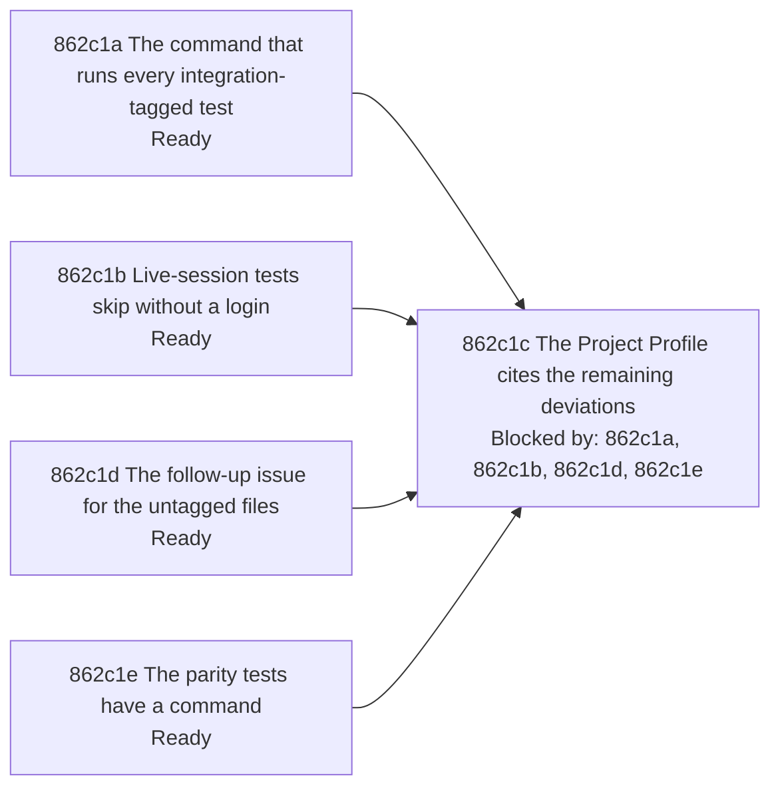

# Test Suite Classification - Implementation Plan

Scope. The approved work is a command that runs every `integration`-tagged test of the module, a clear skip when the live-session tests find no login, a command for the `parity` tests, and a Project Profile that cites the remaining deviations instead of listing them ([862a1 Problem statement](./862a_product-spec.md#862a1-problem-statement); the decisions are the rows of [Questions and decisions](./862d_questions-and-decisions.md#questions-and-decisions)). Sources: issue [#862](https://github.com/toejough/engram/issues/862), [858d99 Test-suite classification deviations](../858_documentation-framework-adoption/858d_questions-and-decisions.md#questions-and-decisions), `dev/targs.go`, `dev/acceptance/session_test.go`, `internal/embed/parity_test.go`, the Project Profile in `AGENTS.md`. Responsibilities in scope: items 1 and 2 of the issue and the missing command are fixed; item 3 is recorded as a deviation with a recommendation and a follow-up issue; item 4 stays with [#860](https://github.com/toejough/engram/issues/860). Constraints: tests are black-box and parallel; the targets are changed only in `dev/targs.go`; no existing gate is removed; `Merged` is used.

## Work graph

The Profile node waits for the nodes it cites. The first, second, fourth and fifth nodes are independent.

## Test catalog

One section per node of the graph. Each row has one scenario ID and one independently tracked test, named `Test<ID>_<Subject>_<Title>` (the rule of `dev/conformance.go`). `WORKFLOW n-m` = lines of `docs/WORKFLOW-GUIDE.md`. Statuses follow WORKFLOW 288-310; every row starts `Not started`. Red evidence, runner, merge, milestones and commits follow [862d5 Method shared with 861](./862d_questions-and-decisions.md#questions-and-decisions); so does the reflection after a green node (the commit body records `Refactor: <named difficulty> -> refactor(<scope>) <sha>` or `Refactor: none justified`). Command per step: `targ test-dev`, and `targ test-dev-integration` for the integration test files; milestones: `targ check-full`.

### 862c1 Nodes

#### 862c1a The command that runs every integration-tagged test

Status: Ready

- Owner: [794b4 Development Check Orchestration](../../specs/technical/development-check-orchestration.md#794b4-development-check-orchestration); Added operations [862b2a One command runs every integration-tagged test](./862b_technical-spec.md#862b2a-added-one-command-runs-every-integration-tagged-test) and [862a3a Every integration-tagged test runs in the full check](./862a_product-spec.md#862a3a-added-every-integration-tagged-test-runs-in-the-full-check), Modified operations [862b3a Preserve entry points](./862b_technical-spec.md#862b3a-modified-preserve-entry-points) and [862b3b Engram's aggregates match Targ's apart from the nil targets](./862b_technical-spec.md#862b3b-modified-engrams-aggregates-match-targs-apart-from-the-nil-targets).
- Package: `dev`; suggested test files: `dev/integration_all_internal_test.go` (tag `targ`) and `dev/integration_all_integration_internal_test.go` (tag `targ && integration`, a fixture module run for real).
- Read first: `dev/targs.go` (`testDevIntegration`, `registerTargets`, the aggregate targets), `dev/nilaway_internal_test.go` (`Test794b4a1c_`), `dev/nilaway_integration_internal_test.go`.
- Class: default of the `dev` tree for the argv scenario; integration for the fixture-module scenarios.

| ID | Gherkin | Classification | Why | Status |
| --- | --- | --- | --- | --- |
| 862c1a1 | [862b2a1a The command selects by tag over the whole module](./862b_technical-spec.md#862b2a1-contract-scenarios) | Example | Fixed inputs, one exact command line. Evidence: Test862b2a1a_TestIntegrationAll_TheCommandSelectsByTagOverTheWholeModule; Red: b00/862c1a-red-test-dev.log (build failed, undefined runIntegrationAll); Green: b00/862c1a-green-test-dev.log (exit=0); mutations that failed it: the timeout changed to 2m (b00/862c1a-mutation-timeout.log) and the integration tag dropped from the command line (b00/862c1a-mutation-no-integration-tag.log). | Green-single |
| 862c1a2 | [862b2a1b A tagged test is run whatever its package and name](./862b_technical-spec.md#862b2a1-contract-scenarios) | Example | Real `go test` on a fixture module; tagged test. Evidence: Test862b2a1b_TestIntegrationAll_ATaggedTestIsRunWhateverItsPackageAndName in dev/integration_all_integration_internal_test.go; Red: not run on its own (the file builds only under the integration tag; b00/862c1a-red-test-dev.log shows runIntegrationAll undefined); Green: b00/862c1a-green-test-dev-integration.log (exit=0); failed by the mutation that drops the integration tag from the command line: b00/862c1a-mutation-no-integration-tag.log. | Green-single |
| 862c1a3 | [862b2a1c A failing tagged test fails the command](./862b_technical-spec.md#862b2a1-contract-scenarios) | Example | Real `go test` on a fixture module; tagged test. Evidence: Test862b2a1c_TestIntegrationAll_AFailingTaggedTestFailsTheCommand in dev/integration_all_integration_internal_test.go; Green: b00/862c1a-green-test-dev-integration.log (exit=0); failed by the mutation that drops the integration tag (the tagged test no longer runs, so nothing fails): b00/862c1a-mutation-no-integration-tag.log. | Green-single |
| 862c1a4 | [862b3b Engram's aggregates match Targ's apart from the nil targets](./862b_technical-spec.md#862b3b-modified-engrams-aggregates-match-targs-apart-from-the-nil-targets) | Interaction | The existing `Test794b4a1c_` compares dependency lists with Targ's own; it is updated, not added. Evidence: Test794b4a1c_AggregatesMatchTargsApartFromNilTargets updated (the extras of check-for-fail and check-full end in test-integration-all); Red: b00/862c1a-red-test-dev.log (build failed, undefined testIntegrationAllTarget); Green: b00/862c1a-green-test-dev.log (exit=0); the mutation that leaves test-integration-all out of check-full failed it: b00/862c1a-mutation-check-full-without-leg.log. | Green-single |
| 862c1a5 | [862a3a1a Every integration-tagged test runs in the full check](./862a_product-spec.md#862a3a1-uat-scenarios) | Interaction | The final dependency group of `check-full` holds `test-integration-all`; same seam as `Test794b4a1c_`. Evidence: Test862a3a1a_TestIntegrationAll_BothAggregatesRunItInTheirFinalGroup; Red: b00/862c1a-red-test-dev.log; Green: b00/862c1a-green-test-dev.log (exit=0); failed by the mutation that leaves test-integration-all out of check-full: b00/862c1a-mutation-check-full-without-leg.log. | Green-single |

| ID | Work | Classification | Why | Status |
| --- | --- | --- | --- | --- |
| 862c1a6 | Register `test-integration-all` in `init()` and in the final dependency group of `check-for-fail` and `check-full`, and update the comment on the aggregates in `dev/targs.go` | Action | [862d3 The command that runs every integration-tagged test](./862d_questions-and-decisions.md#questions-and-decisions) | Done |
| 862c1a7 | Run `targ check-full` once on the branch and record the leg's time and result in the shared evidence | Action | [862d3 The command that runs every integration-tagged test](./862d_questions-and-decisions.md#questions-and-decisions) | Not started |

#### 862c1b Live-session tests skip without a login

Status: Ready

- Owner: [794b4 Development Check Orchestration](../../specs/technical/development-check-orchestration.md#794b4-development-check-orchestration); Added operations [862b2b A live-session test without a login is skipped](./862b_technical-spec.md#862b2b-added-a-live-session-test-without-a-login-is-skipped) and [862a3b A check without a login skips](./862a_product-spec.md#862a3b-added-a-check-without-a-login-skips).
- Package: `dev/acceptance` (tag `network`); suggested: extract the token lookup of `claudeToken` to an untagged file `dev/acceptance/token_logic_test.go`, as `measure_logic_test.go` holds the pure logic of the measurements, so that the default suite runs its test ([862d6 Scope of the acceptance skip](./862d_questions-and-decisions.md#questions-and-decisions)). The extracted lookup takes the environment lookup and the credential-file reader as parameters (`claudeToken` keeps the `os` calls and passes them in), so that the tests run in parallel without `t.Setenv`.
- Read first: `dev/acceptance/session_test.go` (`claudeToken`, `tokenVariable`, `credentialFile`), `dev/acceptance/measure_logic_test.go`.
- Class: default after the extraction.

| ID | Gherkin | Classification | Why | Status |
| --- | --- | --- | --- | --- |
| 862c1b1 | [862b2b1a A missing login skips the test](./862b_technical-spec.md#862b2b1-contract-scenarios) | Example | Fixed environment, one exact outcome (skipped, message). Evidence: Test862b2b1a_RequireToken_AMissingLoginSkipsTheTestAndNamesTheVariableAndTheFile in the untagged dev/acceptance/token_unit_test.go (the default suite runs it); Red: b00/862c1b-red-test-pkg-acceptance.log (build failed, undefined requireToken); Green: b00/862c1b-green-test-pkg-acceptance.log (exit=0); failed by the mutation that removes the Skipf call: b00/862c1b-mutation-no-skip.log. | Green-single |
| 862c1b2 | [862b2b1b A login that exists is used](./862b_technical-spec.md#862b2b1-contract-scenarios) | Example | Fixed environment, one exact outcome. Evidence: Test862b2b1b_RequireToken_ALoginThatExistsIsUsed (the variable, the variable over the file, the file); Red: b00/862c1b-red-test-pkg-acceptance.log; Green: b00/862c1b-green-test-pkg-acceptance.log (exit=0); failed by the mutation that ignores the variable: b00/862c1b-mutation-variable-ignored.log. | Green-single |
| 862c1b3 | [862a3b1a A check without a login skips](./862a_product-spec.md#862a3b1-uat-scenarios) | Example | Same mechanism as [862b2b1a A missing login skips the test](./862b_technical-spec.md#862b2b1-contract-scenarios), named by the product scenario. Evidence: Test862a3b1a_RequireToken_ACheckWithoutALoginSkipsAndSaysWhichLogin; Red: b00/862c1b-red-test-pkg-acceptance.log; Green: b00/862c1b-green-test-pkg-acceptance.log (exit=0); failed by the mutation that removes the Skipf call: b00/862c1b-mutation-no-skip.log. | Green-single |

#### 862c1e The parity tests have a command

Status: Ready

- Owner: [794b4 Development Check Orchestration](../../specs/technical/development-check-orchestration.md#794b4-development-check-orchestration); Added operations [862b2c A parity run has its own command](./862b_technical-spec.md#862b2c-added-a-parity-run-has-its-own-command) and [862a3c The real-model parity check has a command](./862a_product-spec.md#862a3c-added-the-real-model-parity-check-has-a-command).
- Package: `dev`; suggested test file: `dev/test_parity_internal_test.go` (tag `targ`).
- Read first: `dev/targs.go` (`testDevIntegration`, `registerTargets`), `internal/embed/parity_test.go` (header).
- Class: default of the `dev` tree.

| ID | Gherkin | Classification | Why | Status |
| --- | --- | --- | --- | --- |
| 862c1e1 | [862b2c1a The parity command line is pinned](./862b_technical-spec.md#862b2c1-contract-scenarios) | Example | Fixed inputs, one exact command line. Evidence: Test862b2c1a_TestParity_TheCommandLineIsPinned; Red: b00/862c1e-red-test-dev.log (build failed, undefined runParity); Green: b00/862c1e-green-test-dev-2.log (exit=0); failed by the mutation that changes the package path to ./internal/embed/...: b00/862c1e-mutation-package-pattern.log. The target itself ran the parity tests for real: b00/862c1e-selfcheck-test-parity.log (ok, exit=0). | Green-single |
| 862c1e2 | [862b2c1b The aggregates do not run it](./862b_technical-spec.md#862b2c1-contract-scenarios) | Interaction | Compares the dependency lists of `check-for-fail` and `check-full`; same seam as `Test794b4a1c_`. Evidence: Test862b2c1b_TestParity_TheAggregatesDoNotRunIt; Red: b00/862c1e-red-test-dev.log; Green: b00/862c1e-green-test-dev-2.log (exit=0); failed by the mutation that adds test-parity to check-full: b00/862c1e-mutation-parity-in-check-full.log (it failed Test794b4a1c_ too). | Green-single |
| 862c1e3 | [862a3c1a A developer runs the parity check](./862a_product-spec.md#862a3c1-uat-scenarios) | Example | The command line names the `parity` tag and `./internal/embed`; same seam as [862b2c1a The parity command line is pinned](./862b_technical-spec.md#862b2c1-contract-scenarios). Evidence: Test862a3c1a_TestParity_TheCommandLineNamesTheParityTagAndTheEmbedPackage; Red: b00/862c1e-red-test-dev.log; Green: b00/862c1e-green-test-dev-2.log (exit=0); failed by the mutation that changes the package path: b00/862c1e-mutation-package-pattern.log. | Green-single |

| ID | Work | Classification | Why | Status |
| --- | --- | --- | --- | --- |
| 862c1e4 | Register `test-parity` in `init()`, outside the aggregates | Action | [862d9 Item 2: the parity tag has no approved command](./862d_questions-and-decisions.md#questions-and-decisions) | Done |
| 862c1e5 | Replace the direct `go test` line in the header of `internal/embed/parity_test.go` with `targ test-parity` | Action | [862d9 Item 2: the parity tag has no approved command](./862d_questions-and-decisions.md#questions-and-decisions) | Done |

#### 862c1d The follow-up issue for the untagged files

Status: Ready

- Rule: WORKFLOW 578-582 (a filed issue records a deviation; it does not satisfy verification). The change directory is deleted at promotion, so the Project Profile cites the issue, not the decision row.

| ID | Work | Classification | Why | Status |
| --- | --- | --- | --- | --- |
| 862c1d1 | File one GitHub issue (`gh issue create`) for item 3: nine `*_integration_test.go` files outside `dev/` carry no tag; tag them once `test-integration-all` runs in `check-full` and the coverage floor is re-measured without them; record its number in [862d10 Item 3: nine integration test files carry no tag](./862d_questions-and-decisions.md#questions-and-decisions) | Action | [862d10 Item 3: nine integration test files carry no tag](./862d_questions-and-decisions.md#questions-and-decisions) Evidence: filed as [#863](https://github.com/toejough/engram/issues/863) with `gh issue create`; its number is recorded in 862d10. | Done |

#### 862c1c The Project Profile cites the remaining deviations

Status: Blocked by: [862c1a The command that runs every integration-tagged test](#862c1a-the-command-that-runs-every-integration-tagged-test), [862c1b Live-session tests skip without a login](#862c1b-live-session-tests-skip-without-a-login), [862c1d The follow-up issue for the untagged files](#862c1d-the-follow-up-issue-for-the-untagged-files), [862c1e The parity tests have a command](#862c1e-the-parity-tests-have-a-command)

- Rule: the issue's last condition, the Profile no longer lists the deviations it names; the Profile table row of the integration suite names `test-integration-all`.

| ID | Work | Classification | Why | Status |
| --- | --- | --- | --- | --- |
| 862c1c1 | Replace the sentence of known deviations in the test-suite part of the Project Profile (`AGENTS.md`) with one that cites the issue filed by [862c1d The follow-up issue for the untagged files](#862c1d-the-follow-up-issue-for-the-untagged-files) and [#860](https://github.com/toejough/engram/issues/860) only; the acceptance skip and the parity command are no longer deviations | Action | [862d7 Project Profile wording](./862d_questions-and-decisions.md#questions-and-decisions) | Not started |
| 862c1c2 | Rewrite the integration row of the Profile table: `test-integration-all` runs every tagged test; the clause that no `integration`-tagged file exists outside `dev/` is dropped | Action | [862d7 Project Profile wording](./862d_questions-and-decisions.md#questions-and-decisions) | Not started |
| 862c1c3 | Add `test-integration-all` and `test-parity` to the approved commands, in the files and lines that the surface row of [861c1a The test-pkg target](../861_scenario-coverage/861c_implementation-plan.md#861c1a-the-test-pkg-target) lists (`AGENTS.md` Language and toolchain and Code Quality, `README.md` Development) | Action | [862d7 Project Profile wording](./862d_questions-and-decisions.md#questions-and-decisions) | Not started |

## 862c2 Evidence and status

Latest verified evidence per milestone; a result not yet recorded is `Not run`, never a pass.

| ID | Evidence | Command | Result | Recorded at |
| --- | --- | --- | --- | --- |
| 862c2a | Dev tests of the new commands, of the skip and of the updated aggregate scenario | `targ test-dev` | Not run | - |
| 862c2b | Dev integration tests, fixture module included | `targ test-dev-integration` | Not run | - |
| 862c2c | Lint, coverage, nil analysis and the new leg | `targ check-full` | Not run | - |
| 862c2d | Links, IDs and labels of this change | link check over `docs/`; ID and label scan over `docs/specs` and `docs/changes` | Passed on the tree of 8c4d6da6: link check 12,022 links, 0 broken; ID scan 0 duplicates of 8,314 defined IDs, 9,823 ID-labelled links with 0 mismatches, 0 unresolved tokens | 8c4d6da6 |

## 862c3 Completion gates

Behavior-delivery gates (WORKFLOW 150-158); 862 merges without promotion ([862d8 862 merges without promotion](./862d_questions-and-decisions.md#questions-and-decisions)).

| ID | Gate | Evidence |
| --- | --- | --- |
| 862c3a | Coverage: every scenario of the catalog has a passing test; the deviation of item 3 carries a recommendation and a follow-up issue | [862c1 Nodes](#862c1-nodes) |
| 862c3b | Quality: `targ test`, `targ check-full` pass on `main` | the rows of [862c2 Evidence and status](#862c2-evidence-and-status) |
| 862c3c | Progress: every row is Done and every node Merged; issue [#862](https://github.com/toejough/engram/issues/862) is closed by the commit that completes it | node statuses |
| 862c3d | Reviews: one agent review round (with argumentation) before each merge, and the three milestone reviews | [861d10 Milestones and the push](../861_scenario-coverage/861d_questions-and-decisions.md#questions-and-decisions) |
| 862c3e | Owner walkthroughs: each is an Open row that blocks promotion only | [862d12 Red milestone walkthrough](./862d_questions-and-decisions.md#questions-and-decisions), [862d13 Green milestone walkthrough](./862d_questions-and-decisions.md#questions-and-decisions), [862d14 Refactor milestone walkthrough](./862d_questions-and-decisions.md#questions-and-decisions) |
| 862c3f | Integration: promotion of the operations to `docs/specs` after the walkthroughs | deferred; [862d8 862 merges without promotion](./862d_questions-and-decisions.md#questions-and-decisions), [861d28 Promotion order of 861, 862 and 858](../861_scenario-coverage/861d_questions-and-decisions.md#questions-and-decisions) |
| 862c3g | Consolidation: after Green, review findings and reflection lessons become consolidation nodes in this plan; the Consolidation Criteria evidence (WORKFLOW 337-353) is recorded before the Refactor review | [861d12 Incremental refactoring](../861_scenario-coverage/861d_questions-and-decisions.md#questions-and-decisions), [862c2 Evidence and status](#862c2-evidence-and-status) |
