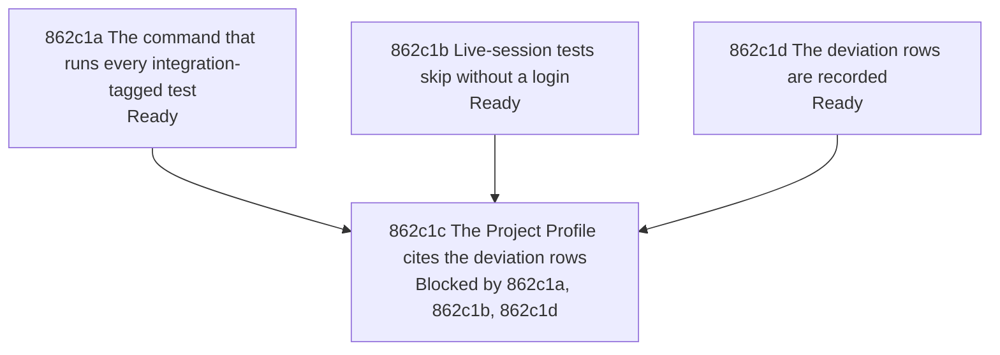

# Test Suite Classification - Implementation Plan

Scope. The approved work is a command that runs every `integration`-tagged test of the module, a clear skip when the live-session tests find no login, and a Project Profile that cites decision rows instead of listing deviations ([862a1 Problem statement](./862a_product-spec.md#862a1-problem-statement); the decisions are the rows of [Questions and decisions](./862d_questions-and-decisions.md#questions-and-decisions)). Sources: issue [#862](https://github.com/toejough/engram/issues/862), [858d99 Test-suite classification deviations](../858_documentation-framework-adoption/858d_questions-and-decisions.md#questions-and-decisions), `dev/targs.go`, `dev/acceptance/session_test.go`, the Project Profile in `AGENTS.md`. Responsibilities in scope: item 1 of the issue and the missing command are fixed; items 2 and 3 are recorded as deviations with a recommendation each, for the owner to rule; item 4 stays with [#860](https://github.com/toejough/engram/issues/860). Constraints: tests are black-box and parallel; the targets are changed only in `dev/targs.go`; no existing gate is removed; `Merged` is used.

## Work graph

The Profile node waits for the nodes it cites. The first, second and fourth nodes are independent.

## Test catalog

One section per node of the graph. Each row has one scenario ID and one independently tracked test, named `Test<ID>_<Subject>_<Title>` (the rule of `dev/conformance.go`). Statuses follow WORKFLOW 288-310; every row starts `Not started`. Red evidence, runner, merge, milestones and commits follow [862d5 Method shared with 861](./862d_questions-and-decisions.md#questions-and-decisions). Command per step: `targ test-dev`, and `targ test-dev-integration` for the integration test files; milestones: `targ check-full`.

### 862c1 Nodes

#### 862c1a The command that runs every integration-tagged test

Status: Ready

- Owner: [794b4 Development Check Orchestration](../../specs/technical/development-check-orchestration.md#794b4-development-check-orchestration); Added operation [862b2a One command runs every integration-tagged test](./862b_technical-spec.md#862b2a-added-one-command-runs-every-integration-tagged-test), Modified operations [862b3a Preserve entry points](./862b_technical-spec.md#862b3a-modified-preserve-entry-points) and [862b3b Engram's aggregates match Targ's apart from the nil targets](./862b_technical-spec.md#862b3b-modified-engrams-aggregates-match-targs-apart-from-the-nil-targets).
- Package: `dev`; suggested test files: `dev/integration_all_internal_test.go` (tag `targ`) and `dev/integration_all_integration_internal_test.go` (tag `targ && integration`, a fixture module run for real).
- Read first: `dev/targs.go` (`testDevIntegration`, `registerTargets`, the aggregate targets), `dev/nilaway_internal_test.go` (`Test794b4a1c_`), `dev/nilaway_integration_internal_test.go`.
- Class: default of the `dev` tree for the argv scenario; integration for the fixture-module scenarios.

| ID | Gherkin | Classification | Why | Properties | Status |
| --- | --- | --- | --- | --- | --- |
| 862c1a1 | [862b2a1a The command selects by tag over the whole module](./862b_technical-spec.md#862b2a1-contract-scenarios) | Example | Fixed inputs, one exact command line | - | Not started |
| 862c1a2 | [862b2a1b A tagged test is run whatever its package and name](./862b_technical-spec.md#862b2a1-contract-scenarios) | Example | Real `go test` on a fixture module; tagged test | - | Not started |
| 862c1a3 | [862b2a1c A failing tagged test fails the command](./862b_technical-spec.md#862b2a1-contract-scenarios) | Example | Real `go test` on a fixture module; tagged test | - | Not started |
| 862c1a4 | [862b3b Engram's aggregates match Targ's apart from the nil targets](./862b_technical-spec.md#862b3b-modified-engrams-aggregates-match-targs-apart-from-the-nil-targets) | Interaction | The existing `Test794b4a1c_` compares dependency lists with Targ's own; it is updated, not added | - | Not started |

| ID | Work | Classification | Why | Status |
| --- | --- | --- | --- | --- |
| 862c1a5 | Register `test-integration-all` in `init()` and in the final dependency group of `check-for-fail` and `check-full` | Action | [862d3 The command that runs every integration-tagged test](./862d_questions-and-decisions.md#questions-and-decisions) | Not started |
| 862c1a6 | Run `targ check-full` once on the branch and record the leg's time and result in the shared evidence | Action | [862d3 The command that runs every integration-tagged test](./862d_questions-and-decisions.md#questions-and-decisions) | Not started |

#### 862c1b Live-session tests skip without a login

Status: Ready

- Owner: [794b4 Development Check Orchestration](../../specs/technical/development-check-orchestration.md#794b4-development-check-orchestration); Added operation [862b2b A live-session test without a login is skipped](./862b_technical-spec.md#862b2b-added-a-live-session-test-without-a-login-is-skipped).
- Package: `dev/acceptance` (tag `network`); suggested: extract the token lookup of `claudeToken` to an untagged file, as `measure_logic_test.go` holds the pure logic of the measurements, so that the default suite runs its test ([862d6 Scope of the acceptance skip](./862d_questions-and-decisions.md#questions-and-decisions)).
- Read first: `dev/acceptance/session_test.go` (`claudeToken`, `tokenVariable`, `credentialFile`), `dev/acceptance/measure_logic_test.go`.
- Class: default after the extraction.

| ID | Gherkin | Classification | Why | Properties | Status |
| --- | --- | --- | --- | --- | --- |
| 862c1b1 | [862b2b1a A missing login skips the test](./862b_technical-spec.md#862b2b1-contract-scenarios) | Example | Fixed environment, one exact outcome (skipped, message) | - | Not started |
| 862c1b2 | [862b2b1b A login that exists is used](./862b_technical-spec.md#862b2b1-contract-scenarios) | Example | Fixed environment, one exact outcome | - | Not started |

#### 862c1c The Project Profile cites the deviation rows

Status: Blocked by: [862c1a The command that runs every integration-tagged test](#862c1a-the-command-that-runs-every-integration-tagged-test), [862c1b Live-session tests skip without a login](#862c1b-live-session-tests-skip-without-a-login), [862c1d The deviation rows are recorded](#862c1d-the-deviation-rows-are-recorded)

- Rule: the issue's last condition, the Profile no longer lists the deviations it names; the Profile table row of the integration suite names `test-integration-all`.

| ID | Work | Classification | Why | Status |
| --- | --- | --- | --- | --- |
| 862c1c1 | Replace the sentence of known deviations in the test-suite part of the Project Profile (`AGENTS.md`) with one that cites [862d9 Item 2: the parity tag has no approved command](./862d_questions-and-decisions.md#questions-and-decisions), [862d10 Item 3: nine integration test files carry no tag](./862d_questions-and-decisions.md#questions-and-decisions) and [#860](https://github.com/toejough/engram/issues/860) | Action | [862d7 Project Profile wording](./862d_questions-and-decisions.md#questions-and-decisions) | Not started |
| 862c1c2 | Rewrite the integration row of the Profile table: `test-integration-all` runs every tagged test; the clause that no `integration` file exists outside `dev/` stays true until [862d10 Item 3: nine integration test files carry no tag](./862d_questions-and-decisions.md#questions-and-decisions) is ruled | Action | [862d7 Project Profile wording](./862d_questions-and-decisions.md#questions-and-decisions) | Not started |
| 862c1c3 | Add `test-integration-all` to the approved commands of the Profile | Action | [862d7 Project Profile wording](./862d_questions-and-decisions.md#questions-and-decisions) | Not started |

#### 862c1d The deviation rows are recorded

Status: Ready

- Rule: WORKFLOW 575 and 606-609: the owner rules on items 2 and 3; an open issue link and status stay beside the deviation.

| ID | Work | Classification | Why | Status |
| --- | --- | --- | --- | --- |
| 862c1d1 | Keep item 2 (the `parity` tag, `internal/embed/parity_test.go`) as the Open row with options and a recommendation | Action | [862d9 Item 2: the parity tag has no approved command](./862d_questions-and-decisions.md#questions-and-decisions) | Not started |
| 862c1d2 | Keep item 3 (nine `*_integration_test.go` files outside `dev/`) as the Open row with options and a recommendation | Action | [862d10 Item 3: nine integration test files carry no tag](./862d_questions-and-decisions.md#questions-and-decisions) | Not started |
| 862c1d3 | Leave item 4 (eighteen default-suite tests with a real temporary directory) to [#860](https://github.com/toejough/engram/issues/860) | Action | [862d2 Scope of 862](./862d_questions-and-decisions.md#questions-and-decisions) | Not started |

## 862c2 Evidence and status

Latest verified evidence per milestone; a result not yet recorded is `Not run`, never a pass.

| ID | Evidence | Command | Result | Recorded at |
| --- | --- | --- | --- | --- |
| 862c2a | Dev tests of the new command and of the updated aggregate scenario | `targ test-dev` | Not run | - |
| 862c2b | Dev integration tests, fixture module included | `targ test-dev-integration` | Not run | - |
| 862c2c | Lint, coverage, nil analysis and the new leg | `targ check-full` | Not run | - |
| 862c2d | Links, IDs and labels of this change | link check over `docs/`; ID and label scan over `docs/specs` and `docs/changes` | Not run | - |

## 862c3 Completion gates

Behavior-delivery gates (WORKFLOW 150-158); 862 merges without promotion ([862d8 862 merges without promotion](./862d_questions-and-decisions.md#questions-and-decisions)).

| ID | Gate | Evidence |
| --- | --- | --- |
| 862c3a | Coverage: every scenario of the catalog has a passing test; the Open rows of items 2 and 3 carry a recommendation | [862c1 Nodes](#862c1-nodes) |
| 862c3b | Quality: `targ test`, `targ check-full` pass on `main` | the rows of [862c2 Evidence and status](#862c2-evidence-and-status) |
| 862c3c | Progress: every row is Done and every node Merged; issue [#862](https://github.com/toejough/engram/issues/862) is closed by the commit that completes it | node statuses |
| 862c3d | Reviews: one agent review round (with argumentation) before each merge, and the three milestone reviews | [861d10 Milestones and the push](../861_scenario-coverage/861d_questions-and-decisions.md#questions-and-decisions) |
| 862c3e | Owner walkthroughs: each is an Open row that blocks promotion only | [862d12 Red milestone walkthrough](./862d_questions-and-decisions.md#questions-and-decisions), [862d13 Green milestone walkthrough](./862d_questions-and-decisions.md#questions-and-decisions), [862d14 Refactor milestone walkthrough](./862d_questions-and-decisions.md#questions-and-decisions) |
| 862c3f | Integration: promotion of the operations to `docs/specs` after the walkthroughs | not done overnight; [862d8 862 merges without promotion](./862d_questions-and-decisions.md#questions-and-decisions) |
