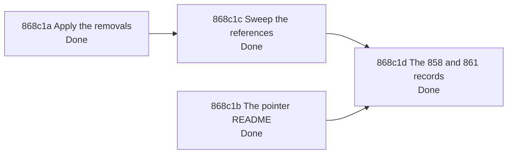

# Development-Tooling Withdrawal - Implementation Plan

Scope. The approved work applies the Removed operations of [868a2 Memory Effectiveness Evaluation](./868a_product-spec.md#868a2-removed-memory-effectiveness-evaluation), [868b1 Eval Trial Harness](./868b_technical-spec.md#868b1-removed-eval-trial-harness) and [868b2 Memory Loop Auditor](./868b_technical-spec.md#868b2-removed-memory-loop-auditor) in place, leaves a short README beside the code, fixes every reference to the removed files and IDs, and brings the records of #858 and #861 to the decision. It adds no behavior and no scenario, so no test is written; the checks are the link check, the ID and label scan and the catalog count. Decisions: [Questions and decisions](./868d_questions-and-decisions.md#questions-and-decisions). Issue: [#868](https://github.com/toejough/engram/issues/868).

## Work graph

## Test catalog

No scenario is added or changed; every row is an Action verified by the evidence rows of [868c2 Evidence and status](#868c2-evidence-and-status).

### 868c1 Nodes

#### 868c1a Apply the removals

Status: Done

| ID | Work | Classification | Why | Status |
| --- | --- | --- | --- | --- |
| 868c1a1 | `git rm` the three files of the Removed operations | Action | [868d1 Owner decision: option (e)](./868d_questions-and-decisions.md#questions-and-decisions), [868d2 Delete rather than relocate](./868d_questions-and-decisions.md#questions-and-decisions) | Done |

#### 868c1b The pointer README

Status: Done

| ID | Work | Classification | Why | Status |
| --- | --- | --- | --- | --- |
| 868c1b1 | Add `dev/eval/README.md` (at most ten lines) | Action | [868d3 A short README beside the code](./868d_questions-and-decisions.md#questions-and-decisions), [868d4 What the pytest suites remain](./868d_questions-and-decisions.md#questions-and-decisions) | Done |

#### 868c1c Sweep the references

Status: Done

| ID | Work | Classification | Why | Status |
| --- | --- | --- | --- | --- |
| 868c1c1 | Fix each link or citation to the removed files and IDs in `docs/`, `README.md`, `AGENTS.md`, `dev/` and `internal/`, except the pytest files and the `dev/eval` result records | Action | [868d4 What the pytest suites remain](./868d_questions-and-decisions.md#questions-and-decisions) | Done |

#### 868c1d The 858 and 861 records

Status: Done

| ID | Work | Classification | Why | Status |
| --- | --- | --- | --- | --- |
| 868c1d1 | In 858c: withdrawn verdict and issue cell `-` on the audit rows of the three files, their rows and lists out of 858c2a, the totals sentence from `gen_catalog.py` | Action | [868d5 Records of #858 and #861](./868d_questions-and-decisions.md#questions-and-decisions) | Done |
| 868c1d2 | In 861c: the nodes 861c3a to 861c3i `Withdrawn (861d21 e)`, the rows that count them refreshed | Action | [868d5 Records of #858 and #861](./868d_questions-and-decisions.md#questions-and-decisions) | Done |
| 868c1d3 | 861d21 and 858d100 `Decided` | Action | [868d1 Owner decision: option (e)](./868d_questions-and-decisions.md#questions-and-decisions) | Done |
| 868c1d4 | The three task-list lines of #861 marked, one comment on #861 | Action | [868d1 Owner decision: option (e)](./868d_questions-and-decisions.md#questions-and-decisions) | Done |

## 868c2 Evidence and status

| ID | Evidence | Command | Result | Recorded at |
| --- | --- | --- | --- | --- |
| 868c2a | Links of `docs/` | link check over `docs/` | Passed: 10379 relative links, 0 broken (before: 10948) | 486dbfaf |
| 868c2b | IDs and labels | ID and label scan over `docs/specs` and `docs/changes` | Passed, with the scan extended to the key 868: 0 duplicates of 8049 defined IDs, 8223 ID-labelled links with 0 mismatches, 0 unresolved tokens, 0 operations of 858 unapplied | 486dbfaf |
| 868c2c | Scenario catalog | `gen_catalog.py` | 3402 scenarios, 3042 with a test, 360 without (before: 3572, 3042 and 530; the 170 scenarios of the three files had no `Test<ID>_` function); the rows, lists and totals of 858c2a, the functions of 858c2b and the tags of 858c2c are this output | 486dbfaf |

## 868c3 Completion gates

| ID | Gate | Evidence |
| --- | --- | --- |
| 868c3a | The three files are removed and no reference to them or their IDs remains outside the pytest files and the `dev/eval` records | [868c2 Evidence and status](#868c2-evidence-and-status) |
| 868c3b | The records of #858 and #861 show the nodes withdrawn and the rows decided | [868c1d The 858 and 861 records](#868c1d-the-858-and-861-records) |
| 868c3c | Promotion: the operations are applied in place, so there is nothing to promote; the directory is deleted when 858 and 861 are promoted ([861d28 Promotion order of 861, 862 and 858](../861_scenario-coverage/861d_questions-and-decisions.md#questions-and-decisions)) | [868d5 Records of #858 and #861](./868d_questions-and-decisions.md#questions-and-decisions) |
