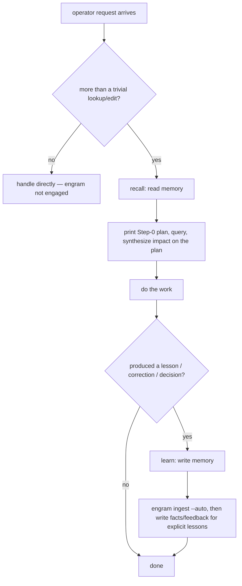

# L1 — System context

The system in scope is **Engram**, persistent memory for LLM coding agents. This
diagram shows the people and external systems engram interacts with at runtime.
Containers, components, technologies, and protocols are hidden — those live at L2
and below (see [L2](c2-containers.md) and [L3](c3-components.md)). The [Key flows](#key-flows) section below pairs the
static view with sequence diagrams for the four user-initiated runtime flows.

## Element catalog

| ID | Name | Type | Responsibility | Source |
|---|---|---|---|---|
| S1 | Engram operator | Person | Directs work through the LLM coding harness; configures engram via environment variables (`ENGRAM_VAULT_PATH`, `XDG_DATA_HOME`, etc.) | Human |
| S2 | Engram | System in scope | Operator-run tools outside the recall/learn/please/update flows (the rest of this row is in [792b2](../../changes/792_documentation-framework-adoption/792b_technical-spec.md#792b2-added-command-line-surface)) — `engram prune` (in [792a5](../../changes/792_documentation-framework-adoption/792a_product-spec.md#792a5-added-chunk-indexing)) and `engram count` (in [792a8](../../changes/792_documentation-framework-adoption/792a_product-spec.md#792a8-added-vault-counting)) | This repo (`cmd/engram/`, `internal/`, `agent-instructions/`) |
| S3 | LLM coding harness | External system | Hosts engram's slash commands and subprocess-invokes the engram CLI. All six engram skills (recall, learn, please, route, curate, write-memory) are loaded by the harness's skill mechanism from `agent-instructions/skills/`; the vault runbook notes that mirror them are in [792a12](../../changes/792_documentation-framework-adoption/792a_product-spec.md#792a12-added-skill-runbook-registration), and the sources registration scans in [792b30](../../changes/792_documentation-framework-adoption/792b_technical-spec.md#792b30-added-skill-source-discovery) | Claude Code (`~/.claude/`), Pi (`~/.pi/agent/`) |
| S5 | Harness session stores | External system | See [792b15](../../changes/792_documentation-framework-adoption/792b_technical-spec.md#792b15-added-transcript-reader) | — |
| S6 | Go toolchain | External system | Resolves module versions and installs the engram binary during `engram update` | `go` binary on `$PATH` |
| S7 | Parent engram vault (`engram serve`) | External system | Another engram instance's HTTP door, configured via `ENGRAM_PARENT` (the vault-graph is a tree — personal → team → org — never a mesh, so a node has at most one parent). Exposes only `query`, `show`, `activate` and `learn`; a served `learn` is always a child's offer going upward (a served `learn` writes or updates a pending note on the far side, and its receipt's `pending` field reports that note's true state — `false` only for an idempotent retry of an already-accepted offer, which changes nothing), while the downward direction is a pull through `GET /show?raw=1` plus a best-effort `POST /activate`, never `/learn` (ADR-0029) | `ENGRAM_PARENT=http://host:port`, another host's own `$ENGRAM_VAULT_PATH` |

## Relationships

| ID | From | To | Description |
|---|---|---|---|
| R1 | S1 Engram operator | S3 LLM coding harness | Directs work via prompts in the harness; configures engram via environment variables |
| R2 | S3 LLM coding harness | S2 Engram | See [792b32](../../changes/792_documentation-framework-adoption/792b_technical-spec.md#792b32-added-agent-instruction-bundle) and [792b2](../../changes/792_documentation-framework-adoption/792b_technical-spec.md#792b2-added-command-line-surface). |
| R4 | S2 Engram | S5 Harness session stores | See [792b18](../../changes/792_documentation-framework-adoption/792b_technical-spec.md#792b18-added-chunk-index-store) and [792b15](../../changes/792_documentation-framework-adoption/792b_technical-spec.md#792b15-added-transcript-reader) |
| R5 | S2 Engram | S6 Go toolchain | See [792b28](../../changes/792_documentation-framework-adoption/792b_technical-spec.md#792b28-added-self-installer) |
| R6 | S2 Engram | S3 LLM coding harness | See [792b29](../../changes/792_documentation-framework-adoption/792b_technical-spec.md#792b29-added-harness-deploy-sync) |
| R7 | S2 Engram | S7 Parent engram vault | With `ENGRAM_PARENT` set: `engram query` fetches the parent's `/query?dedupe-keys=1` and merges notes only (never chunks) into the local payload; `engram learn`/a content `amend`/`resituate` offer the note, queued in a local outbox and drained with backoff to the parent's `/learn`; `engram activate` on a local miss pulls the parent's note down via `GET /show?raw=1` as a new local pending offer, then best-effort bumps its use on the parent (ADR-0029) |

## Key flows

Four user-initiated flows span the L1 edges. Each diagram below uses the
shorthand participant aliases `Op` (S1), `H` (S3), `E` (S2), `V` (S4), `Tr`
(S5), `Go` (S6) and only declares the participants that flow touches. Source
references cite the entry-point symbol on `main` — grep the symbol, since line numbers drift.

### Flow: update

Ported: the product behavior is [792a11](../../changes/792_documentation-framework-adoption/792a_product-spec.md#792a11-added-install-and-update), the install and hand-off sequence [792b28](../../changes/792_documentation-framework-adoption/792b_technical-spec.md#792b28-added-self-installer), and the sync sequence [792b29](../../changes/792_documentation-framework-adoption/792b_technical-spec.md#792b29-added-harness-deploy-sync).

### L1 decision flowcharts

The sequence diagrams above show *message order*; these flowcharts show the *operator-level decision
logic* — when the system is engaged at all. (The `/please` workflow and its gates are
[792a18](../../changes/792_documentation-framework-adoption/792a_product-spec.md#792a18-added-please). Recall's coverage decision is
[792a14](../../changes/792_documentation-framework-adoption/792a_product-spec.md#792a14-added-recall), and learn's
capture kinds are [792a15](../../changes/792_documentation-framework-adoption/792a_product-spec.md#792a15-added-learn).)

#### Flow: engram engagement — the read → work → write → synthesize lifecycle

## Out of scope at L1

L1 hides containers, components, technologies, protocols, and internal structure.
Engram's internal containers (CLI binary, skills, transcript reader, vault writer,
update subsystem, debug logger) are deferred to L2.

The embedding model is not an external at L1; it is part of engram
([792b9](../../changes/792_documentation-framework-adoption/792b_technical-spec.md#792b9-added-text-embedder)).

## Related

- L2 container diagram: [c2-containers.md](c2-containers.md)
- L3 component diagram: [c3-components.md](c3-components.md)
