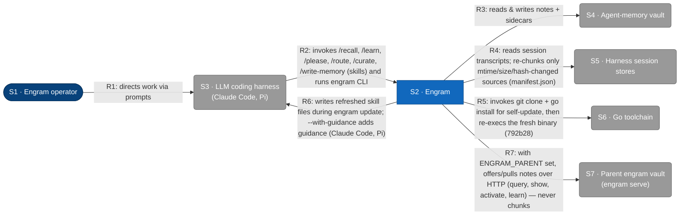
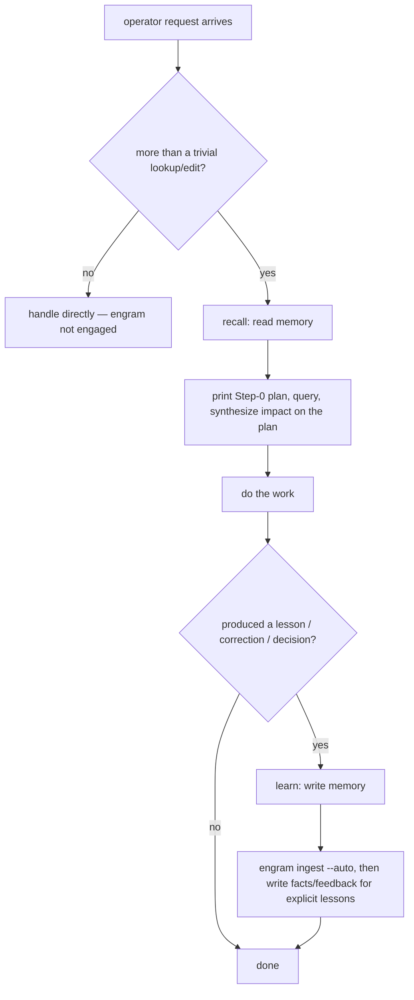
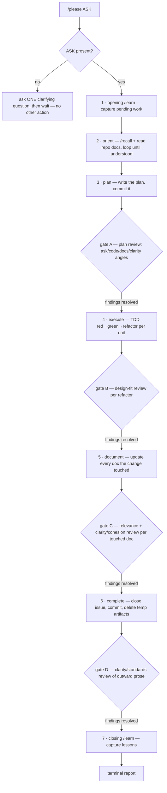

# L1 — System context

The system in scope is **Engram**, persistent memory for LLM coding agents. This
diagram shows the people and external systems engram interacts with at runtime.
Containers, components, technologies, and protocols are hidden — those live at L2
and below (see [L2](c2-containers.md) and [L3](c3-components.md)). The [Key flows](#key-flows) section below pairs the
static view with sequence diagrams for the four user-initiated runtime flows.



## Element catalog

| ID | Name | Type | Responsibility | Source |
|---|---|---|---|---|
| <a id="s1-engram-operator"></a>S1 | Engram operator | Person | Directs work through the LLM coding harness; configures engram via environment variables (`ENGRAM_VAULT_PATH`, `XDG_DATA_HOME`, etc.) | Human |
| <a id="s2-engram"></a>S2 | Engram | System in scope | Operator-run tools outside the recall/learn/please/update flows (the rest of this row is in [792b2](../../changes/792_documentation-framework-adoption/792b_technical-spec.md#792b2-added-command-line-surface)) — `engram prune` (in [792a5](../../changes/792_documentation-framework-adoption/792a_product-spec.md#792a5-added-chunk-indexing)) and `engram count` (in [792a8](../../changes/792_documentation-framework-adoption/792a_product-spec.md#792a8-added-vault-counting)) | This repo (`cmd/engram/`, `internal/`, `agent-instructions/`) |
| <a id="s3-llm-coding-harness"></a>S3 | LLM coding harness | External system | Hosts engram's slash commands and subprocess-invokes the engram CLI. All six engram skills (recall, learn, please, route, curate, write-memory) are loaded by the harness's skill mechanism from `agent-instructions/skills/`; each may also have a mirrored vault runbook note (slug derived from its skill key, `skill_hash`/`skill_key`/`skill_source` frontmatter) that `engram update`/`engram register-skills` offer to register, refresh, or remove, and that `engram query` can surface by trigger. Registration also offers notes for every other skill, command and Pi prompt template in the default folders, sourced from Claude user skills (`~/.claude/skills`) and commands (`~/.claude/commands`), claude.ai-synced skills, Pi user/agents skills and prompts (`~/.pi/agent/`, `~/.agents/`), Pi's configured sources (`~/.pi/agent/settings.json` skill/prompt paths and packages), enabled plugins (`~/.claude/plugins/installed_plugins.json`), and project-local sources (`.claude/{skills,commands}` up to the repo top-level; trusted `.pi/skills`, `.agents/skills`, `.pi/settings.json`, `.pi/prompts`). | Claude Code (`~/.claude/`), Pi (`~/.pi/agent/`) |
| <a id="s5-harness-session-stores"></a>S5 | Harness session stores | External system | See [792b15](../../changes/792_documentation-framework-adoption/792b_technical-spec.md#792b15-added-transcript-reader) | — |
| <a id="s6-go-toolchain"></a>S6 | Go toolchain | External system | Resolves module versions and installs the engram binary during `engram update` | `go` binary on `$PATH` |
| <a id="s7-parent-engram-vault"></a>S7 | Parent engram vault (`engram serve`) | External system | Another engram instance's HTTP door, configured via `ENGRAM_PARENT` (the vault-graph is a tree — personal → team → org — never a mesh, so a node has at most one parent). Exposes only `query`, `show`, `activate` and `learn`; a served `learn` is always a child's offer going upward (a served `learn` writes or updates a pending note on the far side, and its receipt's `pending` field reports that note's true state — `false` only for an idempotent retry of an already-accepted offer, which changes nothing), while the downward direction is a pull through `GET /show?raw=1` plus a best-effort `POST /activate`, never `/learn` (ADR-0029) | `ENGRAM_PARENT=http://host:port`, another host's own `$ENGRAM_VAULT_PATH` |

## Relationships

| ID | From | To | Description |
|---|---|---|---|
| <a id="r1"></a>R1 | S1 Engram operator | S3 LLM coding harness | Directs work via prompts in the harness; configures engram via environment variables |
| <a id="r2"></a>R2 | S3 LLM coding harness | S2 Engram | Invokes the `/recall`, `/learn`, `/please`, `/route`, `/curate`, and `/write-memory` skills; subprocess-executes the engram CLI for each invocation. |
| <a id="r4"></a>R4 | S2 Engram | S5 Harness session stores | See [792b18](../../changes/792_documentation-framework-adoption/792b_technical-spec.md#792b18-added-chunk-index-store) and [792b15](../../changes/792_documentation-framework-adoption/792b_technical-spec.md#792b15-added-transcript-reader) |
| <a id="r5"></a>R5 | S2 Engram | S6 Go toolchain | See [792b28](../../changes/792_documentation-framework-adoption/792b_technical-spec.md#792b28-added-self-installer) |
| <a id="r6"></a>R6 | S2 Engram | S3 LLM coding harness | During `engram update`, syncs refreshed `agent-instructions/skills/` to engram-owned roots (`~/.claude/engram/skills/`, `~/.pi/agent/engram/skills/`, etc.; ADR-0022 D1) and materializes them as symlinks in each harness's surface dirs (`~/.claude/skills/`, `~/.pi/agent/skills/`); removals from the source propagate (sync-delete); first update performs dark migration of pre-existing copies to symlinks; dangling symlinks are cleaned up. `--with-guidance` additionally syncs guidance docs to the root's `guidance/` subtree (`~/.claude/engram/guidance/`, `~/.pi/agent/engram/guidance/`; canonical paths) and materializes symlinks; compat symlinks at flat paths (`~/.claude/engram/*.md`) resolve existing `@import` lines (opt-in). Manifest-mode fallback for harnesses whose discovery fails symlink verification (ADR-0022 D7) |
| <a id="r7"></a>R7 | S2 Engram | S7 Parent engram vault | With `ENGRAM_PARENT` set: `engram query` fetches the parent's `/query?dedupe-keys=1` and merges notes only (never chunks) into the local payload; `engram learn`/a content `amend`/`resituate` offer the note, queued in a local outbox and drained with backoff to the parent's `/learn`; `engram activate` on a local miss pulls the parent's note down via `GET /show?raw=1` as a new local pending offer, then best-effort bumps its use on the parent (ADR-0029) |

## Key flows

Four user-initiated flows span the L1 edges. Each diagram below uses the
shorthand participant aliases `Op` (S1), `H` (S3), `E` (S2), `V` (S4), `Tr`
(S5), `Go` (S6) and only declares the participants that flow touches. Source
references cite the entry-point symbol on `main` — grep the symbol, since line numbers drift.

### Flow: recall

Operator asks a question that needs prior memory. The harness loads the `recall`
skill, prints its Step 0 judgement (Ask, Situation, Plan), then phrases exactly
**10** query strings (one per fixed angle) and issues a single `engram query`
call passing each phrase as a separate `--phrase` flag. Recall has two rungs: the default `deep`
(the full procedure shown here, with crystallization writes) and an opt-in `glance` rung
(read-only, ~3 phrases, no crystallization writes — cheaper per fire). Glance escalates to `deep`
for C5 (recency-channel standards). The sequence shown is `deep`.

What the binary returns for those phrases (the matched set, its clusters and candidate notes, the explore half, the superseding notes, the newest chunks and the trigger hits) is [792a7](../../changes/792_documentation-framework-adoption/792a_product-spec.md#792a7-added-memory-query) and [792b24](../../changes/792_documentation-framework-adoption/792b_technical-spec.md#792b24-added-query-engine). The harness then, **inline and blocking**, reads the cluster's members and candidates (plus the explore items) and applies an
**agent-judged coverage decision**: **covered** (candidate already states the principle with no material
omission, judged against the recency-weighted view) → `engram amend --activate --chunk-source <chunk ids>`
(refresh recency + provenance, no content rewrite); **near** (same situation, ≥1 substantive claim omitted)
→ `engram amend --chunk-source … <re-synthesized content>` (update in place, recency-weighted, D6);
**absent** (no candidate addresses the situation) → invoke the **write-memory** skill (2026-07-04 worker extraction; native invocation restored by `register-skills-as-runbooks`), which composes and runs `engram learn fact|feedback --chunk-source …
--source="<descriptive>"` (create the single representative note). An additional write path,
`engram learn qa` (shipped round 1, 2026-07-03; since 2026-07-04 executed via the write-memory
handoff), captures Q&A pairs: the A-note competes in the main matched set (D5′); the Q-note is
excluded from the main set. A dedicated q-space channel to surface the Q-note is *proposed but NOT
built* — round 3 remains unlicensed (Arm V's larger-n check came back BORDERLINE; see
`docs/ROADMAP.md` → GATED — Q&A memory round-2/3).

**Activation is agent-driven:** the binary no longer emits an `activated` flag.
After synthesis, the agent calls `engram activate` only on the notes it actually
used (the `candidate_l2s` judged Covered/Near and any notes cited in the
Step 3 synthesis). A returned-but-unused note's `LastUsed` goes stale and fades
by recency rank — bumping every returned note would defeat the supersede-by-competition
mechanism. Chunks are never activated.

Source: `engram activate` in `internal/cli/activate.go` and `engram amend` in `internal/cli/amend.go`; the query is [792b24](../../changes/792_documentation-framework-adoption/792b_technical-spec.md#792b24-added-query-engine).

> Two deliberate evolutions of earlier decisions, both driven by retrieval
> precision: (1) coverage is
> **agent-judged** from within-cluster nominees (D7 reversed by recall-v2
> DECISION-2) — cosine only nominates top-5 candidates **within each cluster**;
> the agent reads members + candidates and decides; (2) **activation is agent-driven**
> (recall-v2) — the binary no longer pre-judges use; the agent activates only
> notes it actually drew on. Consequence (intended, ACT-R): regularly-useful
> memory stays fresh; never-retrieved memory decays and loses rank.

```mermaid
sequenceDiagram
    autonumber
    actor Op as S1 Operator
    participant H as S3 Harness
    participant E as S2 Engram CLI
    participant V as S4 Vault

    Op->>H: prompt that may need memory
    Note over H: print Step 0 (Ask, Situation, Plan), phrase exactly 10 query strings (one per fixed angle) — deep rung; glance phrases ~3
    H->>E: engram query --phrase <p1> ... --phrase <p10>
    Note over E: the query-engine (792b24) matches, clusters and samples; the renderer (792b23) shapes the payload
    E-->>H: single YAML payload (phrases[], items, clusters[candidate_l2s], budget)

    Note over H: Step 2.5 — per-cluster coverage synthesis (loop below)
    loop per cluster (blocking inline) — coverage judged from matched clusters only
        Note over H: read candidate_l2s + note members' content inline from the payload (no engram show)
        opt a needed fact lives only in a chunk (rare across general recalls — notes are load-bearing; MANDATORY exception: zero-note clusters must read all chunk members regardless of general rarity)
            H->>E: engram show-chunk <source#anchor> (fetch deferred chunk text under --lazy-chunks)
            E-->>H: chunk text
        end
        Note over H: apply recency weight; judge coverage (covered / near / absent)
        alt covered — candidate already states the principle
            H->>E: engram amend --target <note> --activate --chunk-source <ids>
            E->>V: acquire flock, merge provenance, bump LastUsed
            V-->>E: written path
        else near — same situation, substantive claim omitted
            H->>E: engram amend --target <note> --chunk-source <ids> <re-synth content>
            E->>V: acquire flock, replace content fields, merge provenance, re-embed
            V-->>E: written path
        else absent — no candidate addresses the situation
            H->>E: engram learn fact|feedback --chunk-source <ids> --source="<desc>"
            E->>V: acquire flock, compute Luhmann ID, write note
            V-->>E: written path
        end
    end

    Note over H: agent calls engram activate on notes actually USED (covered/near candidates and cited notes only)
    H->>E: engram activate --note <path> ... (agent-driven; unused returned notes are NOT activated)
    E->>V: acquire flock, bump LastUsed on each activated note
    Note over H: Step 3 synthesis against the Step 0 plan
    H-->>Op: reply with plan walk (confirmed / adjusted / contradicted / silent)
```

### Flow: learn

Operator runs `/learn` (or the harness self-fires after substantive work). The
harness first invokes `engram ingest --auto` to merge-append any new chunks from
session transcripts (S5) and markdown sources into the chunk index — re-chunking
and re-embedding only changed content. Within one source this is still append-only
(D5): a re-chunk never drops a prior record. Across sources the guarantee is
narrower: byte-identical content is deduplicated by content hash, keeping one
canonical copy per hash group; a duplicate's index is removed only once its
retained twin's index file is verified to cover every one of the duplicate's own
records ([792b18](../../changes/792_documentation-framework-adoption/792b_technical-spec.md#792b18-added-chunk-index-store)), never on hash-match alone. It then writes any EXPLICIT lessons (corrections, explicit save-requests,
self-discovered reversals, and confirmed approaches) into the vault via
`engram learn {feedback|fact}`. Each write acquires a `flock`
on the vault root before computing the Luhmann ID and emitting the new file.
Source: `internal/cli/ingest.go` (`RunIngest`) and `internal/cli/learn.go`
(`runLearn`). The `engram learn episode` subcommand and `engram transcript --mark`
are retired: episodes are superseded by the chunk layer (D4); transcript reading
is subsumed by `engram ingest --auto`.

> Every `learn`, `amend`, and `resituate` write runs an in-process vocab trigger check
> (token-free) that persists `refit_pending` in `vocab.centroids.json` when thresholds
> trip (growth-only: ≥40 new notes AND ≥14 days since last refit — untagged-rate and
> hub concentration are `vocab stats` diagnostics only, never triggers); surfaced via
> the `engram vocab stats` verdict line + a ≈5-token `refit_pending` field in the query output payload;
> the learn skill's Step 1.5 acts on the verdict autonomously (2026-07-03).

```mermaid
sequenceDiagram
    autonumber
    actor Op as S1 Operator
    participant H as S3 Harness
    participant E as S2 Engram CLI
    participant V as S4 Vault

    Op->>H: invoke /learn (or self-fire after substantive work)

    H->>E: engram ingest --auto
    E->>V: stat known sources (session transcripts, markdown); re-chunk + re-embed changed content only
    Note over E: merge-append new chunks by ContentHash (D5, within-source append-only); across sources, dedup by content hash keeps one canonical copy per group, evicting a duplicate only when its retained twin verifiably covers its records (792b18c7)
    V-->>E: written chunk count
    E-->>H: per-source chunk tally (or "memory index up to date")

    Note over H: scan THIS session for exactly four kinds: corrections, explicit save-requests, reversals (presented-then-overturned), confirmed approaches (positive reinforcement)

    loop per explicit lesson (one parallel tool-use block)
        H->>E: engram learn feedback|fact --slug ... --source ... --situation ...
        alt vault dir missing
            E->>V: bootstrap .obsidian, README, .gitignore
        end
        E->>V: acquire flock, compute Luhmann ID, write note
        V-->>E: written path
        E-->>H: emit written path on stdout
    end

    H-->>Op: report chunk tally plus written permanent paths
```

### Flow: please

`/please` is a skill-based orchestration of the engram repo's other skills — it has no dedicated subcommand. The harness loads `/please` the same way it loads `/recall` and `/learn` (matched by its own `/please`, `take this end-to-end`, `please` triggers); a session that received only its registered runbook note follows it via `engram query --text` and the literal `triggers:` instead. The diagram below shows the seven-step bracket;
each step that crosses an L1 edge appears as a call into Engram (with the
implementation of `recall`, `learn`, etc. shown in their own diagrams above).
The diagram is intentionally workflow-shaped, not call-surface-shaped — at L1
all engram subprocess calls collapse onto the same R2 edge. The orchestrator
consults the `route` skill (also mirrored as a registered runbook) when staffing each gate reviewer (agent/model/effort);
that is in-context guidance, not an L1 edge, so it does not appear as a message.

```mermaid
sequenceDiagram
    autonumber
    actor Op as S1 Operator
    participant H as S3 Harness
    participant E as S2 Engram CLI

    Op->>H: /please ASK
    Note over H: load the please skill (matched by its own trigger), push 7 tasks to the list

    rect rgb(245,245,255)
        Note over H: Step 1 — opening /learn
        H->>E: engram ingest --auto (and zero-or-more engram learn writes)
        E-->>H: per-source chunk tally plus any written paths
    end

    rect rgb(245,245,255)
        Note over H: Step 2 — orient via /recall
        H->>E: engram query --phrase <p1> --phrase <p2> ...
        E-->>H: single YAML payload (phrases[], items, clusters[candidate_l2s], budget)
        Note over H: clarify with the operator via AskUserQuestion if intent is unclear
    end

    rect rgb(245,245,255)
        Note over H: Step 3 — plan, then git commit the plan
        Note over H: gate A — 4 fresh per-angle reviewer subagents (ask/code/docs/clarity), argue to ACK before execution
    end

    rect rgb(245,245,255)
        Note over H: Step 4 — execute under TDD discipline, repeated FS and build calls
        Note over H: gate B — design-fit reviewer after every refactor phase
    end

    rect rgb(245,245,255)
        Note over H: Step 5 — update docs touched by the change
        Note over H: gate C — relevance + clarity/cohesion reviewers over every touched doc
    end

    rect rgb(245,245,255)
        Note over H: Step 6 — commit via /commit and delete planning artifacts
        Note over H: gate D — clarity/standards reviewer over commit messages and outward prose
    end

    rect rgb(245,245,255)
        Note over H: Step 7 — lessons audit (every STOP, gate FAIL, CORRECTION-class commit, escalation maps to a note or "no lesson: why"); a small addition — originally committed in `agent-instructions/skills/please/SKILL.md` (`662e50ba`; the file was retired 2026-09-20 to a vault-only note and restored as a skill by `register-skills-as-runbooks` — the rule now lives in the please skill's own Step 7 text), unvalidated — then asks which existing vault note should have surfaced each captured lesson, rewording a stale one rather than duplicating it (see GLOSSARY → surprise harvest); then closing /learn
        H->>E: engram ingest --auto
        E-->>H: per-source chunk tally
        loop per explicit lesson
            H->>E: engram learn feedback|fact ...
            E-->>H: written path
        end
    end

    H-->>Op: terminal report (commits made, paths written, gate audit, follow-ups offered)
```

### Flow: update

The product behavior of `engram update` is in [792a11](../../changes/792_documentation-framework-adoption/792a_product-spec.md#792a11-added-install-and-update). The install and hand-off sequence is [792b28b](../../changes/792_documentation-framework-adoption/792b_technical-spec.md#792b28-added-self-installer); the sync sequence below is ported by harness-deploy-sync (792c7j3). Source: `internal/cli/update.go` (`runUpdate`) and `internal/update/update.go` (`Updater.Run`, `reexecAfterInstall`); design: ADR-0022.

```mermaid
sequenceDiagram
    autonumber
    actor Op as S1 Operator
    participant H as S3 Harness
    participant E as S2 Engram CLI

    Op->>H: invoke engram update (or --dry-run)
    H->>E: engram update

    Note over E: detect each harness (Claude Code, Pi) and its deploy mode (symlink or manifest)

    Note over E: compute intended deploy set per harness (skills, guidance if --with-guidance)

    loop per harness: create/migrate/sync engram-owned root
        Note over E: if first sync: create root + marker, migrate pre-existing copies to root + symlinks, report unknowns
        Note over E: if subsequent: sync root to intended set (create missing, overwrite changed, delete removed)
        Note over E: materialize symlinks (or manifest copies) into harness surface dirs (~/.claude/skills, ~/.pi/agent/skills, etc.)
        Note over E: clean up dangling symlinks pointing into engram root
    end

    opt --with-guidance (opt-in; Claude Code + Pi)
        Note over E: sync guidance root (create root's guidance/ subtree with canonical paths); materialize symlinks; create Claude compat symlinks at flat paths (~/.claude/engram/*.md)
    end

    E-->>H: per-harness report (synced artifacts, removals, migrations, dry-run lines if --dry-run)
    H-->>Op: rendered report
```

The sync loop, symlink materialization, cleanup, and Go-toolchain calls are
modeled in the static L1 as relationships [R6](#r6) and [R5](#r5) respectively.

### L1 decision flowcharts

The sequence diagrams above show *message order*; these flowcharts show the *operator-level decision
logic* — when the system is engaged at all, and how `/please` sequences it. (L2 carries the
internal-branch flowcharts: recall's lazy-L2 coverage decision (covered/near/absent) and the
recall-time lazy-L2 synthesis loop; plus marker forward-progress.)

#### Flow: engram engagement — the read → work → write → synthesize lifecycle



#### Flow: `/please` seven-step gated workflow

Steps run **in order** — each starts only after the previous completes. They are **non-waivable**
(urgency / "no ceremony" do not authorize skipping) and **N/A only when the mechanism is absent**
(no VCS for the step-6 commit; no transcript source for the closing `/learn`). Adversarial review
gates A–D are integral stops, not optional: each fans out fresh per-angle reviewer subagents and
blocks its step's completion until every finding is resolved (see the please skill, `agent-instructions/skills/please/SKILL.md`, and its mirrored vault runbook note `skill-claude-please`; the former gates sub-runbook `1042` is merged into the single note).



#### Companion: who reviews at `/please` gates A–D

The flowchart above shows *when* gates A–D fire; this sequence diagram is the swimlane companion showing *who* reviews. It elides the `engram query`/`learn`
call mechanics already diagrammed in Flow: recall and Flow: learn above, and focuses on the
fan-out to fresh per-angle reviewer subagents and the argue-to-ACK loop. As in the Flow: please
diagram, the orchestrator's consult of the `route` skill (also mirrored as a registered runbook) for reviewer staffing (agent/model/effort)
is in-context guidance, not an L1 edge — shown here as a `Note`, never a message or a participant
(route is not an L1 element; see Out of scope at L1). Gate table
(fires-at, artifact, angles, default model) verified against the please skill's gate table (`agent-instructions/skills/please/SKILL.md`).

```mermaid
sequenceDiagram
    autonumber
    actor Op as S1 Operator
    participant H as S3 Harness
    participant GR as fresh per-angle Gate reviewer

    Op->>H: /please ASK
    Note over H: load the please skill (matched by its own trigger), push 7 tasks to the list
    Note over GR: one lifeline stands in for many mutually-isolated FRESH reviewer instances — no reviewer persists across angles or gates (please skill's gate-staffing rule: one fresh-context reviewer per angle)

    Note over H: Steps 1–2 run with no gate — see Flow: please above

    rect rgb(245,245,255)
        Note over H: Step 3 — write the plan, commit it
        Note over H: gate A fires — end of step 3, before any execution; artifact = the committed plan/spec
        Note over H: consult route for each angle's reviewer staffing (agent/model/effort) — default sonnet (ask, code), haiku (docs, clarity)
        Note over GR: every reviewer recalls first (route's recall-first rule), then refutes — not blesses — the artifact
        par ask-alignment (sonnet)
            H->>GR: fresh reviewer — trace every ask element to a plan item and back; gaps and scope creep are findings
            GR-->>H: findings, or clean-pass naming what was checked
        and code-alignment (sonnet)
            H->>GR: fresh reviewer — verify the plan against the working tree, not the plan's own claims
            GR-->>H: findings or clean-pass
        and docs/diagrams-alignment (haiku)
            H->>GR: fresh reviewer — check the plan against architecture diagrams, design docs, glossaries; independently verify any author-pasted enumeration-grep list, never deferring to it
            GR-->>H: findings or clean-pass
        and clarity/standards (haiku)
            H->>GR: fresh reviewer — check prose clarity against repo writing standards
            GR-->>H: findings or clean-pass
        end
        loop every finding — argue to ACK (~2 rounds)
            H->>GR: fix the finding, or rebut with reasons
            GR-->>H: ACK, or counter
        end
        alt unresolved after ~2 rounds
            H->>Op: AskUserQuestion — summarize both positions (measured claims carry an evidence pointer + "verified how?")
            Op-->>H: decision
        end
    end

    rect rgb(245,245,255)
        Note over H: Step 4 — execute under TDD (red, green, refactor) per unit
        loop after EVERY refactor phase
            Note over H: gate B fires — artifact = the refactored unit's diff
            Note over H: consult route — default staffing sonnet (design-fit)
            H->>GR: fresh reviewer — design-fit: DRY, SRP-respecting, YAGNI-compliant; built-in from the start, or layered on?
            GR-->>H: findings or clean-pass
            opt findings raised
                H->>GR: fix or rebut (argue to ACK, ~2 rounds, else escalate to Op as above)
                GR-->>H: ACK or counter
            end
        end
    end

    rect rgb(245,245,255)
        Note over H: Step 5 — update every doc the change touched
        Note over H: gate C fires — end of step 5; artifact = every touched doc file
        Note over H: consult route — default staffing haiku (relevance, clarity/cohesion)
        par relevance (haiku)
            H->>GR: fresh reviewer — does this doc still need the change? is any OTHER doc now stale because of it?
            GR-->>H: findings or clean-pass
        and clarity/cohesion (haiku)
            H->>GR: fresh reviewer — is the change clear, concise, and cohesive with the surrounding doc?
            GR-->>H: findings or clean-pass
        end
        loop per touched doc — argue to ACK (~2 rounds, else escalate to Op as above)
            H->>GR: fix or rebut
            GR-->>H: ACK or counter
        end
    end

    rect rgb(245,245,255)
        Note over H: Step 6 — commit via /commit, delete planning artifacts
        Note over H: gate D fires — before commit/close; artifact = commit messages, issue text, any outward prose
        Note over H: consult route — default staffing haiku (clarity/standards)
        H->>GR: fresh reviewer — clarity/standards over commit messages and outward prose
        GR-->>H: findings or clean-pass
        opt findings raised
            H->>GR: fix or rebut (argue to ACK, ~2 rounds, else escalate to Op as above)
            GR-->>H: ACK or counter
        end
    end

    rect rgb(245,245,255)
        Note over H: Step 7 — lessons audit (every STOP, gate FAIL, CORRECTION-class commit, escalation maps to a note or "no lesson: why"); a small addition — originally committed in `agent-instructions/skills/please/SKILL.md` (`662e50ba`; the file was retired 2026-09-20 to a vault-only note and restored as a skill by `register-skills-as-runbooks` — the rule now lives in the please skill's own Step 7 text), unvalidated — then asks which existing vault note should have surfaced each captured lesson, rewording a stale one rather than duplicating it (see GLOSSARY → surprise harvest); then closing /learn
    end

    H-->>Op: terminal report (commits made, paths written, gate audit, follow-ups offered)
```

## Out of scope at L1

L1 hides containers, components, technologies, protocols, and internal structure.
Engram's internal containers (CLI binary, skills, transcript reader, vault writer,
update subsystem, debug logger) are deferred to L2.

The embedding model is not an external at L1; it is part of engram
([792b9](../../changes/792_documentation-framework-adoption/792b_technical-spec.md#792b9-added-text-embedder)).

The `route` skill is **not** a new L1 element. It adds no system boundary, no
external, and no R-edge: it is skill-level guidance the orchestrator applies
when choosing `Agent`-tool parameters for delegated work (agent type, model,
effort), operating over the existing harness↔engram relationship rather than a
new interaction. It is a sibling of the `please` skill (both loaded via the harness's skill mechanism like recall and learn, each with an optional mirrored vault runbook note) under S2 at L2, not a participant at L1.

## Related

- L2 container diagram: [c2-containers.md](c2-containers.md)
- L3 component diagram: [c3-components.md](c3-components.md)
