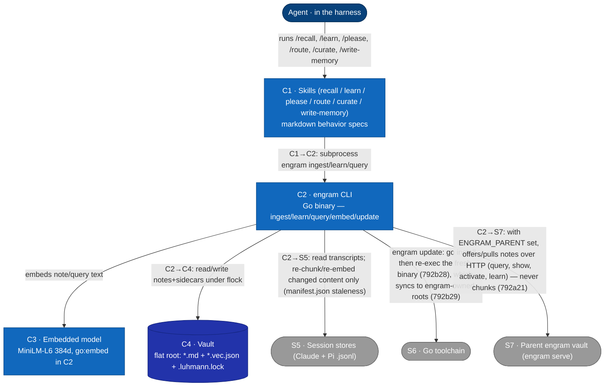

# L2 — Container view

Decomposes **S2 · Engram** (from [L1](c1-system-context.md)) into its runnable/
deployable containers. External systems (harness, session stores, Go toolchain, the
parent engram vault) are carried over from L1. Reflects the current system; verified-defect
annotations (⚠) mark places the implementation diverges from intent and are
re-verified each time this doc is edited — detail in
[memory-invariants](memory-invariants.md).

## Container catalog
| ID | Container | Tech | Responsibility | ⚠ verified defects |
|---|---|---|---|---|
| C1 | Skills | markdown (loaded by harness) | See [792b32](../../changes/792_documentation-framework-adoption/792b_technical-spec.md#792b32-added-agent-instruction-bundle) for the constraints on shipped instructions, [792a12](../../changes/792_documentation-framework-adoption/792a_product-spec.md#792a12-added-skill-runbook-registration) for the registered runbook notes, and [792a13](../../changes/792_documentation-framework-adoption/792a_product-spec.md#792a13-added-write-memory) onward for each skill's procedure. | — |
| C3 | Embedded model | MiniLM-L6-v2@384, `go:embed` | See [792b9](../../changes/792_documentation-framework-adoption/792b_technical-spec.md#792b9-added-text-embedder). Single model id stamped into every sidecar. | M4: off-model sidecars dropped with only a non-fatal stderr advisory under partial migration (`warnModelMismatch` — results thin silently on stdout, no error); a full-vault mismatch errors (`errQueryNoEmbeddings`) |
| C4 | Vault | filesystem | Notes at the flat vault root, named and laid out as in [792b6](../../changes/792_documentation-framework-adoption/792b_technical-spec.md#792b6-added-note-document-format), each with a sibling `.vec.json`. Wikilinks in note bodies = the graph edges. The vault ID and `.engram/` state are in [792b5](../../changes/792_documentation-framework-adoption/792b_technical-spec.md#792b5-added-vault-identity-registry). | G0: bare-id links unresolved by C2's basename resolver — census 151/183 links bare-id, 28 edges resolve, 138/171 orphaned (memory-invariants.md) |

## Relationships
| From → To | Description |
|---|---|
| Agent → C1 | See [792b32c4](../../changes/792_documentation-framework-adoption/792b_technical-spec.md#792b32c4-skills-reach-the-vault-only-through-the-command-line). |
| C2 → C4 | Reads notes+sidecars at query time; writes notes+sidecars atomically (temp-file + rename) under the vault lock ([792b8](../../changes/792_documentation-framework-adoption/792b_technical-spec.md#792b8-added-vault-write-lock)). The wikilink graph is built from note bodies at query time. `engram learn qa` writes Q&A pairs — Q-notes excluded from the query pipeline, A-notes competing as synthesis notes, machine-written edge lines (see [GLOSSARY](../GLOSSARY.md): qa-question / qa-answer / contributors). |
| C2 → S5 | `engram ingest` finds its sources as in [792b17](../../changes/792_documentation-framework-adoption/792b_technical-spec.md#792b17-added-ingestion-source-discovery) (sweep roots, throwaway-workspace skips, `.engram/sweep.json`), reads and strips transcripts as in [792b15](../../changes/792_documentation-framework-adoption/792b_technical-spec.md#792b15-added-transcript-reader), and re-chunks only changed sources ([792a5i](../../changes/792_documentation-framework-adoption/792a_product-spec.md#792a5i-incremental-re-indexing)). |
| C2 → S6 | See [792b28](../../changes/792_documentation-framework-adoption/792b_technical-spec.md#792b28-added-self-installer) and [792b29](../../changes/792_documentation-framework-adoption/792b_technical-spec.md#792b29-added-harness-deploy-sync). |
| C2 → S7 | See [792a21](../../changes/792_documentation-framework-adoption/792a_product-spec.md#792a21-added-parent-sync) for the exchange, [792b36](../../changes/792_documentation-framework-adoption/792b_technical-spec.md#792b36-added-offer-outbox) for the offers a write queues, [792b37](../../changes/792_documentation-framework-adoption/792b_technical-spec.md#792b37-added-parent-vault-client) for the merged query, `show --parent` and the pull-down, and [792b35](../../changes/792_documentation-framework-adoption/792b_technical-spec.md#792b35-added-vault-http-server) for the served side. |

**Cross-level note (L1↔L2 reclassification).** At [L1](c1-system-context.md) the vault is **S4 — an external system** (operator-configurable, on the operator's filesystem, possibly human-edited in Obsidian); on decomposition it reappears here as **C4**, an internal store, because from engram's runtime view it is the data store engram owns and writes. This is an intentional decomposition choice, noted so the L1→L2 mapping is explicit rather than silent. The chunk index's directory is part of C2's operational state rather than a separate container ([792b18](../../changes/792_documentation-framework-adoption/792b_technical-spec.md#792b18-added-chunk-index-store)).
