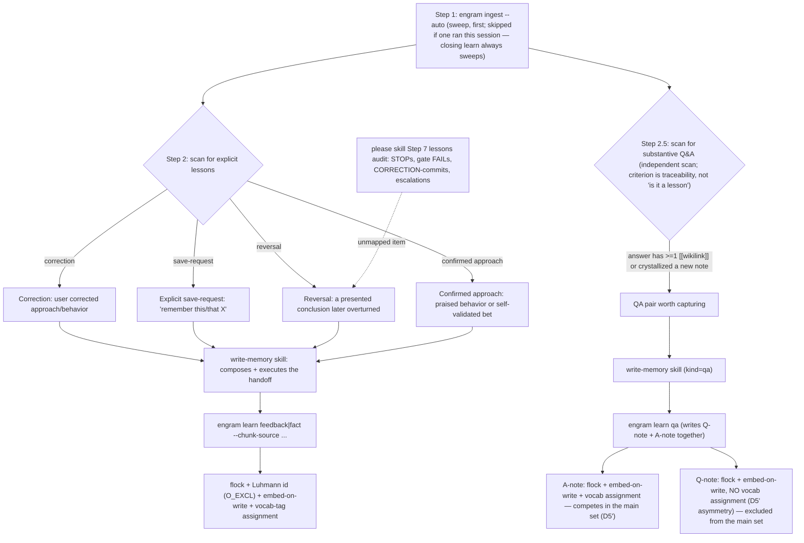

# L2 — Container view

Decomposes **S2 · Engram** (from [L1](c1-system-context.md)) into its runnable/
deployable containers. External systems (harness, session stores, Go toolchain, the
parent engram vault) are carried over from L1. Reflects the current system; verified-defect
annotations (⚠) mark places the implementation diverges from intent and are
re-verified each time this doc is edited — detail in
[memory-invariants](memory-invariants.md).


## Container catalog
| ID | Container | Tech | Responsibility | ⚠ verified defects |
|---|---|---|---|---|
| C1 | Skills | markdown (loaded by harness) | See [792b32](../../changes/792_documentation-framework-adoption/792b_technical-spec.md#792b32-added-agent-instruction-bundle) for the constraints on shipped instructions, [792a12](../../changes/792_documentation-framework-adoption/792a_product-spec.md#792a12-added-skill-runbook-registration) for the registered runbook notes, and [792a13](../../changes/792_documentation-framework-adoption/792a_product-spec.md#792a13-added-write-memory) onward for each skill's procedure. | — |
| C3 | Embedded model | MiniLM-L6-v2@384, `go:embed` | See [792b9](../../changes/792_documentation-framework-adoption/792b_technical-spec.md#792b9-added-text-embedder). Single model id stamped into every sidecar. | M4: off-model sidecars dropped with only a non-fatal stderr advisory under partial migration (`warnModelMismatch` — results thin silently on stdout, no error); a full-vault mismatch errors (`errQueryNoEmbeddings`) |
| C4 | Vault | filesystem | Notes at the flat vault root, named and laid out as in [792b6](../../changes/792_documentation-framework-adoption/792b_technical-spec.md#792b6-added-note-document-format), each with a sibling `.vec.json`. Wikilinks in note bodies = the graph edges. The vault ID and `.engram/` state are in [792b5](../../changes/792_documentation-framework-adoption/792b_technical-spec.md#792b5-added-vault-identity-registry). | G0: bare-id links unresolved by C2's basename resolver — census 151/183 links bare-id, 28 edges resolve, 138/171 orphaned (memory-invariants.md) |

## Relationships
| From → To | Description |
|---|---|
| Agent → C1 | See [792b32c4](../../changes/792_documentation-framework-adoption/792b_technical-spec.md#792b32c4-skills-reach-the-vault-only-through-the-command-line). |
| C2 → C4 | Reads notes+sidecars at query time; writes notes+sidecars atomically (temp-file + rename) under the vault lock ([792b8](../../changes/792_documentation-framework-adoption/792b_technical-spec.md#792b8-added-vault-write-lock)). The wikilink graph is built from note bodies at query time. `engram learn qa` writes Q&A pairs — Q-notes excluded from the query pipeline, A-notes competing as synthesis notes, machine-written edge lines (see [GLOSSARY](../GLOSSARY.md): qa-question / qa-answer / contributors). |
| C2 → S5 | `engram ingest` finds its sources as in [792b17](../../changes/792_documentation-framework-adoption/792b_technical-spec.md#792b17-added-ingestion-source-discovery) (sweep roots, throwaway-workspace skips, `.engram/sweep.json`), reads and strips transcripts as in [792b15](../../changes/792_documentation-framework-adoption/792b_technical-spec.md#792b15-added-transcript-reader), and re-chunks only changed sources ([792a5i](../../changes/792_documentation-framework-adoption/792a_product-spec.md#792a5i-incremental-re-indexing)). |
| C2 → S6 | See [792b28](../../changes/792_documentation-framework-adoption/792b_technical-spec.md#792b28-added-self-installer) and [792b29](../../changes/792_documentation-framework-adoption/792b_technical-spec.md#792b29-added-harness-deploy-sync). |
| C2 → S7 | With `ENGRAM_PARENT` set: `engram query` fetches the parent's `/query?dedupe-keys=1` and merges notes only (never chunks) into the local payload; `engram learn`/a content `amend`/`resituate` offer the note, queued in a local outbox and drained with backoff to the parent's `/learn`; `engram activate` on a local miss pulls the parent's note down via `GET /show?raw=1` as a new local pending offer, then best-effort bumps its use on the parent (ADR-0029). |

**Cross-level note (L1↔L2 reclassification).** At [L1](c1-system-context.md) the vault is **S4 — an external system** (operator-configurable, on the operator's filesystem, possibly human-edited in Obsidian); on decomposition it reappears here as **C4**, an internal store, because from engram's runtime view it is the data store engram owns and writes. This is an intentional decomposition choice, noted so the L1→L2 mapping is explicit rather than silent. The chunk index's directory is part of C2's operational state rather than a separate container ([792b18](../../changes/792_documentation-framework-adoption/792b_technical-spec.md#792b18-added-chunk-index-store)).

## Key flows (L2 — the skills↔binary boundary)

[L1](c1-system-context.md) carries the operator-level sequences. These L2 flows make the
**C1 skill ↔ C2 binary** boundary explicit: every `engram` call is a **fresh subprocess** the
skill shells (C1→C2); all judgment stays in C1; C2 only touches C3 (model), C4 (vault),
S5 (sessions). Every arrow is one of: (a) skill shells a subcommand, (b) a
subcommand touches a store/model/stdout — **never** one subcommand calling another in-process.
The skill layer no longer reads or edits the vault directly: recall reads candidate/member
content via `engram show-chunk` (deferred chunk text under `--lazy-chunks`) plus the query payload (notes carry content inline), and all writes go through `engram amend` /
`engram learn` (INV-S1 resolved — see the C1→C2 row above).

### Flow: learn

```mermaid
sequenceDiagram
    autonumber
    participant Sk as C1 learn skill
    participant E as C2 engram CLI
    participant Tr as S5 sessions
    participant Md as C3 model
    participant V as C4 vault

    Sk->>E: shell engram ingest --auto (fresh process)
    E->>Tr: check mtime/size/hash vs manifest.json; re-chunk/re-embed changed sources only
    Tr-->>E: session entries (changed sources)
    Note over E: strip harness noise (context.Strip); write updated manifest.json to chunk index dir
    E-->>Sk: stdout chunk identifiers + status line (scanned range, new chunk count)
    Note over Sk: scan for the four explicit lesson kinds (corrections, save-requests, reversals, confirmed approaches); hand each to write-memory
    loop per explicit lesson (one parallel tool-use block)
        Note over Sk: invoke the write-memory skill (parents judge, worker writes)
        Sk->>E: shell engram learn fact|feedback … (fresh process; via write-memory; binary side in 792b12)
        E-->>Sk: stdout written path
    end
```

### Flowchart: learn capture kinds (C1)

Companion to the sequence diagram above — the four Step-2 capture kinds plus the Step-2.5 QA-pair kind
(`agent-instructions/skills/learn/SKILL.md` Steps 2/2.5), each invoked natively via the **write-memory** skill, converging on the
same vault-write mechanics.



Source: `agent-instructions/skills/learn/SKILL.md` (Step 1, Step 2, Step 2.5), `agent-instructions/skills/please/SKILL.md` Step 7 (lessons audit), `internal/cli/qa.go` (`isQueryExcludedKind`, `writeQANotesUnderLock`, the D5′ comments),
`internal/cli/learn.go` (`writeLearnUnderLock`, `applyVocabAssignmentCore`).
