# L3 — Component view (inside C2 · engram CLI)

Decomposes **C2 · engram CLI** (from [L2](c2-containers.md)) into its Go packages/
components and the data they exchange. Reflects the current system; ⚠ = a
verified defect, re-verified each time this doc is edited (see
[memory-invariants](memory-invariants.md)). These component IDs are the
vocabulary the [L3 sequence/flow diagrams](#key-flows-l3--component-internal-sequences) reuse.

```mermaid
flowchart TB
    classDef comp  fill:#1168bd,stroke:#0b4884,color:#fff
    classDef defect fill:#b1331f,stroke:#7a1f12,color:#fff
    classDef store fill:#23a,stroke:#127,color:#fff
    classDef ext fill:#999,stroke:#666,color:#fff
    classDef xcut fill:#5a7d5a,stroke:#3a5a3a,color:#fff,stroke-dasharray:4 3

    skills(["C1 · Skills orchestrator (off-binary)<br/>reads stdout, shells next subcommand"])

    subgraph PI[engram ingest — process]
      ing["K1 · ingest<br/>see 792b15–792b18"]
    end
    subgraph PL[engram learn — process]
      learn["K4 · learn<br/>tier defaults · write-under-flock · O_EXCL"]
    end
    subgraph PQ[engram query — process]
      query["K6 · query orchestrator"]
      vg["K7 · vaultgraph<br/>ScanVault (note scan) — query uses ScanVault only"]
      cl["K8 · cluster<br/>KMeans · Silhouette · AutoK · BestMatch"]
    end
    subgraph PE[engram embed — process]
      eb["K5b · cli/embed (operator-run migration)<br/>RunEmbedApply · RunEmbedStatus"]
    end
    subgraph PP[engram prune — process]
      prune["K12 · prune (operator-run GC)<br/>see 792b18 chunk-index-store"]
    end
    subgraph PU[engram update — process]
      upd["K9 · update<br/>go install, re-exec fresh binary for sync (ENGRAM_UPDATE_REEXEC, ADR-0023); sync artifacts to engram-owned roots, materialize symlinks; dark migration, cleanup; --with-guidance; manifest fallback (ADR-0022)"]
    end
    subgraph PW[engram amend / resituate / activate — write-modifier processes]
      wm["K4w · amend · resituate · activate<br/>see 792b14 note-amendment"]
    end
    subgraph PS[engram serve — process]
      srv["K14 · serve<br/>query/show/activate/learn HTTP door; served learn: idempotency-first, in-place pending update, 409 loop refusal"]
    end

    %% shared kernels: compiled into multiple subcommand processes; never call across them
    embed["K5 · embed (shared kernel)<br/>Text(body) · ContentHash · Sidecar · embedder"]
    lz["K10 · luhmann (shared kernel)<br/>ParseID · LetterLess"]
    dbg["K11 · debuglog (cross-cutting, all targets)<br/>pure: writer+clock injected; sink composed in internal/cli/debugsink.go"]
    prims["K13 · cmd/engram — edge primitives + entry point<br/>single-statement main() + thin per-group functions → cli.Primitives → cli.NewDeps<br/>(ALL adapter composition in internal/cli); targ check-thin-api-enforced"]
    px["K14 (child side) · exchange kernel (shared)<br/>offer build/classify · outbox drain · merged-query dedupe · pull-down; compiled into query/learn/wm"]

    vault[("C4 · Vault")]
    model[["C3 · MiniLM"]]
    sessions(["S5 · Session stores"])
    gotool(["S6 · Go toolchain"])
    parentvault(["S7 · Parent engram vault"])

    skills -->|"shell engram ingest --auto"| ing
    skills -->|"shell engram learn (args)"| learn
    skills -->|"shell engram query --phrase / --text"| query
    skills -->|"shell engram update"| upd
    skills -->|"shell engram embed apply (rare)"| eb
    skills -->|"shell engram amend / resituate / activate"| wm

    prune -->|"check whether each source still exists"| sessions

    ing --- sessions
    ing -->|stdout chunk identifiers| skills

    learn --> embed
    learn --> lz
    learn -->|note+sidecar under flock| vault
    learn --> px

    query --> embed
    query --> vg
    query --> cl
    query -->|stdout payload| skills
    query --> px
    vg --> lz
    vg -->|read notes/wikilinks| vault

    wm --> px

    eb --> embed
    eb -->|re-embed sidecars| vault
    embed --- model
    upd -->|go install| gotool

    px -->|"ENGRAM_PARENT: offer /learn, merge /query, pull /show?raw=1 — never chunks"| parentvault
    px --> embed
    px -->|pending offer note+sidecar, outbox.json under .engram/| vault
    srv -->|"served /learn: in-place pending update or new pending note"| vault
    srv --> embed

    class ing,learn,query,vg,cl,eb,embed,upd,lz,prune,prims,px,srv comp
    class dbg xcut
    class vault store
    class skills,sessions,gotool,parentvault ext

    g0[["⚠ G0: BuildGraph resolves basename; learn writes bare ids → most edges dropped (census in memory-invariants.md)"]]:::defect
    vg -.-> g0
```



## Component catalog
| ID | Component | Key functions | Responsibility | ⚠ |
|---|---|---|---|---|
| K1 | `internal/transcript` + `internal/context` + the chunk index (via `engram ingest`) | — | See [792b15](../../changes/792_documentation-framework-adoption/792b_technical-spec.md#792b15-added-transcript-reader), [792b16](../../changes/792_documentation-framework-adoption/792b_technical-spec.md#792b16-added-source-chunking), [792b17](../../changes/792_documentation-framework-adoption/792b_technical-spec.md#792b17-added-ingestion-source-discovery) and [792b18](../../changes/792_documentation-framework-adoption/792b_technical-spec.md#792b18-added-chunk-index-store). | — |
| K6 | `cli/query.go` | `RunQuery`, `runQuery`, `buildMatchedSetFromPhrases`, `buildRecentFillItems`, `capWithNoteFloor`, payload assembly | Single query path: per phrase embed → top-30 (notes+chunks, recency-biased cosine), reserving up to `noteFloorK=5` of those slots for relevance-qualified notes (`capWithNoteFloor`) so higher-cosine chunks cannot fully evict a note that cleared the floor; union across 10 phrases, dedup max score, relevance floor (baseScore < 0.25), cap matched set at ~300 (`matchSetCap`); ONE AutoK cluster over matched set (D1 preserved); `candidate_l2s` = within-cluster top-5 from matched note members only, plus superseded-note ride-alongs; separately, an explore half (`internal/cli/query_explore.go`, `computeExploreHalf`) samples notes from vocab-term centroids by proximity to the query (softmax allocation, budget = exploit-half note count, δ=0.05 match-evidence bonus, core-first within-term, dedupe+backfill) and delivers them as top-level `items[]` (`provenance: explore`, `source_term`; budget: `explore_allocated`) — never cluster members, never in `candidate_l2s`; Channel 2 appends the newest chunks by IngestedAt (`recentFillChunks`, default 25, configurable via `--recent-fill` / `ENGRAM_RECENT_FILL`), deduped, tagged `recent`, not in any cluster. All notes cluster as normal notes. Optional `--text="<user message verbatim>"` (never embedded; served path caps it at 2 KB) is matched against a trigger index built in the same whole-vault meta pass (`loadAllVaultNotesMeta` → `TriggerIndex`, `type: runbook` notes' `triggers:` only, and only those with a compatible sidecar, since the index is built from that set; `internal/cli/query_triggers.go`: `matchTriggers` = case-insensitive whole-word match after whitespace collapse (`containsWholeWord`: a letter/digit edge of the trigger needs a non-letter/digit neighbor or text edge), `applyTriggerHits`); each hit is placed first in `items[]` with provenance `trigger` (rank above `direct`), exempt from the relevance floor, matched-set cap, note floor, and `--limit`; `--text` with no `--phrase` runs a trigger-only query (`runTriggerOnlyQuery`); absent `--text`, the pipeline is unchanged. Optional `--lazy-chunks` renders chunk items path/source-only (notes keep content), fetched on demand via the `show-chunk` subcommand (`cli/show_chunk.go`). | — |
| K7 | `internal/vaultgraph` | `ParseWikilinks`, `BuildGraph`, `UnresolvedTargets` | The vault scan and note references are in [792b13](../../changes/792_documentation-framework-adoption/792b_technical-spec.md#792b13-added-wikilink-graph). Waiting for vault-counting (792c7g1) and vault-health (792c7h1): build the directed wikilink graph (node=basename); identify unresolved links for `engram check`. | **G0** (basename-only resolution); G5 **RETIRED** (episode kind removed; `[[x]]` in chunk bodies no longer parsed as vault edges) |
| K8 | `internal/cluster` | `KMeans`, `Silhouette`, `AutoK`, `CosineDistance` | Pick k by silhouette; cluster the matched set. Silhouette is O(n²) per k swept, so clustering inputs are bounded: the matched set is hard-capped at `matchSetCap`=300 (10 phrases × top-30 per phrase) before clustering; recency-channel chunks (`recentFillChunks`, default 25; `--recent-fill`) are appended un-clustered and never enter K8. | C1 resolved — `TestInvariant_C1_ClusteringDeterminism`, `TestKMeans_DeterministicAcrossRuns`; L3-1 RETIRED (L3 note kind removed) |
| K9 | `internal/update` | `Run`, `SourceLocal/Remote`, `DeployMode` | `go install` the binary, then re-exec the freshly installed binary for the sync phase (`ENGRAM_UPDATE_REEXEC` loop guard, in-process fallback on spawn failure; ADR-0023); sync refreshed agent-instructions/{skills,commands,guidance} to per-harness engram-owned roots (`~/.claude/engram/`, etc.; ADR-0022 D1); materialize symlinks (or manifest copies for manifest-mode harnesses) at harness surface paths; clean up dangling symlinks pointing to removed artifacts; first sync performs dark migration of pre-existing copies to symlinks and reports unknowns; dry-run previews without writing; `--with-guidance` includes guidance docs in the sync (canonical paths `guidance/`, compat symlinks for existing imports); sentinels `ErrGoNotFound`/`ErrNoHarness`/`ErrSkillsSrcMissing` / `ErrEngramRootNotDir` (if root exists as a file). | **U1** resolved — `TestUpdater_Run_Local_Idempotent_Property`; idempotence verified across symlink/manifest modes under ADR-0022 design verification (spec: update-deploy-sync) |
| K11 | `internal/debuglog` | tail-friendly sink (pure: writer+clock injected) | Cross-cutting debug log threaded through every CLI target (`targets.go`); sink composition (`openDebugSink` + per-write-`Sync` `syncWriter`, env-gated) lives in `internal/cli/debugsink.go`; `cmd/engram` supplies only the raw `OpenDebugFile` primitive (#700). | — |
| K5b | `cli/embed.go` | `RunEmbedApply`, `RunEmbedStatus`, `selectStates` | The `engram embed apply/status` subcommand (separate process, operator-run for model migration): re-embeds notes whose sidecar is missing/stale/incompatible via the shared K5 package; `apply` writes sidecars, `status` reports counts. Wired in `targets.go` (grep `Name("embed")`). | drives **M4** remediation |
| K12 | `cli/prune.go` + `cli/prune_duplicates.go` | — | See [792b18](../../changes/792_documentation-framework-adoption/792b_technical-spec.md#792b18-added-chunk-index-store) (792b18c9–792b18c11). | — |
| K13 | `cmd/engram` | edge primitives + entry point | Single-statement `main()` composing `cli.Primitives` from checker-thin per-capability-group functions (FS/Lock/Exec/Proc — raw os/syscall/filepath/hugot/exec capability references + sanctioned closures, each group function returning its composite literal directly); `targ check-thin-api`-enforced; ALL adapter composition (EdgeFS, FileLocker, commander, hugot backend, debug sink, signal force-exit) lives in `internal/cli` via `cli.NewDeps`, integration-tested there with real FS/env (#700). | — |
| K14 | `cli/serve.go`, `cli/serve_client.go`, `cli/serve_learn.go`, `cli/serve_exchange_read.go`, `cli/merged_query.go`, `cli/merged_dedupe.go`, `cli/outbox.go`, `cli/offer_payload.go`, `cli/offer_classify.go`, `cli/offer_wiring.go`, `cli/amend_fold.go`, `cli/pulldown.go`, `cli/vaultid.go`, `cli/exchangehash.go`, `cli/exchangefields.go`, `cli/exchangestate.go` | `RunServe`, offer sender (`newOfferSender`), `runMergedQuery`/`mergeQueryPayloads`/`matchLocalNote`, outbox drain (`drainOutbox`), pull-down (`pullSession`), `exchangeHash`, `foldParentLinks` | Parent sync (ADR-0029, design `local-first-parent-sync`): `engram serve` exposes `query`/`show`/`activate`/`learn` only (`/amend`, `/query-chunks`, `/show-chunk` removed); a served `learn` writes or in-place-updates a pending offer keyed by `offer.origin`/`offer.key`, idempotent and loop-refusing via `offer.path`. The child side classifies and builds offer payloads (`offer_classify.go`, `offer_payload.go`; enqueue hooks in `offer_wiring.go`) from `exchangeHash`-classified content fields, queues them in `<vault>/.engram/outbox.json` under the vault lock, and drains with backoff on parent failure. `mergeQueryPayloads` interleaves the parent's `/query?dedupe-keys=1` response into the local payload, dropping every `kind: chunk` item and deduping notes (`merged_dedupe.go`'s `matchLocalNote`) either by a parent link under the reported vault ID or by dedupe rule 2 — an equal, known exchange hash (design D4). `pullSession` resolves an `engram activate` miss against the parent's `GET /show?raw=1`, writing a new local pending offer and best-effort bumping the parent's own use. `amend_fold.go` is curation's `--discard --into` fold (`foldParentLinks`, `checkJudgedVersion`), and `vaultid.go` is `engram vault-id`/`--regenerate`/`--claim`. | — |

## The recurring defect shape (feeds the Phase-4 ADR) — corrected per Phase-2 antagonist
The canonical example of the silent-mismatch bug class:
- **G0** — write an edge as `[[id]]`; resolve an edge as `[[basename]]`. (disjoint keys)

The unifying invariant: **for every write/read pair over the same datum, the read key
must be a function of (or equal to) the write key, and a mismatch must be loud, not silent.**

M4 (model homogeneity) is in [792b10c7](../../changes/792_documentation-framework-adoption/792b_technical-spec.md#792b10c7-state-classification).

## Dead/test-only surface
`internal/vaultgraph`'s graph-expansion half — `BuildGraph`, `BFSWithCap`, `InDegreeIn` (and the
MOC-navigation helpers) — has **zero production consumers** (the 3-hop-subgraph recall path was
removed in recall-v2; no `vault`/`graph`/`follow` subcommand). Only `ScanVault`, `ParseWikilinks`,
`ParseBasename`, and `UnresolvedTargets` are live — consumed by `query` (note scan), `check`
(unresolved-link report), and `amend`/`resituate`/`show`/`embed`. K7 still bundles the dead
graph-expansion subsystem; a future cleanup should confirm and propose its deletion.

## Data contracts (what crosses component edges) — corrected
- **ingest → skill → learn (NOT in-process):** `engram ingest --auto` prints its per-source lines
  to **stdout** ([792a5i](../../changes/792_documentation-framework-adoption/792a_product-spec.md#792a5i-incremental-re-indexing));
  the skill reads them and shells `engram learn fact|feedback` as a *new process* per candidate.
- **K6 payload (to stdout → skill):** `items[]` (matched notes+chunks + recency-channel chunks
  tagged `recent`; notes carry full content inline, chunk items path/source-only under `--lazy-chunks`, fetched via `show-chunk`) ∪ `clusters[].members` (paths, from matched set only) ∪
  `clusters[].candidate_l2s` (`[{path, cosine, content}]`, within-cluster top-5 only; ride-alongs for superseded notes) ∪ top-level `items[]` explore entries (`provenance: explore`, `source_term`) ∪ `budget` (includes `explore_allocated`, a term → delivered-count map, always present).
  Runbook trigger hits (`--text` matched a runbook's `triggers:`) lead `items[]` with `provenances` containing `trigger`, even at similarity score 0.
  No `nearest_l3` field; no `hubs` field; recency-channel items appear in `items[]` but never in
  any cluster's `members[]`. The skill — not the binary — consumes it and may shell `engram amend`
  (covered/near) or `engram learn` (absent) for recall-time lazy synthesis. Activation is
  agent-driven: the binary emits no `activated` flag; the skill calls `engram activate` on only
  the notes it actually used.

## Key flows (L3 — component-internal sequences)

These zoom into a single `engram` subcommand process and show the K-component call order verified
against the code. Each subcommand is its OWN process; nothing here crosses to another subcommand.
[L2](c2-containers.md) shows the skill↔binary orchestration; this is what one binary call does inside.

### Flow: `engram query` internals (RunQuery)

This is the sole query path (the `--synthesis`/BFS-subgraph path was removed in the 2026-06-20 deep clean; unified clustering is now the only mode).

Verified order: `Scan` → `loadCompatibleSidecars` → `loadClusterChunkRecords`
→ `buildMatchedSetFromPhrases` (per-phrase unified ranking) → `applyFloorAndCap` →
`clusterMatchedSet` (K8) →
`mergeProvenances` → `buildRecentFillItems` → `applyTriggerHits` (a no-op unless `--text` matches a runbook `triggers:` entry) → `renderQueryPayload`.

```mermaid
sequenceDiagram
    autonumber
    participant Q as K6 query
    participant Em as K5 embed
    participant Md as C3 model
    participant Vg as K7 vaultgraph
    participant Cl as K8 cluster
    participant V as C4 vault

    Note over Q: RunQuery — one process; args from the skill, output to stdout
    Q->>Vg: Scan = vaultgraph.ScanVault
    Vg->>V: read note files; ParseWikilinks → Outgoing at scan time
    Vg-->>Q: notes (+ parsed wikilinks)
    Q->>V: loadCompatibleSidecars — read sidecars, drop off-model [M4]
    Q->>V: loadClusterChunkRecords — read chunk index
    loop per phrase (10 phrases)
        Q->>Em: Embed(phrase)
        Em->>Md: encode
        Md-->>Em: vector
        Em-->>Q: query vector
        Note over Q: score notes (rankCandidates, recency-biased) + chunks (per-phrase scorer, recencyMultiplier); merge into one list; take top-30 (capWithNoteFloor reserves up to noteFloorK=5 slots for floor-qualified notes)
    end
    Note over Q: union across phrases, dedup keeping max score; drop baseScore < 0.25; cap at matchSetCap=300 → matched set
    Note over Q: matched set holds both note and chunk members (unified ranking)
    Q->>Cl: clusterUnionForSynthesis — ONE AutoK k-means + silhouette over matched set (D1)
    Cl-->>Q: clusters with candidate_l2s (within-cluster top-5 by centroid cosine only; ride-alongs added post-cluster)
    Note over Q: computeExploreHalf — softmax(cosine(query vec, term centroid)/τ) allocation over vocab-term centroids, budget = exploit-half note count, δ=0.05 match-evidence bonus, core-first within-term, dedupe+backfill; picks delivered as top-level items[] (provenance=explore, source_term), NOT cluster members
    Note over Q: mergeProvenances; applyProjectFilter
    Note over Q: buildRecentFillItems — newest chunks by IngestedAt (recentFillChunks, default 25), deduped vs matched set, tagged recent; NOT in any cluster
    Note over Q: applyTriggerHits — only if --text matches a runbook's triggers: (matchTriggers over TriggerIndex); hits moved/added to the FRONT of items[] with provenance=trigger, exempt from floor/cap/--limit
    Note over Q: renderQueryPayload → stdout (items[matched+explore+recent], clusters[candidate_l2s], budget[explore_allocated])
```

### `engram learn qa` capture path

The capture path is in
[792b12](../../changes/792_documentation-framework-adoption/792b_technical-spec.md#792b12-added-note-authoring)
(792b12c5), and `vocab stats`' question exclusion in
[792a6t](../../changes/792_documentation-framework-adoption/792a_product-spec.md#792a6t-vocabulary-statistics). Residue for later nodes:

- Query (memory-query): a question note is excluded at all four query-pipeline seam points
  (`isQueryExcludedKind`): `applyFloorAndCap`, `isFloorQualifyingNote` (the `capWithNoteFloor`
  reservation), `mergePhraseIntoUnion` (the per-phrase union), and the explore-half `TermIndex`
  build (`loadAllVaultNotesMeta` in `query_vault_meta.go`, guarded by `isQueryExcludedKind` before
  a note's terms populate `TermIndex`). The answer note competes like any fact or feedback note.
