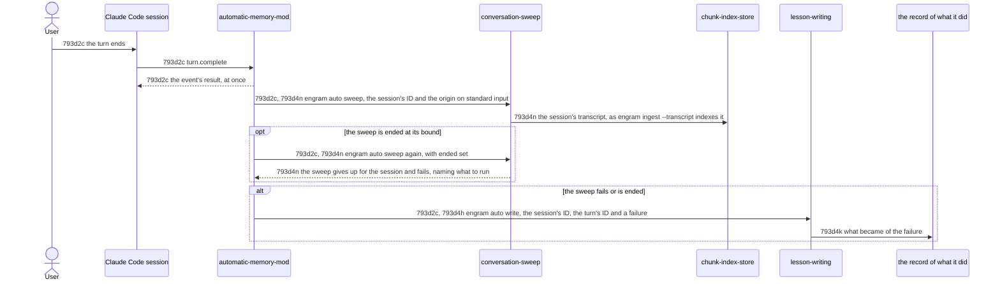

# Conversation Sweep Technical Workflow - Technical Spec

After each [turn](../../GLOSSARY.md#turn-automatic-memory), apart from the capture, the [Automatic Memory Mod](./automatic-memory-mod.md) has the [session](../../GLOSSARY.md#session)'s conversation indexed so that `engram query` finds it.



## 793d2c Conversation sweep flow

Requirement: 793d2c For each [turn](../../GLOSSARY.md#turn-automatic-memory) a [session](../../GLOSSARY.md#session) completes, the [Automatic Memory Mod](./automatic-memory-mod.md) MUST give the event's result back at once and then, from a timer and apart from the capture of [793d2b Turn capture flow](./turn-capture-workflow.md#793d2b-turn-capture-flow), run `engram auto sweep` with one JSON object on standard input: the session's ID and the origin of the [prompt](../../GLOSSARY.md#prompt-automatic-memory) the turn began with. It MUST do nothing for a turn that a [subagent](../../GLOSSARY.md#subagent) ran, and for a session whose ID does not come within 5 seconds. It MUST end the command after 90 seconds, and when it is ended or cannot run MUST run it once more, within 5 seconds, with `ended` set to true in the object, so that the command gives up for the session ([793d4n Sweeping the conversation](./conversation-sweep.md#793d4n-sweeping-the-conversation)); the call for the ID (5), the [sweep](../../GLOSSARY.md#sweep) (90), the run that gives up (5) and the report of its failure (15) take 115 seconds, under the 2 minutes of [793a2f The conversation becomes searchable memory](../product/automatic-memory.md#793a2f-the-conversation-becomes-searchable-memory), and the bound of the sweep neither extends nor waits for those of the capture. When the command exits with other than 0, or the run that gives up exits with other than 0, is ended or cannot run, it MUST run `engram auto write` with the session's ID, the turn's ID and a `failure`, a sentence that names the sweep and how it failed.

Owner: [Automatic Memory Mod](./automatic-memory-mod.md).

Supports: [793a2f1a The conversation so far is findable after a turn](../product/automatic-memory.md#793a2f1-uat-scenarios), [793a2f1b A conversation too long to index in time is left alone and the user is told once what to run](../product/automatic-memory.md#793a2f1-uat-scenarios), [793a2d1c The work after a turn does not hold the next prompt](../product/automatic-memory.md#793a2d1-uat-scenarios).

### 793d2c1 Scenarios

```gherkin
Scenario: 793d2c1a The mod sweeps the conversation after a turn, apart from the capture
  Given the mod, a session whose ID is known, an engram whose auto judge does not answer, and an engram whose auto sweep exits with 0
  When a prompt is raised, the turn starts, and it completes
  Then the event's result is given back at once, and auto sweep received the session's ID and the origin of the prompt while the judgement was still running

Scenario: 793d2c1b A sweep that fails is reported to the writing
  Given the mod, and an engram whose auto sweep exits with 1, or is ended before it answers
  When a turn completes
  Then auto write received the session's ID, the turn's ID and a failure that names the sweep

Scenario: 793d2c1c A sweep that stalls is ended at its bound and reported
  Given the mod, and a host in which, in turn, the call for the session's ID never answers, and auto sweep runs until its time limit
  When a turn completes
  Then with the first auto sweep was never run after the mod waited 5 seconds, and with the second auto sweep was given the time limit of 90 seconds, its run as ended 5 and the report of its failure 15, which with the 5 seconds for the ID are less than 120 seconds

Scenario: 793d2c1d A turn of a subagent is not swept
  Given the mod
  When a turn that a subagent ran completes
  Then auto sweep was never run

Scenario: 793d2c1e A sweep that is ended is run once more, as ended
  Given the mod, a session whose ID is known, and an engram whose auto sweep runs until its time limit and, run as ended, exits with 1 and prints a cause on standard error
  When a turn completes
  Then auto sweep was run twice, the second time with ended set to true and the time limit of 5 seconds, and auto write received the session's ID, the turn's ID and a failure that names the sweep and the cause of the second run

Scenario: 793d2c1f A sweep that gave up before is not reported again
  Given the mod, a session whose ID is known, and an engram whose auto sweep runs until its time limit and, run as ended, exits with 0
  When a turn completes
  Then auto sweep was run twice, and auto write was never run
```
