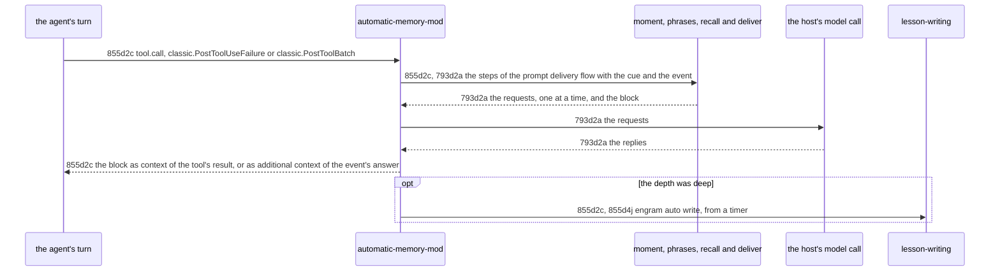

# Mid-Turn Recall Technical Workflow - Technical Spec

Within a [turn](../../GLOSSARY.md#turn-automatic-memory), at the tool events of the main loop, the [Automatic Memory Mod](./automatic-memory-mod.md) runs the steps of [793d2a Prompt delivery flow](./prompt-delivery-workflow.md#793d2a-prompt-delivery-flow) for the cue of the event and puts the block beside the tool's result.



## 855d2c Mid-turn recall flow

Requirement: 855d2c For each tool call the main loop is about to run (`tool.call`, the cue `before-tool`), each that failed (`classic.PostToolUseFailure`, the cue `failure`) and each batch of its tool calls that resolved, before the next model request (`classic.PostToolBatch`, the cue `batch-done`), the [Automatic Memory Mod](./automatic-memory-mod.md) MUST run the steps of [793d2a Prompt delivery flow](./prompt-delivery-workflow.md#793d2a-prompt-delivery-flow) for the cue, with `event` in place of the prompt text in the objects it gives them and the text the [turn](../../GLOSSARY.md#turn-automatic-memory) began with beside it: the event is the tool's name and input, for a failure the error, and for a batch the name, input and response of each of its calls. It MUST take the [session](../../GLOSSARY.md#session)'s ID from the event (`session_id`) or, for `tool.call`, whose input has none, from `$.session.id()`. For `tool.call` it MUST start the chain and call `next(e)` at once, without waiting for the chain, and, when both are over, answer with the result of `next(e)` and, when `deliver` exited with 0 and printed a block, the block as one more entry of the result's `context`, or, when the result is a denial (`deny`), with the denial alone, taking the IDs of the block off the set below so that its [notes](../../GLOSSARY.md#permanent-note) are delivered later; for the other two, with the result of `next(e)` and the block as one more `additionalContext` entry. The user is shown the one line `deliver` printed on standard error. It MUST do nothing for an event of a [subagent](../../GLOSSARY.md#subagent)'s loop (`agentId`, `agent_id`), for a failure that is a user's interrupt (`is_interrupt`), for a batch whose calls each were judged already as failures (it keeps the `tool_use_id` of each failure it judged, a failure that is a memory command's among them) or are memory commands, and for a call that is a memory command and its failure: a call of the `Bash` tool whose `command` runs `engram query`, `engram show`, `engram show-chunk`, `engram recall`, `engram learn` or `engram amend` at the position of a command (at its start, after `;`, `&`, `|` or `(`, or after `-c` and a quote, with a path before `engram` allowed; a command that only names one, in a commit message, a `grep` or a heredoc, is not one), the list the binary holds the text and result of a session for ([793d4d Telling what a session holds](./session-context.md#793d4d-telling-what-a-session-holds)), or of the `Skill` tool whose `skill` is `recall`, `learn`, `curate` or `write-memory`; for these it runs no step and makes no model call, and answers with the result of `next(e)` alone. It MUST NOT queue the chains of one session: they run at once, each bounded as [793d2a Prompt delivery flow](./prompt-delivery-workflow.md#793d2a-prompt-delivery-flow) bounds a prompt's, a stalled or failed step answering the event with the result of `next(e)` alone and being reported to `write` from a timer. It MUST keep for each session the set of the IDs it delivered (the ID of [793d2a Prompt delivery flow](./prompt-delivery-workflow.md#793d2a-prompt-delivery-flow): what runs from the dash and space of a line, whole, to the parenthesis that opens its situation, or to `(passage)`), give it to `deliver` as `held`, and, as a block arrives, drop in one step each line whose ID the set holds and add the IDs of the lines left, so that a [note](../../GLOSSARY.md#permanent-note) or a passage is delivered once however many chains find it, and no block is added when no line is left. At deep depth it MUST run the write of [793d2a Prompt delivery flow](./prompt-delivery-workflow.md#793d2a-prompt-delivery-flow) from a timer after the answer.

Owner: [Automatic Memory Mod](./automatic-memory-mod.md).

Supports: [855a2e1a A note arrives before the agent declares its work done](../product/automatic-memory.md#855a2e1-uat-scenarios), [855a2e1b A note arrives after a failure the agent cannot explain](../product/automatic-memory.md#855a2e1-uat-scenarios), [855a2e1c A note arrives before the agent starts building a new approach](../product/automatic-memory.md#855a2e1-uat-scenarios), [855a2e1d A call of the agent to the memory is not followed by a delivery](../product/automatic-memory.md#855a2e1-uat-scenarios), [793a2d1e A write that fails does not break the session](../product/automatic-memory.md#793a2d1-uat-scenarios), [793a3e1a The agent's own lookups and saves keep working](../product/automatic-memory.md#793a3e1-uat-scenarios).

### 855d2c1 Scenarios

```gherkin
Scenario: 855d2c1a A note arrives with the call, after a failure and after a batch
  Given the mod, a session whose ID is known, an engram whose auto moment, auto phrases, auto recall and auto deliver print what delivers a block, and a model that answers
  When a tool.call event is raised for a Bash call of the main loop, then a classic.PostToolUseFailure event with an error, then a classic.PostToolBatch event for a batch of two calls
  Then auto moment received in turn the cues before-tool, failure and batch-done, each with its event (the tool's name and input, the error, the name, input and response of both calls), the text the turn began with and the session's ID, the first answer holds the block as an entry of the result's context, the other two as additional context, and the user was shown the line the delivery printed each time

Scenario: 855d2c1d The session's ID of a call about to run comes from the host
  Given the mod, a host that gives the session's ID, and a tool.call event that has none
  When the event is raised
  Then auto moment received the ID the host gave

Scenario: 855d2c1e A subagent's loop is left alone
  Given the mod and an engram whose auto moment prints a request
  When each of the three events is raised from a subagent's loop
  Then no step was run, the model was never asked, and each answer is the result of next(e)

Scenario: 855d2c1f A moment that is not one answers the event as it was
  Given the mod and an engram whose auto moment prints nothing, or whose auto recall prints nothing
  When each of the three events is raised
  Then each answer is the result of next(e), with no additional context

Scenario: 855d2c1g A failed or stalled step answers the event as it was and is reported
  Given the mod, a session whose ID is known, and, in turn, an engram whose auto moment exits with 1, and a host in which the model's call never settles unless its signal aborts it
  When a classic.PostToolUseFailure event is raised with each
  Then the answer is the result of next(e), at once for the first and 2 minutes after the call began for the second, and, when the timers run, auto write received the session's ID, no turn and a failure that names auto moment and the model call

Scenario: 855d2c1h Chains of one session run at once and a note is delivered once
  Given the mod, an engram whose auto moment does not answer until the test lets it and whose auto deliver prints a block of one note, and two tool.call events raised at once
  When the test lets both answer
  Then auto moment was run for both events before either was let answer, and of the two answers one holds the block and the other holds none

Scenario: 855d2c1l A denied call keeps no block and its notes are delivered later
  Given the mod, an engram whose auto deliver prints a block of one note each time, and a tool.call event whose result from the hooks beneath is a denial, then a prompt
  When both are raised
  Then the answer to the call is the denial with no block, the answer to the prompt holds the block of the note, and auto deliver was given no held IDs for the prompt

Scenario: 855d2c1m A deep delivery within a turn writes with its cue
  Given the mod, an engram whose auto recall prints a deep request and whose auto deliver prints a block of one note, and a model that answers
  When a classic.PostToolUseFailure event is raised
  Then the answer holds the block as additional context and auto write received the session's ID, the cue failure, the model's reply to the candidate request and the carry

Scenario: 855d2c1n A call runs while its chain does
  Given the mod, an engram whose auto moment does not finish until the call has been let run, and whose auto deliver prints a block of one note
  When a tool.call event is raised
  Then next(e) was called before auto moment finished, and the answer holds the result of next(e) and the block as an entry of its context

Scenario: 855d2c1o A call that is itself a memory command is not looked up for
  Given the mod, and an agent about to run a Bash call whose command runs engram query, or a Skill call of the recall skill
  When a tool.call event, a classic.PostToolUseFailure event, or a classic.PostToolBatch event whose calls all are such calls is raised
  Then no step was run for the event, no model call was made, and the answer is the result of next(e) as it was

Scenario: 855d2c1p A batch with another call among the memory commands is still looked up for
  Given the mod, and a batch of two calls, one engram query and one Read
  When the classic.PostToolBatch event is raised
  Then the steps were run for the cue batch-done

Scenario: 855d2c1q A command that only names a memory command is still looked up for
  Given the mod, and an agent about to run a Bash call whose command is a git commit, a grep or a sed that names engram learn or engram query inside its text
  When a tool.call event is raised
  Then the steps were run for the cue before-tool

Scenario: 855d2c1r A failed memory command and another failed call in one batch are left alone as failures
  Given the mod, a classic.PostToolUseFailure event for an engram query call and one for a Read call, both raised
  When the classic.PostToolBatch event of the two calls is raised
  Then the steps were run for the failure of the Read alone and for no batch-done cue

Scenario: 855d2c1k A user's interrupt and a batch of failures judged already are left alone
  Given the mod, a session whose ID is known, and an engram whose auto moment prints a request
  When a classic.PostToolUseFailure event with is_interrupt is raised, then one without it for a call, then a classic.PostToolBatch event whose only call is that call
  Then no step was run for the interrupt and for the batch, and the second failure was judged once
```
