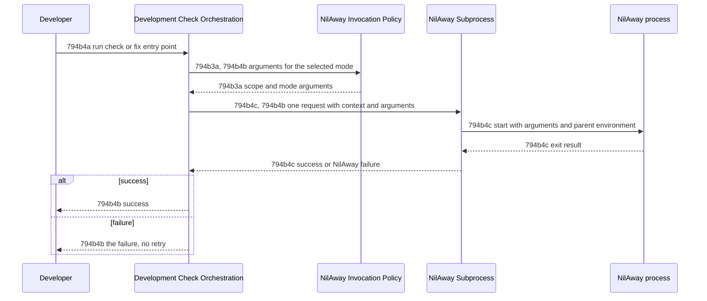

# Nil Check Run Flow - Technical Spec

A developer runs a nil check or fix through the existing entry points. Orchestration obtains the
mode's arguments from the invocation policy, hands one request to the NilAway subprocess, and
returns the analyzer's success or failure.



## 794b4b Nil check run

Requirement: 794b4b Development-check orchestration MUST obtain the selected mode's arguments from
the invocation policy, then send exactly one request, containing only the supplied context and
those arguments, to the NilAway subprocess. When the subprocess returns success, orchestration MUST
return success to the invoking entry point. When it returns a failure, orchestration MUST return
that failure and MUST NOT retry.

Owner: [Development Check Orchestration](./development-check-orchestration.md)

Supports
[794a2a1a Existing check entry points report only on Engram's module packages](../product/development-checks.md#794a2a1-uat-scenarios) and
[794a2a1c The fix command acts only on Engram's module packages](../product/development-checks.md#794a2a1-uat-scenarios).

### 794b4b1 Contract Scenarios

```gherkin
Scenario Outline: 794b4b1a One request carries the context and the policy's arguments
  Given the invocation mode is <mode>
  When orchestration executes the configured check
  Then the NilAway subprocess receives exactly one request
  And the request contains only the supplied context and the arguments the policy returned for <mode>
  Examples:
    | mode  |
    | check |
    | fix   |

Scenario: 794b4b1b A successful run returns success
  Given the NilAway subprocess returns success
  When orchestration executes the configured check
  Then orchestration returns success to the invoking entry point

Scenario: 794b4b1c A failed run returns the failure without retrying
  Given the NilAway subprocess returns an analyzer failure
  When orchestration executes the configured check
  Then orchestration returns that failure to the invoking entry point
  And the NilAway subprocess receives no second request
```
