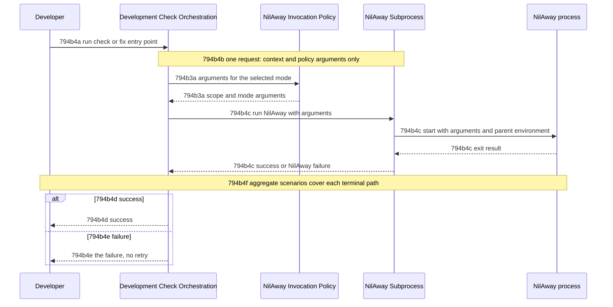

# Nil Check Run Flow - Technical Spec

A developer runs a nil check or fix through the existing entry points. Orchestration obtains the
mode's arguments from the invocation policy, hands one request to the NilAway subprocess, and
returns the analyzer's success or failure.



## 794b4b Execute configured request

Requirement: 794b4b Development-check orchestration MUST obtain the arguments for the selected mode
from the invocation policy, then send one request containing only the supplied context and those
arguments to the NilAway subprocess.

Owner: [Development Check Orchestration](./development-check-orchestration.md)

Supports
[794a2a1a Existing check entry points report only on Engram's module packages](../product/development-checks.md#794a2a1-uat-scenarios) and
[794a2a1c The fix command acts only on Engram's module packages](../product/development-checks.md#794a2a1-uat-scenarios).

### 794b4b1 Contract Scenarios

```gherkin
Scenario Outline: 794b4b1a One request carries the context and the policy's arguments
  Given the invocation mode is <mode>
  When orchestration executes the configured check
  Then the NilAway subprocess receives exactly one request
  And the request contains only the supplied context and the policy's arguments for <mode>
  Examples:
    | mode  |
    | check |
    | fix   |
```

## 794b4d Successful result

Requirement: 794b4d When the NilAway subprocess returns success, development-check orchestration
MUST return success to the invoking entry point.

Owner: [Development Check Orchestration](./development-check-orchestration.md)

Supports
[794a2a1a Existing check entry points report only on Engram's module packages](../product/development-checks.md#794a2a1-uat-scenarios).

### 794b4d1 Contract Scenarios

```gherkin
Scenario: 794b4d1a A successful run returns success
  Given the NilAway subprocess returns success
  When orchestration executes the configured check
  Then orchestration returns success
```

## 794b4e Failed result

Requirement: 794b4e When the NilAway subprocess returns a failure, development-check orchestration
MUST return that failure to the invoking entry point and MUST NOT retry.

Owner: [Development Check Orchestration](./development-check-orchestration.md)

Supports
[794a2a1a Existing check entry points report only on Engram's module packages](../product/development-checks.md#794a2a1-uat-scenarios).

### 794b4e1 Contract Scenarios

```gherkin
Scenario: 794b4e1a A failed run returns the failure without retrying
  Given the NilAway subprocess returns an analyzer failure
  When orchestration executes the configured check
  Then orchestration returns that failure
  And the NilAway subprocess receives no second request
```

## 794b4f Check run outcomes

Requirement: 794b4f A check run MUST reach exactly one terminal outcome: success when the NilAway
subprocess returns success, and the subprocess's failure otherwise, each after the single request
of [794b4b Execute configured request](#794b4b-execute-configured-request).

Owner: [Development Check Orchestration](./development-check-orchestration.md)

Supports
[794a2a1a Existing check entry points report only on Engram's module packages](../product/development-checks.md#794a2a1-uat-scenarios) and
[794a2a1c The fix command acts only on Engram's module packages](../product/development-checks.md#794a2a1-uat-scenarios).

### 794b4f1 Aggregate-Flow Scenarios

```gherkin
Scenario: 794b4f1a A successful check run
  Given the invocation policy supplies the arguments for the selected mode
  And the NilAway subprocess returns success
  When a developer runs the check entry point
  Then the NilAway subprocess receives one request with the policy's arguments
  And the entry point returns success

Scenario: 794b4f1b A failed check run returns the failure
  Given the invocation policy supplies the arguments for the selected mode
  And the NilAway subprocess returns an analyzer failure
  When a developer runs the check entry point
  Then the NilAway subprocess receives one request with the policy's arguments
  And the entry point returns that failure
  And the NilAway subprocess receives no second request
```
