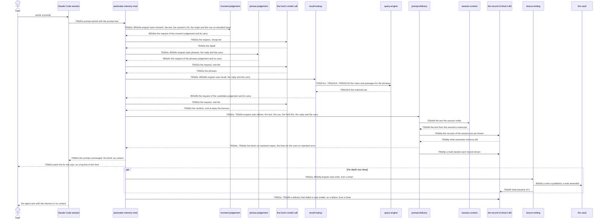

# Prompt Delivery Technical Workflow - Technical Spec

For each [prompt](../../GLOSSARY.md#prompt-automatic-memory) of a [session](../../GLOSSARY.md#session), the [automatic-memory-mod](./automatic-memory-mod.md) has the prompt judged as a [recall moment](../../GLOSSARY.md#recall-moment) or not, the lookup phrased, the candidates looked up and judged, and the notes and passages that apply put beside the prompt; at deep [depth](../../GLOSSARY.md#depth-recall-moment) it also has the lessons written after the block.



## 793d2a Prompt delivery flow

Requirement: 793d2a For each [prompt](../../GLOSSARY.md#prompt-automatic-memory) a Claude Code [session](../../GLOSSARY.md#session) raises, the `automatic-memory-mod` MUST take the session's ID, and then run these steps in order, each as `engram auto <step>` with one JSON object on standard input that holds the session's ID, the prompt's origin, the cue `prompt` and the `held` IDs of [855d2c Mid-turn recall flow](./mid-turn-recall-workflow.md#855d2c-mid-turn-recall-flow): `moment` with the prompt text; `phrases` and `recall` each with the reply to the request before it and its carry; and `deliver` with the prompt text, the last reply and its carry. When a step exits with 0 and prints a request (output beginning `{"request":`), it MUST ask the model for the request exactly as printed. When `moment`, `phrases` or `recall` exits with 0 and prints nothing, it MUST run `deliver` with the prompt text and the cue alone, which prints the lines for the user and no block. It MUST add the standard output of `deliver` to the prompt's context as one block when it exited with 0 and the output begins `[engram memory]`, and nothing otherwise, less each line whose ID the [session](../../GLOSSARY.md#session)'s set of delivered IDs holds ([855d2c Mid-turn recall flow](./mid-turn-recall-workflow.md#855d2c-mid-turn-recall-flow): the ID is what runs from the dash and space of a line, whole, to the parenthesis that opens its situation, or to `(passage)`), the set being given to `deliver` as `held`, read when the `deliver` of the prompt begins, and added to, with the IDs of the lines left, as the block arrives; the `deliver` of one session MUST NOT begin before the one before it is over, so that a [note](../../GLOSSARY.md#permanent-note) is marked as used once; MUST show the user each line `deliver` printed on standard error when it exited with 0, the line that names what was delivered naming only the notes and passages that were left in the block, as a log line of the host (`$.ui.log`), and add none of them to the context; and MUST leave the prompt text as received. It MUST hold the prompt for nothing but this work, and wait for each step and each model call as long as it takes, up to 2 minutes for each wait, the call for the session's ID 5 seconds: each step is given the time limit of 2 minutes, and a model call is aborted at 2 minutes through the `signal` of `$.model.complete`, its request holding no `timeoutMs`. When a [step fails](../../GLOSSARY.md#failed-step) or any one wait passes 2 minutes without an answer, it MUST end what waits, let the prompt continue with nothing added and [report the failure](../../GLOSSARY.md#report-of-a-failure). When the output of `recall` that printed the request holds `"write":true`, which it does at deep depth, it MUST also run `engram auto write` with the session's ID, the cue, the model's reply to the candidate request and the carry, from a timer after the block is given, so that the writing holds neither the prompt nor the [agent](../../GLOSSARY.md#agent-automatic-memory); a failure of that run is reported.

| Wait | Limit | Held |
| --- | --- | --- |
| the call for the session's ID | 5 seconds | the prompt |
| `moment`, `phrases`, `recall` and `deliver` | 2 minutes each | the prompt |
| the model call of the moment, the phrases and the candidate judgement | 2 minutes each | the prompt |
| the report of a failure to `write` | 15 seconds | nothing |
| `write` at deep depth | 60 seconds | nothing |

Owner: [automatic-memory-mod](./automatic-memory-mod.md).

Supports: [793a2a1a The next session has memory after one engram update](../product/automatic-memory.md#793a2a1-uat-scenarios), [793a2b1a The notes that apply to a prompt arrive with it](../product/automatic-memory.md#793a2b1-uat-scenarios), [793a2b1b A note delivered earlier in the session is not delivered again](../product/automatic-memory.md#793a2b1-uat-scenarios), [793a2b1d A prompt that matches no note arrives with nothing](../product/automatic-memory.md#793a2b1-uat-scenarios), [793a2d1a A slow judgement holds the prompt until it has the notes](../product/automatic-memory.md#793a2d1-uat-scenarios), [793a2d1d The prompt and the reply are as they were](../product/automatic-memory.md#793a2d1-uat-scenarios), [793a2d1e A write that fails does not break the session](../product/automatic-memory.md#793a2d1-uat-scenarios), [793a2e1a What was delivered and what was written for the previous turn is in the session by the next prompt](../product/automatic-memory.md#793a2e1-uat-scenarios), [793a2e1b A write that finishes after the next prompt is shown by the prompt after it finishes](../product/automatic-memory.md#793a2e1-uat-scenarios), [793a2e1c A delivery that could not be done is shown with its reason](../product/automatic-memory.md#793a2e1-uat-scenarios), [793a2e1d A write that failed is shown with its reason](../product/automatic-memory.md#793a2e1-uat-scenarios), [793a2e1e A sweep that failed is shown with its reason](../product/automatic-memory.md#793a2e1-uat-scenarios), [793a2e1f A turn that is not captured is shown with the reason](../product/automatic-memory.md#793a2e1-uat-scenarios), [855a2a1a A glance leaves the vault's notes as they were](../product/automatic-memory.md#855a2a1-uat-scenarios), [855a2a1b A deep delivery writes the lesson the vault lacks](../product/automatic-memory.md#855a2a1-uat-scenarios), [855a3b1a A prompt that is not a recall moment arrives with nothing](../product/automatic-memory.md#855a3b1-uat-scenarios), [855a3b1b A note whose words match but that does not apply is not delivered](../product/automatic-memory.md#855a3b1-uat-scenarios), [855a3b1c Of two notes that conflict, only the newer is delivered](../product/automatic-memory.md#855a3b1-uat-scenarios), [855a3b1d The notes that arrive are the notes the recall skill draws on](../product/automatic-memory.md#855a3b1-uat-scenarios), [855a3b1e A passage of an earlier conversation arrives when it applies](../product/automatic-memory.md#855a3b1-uat-scenarios), [855a3c1a A judgement that never answers is stepped aside after 2 minutes](../product/automatic-memory.md#855a3c1-uat-scenarios).

Rationale: The 2 minutes are the liveness bound of [793a2d Never in the way](../product/automatic-memory.md#793a2d-never-in-the-way) and not a latency target: a step that is only slow is waited for, and a chain of waits that are each only slow may take longer in all.

### 793d2a1 Scenarios

```gherkin
Scenario: 793d2a1a A block is added beside the prompt
  Given a session with the mod installed, and an engram whose auto deliver prints a block
  When a prompt is sent
  Then the command received the prompt text, and the session holds the prompt exactly as sent and then the block as context before the agent's first reply

Scenario: 793d2a1b The command receives the session's ID
  Given a session with the mod installed, and an engram whose auto deliver prints a block
  When a prompt is sent
  Then the command received the ID of the session the prompt was sent in

Scenario: 793d2a1c An empty output adds nothing
  Given a session with the mod installed, and an engram whose auto deliver prints nothing
  When a prompt is sent
  Then the session holds the prompt exactly as sent and no context beside it, and no failure was reported

Scenario: 793d2a1d A slow judgement is waited for
  Given a session with the mod installed, an engram whose auto moment, auto phrases, auto recall and auto deliver print what delivers a block, and a model that takes 20 seconds to answer each request
  When a prompt is sent
  Then the session holds the prompt exactly as sent and then the block as context, after the 60 seconds, and the mod's hook did not fail

Scenario: 793d2a1e A failed command adds nothing
  Given a session with the mod installed, and an engram whose auto deliver prints a block and exits with 1
  When a prompt is sent
  Then the session holds the prompt exactly as sent and no context beside it, and the mod's hook did not fail

Scenario: 793d2a1f Output that is not a block adds nothing
  Given a session with the mod installed, and an engram whose auto deliver prints text that does not begin with [engram memory] and exits with 0
  When a prompt is sent
  Then the session holds the prompt exactly as sent and no context beside it, the mod's hook did not fail, and no failure was reported

Scenario: 793d2a1g A session that does not give its ID in time does not hold the prompt
  Given the mod, and a session that never gives its ID
  When a prompt is sent
  Then the mod lets the prompt continue as it was after the 5 seconds of the row, with nothing added, and no step was run

Scenario: 793d2a1h The command receives the prompt's origin
  Given a session with the mod installed, and an engram whose auto deliver prints a block
  When a prompt is sent from a headless session, with claude -p
  Then the command received the origin sdk

Scenario: 793d2a1i A command that fails is reported to the writing
  Given the mod, a session whose ID is known, and an engram whose auto deliver exits with 1 and prints a cause on standard error
  When a prompt is submitted
  Then the prompt goes on as it was with nothing added, no call of the host is in flight when the hook settles, and, when the timers run, auto write received the session's ID, no turn and a failure that names the delivery and the cause, and the user was shown no line

Scenario: 793d2a1j A flow the host never lets finish is stepped aside after 2 minutes
  Given the mod, a session whose ID is known, an engram whose auto moment prints a request, and, in turn, a host in which the model's call never settles unless its signal aborts it and one in which it rejects when its signal aborts it
  When a prompt is submitted
  Then the signal aborted the call 2 minutes after it began, the prompt goes on as it was with nothing added, and, when the timers run, auto write received the session's ID, no turn and a failure that names the delivery and the 2 minutes, and the user was shown no line

Scenario: 793d2a1k The lines the command prints for the user are shown through the host's log and are not added to the context
  Given the mod, a session whose ID is known, and an engram whose auto deliver prints a block and two lines on standard error and exits with 0
  When a prompt is submitted
  Then the host was asked to log the two lines, one call each, in order, and the prompt goes on with the block as context, which holds neither line
```

### 855d2a1 Scenarios

```gherkin
Scenario: 855d2a1a The steps run in order, each given the reply and the carry before it
  Given the mod, a session whose ID is known, and an engram whose auto moment, auto phrases and auto recall print a request and a carry each and whose auto deliver prints a block, and a model that answers each request
  When a prompt is sent
  Then auto moment received the prompt text, the session's ID, the origin, the cue prompt and no held ID, the model was asked each request exactly as printed, with no time limit in the request, auto phrases received the first reply and the first carry, auto recall the second, auto deliver received the prompt text, the cue, the third reply and the third carry, each step was given a time limit of 2 minutes and the call for the ID 5 seconds, and the session holds the block as context

Scenario: 855d2a1b A step that prints nothing leaves the lines to the delivery
  Given the mod, an engram whose auto deliver prints a line on standard error and no block, and, in turn, one whose auto moment prints nothing, one whose auto phrases prints nothing after a moment request, and one whose auto recall prints nothing after the two requests, and a model that answers
  When a prompt is sent
  Then the model was asked once for each request printed and never for the steps after the one that printed nothing, auto deliver received the prompt text and the cue and no reply, the line was shown to the user, and the session holds no context beside the prompt

Scenario: 855d2a1d Output that is not a request or a block fails the step
  Given the mod, a session whose ID is known, and, in turn, an engram whose auto moment prints text that does not begin with a request, and one whose auto deliver prints text that does not begin with [engram memory] and exits with 0
  When a prompt is submitted
  Then with the first the model was never asked, the prompt goes on with nothing added and, when the timers run, auto write received a failure that names auto moment; with the second the prompt goes on with nothing added and no failure was reported

Scenario: 855d2a1e A model that does not answer and a write that fails are reported
  Given the mod, a session whose ID is known, an engram whose auto moment, auto phrases and auto recall print requests, and, in turn, a model that gives no text, rejects the call, or is aborted at 2 minutes, on its first, second and third call; and an engram whose auto recall prints a request with "write":true, whose auto deliver prints a block and whose auto write exits with 1 the first time
  When a prompt is submitted and the timers run
  Then with the model each time the prompt goes on with nothing added, auto deliver was never run, and auto write received a failure that names the model call; with the write the session holds the block as context and auto write was run a second time with a failure that names the write

Scenario: 855d2a1f A deep delivery writes after the block, from a timer
  Given the mod, a session whose ID is known, an engram whose auto recall prints a request with "write":true and whose auto deliver prints a block, and a model that answers
  When a prompt is submitted
  Then the session holds the block as context, no call of the host is in flight when the hook settles, and, when the timers run, auto write received the session's ID, the cue, the reply to the candidate request and the carry

Scenario: 855d2a1g A glance writes nothing
  Given the mod, an engram whose auto recall prints a request without "write":true and whose auto deliver prints a block, and a model that answers
  When a prompt is submitted and the timers run
  Then auto write was never run

Scenario: 855d2a1h A note or passage delivered earlier is left out of a later block
  Given the mod, a session whose ID is known, and an engram whose auto deliver prints, for two prompts in turn, blocks that share a note and a passage whose chunk ID holds a space, the second also holding a passage whose chunk ID begins as that one does
  When the two prompts are sent one after the other
  Then the session holds the first block whole, and as the second block's context its framing line and the other passage's line alone, and the second auto deliver received the IDs of the first block, whole

Scenario: 855d2a1i The line for the user names the notes that are left
  Given the mod, and an engram whose auto deliver prints, for three prompts in turn, blocks that share a note, with the line that names what it delivered, and, last, another line for the user
  When the three prompts are sent one after the other
  Then the user was shown the first line whole, the second with only the notes and passages that were left, and for the third the other line alone

Scenario: 855d2a1j Deliveries of one session run one after another, each given what the one before held
  Given the mod, and an engram whose auto deliver takes a while and prints the same block each time
  When two prompts are raised at once
  Then the second auto deliver began after the first was over and received the first block's IDs, the session holds the block once, and the user was shown the line once

Scenario: 855d2a1k Writes of one session run one after another
  Given the mod, and an engram whose auto write takes a while, and a recall that prints a request with the mark of a write
  When two prompts are raised
  Then the second auto write began after the first was over
```
