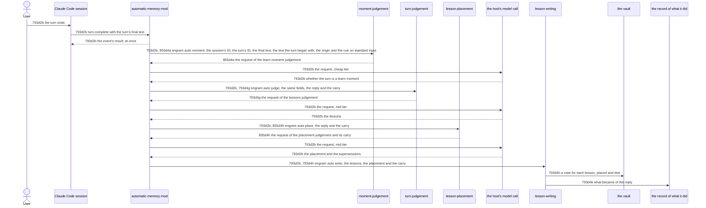

# Turn Capture Technical Workflow - Technical Spec

After each [turn](../../GLOSSARY.md#turn-automatic-memory), the [Automatic Memory Mod](./automatic-memory-mod.md) has the turn judged as a learn moment or not, its lessons judged and placed, and the lessons written as [notes](../../GLOSSARY.md#permanent-note).



## 793d2b Turn capture flow

Requirement: 793d2b For each [turn](../../GLOSSARY.md#turn-automatic-memory) a [session](../../GLOSSARY.md#session) completes, the [Automatic Memory Mod](./automatic-memory-mod.md) MUST give the event's result back at once, with no call of the host in flight, and then, from a timer (`$.clock.after`), take the session's ID and run these steps in order, each as `engram auto <step>` with one JSON object on standard input. It MUST run `moment` with the session's ID, the turn's ID, the turn's final text, the text the turn began with, the origin of the [prompt](../../GLOSSARY.md#prompt-automatic-memory) it began with and the cue `turn-end`; when that exits with 0 and prints a request, ask the model for it exactly as printed, and run `judge` with the same fields, the reply and the carry; when that exits with 0 and prints a request, ask the model for it, and run `place` with the session's ID, the turn's ID, the reply and the carry; and then run `write` with the session's ID, the turn's ID, the model's reply to the lessons request and, when `place` printed a request and the model answered it, the carry of `place` and the reply to that. When `moment` or `judge` exits with 0 and prints nothing, nothing more is run; when `place` prints nothing, `write` is run without a carry and without a placement. When `place` fails (it exits with other than 0 or cannot be run, or prints what is neither nothing nor a request, or a request that is not a JSON object), the model does not answer its request, or its wait overruns its row, the capture does not fail: it MUST run `write` as it does when `place` prints nothing, with a `placementFailure` as well, a sentence that names the step and how it failed, so that the lessons are written at the top and the placement is recorded as skipped with that reason. It MUST do nothing for a turn that a [subagent](../../GLOSSARY.md#subagent) ran, which the event's `agentId` says. When `moment` or `judge` fails (it exits with other than 0 or cannot be run, or prints what is neither nothing nor a request, or a request that is not a JSON object), the model does not answer its request, or a wait overruns its row, it MUST run `engram auto write` with the session's ID, the turn's ID and a `failure`, a sentence that names the step and how it failed (for a model call, the step whose request it was), in place of the replies, whole, for the writing cuts it ([793d4k Recording what automatic memory did](./lesson-writing.md#793d4k-recording-what-automatic-memory-did)). It MUST bound each wait by its row so that together they take under the 2 minutes of [793a2c Lessons are written without the agent](../product/automatic-memory.md#793a2c-lessons-are-written-without-the-agent). The [mod](../../GLOSSARY.md#mod) keeps the text and origin of each prompt: a turn that starts with a text takes the oldest kept prompt with that text and drops those kept before it; a turn whose text no kept prompt has takes the origin of the newest; a turn that starts with no text has no origin.

| Wait | Row (seconds) |
| --- | --- |
| the call for the session's ID | 5 |
| `moment` | 5 |
| the model call of the learn-moment judgement | 10 |
| `judge` | 10 |
| the model call of the lessons judgement | 30 |
| `place` | 5 |
| the model call of the placement judgement | 15 |
| `write` | 20 |
| the report of a failure to `write` | 15 |
| all | 115, under the 2 minutes |

A capture that writes nothing ends at the first step that prints nothing and succeeds, `moment` or `judge`, and that step logs one line ([855d4a Judging the moment](./moment-judgement.md#855d4a-judging-the-moment), [793d4g Judging a turn](./turn-judgement.md#793d4g-judging-a-turn)); a turn that is no learn moment leaves no other trace, since no record is made for it.

Owner: [Automatic Memory Mod](./automatic-memory-mod.md).

Supports: [793a2c1a A correction becomes a note](../product/automatic-memory.md#793a2c1-uat-scenarios), [793a2c1b A request to remember becomes a note](../product/automatic-memory.md#793a2c1-uat-scenarios), [793a2c1c An approach the user confirmed becomes a note](../product/automatic-memory.md#793a2c1-uat-scenarios), [793a2c1d The agent's own correction becomes a note](../product/automatic-memory.md#793a2c1-uat-scenarios), [793a2c1e An approach that succeeded with evidence becomes a note](../product/automatic-memory.md#793a2c1-uat-scenarios), [793a2c1f Guesses, plans and chatter produce no note](../product/automatic-memory.md#793a2c1-uat-scenarios), [793a2c1g A credential in the turn is not in the note](../product/automatic-memory.md#793a2c1-uat-scenarios), [793a2c1h A thanks that names no approach produces no note](../product/automatic-memory.md#793a2c1-uat-scenarios), [793a2c1i A request to remember is written when the agent says it did not save it](../product/automatic-memory.md#793a2c1-uat-scenarios), [793a3c1a A lesson an earlier note states is not written again](../product/automatic-memory.md#793a3c1-uat-scenarios), [793a3c1b A lesson the agent saved itself is not written again](../product/automatic-memory.md#793a3c1-uat-scenarios), [793a3c1c A lesson no earlier note states is written](../product/automatic-memory.md#793a3c1-uat-scenarios), [793a2d1c The work after a turn does not hold the next prompt](../product/automatic-memory.md#793a2d1-uat-scenarios), [793a2d1d The prompt and the reply are as they were](../product/automatic-memory.md#793a2d1-uat-scenarios), [793a2d1e A write that fails does not break the session](../product/automatic-memory.md#793a2d1-uat-scenarios), [855a2b1a A note states the rule and not the story](../product/automatic-memory.md#855a2b1-uat-scenarios), [855a2b1b The note states the lesson the learn skill writes](../product/automatic-memory.md#855a2b1-uat-scenarios), [855a2b1c A confirmed procedure is written as a runbook](../product/automatic-memory.md#855a2b1-uat-scenarios), [855a2c1a A sub-point of a note the session holds continues it](../product/automatic-memory.md#855a2c1-uat-scenarios), [855a2c1b The same thought at the same level is a sibling](../product/automatic-memory.md#855a2c1-uat-scenarios), [855a2c1c A note the session has not seen is not a target](../product/automatic-memory.md#855a2c1-uat-scenarios), [855a2d1a A correcting note names the note it corrects](../product/automatic-memory.md#855a2d1-uat-scenarios).

Rationale: a row is a bound and not a prediction; the sum may not fit what the calls take, in which case a capture fails and is recorded.

### 793d2b1 Scenarios

```gherkin
Scenario: 793d2b1a The mod judges a turn, places the lessons and gives the replies to the writing
  Given the mod, a session whose ID is known, an engram whose auto moment, auto judge and auto place print a request each, and a model that answers each
  When a prompt is raised, the turn starts, and it completes with a final text
  Then the event's result is given back at once, auto moment received the session's ID, the turn's ID, the final text, the origin of the prompt and the cue turn-end, the model was asked each request exactly as printed, and auto write received the session's ID, the turn's ID, the reply to the lessons request, the carry of auto place and the reply to the placement request

Scenario: 793d2b1b A moment or a judgement that prints nothing ends the capture
  Given the mod, and, in turn, an engram whose auto moment exits with 0 and prints nothing, and one whose auto moment prints a request and whose auto judge exits with 0 and prints nothing
  When a turn completes
  Then with the first the model was never asked, with the second it was asked once, and auto write was never run

Scenario: 793d2b1c A step that fails is reported to the writing
  Given the mod, and an engram whose auto moment exits with 1, prints text that is not a request, or is ended before it answers, and, in turn, one whose auto judge does
  When a turn completes
  Then the model was not asked for the request of the failed step, and auto write received the session's ID, the turn's ID and a failure that names the step

Scenario: 793d2b1d A model that does not answer is reported to the writing
  Given the mod, an engram whose auto moment, auto judge and auto place print a request each, and a model that answers with an API error, with no text, or by rejecting the call, on its first and second call in turn
  When a turn completes
  Then auto write received the session's ID, the turn's ID and a failure that names the step whose request the model was asked for and the model call

Scenario: 793d2b1e The first step receives the origin of the prompt the turn began with
  Given the mod, and an engram whose auto moment prints a request
  When a prompt of the origin task-notification is raised, a turn starts, and it completes
  Then auto moment received the origin task-notification, beside the session's ID, the turn's ID and the final text

Scenario: 793d2b1f A turn of a subagent is not captured
  Given the mod, and an engram whose auto judge prints a request
  When a turn that a subagent ran completes
  Then auto judge was never run, and the model was never asked

Scenario: 793d2b1g The first step receives the text the turn began with
  Given the mod, and an engram whose auto moment prints a request
  When a prompt is raised, the turn starts with its text, and it completes
  Then auto moment received the text, beside the session's ID, the turn's ID, the final text and the origin

Scenario: 793d2b1h A turn takes the origin and the text of its own prompt when others are waiting
  Given the mod, and an engram whose auto moment prints a request
  When a prompt of the user starts a turn, a second prompt of the user is raised while it runs, a task notification is raised after the second, the first turn completes, and the second prompt starts a turn that completes
  Then auto moment received for the second turn the origin and the text of the second prompt, and not those of the notification

Scenario: 793d2b1i A turn that starts with no text has no origin
  Given the mod, and an engram whose auto moment prints a request
  When a prompt of the user starts a turn that completes, and a turn then starts with no text and completes
  Then auto moment received no origin for the second turn

Scenario: 793d2b1j A stage that stalls is ended at its row and reported
  Given the mod, and a host in which, in turn, the call for the session's ID never answers, each step runs until its time limit, each model call is cut at its time limit, and the report of a failure runs until its time limit
  When a turn completes
  Then the mod waited for the ID 5 seconds and then did nothing, auto moment was given 5 seconds, auto judge 10, auto place 5, auto write 20, the three model calls 10, 30 and 15, and the report of the failure 15, and those limits together are less than 120 seconds

Scenario: 793d2b1k A request that is not JSON is a failure of the step that printed it
  Given the mod, and an engram whose auto moment or auto judge prints text that begins as a request and is not a JSON object
  When a turn completes
  Then the model was not asked for it, and auto write received a failure that names the step

Scenario: 793d2b1l The work after a turn is started from a timer, with no call in flight when the event settles
  Given the mod, a host that counts the calls it has in flight when the hook of an event settles and runs the mod's timers only when the driver lets them, and an engram whose auto moment and auto sweep do not answer
  When a turn completes
  Then no call of the host was made or in flight when the event's hook settled, and auto moment and auto sweep were run when the timers were let go

Scenario: 793d2b1m A long failure is reported whole
  Given the mod, and an engram whose auto moment exits with 1 and prints on standard error a line of 1000 characters that begins by naming the step and ends with a cause
  When a turn completes
  Then auto write received a failure that holds the whole line, from the name of the judgement and the status to the cause
```

### 855d2b1 Scenarios

```gherkin
Scenario: 855d2b1a A placement that prints nothing leaves the lessons to be written at the top
  Given the mod, an engram whose auto moment and auto judge print a request and whose auto place prints nothing, and a model that answers
  When a turn completes
  Then the model was asked twice, and auto write received the reply to the lessons request and neither a carry nor a placement reply

Scenario: 855d2b1b A placement that fails leaves the lessons to be written at the top and recorded
  Given the mod, an engram whose auto moment and auto judge print a request, a model that answers, and, in turn, an auto place that exits with 1, prints text that is not a request or is ended, and a model that answers the placement request with an API error or by rejecting the call
  When a turn completes
  Then auto write was run once, with the session's ID, the turn's ID, the reply to the lessons request and a placementFailure that names the placement, and with no failure, no carry and no placement reply
```
